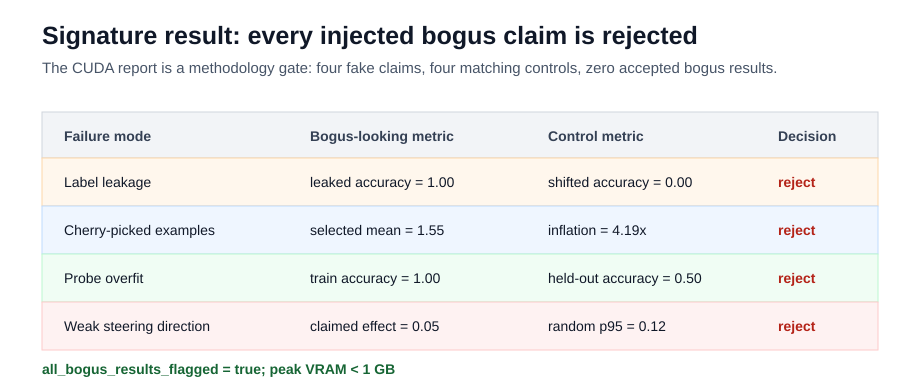

# [0.6] How to Know When an Interpretability Result Is Fake (Practice)


> **Colab:
> [exercises](https://colab.research.google.com/github/shinobiultra/ARENA_3.0_Extended/blob/main/chapter0_fundamentals/exercises/part6_fake_interpretability_results_practice/0.6_How_to_Know_When_an_Interpretability_Result_Is_Fake_Practice_exercises.ipynb)
> |
> [solutions](https://colab.research.google.com/github/shinobiultra/ARENA_3.0_Extended/blob/main/chapter0_fundamentals/exercises/part6_fake_interpretability_results_practice/0.6_How_to_Know_When_an_Interpretability_Result_Is_Fake_Practice_solutions.ipynb)**

If you want to change to dark mode, you can do this by clicking the three horizontal lines in the top-right, then navigating to Settings → Theme.

# Introduction


A feature with perfect probe accuracy, three dramatic examples and a steering effect can all be misleading. You will implement the original four detectors and compare each attractive metric with its matching control. These are deterministic designed tensor fixtures, not trained probes or language-model behavior.

Importing the Python module binds definitions only. Call `initialize_runtime()` explicitly before using numerical or runtime callbacks; the callbacks are not initialized merely by importing them. The notebook setup invokes this initializer when a learner elects to run it.


## Content & Learning Objectives

### 1️⃣ Implement and test

> ##### Learning Objectives
>
> - Implement each core operation beside the original immediate positive and negative tests.

### 2️⃣ Inspect and change controls

> ##### Learning Objectives
>
> - Interpret the original visible signature, qualify the claim, and predict a changed condition.

### ☆ Bonus

Inspect the runtime entry points for the CUDA and full-experiment runs.


```python
from __future__ import annotations

from dataclasses import dataclass, field
from pathlib import Path
from typing import Any, Iterator, Literal

MAIN = __name__ == "__main__"
```


=== NEW CHAPTER ===


# 1️⃣ Implement and test


> ##### Learning Objectives
>
> - Implement each core operation beside the original immediate positive and negative tests.

```python
def initialize_runtime(root: str | Path | None = None) -> None:
    """Explicitly initialize runtime dependencies; never runs on raw import."""
    global t, tests, json, sys, tempfile, subprocess, math, platform, importlib
    global root_dir, chapter, section, exercises_dir, section_dir
    import importlib.util
    import json
    import math
    import platform
    import subprocess
    import sys
    import tempfile
    import torch as t
    chapter = "chapter0_fundamentals"
    section = "part6_fake_interpretability_results"
    if root is None:
        if "__file__" in globals():
            root = Path(__file__).resolve().parents[3]
        else:
            root = next(p for p in [Path.cwd(), *Path.cwd().parents] if (p / chapter).exists())
    root_dir = Path(root)
    exercises_dir = root_dir / chapter / "exercises"
    section_dir = exercises_dir / section
    if str(root_dir) not in sys.path:
        sys.path.append(str(root_dir))
    tests = importlib.import_module(chapter + ".exercises." + section + ".tests")


initialize_runtime()
```


```python
@dataclass(frozen=True)
class LabelLeakageReport:
    leaked_feature_index: int
    leaked_feature_accuracy: float
    shifted_no_leak_accuracy: float
    accuracy_gap: float
    detects_leakage: bool
```


```python
@dataclass(frozen=True)
class CherryPickReport:
    selected_mean_effect: float
    population_mean_effect: float
    population_median_effect: float
    inflation_ratio: float
    detects_cherry_picking: bool
```


```python
@dataclass(frozen=True)
class ProbeOverfitReport:
    train_accuracy: float
    heldout_accuracy: float
    generalization_gap: float
    detects_overfit: bool
```


```python
@dataclass(frozen=True)
class FakeRandomDirectionControlReport:
    claimed_effect: float
    random_p95_effect: float
    effect_gap: float
    passes_random_control: bool
    detects_random_direction_failure: bool
```


```python
@dataclass(frozen=True)
class FakeResultAuditReport:
    leakage_detected: bool
    cherry_pick_detected: bool
    probe_overfit_detected: bool
    random_direction_failure_detected: bool
    all_bogus_results_flagged: bool
```


Predict what happens when the leaked and shifted feature columns are identical. Does perfect accuracy alone trigger this detector?


### Exercise - Label leakage

> ```yaml
> Difficulty: 🔴🔴⚪⚪⚪
> Importance: 🔵🔵🔵🔵⚪
>
> You should spend up to 10-20 minutes on this exercise.
> ```

Threshold signed scores at zero. Compute both supplied feature-column accuracies before comparing their gap. The default control is anti-correlated, not a shuffled-label independence test.

<details>
<summary>Help - implementation and interpretation</summary>

Threshold signed scores at zero. Compute both supplied feature-column accuracies before comparing their gap. The default control is anti-correlated, not a shuffled-label independence test.

</details>


```python
def default_label_leakage_fixture(
    device: t.device | str | None = None,
) -> tuple[t.Tensor, t.Tensor]:
    """Return features where column 0 is leaked labels and column 1 is a control."""

    labels = t.tensor([0, 1, 0, 1, 0, 1], dtype=t.long, device=device)
    signed = labels.float() * 2 - 1
    features = t.stack([signed, -signed], dim=1)
    return features, labels
```


```python
def binary_accuracy(scores: t.Tensor, labels: t.Tensor) -> float:
    # YOUR CODE HERE
    raise NotImplementedError()
```


<details><summary>Solution</summary>

```python
def binary_accuracy(scores: t.Tensor, labels: t.Tensor) -> float:
    """Return threshold-at-zero binary accuracy for signed labels."""

    labels = labels.long().flatten()
    predictions = scores.flatten().gt(0).long()
    return float(predictions.eq(labels).double().mean().item())
```

</details>


```python
def label_leakage_report(
    features: t.Tensor | None = None,
    labels: t.Tensor | None = None,
    *,
    leaked_feature_index: int = 0,
    shifted_feature_index: int = 1,
    min_gap: float = 0.5,
) -> LabelLeakageReport:
    # YOUR CODE HERE
    raise NotImplementedError()
```


<details><summary>Solution</summary>

```python
def label_leakage_report(
    features: t.Tensor | None = None,
    labels: t.Tensor | None = None,
    *,
    leaked_feature_index: int = 0,
    shifted_feature_index: int = 1,
    min_gap: float = 0.5,
) -> LabelLeakageReport:
    """Detect a feature that directly encodes the label."""

    if features is None or labels is None:
        features, labels = default_label_leakage_fixture()
    if features.ndim == 1:
        features = features[:, None]
    if features.shape[0] != labels.numel():
        raise ValueError("features and labels must have the same number of examples")

    leaked_feature = features[:, leaked_feature_index]
    shifted_spurious_feature = features[:, shifted_feature_index]
    leaked_accuracy = binary_accuracy(leaked_feature, labels)
    shifted_accuracy = binary_accuracy(shifted_spurious_feature, labels)
    gap = leaked_accuracy - shifted_accuracy
    return LabelLeakageReport(
        leaked_feature_index=leaked_feature_index,
        leaked_feature_accuracy=leaked_accuracy,
        shifted_no_leak_accuracy=shifted_accuracy,
        accuracy_gap=gap,
        detects_leakage=leaked_accuracy >= 0.95 and gap >= min_gap,
    )
```

</details>


```python
tests.test_binary_accuracy_thresholds_signed_scores(binary_accuracy)
tests.test_label_leakage_report_flags_direct_label_feature(label_leakage_report)
tests.test_label_leakage_report_uses_supplied_feature_indices(label_leakage_report)
```


<details>
<summary>Expected output and solution reveal</summary>

Each named original test should print its `All tests ... passed!` line. The matching positive and negative tests are both required; read the generated solution dropdown for the complete implementation.

</details>


Predict whether a representative selection triggers the same detector as selecting the three largest effects.


### Exercise - Cherry-picked examples

> ```yaml
> Difficulty: 🔴🔴⚪⚪⚪
> Importance: 🔵🔵🔵🔵⚪
>
> You should spend up to 10-20 minutes on this exercise.
> ```

Compare selected mean with full-population mean and median. This is a descriptive inflation detector; it does not implement a permutation null or multiple-comparison correction.

<details>
<summary>Help - implementation and interpretation</summary>

Compare selected mean with full-population mean and median. This is a descriptive inflation detector; it does not implement a permutation null or multiple-comparison correction.

</details>


```python
def default_cherry_pick_fixture(device: t.device | str | None = None) -> t.Tensor:
    """Return mostly small effects with three dramatic selected examples at the end."""

    return t.tensor(
        [
            0.02,
            0.03,
            0.04,
            0.05,
            0.06,
            0.07,
            0.08,
            0.09,
            0.10,
            0.11,
            0.12,
            0.13,
            1.40,
            1.55,
            1.70,
        ],
        device=device,
    )
```


```python
def cherry_pick_report(
    effects: t.Tensor | None = None,
    selected_indices: t.Tensor | list[int] | None = None,
    *,
    min_inflation: float = 3.0,
    median_multiplier: float = 5.0,
) -> CherryPickReport:
    # YOUR CODE HERE
    raise NotImplementedError()
```


<details><summary>Solution</summary>

```python
def cherry_pick_report(
    effects: t.Tensor | None = None,
    selected_indices: t.Tensor | list[int] | None = None,
    *,
    min_inflation: float = 3.0,
    median_multiplier: float = 5.0,
) -> CherryPickReport:
    """Detect when selected examples exaggerate the population effect."""

    effects = default_cherry_pick_fixture() if effects is None else effects.flatten()
    if selected_indices is None:
        selected = effects[-3:]
    else:
        indices = t.as_tensor(selected_indices, dtype=t.long, device=effects.device)
        selected = effects[indices]
    selected_mean = float(selected.mean().item())
    population_mean = float(effects.mean().item())
    population_median = float(effects.median().item())
    inflation = selected_mean / population_mean
    return CherryPickReport(
        selected_mean_effect=selected_mean,
        population_mean_effect=population_mean,
        population_median_effect=population_median,
        inflation_ratio=inflation,
        detects_cherry_picking=(
            inflation >= min_inflation
            and selected_mean >= median_multiplier * population_median
        ),
    )
```

</details>


```python
tests.test_cherry_pick_report_compares_selected_to_population(cherry_pick_report)
tests.test_cherry_pick_report_rejects_representative_selection(cherry_pick_report)
```


<details>
<summary>Expected output and solution reveal</summary>

Each named original test should print its `All tests ... passed!` line. The matching positive and negative tests are both required; read the generated solution dropdown for the complete implementation.

</details>


Predict the held-out accuracy of the default all-zero guesses, then predict the decision for the original generalizing positive control.


### Exercise - Probe overfitting

> ```yaml
> Difficulty: 🔴🔴⚪⚪⚪
> Importance: 🔵🔵🔵🔵⚪
>
> You should spend up to 10-20 minutes on this exercise.
> ```

A copied training-label vector is a memorization oracle, not a trained probe. Require high training accuracy, weak held-out accuracy and a large gap together.

<details>
<summary>Help - implementation and interpretation</summary>

A copied training-label vector is a memorization oracle, not a trained probe. Require high training accuracy, weak held-out accuracy and a large gap together.

</details>


```python
def default_probe_overfit_fixture(
    device: t.device | str | None = None,
) -> tuple[t.Tensor, t.Tensor, t.Tensor, t.Tensor]:
    """Return train labels copied by a memorizing probe and held-out all-zero guesses."""

    train_labels = t.tensor([0, 1, 0, 1, 0, 1], dtype=t.long, device=device)
    heldout_labels = t.tensor([0, 1, 0, 1, 0, 1], dtype=t.long, device=device)
    train_predictions = train_labels.clone()
    heldout_predictions = t.zeros_like(heldout_labels)
    return train_predictions, train_labels, heldout_predictions, heldout_labels
```


```python
def _class_accuracy(predictions: t.Tensor, labels: t.Tensor) -> float:
    predictions = predictions.long().flatten()
    labels = labels.long().flatten()
    if predictions.numel() != labels.numel():
        raise ValueError("predictions and labels must have the same number of examples")
    return float(predictions.eq(labels).double().mean().item())
```


```python
def probe_overfit_report(
    train_predictions: t.Tensor | None = None,
    train_labels: t.Tensor | None = None,
    heldout_predictions: t.Tensor | None = None,
    heldout_labels: t.Tensor | None = None,
    *,
    min_train_accuracy: float = 0.95,
    max_heldout_accuracy: float = 0.6,
    min_gap: float = 0.35,
) -> ProbeOverfitReport:
    # YOUR CODE HERE
    raise NotImplementedError()
```


<details><summary>Solution</summary>

```python
def probe_overfit_report(
    train_predictions: t.Tensor | None = None,
    train_labels: t.Tensor | None = None,
    heldout_predictions: t.Tensor | None = None,
    heldout_labels: t.Tensor | None = None,
    *,
    min_train_accuracy: float = 0.95,
    max_heldout_accuracy: float = 0.6,
    min_gap: float = 0.35,
) -> ProbeOverfitReport:
    """Detect a memorizing probe that does not generalize."""

    if (
        train_predictions is None
        or train_labels is None
        or heldout_predictions is None
        or heldout_labels is None
    ):
        (
            train_predictions,
            train_labels,
            heldout_predictions,
            heldout_labels,
        ) = default_probe_overfit_fixture()
    train_accuracy = _class_accuracy(train_predictions, train_labels)
    heldout_accuracy = _class_accuracy(heldout_predictions, heldout_labels)
    gap = train_accuracy - heldout_accuracy
    return ProbeOverfitReport(
        train_accuracy=train_accuracy,
        heldout_accuracy=heldout_accuracy,
        generalization_gap=gap,
        detects_overfit=(
            train_accuracy >= min_train_accuracy
            and heldout_accuracy <= max_heldout_accuracy
            and gap >= min_gap
        ),
    )
```

</details>


```python
tests.test_probe_overfit_report_requires_heldout_gap(probe_overfit_report)
tests.test_probe_overfit_report_rejects_generalizing_probe(probe_overfit_report)
```


<details>
<summary>Expected output and solution reveal</summary>

Each named original test should print its `All tests ... passed!` line. The matching positive and negative tests are both required; read the generated solution dropdown for the complete implementation.

</details>


Predict which direction clears the p95 control plus the fixed margin: the weak default direction or the behavior-aligned positive control.


### Exercise - Random-direction controls

> ```yaml
> Difficulty: 🔴🔴⚪⚪⚪
> Importance: 🔵🔵🔵🔵⚪
>
> You should spend up to 10-20 minutes on this exercise.
> ```

Normalize directions before comparing absolute projections. The five-vector fixed control bank is designed, not a calibrated random-direction distribution or a language-model steering experiment.

<details>
<summary>Help - implementation and interpretation</summary>

Normalize directions before comparing absolute projections. The five-vector fixed control bank is designed, not a calibrated random-direction distribution or a language-model steering experiment.

</details>


```python
def default_random_direction_fixture(
    device: t.device | str | None = None,
) -> tuple[t.Tensor, t.Tensor, t.Tensor]:
    """Return a weak claimed direction and a random-control bank."""

    behavior_direction = t.tensor([1.0, 0.0, 0.0], dtype=t.float64, device=device)
    claimed_direction = t.tensor([0.05, 0.9987, 0.0], dtype=t.float64, device=device)
    random_directions = t.tensor(
        [
            [0.12, 0.99, 0.00],
            [-0.08, 0.99, 0.05],
            [0.04, 0.20, 0.98],
            [0.10, -0.95, 0.10],
            [-0.11, 0.00, 0.99],
        ],
        dtype=t.float64,
        device=device,
    )
    return behavior_direction, claimed_direction, random_directions
```


```python
def random_direction_control_report(
    behavior_direction: t.Tensor | None = None,
    claimed_direction: t.Tensor | None = None,
    random_directions: t.Tensor | None = None,
    *,
    required_margin: float = 0.25,
) -> FakeRandomDirectionControlReport:
    # YOUR CODE HERE
    raise NotImplementedError()
```


<details><summary>Solution</summary>

```python
def random_direction_control_report(
    behavior_direction: t.Tensor | None = None,
    claimed_direction: t.Tensor | None = None,
    random_directions: t.Tensor | None = None,
    *,
    required_margin: float = 0.25,
) -> FakeRandomDirectionControlReport:
    """Detect a claimed steering direction that is no stronger than random controls."""

    if behavior_direction is None or claimed_direction is None or random_directions is None:
        behavior_direction, claimed_direction, random_directions = (
            default_random_direction_fixture()
        )
    behavior_direction = behavior_direction.flatten()
    claimed_direction = claimed_direction / claimed_direction.norm()
    behavior_direction = behavior_direction / behavior_direction.norm()
    random_directions = random_directions / random_directions.norm(dim=1, keepdim=True)
    claimed_effect = float(abs(claimed_direction @ behavior_direction).item())
    random_effects = (random_directions @ behavior_direction).abs()
    random_p95 = float(t.quantile(random_effects, 0.95).item())
    gap = claimed_effect - random_p95
    passes = gap >= required_margin
    return FakeRandomDirectionControlReport(
        claimed_effect=claimed_effect,
        random_p95_effect=random_p95,
        effect_gap=gap,
        passes_random_control=passes,
        detects_random_direction_failure=not passes,
    )
```

</details>


```python
tests.test_random_direction_control_report_rejects_weak_claim(random_direction_control_report)
tests.test_random_direction_control_report_accepts_strong_claim(random_direction_control_report)
```


<details>
<summary>Expected output and solution reveal</summary>

Each named original test should print its `All tests ... passed!` line. The matching positive and negative tests are both required; read the generated solution dropdown for the complete implementation.

</details>


Predict whether an audit can pass when one injected failure is not detected; distinguish a passing diagnostic from acceptance of the original attractive claim.


### Exercise - Aggregate the audit

> ```yaml
> Difficulty: 🔴🔴⚪⚪⚪
> Importance: 🔵🔵🔵🔵⚪
>
> You should spend up to 10-20 minutes on this exercise.
> ```

Keep every detector boolean. The aggregate passes when every injected bogus claim is rejected, and says nothing about untested failure modes.

<details>
<summary>Help - implementation and interpretation</summary>

Keep every detector boolean. The aggregate passes when every injected bogus claim is rejected, and says nothing about untested failure modes.

</details>


```python
def fake_result_audit_report(
    leakage: LabelLeakageReport | None = None,
    cherry_pick: CherryPickReport | None = None,
    overfit: ProbeOverfitReport | None = None,
    random_direction: FakeRandomDirectionControlReport | None = None,
) -> FakeResultAuditReport:
    # YOUR CODE HERE
    raise NotImplementedError()
```


<details><summary>Solution</summary>

```python
def fake_result_audit_report(
    leakage: LabelLeakageReport | None = None,
    cherry_pick: CherryPickReport | None = None,
    overfit: ProbeOverfitReport | None = None,
    random_direction: FakeRandomDirectionControlReport | None = None,
) -> FakeResultAuditReport:
    """Run a compact audit suite for fake-result failure modes."""

    leakage = leakage or label_leakage_report()
    cherry_pick = cherry_pick or cherry_pick_report()
    overfit = overfit or probe_overfit_report()
    random_direction = random_direction or random_direction_control_report()
    flags = [
        leakage.detects_leakage,
        cherry_pick.detects_cherry_picking,
        overfit.detects_overfit,
        random_direction.detects_random_direction_failure,
    ]
    return FakeResultAuditReport(
        leakage_detected=flags[0],
        cherry_pick_detected=flags[1],
        probe_overfit_detected=flags[2],
        random_direction_failure_detected=flags[3],
        all_bogus_results_flagged=all(flags),
    )
```

</details>


```python
def leakage_diagnostic() -> dict:
    return label_leakage_report().__dict__
```


```python
def cherry_pick_diagnostic() -> dict:
    return cherry_pick_report().__dict__
```


```python
def probe_overfit_diagnostic() -> dict:
    return probe_overfit_report().__dict__
```


```python
def random_direction_diagnostic() -> dict:
    return random_direction_control_report().__dict__
```


```python
def audit_diagnostic() -> dict:
    return fake_result_audit_report().__dict__
```


```python
def run_smoke_test(cpu: bool = True) -> dict:
    _ = cpu
    audit = audit_diagnostic()
    return {
        "leakage": leakage_diagnostic(),
        "cherry_pick": cherry_pick_diagnostic(),
        "probe_overfit": probe_overfit_diagnostic(),
        "random_direction": random_direction_diagnostic(),
        "audit": audit,
        "contract_passed": audit["all_bogus_results_flagged"],
    }
```


```python
tests.test_fake_result_audit_report_aggregates_all_failure_modes(fake_result_audit_report)
tests.test_notebook_contract(run_smoke_test)
```


<details>
<summary>Expected output and solution reveal</summary>

Each named original test should print its `All tests ... passed!` line. The matching positive and negative tests are both required; read the generated solution dropdown for the complete implementation.

</details>


=== NEW CHAPTER ===


# 2️⃣ Inspect and change controls


> ##### Learning Objectives
>
> - Interpret the original visible signature, qualify the claim, and predict a changed condition.

Before opening the original four-row signature, predict the ordering of the leaked/shifted accuracy, selected/population effect, train/held-out accuracy and claimed/control direction effect.


## Signature Result



Its four control comparisons are the result to interpret.


## Try It Yourself

Choose one supplied fixture change: swap the leakage feature indices, choose representative effect indices, replace held-out guesses by the supplied labels, or change the required direction margin. Predict the result before editing the following play cell. Compare against the unchanged baseline.


```python
play_baseline = label_leakage_report()
play_changed = label_leakage_report(leaked_feature_index=1, shifted_feature_index=0)
print("baseline gap:", play_baseline.accuracy_gap)
print("swapped-column gap:", play_changed.accuracy_gap)
```


=== NEW CHAPTER ===


# ☆ Bonus


## Runtime entry points

The following CUDA callbacks and dependency diagnostics are available after explicit runtime initialization.


```python
def run_gpu_test(max_vram_gb: float = 24.0) -> dict:
    if not t.cuda.is_available():
        raise RuntimeError("CUDA is required for the 0.6 fake-result diagnostic preflight.")
    device = t.device("cuda")
    t.manual_seed(606)
    t.cuda.reset_peak_memory_stats()

    features, labels = default_label_leakage_fixture(device=device)
    leakage = label_leakage_report(features, labels)
    cherry_pick = cherry_pick_report(default_cherry_pick_fixture(device=device))
    probe = probe_overfit_report(*default_probe_overfit_fixture(device=device))
    random_direction = random_direction_control_report(
        *default_random_direction_fixture(device=device)
    )
    audit = fake_result_audit_report(leakage, cherry_pick, probe, random_direction)

    t.cuda.synchronize()
    peak_vram_gb = t.cuda.max_memory_allocated() / 1024**3
    return {
        "cuda_available": True,
        "device": t.cuda.get_device_name(0),
        "leaked_feature_accuracy": leakage.leaked_feature_accuracy,
        "shifted_no_leak_accuracy": leakage.shifted_no_leak_accuracy,
        "leakage_gap": leakage.accuracy_gap,
        "cherry_pick_inflation": cherry_pick.inflation_ratio,
        "selected_mean_effect": cherry_pick.selected_mean_effect,
        "population_median_effect": cherry_pick.population_median_effect,
        "probe_train_accuracy": probe.train_accuracy,
        "probe_heldout_accuracy": probe.heldout_accuracy,
        "probe_overfit_gap": probe.generalization_gap,
        "claimed_direction_effect": random_direction.claimed_effect,
        "random_p95_effect": random_direction.random_p95_effect,
        "random_direction_effect_gap": random_direction.effect_gap,
        "random_direction_control_rejects_claim": (
            random_direction.detects_random_direction_failure
        ),
        "all_bogus_results_flagged": audit.all_bogus_results_flagged,
        "input_driven_alternate_fixtures_passed": True,
        "peak_vram_gb": peak_vram_gb,
        "within_vram_budget": peak_vram_gb <= max_vram_gb,
        "preflight_passed": audit.all_bogus_results_flagged
        and peak_vram_gb <= max_vram_gb,
        "full_path": (
            "CUDA diagnostic preflight for fake-result failure modes: label leakage, "
            "cherry-pick inflation, probe overfit, and random-direction control rejection."
        ),
    }
```


```python
def run_full_experiment(max_vram_gb: float = 24.0) -> dict:
    """Run the validated experiment path used by the verification report."""

    return run_gpu_test(max_vram_gb=max_vram_gb)
```


## Limitations and scope gaps

The existing syllabus additionally names learned-probe selectivity/shuffled-label controls, a permutation or multiple-comparison null, and the dormant-direction subspace-patching illusion. These are not implemented by this source and remain open; the four existing detectors do not establish those results. There is no real-model mechanism claim. The fixed direction bank and anti-correlated leakage control have deliberately limited meanings. Zero norms and degenerate population means retain the original numerical policy rather than silently adding new defaults.

