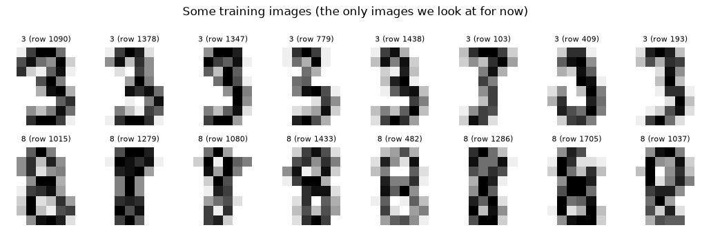
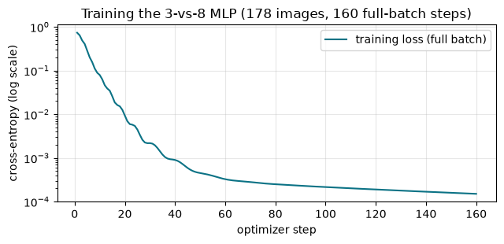
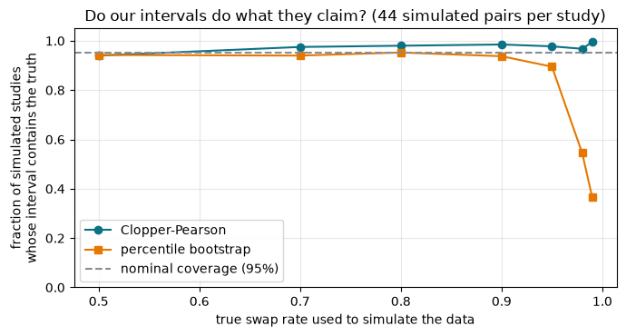
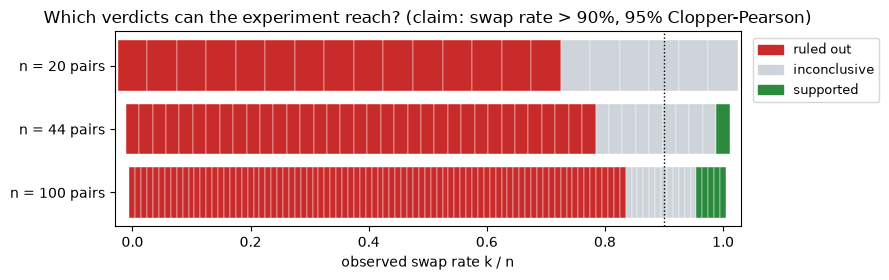
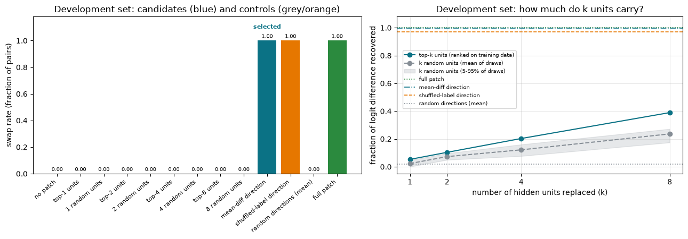
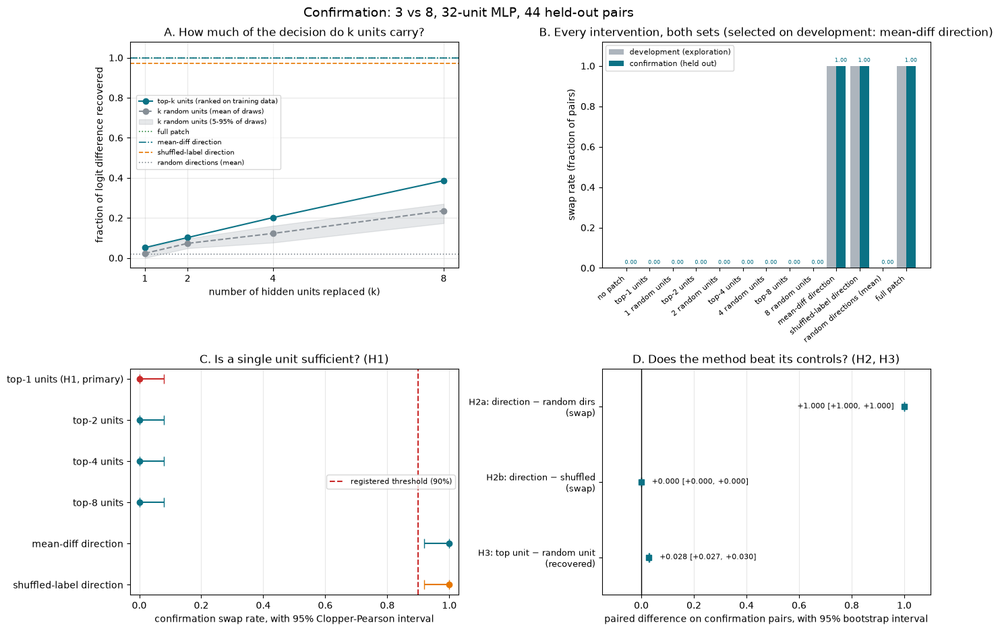
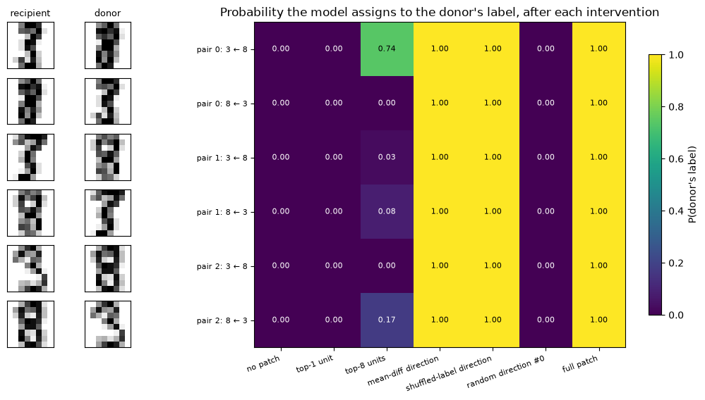
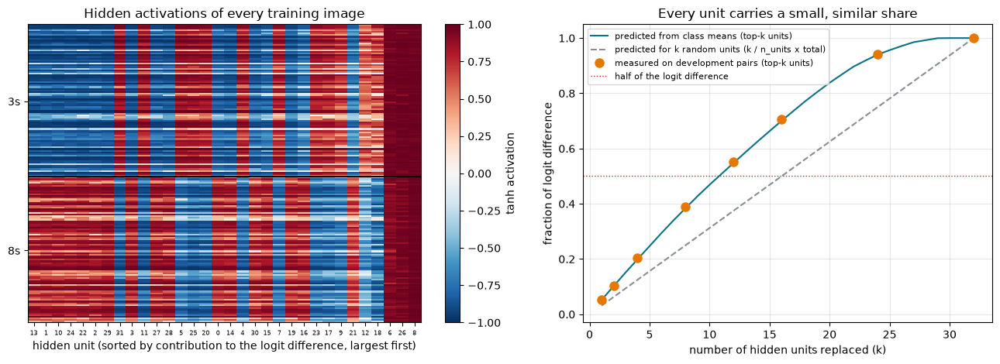
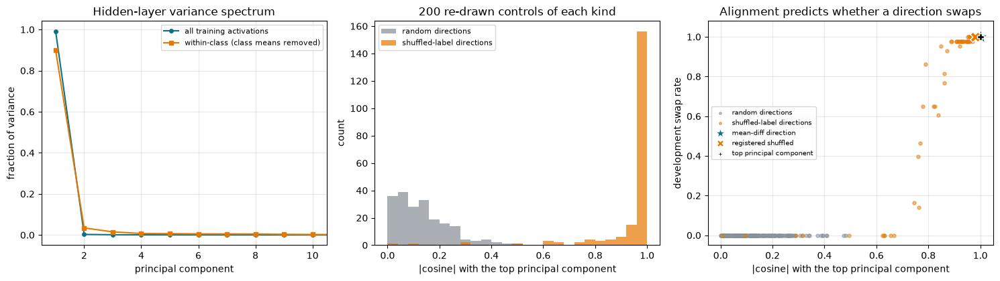
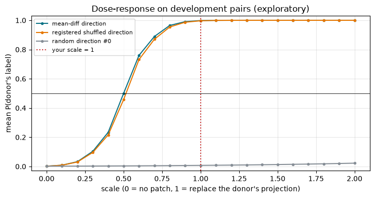

# [10.1] Capstone Research Sprint


> **Colab: [exercises](https://colab.research.google.com/github/shinobiultra/ARENA_3.0_Extended/blob/main/chapter10_capstone_research_sprint/exercises/part1_capstone_research_sprint/10.1_Capstone_Research_Sprint_exercises.ipynb) | [solutions](https://colab.research.google.com/github/shinobiultra/ARENA_3.0_Extended/blob/main/chapter10_capstone_research_sprint/exercises/part1_capstone_research_sprint/10.1_Capstone_Research_Sprint_solutions.ipynb)**

If you want to change to dark mode, you can do this by clicking the three horizontal lines in the top-right, then navigating to Settings → Theme.


# Introduction


Here's an experiment you could run in five minutes.

Train a tiny neural network (64 pixels, then 32 tanh units, then 2 logits) to tell handwritten 3s from 8s. It gets every development image right. Now take a 3 and an 8, and run the 3 through the network, except that just before the output layer you overwrite *one* hidden unit with the value it took on the 8: the unit which, by a sensible ranking, matters most for the 3-vs-8 decision. Does the network now say "8"?

Make a guess before reading on.

It doesn't. Not for a single one of the 44 held-out pairs we'll test. But if instead of one *unit* you copy one *direction* (the difference between the average 8 and the average 3, a single vector in the 32-dimensional hidden space), every one of those 44 decisions swaps. That's a familiar story: the network's concept isn't in a neuron, it's in a direction. You could write that up.

Here's the problem. If you compute the same "direction" after randomly shuffling which images are labelled 3 and which are labelled 8, so that it *shouldn't* mean anything, it swaps every decision too.

This section is about what to do next, and more generally about the part of interpretability research that the rest of this course mostly leaves implicit: how to get from a question to a result you'd be willing to defend. We'll walk through a complete small research project, with the steps that make a result trustworthy:

1. **A question**, made precise enough that an experiment can answer it.
2. **A pre-registration**: hypotheses, metric, controls, the analysis you'll run, and what result would change your mind, written down *before* you look at the data that will test it.
3. **A research log**, recording what you did and what you saw, in order.
4. **Exploration on development data**, where you're allowed to look at anything, and where you pick a method using a rule you fixed in advance.
5. **A confirmatory test on held-out data**, run once.
6. **A write-up** that reports every pre-registered outcome, including the negative results and the controls that didn't behave.

You'll implement the experiment yourself: the data splits, the training run, the interventions, the controls, the selection rule, the confidence intervals and the final assessment. The whole thing runs in a few seconds on a CPU, and that matters. It means you can see every step, rerun anything, and spend your attention on the *process* rather than on waiting for a GPU. The traps we'll meet (peeking at test data, choosing an analysis after seeing the results, counting non-independent samples as independent, controls that don't control for anything) are exactly the traps you'll meet with GPT-2, a VLM or a diffusion model.

By the end of the worked example you'll have:

- a pre-registered primary hypothesis ("a single hidden unit is enough to swap the decision") that a confirmatory test **rules out**;
- a direction that swaps every held-out decision, next to a shuffled-label control that does too, so the claim that the direction is *specific* is **not supported**;
- an explanation of both results (the network's hidden layer is, in effect, one-dimensional), found by clearly labelled exploratory analysis, and a test of that explanation in a model where it predicts the control *should* fail;
- a short write-up that a skeptical reader could check line by line.

None of this is a "discovery", and that's deliberate. Most results from a short research sprint look like this. A well-run negative result is a complete and useful piece of research, and learning to produce one, rather than to keep tweaking until something looks positive, is the most valuable skill this section can teach.

Afterwards, you'll choose your own capstone project from a menu built on the rest of the course (chapters 5-18), or bring your own question, and write your own pre-registration using the templates at the end.

**Prerequisites.** PyTorch basics ([0.1]-[0.3]), and the idea of activation patching from [1.4.1] Indirect Object Identification (or [8.1] Activation Patching Refresher in the extension). [0.6] How to Know When an Interpretability Result Is Fake is a natural companion: it catalogues the ways results go wrong, and this section builds a workflow that guards against them. For statistics, you need to know what a confidence interval is; we'll build everything else.


## Content & Learning Objectives

### 1️⃣ Questions and Instruments

You'll turn a vague question ("does this network have a 3-vs-8 neuron?") into one an experiment can answer, split the data before doing anything else, train the classifier, and build the instruments of the experiment: coordinate and directional interchange interventions, and a pair-level metric. You'll check the instruments work before trusting them.

> ##### Learning Objectives
>
> - Turn a vague interpretability question into an operational one, with an intervention, a metric and a unit of analysis
> - Split data into training, development and confirmation sets before looking at anything
> - Implement coordinate and directional interchange interventions, and a pair-level "swap" metric
> - Validate an instrument with a positive and a negative control before using it

### 2️⃣ Pre-registration and the Research Log

You'll write the plan down before running it: hypotheses, candidate methods, controls (and what each one rules out), a selection rule, decision rules and what would change your mind. You'll write and test the analysis code *before* you have data to analyse, including checking on simulated data that your confidence intervals do what they claim, and working out which conclusions your experiment is even capable of reaching.

> ##### Learning Objectives
>
> - Explain the garden of forking paths, and how pre-registration and held-out data protect against it
> - Write a pre-registration with hypotheses, metric, controls, decision rules and "what would change my mind"
> - Implement an exact binomial interval and a paired bootstrap, and test their coverage on simulated data
> - Use a decision map to check, before collecting data, which verdicts a design can reach
> - Keep a research log that separates planned, exploratory and confirmatory steps

### 3️⃣ Exploration on Development Data

You'll build the candidate methods and controls from training data, run every one of them on the development set, and select a method with the pre-registered rule. You'll meet the anomaly (a control that refuses to fail), log it without changing the plan, and write down predictions before opening the confirmation set.

> ##### Learning Objectives
>
> - Run every candidate and every control on the same development pairs, and select a method by a pre-specified rule
> - Read a sparsity curve against same-size random baselines
> - Notice and log anomalies without quietly changing the plan
> - Make written predictions before opening held-out data

### 4️⃣ Confirmation and Write-up

You'll open the confirmation set once, test the three hypotheses, and make the section's signature figure, with every control on the same axes. You'll assess the experiment's *methodology* separately from its *outcome*, then use clearly labelled exploratory analyses to explain both the negative result and the misbehaving control, and test that explanation where it makes a different prediction. Finally you'll write the result up in under 250 words.

> ##### Learning Objectives
>
> - Run a confirmatory analysis exactly once, and report every pre-registered outcome
> - Separate "was the experiment sound?" from "was the hypothesis true?"
> - Explain a negative result with labelled post-hoc analysis, and test the explanation where it predicts something new
> - Write up a result, including negative results and limitations, so that a reader can check it

### 5️⃣ Your Capstone

A menu of project ideas drawn from chapters 5-18 (each with a model, a method, a control that should fail, and a compute estimate), advice on adapting this section's pipeline, a pilot cell for trying other tasks, and templates for your own pre-registration, research log and write-up.

> ##### Learning Objectives
>
> - Choose a project that can be answered in a few days on a single GPU
> - Map the worked example's pipeline (splits, candidates, controls, selection, confirmation) onto a new model and method
> - Write your own pre-registration before running your confirmatory analysis

### ☆ Bonus

Extensions of the worked example (necessity tests, distributed alignment search, controls that should have been registered, writer dependence), and further reading on research practice.


## Setup code


```python
import functools
import hashlib
import json
import sys
import textwrap
from pathlib import Path
from typing import Callable

import matplotlib.pyplot as plt
import numpy as np
import pandas as pd
import torch as t
import torch.nn as nn
import torch.nn.functional as F
from jaxtyping import Float, Int
from scipy import stats
from torch import Tensor

# Everything in this section runs on a CPU in a few seconds, so we don't use a GPU at all. Using a single thread makes
# the float64 arithmetic (and so every number in the expected outputs) reproducible.
t.set_num_threads(1)

# Make sure exercises are in the path
chapter = "chapter10_capstone_research_sprint"
section = "part1_capstone_research_sprint"
root_dir = next(p for p in [Path.cwd(), *Path.cwd().parents] if (p / chapter).exists())
exercises_dir = root_dir / chapter / "exercises"
section_dir = exercises_dir / section
if str(exercises_dir) not in sys.path:
    sys.path.append(str(exercises_dir))

import part1_capstone_research_sprint.tests as tests
import part1_capstone_research_sprint.utils as utils

MAIN = __name__ == "__main__"
```


=== NEW CHAPTER ===


# 1️⃣ Questions and Instruments


> ##### Learning Objectives
>
> - Turn a vague interpretability question into an operational one, with an intervention, a metric and a unit of analysis
> - Split data into training, development and confirmation sets before looking at anything
> - Implement coordinate and directional interchange interventions, and a pair-level "swap" metric
> - Validate an instrument with a positive and a negative control before using it

## From a question to an experiment

Research questions usually start out too vague to answer. "Does this network have a 3-vs-8 neuron?" sounds like a question, but what would count as *yes*? Here are three different things it could mean:

- **Correlation**: some hidden unit's activation is different for 3s and 8s. This is almost certainly true of most units in a network trained to separate 3s from 8s, so it's not an interesting claim.
- **Sufficiency**: setting that unit to the value it takes on an 8 makes the network say "8", even though the input is a 3.
- **Necessity**: removing that unit (e.g. replacing it with its average value) stops the network from telling 3s from 8s.

These can come apart. A unit can be sufficient without being necessary (if other units carry the same information redundantly), or necessary without being sufficient (if it's one of several inputs that all have to agree). In this section we test **sufficiency**, with a tool you've met before under a different name: activation patching. Here it's called an **interchange intervention** (Geiger et al., 2021). Take a *recipient* input and a *donor* input from the other class, run the recipient through the network, but replace part of its hidden representation with the donor's. If that part carries the decision, the output should now follow the donor.

Choosing what counts as "part of the representation" is the other half of making the question precise. We'll compare two kinds of part:

- a **set of coordinates**: one or a few hidden units, chosen by a ranking computed on training data;
- a **direction**: a single vector in hidden space, computed from training data, along which we replace the recipient's component by the donor's.

So the vague question becomes:

> **When we copy a part of the hidden representation from a donor image into a recipient image of the other class, does the network's decision swap? In particular, is a single well-chosen hidden unit enough?**

That's a question an experiment can answer, and it's worth noticing what made it so. A good question for a short research sprint is:

- **answerable with one family of experiments** that you can run many times within your time budget;
- **falsifiable**: you can say in advance what result would make you abandon it;
- **measured by a metric you choose before you look** (we'll define ours below);
- **interesting either way**: if the answer is "no", you still learn something about how the network represents the decision.

The last point deserves emphasis. If you'd only be happy with one answer, you're likely to keep adjusting the experiment until you get it.


## The data

We'll use the handwritten digits dataset that ships with scikit-learn: 1,797 images of 8×8 pixels, each pixel a count from 0 to 16 (from downsampled 32×32 scans), which we scale to $[0, 1]$. It's small enough that a model trains in a fraction of a second, it needs no download, and it's real handwriting with all its variation. `utils.load_digit_pair` returns the images of two digit classes, labels (0 for the first digit, 1 for the second), and each image's row in the full dataset, so that any image can always be found again.

We'll study **3 vs 8**. That's a nicely non-trivial pair: an 8 is roughly a 3 with its left side closed, so the network has to attend to specific strokes rather than just to how much ink there is.


```python
DIGITS = (3, 8)
x, y, rows = utils.load_digit_pair(DIGITS)
print(f"{len(x)} images: {(y == 0).sum().item()} {DIGITS[0]}s and {(y == 1).sum().item()} {DIGITS[1]}s, {x.shape[1]} pixels each")
```


<details>
<summary>Expected output</summary>

<pre style="white-space:pre;overflow-x:auto;line-height:normal;font-family:Menlo,'DejaVu Sans Mono',consolas,'Courier New',monospace">357 images: 183 3s and 174 8s, 64 pixels each</pre>

</details>

Notice that we haven't looked at any images yet. That's on purpose: the first thing we'll do is decide which images we're allowed to look at.


## Three splits, made first

Every experiment in this section uses three disjoint sets of images:

- **Training set**: used to fit the model, and to *construct* everything that's learned from data: the ranking of hidden units, the mean-difference direction, the shuffled-label control.
- **Development set**: our playground. We evaluate every candidate method and control on it, look at as many plots as we like, and **select** which method to take forward. Anything we learn here is *exploratory*.
- **Confirmation set**: opened exactly once, after the plan is frozen and the method is selected, to run the pre-registered tests. Results here are *confirmatory*.

Why not just a train/test split? Because of the selection step. If we chose the best method on the test set and then reported its test performance, the number would be biased upwards: we'd be reporting the maximum of several noisy estimates. Selecting on development data and confirming on untouched data removes that bias. (This is the same reason ML papers tune hyperparameters on a validation set.)

Two details matter:

- **Split first, before anything else.** Every look at the data before the split risks leaking information into choices that are later "tested". This is why we haven't plotted any images yet.
- **Stratify by class**, so that every split has the same mix of 3s and 8s as the whole dataset. Otherwise a small split could, by chance, be mostly 8s, and the pairs we build later would be lopsided.


### Exercise - implement `split_examples`

> ```yaml
> Difficulty: 🔴🔴⚪⚪⚪
> Importance: 🔵🔵🔵🔵⚪
> 
> You should spend up to 10 minutes on this exercise.
> ```

Implement a stratified three-way split. For each class (0 first, then 1):

1. shuffle that class's indices with `rng.permutation`, using a single `rng = np.random.default_rng(seed)` created at the start;
2. put the first `int(n_class * train_fraction)` shuffled indices in `"train"`, the next `int(n_class * dev_fraction)` in `"dev"`, and the rest in `"confirm"`.

Return a dict mapping `"train"`, `"dev"` and `"confirm"` to integer index arrays (class 0's indices followed by class 1's). Raise a `ValueError` if the fractions aren't positive or leave nothing for the confirmation set.

Following the recipe exactly (one generator, class 0 before class 1) means your split will match ours, so your numbers will match the expected outputs.


```python
def split_examples(
    labels: np.ndarray | Tensor, train_fraction: float = 0.5, dev_fraction: float = 0.25, seed: int = 0
) -> dict[str, np.ndarray]:
    """
    Stratified split of example indices into "train", "dev" and "confirm" sets.
    """
    raise NotImplementedError()


tests.test_split_examples(split_examples)
```


<details>
<summary>Hint</summary>

`np.flatnonzero(labels == label)` gives the indices of one class. After `rng.permutation`, slice with `[:n_train]`, `[n_train:n_train + n_dev]` and `[n_train + n_dev:]`, collect the slices for both classes, and `np.concatenate` them at the end.
</details>


<details><summary>Solution</summary>

```python
def split_examples(
    labels: np.ndarray | Tensor, train_fraction: float = 0.5, dev_fraction: float = 0.25, seed: int = 0
) -> dict[str, np.ndarray]:
    """
    Stratified split of example indices into "train", "dev" and "confirm" sets.
    """
    labels = np.asarray(labels)
    if not (train_fraction > 0 and dev_fraction > 0 and train_fraction + dev_fraction < 1):
        raise ValueError(f"Fractions must be positive and leave data for confirmation: {train_fraction=}, {dev_fraction=}")
    rng = np.random.default_rng(seed)
    parts = {"train": [], "dev": [], "confirm": []}
    for label in (0, 1):
        indices = rng.permutation(np.flatnonzero(labels == label))
        n_train, n_dev = int(len(indices) * train_fraction), int(len(indices) * dev_fraction)
        parts["train"].append(indices[:n_train])
        parts["dev"].append(indices[n_train : n_train + n_dev])
        parts["confirm"].append(indices[n_train + n_dev :])
    return {name: np.concatenate(chunks) for name, chunks in parts.items()}
```
</details>


Now we make the split. The seed is the first of several numbers we'll fix in advance and record in the plan. Then, and only then, we look at some images: from the **training set only**.


```python
splits = split_examples(y, train_fraction=0.5, dev_fraction=0.25, seed=17)
for name, ids in splits.items():
    print(f"{name:>8}: {len(ids):3d} images ({(y[ids] == 0).sum().item()} {DIGITS[0]}s, {(y[ids] == 1).sum().item()} {DIGITS[1]}s)")

train_ids = splits["train"]
shown = np.concatenate([train_ids[y[train_ids] == 0][:8], train_ids[y[train_ids] == 1][:8]])
utils.plot_digit_grid(
    x[shown], [f"{DIGITS[y[i].item()]} (row {rows[i]})" for i in shown], "Some training images (the only images we look at for now)"
)
```





<details>
<summary>Expected output</summary>

<pre style="white-space:pre;overflow-x:auto;line-height:normal;font-family:Menlo,'DejaVu Sans Mono',consolas,'Courier New',monospace">   train: 178 images (91 3s, 87 8s)
     dev:  88 images (45 3s, 43 8s)
 confirm:  91 images (47 3s, 44 8s)</pre>

</details>

At 8×8 resolution, some of these are hard to read even for a human: a couple of the 8s (rows 1279 and 1080) are thin enough to pass for a 1. Keep that in mind when we look at individual examples later.


## The model

Our model is as small as an interesting model gets: a one-hidden-layer MLP,

$$
h = \tanh(W x + b) \in \mathbb{R}^{32}, \qquad \text{logits} = V h + c \in \mathbb{R}^2 .
$$

We'll call $h$ the **hidden representation**, the `encoder` the map $x \mapsto h$, and the `head` the map $h \mapsto \text{logits}$. Every intervention in this section edits $h$ and then runs the head, so the head is the only part of the network that "reads" our edits. Because the head is linear, the quantity that decides the prediction is the **logit difference**

$$
\text{LD}(h) = \text{logit}_1 - \text{logit}_0 = (V_1 - V_0) \cdot h + (c_1 - c_0),
$$

and the model predicts class 1 (an 8) exactly when $\text{LD}(h) > 0$. The vector $w = V_1 - V_0$ is the **readout direction**; we'll use it in several places.

The class also supports a `"linear"` model, where the encoder is the identity (so the "hidden representation" is the 64 raw pixels). We won't use it until section 4️⃣, where it gives us a model with a very different representation to test an explanation on.

We work in float64 throughout. That's unusual for deep learning, but this model is tiny and it makes the results exactly reproducible.


```python
class DigitClassifier(nn.Module):
    """
    A two-class digit classifier. `kind="mlp"`: 64 pixels -> `hidden_width` tanh units -> 2 logits.
    `kind="linear"`: 64 pixels -> 2 logits (the "hidden representation" is the pixels themselves).
    """

    def __init__(self, kind: str = "mlp", hidden_width: int = 32):
        super().__init__()
        if kind == "mlp":
            self.encoder = nn.Sequential(nn.Linear(64, hidden_width), nn.Tanh())
            self.head = nn.Linear(hidden_width, 2)
        elif kind == "linear":
            self.encoder = nn.Identity()
            self.head = nn.Linear(64, 2)
        else:
            raise ValueError(f"Unknown model kind {kind!r}")
        self.double()

    def forward(self, x: Float[Tensor, "batch 64"]) -> Float[Tensor, "batch 2"]:
        return self.head(self.encoder(x))
```


### Exercise - implement `train_model`

> ```yaml
> Difficulty: 🔴⚪⚪⚪⚪
> Importance: 🔵🔵🔵⚪⚪
> 
> You should spend up to 5-10 minutes on this exercise.
> ```

Write a standard full-batch training loop. Call `t.manual_seed(seed)` **before** creating the `DigitClassifier` (so that the initialisation is reproducible), then run `steps` steps of Adam with learning rate `lr` on the cross-entropy loss over all of `x`. Return the model in eval mode and a list of the losses (as Python floats), one per step.

This function only ever receives training data. That sounds obvious, but it's the kind of thing that goes wrong in larger projects, e.g. when a "training" activation cache was built from a dataset that also contains evaluation prompts.


```python
def train_model(
    x: Float[Tensor, "n 64"],
    y: Int[Tensor, " n"],
    kind: str = "mlp",
    hidden_width: int = 32,
    steps: int = 160,
    lr: float = 0.025,
    seed: int = 0,
) -> tuple[DigitClassifier, list[float]]:
    """Trains a DigitClassifier with full-batch Adam, and returns (model in eval mode, losses)."""
    raise NotImplementedError()


tests.test_train_model(train_model)
```


<details>
<summary>Hint</summary>

Each step is: compute `loss = F.cross_entropy(model(x), y)`, then `optimizer.zero_grad()`, `loss.backward()`, `optimizer.step()`, and append `loss.item()`. Remember `t.manual_seed(seed)` has to come before `DigitClassifier(...)`, since it's the layer initialisation that uses the random number generator.
</details>


<details><summary>Solution</summary>

```python
def train_model(
    x: Float[Tensor, "n 64"],
    y: Int[Tensor, " n"],
    kind: str = "mlp",
    hidden_width: int = 32,
    steps: int = 160,
    lr: float = 0.025,
    seed: int = 0,
) -> tuple[DigitClassifier, list[float]]:
    """Trains a DigitClassifier with full-batch Adam, and returns (model in eval mode, losses)."""
    t.manual_seed(seed)
    model = DigitClassifier(kind, hidden_width)
    optimizer = t.optim.Adam(model.parameters(), lr=lr)
    losses = []
    for _ in range(steps):
        loss = F.cross_entropy(model(x), y)
        optimizer.zero_grad()
        loss.backward()
        optimizer.step()
        losses.append(loss.item())
    return model.eval(), losses
```
</details>


Let's train it. We report accuracy on the training and development sets, but **not** on the confirmation set. Even a harmless-looking number like "confirmation accuracy" is a look at the confirmation data, and it's easier to keep a rule with no exceptions than one with "harmless" exceptions.


```python
model, losses = train_model(x[splits["train"]], y[splits["train"]], kind="mlp", hidden_width=32, steps=160, lr=0.025, seed=23)

with t.no_grad():
    for name in ["train", "dev"]:
        accuracy = (model(x[splits[name]]).argmax(-1) == y[splits[name]]).double().mean().item()
        print(f"{name:>5} accuracy: {accuracy:.1%}")
print(f"loss: {losses[0]:.4f} at step 1, {losses[-1]:.6f} at step {len(losses)}")

utils.plot_training_curve(losses, f"Training the {DIGITS[0]}-vs-{DIGITS[1]} MLP (178 images, 160 full-batch steps)")
```





<details>
<summary>Expected output</summary>

<pre style="white-space:pre;overflow-x:auto;line-height:normal;font-family:Menlo,'DejaVu Sans Mono',consolas,'Courier New',monospace">train accuracy: 100.0%
  dev accuracy: 100.0%
loss: 0.7339 at step 1, 0.000151 at step 160</pre>

</details>

The model separates the training set perfectly and drives the loss to almost zero. It's also perfect on the development set, so it isn't just memorising. A training loss of 0.00015 means the logits are very confident, which will matter later: a confidently classified recipient needs a large push to change its mind.


## The instruments: interchange interventions

Now for the tools of the experiment. Write $h_r$ for the recipient's hidden representation and $h_d$ for the donor's. We'll use four interventions, each producing a patched representation $h'$ that we feed to the head:

| intervention | $h'$ | role |
|---|---|---|
| no patch | $h_r$ | negative control: the recipient's own prediction |
| full patch | $h_d$ | positive control: should give the donor's prediction |
| coordinate patch on a set $S$ | $h'_j = h_{d,j}$ for $j \in S$, $h'_j = h_{r,j}$ otherwise | is this set of units enough? |
| directional patch along $u$ | $h' = h_r + \big((h_d - h_r) \cdot \hat u\big)\, \hat u$, with $\hat u = u / \lVert u \rVert$ | is this direction enough? |

The directional patch replaces the recipient's component along $\hat u$ with the donor's, and leaves the component orthogonal to $\hat u$ untouched. Note that it doesn't care about the sign or length of $u$. Also note that a "single direction" is not the same budget as a "single unit": a direction can change every coordinate at once. A coordinate patch on $S = \{j\}$ is the special case $u = e_j$.

### Pairs, and what counts as one observation

We'll pair each 3 with an 8 *from the same split*, and intervene in **both directions**: 3 ← 8 (the 3 is the recipient) and 8 ← 3. The two directions use the same two images, so they aren't independent observations. If one of the images is unusual, both directions are affected. So our **unit of analysis is the pair**, not the directed intervention, and every statistic we compute treats pairs as the independent units.

Getting the unit of analysis right is one of the most common places for an interpretability result to look more certain than it is. Fifty prompts generated from one template are closer to one observation than to fifty; ten patching positions in the same prompt are not ten independent results.

### Metrics

We'll record two numbers for every pair and every intervention:

- **Swap** (binary, the primary metric): did the decision follow the donor in *both* directions? That is, is the patched 3 classified as an 8 *and* the patched 8 classified as a 3? This is the strict, all-or-nothing version of "the patched part carries the decision".
- **Fraction of logit difference recovered** (continuous, descriptive): how far did the intervention move the logit difference, as a fraction of the way from the recipient's value to the donor's,

$$
\text{recovered} = \frac{\text{LD}(h') - \text{LD}(h_r)}{\text{LD}(h_d) - \text{LD}(h_r)},
$$

averaged over the two directions. It's 0 for no patch and 1 for a full patch. It tells us how *close* an intervention came, even when it didn't swap the decision, which makes it much more informative for small coordinate sets. (This is the same "normalised logit difference" you used for IOI in [1.4.1].)

Because the head is linear, the recovered fraction for a coordinate patch has a neat closed form, which we'll come back to in section 4️⃣:

$$
\text{recovered}(S) = \frac{\sum_{j \in S} w_j (h_d - h_r)_j}{\sum_{j} w_j (h_d - h_r)_j} .
$$


### Exercise - implement `make_pairs`

> ```yaml
> Difficulty: 🔴⚪⚪⚪⚪
> Importance: 🔵🔵🔵⚪⚪
> 
> You should spend up to 5 minutes on this exercise.
> ```

Given the labels of one split, return two index arrays `(idx0, idx1)` of equal length $n = \min(n_0, n_1)$: the first $n$ class-0 indices and the first $n$ class-1 indices, in their original order. Pair $i$ is `(idx0[i], idx1[i])`.

The leftover examples of the larger class are simply unused. Importantly, pairs are formed **without looking at the model**: we don't drop pairs the model gets wrong, or pairs that "don't work". If the model misclassifies an image in a pair, that pair stays in the denominator.


```python
def make_pairs(labels: np.ndarray | Tensor) -> tuple[np.ndarray, np.ndarray]:
    """Pairs the i-th class-0 example with the i-th class-1 example. Returns (idx0, idx1)."""
    raise NotImplementedError()


tests.test_make_pairs(make_pairs)
```


<details>
<summary>Hint</summary>

`np.flatnonzero(labels == 0)` gives the class-0 indices in order. Convert `labels` with `np.asarray` first, so that the function works for tensors too.
</details>


<details><summary>Solution</summary>

```python
def make_pairs(labels: np.ndarray | Tensor) -> tuple[np.ndarray, np.ndarray]:
    """Pairs the i-th class-0 example with the i-th class-1 example. Returns (idx0, idx1)."""
    labels = np.asarray(labels)
    idx0, idx1 = np.flatnonzero(labels == 0), np.flatnonzero(labels == 1)
    n = min(len(idx0), len(idx1))
    return idx0[:n], idx1[:n]
```
</details>


### Exercise - implement `patch_coordinates` and `patch_direction`

> ```yaml
> Difficulty: 🔴🔴⚪⚪⚪
> Importance: 🔵🔵🔵🔵🔵
> 
> You should spend up to 10-15 minutes on these exercises.
> ```

Implement the two interventions from the table above. Both take a batch of recipient activations and a batch of donor activations of the same shape `(batch, d)` (row $i$ of the donor is patched into row $i$ of the recipient), and return a **new** tensor: don't modify the recipient in place.

- `patch_coordinates(recipient, donor, coords)` replaces the columns listed in `coords` (a tensor or list of indices, possibly empty).
- `patch_direction(recipient, donor, direction)` normalises `direction` and replaces the recipient's component along it with the donor's.


```python
def patch_coordinates(
    recipient: Float[Tensor, "batch d"], donor: Float[Tensor, "batch d"], coords: Int[Tensor, " k"] | list[int]
) -> Float[Tensor, "batch d"]:
    """Returns a copy of `recipient` in which the coordinates `coords` are replaced by the donor's."""
    raise NotImplementedError()


def patch_direction(
    recipient: Float[Tensor, "batch d"], donor: Float[Tensor, "batch d"], direction: Float[Tensor, " d"]
) -> Float[Tensor, "batch d"]:
    """Returns `recipient` with its component along `direction` replaced by the donor's."""
    raise NotImplementedError()


tests.test_patch_coordinates(patch_coordinates)
tests.test_patch_direction(patch_direction)
```


<details>
<summary>Hint</summary>

For `patch_coordinates`, convert `coords` with `t.as_tensor(coords, dtype=t.long)` so that lists and empty lists work, clone the recipient, and assign `patched[:, coords] = donor[:, coords]`.

For `patch_direction`, `(donor - recipient) @ unit` has shape `(batch,)`: it's how much further along $\hat u$ the donor is than the recipient. Add that amount of $\hat u$ to each recipient row (you'll need `[:, None]` to broadcast).
</details>


<details><summary>Solution</summary>

```python
def patch_coordinates(
    recipient: Float[Tensor, "batch d"], donor: Float[Tensor, "batch d"], coords: Int[Tensor, " k"] | list[int]
) -> Float[Tensor, "batch d"]:
    """Returns a copy of `recipient` in which the coordinates `coords` are replaced by the donor's."""
    coords = t.as_tensor(coords, dtype=t.long)
    patched = recipient.clone()
    patched[:, coords] = donor[:, coords]
    return patched


def patch_direction(
    recipient: Float[Tensor, "batch d"], donor: Float[Tensor, "batch d"], direction: Float[Tensor, " d"]
) -> Float[Tensor, "batch d"]:
    """Returns `recipient` with its component along `direction` replaced by the donor's."""
    unit = direction / direction.norm()
    return recipient + ((donor - recipient) @ unit)[:, None] * unit
```
</details>


### Exercise - implement `evaluate_patch`

> ```yaml
> Difficulty: 🔴🔴⚪⚪⚪
> Importance: 🔵🔵🔵🔵🔵
> 
> You should spend up to 15 minutes on this exercise.
> ```

This function is the experiment's measuring device. It takes the model's head, the hidden representations `h0` and `h1` of the class-0 and class-1 member of each pair (row $i$ of each is pair $i$), and an intervention `patch_fn(recipient, donor)` like the ones you just wrote. It should:

1. patch in both directions: `patch_fn(h0, h1)` (the 3s receive from the 8s) and `patch_fn(h1, h0)` (the 8s receive from the 3s);
2. compute **swap** for each pair: `1.0` if the patched class-0 rows are now predicted as class 1 **and** the patched class-1 rows are predicted as class 0, else `0.0` (use `argmax` over the logits for the prediction);
3. compute **recovered** for each pair: the fraction of logit difference recovered in each direction (formula above), averaged over the two directions.

Return `{"swap": ..., "recovered": ...}`, each a float numpy array of shape `(n_pairs,)`. Wrap the computation in `t.no_grad()`.


```python
def evaluate_patch(
    head: nn.Module,
    h0: Float[Tensor, "n_pairs d"],
    h1: Float[Tensor, "n_pairs d"],
    patch_fn: Callable[[Tensor, Tensor], Tensor],
) -> dict[str, np.ndarray]:
    """
    Runs an interchange intervention in both directions on each pair, and returns per-pair "swap" (both directions
    now predict the donor's label) and "recovered" (fraction of logit difference recovered, averaged over directions).
    """
    raise NotImplementedError()


tests.test_evaluate_patch(evaluate_patch)
```


<details>
<summary>Hint</summary>

Write a small helper `logit_diff(h)` that returns `head(h)[:, 1] - head(h)[:, 0]`. In the direction where class-0 rows are recipients, the donor's logit difference is `logit_diff(h1)`; in the other direction it's `logit_diff(h0)`.
</details>


<details><summary>Solution</summary>

```python
def evaluate_patch(
    head: nn.Module,
    h0: Float[Tensor, "n_pairs d"],
    h1: Float[Tensor, "n_pairs d"],
    patch_fn: Callable[[Tensor, Tensor], Tensor],
) -> dict[str, np.ndarray]:
    """
    Runs an interchange intervention in both directions on each pair, and returns per-pair "swap" (both directions
    now predict the donor's label) and "recovered" (fraction of logit difference recovered, averaged over directions).
    """
    with t.no_grad():

        def logit_diff(h: Tensor) -> Tensor:
            logits = head(h)
            return logits[:, 1] - logits[:, 0]

        patched0, patched1 = patch_fn(h0, h1), patch_fn(h1, h0)
        swap = (head(patched0).argmax(-1) == 1) & (head(patched1).argmax(-1) == 0)
        ld0, ld1 = logit_diff(h0), logit_diff(h1)
        recovered0 = (logit_diff(patched0) - ld0) / (ld1 - ld0)
        recovered1 = (logit_diff(patched1) - ld1) / (ld0 - ld1)
    return {"swap": swap.double().numpy(), "recovered": (0.5 * (recovered0 + recovered1)).numpy()}
```
</details>


## Validating the instruments

Before we use a measuring device, we check that it reads zero when nothing is there and reads correctly when we know the answer. For interchange interventions, that means:

- **no patch** should swap no pairs and recover 0%, since every image is correctly classified;
- **full patch** should swap every pair and recover 100%;
- patching **every** coordinate should be identical to a full patch;
- patching along a direction should only change the representation's component along that direction.

The tests have already checked the last point on synthetic data. Let's check the rest on real **training** pairs. (Training data, because instrument checks are part of building the experiment, not part of testing a hypothesis. But notice that this is already a look at real data. We'll record it in the plan's "what we've already looked at" section.)


```python
with t.no_grad():
    h_train = model.encoder(x[splits["train"]])
y_train = y[splits["train"]]
train0, train1 = make_pairs(y_train)
print(f"{len(train0)} training pairs\n")

checks = {
    "no patch": lambda r, d: r,
    "full patch": lambda r, d: d,
    "all 32 coordinates": functools.partial(patch_coordinates, coords=list(range(32))),
}
for name, fn in checks.items():
    out = evaluate_patch(model.head, h_train[train0], h_train[train1], fn)
    print(f"{name:>20}: swap rate {out['swap'].mean():.3f}, mean recovered {out['recovered'].mean():.3f}")
```


<details>
<summary>Expected output</summary>

<pre style="white-space:pre;overflow-x:auto;line-height:normal;font-family:Menlo,'DejaVu Sans Mono',consolas,'Courier New',monospace">87 training pairs

            no patch: swap rate 0.000, mean recovered 0.000
          full patch: swap rate 1.000, mean recovered 1.000
  all 32 coordinates: swap rate 1.000, mean recovered 1.000</pre>

</details>

The instruments behave. This might feel like a formality, but it's the step that catches a surprising number of bugs in real projects: a hook that patches the wrong position, a cache that was computed with a different model, a metric with the sign flipped. If your positive control doesn't work, no other result from the experiment can be interpreted.


## Try it yourself - patch by hand

Before writing down a plan, researchers usually poke at the system to get a feel for it. That's fine, and often essential, as long as you're honest about it later. Use the cell below to patch any set of hidden units (or a direction of your choice) on a few **training** pairs, and see what the model's probabilities do. Some things to try:

- Patch a single unit. Then patch a few. How many do you need before anything changes?
- Patch the readout direction `w = model.head.weight[1] - model.head.weight[0]` with `patch_direction`. What happens, and why is that not a fair test of anything?

Whatever you notice here, you've now seen it. In a real project, it would go into the pre-registration under "what we've already looked at".


```python
PLAY_UNITS = [0, 1, 2, 3]  # which hidden units to copy from the donor
PLAY_PAIRS = [0, 1, 2]  # which training pairs to look at

with t.no_grad():
    for i in PLAY_PAIRS:
        r, d = h_train[train0[i : i + 1]], h_train[train1[i : i + 1]]  # recipient: a 3, donor: an 8
        p_before = model.head(r).softmax(-1)[0, 1].item()
        p_after = model.head(patch_coordinates(r, d, PLAY_UNITS)).softmax(-1)[0, 1].item()
        print(f"training pair {i}: P(8) for the 3 is {p_before:.4f} before and {p_after:.4f} after patching units {PLAY_UNITS}")
```


<details>
<summary>Expected output (for the default settings)</summary>

<pre style="white-space:pre;overflow-x:auto;line-height:normal;font-family:Menlo,'DejaVu Sans Mono',consolas,'Courier New',monospace">training pair 0: P(8) for the 3 is 0.0000 before and 0.0000 after patching units [0, 1, 2, 3]
training pair 1: P(8) for the 3 is 0.0000 before and 0.0000 after patching units [0, 1, 2, 3]
training pair 2: P(8) for the 3 is 0.0000 before and 0.0000 after patching units [0, 1, 2, 3]</pre>

Four units leave $P(8)$ at essentially zero on these pairs. Four decimal places hides the change, though: if you print the logit difference instead, you'll see it move from about $-19$ to about $-13$ (a typical 8 sits at around $+14$). If you patch the readout direction `w`, every pair swaps, but that's circular: `w` is by definition the direction the head reads, so of course replacing the recipient's component along it changes the output. A direction is only an interesting finding if it was found by something *other* than reading off the answer.
</details>


## Summary of 1️⃣

- We turned "is there a 3-vs-8 neuron?" into a question about **sufficiency**, tested with **interchange interventions**: copy part of a donor's hidden representation into a recipient of the other class, and see whether the decision follows.
- We split the data **before** looking at it, into training (fit and construct), development (explore and select) and confirmation (test, once) sets, stratified by class.
- The **unit of analysis is the pair**: both intervention directions on the same two images count as one observation. The primary metric is the binary **swap**; the **fraction of logit difference recovered** is a descriptive metric that shows partial effects.
- The instruments pass their checks: no patch swaps nothing, a full patch swaps everything.

We haven't tested anything yet. Before we do, we're going to write down exactly what we'll test, how, and what would change our minds.


=== NEW CHAPTER ===


# 2️⃣ Pre-registration and the Research Log


> ##### Learning Objectives
>
> - Explain the garden of forking paths, and how pre-registration and held-out data protect against it
> - Write a pre-registration with hypotheses, metric, controls, decision rules and "what would change my mind"
> - Implement an exact binomial interval and a paired bootstrap, and test their coverage on simulated data
> - Use a decision map to check, before collecting data, which verdicts a design can reach
> - Keep a research log that separates planned, exploratory and confirmatory steps

## The garden of forking paths

Count the choices hidden in the question we just wrote down. Which unit is "the most important" one (by activation difference? by readout weight? by both)? How many units count as "a few"? Which direction (mean difference? a probe's weights? the top principal component?) What counts as success (the swap? the recovered fraction? the probability of the donor's label?), at what threshold? Which pairs? Which random seed for the model? Which digit pair, even?

Each of these choices is reasonable on its own. The problem, which Gelman and Loken called **the garden of forking paths**, is what happens when you make them *after* seeing the results. Suppose there are 20 reasonable ways to analyse an experiment, and the effect you're looking for doesn't exist. If each analysis has a 5% chance of a false positive, and you pick whichever one "works", your chance of finding *something* is up to $1 - 0.95^{20} \approx 64\%$. You don't need to be dishonest for this to happen. You only need to try one thing, find it unconvincing, try a slightly different thing, and stop when it looks right.

Interpretability is particularly exposed to this. A single experiment has layers, positions, heads, prompts, templates, features, thresholds, normalisations and seeds to choose from, and the outputs (heatmaps, top-activating examples, steering samples) are very good at looking meaningful.

The defence has two parts, and you've already set up the first:

1. **Held-out data.** Whatever you choose on development data, you test on data that played no part in the choice.
2. **Pre-registration.** Before testing, you write down the hypotheses, the metric, the analysis, the decision rules and the controls. Then the confirmatory test has exactly one path through the garden.

Pre-registration doesn't forbid exploration. It *labels* it. Exploratory results generate hypotheses; confirmatory results test them; a good write-up reports both and never presents the first as the second. And pre-registration doesn't have to be formal. In interpretability it's rarely more than a dated note, a git commit or a message to a collaborator, and that's enough: the point is to make it impossible for future-you to quietly change the question.


## What goes in a pre-registration

A useful pre-registration answers these questions:

1. **Question.** One sentence.
2. **Hypotheses.** Each with the exact quantity, the data it's measured on, and the threshold. Mark one as **primary**: the one the study is designed to test.
3. **Metric and unit of analysis.** What's measured, and what counts as one independent observation.
4. **Data and splits.** Where the data comes from, how it's split, with seeds.
5. **Candidate methods and selection rule.** If you'll choose between methods on development data, list them all and say how you'll choose, including how ties are broken.
6. **Controls.** For each: what it rules out, and what you expect it to do.
7. **Analysis plan and decision rules.** Which interval or test, at what level, and how each possible result maps onto a verdict ("supported", "ruled out", "inconclusive").
8. **What would change my mind.** The results that would make you abandon, or strongly believe, the hypothesis. If you can't name any, the hypothesis isn't falsifiable.
9. **Instrument checks.** The conditions under which the experiment is broken rather than negative.
10. **Budget.** How much compute and time, and what you'll do if you run out.
11. **What you've already looked at.** Honesty about prior exploration.

Before we write ours, we need to build two more pieces of the method (so that the plan can name them precisely) and the statistics (so that the decision rules are concrete). It's good practice to write and test your **analysis code before you have the data to analyse**: if the code exists before the results do, the results can't influence the code.


## The candidate methods

We'll derive two things from the **training** set's hidden representations $h$ and labels $y$.

**A ranking of hidden units.** For each unit $j$, how much does it contribute to the difference in logit difference between the average 8 and the average 3? With $\mu_c$ the mean hidden representation of class $c$ and $w$ the readout direction, that contribution is $w_j (\mu_1 - \mu_0)_j$. It combines how differently the unit behaves on the two classes with how strongly the head reads it. We rank units by its absolute value, largest first. The "top-$k$ units" candidate patches the first $k$ units in this ranking.

**A mean-difference direction.**

$$
u = \frac{\mu_1 - \mu_0}{\lVert \mu_1 - \mu_0 \rVert} .
$$

This is the simplest direction that separates the classes, and it's the same construction as the refusal direction in [9.1] or the truth directions in [9.2] (where it's often called a "diff-in-means" or "mass-mean" direction). Note that it's *not* the readout direction $w$: it's computed from the representations alone, without looking at the head.


### Exercise - implement `mean_difference_direction` and `rank_coordinates`

> ```yaml
> Difficulty: 🔴⚪⚪⚪⚪
> Importance: 🔵🔵🔵🔵⚪
> 
> You should spend up to 10 minutes on these exercises.
> ```

- `mean_difference_direction(h, y)` returns the unit vector $(\mu_1 - \mu_0) / \lVert \mu_1 - \mu_0 \rVert$.
- `rank_coordinates(h, y, readout)` returns the unit indices sorted by $|w_j (\mu_1 - \mu_0)_j|$, largest first. Use a **stable** sort (`t.argsort(..., descending=True, stable=True)`), so that exact ties keep their original order and the ranking is reproducible.


```python
def mean_difference_direction(h: Float[Tensor, "n d"], y: Int[Tensor, " n"]) -> Float[Tensor, " d"]:
    """Unit vector pointing from the mean of class 0 to the mean of class 1."""
    raise NotImplementedError()


def rank_coordinates(h: Float[Tensor, "n d"], y: Int[Tensor, " n"], readout: Float[Tensor, " d"]) -> Int[Tensor, " d"]:
    """Unit indices sorted by |readout_j * (class-1 mean - class-0 mean)_j|, largest first (stable for ties)."""
    raise NotImplementedError()


tests.test_mean_difference_direction(mean_difference_direction)
tests.test_rank_coordinates(rank_coordinates)
```


<details>
<summary>Hint</summary>

`h[y == 1].mean(0) - h[y == 0].mean(0)` is $\mu_1 - \mu_0$. For the ranking, multiply it elementwise by `readout`, take `.abs()`, and pass it to `t.argsort(..., descending=True, stable=True)`.
</details>


<details><summary>Solution</summary>

```python
def mean_difference_direction(h: Float[Tensor, "n d"], y: Int[Tensor, " n"]) -> Float[Tensor, " d"]:
    """Unit vector pointing from the mean of class 0 to the mean of class 1."""
    diff = h[y == 1].mean(0) - h[y == 0].mean(0)
    return diff / diff.norm()


def rank_coordinates(h: Float[Tensor, "n d"], y: Int[Tensor, " n"], readout: Float[Tensor, " d"]) -> Int[Tensor, " d"]:
    """Unit indices sorted by |readout_j * (class-1 mean - class-0 mean)_j|, largest first (stable for ties)."""
    diff = h[y == 1].mean(0) - h[y == 0].mean(0)
    return t.argsort((readout * diff).abs(), descending=True, stable=True)
```
</details>


## The controls, and what each one rules out

A control is an alternative explanation, made concrete. For each result we hope to see, we ask "what else could produce this?", and design a condition where that alternative would produce the same result but our explanation wouldn't. If the control *also* succeeds, the alternative explanation is still standing.

| control | the alternative it rules out | what it should do if our explanation is right |
|---|---|---|
| no patch | the recipients were already misclassified, or the metric is broken | swap 0% |
| full patch | the instrument is broken (wrong activations, wrong readout) | swap ~100% |
| $k$ random units, 16 draws per $k$ | "any $k$ units would do; the ranking doesn't matter" | do worse than the top-$k$ units |
| random directions, 16 draws | "any direction would do; it's a generic perturbation" | swap ~0% |
| shuffled-label direction | "the direction works because of how we construct it, not because of what the labels mean" | swap ~0% |

The last one deserves a moment. The shuffled-label control computes exactly the same mean-difference direction, but with the training labels randomly permuted, so that "class 1" is a random half of the images. It goes through the same code path, with the same amount of data, and ends up with the same norm. If the mean-difference direction works *because it captures the difference between 3s and 8s*, the shuffled version (which captures no such difference) should fail. It's the analogue of a probe trained on shuffled labels, or of Hewitt and Liang's control tasks for probes.

All random controls are drawn **once**, with a seed fixed in the plan, before we see any development results. Re-drawing a control until it "behaves" is one of the forking paths.


## The statistics, decided in advance

We'll test two kinds of claim:

- **An absolute rate**, for the primary hypothesis: "the top unit swaps more than 90% of pairs". For this we need a confidence interval on a proportion.
- **A difference between a method and a control on the same pairs**: "the selected method swaps more pairs than the shuffled-label direction". For this we need an interval on a *paired* difference.

### An exact interval for a proportion

If $k$ out of $n$ independent pairs swap, the **Clopper-Pearson** interval is the "exact" binomial confidence interval: it's constructed by inverting the binomial test, so its coverage is guaranteed to be at least $1 - \alpha$ for any true rate. Its endpoints are quantiles of Beta distributions:

$$
\text{low} = \text{Beta}^{-1}\!\left(\tfrac{\alpha}{2};\; k,\; n - k + 1\right), \qquad \text{high} = \text{Beta}^{-1}\!\left(1 - \tfrac{\alpha}{2};\; k + 1,\; n - k\right),
$$

with the conventions $\text{low} = 0$ when $k = 0$ and $\text{high} = 1$ when $k = n$. It's somewhat conservative (wider than strictly necessary), but it behaves correctly at the edges, where $k = 0$ or $k = n$. As we're about to see, that's exactly where simpler methods break.


### Exercise - implement `clopper_pearson` and `claim_verdict`

> ```yaml
> Difficulty: 🔴⚪⚪⚪⚪
> Importance: 🔵🔵🔵🔵⚪
> 
> You should spend up to 10 minutes on these exercises.
> ```

- `clopper_pearson(k, n, alpha)` returns `(low, high)` using `stats.beta.ppf` and the formula above.
- `claim_verdict(low, high, threshold)` turns an interval into a verdict on the claim "**the true value is greater than `threshold`**": `"supported"` if the whole interval is above the threshold (`low > threshold`), `"ruled out"` if none of it is (`high <= threshold`), and `"inconclusive"` otherwise.

We'll use `claim_verdict` for every hypothesis: for the primary one with `threshold=0.9`, and for the comparisons with `threshold=0` (the claim being "the difference is positive").


```python
def clopper_pearson(k: int, n: int, alpha: float = 0.05) -> tuple[float, float]:
    """Exact (Clopper-Pearson) 1 - alpha confidence interval for a binomial proportion k / n."""
    raise NotImplementedError()


def claim_verdict(low: float, high: float, threshold: float) -> str:
    """Verdict on the claim 'the true value is greater than threshold', given a confidence interval."""
    raise NotImplementedError()


tests.test_clopper_pearson(clopper_pearson)
tests.test_claim_verdict(claim_verdict)
```


<details>
<summary>Hint</summary>

`stats.beta.ppf(q, a, b)` is the inverse CDF (the $q$-quantile) of a Beta($a$, $b$) distribution. Handle `k == 0` and `k == n` separately, since a Beta distribution needs both parameters to be positive. For `claim_verdict`, check `low > threshold` first, then `high <= threshold`.
</details>


<details><summary>Solution</summary>

```python
def clopper_pearson(k: int, n: int, alpha: float = 0.05) -> tuple[float, float]:
    """Exact (Clopper-Pearson) 1 - alpha confidence interval for a binomial proportion k / n."""
    low = 0.0 if k == 0 else stats.beta.ppf(alpha / 2, k, n - k + 1)
    high = 1.0 if k == n else stats.beta.ppf(1 - alpha / 2, k + 1, n - k)
    return float(low), float(high)


def claim_verdict(low: float, high: float, threshold: float) -> str:
    """Verdict on the claim 'the true value is greater than threshold', given a confidence interval."""
    if low > threshold:
        return "supported"
    if high <= threshold:
        return "ruled out"
    return "inconclusive"
```
</details>


### A paired bootstrap for differences

For comparisons, we have two scores per pair: the method's and the control's. They're measured on the same pairs, so they're correlated (a pair that's easy for one is often easy for the other), and the right thing to analyse is the **per-pair difference**. The **paired bootstrap** estimates the uncertainty of the mean difference by resampling *pairs* with replacement:

1. compute $\delta_i = \text{method}_i - \text{control}_i$ for each of the $n$ pairs;
2. draw $B$ resamples of $n$ pair indices with replacement, and compute the mean $\delta$ of each;
3. the $\alpha/2$ and $1 - \alpha/2$ quantiles of those $B$ means are the interval.

Resampling pairs (not directed interventions, not the method's and control's scores separately) is what makes this respect the unit of analysis. When a control is drawn several times (16 random directions), we first average over draws within each pair, so each pair still contributes one number.


### Exercise - implement `paired_bootstrap`

> ```yaml
> Difficulty: 🔴🔴⚪⚪⚪
> Importance: 🔵🔵🔵🔵⚪
> 
> You should spend up to 10 minutes on this exercise.
> ```

Implement the recipe above. To make results reproducible (and testable), use `rng = np.random.default_rng(seed)` and draw all resampled indices at once with `rng.integers(0, n, size=(n_resamples, n))`. Use `np.quantile` for the interval. Return `(mean difference, low, high)` as Python floats.


```python
def paired_bootstrap(
    method_scores: np.ndarray, control_scores: np.ndarray, n_resamples: int = 2000, seed: int = 0, alpha: float = 0.05
) -> tuple[float, float, float]:
    """Mean of (method - control) over pairs, with a percentile bootstrap interval that resamples pairs."""
    raise NotImplementedError()


tests.test_paired_bootstrap(paired_bootstrap)
```


<details>
<summary>Hint</summary>

If `diffs` has shape `(n,)` and `idx` has shape `(n_resamples, n)`, then `diffs[idx]` has shape `(n_resamples, n)`, and `.mean(axis=1)` gives one mean per resample. Then `np.quantile(boot_means, [alpha / 2, 1 - alpha / 2])`.
</details>


<details><summary>Solution</summary>

```python
def paired_bootstrap(
    method_scores: np.ndarray, control_scores: np.ndarray, n_resamples: int = 2000, seed: int = 0, alpha: float = 0.05
) -> tuple[float, float, float]:
    """Mean of (method - control) over pairs, with a percentile bootstrap interval that resamples pairs."""
    diffs = np.asarray(method_scores, dtype=float) - np.asarray(control_scores, dtype=float)
    rng = np.random.default_rng(seed)
    idx = rng.integers(0, len(diffs), size=(n_resamples, len(diffs)))
    boot_means = diffs[idx].mean(axis=1)
    low, high = np.quantile(boot_means, [alpha / 2, 1 - alpha / 2])
    return float(diffs.mean()), float(low), float(high)
```
</details>


## A dry run on simulated data

We now have analysis code and no data to analyse. That's the perfect time to check that the analysis code does what we think, on **simulated data where we know the right answer**.

The cell below simulates many "studies", each with 44 pairs (the number of pairs our confirmation set will contain; we know this from the split sizes alone, without looking at any outcomes). In each study, every pair swaps independently with a known true rate $p$. We compute both intervals for the swap rate, Clopper-Pearson and the bootstrap (bootstrapping the swap scores against a control of all zeros, so the "difference" is just the rate), and count how often each interval contains the true $p$. A 95% interval should contain it about 95% of the time.

Make a prediction first: is there any $p$ for which the bootstrap will do badly?


```python
def simulate_coverage(true_rates: list[float], n_pairs: int, n_studies: int, seed: int = 0) -> dict[str, list[float]]:
    """For each true swap rate, the fraction of simulated studies whose 95% interval contains it."""
    rng = np.random.default_rng(seed)
    coverage = {"Clopper-Pearson": [], "percentile bootstrap": []}
    for p in true_rates:
        hits_cp = hits_boot = 0
        for study in range(n_studies):
            swaps = (rng.random(n_pairs) < p).astype(float)
            low, high = clopper_pearson(int(swaps.sum()), n_pairs)
            hits_cp += low <= p <= high
            _, low, high = paired_bootstrap(swaps, np.zeros(n_pairs), n_resamples=1000, seed=study)
            hits_boot += low <= p <= high
        coverage["Clopper-Pearson"].append(hits_cp / n_studies)
        coverage["percentile bootstrap"].append(hits_boot / n_studies)
    return coverage


TRUE_RATES = [0.5, 0.7, 0.8, 0.9, 0.95, 0.98, 0.99]
coverage = simulate_coverage(TRUE_RATES, n_pairs=44, n_studies=400)
print(pd.DataFrame(coverage, index=pd.Index(TRUE_RATES, name="true rate")).round(3).to_string())
utils.plot_coverage(TRUE_RATES, coverage, n_pairs=44)
```





<details>
<summary>Expected output</summary>

<pre style="white-space:pre;overflow-x:auto;line-height:normal;font-family:Menlo,'DejaVu Sans Mono',consolas,'Courier New',monospace">           Clopper-Pearson  percentile bootstrap
true rate
0.50                 0.940                 0.942
0.70                 0.975                 0.940
0.80                 0.980                 0.952
0.90                 0.985                 0.938
0.95                 0.978                 0.895
0.98                 0.968                 0.545
0.99                 0.995                 0.365</pre>

</details>

<details>
<summary>Help - how should I interpret this plot?</summary>

**Clopper-Pearson** contains the true rate in 94-99.5% of the simulated studies, at every rate. (With 400 studies per rate, the simulation's own standard error is about 1 percentage point, so 0.940 is consistent with 95%.) For most rates it's above 95%: it's conservative, as promised.

**The bootstrap** is fine for rates up to 0.9, but it collapses near the edge: 0.895 at a true rate of 0.95, 0.545 at 0.98, and 0.365 at 0.99. The reason is simple. When the true rate is 0.99, most simulated studies see 44 swaps out of 44. Every bootstrap resample of 44 ones is also 44 ones, so the interval is $[1, 1]$, which doesn't contain 0.99. The bootstrap can only express the variability it sees in the sample, and a sample of all ones has none.

Exactly the same thing happens at the other edge: a study that sees 0 swaps out of 44 gets a bootstrap interval of $[0, 0]$, as if it were *certain* that the true rate is exactly zero. Since our primary hypothesis is about whether a swap rate is above 0.9, and results near 0 or 1 are entirely plausible, we'll use Clopper-Pearson for absolute rates. We'll keep the bootstrap for differences between conditions, where it's the standard tool, but we've now seen its weak spot, and it will come back to bite us.

This kind of check costs a few seconds and a few lines of code. It's worth doing for any analysis you haven't used before: simulate data where you know the answer, and see whether your pipeline finds it.
</details>


## Which verdicts can the experiment reach?

Here's a question that's very easy to skip: given the sample size and the decision rule, **is the experiment even capable of supporting the hypothesis?** Our primary hypothesis says the top unit swaps *more than 90%* of pairs. The verdict will be "supported" only if the lower end of the Clopper-Pearson interval is above 0.9. With 44 pairs, how many swaps does that take?

The cell below computes the verdict for every possible outcome $k = 0, \dots, n$, for three sample sizes, and draws it as a **decision map**. This only uses $n$, which we know from the split sizes, never the outcomes, so it's legitimate to do before registering.


```python
N_CONFIRM_PAIRS = len(make_pairs(y[splits["confirm"]])[0])  # uses labels only: no model, no outcomes
THRESHOLD = 0.9

decision_map = {
    n: [claim_verdict(*clopper_pearson(k, n), THRESHOLD) for k in range(n + 1)] for n in [20, N_CONFIRM_PAIRS, 100]
}
for n, verdicts in decision_map.items():
    supported = [k for k, v in enumerate(verdicts) if v == "supported"]
    ruled_out = [k for k, v in enumerate(verdicts) if v == "ruled out"]
    can_support = f"k >= {min(supported)}" if supported else "is impossible"
    print(f"n = {n:3d}: 'ruled out' if k <= {max(ruled_out)}, 'supported' {can_support}, inconclusive in between")
utils.plot_decision_map(decision_map, THRESHOLD)
```





<details>
<summary>Expected output</summary>

<pre style="white-space:pre;overflow-x:auto;line-height:normal;font-family:Menlo,'DejaVu Sans Mono',consolas,'Courier New',monospace">n =  20: 'ruled out' if k <= 14, 'supported' is impossible, inconclusive in between
n =  44: 'ruled out' if k <= 34, 'supported' k >= 44, inconclusive in between
n = 100: 'ruled out' if k <= 83, 'supported' k >= 96, inconclusive in between</pre>

</details>

This is sobering. With 20 pairs, *no* outcome supports the claim, not even 20 out of 20: the Clopper-Pearson lower bound for 20/20 is only 0.83. A 20-pair study of this hypothesis could rule it out or be inconclusive, but it could never support it, and you'd want to know that before running it rather than after.

With our 44 pairs, only a perfect 44/44 supports the claim (the lower bound for 44/44 is 0.920, and for 43/44 it's 0.880), while 34/44 or fewer rules it out. With 100 pairs, 96 swaps would be enough.

Two lessons. First, strong claims like "more than 90%" need either a lot of data or near-perfect results. Second, an experiment in which one of the verdicts is unreachable is not a fair test of the hypothesis. Our design can reach all three verdicts, and for a *sufficiency* claim we'd want a near-perfect swap rate anyway, so we'll accept it. But we'll write the numbers into the plan, so that nobody (including us) can later argue that 40/44 "basically supports" it.


## Try it yourself - plan the sample size

Change `PLAY_THRESHOLD` and `PLAY_ALPHA` below and find the smallest number of pairs for which the hypothesis could be supported with `PLAY_FAILURES` failures. This is a **precision analysis**: the interpretability equivalent of a power calculation. Doing it before collecting data tells you whether your experiment can answer your question at all, and it's much cheaper than discovering afterwards that it couldn't.


```python
PLAY_THRESHOLD = 0.9
PLAY_ALPHA = 0.05

for PLAY_FAILURES in [0, 1, 2, 5]:
    n_needed = next(
        (n for n in range(PLAY_FAILURES + 1, 10_000)
         if claim_verdict(*clopper_pearson(n - PLAY_FAILURES, n, PLAY_ALPHA), PLAY_THRESHOLD) == "supported"),
        None,
    )
    print(f"To support 'rate > {PLAY_THRESHOLD:.0%}' with {PLAY_FAILURES} failure(s) you need at least {n_needed} pairs")
```


<details>
<summary>Expected output (for the default settings)</summary>

<pre style="white-space:pre;overflow-x:auto;line-height:normal;font-family:Menlo,'DejaVu Sans Mono',consolas,'Courier New',monospace">To support 'rate > 90%' with 0 failure(s) you need at least 36 pairs
To support 'rate > 90%' with 1 failure(s) you need at least 54 pairs
To support 'rate > 90%' with 2 failure(s) you need at least 70 pairs
To support 'rate > 90%' with 5 failure(s) you need at least 114 pairs</pre>

Each failure you want to tolerate costs roughly 15-20 more pairs. In a language-model project, a "pair" might be a prompt pair built from a template, and 100+ independent ones can be hard to come by. That's exactly the kind of constraint to discover while planning.
</details>


## The pre-registration

We now have everything the plan needs to refer to. Here it is, first as prose for humans, then as a Python dict that the rest of the notebook reads its settings from. In a real project you'd commit both (or send them to a collaborator) before going further.

---

**Question.** When we copy part of the hidden representation of a one-hidden-layer MLP from a donor image into a recipient image of the other class (3 vs 8), does the decision swap? In particular, is a single well-chosen hidden unit enough?

**Hypotheses.** All measured on the 44 confirmation pairs.

- **H1 (primary, sufficiency of one unit).** Patching the single top-ranked hidden unit swaps the decision in more than 90% of pairs. *Test:* 95% Clopper-Pearson interval on the swap rate; verdict from `claim_verdict` with threshold 0.9.
- **H2 (secondary, specificity of the selected method).** The method selected on development data swaps more pairs than (a) random directions and (b) the shuffled-label direction. *Test:* paired bootstrap (2,000 resamples, seed 37) on per-pair swap scores, for each control; H2 is supported only if both differences are supported (threshold 0).
- **H3 (secondary, the ranking beats chance).** The top-ranked unit recovers more of the logit difference than a random unit. *Test:* paired bootstrap on per-pair recovered fraction, against the average over 16 random single units; threshold 0.

**Metric and unit of analysis.** The unit of analysis is a (3, 8) pair from the same split, intervened on in both directions. Primary metric: *swap*, 1 if both directions follow the donor. Secondary metric: fraction of logit difference recovered, averaged over both directions.

**Data and splits.** scikit-learn digits, classes 3 and 8 (357 images). Stratified split, seed 17: 50% training, 25% development, 25% confirmation (178 / 88 / 91 images; 87 / 43 / 44 pairs). Pairs are formed by order within each split, without reference to the model.

**Model.** MLP, 64 → 32 tanh → 2, float64, full-batch Adam, learning rate 0.025, 160 steps, seed 23, trained once on the training split.

**Candidates and selection rule.** Top-1, top-2, top-4 and top-8 units (ranked on training data by $|w_j(\mu_1 - \mu_0)_j|$), and the mean-difference direction (training data). We select the candidate with the highest development swap rate; ties go to the earlier candidate in that list.

**Controls.** No patch, full patch, 16 random sets of $k$ units for each $k$, 16 random directions, one shuffled-label direction. All drawn from one generator with seed 31, before any development result is seen.

**What would change our minds.**
- If the top unit swaps all 44 confirmation pairs (by the decision map, nothing less supports H1), we'd believe the decision is carried by a single unit.
- If it swaps 34 pairs or fewer, we'd conclude that no single unit is sufficient, at this precision.
- If random directions or the shuffled-label direction swap as many pairs as the selected method, we'd conclude the selected method's success isn't specific to the class difference.
- If the full patch fails or the no-patch condition swaps any pair, we'd conclude the experiment is broken, and interpret nothing.

**Instrument checks.** Full patch swaps at least 95% of confirmation pairs; no patch swaps none; at least 40 confirmation pairs.

**Budget.** One model fit (160 steps); every intervention evaluated once on development and once on confirmation pairs. A few seconds of CPU time.

**What we've already looked at.** Training images, the training curve, training and development accuracy, and the instrument checks on training pairs. And, honestly: the authors of this notebook ran this experiment before writing it, so this is a re-enactment of a pre-registration rather than a real one. Your own will be real.

---

That's a lot of text for a five-second experiment! In a real project most of it takes one line each, and it's always worth it: you'll find that writing "what would change my mind" is where you discover that you haven't decided what you're actually testing.


```python
PLAN = {
    "question": "Is the 3-vs-8 decision of a one-hidden-layer MLP carried by a single hidden unit?",
    "digits": [3, 8],
    "split": {"train_fraction": 0.5, "dev_fraction": 0.25, "seed": 17},
    "model": {"kind": "mlp", "hidden_width": 32, "steps": 160, "lr": 0.025, "seed": 23},
    "candidates": ["units_1", "units_2", "units_4", "units_8", "direction"],
    "coordinate_counts": [1, 2, 4, 8],
    "selection_rule": "highest development swap rate; ties go to the earlier candidate",
    "controls": {"n_random": 16, "seed": 31, "kinds": ["no_patch", "full_patch", "random_units", "random_dirs", "shuffled"]},
    "H1": {"intervention": "units_1", "metric": "swap", "test": "clopper_pearson", "threshold": 0.9, "alpha": 0.05},
    "H2": {"method": "selected", "controls": ["random_dirs", "shuffled"], "metric": "swap", "test": "paired_bootstrap"},
    "H3": {"method": "units_1", "control": "random_units_1", "metric": "recovered", "test": "paired_bootstrap"},
    "bootstrap": {"n_resamples": 2000, "seed": 37, "alpha": 0.05},
    "instrument_checks": {"full_patch_min_swap": 0.95, "no_patch_max_swaps": 0, "min_confirm_pairs": 40},
}


def plan_fingerprint(plan: dict) -> str:
    """A short hash of the plan. If any setting changes, the fingerprint changes."""
    return hashlib.sha256(json.dumps(plan, sort_keys=True).encode()).hexdigest()[:12]
```


## The research log

The plan says what we *will* do. The research log records what we *did*, and what we saw, in the order it happened. It's what lets you (and your readers) reconstruct which results were planned and which were found along the way. In a real project, a dated document or the commit history of your notebook works well. Here, a list of entries will do.

Every entry has a **stage**. The stages tell the story of the project, and later we'll use the order of the stages to check, mechanically, that we didn't select a method after looking at the confirmation data.


```python
class ResearchLog:
    """A minimal research log: an ordered list of (stage, note) entries."""

    STAGES = ["question", "setup", "registered", "exploration", "anomaly", "selection", "prediction", "confirmation", "post-hoc", "write-up"]

    def __init__(self):
        self.entries: list[tuple[str, str]] = []

    def add(self, stage: str, note: str):
        assert stage in self.STAGES, f"Unknown stage {stage!r}: use one of {self.STAGES}"
        self.entries.append((stage, note))

    def stages(self) -> list[str]:
        return [stage for stage, _ in self.entries]

    def show(self, width: int = 100):
        for i, (stage, note) in enumerate(self.entries, 1):
            lines = textwrap.wrap(note, width - 18)
            print(f"{i:02d} {stage:>12} | {lines[0]}")
            for line in lines[1:]:
                print(" " * 16 + "| " + line)
```


```python
log = ResearchLog()
log.add("question", PLAN["question"])
log.add(
    "setup",
    f"Split {len(y)} images into {len(splits['train'])}/{len(splits['dev'])}/{len(splits['confirm'])} (seed 17). "
    f"Trained the MLP once: train and dev accuracy 100%. Instrument checks on {len(train0)} training pairs pass "
    "(no patch swaps 0%, full patch 100%). Confirmation set untouched.",
)
REGISTERED_FINGERPRINT = plan_fingerprint(PLAN)
log.add("registered", f"Plan registered with fingerprint {REGISTERED_FINGERPRINT}.")
log.show()
```


<details>
<summary>Expected output</summary>

<pre style="white-space:pre;overflow-x:auto;line-height:normal;font-family:Menlo,'DejaVu Sans Mono',consolas,'Courier New',monospace">01     question | Is the 3-vs-8 decision of a one-hidden-layer MLP carried by a single hidden unit?
02        setup | Split 357 images into 178/88/91 (seed 17). Trained the MLP once: train and dev
                | accuracy 100%. Instrument checks on 87 training pairs pass (no patch swaps 0%,
                | full patch 100%). Confirmation set untouched.
03   registered | Plan registered with fingerprint 288f31d0779d.</pre>

</details>

The fingerprint is a cheap way to notice, later, that the plan changed. If you edit `PLAN` after this point (even to fix a typo), the check before the confirmation stage will fail, and you'll have to decide, explicitly, whether the change is an honest correction (log it, and say so in the write-up) or a new study.

<details>
<summary>Aside - amendments are allowed, silently changing the plan isn't</summary>

Sometimes you discover during exploration that the plan has a genuine bug: a metric that can't be computed, a control that's impossible to run, a hypothesis that was mis-stated. Changing the plan **before opening the confirmation data** is fine, as long as the change is logged with its reason, and the write-up says what was changed and when. What's not fine is changing the plan in response to what the *confirmation* data showed, or making the change silently. A good test: would you be comfortable showing a skeptical reader the log entry for the change?
</details>


## Summary of 2️⃣

- The **garden of forking paths** turns honest exploration into false positives when analysis choices are made after seeing results. Held-out data and pre-registration together give the confirmatory test a single path.
- A pre-registration names the hypotheses (one primary), the metric and unit of analysis, the candidates and selection rule, the controls and what each rules out, the decision rules, what would change your mind, the instrument checks, the budget, and what you've already seen.
- We wrote and tested the analysis code before having data: the **Clopper-Pearson** interval for absolute rates (correct at the edges, where the bootstrap fails) and the **paired bootstrap** for method-vs-control differences.
- The **decision map** showed that with 44 pairs, "a single unit is sufficient" can only be supported by a perfect 44/44, while it's ruled out by 34/44 or fewer. We know this before running anything.
- The **research log** records what happened, in order, and the plan's fingerprint lets us check it hasn't changed.


=== NEW CHAPTER ===


# 3️⃣ Exploration on Development Data


> ##### Learning Objectives
>
> - Run every candidate and every control on the same development pairs, and select a method by a pre-specified rule
> - Read a sparsity curve against same-size random baselines
> - Notice and log anomalies without quietly changing the plan
> - Make written predictions before opening held-out data

## What exploration is for

The development set is where we're allowed to be curious. We'll run every candidate and every control, make plots, and look at whatever we like. There are only two rules:

1. **The only path from exploration to confirmation is the pre-registered selection rule.** Whatever else we learn here can shape *future* studies, or an explicitly logged amendment, but it doesn't get to change the confirmatory test.
2. **Everything goes in the log**, including (especially) the things that surprised us.

First we construct the candidates and controls from the training data, using the seeds in the plan.


### Exercise - implement `build_controls`

> ```yaml
> Difficulty: 🔴🔴⚪⚪⚪
> Importance: 🔵🔵🔵🔵⚪
> 
> You should spend up to 10 minutes on this exercise.
> ```

Build all three random controls from **one** generator, `generator = t.Generator().manual_seed(seed)`, drawing in this order (so that your controls match ours exactly):

1. `"shuffled_direction"`: draw a permutation of the training examples with `t.randperm(n, generator=generator)`, and return the mean-difference direction computed with the **permuted labels** `y_train[permutation]` (use your `mean_difference_direction`).
2. `"random_directions"`: `t.randn(n_random, d, generator=generator, dtype=h_train.dtype)`, with each row normalised to unit length.
3. `"random_coordinates"`: a dict mapping each `k` in `coordinate_counts` to a list of `n_random` index tensors, each `t.randperm(d, generator=generator)[:k]` (looping over `k` in the outer loop, draws in the inner loop).


```python
def build_controls(
    h_train: Float[Tensor, "n d"], y_train: Int[Tensor, " n"], coordinate_counts: list[int], n_random: int, seed: int
) -> dict:
    """Builds the shuffled-label direction, random directions and random coordinate sets from one seeded generator."""
    raise NotImplementedError()


tests.test_build_controls(build_controls, mean_difference_direction)
```


<details>
<summary>Hint</summary>

The permutation shuffles which label goes with which image: `mean_difference_direction(h_train, y_train[permutation])`. Pass `generator=generator` to every `t.randperm` and `t.randn` call, and normalise the random directions with `random_directions / random_directions.norm(dim=-1, keepdim=True)`.
</details>


<details><summary>Solution</summary>

```python
def build_controls(
    h_train: Float[Tensor, "n d"], y_train: Int[Tensor, " n"], coordinate_counts: list[int], n_random: int, seed: int
) -> dict:
    """Builds the shuffled-label direction, random directions and random coordinate sets from one seeded generator."""
    n, d = h_train.shape
    generator = t.Generator().manual_seed(seed)
    permutation = t.randperm(n, generator=generator)
    shuffled = mean_difference_direction(h_train, y_train[permutation])
    random_directions = t.randn(n_random, d, generator=generator, dtype=h_train.dtype)
    random_directions = random_directions / random_directions.norm(dim=-1, keepdim=True)
    random_coordinates = {
        k: [t.randperm(d, generator=generator)[:k] for _ in range(n_random)] for k in coordinate_counts
    }
    return {"shuffled_direction": shuffled, "random_directions": random_directions, "random_coordinates": random_coordinates}
```
</details>


Next, a helper (written for you, since it's bookkeeping) that turns the candidates and controls into a dictionary of **interventions**. Each entry maps a name to a *list* of patch functions: one function for the deterministic interventions, and one per random draw for the random controls. Keeping the draws separate lets us look at the spread across draws, and average within each pair for the statistics.


```python
def make_interventions(
    order: Int[Tensor, " d"], direction: Float[Tensor, " d"], controls: dict, coordinate_counts: list[int]
) -> dict[str, list[Callable]]:
    """Maps each intervention name to a list of patch functions (one per random draw for the random controls)."""
    interventions = {"no_patch": [lambda r, d: r]}
    for k in coordinate_counts:
        interventions[f"units_{k}"] = [functools.partial(patch_coordinates, coords=order[:k])]
        interventions[f"random_units_{k}"] = [
            functools.partial(patch_coordinates, coords=coords) for coords in controls["random_coordinates"][k]
        ]
    interventions["direction"] = [functools.partial(patch_direction, direction=direction)]
    interventions["shuffled"] = [functools.partial(patch_direction, direction=controls["shuffled_direction"])]
    interventions["random_dirs"] = [functools.partial(patch_direction, direction=v) for v in controls["random_directions"]]
    interventions["full_patch"] = [lambda r, d: d]
    return interventions
```


### Exercise - implement `evaluate_interventions`

> ```yaml
> Difficulty: 🔴🔴⚪⚪⚪
> Importance: 🔵🔵🔵🔵🔵
> 
> You should spend up to 10 minutes on this exercise.
> ```

Evaluate **every** intervention on the **same** pairs. Given the head, the hidden representations `h` and labels `y` of one split, and an interventions dict like the one above:

1. form the pairs with `make_pairs(y)`;
2. for each intervention name, call `evaluate_patch` once per patch function in its list;
3. stack the results, so that `results[name]["swap"]` and `results[name]["recovered"]` are numpy arrays of shape `(n_draws, n_pairs)`.

So `results[name]["swap"].mean()` is the overall swap rate, `.mean(0)` is the per-pair score (averaged over random draws), and `.mean(1)` is the rate for each random draw.

This function is short, but it encodes an important principle: **every candidate and every control is evaluated on exactly the same pairs**, which is what makes the paired comparisons later valid.


```python
def evaluate_interventions(
    head: nn.Module, h: Float[Tensor, "n d"], y: Int[Tensor, " n"], interventions: dict[str, list[Callable]]
) -> dict[str, dict[str, np.ndarray]]:
    """Evaluates every intervention on the pairs of one split. Arrays have shape (n_draws, n_pairs)."""
    raise NotImplementedError()


tests.test_evaluate_interventions(evaluate_interventions)
```


<details>
<summary>Hint</summary>

Index the pairs once (`h0, h1 = h[idx0], h[idx1]`), loop over `interventions.items()`, call `evaluate_patch(head, h0, h1, fn)` for each `fn` in the list, and `np.stack` the `"swap"` arrays (and the `"recovered"` arrays) along a new first dimension.
</details>


<details><summary>Solution</summary>

```python
def evaluate_interventions(
    head: nn.Module, h: Float[Tensor, "n d"], y: Int[Tensor, " n"], interventions: dict[str, list[Callable]]
) -> dict[str, dict[str, np.ndarray]]:
    """Evaluates every intervention on the pairs of one split. Arrays have shape (n_draws, n_pairs)."""
    idx0, idx1 = make_pairs(y)
    h0, h1 = h[idx0], h[idx1]
    results = {}
    for name, patch_fns in interventions.items():
        outcomes = [evaluate_patch(head, h0, h1, fn) for fn in patch_fns]
        results[name] = {key: np.stack([out[key] for out in outcomes]) for key in ["swap", "recovered"]}
    return results
```
</details>


Now we build everything from the training set, exactly as registered, and run it on the development set. We print a table with one row per intervention: the swap rate, and the mean fraction of logit difference recovered. For the random controls, these are averages over the 16 draws.


```python
assert plan_fingerprint(PLAN) == REGISTERED_FINGERPRINT, "The plan has changed since it was registered!"

readout = (model.head.weight[1] - model.head.weight[0]).detach()
order = rank_coordinates(h_train, y_train, readout)
direction = mean_difference_direction(h_train, y_train)
controls = build_controls(h_train, y_train, PLAN["coordinate_counts"], PLAN["controls"]["n_random"], PLAN["controls"]["seed"])
interventions = make_interventions(order, direction, controls, PLAN["coordinate_counts"])

with t.no_grad():
    h_dev = model.encoder(x[splits["dev"]])
y_dev = y[splits["dev"]]
dev = evaluate_interventions(model.head, h_dev, y_dev, interventions)

n_dev_pairs = dev["no_patch"]["swap"].shape[1]
print(f"Development set: {n_dev_pairs} pairs\n")
print(f"{'intervention':>16} | {'swap rate':>9} | {'recovered':>9}")
for name, res in dev.items():
    print(f"{name:>16} | {res['swap'].mean():9.3f} | {res['recovered'].mean():9.3f}")
```


<details>
<summary>Expected output</summary>

<pre style="white-space:pre;overflow-x:auto;line-height:normal;font-family:Menlo,'DejaVu Sans Mono',consolas,'Courier New',monospace">Development set: 43 pairs

    intervention | swap rate | recovered
        no_patch |     0.000 |     0.000
         units_1 |     0.000 |     0.053
  random_units_1 |     0.000 |     0.023
         units_2 |     0.000 |     0.104
  random_units_2 |     0.000 |     0.073
         units_4 |     0.000 |     0.203
  random_units_4 |     0.000 |     0.122
         units_8 |     0.000 |     0.389
  random_units_8 |     0.000 |     0.236
       direction |     1.000 |     0.997
        shuffled |     1.000 |     0.971
     random_dirs |     0.000 |     0.020
      full_patch |     1.000 |     1.000</pre>

</details>


### Exercise - implement `select_on_development`

> ```yaml
> Difficulty: 🔴⚪⚪⚪⚪
> Importance: 🔵🔵🔵🔵⚪
> 
> You should spend up to 5 minutes on this exercise.
> ```

Implement the registered selection rule. Given a dict of development scores and the registered list of candidates, return the name of the candidate with the highest score, breaking ties in favour of the candidate that comes **first** in the registered list. Raise a `ValueError` if the scores aren't for exactly the registered candidates (a missing score means a candidate wasn't evaluated; an extra one means something unregistered is being considered).

Note that controls are not candidates. We don't get to select the shuffled-label direction, even if it does well.


```python
def select_on_development(dev_scores: dict[str, float], candidates: list[str]) -> str:
    """Returns the registered candidate with the highest development score (ties: earliest in `candidates`)."""
    raise NotImplementedError()


tests.test_select_on_development(select_on_development)
```


<details>
<summary>Hint</summary>

Compare `set(dev_scores)` with `set(candidates)` first. Then build the list of scores in the order of `candidates`; `np.argmax` returns the *first* index of the maximum, which gives you the tie-breaking rule for free.
</details>


<details><summary>Solution</summary>

```python
def select_on_development(dev_scores: dict[str, float], candidates: list[str]) -> str:
    """Returns the registered candidate with the highest development score (ties: earliest in `candidates`)."""
    if set(dev_scores) != set(candidates):
        raise ValueError(f"Scores {sorted(dev_scores)} don't match the registered candidates {sorted(candidates)}")
    scores = [dev_scores[name] for name in candidates]
    return candidates[int(np.argmax(scores))]  # np.argmax returns the first maximum
```
</details>


```python
dev_scores = {name: dev[name]["swap"].mean() for name in PLAN["candidates"]}
selected = select_on_development(dev_scores, PLAN["candidates"])
print("Development swap rates of the candidates:", {name: round(float(s), 3) for name, s in dev_scores.items()})
print(f"Selected: {selected!r}")

ORDER = [
    "no_patch", "units_1", "random_units_1", "units_2", "random_units_2", "units_4", "random_units_4",
    "units_8", "random_units_8", "direction", "shuffled", "random_dirs", "full_patch",
]
utils.plot_dev_exploration(dev, PLAN["coordinate_counts"], ORDER, selected=selected)
```





<details>
<summary>Expected output</summary>

<pre style="white-space:pre;overflow-x:auto;line-height:normal;font-family:Menlo,'DejaVu Sans Mono',consolas,'Courier New',monospace">Development swap rates of the candidates: {'units_1': 0.0, 'units_2': 0.0, 'units_4': 0.0, 'units_8': 0.0, 'direction': 1.0}
Selected: 'direction'</pre>

</details>

<details>
<summary>Help - how should I interpret these plots?</summary>

**Left: swap rates.** Only three interventions swap any development pair at all: the mean-difference direction, the shuffled-label direction and the full patch, each of which swaps all 43. No set of up to 8 top-ranked units swaps a single pair, and neither do random units or random directions. So the selection rule picks the direction, and it isn't close.

**Right: the gradient hidden by the swap rate.** The recovered fraction shows what the all-or-nothing swap metric can't. The top-ranked units recover more of the logit difference than the same number of random units at every $k$ (5.3% vs 2.3% for one unit, 38.9% vs 23.6% for eight), so the ranking is picking up *something*. But the top 8 units, a quarter of the hidden layer, still recover less than 40% of the logit difference, which isn't enough to swap a confidently classified image. The mean-difference direction recovers 99.7% with a single direction; random directions recover 2%.

And then there's the orange line. The shuffled-label direction recovers 97.1%.
</details>


## An anomaly

Look at the orange bar again. The shuffled-label direction was supposed to fail: it's a mean difference between two *random* halves of the training set, so it shouldn't capture anything about 3s and 8s. Instead, it swaps every development pair, and recovers almost as much of the logit difference as the real direction.

There are several things we could do now, and most of them are bad:

- **Re-draw the shuffle until it fails.** That's a forking path: we'd be choosing a control by its outcome. (We registered one shuffle, with one seed.)
- **Drop the control**, on the grounds that it "obviously" isn't working. Then the write-up would present the direction's success without the evidence against its specificity.
- **Change H2** to compare only against random directions, which the direction beats easily. That's rewriting the hypothesis to fit the data.

What we *should* do is record it, keep the plan as it is, and make a prediction. The anomaly is information: it tells us that the shuffled-label control, in this model, is not ruling out what we designed it to rule out. Working out *why* is a job for later, and it's a job for exploratory analysis, clearly labelled. (You might already have a guess. Hold onto it; we'll test it in section 4️⃣.)


```python
topk_rates = ", ".join(f"{dev['units_' + str(k)]['swap'].mean():.0%}" for k in PLAN["coordinate_counts"])
log.add(
    "exploration",
    f"Development ({n_dev_pairs} pairs): top-k units swap {topk_rates} for k = {PLAN['coordinate_counts']}; "
    f"mean-diff direction {dev['direction']['swap'].mean():.0%}; random directions {dev['random_dirs']['swap'].mean():.0%}; "
    f"full patch {dev['full_patch']['swap'].mean():.0%}.",
)
log.add(
    "anomaly",
    f"Shuffled-label direction swaps {dev['shuffled']['swap'].mean():.0%} of development pairs (expected ~0%). "
    "Not re-drawing it and not changing the plan. Cause to be investigated after confirmation, as post-hoc analysis.",
)
log.add("selection", f"Selected {selected!r} by the registered rule (development swap rate {dev_scores[selected]:.0%}).")
```


## Stop and predict

Before opening the confirmation set, write down what you expect each pre-registered test to show. This isn't a formality either. Comparing predictions with results is how you calibrate your own intuitions, and a prediction recorded *before* the result can't be revised after it.

Fill in your own predictions in the cell below (replace ours if you disagree), then run it.


```python
PREDICTIONS = {
    "H1": "ruled out: no top-k set swapped a single development pair, and k = 1 recovers only ~5% of the logit difference",
    "H2": "not supported: the selected direction will beat random directions, but not the shuffled-label direction",
    "H3": "supported: the top unit recovered more than random units on development pairs, by a small margin",
}
for hypothesis, prediction in PREDICTIONS.items():
    log.add("prediction", f"{hypothesis}: {prediction}")
log.show()
```


<details>
<summary>Expected output</summary>

<pre style="white-space:pre;overflow-x:auto;line-height:normal;font-family:Menlo,'DejaVu Sans Mono',consolas,'Courier New',monospace">01     question | Is the 3-vs-8 decision of a one-hidden-layer MLP carried by a single hidden unit?
02        setup | Split 357 images into 178/88/91 (seed 17). Trained the MLP once: train and dev
                | accuracy 100%. Instrument checks on 87 training pairs pass (no patch swaps 0%,
                | full patch 100%). Confirmation set untouched.
03   registered | Plan registered with fingerprint 288f31d0779d.
04  exploration | Development (43 pairs): top-k units swap 0%, 0%, 0%, 0% for k = [1, 2, 4, 8];
                | mean-diff direction 100%; random directions 0%; full patch 100%.
05      anomaly | Shuffled-label direction swaps 100% of development pairs (expected ~0%). Not re-
                | drawing it and not changing the plan. Cause to be investigated after confirmation,
                | as post-hoc analysis.
06    selection | Selected 'direction' by the registered rule (development swap rate 100%).
07   prediction | H1: ruled out: no top-k set swapped a single development pair, and k = 1 recovers
                | only ~5% of the logit difference
08   prediction | H2: not supported: the selected direction will beat random directions, but not the
                | shuffled-label direction
09   prediction | H3: supported: the top unit recovered more than random units on development pairs,
                | by a small margin</pre>

</details>

<details>
<summary>Question - if the development results are this clear, why bother with the confirmation set at all?</summary>

Three reasons.

- **Selection bias.** The selected method was chosen *because* it did best on these pairs. Its development score is an optimistic estimate of how it does in general. Here the margin is so large that the bias is irrelevant, but you can't know that in general without held-out data, and the habit is what matters.
- **The tests were registered on the confirmation set.** Running them on the development set instead would be changing the plan.
- **Development data has been looked at.** We've been staring at it, forming hypotheses about it, and could (without meaning to) have tuned our interpretation to its quirks. Confirmation data hasn't had that chance.

And sometimes, of course, confirmation results *disagree* with development results. That's the whole point of having them.
</details>


## Summary of 3️⃣

- We built every candidate and control from training data with registered seeds, and evaluated all of them on the same development pairs.
- The selection rule picked the **mean-difference direction**, which swaps every development pair. No set of up to 8 top-ranked units swaps any pair, although the top-ranked units do recover more of the logit difference than random units.
- The **shuffled-label control failed to fail**: it swaps every development pair too. We logged it, kept the plan unchanged, and predicted that H2 will not be supported.
- We wrote our predictions down before opening the confirmation set.


=== NEW CHAPTER ===


# 4️⃣ Confirmation and Write-up


> ##### Learning Objectives
>
> - Run a confirmatory analysis exactly once, and report every pre-registered outcome
> - Separate "was the experiment sound?" from "was the hypothesis true?"
> - Explain a negative result with labelled post-hoc analysis, and test the explanation where it predicts something new
> - Write up a result, including negative results and limitations, so that a reader can check it

## Opening the confirmation set

This is the moment the whole structure exists for. The next cell checks that the plan is unchanged and that a method was selected before this point, computes the confirmation set's hidden representations for the first time, and evaluates every registered intervention on the 44 confirmation pairs.

Run it once. If you find yourself wanting to change something and run it again, that's a new study: log it as one.


```python
assert plan_fingerprint(PLAN) == REGISTERED_FINGERPRINT, "The plan has changed since it was registered!"
assert "selection" in log.stages() and "confirmation" not in log.stages(), "Select a method before opening confirmation"

with t.no_grad():
    h_confirm = model.encoder(x[splits["confirm"]])
    confirm_accuracy = (model.head(h_confirm).argmax(-1) == y[splits["confirm"]]).double().mean().item()
y_confirm = y[splits["confirm"]]
confirm = evaluate_interventions(model.head, h_confirm, y_confirm, interventions)
n_pairs = confirm["no_patch"]["swap"].shape[1]

log.add("confirmation", f"Opened the confirmation set once ({len(y_confirm)} images, {n_pairs} pairs; model accuracy {confirm_accuracy:.1%}).")
print(f"Confirmation set: {len(y_confirm)} images, model accuracy {confirm_accuracy:.1%}, {n_pairs} pairs\n")
print(f"{'intervention':>16} | {'swaps':>7} | {'recovered':>9}")
for name, res in confirm.items():
    swaps = f"{res['swap'].sum(1).mean():.0f}/{n_pairs}" if res["swap"].shape[0] == 1 else f"{res['swap'].mean():.3f}"
    print(f"{name:>16} | {swaps:>7} | {res['recovered'].mean():9.3f}")

confirm0, confirm1 = make_pairs(y_confirm)
with t.no_grad():
    wrong = np.flatnonzero((model.head(h_confirm).argmax(-1) != y_confirm).numpy())
for i in wrong:
    in_pair = i in confirm0 or i in confirm1
    print(f"\nMisclassified: a {DIGITS[y_confirm[i]]} (dataset row {rows[splits['confirm'][i]]}), {'in' if in_pair else 'not in'} a pair")
```


<details>
<summary>Expected output</summary>

<pre style="white-space:pre;overflow-x:auto;line-height:normal;font-family:Menlo,'DejaVu Sans Mono',consolas,'Courier New',monospace">Confirmation set: 91 images, model accuracy 98.9%, 44 pairs

    intervention |   swaps | recovered
        no_patch |    0/44 |     0.000
         units_1 |    0/44 |     0.051
  random_units_1 |   0.000 |     0.023
         units_2 |    0/44 |     0.102
  random_units_2 |   0.000 |     0.073
         units_4 |    0/44 |     0.201
  random_units_4 |   0.000 |     0.122
         units_8 |    0/44 |     0.386
  random_units_8 |   0.000 |     0.236
       direction |   44/44 |     0.999
        shuffled |   44/44 |     0.973
     random_dirs |   0.000 |     0.020
      full_patch |   44/44 |     1.000

Misclassified: a 3 (dataset row 1118), not in a pair</pre>

</details>

The confirmation results replicate the development results almost exactly, to within a few thousandths on the recovered fraction. For the random controls, the "swaps" column shows the swap rate averaged over the 16 draws.

The model misclassifies one of the 91 confirmation images, a 3 that it calls an 8 (row 1118 of the dataset; have a look at it with `utils.plot_digit_grid` if you're curious). It happens to be one of the three 3s left over when the 47 confirmation 3s were paired with the 44 confirmation 8s, so it doesn't enter any pair. That wasn't a choice: the pairs were fixed by their order in the split, before anyone looked at the model's predictions. If it *had* been in a pair, the pair would have stayed in the denominator. (It would almost certainly have counted as a failure for every intervention, even the full patch: copying this 3's representation into an 8 gives a representation the model calls "8", so the 8 ← 3 direction can't flip.)


## Testing the hypotheses

Now we run exactly the tests in the plan, and nothing else.

- **H1**: Clopper-Pearson interval on the number of confirmation pairs swapped by `units_1`, verdict against 0.9.
- **H2**: paired bootstrap of the selected method's per-pair swap score against (a) the per-pair average over the 16 random directions and (b) the shuffled-label direction. H2 is supported only if both are.
- **H3**: paired bootstrap of the top unit's per-pair recovered fraction against the per-pair average over 16 random single units.


```python
def per_pair(results: dict, name: str, metric: str) -> np.ndarray:
    """Per-pair score for one intervention, averaged over random draws."""
    return results[name][metric].mean(0)


boot = PLAN["bootstrap"]
h1_swaps = int(per_pair(confirm, "units_1", "swap").sum())
h1_interval = clopper_pearson(h1_swaps, n_pairs, PLAN["H1"]["alpha"])
h2a = paired_bootstrap(per_pair(confirm, selected, "swap"), per_pair(confirm, "random_dirs", "swap"), boot["n_resamples"], boot["seed"], boot["alpha"])
h2b = paired_bootstrap(per_pair(confirm, selected, "swap"), per_pair(confirm, "shuffled", "swap"), boot["n_resamples"], boot["seed"], boot["alpha"])
h3 = paired_bootstrap(per_pair(confirm, "units_1", "recovered"), per_pair(confirm, "random_units_1", "recovered"), boot["n_resamples"], boot["seed"], boot["alpha"])

verdicts = {
    "H1": claim_verdict(*h1_interval, PLAN["H1"]["threshold"]),
    "H2a": claim_verdict(h2a[1], h2a[2], 0.0),
    "H2b": claim_verdict(h2b[1], h2b[2], 0.0),
    "H3": claim_verdict(h3[1], h3[2], 0.0),
}
verdicts["H2"] = "supported" if verdicts["H2a"] == verdicts["H2b"] == "supported" else "not supported"

print(f"H1  top unit swap rate        {h1_swaps}/{n_pairs} = {h1_swaps / n_pairs:.3f}, 95% CI [{h1_interval[0]:.3f}, {h1_interval[1]:.3f}] vs 0.9 -> {verdicts['H1']}")
print(f"H2a {selected} - random dirs    {h2a[0]:+.3f}, 95% CI [{h2a[1]:+.3f}, {h2a[2]:+.3f}] -> {verdicts['H2a']}")
print(f"H2b {selected} - shuffled       {h2b[0]:+.3f}, 95% CI [{h2b[1]:+.3f}, {h2b[2]:+.3f}] -> {verdicts['H2b']}")
print(f"H2  (needs both)                          -> {verdicts['H2']}")
print(f"H3  top unit - random unit    {h3[0]:+.4f}, 95% CI [{h3[1]:+.4f}, {h3[2]:+.4f}] (recovered) -> {verdicts['H3']}")
```


<details>
<summary>Expected output</summary>

<pre style="white-space:pre;overflow-x:auto;line-height:normal;font-family:Menlo,'DejaVu Sans Mono',consolas,'Courier New',monospace">H1  top unit swap rate        0/44 = 0.000, 95% CI [0.000, 0.080] vs 0.9 -> ruled out
H2a direction - random dirs    +1.000, 95% CI [+1.000, +1.000] -> supported
H2b direction - shuffled       +0.000, 95% CI [+0.000, +0.000] -> ruled out
H2  (needs both)                          -> not supported
H3  top unit - random unit    +0.0284, 95% CI [+0.0272, +0.0296] (recovered) -> supported</pre>

</details>

All three verdicts match the predictions we logged before opening the confirmation set:

- **H1 is ruled out.** The top unit swapped none of the 44 pairs. The whole 95% interval, $[0, 0.080]$, lies below the threshold of 0.9. In fact we can say more than the hypothesis asked: with 95% confidence, the top unit swaps fewer than 8% of pairs.
- **H2 is not supported.** The selected direction swaps every pair and random directions swap none (difference +1), but the shuffled-label direction also swaps every pair, so the difference against it is exactly 0.
- **H3 is supported, with a small effect.** The top unit recovers 2.8 percentage points more of the logit difference than a random unit (5.1% against 2.3%), with interval $[2.7, 3.0]$ points. The ranking is better than chance, which makes H1's failure more informative: it isn't that we picked the wrong unit.

<details>
<summary>A flaw in our plan: the H2 intervals</summary>

Look at the H2 intervals: $[+1, +1]$ and $[0, 0]$. Both have zero width. That's the bootstrap's edge problem from the dry run, applied to differences: when every pair has the same outcome under both conditions, every resample gives the same mean difference, and the interval claims a certainty the data doesn't support.

Here, the verdicts don't depend on it. The shuffled-label direction swapped 44/44 pairs, so by Clopper-Pearson its true swap rate is at least 0.92, and no method can beat it by more than 0.08 on average. The random directions swapped none of the $44 \times 16$ pair-draws. Either way, the conclusions stand.

But we registered an interval that can't express uncertainty in exactly the situation that occurred, and our own dry run had warned us about it. That's a flaw in the plan, and the right response is to say so, report the registered result as it is, and fix it next time: for instance by registering an exact test for paired binary outcomes (McNemar's test, which looks only at pairs where the two conditions disagree), or by comparing Clopper-Pearson intervals on each rate. What we must *not* do is quietly swap in a different test now that we've seen the data.
</details>


## The signature result

Here's the whole confirmatory result in one figure, with every control on the same axes as the thing it controls for:

- **A.** The sparsity curve on confirmation pairs: how much of the logit difference the top-$k$ units recover, against $k$ random units (mean and 5-95% range over the 16 draws), with the directions and the full patch as reference lines.
- **B.** Swap rates of every intervention on the development set (where the method was selected) and the confirmation set (where it was tested).
- **C.** H1: the top unit's swap rate with its exact interval, against the registered threshold (plus the other candidates and the shuffled control, for reference).
- **D.** H2 and H3: the paired differences with their bootstrap intervals.


```python
intervals = {}
for name in ["units_1", "units_2", "units_4", "units_8", "direction", "shuffled"]:
    k = int(per_pair(confirm, name, "swap").sum())
    intervals[name] = (k / n_pairs, *clopper_pearson(k, n_pairs))
comparisons = {
    f"H2a: {selected} − random dirs\n(swap)": h2a,
    f"H2b: {selected} − shuffled\n(swap)": h2b,
    "H3: top unit − random unit\n(recovered)": h3,
}
utils.plot_signature(
    dev, confirm, PLAN["coordinate_counts"], ORDER, selected, intervals, comparisons, PLAN["H1"]["threshold"],
    suptitle=f"Confirmation: {DIGITS[0]} vs {DIGITS[1]}, 32-unit MLP, {n_pairs} held-out pairs",
)
```





<details>
<summary>Help - how should I interpret this figure?</summary>

**A. Sparsity.** The top-ranked units beat random units at every $k$ (38.6% against 23.6% of the logit difference for $k = 8$, well above the range of the random draws), but even 8 units recover less than 40%. Both directions sit at the top (99.9% and 97.3%); random directions are at 2%. Read this panel together with C: "better than random" and "sufficient" are very different claims.

**B. Development vs confirmation.** The two sets agree for every intervention, so the selected method's performance isn't an artefact of selection. (It rarely is when the gap between candidates is this large. With close candidates and small development sets, the selected method's development score can be noticeably optimistic, and this panel is where you'd see it.)

**C. H1.** Every top-$k$ set has the same interval, $[0, 0.080]$, far below the red threshold. The two directions both have $[0.920, 1]$: indistinguishable.

**D. H2 and H3.** H2a is far from zero, H2b is exactly at zero (with the degenerate interval discussed above), and H3 is small but clearly positive.

This is the figure you'd put in a paper. Notice that the control that undermines the headline result is right next to the headline result, on the same axes. A reader can't miss it, which is exactly the point.
</details>


## Looking at individual pairs

Aggregate numbers hide things, so let's look at a few actual pairs. To avoid cherry-picking, we show the **first** few confirmation pairs, in the order they were formed, whatever they look like. For each directed intervention, the heatmap shows the probability the model gives to the donor's label after each intervention.


```python
SHOWN_PAIRS = [0, 1, 2]
SHOWN_INTERVENTIONS = ["no_patch", "units_1", "units_8", "direction", "shuffled", "random_dirs", "full_patch"]

images, row_labels, probs = [], [], []
with t.no_grad():
    for i in SHOWN_PAIRS:
        for recipient, donor in [(confirm0[i], confirm1[i]), (confirm1[i], confirm0[i])]:
            r, d = h_confirm[[recipient]], h_confirm[[donor]]
            donor_label = y_confirm[donor].item()
            row = [model.head(interventions[name][0](r, d)).softmax(-1)[0, donor_label].item() for name in SHOWN_INTERVENTIONS]
            probs.append(row)
            images.append((x[splits["confirm"]][recipient], x[splits["confirm"]][donor]))
            row_labels.append(f"pair {i}: {DIGITS[1 - donor_label]} ← {DIGITS[donor_label]}")
column_labels = ["no patch", "top-1 unit", "top-8 units", "mean-diff direction", "shuffled-label direction", "random direction #0", "full patch"]
utils.plot_pairs(images, row_labels, np.array(probs), column_labels)
```





Each row is one directed intervention: the recipient on the left, the donor next to it, and the probability the model gives to the *donor's* label after each intervention (the random-direction column uses the first of the 16 random directions).

No patch and the top unit leave the model completely confident in the recipient's label: 0.00 everywhere. The top 8 units move it part of the way, and in one directed intervention (pair 0, 3 ← 8) far enough to flip the decision: $P(8) = 0.74$. But the other direction of the same pair (8 ← 3) doesn't move at all, so pair 0 doesn't count as swapped. That's the strictness of the swap metric, and the reason it looks at both directions: an intervention that shifts the logit difference by a fixed amount will flip a recipient that happens to be close to the boundary in one direction, without carrying the decision in general.

The mean-difference direction, the shuffled-label direction and the full patch all put probability 1.00 on the donor's label. The random direction does nothing. On these images, the shuffled-label direction is indistinguishable from the real one.


## Was the experiment sound? (A separate question from "was the hypothesis true?")

We now have three verdicts, and together they don't describe the neat mechanism we might have hoped for: the primary hypothesis is ruled out, the headline direction fails its specificity control, and the one positive result is small. Is that a failed project?

No, and the distinction is important enough to make mechanical. There are two separate questions:

1. **Was the experiment carried out soundly?** Was the plan followed, were the data splits clean, was the method selected before confirmation, were all registered conditions run and reported, did the instruments work?
2. **What did it find?** Was each hypothesis supported, ruled out, or left inconclusive?

A study can be sound and find nothing; that's a negative result, and it's publishable knowledge. A study can be unsound and find something spectacular; that's not evidence of anything. The first question must be answerable **without looking at whether the hypotheses came out true**, otherwise "soundness" quietly becomes "agreed with me".

Note what this does and doesn't include. The instrument checks (full patch works, no patch is clean) depend on *control* outcomes, and that's fine: if the positive control fails, the experiment can't measure anything, whatever the hypothesis. But a control that *fails to fail*, like our shuffled-label direction, is not a methodological flaw. The control was run as registered; it just turned out to be uninformative, and that's a *finding* about the model, which belongs under question 2.


### Exercise - assess the methodology

> ```yaml
> Difficulty: 🔴🔴⚪⚪⚪
> Importance: 🔵🔵🔵🔵⚪
> 
> You should spend up to 10-15 minutes on this exercise.
> ```

There are two parts to this exercise.

First, implement `assess_methodology`, which takes a dict mapping check names to booleans and returns the list of the names of the checks that **failed**, in order (an empty list means the methodology is sound). Raise a `TypeError` if any value isn't a boolean (Python `bool` or `np.bool_`): a check like `"controls run": "yes"` or `"positive control": 0.97` is a sign that someone has replaced a measured check with an assertion or a score. Notice that the function has no argument for the hypotheses' results. That's the point.

Second, in the cell after it, fill in the checks. Each should be computed from the actual state of the study (the plan, the splits, the log, the results), not typed in as `True`. We need:

- the plan is unchanged since registration;
- the three splits are disjoint and together contain every image exactly once;
- the method was selected before the confirmation set was opened (use the order of stages in the log);
- every registered intervention was evaluated on the confirmation set;
- the positive control works: the full patch swaps at least `PLAN["instrument_checks"]["full_patch_min_swap"]` of the confirmation pairs;
- the negative control is clean: no patch swaps at most `PLAN["instrument_checks"]["no_patch_max_swaps"]` pairs;
- there are at least `PLAN["instrument_checks"]["min_confirm_pairs"]` confirmation pairs.


```python
def assess_methodology(checks: dict[str, bool]) -> list[str]:
    """Returns the names of the failed checks (an empty list means the methodology is sound)."""
    raise NotImplementedError()


tests.test_assess_methodology(assess_methodology)
```


```python
instrument = PLAN["instrument_checks"]
methodology_checks = {
    "plan unchanged since registration": ...,
    "splits disjoint and exhaustive": ...,
    "method selected before confirmation opened": ...,
    "every registered intervention run on confirmation": ...,
    "positive control works (full patch)": ...,
    "negative control clean (no patch)": ...,
    "enough confirmation pairs": ...,
}

failed = assess_methodology(methodology_checks)
for name, value in methodology_checks.items():
    print(f"  [{'x' if value else ' '}] {name}")
print(f"\nMethodology: {'SOUND' if not failed else 'FLAWED: ' + ', '.join(failed)}")
print(f"Findings:    H1 {verdicts['H1']}, H2 {verdicts['H2']}, H3 {verdicts['H3']}")
```


<details><summary>Solution</summary>

```python
instrument = PLAN["instrument_checks"]
all_ids = np.concatenate(list(splits.values()))
methodology_checks = {
    "plan unchanged since registration": plan_fingerprint(PLAN) == REGISTERED_FINGERPRINT,
    "splits disjoint and exhaustive": bool(np.array_equal(np.sort(all_ids), np.arange(len(y)))),
    "method selected before confirmation opened": log.stages().index("selection") < log.stages().index("confirmation"),
    "every registered intervention run on confirmation": set(confirm) == set(interventions),
    "positive control works (full patch)": bool(confirm["full_patch"]["swap"].mean() >= instrument["full_patch_min_swap"]),
    "negative control clean (no patch)": bool(confirm["no_patch"]["swap"].sum() <= instrument["no_patch_max_swaps"]),
    "enough confirmation pairs": n_pairs >= instrument["min_confirm_pairs"],
}

failed = assess_methodology(methodology_checks)
for name, value in methodology_checks.items():
    print(f"  [{'x' if value else ' '}] {name}")
print(f"\nMethodology: {'SOUND' if not failed else 'FLAWED: ' + ', '.join(failed)}")
print(f"Findings:    H1 {verdicts['H1']}, H2 {verdicts['H2']}, H3 {verdicts['H3']}")
```
</details>


<details>
<summary>Expected output</summary>

<pre style="white-space:pre;overflow-x:auto;line-height:normal;font-family:Menlo,'DejaVu Sans Mono',consolas,'Courier New',monospace">  [x] plan unchanged since registration
  [x] splits disjoint and exhaustive
  [x] method selected before confirmation opened
  [x] every registered intervention run on confirmation
  [x] positive control works (full patch)
  [x] negative control clean (no patch)
  [x] enough confirmation pairs

Methodology: SOUND
Findings:    H1 ruled out, H2 not supported, H3 supported</pre>

</details>

<details>
<summary>Hint</summary>

For the stage order, `log.stages()` returns the stages in the order they were logged, so `log.stages().index("selection") < log.stages().index("confirmation")` checks that selection came first. For the splits, sort the concatenation of all three index arrays and compare it with `np.arange(len(y))`. Wrap numpy comparisons in `bool(...)` if you like, though `assess_methodology` accepts `np.bool_` too.
</details>

A sound experiment with a ruled-out primary hypothesis, a failed specificity test and a small positive secondary result. That's a complete result, and the rest of this section is about understanding it and writing it up.


## Understanding the result (post-hoc, exploratory)

The confirmatory part of the study is over. Everything from here on is **post-hoc**: we're looking for explanations of what we found, and anything we conclude is a hypothesis for a future study, not a confirmed result. We'll keep using training and development data for this, by habit: the confirmation set has done its job, and keeping it out of post-hoc analyses means its numbers stay a clean record of the registered test.

We have two things to explain:

1. Why is no single unit (or even 8 units) sufficient, when a single direction is?
2. Why does a direction computed from shuffled labels work as well as the real one?

It would be nice if the answers were connected. Let's see.


### Why doesn't a single unit work?

Remember that the head is linear, so the logit difference is a sum over units: $\text{LD}(h) = \sum_j w_j h_j + b'$. The difference in average logit difference between 8s and 3s therefore splits exactly into per-unit contributions:

$$
\overline{\text{LD}}_8 - \overline{\text{LD}}_3 = \sum_j w_j (\mu_1 - \mu_0)_j .
$$

The **share** of unit $j$ is its term divided by the total. Patching the coordinates in $S$ moves a pair's logit difference by $\sum_{j \in S} w_j (h_d - h_r)_j$, so on average the top-$k$ units should recover roughly the sum of their shares. (Roughly, because "average of ratios" isn't "ratio of averages".) To swap a confidently classified image, an intervention needs to recover somewhat more than half of the logit difference.


### Exercise - implement `logit_contributions`

> ```yaml
> Difficulty: 🔴⚪⚪⚪⚪
> Importance: 🔵🔵🔵⚪⚪
> 
> You should spend up to 5 minutes on this exercise.
> ```

Return each unit's share $w_j (\mu_1 - \mu_0)_j \,/\, \sum_i w_i (\mu_1 - \mu_0)_i$, as a tensor of shape `(d,)`. The shares sum to 1 (some can be negative).


```python
def logit_contributions(h: Float[Tensor, "n d"], y: Int[Tensor, " n"], readout: Float[Tensor, " d"]) -> Float[Tensor, " d"]:
    """Each unit's share of the difference in mean logit difference between class 1 and class 0."""
    raise NotImplementedError()


tests.test_logit_contributions(logit_contributions)
```


<details>
<summary>Hint</summary>

`readout * (h[y == 1].mean(0) - h[y == 0].mean(0))` gives the unnormalised contributions; divide by their sum.
</details>


<details><summary>Solution</summary>

```python
def logit_contributions(h: Float[Tensor, "n d"], y: Int[Tensor, " n"], readout: Float[Tensor, " d"]) -> Float[Tensor, " d"]:
    """Each unit's share of the difference in mean logit difference between class 1 and class 0."""
    contributions = readout * (h[y == 1].mean(0) - h[y == 0].mean(0))
    return contributions / contributions.sum()
```
</details>


Now let's look at the hidden layer directly, and compare the shares (predicted from training class means) with what patching the top-$k$ units actually recovers on development pairs. We'll measure a few more values of $k$ than we registered, all the way to 32; that's fine, because this is exploration.


```python
shares = logit_contributions(h_train, y_train, readout)
cumulative = shares[order].cumsum(0).numpy()
print("Shares of the top 8 units:", [f"{s:.3f}" for s in shares[order[:8]].tolist()])
print(f"Units with a share above 2%: {(shares > 0.02).sum().item()} of {len(shares)}")

dev0, dev1 = make_pairs(y_dev)
measured_k = [1, 2, 4, 8, 12, 16, 24, 32]
measured = [
    evaluate_patch(model.head, h_dev[dev0], h_dev[dev1], functools.partial(patch_coordinates, coords=order[:k]))
    for k in measured_k
]
for k, out in zip(measured_k, measured):
    print(f"top {k:2d} units: predicted share {cumulative[k - 1]:.3f}, measured recovered {out['recovered'].mean():.3f}, swap rate {out['swap'].mean():.3f}")

class_order = np.argsort(y_train.numpy(), kind="stable")
utils.plot_hidden_code(
    h_train[class_order][:, order].numpy(),
    int((y_train == 0).sum()),
    (str(DIGITS[0]), str(DIGITS[1])),
    order.tolist(),
    cumulative,
    measured_k,
    [out["recovered"].mean() for out in measured],
    np.arange(1, len(shares) + 1) / len(shares),
)
```





<details>
<summary>Expected output</summary>

<pre style="white-space:pre;overflow-x:auto;line-height:normal;font-family:Menlo,'DejaVu Sans Mono',consolas,'Courier New',monospace">Shares of the top 8 units: ['0.052', '0.050', '0.050', '0.048', '0.048', '0.048', '0.046', '0.044']
Units with a share above 2%: 24 of 32
top  1 units: predicted share 0.052, measured recovered 0.053, swap rate 0.000
top  2 units: predicted share 0.102, measured recovered 0.104, swap rate 0.000
top  4 units: predicted share 0.199, measured recovered 0.203, swap rate 0.000
top  8 units: predicted share 0.384, measured recovered 0.389, swap rate 0.000
top 12 units: predicted share 0.548, measured recovered 0.552, swap rate 0.349
top 16 units: predicted share 0.700, measured recovered 0.705, swap rate 0.837
top 24 units: predicted share 0.940, measured recovered 0.942, swap rate 1.000
top 32 units: predicted share 1.000, measured recovered 1.000, swap rate 1.000</pre>

</details>

<details>
<summary>Help - how should I interpret this?</summary>

**Left: the hidden layer is many copies of one bit.** Each column is a hidden unit, each row a training image (3s on top, 8s below). For almost every unit, the activation is close to $-1$ for one class and close to $+1$ for the other, with the sign depending on the unit. The three units on the far right (6, 26 and 8) are saturated near $+1$ for both classes and carry no information about the digit, and a couple of others (12 and 18) differ between the classes but are barely read by the head. So the 3-vs-8 information is spread, redundantly, across almost every unit.

**Right: every unit carries a small, similar share.** The top unit carries only 5.2% of the logit difference, and the next seven carry 4.4-5.0% each; 24 of the 32 units carry more than 2%. The predicted shares match what patching actually recovers on development pairs almost exactly (0.052 against 0.053 for one unit, 0.384 against 0.389 for eight), so this simple piece of linear algebra fully explains the sparsity curve. Pairs start to swap somewhere between 8 and 12 units (35% of pairs at 12 units, 84% at 16 and all of them at 24), which is where the recovered fraction passes one half.

**What this explains.** H1 failed because no single unit carries more than about a twentieth of the decision, and to swap a confident decision you need to move about half of it. H3 succeeded, but only by a little, because the shares are so flat that the "best" unit is only slightly better than an average one (5.2% against an average of $1/32 \approx 3.1\%$). Neither result depended on choosing the ranking well.

This is a familiar picture from the superposition and polysemanticity literature, seen from the other side: rather than one unit representing many features, here one feature is represented by many units. Either way, the individual unit is the wrong unit of analysis.
</details>


### Why does the shuffled-label direction work?

The heatmap suggests a hypothesis. If almost every unit just encodes "3 or 8" with a different sign, then the hidden representations of all 178 training images lie close to a **single line** through the 32-dimensional space: the line from the typical 3 to the typical 8. If that's right, then:

- the top **principal component** of the hidden representations should explain almost all of their variance;
- *any* direction computed from the data, by any method, will tend to point along that line, because there's almost nothing else for it to point along. In particular, a mean difference between two random halves of the data won't be zero: one half will, by chance, contain a few more 8s than the other, and that small imbalance, multiplied by the very large 3-to-8 difference, is usually much bigger than the noise from the particular images that ended up in each half;
- random directions, which are *not* computed from the data, will be nearly orthogonal to that line (a random unit vector in 32 dimensions typically has $|\cos|$ of about 0.1 with any fixed direction; its root-mean-square is $1/\sqrt{32} \approx 0.18$), and will fail.

That's a testable explanation. Let's test it.


### Exercise - implement `principal_directions`

> ```yaml
> Difficulty: 🔴🔴⚪⚪⚪
> Importance: 🔵🔵🔵⚪⚪
> 
> You should spend up to 10 minutes on this exercise.
> ```

Return the principal directions of `h` (rows of the returned matrix, largest variance first) and the fraction of variance each one explains. Centre `h` by subtracting its mean, take `t.linalg.svd(centered, full_matrices=False)`, and use the rows of $V^\top$ and the squared singular values. (We'll reuse this in section 5️⃣ and you'll use it many times in chapter 11.)


```python
def principal_directions(h: Float[Tensor, "n d"]) -> tuple[Float[Tensor, "k d"], Float[Tensor, " k"]]:
    """Principal directions (rows, largest variance first) and the fraction of variance each explains."""
    raise NotImplementedError()


tests.test_principal_directions(principal_directions)
```


<details>
<summary>Hint</summary>

`t.linalg.svd(centered, full_matrices=False)` returns `(U, S, Vh)`. The rows of `Vh` are the principal directions, already sorted by decreasing singular value, and the variance along each is proportional to `S**2`.
</details>


<details><summary>Solution</summary>

```python
def principal_directions(h: Float[Tensor, "n d"]) -> tuple[Float[Tensor, "k d"], Float[Tensor, " k"]]:
    """Principal directions (rows, largest variance first) and the fraction of variance each explains."""
    centered = h - h.mean(0)
    _, singular_values, vh = t.linalg.svd(centered, full_matrices=False)
    variance = singular_values**2
    return vh, variance / variance.sum()
```
</details>


Now the test. We compute the variance spectrum of the training representations (also after removing the class means, to see where the *within-class* variation lives), then measure how well aligned each direction is with the top principal component. To check that our registered shuffle wasn't just unlucky, we re-draw **200** shuffled-label directions and 200 random directions, and measure each one's alignment and its swap rate on the development pairs.

(Re-drawing the control 200 times is fine *here*, because we're not choosing one to report as the registered control; we're characterising the whole distribution of controls, post hoc.)


```python
components, variance = principal_directions(h_train)
within = t.cat([h_train[y_train == c] - h_train[y_train == c].mean(0) for c in (0, 1)])
components_within, variance_within = principal_directions(within)
pc1 = components[0]
print(f"Top principal component (PC1): {variance[0]:.1%} of the variance")
print(
    f"Within-class (class means removed): top component explains {variance_within[0]:.1%}, "
    f"|cos| with PC1 = {(components_within[0] @ pc1).abs():.3f}"
)


def alignment(v: Tensor) -> float:
    return (v / v.norm() @ pc1).abs().item()


def dev_swap_rate(v: Tensor) -> float:
    return evaluate_patch(model.head, h_dev[dev0], h_dev[dev1], functools.partial(patch_direction, direction=v))["swap"].mean()


generator = t.Generator().manual_seed(2024)
redrawn_shuffled = [mean_difference_direction(h_train, y_train[t.randperm(len(y_train), generator=generator)]) for _ in range(200)]
redrawn_random = list(t.randn(200, h_train.shape[1], generator=generator, dtype=t.float64))
cos_shuffled = np.array([alignment(v) for v in redrawn_shuffled])
cos_random = np.array([alignment(v) for v in redrawn_random])
swap_shuffled = np.array([dev_swap_rate(v) for v in redrawn_shuffled])
swap_random = np.array([dev_swap_rate(v) for v in redrawn_random])

print(f"|cos| with PC1: mean-diff direction {alignment(direction):.4f}, registered shuffled {alignment(controls['shuffled_direction']):.3f}")
print(f"Re-drawn shuffled directions: median |cos| {np.median(cos_shuffled):.3f}, {np.mean(swap_shuffled >= 0.9):.0%} swap at least 90% of dev pairs")
print(f"Re-drawn random directions:   median |cos| {np.median(cos_random):.3f}, {np.mean(swap_random >= 0.9):.0%} swap at least 90% of dev pairs")

utils.plot_one_dimensional(
    variance.numpy(), variance_within.numpy(), cos_shuffled, cos_random, swap_shuffled, swap_random,
    {
        "mean-diff direction": (alignment(direction), dev["direction"]["swap"].mean()),
        "registered shuffled": (alignment(controls["shuffled_direction"]), dev["shuffled"]["swap"].mean()),
        "top principal component": (1.0, dev_swap_rate(pc1)),
    },
)
```





<details>
<summary>Expected output</summary>

<pre style="white-space:pre;overflow-x:auto;line-height:normal;font-family:Menlo,'DejaVu Sans Mono',consolas,'Courier New',monospace">Top principal component (PC1): 99.2% of the variance
Within-class (class means removed): top component explains 90.0%, |cos| with PC1 = 0.995
|cos| with PC1: mean-diff direction 1.0000, registered shuffled 0.981
Re-drawn shuffled directions: median |cos| 0.993, 90% swap at least 90% of dev pairs
Re-drawn random directions:   median |cos| 0.116, 0% swap at least 90% of dev pairs</pre>

</details>

<details>
<summary>Help - how should I interpret this?</summary>

Every prediction of the explanation holds.

**Left: one axis.** The top principal component explains 99.2% of the variance of the hidden representations. Even *within* a class (after removing the class means), 90% of what's left lies along a single direction, and it's essentially the same axis ($|\cos| = 0.995$): images vary in *how much* they look like a 3 along the same line that separates 3s from 8s. Everything else, all 31 other dimensions, accounts for less than 1% of the variance.

**Middle: data-derived directions find the axis.** The 200 re-drawn shuffled-label directions are almost all aligned with PC1 (median $|\cos| = 0.993$). The random directions aren't (median 0.116, just what you'd expect in 32 dimensions). The mean-difference direction is aligned to four decimal places.

**Right: alignment predicts success.** Directions with $|\cos|$ above about 0.9 swap essentially every development pair; directions below about 0.7 swap none; there's a narrow transition in between. 90% of re-drawn shuffled directions swap at least 90% of pairs, and no random direction does. The top principal component itself, found **without any labels at all**, swaps every pair.

So our registered shuffle (with $|\cos| = 0.981$) wasn't unlucky: it was typical. In this network, *any* direction computed from the hidden representations points along the one axis there is, whether it's computed from the labels, from shuffled labels or from no labels. The mean-difference direction isn't special because it was computed from the labels. The shuffled-label control can't fail here, not because it was implemented wrongly, but because the representation leaves a data-derived direction nowhere else to point. It simply can't test, in this model, what we designed it to test.

A few re-drawn shuffles do fail: the ones that happen to land well away from the axis. Working out exactly when that happens is one of the bonus exercises.
</details>


### Testing the explanation where it predicts something different

An explanation that only accounts for what we've already seen is cheap. A better test is a situation where the explanation predicts something *different*, which we haven't seen yet.

Our explanation says the shuffled-label control fails to fail **because the representation is one-dimensional**. So in a model whose representation is *not* one-dimensional, the shuffled-label direction should fail, and the mean-difference direction (if it still works) should beat it. The `"linear"` model gives us exactly that: its "hidden representation" is the 64 raw pixels, which vary in many independent ways (stroke thickness, slant, position), not just along the 3-to-8 axis.

The helper below re-runs the whole exploration stage, using your functions and the same registered seeds, for any choice of digits and model, on **training and development data only**. It never touches a confirmation set, so we can run it as often as we like. We'll reuse it in section 5️⃣ as a pilot tool.


```python
def run_pilot(digits: tuple[int, int] = (3, 8), kind: str = "mlp", hidden_width: int = 32, steps: int = 160) -> dict[str, float]:
    """
    Runs the exploration stage of the sprint (train the model, build candidates and controls, evaluate on the
    development pairs) for another task or model. Uses training and development data only.
    """
    x_, y_, _ = utils.load_digit_pair(digits)
    splits_ = split_examples(y_, train_fraction=0.5, dev_fraction=0.25, seed=17)
    model_, _ = train_model(x_[splits_["train"]], y_[splits_["train"]], kind, hidden_width, steps, lr=0.025, seed=23)
    with t.no_grad():
        h_tr, h_dv = model_.encoder(x_[splits_["train"]]), model_.encoder(x_[splits_["dev"]])
        dev_accuracy = (model_.head(h_dv).argmax(-1) == y_[splits_["dev"]]).double().mean().item()
    y_tr, y_dv = y_[splits_["train"]], y_[splits_["dev"]]
    readout_ = (model_.head.weight[1] - model_.head.weight[0]).detach()
    order_ = rank_coordinates(h_tr, y_tr, readout_)
    direction_ = mean_difference_direction(h_tr, y_tr)
    controls_ = build_controls(h_tr, y_tr, [1, 2, 4, 8], n_random=16, seed=31)
    results = evaluate_interventions(model_.head, h_dv, y_dv, make_interventions(order_, direction_, controls_, [1, 2, 4, 8]))
    _, variance_ = principal_directions(h_tr)
    summary = {"dev pairs": float(results["no_patch"]["swap"].shape[1]), "dev accuracy": dev_accuracy, "top PC variance": variance_[0].item()}
    for name in ["units_1", "units_8", "direction", "shuffled", "random_dirs", "full_patch"]:
        summary[name] = results[name]["swap"].mean()
    return summary
```


```python
pilots = {
    "3 vs 8, MLP (our model)": run_pilot((3, 8), "mlp"),
    "3 vs 8, linear (pixels)": run_pilot((3, 8), "linear"),
}
print("Development swap rates (and other summaries), per model:\n")
print(pd.DataFrame(pilots).T.round(3).to_string())
log.add(
    "post-hoc",
    f"Hidden layer is effectively 1-D: PC1 explains {variance[0]:.1%} of training variance; every unit carries a "
    f"small share (top unit {shares[order[0]]:.1%}). Re-drawn shuffled directions align with PC1 (median |cos| "
    f"{np.median(cos_shuffled):.2f}). In the pixel-space linear model (PC1 {pilots['3 vs 8, linear (pixels)']['top PC variance']:.0%}), "
    f"the shuffled direction swaps {pilots['3 vs 8, linear (pixels)']['shuffled']:.0%} of dev pairs vs "
    f"{pilots['3 vs 8, linear (pixels)']['direction']:.0%} for the mean-diff direction. Exploratory only.",
)
```


<details>
<summary>Expected output</summary>

<pre style="white-space:pre;overflow-x:auto;line-height:normal;font-family:Menlo,'DejaVu Sans Mono',consolas,'Courier New',monospace">Development swap rates (and other summaries), per model:

                         dev pairs  dev accuracy  top PC variance  units_1  units_8  direction  shuffled  random_dirs  full_patch
3 vs 8, MLP (our model)       43.0           1.0            0.992      0.0    0.000      1.000       1.0          0.0         1.0
3 vs 8, linear (pixels)       43.0           1.0            0.268      0.0    0.465      0.907       0.0          0.0         1.0</pre>

</details>

The first row reproduces our development results, which is a useful check that `run_pilot` does the same thing as the main pipeline.

The second row is the test. In pixel space, the top principal component explains only 26.8% of the variance, so the representation is far from one-dimensional. And the explanation's prediction holds: **the shuffled-label direction swaps none of the development pairs**, while the mean-difference direction swaps 90.7% (39 of 43). In this model the control does its job, and the mean-difference direction passes it.

(Two other differences are worth a look. Sparse interventions do much better on pixels: the top 8 pixels swap 46.5% of pairs, because the linear model's weights are concentrated on the few strokes that distinguish a 3 from an 8. And the mean-difference direction no longer swaps *every* pair, because in a many-dimensional representation, the direction that separates the class means isn't exactly the direction the head reads.)

Keep the status of this result in mind. It's a post-hoc test, run on development data after we'd seen the confirmatory results, so it's evidence *for* the explanation, not confirmation of it. To confirm it, you'd pre-register something like "in models whose top principal component explains less than half of the variance, the shuffled-label direction swaps fewer than 10% of pairs", and test it on fresh models and data.


## Try it yourself - dose and direction

The directional patch replaces the recipient's component along a direction by the donor's. What if we only go part of the way, or overshoot? The cell below interpolates, $h' = h_r + s \cdot (\text{patch}(h_r, h_d) - h_r)$, for scales $s$ from 0 to 2, and plots the mean probability of the donor's label over all development pairs (both directions).

Try:

- adding your own directions to `PLAY_DIRECTIONS`: the second principal component `components[1]`, the readout direction `readout`, a single unit's axis;
- changing `PLAY_SCALE` to see the numbers at a particular scale.

This is exploratory, on development data, after the confirmatory test: nothing here changes the registered results, and anything interesting you find is a hypothesis for a new study.


```python
PLAY_DIRECTIONS = {
    "mean-diff direction": direction,
    "registered shuffled direction": controls["shuffled_direction"],
    "random direction #0": controls["random_directions"][0],
}
PLAY_SCALE = 1.0

scales = np.linspace(0, 2, 21)
curves = {}
with t.no_grad():
    for name, v in PLAY_DIRECTIONS.items():
        curve = []
        for s in scales:
            p = []
            for recipient, donor, label in [(h_dev[dev0], h_dev[dev1], 1), (h_dev[dev1], h_dev[dev0], 0)]:
                patched = recipient + s * (patch_direction(recipient, donor, v) - recipient)
                p.append(model.head(patched).softmax(-1)[:, label])
            curve.append(t.cat(p).mean().item())
        curves[name] = np.array(curve)
        at_scale = np.interp(PLAY_SCALE, scales, curves[name])
        print(f"{name:>30}: mean P(donor's label) = {at_scale:.3f} at scale {PLAY_SCALE}")
utils.plot_dose_response(scales, curves, PLAY_SCALE, "Dose-response on development pairs (exploratory)")
```





<details>
<summary>Expected output (for the default settings)</summary>

<pre style="white-space:pre;overflow-x:auto;line-height:normal;font-family:Menlo,'DejaVu Sans Mono',consolas,'Courier New',monospace">           mean-diff direction: mean P(donor's label) = 0.998 at scale 1.0
 registered shuffled direction: mean P(donor's label) = 0.997 at scale 1.0
           random direction #0: mean P(donor's label) = 0.007 at scale 1.0</pre>

The two data-derived directions trace almost identical S-curves, crossing 50% at a scale of about 0.5: halfway from the recipient to the donor along the axis is, roughly, the decision boundary. Beyond a scale of 1 nothing changes, because the model is already certain. The random direction barely moves the probability, even at scale 2. If you add the second principal component (`components[1]`), what do you find, and what does that tell you about the other 31 dimensions of the hidden layer?
</details>


## Writing it up

A write-up is the part of the project other people actually read, so it has to stand on its own. For a sprint, aim for 150-250 words, structured as:

1. **Question and design.** What you asked, on what model and data, with what splits; what was pre-registered; what exploration came before registration.
2. **Results.** Every pre-registered hypothesis, with its number, its interval, the unit of analysis, and its verdict, in the order they were registered. Primary hypothesis first, whatever its result.
3. **Controls.** Which controls behaved, and which didn't. A control that failed to fail goes here, prominently.
4. **Exploratory findings.** Clearly labelled as such, with what they suggest for a future study.
5. **Limitations.** What the result does *not* show.

Here's ours. Every number in it comes from the executed notebook above; check a few.


> **Is the 3-vs-8 decision of a small MLP carried by a single hidden unit?**
>
> We trained a 64-32-2 tanh MLP on 178 handwritten 3s and 8s (scikit-learn digits; 100% training and development accuracy), and asked whether copying part of its hidden layer from a donor image into a recipient of the other class swaps the decision in both directions. Before evaluating anything on held-out data, we registered three hypotheses, the candidate methods, a selection rule and the controls. We selected a method on 43 development pairs and tested once on 44 confirmation pairs.
>
> **H1 (primary) is ruled out**: the top-ranked unit swapped 0/44 pairs (95% Clopper-Pearson interval [0, 0.08]; threshold 0.9). The top 8 units also swapped none. **H2 is not supported**: the selected mean-difference direction swapped 44/44 pairs and random directions none, but a direction computed from shuffled labels also swapped 44/44 (difference 0; the registered bootstrap interval is degenerate). **H3 is supported**, with a small effect: the top unit recovers 2.8 [2.7, 3.0] percentage points more of the logit difference than a random unit. The full-patch and no-patch checks behaved; the shuffled-label control did not.
>
> *Exploratory:* the hidden layer is effectively one-dimensional (top principal component: 99.2% of the variance). Units encode the class redundantly, each with a small share of the decision (at most 5.2%), and every data-derived direction, including shuffled-label and unsupervised ones, aligns with the single class axis. In a pixel-space linear model (top component: 27%), the shuffled-label direction swaps 0% of development pairs.
>
> *Limitations:* one model and seed; 13 writers, so pairs aren't fully independent; sufficiency only.


Compare that with the version you'd be tempted to write without the plan: *"We find that the 3-vs-8 decision of an MLP is mediated by a single direction in its hidden layer, which swaps 100% of held-out decisions, while individual neurons have little effect."* Every number in that sentence is true. It's still misleading, because it omits the control that undermines its central claim.

### Limitations

Some limitations are specific to this study and some are general; a good write-up lists the ones a reader might not think of.

- **One model, one seed, one digit pair.** Everything above is about a single trained network. A different seed, width or training length might give a less collapsed representation (the pilots in section 5️⃣ suggest it doesn't, but they're single runs). The unit of analysis for a claim about "MLPs trained on digits" would be the *training run*, and we have one.
- **The pairs aren't fully independent.** scikit-learn's digits are the UCI test set, written by just 13 people, and we don't know who wrote which image. Pairs that share a writer are correlated, so our intervals are probably too narrow for claims about new writers. A writer-disjoint split would fix this, if we had writer IDs.
- **Interventions can leave the data distribution.** A patched hidden vector may not correspond to any real image. With a linear head this matters less than in a deep network, where off-distribution activations can trigger behaviour that never occurs naturally (see [0.6] and Makelov et al., 2023).
- **Sufficiency only.** We tested whether parts of the representation are *sufficient* to swap the decision, not whether they're *necessary*. The bonus section suggests how to test necessity.
- **Re-enacted pre-registration.** The authors knew the results before writing the plan. Your own pre-registration, written before you run anything, is the real thing.


```python
log.add("write-up", "Wrote up all three registered results (H1 ruled out, H2 not supported, H3 supported), both controls that behaved and the one that didn't, the post-hoc explanation (labelled exploratory), and limitations.")
log.show()
```


<details>
<summary>Expected output</summary>

<pre style="white-space:pre;overflow-x:auto;line-height:normal;font-family:Menlo,'DejaVu Sans Mono',consolas,'Courier New',monospace">01     question | Is the 3-vs-8 decision of a one-hidden-layer MLP carried by a single hidden unit?
02        setup | Split 357 images into 178/88/91 (seed 17). Trained the MLP once: train and dev
                | accuracy 100%. Instrument checks on 87 training pairs pass (no patch swaps 0%,
                | full patch 100%). Confirmation set untouched.
03   registered | Plan registered with fingerprint 288f31d0779d.
04  exploration | Development (43 pairs): top-k units swap 0%, 0%, 0%, 0% for k = [1, 2, 4, 8];
                | mean-diff direction 100%; random directions 0%; full patch 100%.
05      anomaly | Shuffled-label direction swaps 100% of development pairs (expected ~0%). Not re-
                | drawing it and not changing the plan. Cause to be investigated after confirmation,
                | as post-hoc analysis.
06    selection | Selected 'direction' by the registered rule (development swap rate 100%).
07   prediction | H1: ruled out: no top-k set swapped a single development pair, and k = 1 recovers
                | only ~5% of the logit difference
08   prediction | H2: not supported: the selected direction will beat random directions, but not the
                | shuffled-label direction
09   prediction | H3: supported: the top unit recovered more than random units on development pairs,
                | by a small margin
10 confirmation | Opened the confirmation set once (91 images, 44 pairs; model accuracy 98.9%).
11     post-hoc | Hidden layer is effectively 1-D: PC1 explains 99.2% of training variance; every
                | unit carries a small share (top unit 5.2%). Re-drawn shuffled directions align
                | with PC1 (median |cos| 0.99). In the pixel-space linear model (PC1 27%), the
                | shuffled direction swaps 0% of dev pairs vs 91% for the mean-diff direction.
                | Exploratory only.
12     write-up | Wrote up all three registered results (H1 ruled out, H2 not supported, H3
                | supported), both controls that behaved and the one that didn't, the post-hoc
                | explanation (labelled exploratory), and limitations.</pre>

</details>

That's the full story of the project, in the order it happened. Reading a log like this is the fastest way for someone else (or you, in three months) to see which results were planned, which were found along the way, and what was predicted before it was seen.


## Summary of 4️⃣

- We opened the confirmation set once and ran exactly the registered tests. **H1 was ruled out**: the top unit swapped 0 of 44 pairs. **H2 was not supported**: the selected direction beat random directions, but the shuffled-label direction did exactly as well. **H3 was supported**, with a small effect: the top unit recovers a little more of the logit difference than a random unit.
- The methodology checks are independent of the hypotheses' outcomes, and they all pass. A sound experiment with negative results is a complete result.
- Post-hoc analysis explained both surprises with one fact: the hidden layer is effectively **one-dimensional**. Almost every unit encodes "3 or 8" with a small, similar share of the logit difference (so no single unit is sufficient), and every direction computed from the data, including shuffled-label ones, ends up on that one axis (so the shuffled control can't fail).
- We tested the explanation where it predicts something different: in the pixel-space linear model, the shuffled-label control fails as it should.
- The write-up reports every registered result, the misbehaving control, the labelled exploratory findings and the limitations.


=== NEW CHAPTER ===


# 5️⃣ Your Capstone


> ##### Learning Objectives
>
> - Choose a project that can be answered in a few days on a single GPU
> - Map the worked example's pipeline (splits, candidates, controls, selection, confirmation) onto a new model and method
> - Write your own pre-registration before running your confirmatory analysis

## Choosing a project

Now it's your turn. The goal is a small, honest project that you can finish in a few days: pre-registered, with a confirmatory test on held-out data and a write-up that would survive a skeptical reader. A positive result is welcome but not required. A well-run negative or inconclusive result is a complete capstone.

Some advice on choosing:

- **Start from a result you've already seen in the course, and ask whether it survives a harder test.** The sections in chapters 5-18 each end with anomalies, open questions and controls that behaved strangely. Those are good starting points, because you already have working code and a baseline.
- **Pick a question with one primary hypothesis.** You can have secondary ones, but the study should be designed around one test.
- **Make sure a control can fail.** If you can't design a condition that would come out differently if your explanation were wrong, you don't have a test yet. (And, as we've just seen, check that the control isn't secretly measuring the same thing as the method.)
- **Make sure the experiment can reach every verdict.** Do the decision-map exercise from section 2️⃣ for your sample size before collecting anything.
- **Size it to your hardware.** Everything on the menu below fits on a single GPU with about 6GB of free memory, and most of it runs in under an hour. Plan for the confirmatory run to take less than a tenth of your total time; most of the time goes on building, piloting and exploring.
- **Decide what you'll do if you run out of time.** A smaller study that finishes beats a bigger one that doesn't.


## Project menu

Each idea names the section it builds on, a model, the method, a control that should fail if the explanation is right, and a rough compute estimate on one consumer GPU. They're starting points: change the model, the task or the method as you like, as long as you do it before you register.

| # | builds on | question | model | method | control that should fail | compute |
|---|---|---|---|---|---|---|
| 1 | [7.1] Patchscopes | Is the "target layer 2" anomaly in the Patchscope grid caused by the norm mismatch between patched and native residual vectors? | GPT-2 small | Patchscope grid with and without norm-matched patching | norm-matched random vectors | GPU, ~10 min |
| 2 | [6.2] Feature steering | Does steering with an SAE feature change behaviour more than a norm-matched random direction, on held-out prompts? | Gemma-3-1B or Gemma-2-2B (bf16) with Gemma Scope SAEs, or GPT-2 small | feature steering, dose-response | matched-norm random features; random SAE latents | GPU, ~30 min |
| 3 | [6.3] Absorption | Do first-letter features show absorption on a held-out word list chosen before looking at feature activations? | GPT-2 small + released SAEs | probe vs feature comparison (Chanin et al.) | shuffled first-letter labels | GPU, ~20 min |
| 4 | [8.4] ACDC | Is an ACDC circuit more faithful than same-size random circuits on *templates* held out from discovery? | GPT-2 small, IOI or greater-than | ACDC + faithfulness/completeness | same-size random circuits, resampled templates | GPU, ~30-60 min |
| 5 | [8.8] Compiled transformers | Does attribution patching recover the known circuit of a compiled RASP program as well as exact patching? | tracr / minimal compiler | EAP vs exact patching, precision/recall vs ground truth | random edge rankings | CPU, minutes |
| 6 | [9.1] Refusal | Does a refusal direction found on one prompt template transfer to a held-out template family? | small instruct model (e.g. Qwen2.5-0.5B-Instruct, gemma-3-1b-it) | diff-in-means direction, directional ablation | label-shuffled and random directions; harmless prompts | GPU, ~30 min |
| 7 | [9.2] Truth probes | Does a truth probe trained on one dataset generalise to a held-out dataset, beyond a topic-matched baseline? | Pythia-410m or gemma-3-1b | mass-mean and logistic probes | shuffled-label probes; topic-matched negatives | GPU, ~20 min |
| 8 | [9.6] ROME | Does causal-tracing localisation predict which layer gives the most successful edit (Hase et al.)? | GPT-2 small/medium | causal tracing + ROME at each layer | edits at a random layer; unrelated facts (specificity) | GPU, ~1 h |
| 9 | [11.3] DAS | Does a DAS subspace beat the mean-difference direction on held-out interchange accuracy, and survive the subspace-patching illusion test? | this section's MLP, or a toy task model | DAS vs mean difference | rotations learned on shuffled labels; a dormant-direction model (Makelov et al.) | CPU, minutes |
| 10 | [11.6] Feature manifolds | Does intervening along the "days of the week" circle shift the predicted day by the predicted amount, on held-out prompts? | GPT-2 small | circular probe + intervention | intervention along a random plane | GPU, ~20 min |
| 11 | [12.2] Typographic attacks | Is CLIP's typographic attack carried by a small set of heads, and does ablating them restore accuracy without hurting clean images? | OpenAI CLIP ViT-B/32 | head ablation, attention to text regions | ablating random heads of the same count | GPU, ~20 min |
| 12 | [13.2] Denoising-time patching | At which denoising step is an object's identity fixed, and is that step the same for different object classes? | small DDPM from [13.1] or SD-1.5 | patching across timesteps | patching background regions; shuffled prompts | GPU, ~30-60 min |
| 13 | [14.5] / [14.6] World models | Is the board/maze state linearly decodable *and* causally used (editing it changes the move)? | maze or Sudoku transformer from the section | probes + causal edits | probes on a randomly initialised model; edits of irrelevant cells | GPU, ~30 min |
| 14 | [15.4] LoRA | Is a fine-tuned behaviour carried by the adapter's top singular direction? | small model + rank-r LoRA from the section | ablate/steer along LoRA singular vectors | random rank-1 directions in the adapter's input space | GPU, ~30 min |
| 15 | [16.8] SHAP vs patching | Do token-level SHAP values and activation patching agree on which tokens matter, beyond what token frequency predicts? | GPT-2 small, IOI | KernelSHAP vs patching rank correlation | random attributions; frequency baseline | GPU, ~30 min |
| 16 | [17.2] Induction heads | Does the induction-head phase change happen at the same point across seeds, and does freezing the previous-token head delay it? | 2-layer attention-only transformer | training runs + prefix-matching scores | runs on shuffled (non-repeating) sequences | GPU, ~1 h (several seeds) |
| 17 | [5.5] State tracking | Is a small SSM's parity state carried by a single direction of its recurrent state? | toy Mamba-style model from the section | probe + directional patching of the state | random directions; probes on shuffled labels | CPU/GPU, minutes |
| 18 | [18.1] Interchange intervention training | Does IIT make a chosen subspace *the* causal variable, as verified by DAS on held-out inputs? | small MLP/transformer on a toy task | IIT, then DAS | untrained model with the same architecture | CPU/GPU, minutes |

If none of these appeals, bring your own question. The only requirements are those of this section: one primary hypothesis, held-out data, at least one control that could fail, and a pre-registration written before the confirmatory run.


## Adapting the pipeline

Almost every piece of the worked example has a direct analogue in a real-model project:

| worked example | in your project |
|---|---|
| images, 3s and 8s | prompts, images or inputs from the task; the "classes" are whatever your hypothesis contrasts (refuse/comply, true/false, object A/object B) |
| stratified train/dev/confirm split | the same; also hold out *templates*, *entities* or *datasets*, not just examples, if your claim is about generalising across them |
| the pair (both directions) | the unit of analysis: a prompt pair, a template, an entity, a training seed. Ask what's actually independent |
| the MLP's hidden layer | a residual stream position and layer, a head's output, an SAE latent, a LoRA's singular directions |
| top-$k$ units, mean-difference direction | your candidate methods; list them all, with one selection rule |
| swap and recovered fraction | your metric: logit difference, refusal rate, probe accuracy, faithfulness, retrieval accuracy |
| no patch / full patch | your instrument checks: does the clean run do the task? does patching the whole representation transfer it? |
| random units, random directions, shuffled labels | your controls; for each, write down the alternative it rules out |
| Clopper-Pearson, paired bootstrap | the same tools work for most metrics; use Clopper-Pearson for rates near 0 or 1 |

One practical tip: write a `run_pilot`-style function early, which runs your whole exploration stage on a small slice of training/development data. You'll run it dozens of times while developing, and it's what lets you change your mind cheaply *before* you register.


## Try it yourself - pilot a different task

Before you leave the digits, use `run_pilot` to see how much the worked example's conclusions depend on the choices we registered. It only touches training and development data, so you can run it as many times as you like. Some things to try:

- other digit pairs: does any pair give a representation where a single unit *is* sufficient?
- a narrower or wider hidden layer (`hidden_width=4`, `8`, `64`): when does a handful of units start to swap decisions?
- fewer training steps (`steps=20`): is the one-dimensional collapse a consequence of training to near-zero loss?

If something here makes you want to re-run the full study with different settings, that's exactly the right instinct, and the right procedure is: write a new pre-registration, change `PLAN`, and re-run the notebook from the top, as a new study with its own log.


```python
PILOTS = [
    {"digits": (1, 7), "kind": "mlp"},
    {"digits": (1, 7), "kind": "linear"},
    {"digits": (3, 8), "kind": "mlp", "hidden_width": 8},
    {"digits": (3, 8), "kind": "mlp", "steps": 20},
]
table = {f"{p['digits'][0]} vs {p['digits'][1]}, " + ", ".join(f"{k}={v}" for k, v in p.items() if k != "digits"): run_pilot(**p) for p in PILOTS}
print(pd.DataFrame(table).T.round(3).to_string())
```


<details>
<summary>Expected output (for the default settings)</summary>

<pre style="white-space:pre;overflow-x:auto;line-height:normal;font-family:Menlo,'DejaVu Sans Mono',consolas,'Courier New',monospace">                                  dev pairs  dev accuracy  top PC variance  units_1  units_8  direction  shuffled  random_dirs  full_patch
1 vs 7, kind=mlp                       44.0           1.0            0.986      0.0    0.000        1.0     1.000        0.000         1.0
1 vs 7, kind=linear                    44.0           1.0            0.243      0.0    0.205        1.0     0.000        0.000         1.0
3 vs 8, kind=mlp, hidden_width=8       43.0           1.0            0.998      0.0    1.000        1.0     1.000        0.041         1.0
3 vs 8, kind=mlp, steps=20             43.0           1.0            0.981      0.0    0.000        1.0     0.977        0.000         1.0</pre>

- **1 vs 7** behaves just like 3 vs 8. The MLP's hidden layer collapses onto one axis (98.6% of the variance), no single unit swaps anything, and the shuffled-label direction swaps everything; in the linear model, it swaps nothing.
- **An 8-unit MLP** is even more collapsed (99.8%). Now the top 8 units are the whole hidden layer, so of course they swap every pair (that row's `units_8` is really a full patch). Even a random direction swaps 4% of pairs, because in 8 dimensions a random direction is much more likely to land near the class axis.
- **Stopping after 20 steps** doesn't prevent the collapse (98.1%), so it isn't a consequence of training to near-zero loss: it happens early.

So the one-dimensional hidden layer looks like a robust property of small tanh MLPs trained on a two-class task, rather than an accident of our seed or training length. (These are single pilot runs on development data, so treat that as a hypothesis.) If you want a model in which a sparse set of units *is* sufficient, or in which the shuffled-label control can discriminate, you'll need a different kind of representation: more classes, a wider bottleneck with a different nonlinearity, or a different task.
</details>


## Your pre-registration

Copy this template into your project notebook (or fill it in here: double-click to edit), and complete it **before** you run your confirmatory analysis. Commit it, or send it to someone. Keep each answer short; one or two lines is usually enough.

---

**Title and date.**

**Question.** *(One sentence.)*

**Hypotheses.** *(For each: the exact quantity, the data it's measured on, the threshold. Mark one as primary.)*

- H1 (primary):
- H2:

**Metric and unit of analysis.** *(What's measured, and what counts as one independent observation.)*

**Data and splits.** *(Source, how it's split, seeds, what's held out: examples, templates, entities, datasets?)*

**Model(s).** *(Name, size, revision/checkpoint, precision, anything trained and how.)*

**Candidate methods and selection rule.** *(All candidates, the development metric, how ties are broken.)*

**Controls.** *(For each: what alternative explanation it rules out, and what it should do if you're right.)*

| control | rules out | expected |
|---|---|---|
| | | |

**Analysis plan and decision rules.** *(Which interval or test, which level, how each result maps to "supported" / "ruled out" / "inconclusive". Include your decision map: what's the smallest result that could support H1 at your sample size?)*

**What would change my mind.** *(The results that would make you abandon, or strongly believe, H1.)*

**Instrument checks.** *(The conditions under which the experiment is broken rather than negative.)*

**Budget.** *(Compute and time, and what you'll cut if you run out.)*

**What I've already looked at.** *(Be specific.)*

---


## Your research log

Start a `ResearchLog` for your project at the same time as your pre-registration, and add to it as you go. Use the stages honestly: `"exploration"` and `"post-hoc"` for anything you weren't planning to test, `"anomaly"` for surprises, `"prediction"` before every confirmatory run. The cell below is a starting point.


```python
my_log = ResearchLog()
my_log.add("question", "(write your question here)")
# my_log.add("setup", "...")
# my_log.add("registered", f"Plan registered with fingerprint {plan_fingerprint(MY_PLAN)}")
my_log.show()
```


## Your write-up

Fill this in after the confirmatory run, in 150-250 words, before you do any post-hoc analysis (then add the post-hoc findings, labelled). Read it back as a skeptical reviewer would: could someone check every number? Is every registered result there, in the registered order? Is the control that misbehaved mentioned?

---

**Title.**

**Question and design.** *(What you asked; model, data, splits; what was pre-registered and when; what exploration came first.)*

**Results.** *(Each registered hypothesis, primary first: estimate, interval, unit of analysis, verdict.)*

**Controls.** *(Which behaved and which didn't.)*

**Exploratory findings.** *(Labelled as such, with what they suggest for a future study.)*

**Limitations.** *(What this does not show.)*

---


## Summary of 5️⃣

- A good capstone has one primary hypothesis, held-out data, a control that could fail, a decision map showing that every verdict is reachable, and a pre-registration written before the confirmatory run.
- The worked example's pipeline (splits, candidates, controls, selection on development data, a single confirmatory run, separate methodology and findings) carries over directly to real models; the pieces that change are the data, the representation, the methods and the metric.
- Pilot cheaply on training and development data, as often as you like, and register before you confirm.


=== NEW CHAPTER ===


# ☆ Bonus


## Extensions of the worked example

Each of these is a small study in its own right. Write a short pre-registration for it first (it can be three lines), and keep the confirmation set closed until you've selected your method on development data. Note that the original confirmation set has been used, so a new confirmatory test needs fresh data: a different digit pair (there are 1,440 images of other digits in the dataset), or the UCI training set, which was written by 30 different people and can be downloaded from the UCI repository linked below.

- **Necessity.** We tested sufficiency. Test necessity: mean-ablate the direction (replace each image's component along it with the training mean), or the top-$k$ units, and measure how much accuracy drops. Is the direction necessary? Is any single unit? Given the redundancy you saw in the hidden-layer heatmap, what do you predict?
- **A control that should have been registered.** One route by which the shuffled-label control picks up the class axis is that a random relabelling is never perfectly balanced between 3s and 8s. Design a *class-balanced* shuffle (each fake class contains exactly half the 3s and half the 8s), so that the class imbalance term vanishes. Predict how often it will still swap development pairs, given that 90% of the *within-class* variance lies along (almost exactly) the same axis as the class difference, and then check. What does that tell you about whether any data-derived direction can be a clean control in this model?
- **Distributed alignment search (11.3).** Learn a direction that maximises interchange-intervention accuracy directly (a 1-dimensional DAS), on training pairs. Does it differ from the mean-difference direction here? On the pixel-space linear model? Then read Makelov et al. (2023) on how such learned subspaces can create an "illusion" of a mechanism, and design a control for it.
- **Seeds as the unit of analysis.** Train 20 models with different seeds and record, for each, the top principal component's share of variance and the shuffled-label swap rate. Is the collapse a property of this architecture and training length, or of seed 23? What's the right interval when the unit of analysis is a training run?
- **Earlier in training.** Save checkpoints during training (every 10 steps) and track when the representation collapses onto one axis, and when the shuffled control starts to "work". This is a tiny version of the developmental interpretability questions in chapter 17.
- **Multiple comparisons.** We registered one primary and two secondary hypotheses, and didn't correct the secondary ones for multiple testing. Apply a Holm-Bonferroni correction to H2a, H2b and H3. Does any verdict change? When would it?


## Further reading

On research practice:

- Gelman & Loken (2013), [*The garden of forking paths*](http://www.stat.columbia.edu/~gelman/research/unpublished/forking.pdf). Why multiple comparisons happen even when researchers test only one hypothesis.
- Simmons, Nelson & Simonsohn (2011), [*False-positive psychology*](https://journals.sagepub.com/doi/10.1177/0956797611417632). A demonstration of how flexible analysis choices make almost anything "significant", and a short list of fixes.
- Nosek et al. (2018), [*The preregistration revolution*](https://www.pnas.org/doi/10.1073/pnas.1708274114). What pre-registration is, what it isn't, and how to handle deviations from the plan.

On interventions, controls and illusions in interpretability:

- Geiger et al. (2021), [*Causal abstractions of neural networks*](https://arxiv.org/abs/2106.02997). Interchange interventions as a test of whether a representation implements a causal variable.
- Hewitt & Liang (2019), [*Designing and interpreting probes with control tasks*](https://arxiv.org/abs/1909.03368). Control tasks and selectivity: the probing analogue of this section's shuffled-label control.
- Zhang & Nanda (2023), [*Towards best practices of activation patching*](https://arxiv.org/abs/2309.16042), and Heimersheim & Nanda (2024), [*How to use and interpret activation patching*](https://arxiv.org/abs/2404.15255). Metric choice, corruption choice and interpretation pitfalls for patching in language models.
- Makelov, Lange & Nanda (2023), [*Is this the subspace you are looking for?*](https://arxiv.org/abs/2311.17030). How subspace interventions can produce convincing but illusory mechanisms.
- Bolukbasi et al. (2021), [*An interpretability illusion for BERT*](https://arxiv.org/abs/2104.07143). Why a neuron's top-activating examples depend on the dataset you look at.
- Elhage et al. (2022), [*Toy models of superposition*](https://transformer-circuits.pub/2022/toy_model/index.html). Why individual neurons are often not the right unit of analysis, which is the background to this section's primary hypothesis.

On the data:

- [scikit-learn `load_digits`](https://scikit-learn.org/stable/modules/generated/sklearn.datasets.load_digits.html) and the [UCI optical recognition of handwritten digits dataset](https://archive.ics.uci.edu/dataset/80/optical+recognition+of+handwritten+digits) it comes from.

