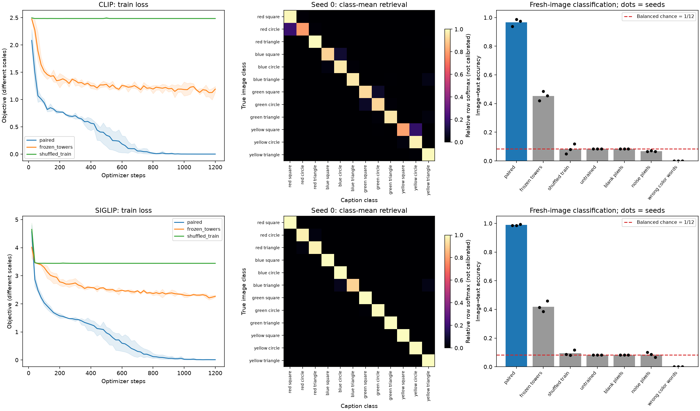
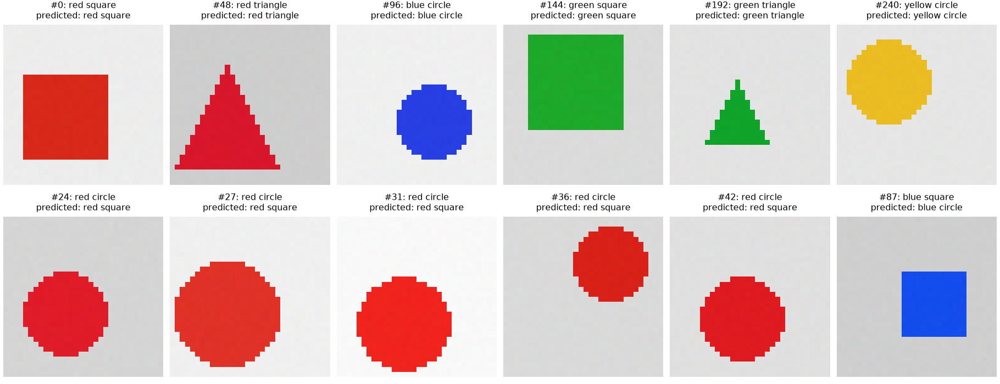
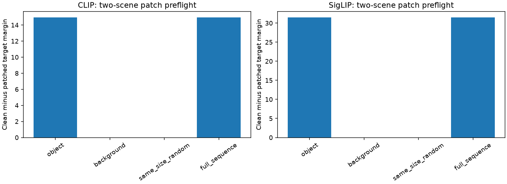
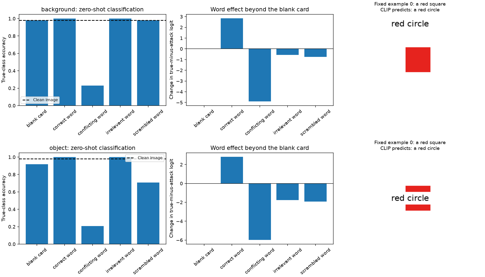

# [12.1] CLIP, SigLIP, and VLM Controls

**Can image and caption encoders learn a shared space from paired examples, and which visual tokens
carry a pretrained model's match?**

Start with a cosine calculation, then build a complete RGB CNN and causal caption encoder. Train
both towers with CLIP and SigLIP losses, retrieve fresh pictures and captions, inspect mistakes, and
break the claim with matched controls. Finally extract embeddings and patch visual activations in
pinned real checkpoints. Original ARENA chapters 0–4 remain unchanged.

## Learning Objectives

1. Implement normalized cosine logits and both alignment objectives.
2. Implement a pixel CNN, causal text block, explicit EOS pooling and projections.
3. Train both towers and compare independent instances across three seeds.
4. Score semantic retrieval with duplicate positives and honest tie handling.
5. Inspect controls, actual predictions and editable pixel/caption examples.
6. Extract real embeddings, cache activations and apply temporary patch hooks.
7. Compare object, background, same-size random and full-sequence interventions.
8. Trim generation prompts before scoring Qwen's answers.

Allow two sittings (roughly 4–6 hours including implementation). Tiny training supports CPU or CUDA;
the pinned real-model stage requires CUDA and cached or downloadable weights. Tests immediately
follow each implementation. Expected outputs, help and complete answers appear below them.

**Common bug:** fitting a projector on supplied labels or features can look like image learning. The full-encoder tests below require pixels, token content, gradients and fresh images.

## Core Question

Does the model use the correspondence between visible image content and caption words? A diagonal
training heatmap alone cannot answer this. Fresh instances, broken pairing and actual interventions
let us test the claim.


```python
import copy
import json
import math
import os
from typing import Sequence
import numpy as np
from torch import nn
import sys
from collections.abc import Callable, Mapping
from pathlib import Path

import matplotlib.pyplot as plt
import pandas as pd
import torch as t
import torch.nn.functional as F
from IPython.display import display

GT_TIER = "GT-1"
EXERCISE_ID = "12_1_clip_siglip_and_vlm_controls"
DIFFICULTY = 4
IMPORTANCE = 3
EXPECTED_RUNTIME = "4-6 hours in two sittings; optional pinned real-model cells require CUDA"
REQUIRES_GPU = True

chapter = "chapter12_vlm_interpretability"
section = "part1_clip_siglip_vlm_controls"
root_dir = next(p for p in [Path.cwd(), *Path.cwd().parents] if (p / chapter).exists())
exercises_dir = root_dir / chapter / "exercises"
section_dir = exercises_dir / section
assets_dir = root_dir / chapter / "instructions" / "assets"
for path in (root_dir, exercises_dir):
    if str(path) not in sys.path:
        sys.path.append(str(path))

import part1_clip_siglip_vlm_controls.tests as tests
from arena_ext.vlm_interpretability import (
    ContrastiveAlignmentReport,
    ToyCLIPTrainingResult,
    build_toy_clip_batch,
    deterministic_derangement,
    same_size_non_overlapping_token_control,
    toy_caption_features,
)

RUN_REAL_MODELS = t.cuda.is_available() and os.environ.get("ARENA_CLIP_CPU_ONLY") != "1"
REAL_MODELS = {
    "CLIP": (
        "openai/clip-vit-base-patch32",
        "3d74acf9a28c67741b2f4f2ea7635f0aaf6f0268",
        32,
        True,
    ),
    "SigLIP": (
        "google/siglip-base-patch16-224",
        "7fd15f0689c79d79e38b1c2e2e2370a7bf2761ed",
        16,
        False,
    ),
}
QWEN_ID = "Qwen/Qwen2.5-VL-3B-Instruct"
QWEN_REVISION = "66285546d2b821cf421d4f5eb2576359d3770cd3"
TEXTS = (
    "a simple red square on a white background",
    "a simple blue circle on a white background",
)
OBJECT_BBOX = (76, 76, 148, 148)
BACKGROUND_BBOX = (0, 0, 40, 40)

from part1_clip_siglip_vlm_controls import pixel_tests
from part1_clip_siglip_vlm_controls.pixel_clip import (
    PixelDataset,
    PIXEL_CAPTIONS,
    PIXEL_VOCAB,
    make_pixel_dataset,
    dataset_overlap,
    plot_pixel_comparison,
    pixel_comparison_payload,
)
```


## Cold Open: Inspect the Evidence Before the Model

The finite world below contains twelve paired images and captions. A useful representation must
retrieve the exact pair, reject deranged captions, and reject a caption that preserves shape but
changes color. This toy task is ground truth for the evaluation code used on real checkpoints later.


```python
toy_batch = build_toy_clip_batch(
    colors=("red", "blue", "green", "yellow"),
    shapes=("square", "circle", "triangle"),
    image_size=48,
)
fig, axes = plt.subplots(3, 4, figsize=(9, 6))
for ax, image, caption in zip(axes.flat, toy_batch.image_tensors, toy_batch.captions):
    ax.imshow(image.permute(1, 2, 0).numpy())
    ax.set_title(caption, fontsize=9)
    ax.axis("off")
fig.suptitle("Controlled image-text pairs")
plt.tight_layout()
plt.show()
```


### Exercise 1 - CLIP similarity and a falsifiable retrieval report

Implement normalized all-pairs cosine logits, then require both retrieval directions and the
diagonal-to-strongest-distractor margin. Test first on an exact orthogonal basis.


```python
def _normalize(values: t.Tensor) -> t.Tensor:
    raise NotImplementedError()


def clip_contrastive_logits(
    image_embeddings: t.Tensor, text_embeddings: t.Tensor, *, logit_scale: float = 10.0
) -> t.Tensor:
    raise NotImplementedError()


def contrastive_alignment_report(
    logits: t.Tensor, *, min_accuracy: float = 1.0, min_positive_margin: float = 1.0
) -> ContrastiveAlignmentReport:
    raise NotImplementedError()
```


```python
def contrastive_smoke_test():
    logits = clip_contrastive_logits(t.eye(3), t.eye(3), logit_scale=5.0)
    return contrastive_alignment_report(logits, min_positive_margin=4.0).__dict__


tests.test_contrastive_smoke_test(contrastive_smoke_test)
```


<details>
<summary>Expected output</summary>

Both retrieval accuracies are `1.0` and the exact margin is `5.0`.

</details>

<details>
<summary>Help - reason about the invariant</summary>

Normalize each row before multiplying. Mask the diagonal only when finding the strongest negative.

</details>

<details>
<summary>Solution</summary>

```python
def _normalize(values: t.Tensor) -> t.Tensor:
    values = values.float()
    return values / values.norm(dim=-1, keepdim=True).clamp_min(1e-8)


def clip_contrastive_logits(
    image_embeddings: t.Tensor,
    text_embeddings: t.Tensor,
    *,
    logit_scale: float = 10.0,
) -> t.Tensor:
    if image_embeddings.ndim != 2 or text_embeddings.ndim != 2:
        raise ValueError("embeddings must be rank-2 matrices.")
    if image_embeddings.shape[1] != text_embeddings.shape[1]:
        raise ValueError("image and text embedding widths must match.")
    return logit_scale * (_normalize(image_embeddings) @ _normalize(text_embeddings).T)


def contrastive_alignment_report(
    logits: t.Tensor,
    *,
    min_accuracy: float = 1.0,
    min_positive_margin: float = 1.0,
) -> ContrastiveAlignmentReport:
    if logits.ndim != 2 or logits.shape[0] != logits.shape[1]:
        raise ValueError("paired retrieval logits must be square.")
    targets = t.arange(logits.shape[0], device=logits.device)
    image_accuracy = float((logits.argmax(dim=1) == targets).float().mean())
    text_accuracy = float((logits.argmax(dim=0) == targets).float().mean())
    diagonal = logits.diag()
    mask = t.eye(logits.shape[0], dtype=t.bool, device=logits.device)
    strongest_image_negative = logits.masked_fill(mask, float("-inf")).max(dim=1).values
    strongest_text_negative = logits.masked_fill(mask, float("-inf")).max(dim=0).values
    margin = float(
        t.cat([diagonal - strongest_image_negative, diagonal - strongest_text_negative]).mean()
    )
    return ContrastiveAlignmentReport(
        image_to_text_accuracy=image_accuracy,
        text_to_image_accuracy=text_accuracy,
        mean_positive_margin=margin,
        aligned=image_accuracy >= min_accuracy
        and text_accuracy >= min_accuracy
        and margin >= min_positive_margin,
    )
```

</details>

<details>
<summary>Interpretation</summary>

The matrix is evidence only because its pairing and strongest-distractor margin are known exactly.

</details>


### Exercise 2 - SigLIP pairwise loss

Turn matching pairs into `+1`, mismatches into `-1`, and penalize every signed logit independently.


```python
def siglip_pairwise_loss(logits: t.Tensor, labels: t.Tensor) -> t.Tensor:
    raise NotImplementedError()
```


```python
def siglip_smoke_test():
    logits = t.tensor([[4.0, -4.0], [-3.0, 3.0]])
    return {"loss": float(siglip_pairwise_loss(logits, t.eye(2)))}


tests.test_siglip_smoke_test(siglip_smoke_test)
```


<details>
<summary>Expected output</summary>

The exact pairwise loss is approximately `0.03337`.

</details>

<details>
<summary>Help - reason about the invariant</summary>

Use `softplus(-label * logit)` so correct positive and negative pairs both have small loss.

</details>

<details>
<summary>Solution</summary>

```python
def siglip_pairwise_loss(logits: t.Tensor, labels: t.Tensor) -> t.Tensor:
    if logits.shape != labels.shape:
        raise ValueError("logits and labels must have the same shape.")
    signed_labels = t.where(labels > 0, 1.0, -1.0).to(logits)
    return F.softplus(-signed_labels * logits).mean()
```

</details>

<details>
<summary>Interpretation</summary>

Unlike CLIP's batch softmax, each SigLIP pair is an independent binary decision.

</details>


### Exercise 3 - Train a tiny CLIP before trusting a checkpoint

Learn separate image and text projections on the rendered grid. The code must optimize the same
all-pairs logits you just implemented.

This warm-up trains only projection matrices on supplied features. It is not a pixel or token
encoder; we build those next.


```python
def train_toy_clip_projectors(
    image_features: t.Tensor,
    text_features: t.Tensor,
    *,
    embedding_dim: int = 8,
    steps: int = 250,
    lr: float = 0.05,
    seed: int = 0,
) -> ToyCLIPTrainingResult:
    raise NotImplementedError()
```


```python
trained = train_toy_clip_projectors(toy_batch.image_features, toy_batch.text_features)
assert (
    trained.train_losses[-1] < 0.1 * trained.train_losses[0]
), "The contrastive loss should fall by at least 90%."
assert trained.report.aligned, "The trained toy CLIP should retrieve all paired examples."
fig, axes = plt.subplots(1, 2, figsize=(11, 4))
axes[0].plot(trained.train_losses)
axes[0].set(title="Tiny CLIP training", xlabel="step", ylabel="symmetric CE")
heat = axes[1].imshow(trained.retrieval_logits, cmap="viridis")
axes[1].set(title="Paired retrieval logits", xlabel="caption", ylabel="image")
fig.colorbar(heat, ax=axes[1])
plt.tight_layout()
plt.show()
```


<details>
<summary>Expected output</summary>

Loss falls by more than 90%; both paired retrieval accuracies reach `1.0`.

</details>

<details>
<summary>Help - reason about the invariant</summary>

Optimize two projection matrices jointly with image-to-text and text-to-image cross entropy.

</details>

<details>
<summary>Solution</summary>

```python
def train_toy_clip_projectors(
    image_features: t.Tensor,
    text_features: t.Tensor,
    *,
    embedding_dim: int = 8,
    steps: int = 250,
    lr: float = 0.05,
    seed: int = 0,
) -> ToyCLIPTrainingResult:
    generator = t.Generator(device="cpu").manual_seed(seed)
    image_projection = t.nn.Parameter(
        t.randn(image_features.shape[1], embedding_dim, generator=generator)
        / image_features.shape[1] ** 0.5
    )
    text_projection = t.nn.Parameter(
        t.randn(text_features.shape[1], embedding_dim, generator=generator)
        / text_features.shape[1] ** 0.5
    )
    optimizer = t.optim.Adam([image_projection, text_projection], lr=lr)
    targets = t.arange(image_features.shape[0])
    losses = []
    for _ in range(steps):
        logits = clip_contrastive_logits(
            image_features @ image_projection, text_features @ text_projection
        )
        loss = (F.cross_entropy(logits, targets) + F.cross_entropy(logits.T, targets)) / 2
        optimizer.zero_grad(set_to_none=True)
        loss.backward()
        optimizer.step()
        losses.append(float(loss.detach()))
    with t.no_grad():
        image_embeddings = image_features @ image_projection
        text_embeddings = text_features @ text_projection
        logits = clip_contrastive_logits(image_embeddings, text_embeddings)
        report = contrastive_alignment_report(logits)
    return ToyCLIPTrainingResult(
        image_projection=image_projection.detach(),
        text_projection=text_projection.detach(),
        image_embeddings=image_embeddings.detach(),
        text_embeddings=text_embeddings.detach(),
        retrieval_logits=logits.detach(),
        train_losses=tuple(losses),
        report=report,
    )
```

</details>

<details>
<summary>Interpretation</summary>

The heatmap should be read together with loss and retrieval metrics, not as a decorative diagonal.

</details>


### Exercise 4 - Break the toy claim with controls

Derange captions and replace each color word with a counterfactual color. Compute the same report
without changing its thresholds.


```python
permutation = deterministic_derangement(len(toy_batch.captions), seed=0)
deranged_logits = clip_contrastive_logits(
    trained.image_embeddings, trained.text_embeddings[permutation]
)
conflict_captions = tuple(
    f"a {scene.counterfactual_answer} {scene.shape}" for scene in toy_batch.scenes
)
conflict_features = toy_caption_features(
    conflict_captions, colors=toy_batch.colors, shapes=toy_batch.shapes
)
conflict_embeddings = conflict_features @ trained.text_projection
conflict_logits = clip_contrastive_logits(trained.image_embeddings, conflict_embeddings)
control_rows = []
for name, logits in {
    "paired": trained.retrieval_logits,
    "deranged": deranged_logits,
    "wrong_color": conflict_logits,
}.items():
    result = contrastive_alignment_report(logits)
    control_rows.append({"condition": name, **result.__dict__})
display(pd.DataFrame(control_rows))
assert (
    control_rows[0]["aligned"] and not control_rows[1]["aligned"] and not control_rows[2]["aligned"]
)
```


<details>
<summary>Expected output</summary>

Paired retrieval passes; deranged and wrong-color conditions fail the same gate.

</details>

<details>
<summary>Help - reason about the invariant</summary>

Do not retrain for a control. Change only the pairing or caption evidence and reuse the metric.

</details>

<details>
<summary>Solution</summary>

```python
# The complete control computation is the code cell directly above.
```

</details>

<details>
<summary>Interpretation</summary>

A model that still passes after caption derangement has not established paired cross-modal
alignment.

</details>


## From Projectors to a Complete Pixel-and-Token Model

The warm-up above learned two linear maps from supplied color/shape features. It did **not** learn
to read an image. Now remove those features: our image tower receives only a `(batch, 3, 32, 32)`
RGB tensor, and our text tower receives only token IDs and a padding mask. Labels may construct a
batch and score an answer; they never enter either tower.

**Question:** can both encoders learn a shared space in which a new picture retrieves the right
caption, and a caption retrieves any correct picture?

Follow the data: RGB → three convolution/GELU stages → a learned readout → projection → unit vector.
Caption → token and position embeddings → one causal attention/MLP block → EOS pooling → projection
→ unit vector. Their dot product is a cosine similarity. A learned positive scale controls its
sharpness. The module constructors are supplied; you implement their computations.

This reuses the CNN progression from original ARENA 0.2 and the attention implementation from
original ARENA 1.1. Complete those prerequisites if convolution shapes, residual connections, or
attention heads are unfamiliar. The tiny CNN and single text block are a teaching model, not CLIP's
full architecture. The official checkpoint comparison follows this experiment.

We use 576 training images (48 per class, renderer seed 100), development images from seed 200, and
288 evaluation images (24 per class, seed 300). The 1,200-step schedule was chosen on development
images and then fixed. Final evaluation is never passed to the optimizer. Position, size, color
shade, background and sensor noise vary independently between instances. All twelve color–shape
classes and the caption template are shared across splits. This measures fresh instances, not unseen
concepts or natural images. Zero exact pixel overlap is a useful leak check; sensor noise alone can
make bytes differ, so it does not prove novel geometry.


```python
pixel_train = make_pixel_dataset(examples_per_class=48, seed=100)
pixel_evaluation = make_pixel_dataset(examples_per_class=24, seed=300)
assert dataset_overlap(pixel_train, pixel_evaluation) == 0
fig, axes = plt.subplots(2, 6, figsize=(12, 4), constrained_layout=True)
for class_id, ax in enumerate(axes.flat):
    image_index = 24 * class_id
    ax.imshow(pixel_evaluation.images[image_index].permute(1, 2, 0))
    ax.set_title(PIXEL_CAPTIONS[class_id], fontsize=9)
    ax.axis("off")
plt.show()
print("Training:", pixel_train.images.shape, "Evaluation:", pixel_evaluation.images.shape)
```


### Exercise 5 — Tokenize captions without losing EOS

Build `[BOS, words..., EOS, PAD...]` sequences and a boolean mask. Use the explicit vocabulary, map
unknown words to UNK, and reject captions that would lose EOS at the context boundary. Our IDs
deliberately put EOS below ordinary word IDs; taking the largest ID is not a general pooling rule.

For `"A red square"` at length 7, work out the seven IDs before implementing. The mask marks valid
positions, not token values. Padding IDs can change while the mask stays false; downstream
predictions must stay the same.


```python
def tokenize_pixel_captions(
    captions: Sequence[str], vocab: dict[str, int], *, context_length: int = 12
):
    """Right-pad BOS/word/EOS sequences and return an explicit boolean validity mask."""
    raise NotImplementedError()
```


```python
pixel_tests.test_tokenizer(tokenize_pixel_captions)
print("Numerical checks passed.")
```


<details>
<summary>Expected output</summary>

The first sequence is `[1, 4, 8, 12, 2, 0, 0]`; five positions are valid. The overlong caption
raises `ValueError`.

</details>

<details>
<summary>Help — work through the shapes</summary>

Lowercase and split words. Allocate the full PAD matrix first, then fill each prefix through EOS.
Set exactly that prefix of the mask to True.

</details>

<details>
<summary>Solution</summary>

```python
def tokenize_pixel_captions(
    captions: Sequence[str], vocab: dict[str, int], *, context_length: int = 12
):
    """Right-pad BOS/word/EOS sequences and return an explicit boolean validity mask."""
    ids = t.full((len(captions), context_length), vocab["<pad>"], dtype=t.long)
    mask = t.zeros_like(ids, dtype=t.bool)
    for row, caption in enumerate(captions):
        tokens = [
            vocab["<bos>"],
            *(vocab.get(word, vocab["<unk>"]) for word in caption.lower().split()),
            vocab["<eos>"],
        ]
        if len(tokens) > context_length:
            raise ValueError("caption exceeds context_length; do not silently discard EOS")
        ids[row, : len(tokens)] = t.tensor(tokens)
        mask[row, : len(tokens)] = True
    return ids, mask
```

</details>

<details>
<summary>Interpretation</summary>

A tokenizer bug changes which evidence the text model sees. An explicit mask lets you test this
independently of learning.

</details>


### Exercise 6 — Implement the RGB image encoder

Use the supplied layers to transform RGB pixels into an eight- or 32-dimensional representation. Map
pixel values from `[0, 1]` to `[-1, 1]`, then apply convolution and GELU three times. Spatial sizes
are 32 → 16 → 8 → 4. Flatten only the channel and spatial axes; the readout consumes `32 * 4 * 4`
values per image. Reject engineered feature matrices in this encoder.

The test compares both your forward values and gradients with an independent functional convolution
calculation. It also flips actual pixels to establish that the model consumes spatial input.


```python
class PixelImageEncoder(nn.Module):
    """A complete small CNN: RGB pixels -> spatial features -> global representation."""

    def __init__(self, width: int = 32):
        super().__init__()
        self.conv1 = nn.Conv2d(3, 16, kernel_size=5, stride=2, padding=2)
        self.conv2 = nn.Conv2d(16, 32, kernel_size=3, stride=2, padding=1)
        self.conv3 = nn.Conv2d(32, 32, kernel_size=3, stride=2, padding=1)
        self.readout = nn.Linear(32 * 4 * 4, width)

    def forward(self, pixels: t.Tensor) -> t.Tensor:
        raise NotImplementedError()
```


```python
pixel_tests.test_pixel_cnn(PixelImageEncoder)
print("Numerical checks passed.")
```


<details>
<summary>Expected output</summary>

The double-precision forward and input/weight gradients match the independent convolution formula; a
rank-two feature matrix is rejected.

</details>

<details>
<summary>Help — work through the shapes</summary>

Apply `F.gelu` after each convolution. `hidden.flatten(1)` retains the batch axis. A learned spatial
readout preserves information that a simple mean of RGB channels would destroy.

</details>

<details>
<summary>Solution</summary>

```python
class PixelImageEncoder(nn.Module):
    """A complete small CNN: RGB pixels -> spatial features -> global representation."""

    def __init__(self, width: int = 32):
        super().__init__()
        self.conv1 = nn.Conv2d(3, 16, kernel_size=5, stride=2, padding=2)
        self.conv2 = nn.Conv2d(16, 32, kernel_size=3, stride=2, padding=1)
        self.conv3 = nn.Conv2d(32, 32, kernel_size=3, stride=2, padding=1)
        self.readout = nn.Linear(32 * 4 * 4, width)

    def forward(self, pixels: t.Tensor) -> t.Tensor:
        if pixels.ndim != 4 or tuple(pixels.shape[1:]) != (3, 32, 32):
            raise ValueError("image encoder expects RGB tensors of shape (batch, 3, 32, 32)")
        hidden = F.gelu(self.conv1(2 * pixels - 1))
        hidden = F.gelu(self.conv2(hidden))
        hidden = F.gelu(self.conv3(hidden))
        return self.readout(hidden.flatten(1))
```

</details>

<details>
<summary>Interpretation</summary>

You now have a trainable pixel encoder. The next exercises build an equally trainable text path, so
a good projector cannot conceal a missing encoder.

</details>


### Exercise 7 — Implement causal attention with padding

Implement one pre-norm transformer block. Split a single QKV projection into `(batch, heads, length,
head_width)` tensors. Scale scores by `sqrt(head_width)`. A key is visible only when it is valid
**and** not in the query's future. Softmax over keys, combine values, and restore the original
shape. Add the attention residual, then the pre-norm two-layer GELU MLP residual.

Our tokenizer always supplies a valid first token. Validate that convention; otherwise the first
attention row could contain only minus infinity and produce NaNs. Padding queries may be computed,
but they must not influence valid outputs. Predict which outputs can change if token 4 is perturbed.


```python
class PixelTextBlock(nn.Module):
    """One visible pre-norm causal attention/MLP block, including padding exclusion."""

    def __init__(self, width: int = 32, heads: int = 4):
        super().__init__()
        if width % heads:
            raise ValueError("width must divide into complete attention heads")
        self.heads = heads
        self.norm1 = nn.LayerNorm(width)
        self.qkv = nn.Linear(width, 3 * width, bias=False)
        self.attention_out = nn.Linear(width, width, bias=False)
        self.norm2 = nn.LayerNorm(width)
        self.fc1 = nn.Linear(width, 2 * width)
        self.fc2 = nn.Linear(2 * width, width)

    def forward(self, hidden: t.Tensor, valid_mask: t.Tensor) -> t.Tensor:
        raise NotImplementedError()
```


```python
pixel_tests.test_causal_text_block(PixelTextBlock)
print("Numerical checks passed.")
```


<details>
<summary>Expected output</summary>

Forward values and input gradients match PyTorch scaled-dot-product attention. Perturbing future or
padded content leaves the protected outputs unchanged.

</details>

<details>
<summary>Help — work through the shapes</summary>

The lower triangle has shape `(length, length)`; the key mask broadcasts as `(batch, 1, 1, length)`.
Their conjunction broadcasts across heads. Never softmax the query axis.

</details>

<details>
<summary>Solution</summary>

```python
class PixelTextBlock(nn.Module):
    """One visible pre-norm causal attention/MLP block, including padding exclusion."""

    def __init__(self, width: int = 32, heads: int = 4):
        super().__init__()
        if width % heads:
            raise ValueError("width must divide into complete attention heads")
        self.heads = heads
        self.norm1 = nn.LayerNorm(width)
        self.qkv = nn.Linear(width, 3 * width, bias=False)
        self.attention_out = nn.Linear(width, width, bias=False)
        self.norm2 = nn.LayerNorm(width)
        self.fc1 = nn.Linear(width, 2 * width)
        self.fc2 = nn.Linear(2 * width, width)

    def forward(self, hidden: t.Tensor, valid_mask: t.Tensor) -> t.Tensor:
        batch, length, width = hidden.shape
        if valid_mask.shape != (batch, length) or valid_mask.dtype != t.bool:
            raise ValueError("valid_mask must be a boolean batch-by-length matrix")
        if length == 0 or not bool(valid_mask[:, 0].all()):
            raise ValueError("every sequence needs a valid first token for causal attention")
        q, k, v = (
            self.qkv(self.norm1(hidden))
            .reshape(batch, length, 3, self.heads, width // self.heads)
            .unbind(2)
        )
        q, k, v = (item.transpose(1, 2) for item in (q, k, v))
        allowed = t.ones(length, length, dtype=t.bool, device=hidden.device).tril()
        allowed = allowed[None, None] & valid_mask[:, None, None, :]
        scores = (q @ k.transpose(-2, -1)) / math.sqrt(width // self.heads)
        attention = scores.masked_fill(~allowed, -t.inf).softmax(-1)
        mixed = (attention @ v).transpose(1, 2).reshape(batch, length, width)
        hidden = hidden + self.attention_out(mixed)
        return hidden + self.fc2(F.gelu(self.fc1(self.norm2(hidden))))
```

</details>

<details>
<summary>Interpretation</summary>

Causality and padding are separate constraints. The EOS query can collect every caption word, while
the word queries cannot read a later EOS or pad token.

</details>


### Exercise 8 — Pool the explicit EOS representation

Add token and learned position embeddings, run your block and final layer normalization, and gather
the position containing the one valid EOS token. Require a boolean mask and a context length
supported by the position table. Reject missing or repeated unmasked EOS tokens.

Why not pool `token_ids.argmax(-1)`? Why not average all twelve positions? Write down the effect of
either choice on a five-token caption with padding.


```python
class PixelTextEncoder(nn.Module):

    def __init__(self, vocab_size: int, width: int = 32, context_length: int = 12, eos_id: int = 2):
        super().__init__()
        self.eos_id = eos_id
        self.embedding = nn.Embedding(vocab_size, width)
        self.position = nn.Parameter(0.01 * t.randn(context_length, width))
        self.block = PixelTextBlock(width)
        self.final_norm = nn.LayerNorm(width)

    def forward(self, token_ids: t.Tensor, valid_mask: t.Tensor) -> t.Tensor:
        raise NotImplementedError()
```


```python
pixel_tests.test_eos_encoder(PixelTextEncoder)
print("Numerical checks passed.")
```


<details>
<summary>Expected output</summary>

EOS pooling matches the explicit position-4 result. Changing padded IDs does not change the
embedding. Content-word embeddings receive gradients.

</details>

<details>
<summary>Help — work through the shapes</summary>

Find `(token_ids == self.eos_id) & valid_mask`, check one match per row, and gather that position
after the block and final normalization.

</details>

<details>
<summary>Solution</summary>

```python
class PixelTextEncoder(nn.Module):
    def __init__(self, vocab_size: int, width: int = 32, context_length: int = 12, eos_id: int = 2):
        super().__init__()
        self.eos_id = eos_id
        self.embedding = nn.Embedding(vocab_size, width)
        self.position = nn.Parameter(0.01 * t.randn(context_length, width))
        self.block = PixelTextBlock(width)
        self.final_norm = nn.LayerNorm(width)

    def forward(self, token_ids: t.Tensor, valid_mask: t.Tensor) -> t.Tensor:
        if token_ids.shape != valid_mask.shape or token_ids.ndim != 2:
            raise ValueError("token ids and validity mask must be equal-shaped matrices")
        if token_ids.shape[1] > len(self.position) or valid_mask.dtype != t.bool:
            raise ValueError("use a boolean mask and stay within the position context")
        eos = (token_ids == self.eos_id) & valid_mask
        if not bool((eos.sum(-1) == 1).all()):
            raise ValueError("each caption needs exactly one unmasked EOS")
        hidden = self.embedding(token_ids) + self.position[: token_ids.shape[1]]
        hidden = self.final_norm(self.block(hidden, valid_mask))
        positions = eos.long().argmax(-1)
        return hidden[t.arange(len(hidden), device=hidden.device), positions]
```

</details>

<details>
<summary>Interpretation</summary>

Pooling a constant EOS token is useful because its hidden state has attended to the content. Pooling
its uncontextualized embedding would collapse all captions.

</details>


### Exercise 9 — Join the towers, normalize, and scale

Implement `encode_images`, `encode_texts` and `forward` using your two encoders and the supplied
projection heads. Normalize projected vectors to unit L2 norm. For image vectors U and text vectors
V, return `exp(logit_scale) * U @ V.T + logit_bias`.

The scalar scale is stored in log space so its exponential is positive. CLIP's shared scalar bias
cancels inside its row and column softmax losses; SigLIP needs a bias to model the imbalance between
matched and unmatched pairs. We initialize the scale to 10 and the bias to `-log(11)` for twelve
classes. The same initialization is used in the objective comparison.


```python
class PixelDualEncoder(nn.Module):

    def __init__(self, vocab_size: int, width: int = 32, embedding_dim: int = 16):
        super().__init__()
        self.image_encoder = PixelImageEncoder(width)
        self.text_encoder = PixelTextEncoder(vocab_size, width)
        self.image_projection = nn.Linear(width, embedding_dim, bias=False)
        self.text_projection = nn.Linear(width, embedding_dim, bias=False)
        self.logit_scale = nn.Parameter(t.tensor(math.log(10.0)))
        self.logit_bias = nn.Parameter(t.tensor(-math.log(11.0)))

    def encode_images(self, pixels: t.Tensor) -> t.Tensor:
        raise NotImplementedError()

    def encode_texts(self, token_ids: t.Tensor, valid_mask: t.Tensor) -> t.Tensor:
        raise NotImplementedError()

    def forward(self, pixels: t.Tensor, token_ids: t.Tensor, valid_mask: t.Tensor) -> t.Tensor:
        raise NotImplementedError()
```


```python
pixel_tests.test_dual_encoder(PixelDualEncoder)
print("Numerical checks passed.")
```


<details>
<summary>Expected output</summary>

Both embeddings have unit norm. With scale 7 and bias -1.5, the logits equal `7 * U @ V.T - 1.5`;
gradients reach both towers, both heads, scale and bias.

</details>

<details>
<summary>Help — work through the shapes</summary>

Normalize after each projection, along the embedding axis. Transpose only the text batch/embedding
axes. The output may be rectangular at evaluation.

</details>

<details>
<summary>Solution</summary>

```python
class PixelDualEncoder(nn.Module):
    def __init__(self, vocab_size: int, width: int = 32, embedding_dim: int = 16):
        super().__init__()
        self.image_encoder = PixelImageEncoder(width)
        self.text_encoder = PixelTextEncoder(vocab_size, width)
        self.image_projection = nn.Linear(width, embedding_dim, bias=False)
        self.text_projection = nn.Linear(width, embedding_dim, bias=False)
        self.logit_scale = nn.Parameter(t.tensor(math.log(10.0)))
        self.logit_bias = nn.Parameter(t.tensor(-math.log(11.0)))

    def encode_images(self, pixels: t.Tensor) -> t.Tensor:
        return F.normalize(self.image_projection(self.image_encoder(pixels)), dim=-1)

    def encode_texts(self, token_ids: t.Tensor, valid_mask: t.Tensor) -> t.Tensor:
        return F.normalize(self.text_projection(self.text_encoder(token_ids, valid_mask)), dim=-1)

    def forward(self, pixels: t.Tensor, token_ids: t.Tensor, valid_mask: t.Tensor) -> t.Tensor:
        image = self.encode_images(pixels)
        text = self.encode_texts(token_ids, valid_mask)
        return self.logit_scale.exp() * image @ text.T + self.logit_bias
```

</details>

<details>
<summary>Interpretation</summary>

The gradient fixture uses a non-invariant scalar objective to check bias wiring. Under the actual
CLIP loss, a global bias has zero gradient in exact arithmetic.

</details>


### Exercise 10 — Derive and implement both alignment losses

Each training batch has one image per semantic class and its caption in the matching column. This
prevents another image of the same class becoming a false negative. Evaluation will deliberately
contain duplicate positives.

For square logits L, implement CLIP's mean of image→text and text→image cross entropies, using
diagonal targets. For SigLIP use signed labels Y: +1 on the diagonal and -1 elsewhere, and compute

\[
\mathcal L_{\mathrm{SigLIP}}=\frac1N\sum_{i,j}\log(1+\exp(-Y_{ij}L_{ij})).
\]

Use `softplus` for numerical stability. This paper convention divides the pair sum by N. The earlier
pairwise warm-up averaged over N² pairs; multiply that warm-up loss by N to obtain this convention.
Their raw values and gradients therefore have different scales. Do not compare the two objectives'
loss heights as a quality score.

At three-by-three zero logits, derive CLIP loss `log(3)` and SigLIP loss `3 * log(2)`. Then derive
the gradient of a diagonal and an off-diagonal entry. Explain why changing a competing pair can
affect CLIP's gradient but does not change another pair's SigLIP gradient.


```python
def pixel_alignment_loss(logits: t.Tensor, *, objective: str) -> t.Tensor:
    """CLIP symmetric cross entropy or SigLIP sum-over-pairs divided by batch size."""
    raise NotImplementedError()
```


```python
pixel_tests.test_alignment_losses(pixel_alignment_loss)
print("Numerical checks passed.")
```


<details>
<summary>Expected output</summary>

CLIP gives 1.098612 and SigLIP 2.079442. The exact zero-logit gradients and a nonzero asymmetric
fixture pass; the SigLIP pair gradient is local.

</details>

<details>
<summary>Help — work through the shapes</summary>

CLIP gradients at zero are -2/9 on the diagonal and 1/9 elsewhere. SigLIP gradients are -1/6 and
1/6. `cross_entropy(logits.T, targets)` supplies the reverse direction.

</details>

<details>
<summary>Solution</summary>

```python
def pixel_alignment_loss(logits: t.Tensor, *, objective: str) -> t.Tensor:
    """CLIP symmetric cross entropy or SigLIP sum-over-pairs divided by batch size."""
    if logits.ndim != 2 or logits.shape[0] != logits.shape[1] or len(logits) == 0:
        raise ValueError("training uses square batches with one example per semantic class")
    count = len(logits)
    labels = t.arange(count, device=logits.device)
    if objective == "clip":
        return (F.cross_entropy(logits, labels) + F.cross_entropy(logits.T, labels)) / 2
    if objective == "siglip":
        signed = 2 * t.eye(count, device=logits.device) - 1
        return F.softplus(-signed * logits).sum() / count
    raise ValueError("objective must be clip or siglip")
```

</details>

<details>
<summary>Interpretation</summary>

The objectives express different interactions between pairs. This tiny matched comparison is not a
claim that one objective wins at the data and compute scale of the papers.

</details>


### Exercise 11 — Score semantic retrieval, including ties

At evaluation we have 288 images and twelve captions. A caption retrieves correctly if its top image
is **any** instance with that class. Comparing its top image index with the caption index is wrong.
Construct the full boolean positive matrix from the two label vectors.

Use each row's maximum for image→text and each column's maximum for text→image. Split exact ties
uniformly among the tied winners; this reports 1/12, rather than an index-order artifact, for a
collapsed balanced gallery. Require every query to have at least one positive. Do not use labels to
construct logits or to break ties in the model's favor.


```python
def semantic_retrieval_metrics(
    logits: t.Tensor, image_labels: t.Tensor, text_labels: t.Tensor
) -> dict[str, float]:
    """Score any semantically correct retrieved instance; split exact top ties fairly."""
    raise NotImplementedError()
```


```python
pixel_tests.test_semantic_retrieval(semantic_retrieval_metrics)
print("Numerical checks passed.")
```


<details>
<summary>Expected output</summary>

A four-image, two-caption gallery scores 1.0 both ways even with duplicate positives. Permuting
rows/columns and their labels preserves the score. All ties score 1/12 on the balanced twelve-class
fixture.

</details>

<details>
<summary>Help — work through the shapes</summary>

For each query, divide the number of tied winners that are positive by the number of tied winners.
Average those fractions across queries.

</details>

<details>
<summary>Solution</summary>

```python
def semantic_retrieval_metrics(
    logits: t.Tensor, image_labels: t.Tensor, text_labels: t.Tensor
) -> dict[str, float]:
    """Score any semantically correct retrieved instance; split exact top ties fairly."""
    if logits.shape != (len(image_labels), len(text_labels)):
        raise ValueError("labels must describe the rectangular retrieval matrix")
    positive = image_labels[:, None] == text_labels[None, :]
    if not bool(positive.any(0).all() and positive.any(1).all()):
        raise ValueError("every query must have a positive in its gallery")
    top_text = logits == logits.max(1, keepdim=True).values
    top_image = logits == logits.max(0, keepdim=True).values
    i2t = (top_text & positive).sum(1) / top_text.sum(1)
    t2i = (top_image & positive).sum(0) / top_image.sum(0)
    return {"image_to_text": float(i2t.float().mean()), "text_to_image": float(t2i.float().mean())}
```

</details>

<details>
<summary>Interpretation</summary>

Perfect text→image retrieval can coexist with imperfect image classification: each caption needs
only one strong positive. Always report both directions.

</details>


### Exercise 12 — Train both encoders on RGB and token IDs

Implement the optimizer loop. Pre-tokenize the twelve captions. Build index groups from labels, then
draw one training image per class per step. Compute your logits and objective, clear gradients,
backpropagate, clip the global gradient norm to 1, and take an AdamW step (learning rate 0.002,
weight decay 0.01). Clamp log scale between 0 and `log(100)` after the step. Return the complete
loss history and the L2 parameter change for each tower and projection head.

Use separate generators for image sampling and the shuffled-pair control. The latter reassigns
captions independently every step, so it cannot learn a stable wrong dictionary. It must see the
same image batches as the paired run. Frozen-tower controls keep the encoders fixed and train only
the heads and logit parameters; optimize only parameters whose `requires_grad` is true.

The immediate test reconstructs two independent AdamW updates in float64. That precision avoids
amplifying float32 cancellation noise in CLIP's theoretically redundant global bias. The actual
experiment trains in float32. Matching two updates is a debugging oracle, not a substitute for
held-out learning or the paired controls.


```python
def train_pixel_dual_encoder(
    model: nn.Module,
    dataset: PixelDataset,
    *,
    objective: str,
    steps: int = 1200,
    seed: int = 0,
    learning_rate: float = 0.002,
    shuffle_pairs: bool = False,
) -> dict:
    """Train directly on RGB and token IDs, sampling one image per class each step."""
    raise NotImplementedError()
```


```python
pixel_tests.test_training_loop(train_pixel_dual_encoder)
print("Numerical checks passed.")
```


<details>
<summary>Expected output</summary>

The two losses and updated parameters match the independent optimizer calculation. Both encoders and
both heads have nonzero, correctly reported parameter changes.

</details>

<details>
<summary>Help — work through the shapes</summary>

Keep image indices ordered by semantic class before any caption shuffle. Clone initial parameters
before training, and compute change norms after the final update. Pair-generator seed is `seed +
10000`.

</details>

<details>
<summary>Solution</summary>

```python
def train_pixel_dual_encoder(
    model: nn.Module,
    dataset: PixelDataset,
    *,
    objective: str,
    steps: int = 1200,
    seed: int = 0,
    learning_rate: float = 0.002,
    shuffle_pairs: bool = False,
) -> dict:
    """Train directly on RGB and token IDs, sampling one image per class each step."""
    device = next(model.parameters()).device
    generator = t.Generator().manual_seed(seed)
    pair_generator = t.Generator().manual_seed(seed + 10000)
    images = dataset.images.to(device)
    token_ids, valid_mask = tokenize_pixel_captions(dataset.captions, PIXEL_VOCAB)
    token_ids, valid_mask = token_ids.to(device), valid_mask.to(device)
    groups = [
        (dataset.labels == label).nonzero().flatten() for label in range(len(dataset.captions))
    ]
    if steps < 1 or any(len(group) == 0 for group in groups):
        raise ValueError("positive steps and at least one image per caption class are required")
    trainable = [parameter for parameter in model.parameters() if parameter.requires_grad]
    before = {name: parameter.detach().clone() for name, parameter in model.named_parameters()}
    optimizer = t.optim.AdamW(trainable, lr=learning_rate, weight_decay=0.01)
    losses = []
    model.train()
    for _ in range(steps):
        indices = t.stack(
            [group[t.randint(len(group), (), generator=generator)] for group in groups]
        ).to(device)
        order = (
            t.randperm(len(groups), generator=pair_generator).to(device)
            if shuffle_pairs
            else t.arange(len(groups), device=device)
        )
        logits = model(images[indices], token_ids[order], valid_mask[order])
        loss = pixel_alignment_loss(logits, objective=objective)
        optimizer.zero_grad(set_to_none=True)
        loss.backward()
        t.nn.utils.clip_grad_norm_(trainable, 1.0)
        optimizer.step()
        with t.no_grad():
            model.logit_scale.clamp_(0, math.log(100))
        losses.append(float(loss.detach()))
    changes = {}
    for prefix in ("image_encoder", "text_encoder", "image_projection", "text_projection"):
        changes[prefix] = math.sqrt(
            sum(
                float((p.detach() - before[n]).square().sum())
                for n, p in model.named_parameters()
                if n.startswith(prefix)
            )
        )
    return {
        "losses": losses,
        "parameter_change_norms": changes,
        "steps": steps,
        "examples_seen": steps * len(groups),
        "objective": objective,
        "shuffle_pairs": shuffle_pairs,
    }
```

</details>

<details>
<summary>Interpretation</summary>

Changing parameters alone does not establish learning. The next result asks whether those changes
improve independent images while a matched broken pairing does not.

</details>


### Exercise 13 — Evaluate a fresh gallery without a classifier head

Implement evaluation under `no_grad`: use evaluation mode, encode all images in batches of 64,
encode the caption gallery, construct logits, and call your semantic retrieval metric. Return logits
as well as scores and maximum embedding-norm errors. `image_override` lets us reuse exactly the same
labels and captions for blank/noise controls.

Image→caption retrieval also acts as classification by class descriptions: there is no separately
fitted classification head. Here the concepts and template occurred during training, so call it
**fresh-instance classification**, not generalization to unseen classes. CLIP's usual zero-shot
evaluation instead applies a pretrained model to downstream class names without training on that
downstream dataset. We distinguish these claims in the real-model stage.


```python
@t.no_grad()
def evaluate_pixel_model(
    model: nn.Module, dataset: PixelDataset, *, image_override: t.Tensor | None = None
) -> dict:
    raise NotImplementedError()
```


```python
pixel_tests.test_evaluation(evaluate_pixel_model)
print("Numerical checks passed.")
```


<details>
<summary>Expected output</summary>

The returned matrix equals a direct model forward pass. Norm errors are below 1e-6. Replacing every
image by the same white image gives 1/12 in both retrieval directions.

</details>

<details>
<summary>Help — work through the shapes</summary>

Keep the full rectangular matrix. Labels stay on the CPU with the detached logits. Do not call the
training loop, fit a probe, or select a threshold on evaluation images.

</details>

<details>
<summary>Solution</summary>

```python
@t.no_grad()
def evaluate_pixel_model(
    model: nn.Module, dataset: PixelDataset, *, image_override: t.Tensor | None = None
) -> dict:
    model.eval()
    device = next(model.parameters()).device
    ids, mask = tokenize_pixel_captions(dataset.captions, PIXEL_VOCAB)
    pixels = dataset.images if image_override is None else image_override
    text = model.encode_texts(ids.to(device), mask.to(device))
    image = t.cat([model.encode_images(batch.to(device)) for batch in pixels.split(64)])
    logits = (model.logit_scale.exp() * image @ text.T + model.logit_bias).cpu()
    return {
        **semantic_retrieval_metrics(logits, dataset.labels, t.arange(len(dataset.captions))),
        "logits": logits,
        "image_norm_max_error": float((image.norm(dim=-1) - 1).abs().max()),
        "text_norm_max_error": float((text.norm(dim=-1) - 1).abs().max()),
    }
```

</details>

<details>
<summary>Interpretation</summary>

A score answers a precise gallery question. Keep the images, captions and logits available so you
can inspect errors rather than trusting a scalar.

</details>


## Signature Result: Learn, Retrieve, and Break the Pairing

The following provided orchestration calls **your** classes, training loop, loss and evaluation
functions from this notebook's namespace. Read the three training conditions before running. They
start from copies of the same initialization and receive the same image batches. Every seed is
retained; the heatmaps and later play cell use the predeclared seed 0, not the best run.

We compare CLIP and SigLIP, each at seeds 0, 1 and 2, with full training, frozen towers and shuffled
training pairs. Untrained, white-image, independent noise and wrong-color caption controls require
no additional training. Frozen random features can contain useful color/shape information: this is a
strong baseline that need not fall to chance. For the wrong-color control, each caption's color
changes while its purported target label stays fixed; this is intentionally different from
relabeling a reordered gallery.


```python
def run_pixel_comparison(
    train_data: PixelDataset,
    evaluation_data: PixelDataset,
    *,
    device: str = "cpu",
    seeds: tuple[int, ...] = (0, 1, 2),
    steps: int = 1200,
) -> dict:
    """Visible experiment orchestration; all taught methods resolve in this namespace."""
    rows, histories, matrices, models = [], {}, {}, {}
    overlap = dataset_overlap(train_data, evaluation_data)
    if overlap:
        raise ValueError("evaluation contains training pixels")
    for objective in ("clip", "siglip"):
        for seed in seeds:
            t.manual_seed(seed)
            initial = PixelDualEncoder(len(PIXEL_VOCAB)).to(device)

            def record(condition, result):
                rows.append(
                    {
                        "objective": objective,
                        "seed": seed,
                        "condition": condition,
                        **{key: value for key, value in result.items() if key != "logits"},
                    }
                )
                if seed == seeds[0]:
                    matrices[f"{objective}/{condition}"] = result["logits"]

            record("untrained", evaluate_pixel_model(initial, evaluation_data))
            for condition in ("paired", "shuffled_train", "frozen_towers"):
                model = copy.deepcopy(initial)
                if condition == "frozen_towers":
                    for tower in (model.image_encoder, model.text_encoder):
                        tower.requires_grad_(False)
                history = train_pixel_dual_encoder(
                    model,
                    train_data,
                    objective=objective,
                    steps=steps,
                    seed=seed,
                    shuffle_pairs=condition == "shuffled_train",
                )
                histories[f"{objective}/{seed}/{condition}"] = history
                result = evaluate_pixel_model(model, evaluation_data)
                record(condition, result)
                if condition == "paired":
                    blank = t.ones_like(evaluation_data.images)
                    generator = t.Generator().manual_seed(seed + 700)
                    noise = t.rand(evaluation_data.images.shape, generator=generator)
                    record(
                        "blank_pixels",
                        evaluate_pixel_model(model, evaluation_data, image_override=blank),
                    )
                    record(
                        "noise_pixels",
                        evaluate_pixel_model(model, evaluation_data, image_override=noise),
                    )
                    # Replace every caption's color, retaining its original target label.
                    # This is a semantic mismatch control, not a reordering of the gallery labels.
                    permutation = t.arange(len(PIXEL_CAPTIONS)).roll(3)
                    wrong_logits = result["logits"][:, permutation]
                    record(
                        "wrong_color_words",
                        {
                            **semantic_retrieval_metrics(
                                wrong_logits, evaluation_data.labels, t.arange(len(PIXEL_CAPTIONS))
                            ),
                            "logits": wrong_logits,
                        },
                    )
                    if seed == seeds[0]:
                        models[objective] = model
                print(
                    f"{objective}, seed {seed}, {condition}: "
                    f"image→text {result['image_to_text']:.3f}; "
                    f"text→image {result['text_to_image']:.3f}",
                    flush=True,
                )
    return {
        "rows": rows,
        "histories": histories,
        "matrices": matrices,
        "models": models,
        "train_seed": train_data.seed,
        "evaluation_seed": evaluation_data.seed,
        "train_images": len(train_data.images),
        "evaluation_images": len(evaluation_data.images),
        "exact_pixel_overlap": overlap,
        "seeds": list(seeds),
        "steps": steps,
    }
```


```python
pixel_device = "cuda" if t.cuda.is_available() else "cpu"
pixel_result = run_pixel_comparison(pixel_train, pixel_evaluation, device=pixel_device)
pixel_rows = pd.DataFrame(pixel_result["rows"])
display(
    pixel_rows.groupby(["objective", "condition"])[["image_to_text", "text_to_image"]].agg(
        ["mean", "min", "max"]
    )
)
pixel_figure = plot_pixel_comparison(pixel_result, pixel_evaluation)
pixel_figure.savefig(assets_dir / "clip_pixel_encoder_comparison.png", dpi=140)
plt.show()
pixel_payload = pixel_comparison_payload(pixel_result)
pixel_payload.update(torch_version=t.__version__, device=pixel_device)
(section_dir / "expected_outputs" / "pixel_encoder_metrics.json").write_text(
    json.dumps(pixel_payload, indent=2)
)
```


<details>
<summary>Expected output and interpretation</summary>

The reference float32 CUDA run on 288 fresh images gives image→text accuracy
0.948–0.990 for CLIP and 0.986–0.993 for SigLIP across the three seeds.
Both have text→image accuracy 1.0: every caption finds a correct picture, although some individual
pictures still choose the wrong shape.

Shuffled pairing remains near chance (roughly 0.05–0.11). Blank images give 1/12. Frozen random
towers score roughly 0.39–0.49, showing why beating only chance would be a weak claim. Wrong-color
captions fail. Your precise floating-point trajectory may vary by device; inspect the measured
controls and all three seeds rather than comparing only the final loss.

The heatmaps average a row softmax within each true class for readability. These are relative
gallery scores, not calibrated class probabilities; even SigLIP is plotted this way for the same
retrieval comparison. Loss bands show the range across seeds after nonoverlapping 20-step smoothing.
Black dots in the accuracy panels are individual seeds, not independent datasets or a confidence
interval over the natural-image population.

</details>



### Inspect actual predictions

The upper row uses six fixed evaluation indices. The lower row shows up to six mistakes in index
order. This is a diagnostic error gallery, not a random sample from which to estimate accuracy. Read
the complete scores above first.


```python
example_logits = pixel_result["matrices"]["clip/paired"]
predictions = example_logits.argmax(1)
fixed_indices = list(range(0, 288, 48))
error_indices = (predictions != pixel_evaluation.labels).nonzero().flatten().tolist()[:6]
fig, axes = plt.subplots(2, 6, figsize=(13, 5), constrained_layout=True)
for row, indices in enumerate([fixed_indices, error_indices]):
    for column, ax in enumerate(axes[row]):
        ax.axis("off")
        if column >= len(indices):
            continue
        index = indices[column]
        ax.imshow(pixel_evaluation.images[index].permute(1, 2, 0))
        truth = PIXEL_CAPTIONS[int(pixel_evaluation.labels[index])][2:]
        guess = PIXEL_CAPTIONS[int(predictions[index])][2:]
        ax.set_title(f"#{index}: {truth}\npredicted: {guess}", fontsize=8)
fig.savefig(assets_dir / "clip_pixel_encoder_examples.png", dpi=140)
plt.show()
```




### Try It Yourself — Change the Pixels or a Caption

Change `play_index`, `noise_mix` (0 to 1), or one caption below and rerun this cell. Predict the top
caption first. Find a circle/square confusion, then inspect its pixels and the five competing
scores. Try a paraphrase containing untrained words; the result is a vocabulary/generalization
probe, not an OCR or language-understanding benchmark. We keep the trained model fixed.


```python
play_index = 0
noise_mix = 0.0
play_captions = list(PIXEL_CAPTIONS)
# Try: play_captions[0] = "a blue square"
play_model = pixel_result["models"]["clip"]
play_image = pixel_evaluation.images[play_index]
play_noise = t.rand(play_image.shape, generator=t.Generator().manual_seed(42))
play_image = (1 - noise_mix) * play_image + noise_mix * play_noise
play_ids, play_mask = tokenize_pixel_captions(play_captions, PIXEL_VOCAB)
with t.no_grad():
    play_scores = play_model(
        play_image[None].to(pixel_device), play_ids.to(pixel_device), play_mask.to(pixel_device)
    )[0].cpu()
values, indices = play_scores.topk(5)
fig, axes = plt.subplots(1, 2, figsize=(10, 3), constrained_layout=True)
axes[0].imshow(play_image.permute(1, 2, 0))
axes[0].set_title(f"Evaluation image {play_index}; noise mix {noise_mix}")
axes[0].axis("off")
axes[1].barh(range(5), values.flip(0))
axes[1].set_yticks(range(5), [play_captions[int(i)] for i in indices.flip(0)])
axes[1].set_xlabel("Learned similarity logit")
plt.show()
```


### Limits and questions to investigate

These are twelve familiar synthetic concepts under one renderer. We varied instances and optimizer
seeds, not scene semantics, data sources or train/test distributions. A new caption assembled from
unfamiliar words has untrained token embeddings. No OCR supervision has been supplied. The higher
SigLIP score in this small run does not reproduce its large-scale paper comparison.

Useful next experiments: reserve one color–shape combination **before** training; compare
global-average pooling with the spatial readout; or change the number of negatives while keeping
optimizer steps and examples seen explicit. Predict the failure mode, hold out a new evaluation seed
before tuning, and show both retrieval directions with the same controls.


## Real Checkpoints: You Own the Computation

The remaining exercises use the same operations on pinned CLIP and SigLIP checkpoints. Weight
loading and deterministic image rendering are plumbing; embedding extraction, retrieval, hooks,
interventions, controls, and metrics remain learner code.


### Exercise 14 - Extract real image and text embeddings

Call each tower explicitly, normalize its output, and compute both retrieval directions. Do not use
a preassembled report.


```python
def extract_contrastive_embeddings(
    model, batch: Mapping[str, t.Tensor]
) -> tuple[t.Tensor, t.Tensor]:
    raise NotImplementedError()


def bidirectional_retrieval_metrics(
    image_embeddings: t.Tensor,
    text_embeddings: t.Tensor,
    *,
    logit_scale: float = 1.0,
    logit_bias: float | t.Tensor = 0.0,
) -> dict[str, object]:
    raise NotImplementedError()
```


```python
tests.test_extract_contrastive_embeddings_normalizes_both_towers(extract_contrastive_embeddings)
tests.test_bidirectional_retrieval_metrics_uses_both_directions(bidirectional_retrieval_metrics)
```


<details>
<summary>Expected output</summary>

The exact dual-encoder oracle returns identity embeddings and a margin of `5.0`.

</details>

<details>
<summary>Help - reason about the invariant</summary>

Pass only pixel values to the image tower and token fields to the text tower; normalize after
extraction.

</details>

<details>
<summary>Solution</summary>

```python
def extract_contrastive_embeddings(
    model,
    batch: Mapping[str, t.Tensor],
) -> tuple[t.Tensor, t.Tensor]:
    if "pixel_values" not in batch or "input_ids" not in batch:
        raise KeyError("batch must contain pixel_values and input_ids.")
    image_output = model.get_image_features(pixel_values=batch["pixel_values"])
    text_kwargs = {"input_ids": batch["input_ids"]}
    if "attention_mask" in batch:
        text_kwargs["attention_mask"] = batch["attention_mask"]
    text_output = model.get_text_features(**text_kwargs)
    image = image_output if isinstance(image_output, t.Tensor) else image_output.pooler_output
    text = text_output if isinstance(text_output, t.Tensor) else text_output.pooler_output
    image, text = image.float(), text.float()
    return (
        image / image.norm(dim=-1, keepdim=True).clamp_min(1e-8),
        text / text.norm(dim=-1, keepdim=True).clamp_min(1e-8),
    )


def bidirectional_retrieval_metrics(
    image_embeddings: t.Tensor,
    text_embeddings: t.Tensor,
    *,
    logit_scale: float = 1.0,
    logit_bias: float | t.Tensor = 0.0,
) -> dict[str, object]:
    logits = clip_contrastive_logits(image_embeddings, text_embeddings, logit_scale=logit_scale)
    logits = logits + t.as_tensor(logit_bias, device=logits.device, dtype=logits.dtype)
    report = contrastive_alignment_report(
        logits, min_accuracy=0.0, min_positive_margin=float("-inf")
    )
    return {"logits": logits, **report.__dict__}
```

</details>

<details>
<summary>Interpretation</summary>

This makes the shared embedding space a visible computation instead of a black-box `model(**inputs)`
claim.

</details>


### Exercise 15 - Construct image-region and token-region controls

Patch pixels inside a bounding box and map that box to every overlapping visual token. Preserve
CLIP's class-token offset but omit it for SigLIP.


```python
def patch_image_region(clean_image, corrupt_image, bbox: tuple[int, int, int, int]):
    raise NotImplementedError()


def bbox_to_visual_tokens(
    bbox: tuple[int, int, int, int], *, image_size: int, patch_size: int, has_cls_token: bool
) -> tuple[int, ...]:
    raise NotImplementedError()
```


```python
assert bbox_to_visual_tokens(OBJECT_BBOX, image_size=224, patch_size=32, has_cls_token=True) == (
    17,
    18,
    19,
    24,
    25,
    26,
    31,
    32,
    33,
)
assert (
    len(bbox_to_visual_tokens(OBJECT_BBOX, image_size=224, patch_size=16, has_cls_token=False))
    == 36
)
print("Object token geometry is exact for CLIP and SigLIP.")
```


<details>
<summary>Expected output</summary>

CLIP maps the object to 9 patch tokens after its class token; SigLIP maps it to 36 tokens.

</details>

<details>
<summary>Help - reason about the invariant</summary>

Enumerate patch rectangles and use strict interval overlap. Add one only to patch-token indices when
a class token is present.

</details>

<details>
<summary>Solution</summary>

```python
def patch_image_region(clean_image, corrupt_image, bbox: tuple[int, int, int, int]):
    patched = clean_image.copy()
    patched.paste(corrupt_image.crop(bbox), bbox)
    return patched


def bbox_to_visual_tokens(
    bbox: tuple[int, int, int, int],
    *,
    image_size: int,
    patch_size: int,
    has_cls_token: bool,
) -> tuple[int, ...]:
    x1, y1, x2, y2 = bbox
    if not (0 <= x1 < x2 <= image_size and 0 <= y1 < y2 <= image_size):
        raise ValueError("bbox must have positive area inside the image.")
    grid = image_size // patch_size
    offset = int(has_cls_token)
    indices = []
    for row in range(grid):
        for col in range(grid):
            px1, py1 = col * patch_size, row * patch_size
            px2, py2 = px1 + patch_size, py1 + patch_size
            if max(x1, px1) < min(x2, px2) and max(y1, py1) < min(y2, py2):
                indices.append(offset + row * grid + col)
    return tuple(indices)
```

</details>

<details>
<summary>Interpretation</summary>

Token count is part of the causal claim: random controls must replace exactly the same number of
rows.

</details>


### Exercise 16 - Register a cache hook and replace hidden token rows

Capture exactly one tensor from the vision embedding module, remove the hook in a `finally` block,
and replace only selected sequence rows.


```python
def capture_module_output(
    module: t.nn.Module, forward_fn: Callable[[], object]
) -> tuple[object, t.Tensor]:
    raise NotImplementedError()


def patch_hidden_token_rows(
    clean_activations: t.Tensor,
    corrupt_activations: t.Tensor,
    token_indices: tuple[int, ...] | list[int],
) -> t.Tensor:
    raise NotImplementedError()
```


```python
tests.test_hook_cache_and_hidden_patch_are_causal(capture_module_output, patch_hidden_token_rows)
```


<details>
<summary>Expected output</summary>

The exact linear module's activation is captured once; one selected row changes and all other rows
remain clean.

</details>

<details>
<summary>Help - reason about the invariant</summary>

A hook is global mutable state. Always remove it even when the forward pass raises.

</details>

<details>
<summary>Solution</summary>

```python
def capture_module_output(
    module: t.nn.Module,
    forward_fn: Callable[[], object],
) -> tuple[object, t.Tensor]:
    captured = []

    def save_output(_module, _args, output):
        if not isinstance(output, t.Tensor):
            raise TypeError("the hook point must return a tensor.")
        captured.append(output.detach())

    handle = module.register_forward_hook(save_output)
    try:
        result = forward_fn()
    finally:
        handle.remove()
    if len(captured) != 1:
        raise RuntimeError(f"expected one activation, captured {len(captured)}.")
    return result, captured[0]


def patch_hidden_token_rows(
    clean_activations: t.Tensor,
    corrupt_activations: t.Tensor,
    token_indices: tuple[int, ...] | list[int],
) -> t.Tensor:
    if clean_activations.shape != corrupt_activations.shape or clean_activations.ndim != 3:
        raise ValueError(
            "clean and corrupt activations need matching [batch, token, hidden] shape."
        )
    index = t.tensor(tuple(token_indices), device=clean_activations.device)
    if index.numel() == 0 or index.unique().numel() != index.numel():
        raise ValueError("token_indices must be nonempty and unique.")
    if index.min() < 0 or index.max() >= clean_activations.shape[1]:
        raise ValueError("token index out of range.")
    patched = clean_activations.clone()
    patched[:, index] = corrupt_activations[:, index].to(patched)
    return patched
```

</details>

<details>
<summary>Interpretation</summary>

A localized activation intervention is meaningful only if unselected token rows are bit-for-bit
unchanged.

</details>


### Exercise 17 - Run a real activation patch

Compute corrupt visual embeddings once, register a temporary replacement hook, run the
otherwise-clean model, and return its image-text logits.


```python
def run_with_activation_patch(
    model,
    embedding_module: t.nn.Module,
    clean_inputs: Mapping[str, t.Tensor],
    corrupt_pixel_values: t.Tensor,
    token_indices: tuple[int, ...] | list[int],
) -> t.Tensor:
    raise NotImplementedError()
```


```python
pixel_tests.test_activation_patch(run_with_activation_patch)
print("Patch values and exception-safe hook cleanup passed.")
```


<details>
<summary>Expected output</summary>

On the pinned runs, full-sequence patch logits match the corrupt forward pass to numerical
precision.

</details>

<details>
<summary>Help - reason about the invariant</summary>

The patch hook must return a complete activation tensor with only selected rows changed.

</details>

<details>
<summary>Solution</summary>

```python
def run_with_activation_patch(
    model,
    embedding_module: t.nn.Module,
    clean_inputs: Mapping[str, t.Tensor],
    corrupt_pixel_values: t.Tensor,
    token_indices: tuple[int, ...] | list[int],
) -> t.Tensor:
    with t.inference_mode():
        corrupt_activations = embedding_module(corrupt_pixel_values)

    def patch_hook(_module, _args, clean_activations):
        return patch_hidden_token_rows(clean_activations, corrupt_activations, token_indices)

    handle = embedding_module.register_forward_hook(patch_hook)
    try:
        with t.inference_mode():
            return model(**dict(clean_inputs)).logits_per_image.detach().float().cpu()
    finally:
        handle.remove()
```

</details>

<details>
<summary>Interpretation</summary>

Full-sequence parity is the integration oracle for the hook: if it fails, do not interpret object
localization.

</details>


### Exercise 18 - Compute causal effects and matched controls

Turn each logit matrix into target-minus-counterfactual margins, then compare object, background,
same-size random, and full-sequence patches.


```python
def causal_patch_metrics(
    clean_logits: t.Tensor,
    corrupt_logits: t.Tensor,
    patched_logits: Mapping[str, t.Tensor],
    *,
    target_indices: t.Tensor,
    counterfactual_indices: t.Tensor,
) -> dict[str, object]:
    raise NotImplementedError()
```


```python
tests.test_causal_patch_metrics_separates_object_from_controls(causal_patch_metrics)
```


<details>
<summary>Expected output</summary>

Object and full-sequence conditions flip; background and same-size random controls preserve the
exact oracle.

</details>

<details>
<summary>Help - reason about the invariant</summary>

Use the same target and counterfactual caption indices for every condition. Effect is clean margin
minus patched margin.

</details>

<details>
<summary>Solution</summary>

```python
def causal_patch_metrics(
    clean_logits: t.Tensor,
    corrupt_logits: t.Tensor,
    patched_logits: Mapping[str, t.Tensor],
    *,
    target_indices: t.Tensor,
    counterfactual_indices: t.Tensor,
) -> dict[str, object]:
    def margins(logits: t.Tensor) -> t.Tensor:
        rows = t.arange(logits.shape[0], device=logits.device)
        return (
            logits[rows, target_indices.to(logits.device)]
            - logits[rows, counterfactual_indices.to(logits.device)]
        )

    clean = margins(clean_logits)
    corrupt = margins(corrupt_logits)
    rows = []
    for condition, logits in patched_logits.items():
        patched = margins(logits)
        rows.append(
            {
                "condition": condition,
                "mean_margin": float(patched.mean()),
                "mean_effect": float((clean - patched).mean()),
                "all_flip": bool((patched < 0).all()),
            }
        )
    return {"clean_margins": clean.tolist(), "corrupt_margins": corrupt.tolist(), "rows": rows}
```

</details>

<details>
<summary>Interpretation</summary>

The object patch is localized evidence only when its effect exceeds both matched controls.

</details>


### Exercise 19 - Decode Qwen answers without scoring the prompt

Generation returns prompt plus continuation. Trim the complete padded prompt width before decoding
the answer, then use exact controlled labels.


```python
def trim_generated_tokens(input_ids: t.Tensor, generated_ids: t.Tensor) -> list[t.Tensor]:
    raise NotImplementedError()


def generate_qwen_answers(model, processor, inputs, *, max_new_tokens: int = 8) -> list[str]:
    raise NotImplementedError()
```


```python
tests.test_trim_generated_tokens_removes_prompt_prefix(trim_generated_tokens)
```


<details>
<summary>Expected output</summary>

The exact token oracle keeps only the two generated tokens in each row.

</details>

<details>
<summary>Help - reason about the invariant</summary>

Slice every generated row at `len(prompt_row)`, not at the number of non-padding tokens.

</details>

<details>
<summary>Solution</summary>

```python
def trim_generated_tokens(input_ids: t.Tensor, generated_ids: t.Tensor) -> list[t.Tensor]:
    if (
        input_ids.ndim != 2
        or generated_ids.ndim != 2
        or input_ids.shape[0] != generated_ids.shape[0]
    ):
        raise ValueError("input_ids and generated_ids need matching rank-2 batch axes.")
    return [output[len(prompt) :] for prompt, output in zip(input_ids, generated_ids)]


def generate_qwen_answers(model, processor, inputs, *, max_new_tokens: int = 8) -> list[str]:
    with t.inference_mode():
        generated = model.generate(**inputs, max_new_tokens=max_new_tokens, do_sample=False)
    trimmed = trim_generated_tokens(inputs.input_ids, generated)
    return [
        answer.strip().lower()
        for answer in processor.batch_decode(trimmed, skip_special_tokens=True)
    ]
```

</details>

<details>
<summary>Interpretation</summary>

Qwen is a bounded generation comparison here, not evidence for hidden-token localization.

</details>


## Real Checkpoint Result: Localize a Match

The full pixel-encoder experiment above is the main fresh-instance learning result. Here the actual
pinned CLIP/SigLIP forwards produce a small causal preflight: object-token patches, matched
random/background controls and full-sequence parity. Qwen provides a separate two-scene generation
check. The bars below are generated by your implementations in this kernel.


```python
def render_real_shape(color: str, shape: str):
    from PIL import Image, ImageDraw

    image = Image.new("RGB", (224, 224), "white")
    draw = ImageDraw.Draw(image)
    if shape == "square":
        draw.rectangle(OBJECT_BBOX, fill=color)
    elif shape == "circle":
        draw.ellipse(OBJECT_BBOX, fill=color)
    else:
        raise ValueError("shape must be square or circle.")
    return image


def load_pinned_contrastive_model(kind: str, device: str = "cuda"):
    from huggingface_hub import snapshot_download
    from transformers import AutoProcessor, CLIPModel, CLIPProcessor, SiglipModel

    model_id, revision, _, _ = REAL_MODELS[kind]
    patterns = ["config.json", "preprocessor_config.json", "tokenizer.json",
                "tokenizer_config.json", "special_tokens_map.json", "vocab.json",
                "merges.txt", "spiece.model", "sentencepiece.bpe.model"]
    patterns.append("pytorch_model.bin" if kind == "CLIP" else "model.safetensors")
    snapshot = snapshot_download(model_id, revision=revision, allow_patterns=patterns)
    if kind == "CLIP":
        return CLIPModel.from_pretrained(snapshot).to(device).eval(), CLIPProcessor.from_pretrained(
            snapshot, use_fast=False
        )
    return SiglipModel.from_pretrained(snapshot, use_safetensors=True, dtype=t.float16).to(
        device
    ).eval(), AutoProcessor.from_pretrained(snapshot, use_fast=False)


def run_real_contrastive_study(kind: str) -> dict[str, object]:
    model, processor = load_pinned_contrastive_model(kind)
    _, _, patch_size, has_cls = REAL_MODELS[kind]
    images = [render_real_shape("red", "square"), render_real_shape("blue", "circle")]
    corrupt_images = images[::-1]
    padding = "max_length" if kind == "SigLIP" else True
    clean_inputs = processor(
        text=list(TEXTS), images=images, return_tensors="pt", padding=padding
    ).to("cuda")
    corrupt_inputs = processor(
        text=list(TEXTS), images=corrupt_images, return_tensors="pt", padding=padding
    ).to("cuda")
    image_embeddings, text_embeddings = extract_contrastive_embeddings(model, clean_inputs)
    cosine = bidirectional_retrieval_metrics(
        image_embeddings,
        text_embeddings,
        logit_scale=float(model.logit_scale.exp().detach()),
        logit_bias=getattr(model, "logit_bias", 0.0),
    )
    embedding_module = model.vision_model.embeddings
    object_indices = bbox_to_visual_tokens(
        OBJECT_BBOX, image_size=224, patch_size=patch_size, has_cls_token=has_cls
    )
    background_indices = bbox_to_visual_tokens(
        BACKGROUND_BBOX, image_size=224, patch_size=patch_size, has_cls_token=has_cls
    )
    _, sample_cache = capture_module_output(
        embedding_module, lambda: embedding_module(clean_inputs.pixel_values)
    )
    random_indices = same_size_non_overlapping_token_control(
        object_indices,
        num_tokens=sample_cache.shape[1],
        protected_indices=tuple(background_indices) + ((0,) if has_cls else ()),
        seed=0,
    )
    full_indices = tuple(range(1 if has_cls else 0, sample_cache.shape[1]))
    with t.inference_mode():
        clean_logits = model(**clean_inputs).logits_per_image.detach().float().cpu()
        corrupt_logits = (
            model(**{**clean_inputs, "pixel_values": corrupt_inputs.pixel_values})
            .logits_per_image.detach()
            .float()
            .cpu()
        )
    official_logit_error = float((cosine["logits"].detach().float().cpu() - clean_logits).abs().max())
    parity_tolerance = 1e-4 if kind == "CLIP" else 0.05
    assert official_logit_error < parity_tolerance, "Extracted embeddings must reconstruct official logits."
    patched = {
        name: run_with_activation_patch(
            model, embedding_module, clean_inputs, corrupt_inputs.pixel_values, indices
        )
        for name, indices in {
            "object": object_indices,
            "background": background_indices,
            "same_size_random": random_indices,
            "full_sequence": full_indices,
        }.items()
    }
    causal = causal_patch_metrics(
        clean_logits,
        corrupt_logits,
        patched,
        target_indices=t.tensor([0, 1]),
        counterfactual_indices=t.tensor([1, 0]),
    )
    return {
        "kind": kind,
        "cosine": cosine,
        "causal": causal,
        "object_indices": object_indices,
        "random_indices": random_indices,
        "official_logit_max_abs_error": official_logit_error,
        "official_logit_parity_tolerance": parity_tolerance,
    }


def run_real_qwen_study() -> dict[str, object]:
    from transformers import AutoProcessor, Qwen2_5_VLForConditionalGeneration

    processor = AutoProcessor.from_pretrained(
        QWEN_ID, revision=QWEN_REVISION, min_pixels=224 * 224, max_pixels=224 * 224, use_fast=False
    )
    model = Qwen2_5_VLForConditionalGeneration.from_pretrained(
        QWEN_ID,
        revision=QWEN_REVISION,
        dtype=t.bfloat16,
        device_map="cuda",
        attn_implementation="eager",
    ).eval()
    images = [render_real_shape("red", "square"), render_real_shape("blue", "circle")]
    messages = [
        [
            {
                "role": "user",
                "content": [
                    {"type": "image", "image": image},
                    {"type": "text", "text": "Answer with two lowercase words: color shape."},
                ],
            }
        ]
        for image in images
    ]
    prompts = [
        processor.apply_chat_template(message, tokenize=False, add_generation_prompt=True)
        for message in messages
    ]
    inputs = processor(text=prompts, images=images, return_tensors="pt", padding=True).to("cuda")
    answers = generate_qwen_answers(model, processor, inputs)
    expected = ["red square", "blue circle"]
    return {
        "answers": answers,
        "expected": expected,
        "accuracy": sum(answer == target for answer, target in zip(answers, expected))
        / len(expected),
    }
```


```python
if RUN_REAL_MODELS:
    real_results = {kind: run_real_contrastive_study(kind) for kind in REAL_MODELS}
    for kind, result in real_results.items():
        display(pd.DataFrame(result["causal"]["rows"]).assign(model=kind))
    fig, axes = plt.subplots(1, 2, figsize=(11, 4), constrained_layout=True)
    for ax, (kind, result) in zip(axes, real_results.items()):
        rows = result["causal"]["rows"]
        ax.bar([row["condition"] for row in rows], [row["mean_effect"] for row in rows])
        ax.set(
            title=f"{kind}: two-scene patch preflight", ylabel="Clean minus patched target margin"
        )
        ax.tick_params(axis="x", rotation=35)
    fig.savefig(assets_dir / "clip_siglip_live_patch_results.png", dpi=140)
    plt.show()
    display(pd.DataFrame([
        {"model": kind, "official_logit_max_abs_error": item["official_logit_max_abs_error"],
         "tolerance": item["official_logit_parity_tolerance"]}
        for kind, item in real_results.items()
    ]))
    qwen_result = run_real_qwen_study()
    display(
        pd.DataFrame({"expected": qwen_result["expected"], "Qwen answer": qwen_result["answers"]})
    )
    real_payload = {
        kind: {key: value for key, value in item.items() if key != "cosine"}
        for kind, item in real_results.items()
    }
    real_payload["qwen"] = qwen_result
    (section_dir / "expected_outputs" / "real_checkpoint_metrics.json").write_text(json.dumps(real_payload, indent=2))
else:
    print("Real checkpoints skipped: this run supports only the executed tiny-encoder results.")


def run_gpu_test(max_vram_gb: float = 24.0) -> dict[str, object]:
    if not t.cuda.is_available():
        raise RuntimeError("12.1 real-model study requires CUDA.")
    t.cuda.reset_peak_memory_stats()
    result = {
        "contrastive": {kind: run_real_contrastive_study(kind) for kind in REAL_MODELS},
        "qwen": run_real_qwen_study(),
    }
    result["peak_vram_gb"] = t.cuda.max_memory_allocated() / 1024**3
    result["within_vram_budget"] = result["peak_vram_gb"] <= max_vram_gb
    return result


def run_full_experiment(max_vram_gb: float = 24.0) -> dict[str, object]:
    return run_gpu_test(max_vram_gb=max_vram_gb)
```




## Zero-Shot Classification and Typographic Conflict in Pretrained CLIP

The tiny encoders above never learned to read words drawn into images. Their response to a word
overlay would not establish the behavior of pretrained CLIP. We now use the pinned
`openai/clip-vit-base-patch32` checkpoint with twelve class descriptions and **no downstream
fitting**. This is zero-shot classification on our rendered dataset. We do not claim the model's
original pretraining excluded these concepts or this rendering style.

The motivation is the published observation that CLIP can respond to a written concept as well as to
its visual appearance. [OpenAI's multimodal-neuron
study](https://openai.com/index/multimodal-neurons/) demonstrates typographic attacks; our
controlled exercise tests a specific checkpoint and renderer rather than reproducing every result in
that study.

There are 48 scenes: four new layouts per color–shape class, renderer seed 400, a fixed font and no
attack optimization. Each image receives the same ten interventions: a blank white card, correct
words, a conflicting shape name, irrelevant words, or scrambled conflict letters, each placed in
either the background or across the object. Color words stay fixed in the attack. Background cards
never overlap the object. Object cards have a matched blank version so that covering the shape is
not mistaken for a semantic text effect.

### Exercise 20 — Measure a Targeted Flip, Not Just an Error

Implement `typographic_attack_metrics`. Report ordinary accuracy and how often the model selects the
attacker's named class. Then compute targeted flip rate **among images the baseline classified
correctly**. Return `None` if that denominator is zero. An image already wrong before the overlay
cannot count as a newly induced targeted failure.

Also calculate the change in the true-minus-attack logit margin. A negative change favors the
written conflicting class. We call this metric once with the unmodified image baseline and once with
the matching blank-card baseline. For each comparison, report the denominator alongside the flip
rate.


```python
def typographic_attack_metrics(baseline_logits: t.Tensor, condition_logits: t.Tensor, true_labels: t.Tensor, attack_labels: t.Tensor) -> dict:
    raise NotImplementedError()
```


```python
pixel_tests.test_typographic_metrics(typographic_attack_metrics)
print("Targeted flip and matched-margin checks passed.")
```


<details>
<summary>Expected output</summary>

In the four-image fixture, three baselines are correct, two suffer a targeted flip, and one stays
correct. Accuracy is 1/4, attack-choice rate is 3/4, and targeted flip rate is 2/3. Mean margin
change is -3. A zero denominator returns None. This catches confusing total attack-class choices
with induced flips.

</details>

<details>
<summary>Help - keep the denominator explicit</summary>

Find the baseline-correct boolean mask before scoring the changed prediction. Select that mask when
counting the attacker's class. Compute both margins with the same true/attack class indices, then
subtract baseline from condition.

</details>

<details>
<summary>Solution</summary>

```python
def typographic_attack_metrics(
    baseline_logits: t.Tensor,
    condition_logits: t.Tensor,
    true_labels: t.Tensor,
    attack_labels: t.Tensor,
) -> dict:
    """Separate ordinary errors from targeted flips among baseline-correct images."""
    if baseline_logits.shape != condition_logits.shape or baseline_logits.ndim != 2:
        raise ValueError("baseline and condition need equal rectangular logit matrices")
    if true_labels.shape != (len(baseline_logits),) or attack_labels.shape != true_labels.shape:
        raise ValueError("provide one true and attack label per image")
    if bool((true_labels == attack_labels).any()):
        raise ValueError("a targeted attack must name a different class")
    index = t.arange(len(baseline_logits), device=baseline_logits.device)
    true_labels, attack_labels = true_labels.to(index.device), attack_labels.to(index.device)
    baseline_correct = baseline_logits.argmax(1) == true_labels
    prediction = condition_logits.argmax(1)
    baseline_margin = baseline_logits[index, true_labels] - baseline_logits[index, attack_labels]
    condition_margin = condition_logits[index, true_labels] - condition_logits[index, attack_labels]
    denominator = int(baseline_correct.sum())
    return {
        "image_count": len(index),
        "baseline_correct_count": denominator,
        "baseline_accuracy": float(baseline_correct.float().mean()),
        "accuracy": float((prediction == true_labels).float().mean()),
        "attack_choice_rate": float((prediction == attack_labels).float().mean()),
        "targeted_flip_rate": (
            float((prediction[baseline_correct] == attack_labels[baseline_correct]).float().mean())
            if denominator
            else None
        ),
        "mean_margin_change": float((condition_margin - baseline_margin).mean()),
    }
```

</details>

<details>
<summary>Interpretation</summary>

The attack may select the named class, induce a different error, or leave the answer unchanged while
reducing the margin. These are distinct outcomes. The blank-card comparison asks how much the words
add beyond occlusion.

</details>


### Run the Controlled Overlay Experiment

Rendering, font loading and batching are supplied. The batching helper calls your
`extract_contrastive_embeddings` and `typographic_attack_metrics` explicitly. The entire comparison
loop is shown here so you can inspect which baseline accompanies each condition. It does not train
or tune CLIP.


```python
from part1_clip_siglip_vlm_controls.typography import (
    make_typographic_dataset, plot_typographic_study,
)
def run_typographic_study(
    model, processor, dataset: dict, *, extract_fn, metric_fn, batch_size: int = 24
) -> dict:
    """Provided batching; call the supplied learner extractor and metric explicitly."""
    device = next(model.parameters()).device
    captions = [f"a simple {caption[2:]} on a white background" for caption in PIXEL_CAPTIONS]
    matrices = {}
    for condition, images in dataset["images"].items():
        rows = []
        for start in range(0, len(images), batch_size):
            batch = processor(
                images=images[start : start + batch_size],
                text=captions,
                return_tensors="pt",
                padding=True,
            ).to(device)
            with t.inference_mode():
                image_embeddings, text_embeddings = extract_fn(model, batch)
                rows.append((model.logit_scale.exp() * image_embeddings @ text_embeddings.T).cpu())
        matrices[condition] = t.cat(rows)
    metrics = []
    for condition, logits in matrices.items():
        placement = condition.split("/")[0]
        card_key = f"{placement}/blank_card"
        baseline_key = card_key if card_key in matrices else "clean"
        clean = metric_fn(matrices["clean"], logits, dataset["labels"], dataset["attack_labels"])
        matched = metric_fn(
            matrices[baseline_key], logits, dataset["labels"], dataset["attack_labels"]
        )
        metrics.append(
            {
                "condition": condition,
                "matched_baseline": baseline_key,
                **clean,
                "matched_card_targeted_flip_rate": matched["targeted_flip_rate"],
                "matched_card_margin_change": matched["mean_margin_change"],
                "matched_card_correct_count": matched["baseline_correct_count"],
            }
        )
    return {
        "rows": metrics,
        "matrices": matrices,
        "seed": dataset["seed"],
        "font_sha256": dataset["font_sha256"],
        "font_size": dataset["font_size"],
        "image_count": len(dataset["labels"]),
        "captions": captions,
    }
```


```python
if RUN_REAL_MODELS:
    typo_dataset = make_typographic_dataset(examples_per_class=4, seed=400)
    typo_model, typo_processor = load_pinned_contrastive_model("CLIP")
    typo_result = run_typographic_study(
        typo_model, typo_processor, typo_dataset,
        extract_fn=extract_contrastive_embeddings, metric_fn=typographic_attack_metrics,
    )
    display(pd.DataFrame(typo_result["rows"])[[
        "condition", "accuracy", "baseline_correct_count", "targeted_flip_rate",
        "matched_card_correct_count", "matched_card_targeted_flip_rate",
        "matched_card_margin_change",
    ]])
    typo_figure = plot_typographic_study(typo_result, typo_dataset)
    typo_figure.savefig(assets_dir / "clip_typographic_controls.png", dpi=140)
    plt.show()
    typo_payload = {key: value for key, value in typo_result.items() if key != "matrices"}
    typo_payload.update(model_id=REAL_MODELS["CLIP"][0], revision=REAL_MODELS["CLIP"][1])
    (section_dir / "expected_outputs" / "typographic_metrics.json").write_text(json.dumps(typo_payload, indent=2))
else:
    print("Typography requires the real checkpoint; no OCR claim is inferred from the tiny encoders.")
```


<details>
<summary>Expected output and interpretation</summary>

The pinned reference run classifies 47/48 clean images correctly. Background conflicting words
reduce accuracy to 11/48, while correct and irrelevant words give 48/48 and scrambled letters give
47/48. A white background card does not alter any image pixels. Thus occluding the object cannot
explain the background-word effect.

An object-covering blank card already reduces accuracy to 44/48. Conflicting words on that card
reduce it to 10/48; the matched-card targeted flip rate is 34/44. Object-covering scrambled letters
also hurt accuracy (34/48), so that control is imperfect and should remain visible. Read its effect
separately from the larger effect of meaningful conflicting words.

The two pictures show fixed example 0, not the largest successful attack. Inspect all 48 examples
before generalizing. This is one checkpoint, font, caption set and rendered-scene distribution. It
establishes behavior on this controlled set; it does not locate an OCR circuit or establish
robustness to natural-image attacks. The adjacent activation-patching exercise remains a separate
two-scene mechanistic preflight.

</details>



### Try It Yourself — Inspect One Word Conflict

Change `typo_index` or the condition below and rerun. Compare the conflicting word with its blank,
irrelevant and scrambled controls at the same placement. The displayed probabilities are relative
softmax scores over these twelve captions, not calibrated confidence. To study a new font or phrase,
edit the provided renderer and regenerate the complete matched dataset before drawing a new
conclusion.


```python
typo_index = 0
typo_condition = "background/conflicting_word"
if RUN_REAL_MODELS:
    fig, axes = plt.subplots(1, 2, figsize=(10, 3), constrained_layout=True)
    axes[0].imshow(typo_dataset["images"][typo_condition][typo_index])
    axes[0].axis("off")
    values, indices = typo_result["matrices"][typo_condition][typo_index].softmax(0).topk(5)
    axes[1].barh(range(5), values.flip(0))
    axes[1].set_yticks(range(5), [PIXEL_CAPTIONS[int(i)] for i in indices.flip(0)])
    axes[1].set_xlabel("Relative score over the caption gallery")
    plt.show()
```


## Try It Yourself

Change one variable at a time: move `OBJECT_BBOX`, use `BACKGROUND_BBOX` as the purported object,
swap only color while preserving shape, or replace `kind = "CLIP"` with `"SigLIP"`. Predict the
target margin before running.


```python
kind = "CLIP"
play_bbox = OBJECT_BBOX
play_indices = bbox_to_visual_tokens(play_bbox, image_size=224, patch_size=REAL_MODELS[kind][2], has_cls_token=REAL_MODELS[kind][3])
print(kind, play_bbox, play_indices)
```


## Interpreting the Result

- **Retrieval success** says paired representations align on this controlled set.
- **Object patch flips** say counterfactual evidence in object-token rows is causally sufficient to reverse the pairwise choice.
- **Background and same-size random preservation** reject patch-size and generic-perturbation explanations.
- **Full-sequence parity** validates the hook and replacement mechanism.
- **Qwen generation** is behavioral grounding only; it does not localize a mechanism.

## Bonus: Hunt an Anomaly

Translate the shape until its box straddles patch boundaries. Does a larger token set dilute the
object-vs-control gap? Repeat across seeds for the same-size random control and report the complete
distribution, not the most favorable seed.

## Limitations

The real-model evidence uses two controlled rendered images, so it is a pinned mechanistic preflight
rather than a broad claim about natural-image retrieval, hallucination, or VLM reasoning. Qwen is
checked behaviorally on two safe prompts. A research-grade extension needs at least twenty held-out
counterfactual scenes, natural-image controls, multiple hook points, and uncertainty across examples
and random control sets.

## Reading Links

- [Learning Transferable Visual Models From Natural Language Supervision](https://arxiv.org/abs/2103.00020)
- [Sigmoid Loss for Language Image Pre-Training](https://arxiv.org/abs/2303.15343)
- [Qwen2.5-VL Technical Report](https://arxiv.org/abs/2502.13923)
- [Transformer Circuits: activation patching](https://transformer-circuits.pub/2021/framework/index.html)

## Verification Appendix

`verification_report.json` records the post-rewrite CUDA 13.2 run and pinned revisions. It is
supporting evidence; the notebook does not load it to manufacture experiment outputs.
