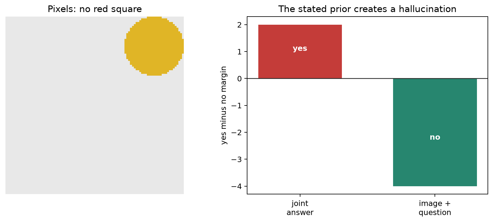
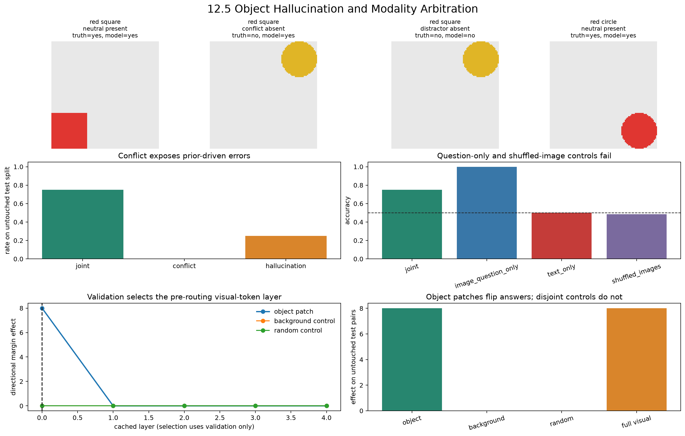
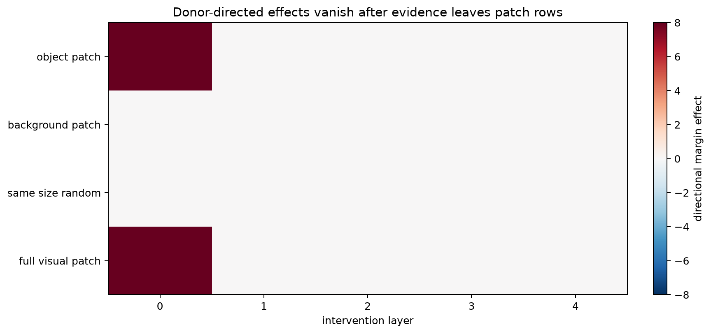

# [12.5] Object Hallucination and Modality Arbitration

> **Claim.** In an explicit pixel-and-prompt ground-truth organism, a conflicting textual prior can cause object hallucination, while prompt-identical counterfactual activation patches isolate the causal visual region against two genuinely distinct geometry-matched controls.

## Core Question

**When a multimodal model says an object is present, did the answer come from pixels or from a stated textual prior?**

### Learning objectives

1. Build a full color x shape factorial without placing answer labels in model inputs.
2. Define true background from image geometry outside target and distractor boxes.
3. Implement token activation replacement and a layerwise counterfactual patch sweep.
4. Select intervention layers on validation and report only on untouched test data.
5. Distinguish a visual-counterfactual preflight from evidence that an intervention repairs hallucinations.

## Cold Open

<div class="arena-side-by-side" style="display:grid;grid-template-columns:minmax(240px,0.85fr) minmax(360px,1.4fr);gap:22px;align-items:center;">
<div>
<p>The pixels contain no red square. A prior caption claims one is present. The joint organism answers <strong>yes</strong>; removing only the prior restores <strong>no</strong>.</p>
<p>This is a visible failure to explain, not evidence by itself. The causal test must move only the target patch tokens while equal-size regions outside both objects remain inert.</p>
</div>

</div>

## Scope and runtime

The chapter plan numbers this topic **12.5**. The folder retains its historical
`part2_object_hallucination_arbitration` path only to avoid changing shared chapter configuration.
The CPU ground-truth lab takes about 4-6 hours for a learner and seconds to execute solved. The
optional pinned-Qwen release run is budgeted at **12-25 minutes on CUDA** and may take up to 40
minutes before the acceptance timeout; this notebook never silently falls back to CPU.

The organism is deliberately analytic: it measures target-color occupancy from pixels, compares 2x2 regions with square/circle geometry from the prompt, routes the prompt's stated prior separately, and then adds the channels. It is ground truth for causal mechanics, not evidence about natural-image VLMs.

## Setup

The notebooks contain the complete imports, renderer, data contracts, and learner tests. Work in the exercise notebook so every implementation is immediately executable. Provided support functions accompany each method stub; their definitions stay visible and editable.

### Exercise 1 - Encode a question without encoding its answer

> **Claim tested.** Parse only the queried color, queried shape, and stated prior. The presence label is not a model input.
>
> **Difficulty:** 3/5 &nbsp;&nbsp; **Importance:** 5/5 &nbsp;&nbsp; **Time:** 15 minutes

<details><summary>Expected output</summary>

`[2, 1, PRIOR_PRESENT]` for a green-circle query with a positive prior; tensor shape `(3,)`.

</details>

<details><summary>Help</summary>

Match exactly one color and one shape from the declared vocabulary, then map the opening prior clause to one of three IDs.

</details>

<details><summary>Solution</summary>

```python
def encode_prompt(prompt: str) -> Tensor:
    """Encode the query and stated prior from text; no answer label is encoded."""

    colors = [index for index, color in enumerate(COLORS) if f" {color} " in prompt]
    shapes = [index for index, shape in enumerate(SHAPES) if f" {shape} " in prompt]
    if len(colors) != 1 or len(shapes) != 1:
        raise ValueError(f"Prompt must name exactly one color and shape: {prompt!r}")
    if prompt.startswith("Ignore prior captions"):
        prior = PRIOR_NEUTRAL
    elif prompt.startswith("A previous caption claims no"):
        prior = PRIOR_ABSENT
    elif prompt.startswith("A previous caption claims a"):
        prior = PRIOR_PRESENT
    else:
        raise ValueError(f"Prompt has no recognized prior clause: {prompt!r}")
    return t.tensor((colors[0], shapes[0], prior), dtype=t.long)

```

</details>

<details><summary>Interpretation</summary>

The prior is legitimate input context, but it is balanced across true and false labels. There is no answer token in this encoding.

</details>

```python
def encode_prompt(prompt: str) -> Tensor:
    """Return [color_id, shape_id, prior_id]; never encode the answer label."""
    raise NotImplementedError("Parse the visible prompt text")

```

```python
# Immediate test: fails while the stub is present
tests.test_encode_prompt_contains_query_and_prior_not_answer(encode_prompt)
```

### Exercise 2 - Build the factorial arbitration benchmark

> **Claim tested.** Generate all eight color-shape queries in development, validation, and test renders, with balanced labels and priors.
>
> **Difficulty:** 3/5 &nbsp;&nbsp; **Importance:** 5/5 &nbsp;&nbsp; **Time:** 25 minutes

<details><summary>Expected output</summary>

`192 examples`; exactly `64` per split; every split contains all `4 x 2` color-shape combinations.

</details>

<details><summary>Help</summary>

Loop over `TARGETS`, then `SPLITS`, then the eight condition specifications. Positive priors must occur once with each label for every target.

</details>

<details><summary>Solution</summary>

```python
def build_arbitration_benchmark(variants_per_target: int = 3) -> list[ArbitrationExample]:
    """Build a color-shape factorial benchmark with disjoint validation and test renders."""

    if variants_per_target != 3:
        raise ValueError("The audited benchmark requires exactly three variants per target")
    specs = (
        ("neutral_present", True, "neutral", False),
        ("neutral_absent", False, "neutral", False),
        ("aligned_present", True, "claims_present", False),
        ("aligned_absent", False, "claims_absent", False),
        ("conflict_present", True, "claims_absent", True),
        ("conflict_absent", False, "claims_present", True),
        ("distractor_absent", False, "neutral", True),
        ("counterfactual_present", True, "neutral", True),
    )
    examples: list[ArbitrationExample] = []
    for target_index, (target_color, target_shape) in enumerate(TARGETS):
        for variant, split in enumerate(SPLITS):
            for condition, present, prior, distractor in specs:
                scene = render_scene(
                    target_color,
                    target_shape,
                    object_present=present,
                    variant=variant,
                    target_index=target_index,
                    include_distractor=distractor,
                )
                examples.append(
                    ArbitrationExample(
                        example_id=f"{split[:3]}_{target_color}_{target_shape}_{condition}",
                        image=scene.image,
                        target_color=target_color,
                        target_shape=target_shape,
                        object_present=present,
                        prior=prior,
                        condition=condition,
                        split=split,
                        variant=variant,
                        target_bbox=scene.target_bbox,
                        distractor_bbox=scene.distractor_bbox,
                        distractor_color=scene.distractor_color,
                        distractor_shape=scene.distractor_shape,
                        prompt=build_prompt(target_color, target_shape, prior),
                    )
                )
    return examples


def make_counterfactual(example: ArbitrationExample) -> ArbitrationExample:
    target_index = TARGETS.index((example.target_color, example.target_shape))
    scene = render_scene(
        example.target_color,
        example.target_shape,
        object_present=not example.object_present,
        variant=example.variant,
        target_index=target_index,
        include_distractor=example.distractor_bbox is not None,
    )
    return replace(
        example,
        example_id=f"{example.example_id}_pixel_counterfactual",
        image=scene.image,
        object_present=not example.object_present,
        target_bbox=scene.target_bbox,
        distractor_bbox=scene.distractor_bbox,
        distractor_color=scene.distractor_color,
        distractor_shape=scene.distractor_shape,
    )


def batch_inputs(examples: Sequence[ArbitrationExample]) -> tuple[Tensor, Tensor, Tensor]:
    if not examples:
        raise ValueError("examples must be nonempty")
    images = t.stack([example.image for example in examples])
    prompts = t.stack([encode_prompt(example.prompt) for example in examples])
    labels = t.tensor([example.label for example in examples], dtype=t.long)
    return images, prompts, labels

```

</details>

<details><summary>Interpretation</summary>

Because color and shape are fully crossed, neither feature can act as a proxy for the other. Validation and test use untouched render variants.

</details>

```python
def build_arbitration_benchmark(variants_per_target: int = 3) -> list[ArbitrationExample]:
    """Return the audited 8 targets x 3 splits x 8 conditions benchmark."""
    raise NotImplementedError("Render the full factorial without label leakage")


def make_counterfactual(example: ArbitrationExample) -> ArbitrationExample:
    target_index = TARGETS.index((example.target_color, example.target_shape))
    scene = render_scene(
        example.target_color,
        example.target_shape,
        object_present=not example.object_present,
        variant=example.variant,
        target_index=target_index,
        include_distractor=example.distractor_bbox is not None,
    )
    return replace(
        example,
        example_id=f"{example.example_id}_pixel_counterfactual",
        image=scene.image,
        object_present=not example.object_present,
        target_bbox=scene.target_bbox,
        distractor_bbox=scene.distractor_bbox,
        distractor_color=scene.distractor_color,
        distractor_shape=scene.distractor_shape,
    )


def batch_inputs(examples: Sequence[ArbitrationExample]) -> tuple[Tensor, Tensor, Tensor]:
    if not examples:
        raise ValueError("examples must be nonempty")
    images = t.stack([example.image for example in examples])
    prompts = t.stack([encode_prompt(example.prompt) for example in examples])
    labels = t.tensor([example.label for example in examples], dtype=t.long)
    return images, prompts, labels

```

```python
# Immediate test: fails while the stub is present
tests.test_build_arbitration_benchmark(build_arbitration_benchmark)
```

### Exercise 3 - Construct fair image-region controls

> **Claim tested.** Map boxes to patches and choose two equal-size controls from image geometry outside both target and distractor boxes.
>
> **Difficulty:** 3/5 &nbsp;&nbsp; **Importance:** 5/5 &nbsp;&nbsp; **Time:** 30 minutes

<details><summary>Expected output</summary>

A 32x32 aligned object maps to four patches. Object, background, and random controls each contain four pairwise-disjoint indices.

</details>

<details><summary>Help</summary>

Create a geometry exclusion set from the target and distractor boxes. Enumerate translated regions of the object's patch height and width, then choose two that do not overlap.

</details>

<details><summary>Solution</summary>

```python
def bbox_to_patch_indices(
    bbox: tuple[int, int, int, int],
    *,
    image_size: int = IMAGE_SIZE,
    patch_grid: int = PATCH_GRID,
) -> tuple[int, ...]:
    """Return row-major patches with positive-area overlap with ``bbox``."""

    x1, y1, x2, y2 = bbox
    if not (0 <= x1 < x2 <= image_size and 0 <= y1 < y2 <= image_size):
        raise ValueError(f"bbox must lie inside the image, got {bbox}")
    patch_size = image_size / patch_grid
    cols = range(int(x1 // patch_size), min(patch_grid, int(math.ceil(x2 / patch_size))))
    rows = range(int(y1 // patch_size), min(patch_grid, int(math.ceil(y2 / patch_size))))
    return tuple(row * patch_grid + col for row in rows for col in cols)


def geometry_background_indices(example: ArbitrationExample) -> tuple[int, ...]:
    """Return patches outside target and distractor geometry, independent of pixel color."""

    excluded = set(bbox_to_patch_indices(example.target_bbox))
    if example.distractor_bbox is not None:
        excluded.update(bbox_to_patch_indices(example.distractor_bbox))
    return tuple(index for index in range(N_VISUAL_TOKENS) if index not in excluded)


def _translated_region_candidates(
    object_indices: Sequence[int], available: set[int]
) -> list[tuple[int, ...]]:
    rows = [index // PATCH_GRID for index in object_indices]
    cols = [index % PATCH_GRID for index in object_indices]
    height = max(rows) - min(rows) + 1
    width = max(cols) - min(cols) + 1
    if len(object_indices) != height * width:
        return []
    candidates = []
    for top in range(PATCH_GRID - height + 1):
        for left in range(PATCH_GRID - width + 1):
            region = tuple(
                row * PATCH_GRID + col
                for row in range(top, top + height)
                for col in range(left, left + width)
            )
            if set(region) <= available:
                candidates.append(region)
    return candidates


def matched_control_regions(example: ArbitrationExample, *, seed: int = 0) -> ControlRegions:
    """Choose two equal-size, pairwise-disjoint regions from true background geometry."""

    object_region = bbox_to_patch_indices(example.target_bbox)
    background_pool = set(geometry_background_indices(example))
    candidates = _translated_region_candidates(object_region, background_pool)
    if not candidates:
        raise RuntimeError("No translated background region matches the object geometry")
    target_center = np.mean(
        [(index // PATCH_GRID, index % PATCH_GRID) for index in object_region], axis=0
    )
    candidates.sort(
        key=lambda region: (
            -float(
                np.linalg.norm(
                    np.mean(
                        [(index // PATCH_GRID, index % PATCH_GRID) for index in region], axis=0
                    )
                    - target_center
                )
            ),
            region,
        )
    )
    background = candidates[0]
    remaining = [region for region in candidates[1:] if set(region).isdisjoint(background)]
    if not remaining:
        raise RuntimeError("No second nonoverlapping matched background region is available")
    generator = t.Generator().manual_seed(seed)
    random_region = remaining[int(t.randint(len(remaining), (1,), generator=generator).item())]
    controls = ControlRegions(object_region, background, random_region)
    controls.validate()
    return controls

```

</details>

<details><summary>Interpretation</summary>

A same-size control is not fair if it silently touches another object or duplicates the first control in a different order.

</details>

```python
def bbox_to_patch_indices(
    bbox: tuple[int, int, int, int], *, image_size: int = IMAGE_SIZE, patch_grid: int = PATCH_GRID
) -> tuple[int, ...]:
    raise NotImplementedError("Return every positive-overlap patch")


def geometry_background_indices(example: ArbitrationExample) -> tuple[int, ...]:
    """Return patches outside target and distractor geometry, independent of pixel color."""

    excluded = set(bbox_to_patch_indices(example.target_bbox))
    if example.distractor_bbox is not None:
        excluded.update(bbox_to_patch_indices(example.distractor_bbox))
    return tuple(index for index in range(N_VISUAL_TOKENS) if index not in excluded)


def _translated_region_candidates(
    object_indices: Sequence[int], available: set[int]
) -> list[tuple[int, ...]]:
    rows = [index // PATCH_GRID for index in object_indices]
    cols = [index % PATCH_GRID for index in object_indices]
    height = max(rows) - min(rows) + 1
    width = max(cols) - min(cols) + 1
    if len(object_indices) != height * width:
        return []
    candidates = []
    for top in range(PATCH_GRID - height + 1):
        for left in range(PATCH_GRID - width + 1):
            region = tuple(
                row * PATCH_GRID + col
                for row in range(top, top + height)
                for col in range(left, left + width)
            )
            if set(region) <= available:
                candidates.append(region)
    return candidates


def matched_control_regions(example: ArbitrationExample, *, seed: int = 0) -> ControlRegions:
    raise NotImplementedError("Return object/background/random regions that are pairwise disjoint")

```

```python
# Immediate test: fails while the stub is present
tests.test_bbox_to_patch_indices(bbox_to_patch_indices)
tests.test_matched_controls_are_true_background_equal_distinct_and_nonoverlapping(matched_control_regions)
```

### Exercise 4 - Measure hallucinations separately from accuracy

> **Claim tested.** Report accuracy, false-positive hallucinations on absent objects, and misses on present objects.
>
> **Difficulty:** 3/5 &nbsp;&nbsp; **Importance:** 5/5 &nbsp;&nbsp; **Time:** 15 minutes

<details><summary>Expected output</summary>

The four-row test fixture returns `0.5` for accuracy, hallucination rate, and miss rate.

</details>

<details><summary>Help</summary>

Argmax the no/yes logits. Condition false-positive rate on `label == 0` and false-negative rate on `label == 1`.

</details>

<details><summary>Solution</summary>

```python
def binary_metrics(logits: Tensor, labels: Tensor) -> dict[str, float]:
    predictions = logits.argmax(dim=-1)
    labels = labels.to(predictions.device)
    if labels.shape != predictions.shape or not ((labels == 0) | (labels == 1)).all():
        raise ValueError("labels must be binary and match the logits batch")
    absent = labels == 0
    present = labels == 1
    return {
        "accuracy": float((predictions == labels).float().mean()),
        "hallucination_rate": float((predictions[absent] == 1).float().mean()),
        "miss_rate": float((predictions[present] == 0).float().mean()),
    }


def benchmark_metrics(
    examples: Sequence[ArbitrationExample], logits: Tensor
) -> dict[str, float]:
    labels = t.tensor([example.label for example in examples], device=logits.device)
    result = binary_metrics(logits, labels)
    conflict = t.tensor(
        [example.condition in CONFLICT_CONDITIONS for example in examples], device=logits.device
    )
    neutral = t.tensor([example.prior == "neutral" for example in examples], device=logits.device)
    predictions = logits.argmax(dim=-1)
    result.update(
        {
            "joint_accuracy": result.pop("accuracy"),
            "conflict_accuracy": float((predictions[conflict] == labels[conflict]).float().mean()),
            "neutral_accuracy": float((predictions[neutral] == labels[neutral]).float().mean()),
        }
    )
    return result


def condition_metrics(
    examples: Sequence[ArbitrationExample], logits: Tensor
) -> pd.DataFrame:
    predictions = logits.argmax(dim=-1).cpu()
    rows = []
    for condition in CONDITIONS:
        indices = [index for index, example in enumerate(examples) if example.condition == condition]
        labels = t.tensor([examples[index].label for index in indices])
        predicted = predictions[indices]
        absent = labels == 0
        rows.append(
            {
                "condition": condition,
                "n": len(indices),
                "accuracy": float((predicted == labels).float().mean()),
                "hallucination_rate": (
                    float((predicted[absent] == 1).float().mean()) if bool(absent.any()) else float("nan")
                ),
            }
        )
    return pd.DataFrame(rows)


def modality_baseline_report(
    model: PixelPromptGroundTruthVLM,
    examples: Sequence[ArbitrationExample],
    *,
    seed: int = 0,
) -> pd.DataFrame:
    images, prompts, labels = batch_inputs(examples)
    generator = t.Generator().manual_seed(seed)
    permutation = t.randperm(len(images), generator=generator)
    conditions = {
        "joint": model(images, prompts),
        "image_question_only": model(images, prompts, text_scale=0.0),
        "text_only": model(images, prompts, visual_scale=0.0),
        "shuffled_images": model(images[permutation], prompts),
    }
    rows = []
    for condition, logits in conditions.items():
        rows.append({"condition": condition, **binary_metrics(logits, labels)})
    return pd.DataFrame(rows)

```

</details>

<details><summary>Interpretation</summary>

Overall accuracy can hide asymmetric object hallucinations, so the real-model gate requires joint accuracy, conflict accuracy, and hallucination rate separately.

</details>

```python
def binary_metrics(logits: Tensor, labels: Tensor) -> dict[str, float]:
    raise NotImplementedError("Compute accuracy, hallucination rate, and miss rate")


def benchmark_metrics(
    examples: Sequence[ArbitrationExample], logits: Tensor
) -> dict[str, float]:
    labels = t.tensor([example.label for example in examples], device=logits.device)
    result = binary_metrics(logits, labels)
    conflict = t.tensor(
        [example.condition in CONFLICT_CONDITIONS for example in examples], device=logits.device
    )
    neutral = t.tensor([example.prior == "neutral" for example in examples], device=logits.device)
    predictions = logits.argmax(dim=-1)
    result.update(
        {
            "joint_accuracy": result.pop("accuracy"),
            "conflict_accuracy": float((predictions[conflict] == labels[conflict]).float().mean()),
            "neutral_accuracy": float((predictions[neutral] == labels[neutral]).float().mean()),
        }
    )
    return result


def condition_metrics(
    examples: Sequence[ArbitrationExample], logits: Tensor
) -> pd.DataFrame:
    predictions = logits.argmax(dim=-1).cpu()
    rows = []
    for condition in CONDITIONS:
        indices = [index for index, example in enumerate(examples) if example.condition == condition]
        labels = t.tensor([examples[index].label for index in indices])
        predicted = predictions[indices]
        absent = labels == 0
        rows.append(
            {
                "condition": condition,
                "n": len(indices),
                "accuracy": float((predicted == labels).float().mean()),
                "hallucination_rate": (
                    float((predicted[absent] == 1).float().mean()) if bool(absent.any()) else float("nan")
                ),
            }
        )
    return pd.DataFrame(rows)


def modality_baseline_report(
    model: PixelPromptGroundTruthVLM,
    examples: Sequence[ArbitrationExample],
    *,
    seed: int = 0,
) -> pd.DataFrame:
    images, prompts, labels = batch_inputs(examples)
    generator = t.Generator().manual_seed(seed)
    permutation = t.randperm(len(images), generator=generator)
    conditions = {
        "joint": model(images, prompts),
        "image_question_only": model(images, prompts, text_scale=0.0),
        "text_only": model(images, prompts, visual_scale=0.0),
        "shuffled_images": model(images[permutation], prompts),
    }
    rows = []
    for condition, logits in conditions.items():
        rows.append({"condition": condition, **binary_metrics(logits, labels)})
    return pd.DataFrame(rows)

```

```python
# Immediate test: fails while the stub is present
tests.test_binary_metrics_are_semantic(binary_metrics)
```

### Exercise 5 - Capture the residual stream

> **Claim tested.** Return logits and all five cache states, from pixel/prompt embeddings through visual routing, prior routing, integration, and readout.
>
> **Difficulty:** 3/5 &nbsp;&nbsp; **Importance:** 5/5 &nbsp;&nbsp; **Time:** 15 minutes

<details><summary>Expected output</summary>

Cache shape `(5, batch, 38, 16)`; the visual margin appears after layer 0 and the stated prior after layer 1.

</details>

<details><summary>Help</summary>

Call the model with `return_cache=True`, then stack the returned list on a new leading layer axis.

</details>

<details><summary>Solution</summary>

```python
def capture_arbitration_cache(
    model: PixelPromptGroundTruthVLM,
    images: Tensor,
    prompt_tokens: Tensor,
    *,
    visual_scale: float = 1.0,
    text_scale: float = 1.0,
) -> tuple[Tensor, Tensor]:
    logits, states = model(
        images,
        prompt_tokens,
        visual_scale=visual_scale,
        text_scale=text_scale,
        return_cache=True,
    )
    return logits, t.stack(states)


def answer_margin(logits: Tensor) -> Tensor:
    if logits.ndim != 2 or logits.shape[-1] != 2:
        raise ValueError(f"Expected [batch, no/yes] logits, got {tuple(logits.shape)}")
    return logits[:, 1] - logits[:, 0]

```

</details>

<details><summary>Interpretation</summary>

The cache makes a precise causal question possible: at which state can replacing object-token rows still alter the answer?

</details>

```python
def capture_arbitration_cache(
    model: PixelPromptGroundTruthVLM,
    images: Tensor,
    prompt_tokens: Tensor,
    *,
    visual_scale: float = 1.0,
    text_scale: float = 1.0,
) -> tuple[Tensor, Tensor]:
    raise NotImplementedError("Stack every state returned by the organism")


def answer_margin(logits: Tensor) -> Tensor:
    if logits.ndim != 2 or logits.shape[-1] != 2:
        raise ValueError(f"Expected [batch, no/yes] logits, got {tuple(logits.shape)}")
    return logits[:, 1] - logits[:, 0]

```

```python
# Immediate test: fails while the stub is present
tests.test_cache_has_pixel_and_prompt_routing_stages(capture_arbitration_cache)
```

### Exercise 6 - Implement activation replacement

> **Claim tested.** Clone a recipient state and interpolate donor values into exactly the selected token rows.
>
> **Difficulty:** 3/5 &nbsp;&nbsp; **Importance:** 5/5 &nbsp;&nbsp; **Time:** 20 minutes

<details><summary>Expected output</summary>

At strength `1.0`, selected rows equal the donor exactly; unselected rows and the recipient tensor remain unchanged. Strength `0.5` gives the midpoint.

</details>

<details><summary>Help</summary>

Validate shapes and unique indices, clone the recipient, then assign `recipient + strength * (donor - recipient)` only at those rows.

</details>

<details><summary>Solution</summary>

```python
def replace_token_activations(
    recipient: Tensor,
    donor: Tensor,
    token_indices: Sequence[int],
    *,
    strength: float = 1.0,
) -> Tensor:
    """Interpolate donor activations into selected recipient token rows."""

    if recipient.shape != donor.shape or recipient.ndim != 3:
        raise ValueError("recipient and donor must have identical [batch, sequence, width] shapes")
    indices = tuple(int(index) for index in token_indices)
    if not indices or len(indices) != len(set(indices)):
        raise ValueError("token_indices must be nonempty and unique")
    if min(indices) < 0 or max(indices) >= recipient.shape[1]:
        raise IndexError("token index is out of bounds")
    if not math.isfinite(strength) or strength < 0:
        raise ValueError("strength must be finite and nonnegative")
    patched = recipient.clone()
    patched[:, indices] = recipient[:, indices] + strength * (
        donor[:, indices] - recipient[:, indices]
    )
    return patched

```

</details>

<details><summary>Interpretation</summary>

This is the actual causal intervention. Returning either input, replacing every token, or mutating the clean cache fails immediately.

</details>

```python
def replace_token_activations(
    recipient: Tensor,
    donor: Tensor,
    token_indices: Sequence[int],
    *,
    strength: float = 1.0,
) -> Tensor:
    raise NotImplementedError("Replace only selected rows without mutating either cache")

```

```python
# Immediate test: fails while the stub is present
tests.test_replace_token_activations_is_exact_and_stub_sensitive(replace_token_activations)
```

### Exercise 7 - Run the controlled counterfactual patch sweep

> **Claim tested.** Patch object, background, random, and full-visual rows at every cache state and score movement toward the donor answer.
>
> **Difficulty:** 3/5 &nbsp;&nbsp; **Importance:** 5/5 &nbsp;&nbsp; **Time:** 35 minutes

<details><summary>Expected output</summary>

At layer 0, object and full-visual patches move the margin by `8.0` and flip the answer; both disjoint matched controls have `0.0` effect.

</details>

<details><summary>Help</summary>

Cache prompt-identical recipient/donor runs. For each layer and region, call your replacement function and resume with `model.continue_from`.

</details>

<details><summary>Solution</summary>

```python
def counterfactual_patch_sweep(
    model: PixelPromptGroundTruthVLM,
    recipient: ArbitrationExample,
    donor: ArbitrationExample,
    *,
    strength: float = 1.0,
) -> pd.DataFrame:
    """Run layerwise object, background, random, and full-visual patches."""

    if recipient.prompt != donor.prompt:
        raise ValueError("A causal image counterfactual must preserve the prompt exactly")
    if recipient.label == donor.label:
        raise ValueError("Recipient and donor must have different pixel-ground-truth labels")
    recipient_images, recipient_prompts, _ = batch_inputs([recipient])
    donor_images, donor_prompts, _ = batch_inputs([donor])
    recipient_logits, recipient_cache = capture_arbitration_cache(
        model, recipient_images, recipient_prompts
    )
    donor_logits, donor_cache = capture_arbitration_cache(model, donor_images, donor_prompts)
    recipient_margin = float(answer_margin(recipient_logits).item())
    donor_margin = float(answer_margin(donor_logits).item())
    direction = 1.0 if donor_margin > recipient_margin else -1.0
    controls = matched_control_regions(recipient, seed=recipient.variant + 17)
    regions: Mapping[str, tuple[int, ...]] = {
        "object_patch": controls.object,
        "background_patch": controls.background,
        "same_size_random": controls.random,
        "full_visual_patch": tuple(range(N_VISUAL_TOKENS)),
    }
    rows: list[dict[str, object]] = []
    recipient_prediction = int(recipient_logits.argmax(dim=-1).item())
    donor_prediction = int(donor_logits.argmax(dim=-1).item())
    for layer in range(N_LAYERS + 1):
        rows.extend(
            (
                {
                    "example_id": recipient.example_id,
                    "split": recipient.split,
                    "layer": layer,
                    "condition": "recipient",
                    "margin": recipient_margin,
                    "prediction": recipient_prediction,
                    "token_count": 0,
                    "directional_effect": 0.0,
                    "answer_flip": False,
                },
                {
                    "example_id": recipient.example_id,
                    "split": recipient.split,
                    "layer": layer,
                    "condition": "donor",
                    "margin": donor_margin,
                    "prediction": donor_prediction,
                    "token_count": 0,
                    "directional_effect": abs(donor_margin - recipient_margin),
                    "answer_flip": donor_prediction != recipient_prediction,
                },
            )
        )
        for name, indices in regions.items():
            patched = replace_token_activations(
                recipient_cache[layer], donor_cache[layer], indices, strength=strength
            )
            logits, _ = model.continue_from(patched, layer)
            margin = float(answer_margin(logits).item())
            prediction = int(logits.argmax(dim=-1).item())
            rows.append(
                {
                    "example_id": recipient.example_id,
                    "split": recipient.split,
                    "layer": layer,
                    "condition": name,
                    "margin": margin,
                    "prediction": prediction,
                    "token_count": len(indices),
                    "directional_effect": direction * (margin - recipient_margin),
                    "answer_flip": prediction != recipient_prediction,
                }
            )
    return pd.DataFrame(rows)


def summarize_patch_rows(rows: pd.DataFrame, *, layer: int) -> dict[str, float]:
    selected = rows[rows.layer == layer]
    required = {"object_patch", "background_patch", "same_size_random", "full_visual_patch"}
    if not required <= set(selected.condition):
        raise ValueError(f"Patch rows are missing conditions: {required - set(selected.condition)}")
    grouped = selected.groupby("condition", sort=False)
    summary: dict[str, float] = {}
    for condition in required:
        group = grouped.get_group(condition)
        summary[f"{condition}_directional_effect_mean"] = float(group.directional_effect.mean())
        summary[f"{condition}_absolute_effect_mean"] = float(group.directional_effect.abs().mean())
        summary[f"{condition}_flip_fraction"] = float(group.answer_flip.astype(float).mean())
    return summary

```

</details>

<details><summary>Interpretation</summary>

A directional effect is positive only when the intervention moves the recipient toward its donor. Full visual is a positive control, not an equality oracle after modalities have mixed.

</details>

```python
def counterfactual_patch_sweep(
    model: PixelPromptGroundTruthVLM,
    recipient: ArbitrationExample,
    donor: ArbitrationExample,
    *,
    strength: float = 1.0,
) -> pd.DataFrame:
    raise NotImplementedError("Patch each region at each layer and continue the forward pass")


def summarize_patch_rows(rows: pd.DataFrame, *, layer: int) -> dict[str, float]:
    selected = rows[rows.layer == layer]
    required = {"object_patch", "background_patch", "same_size_random", "full_visual_patch"}
    if not required <= set(selected.condition):
        raise ValueError(f"Patch rows are missing conditions: {required - set(selected.condition)}")
    grouped = selected.groupby("condition", sort=False)
    summary: dict[str, float] = {}
    for condition in required:
        group = grouped.get_group(condition)
        summary[f"{condition}_directional_effect_mean"] = float(group.directional_effect.mean())
        summary[f"{condition}_absolute_effect_mean"] = float(group.directional_effect.abs().mean())
        summary[f"{condition}_flip_fraction"] = float(group.answer_flip.astype(float).mean())
    return summary

```

```python
# Immediate test: fails while the stub is present
tests.test_counterfactual_patch_sweep_is_causal_and_controlled(counterfactual_patch_sweep)
```

### Exercise 8 - Select on validation, report once on test

> **Claim tested.** Choose the layer maximizing object directional effect over matched controls using validation pairs only.
>
> **Difficulty:** 3/5 &nbsp;&nbsp; **Importance:** 5/5 &nbsp;&nbsp; **Time:** 25 minutes

<details><summary>Expected output</summary>

Validation selects layer `0` with score `8.0`; passing test recipients into the selector raises.

</details>

<details><summary>Help</summary>

Aggregate each candidate's object directional effect, subtract the larger absolute control effect, and break ties toward the earlier layer.

</details>

<details><summary>Solution</summary>

```python
def select_layer_on_validation(
    model: PixelPromptGroundTruthVLM,
    validation_pairs: Sequence[tuple[ArbitrationExample, ArbitrationExample]],
    *,
    candidate_layers: Sequence[int] = tuple(range(N_LAYERS + 1)),
) -> tuple[int, pd.DataFrame]:
    """Select one layer using validation pairs only; test rows are never inspected."""

    if not validation_pairs or any(pair[0].split != "validation" for pair in validation_pairs):
        raise ValueError("Layer selection requires nonempty validation recipient pairs")
    if len(set(candidate_layers)) != len(candidate_layers):
        raise ValueError("candidate_layers must be unique")
    all_rows = pd.concat(
        [counterfactual_patch_sweep(model, recipient, donor) for recipient, donor in validation_pairs],
        ignore_index=True,
    )
    summaries = []
    for layer in candidate_layers:
        summary = summarize_patch_rows(all_rows, layer=layer)
        control = max(
            summary["background_patch_absolute_effect_mean"],
            summary["same_size_random_absolute_effect_mean"],
        )
        summaries.append(
            {
                "layer": int(layer),
                "object_directional_effect": summary["object_patch_directional_effect_mean"],
                "background_absolute_effect": summary["background_patch_absolute_effect_mean"],
                "random_absolute_effect": summary["same_size_random_absolute_effect_mean"],
                "selection_score": summary["object_patch_directional_effect_mean"] - control,
            }
        )
    frame = pd.DataFrame(summaries).sort_values("layer").reset_index(drop=True)
    best_score = frame.selection_score.max()
    selected_layer = int(frame.loc[frame.selection_score == best_score, "layer"].min())
    return selected_layer, frame


def intervention_playground(
    model: PixelPromptGroundTruthVLM,
    recipient: ArbitrationExample,
    *,
    layer: int,
    region: str,
    strength: float,
) -> dict[str, object]:
    """Parameterized learner intervention used by the Try It Yourself cell."""

    donor = make_counterfactual(recipient)
    sweep = counterfactual_patch_sweep(model, recipient, donor, strength=strength)
    allowed = {"object_patch", "background_patch", "same_size_random", "full_visual_patch"}
    if region not in allowed:
        raise ValueError(f"region must be one of {sorted(allowed)}")
    row = sweep[(sweep.layer == layer) & (sweep.condition == region)]
    if len(row) != 1:
        raise ValueError(f"layer must be in [0, {N_LAYERS}]")
    record = row.iloc[0]
    return {
        "layer": int(layer),
        "region": region,
        "strength": float(strength),
        "margin": float(record.margin),
        "prediction": "yes" if int(record.prediction) else "no",
        "answer_flip": bool(record.answer_flip),
    }


def _counterfactual_pairs(
    examples: Sequence[ArbitrationExample], split: str
) -> list[tuple[ArbitrationExample, ArbitrationExample]]:
    recipients = [
        example
        for example in examples
        if example.split == split and example.condition == "counterfactual_present"
    ]
    return [(recipient, make_counterfactual(recipient)) for recipient in recipients]


def toy_signature_result() -> dict[str, object]:
    examples = build_arbitration_benchmark()
    model = PixelPromptGroundTruthVLM()
    test_examples = [example for example in examples if example.split == "test"]
    images, prompts, _ = batch_inputs(test_examples)
    logits = model(images, prompts)
    metrics = benchmark_metrics(test_examples, logits)
    baselines = modality_baseline_report(model, test_examples)
    selected_layer, validation_curve = select_layer_on_validation(
        model, _counterfactual_pairs(examples, "validation")
    )
    test_patch_rows = pd.concat(
        [
            counterfactual_patch_sweep(model, recipient, donor)
            for recipient, donor in _counterfactual_pairs(examples, "test")
        ],
        ignore_index=True,
    )
    test_patch = summarize_patch_rows(test_patch_rows, layer=selected_layer)
    accepted = bool(
        len(examples) == 192
        and metrics["joint_accuracy"] == 0.75
        and metrics["conflict_accuracy"] == 0.0
        and metrics["hallucination_rate"] == 0.25
        and selected_layer == 0
        and test_patch["object_patch_flip_fraction"] == 1.0
        and test_patch["object_patch_directional_effect_mean"] > 0
        and test_patch["background_patch_absolute_effect_mean"] == 0
        and test_patch["same_size_random_absolute_effect_mean"] == 0
    )
    return {
        "accepted": accepted,
        "examples": examples,
        "test_examples": test_examples,
        "test_logits": logits,
        "metrics": metrics,
        "conditions": condition_metrics(test_examples, logits),
        "baselines": baselines,
        "selected_layer": selected_layer,
        "validation_curve": validation_curve,
        "test_patch_rows": test_patch_rows,
        "test_patch_summary": test_patch,
    }

```

</details>

<details><summary>Interpretation</summary>

The signature test effect is confirmatory because no test row participates in layer choice.

</details>

```python
def select_layer_on_validation(
    model: PixelPromptGroundTruthVLM,
    validation_pairs: Sequence[tuple[ArbitrationExample, ArbitrationExample]],
    *,
    candidate_layers: Sequence[int] = tuple(range(N_LAYERS + 1)),
) -> tuple[int, pd.DataFrame]:
    raise NotImplementedError("Aggregate only validation rows and select the best layer")


def intervention_playground(
    model: PixelPromptGroundTruthVLM,
    recipient: ArbitrationExample,
    *,
    layer: int,
    region: str,
    strength: float,
) -> dict[str, object]:
    """Parameterized learner intervention used by the Try It Yourself cell."""

    donor = make_counterfactual(recipient)
    sweep = counterfactual_patch_sweep(model, recipient, donor, strength=strength)
    allowed = {"object_patch", "background_patch", "same_size_random", "full_visual_patch"}
    if region not in allowed:
        raise ValueError(f"region must be one of {sorted(allowed)}")
    row = sweep[(sweep.layer == layer) & (sweep.condition == region)]
    if len(row) != 1:
        raise ValueError(f"layer must be in [0, {N_LAYERS}]")
    record = row.iloc[0]
    return {
        "layer": int(layer),
        "region": region,
        "strength": float(strength),
        "margin": float(record.margin),
        "prediction": "yes" if int(record.prediction) else "no",
        "answer_flip": bool(record.answer_flip),
    }


def _counterfactual_pairs(
    examples: Sequence[ArbitrationExample], split: str
) -> list[tuple[ArbitrationExample, ArbitrationExample]]:
    recipients = [
        example
        for example in examples
        if example.split == split and example.condition == "counterfactual_present"
    ]
    return [(recipient, make_counterfactual(recipient)) for recipient in recipients]


def toy_signature_result() -> dict[str, object]:
    examples = build_arbitration_benchmark()
    model = PixelPromptGroundTruthVLM()
    test_examples = [example for example in examples if example.split == "test"]
    images, prompts, _ = batch_inputs(test_examples)
    logits = model(images, prompts)
    metrics = benchmark_metrics(test_examples, logits)
    baselines = modality_baseline_report(model, test_examples)
    selected_layer, validation_curve = select_layer_on_validation(
        model, _counterfactual_pairs(examples, "validation")
    )
    test_patch_rows = pd.concat(
        [
            counterfactual_patch_sweep(model, recipient, donor)
            for recipient, donor in _counterfactual_pairs(examples, "test")
        ],
        ignore_index=True,
    )
    test_patch = summarize_patch_rows(test_patch_rows, layer=selected_layer)
    accepted = bool(
        len(examples) == 192
        and metrics["joint_accuracy"] == 0.75
        and metrics["conflict_accuracy"] == 0.0
        and metrics["hallucination_rate"] == 0.25
        and selected_layer == 0
        and test_patch["object_patch_flip_fraction"] == 1.0
        and test_patch["object_patch_directional_effect_mean"] > 0
        and test_patch["background_patch_absolute_effect_mean"] == 0
        and test_patch["same_size_random_absolute_effect_mean"] == 0
    )
    return {
        "accepted": accepted,
        "examples": examples,
        "test_examples": test_examples,
        "test_logits": logits,
        "metrics": metrics,
        "conditions": condition_metrics(test_examples, logits),
        "baselines": baselines,
        "selected_layer": selected_layer,
        "validation_curve": validation_curve,
        "test_patch_rows": test_patch_rows,
        "test_patch_summary": test_patch,
    }

```

```python
# Immediate test: fails while the stub is present
tests.test_validation_selects_layer_and_test_remains_untouched(select_layer_on_validation)
```

## Signature Result

<div class="arena-side-by-side" style="display:grid;grid-template-columns:minmax(240px,0.8fr) minmax(420px,1.6fr);gap:22px;align-items:center;">
<div>
<p>Validation selects the only state where target patch rows still carry causal pixel evidence. On the untouched test split, object and full-visual patches move every answer toward the donor; equal-size background and random controls are distinct, nonoverlapping, and inert.</p>
<p>The behavioral panels keep conflict accuracy and hallucination rate visible rather than hiding them inside aggregate accuracy.</p>
</div>

</div>



## Try It Yourself

Use the parameterized notebook cell to choose target color, target shape, layer, region, and interpolation strength. It reruns the cache replacement and continuation; it does not index a saved answer.

## Real VLM Escalation

**Visual-counterfactual preflight only:** the intervention pairs have neutral priors.
They do not test repair of actual hallucinations, and the four-stage failure
diagnosis remains unfinished. Passing the preflight does not complete that claim.

The optional pinned Qwen run selects among four candidate layers using eight validation
counterfactual pairs, then freezes that layer and reports behavior plus intervention controls on 64
untouched test examples and eight untouched test pairs. Acceptance requires all declared behavior
and causal gates. A full-visual patch is a positive control, not a demand for invalid donor-output
equality after modalities have mixed.

## Limitations

- The CPU organism is analytic ground truth over rendered shapes, not a trained or natural-image VLM.
- The real-Qwen mechanism claim is unaccepted until the parent CUDA run passes every gate and updates the report.
- This controlled object-presence result does not establish a general hallucination circuit.
