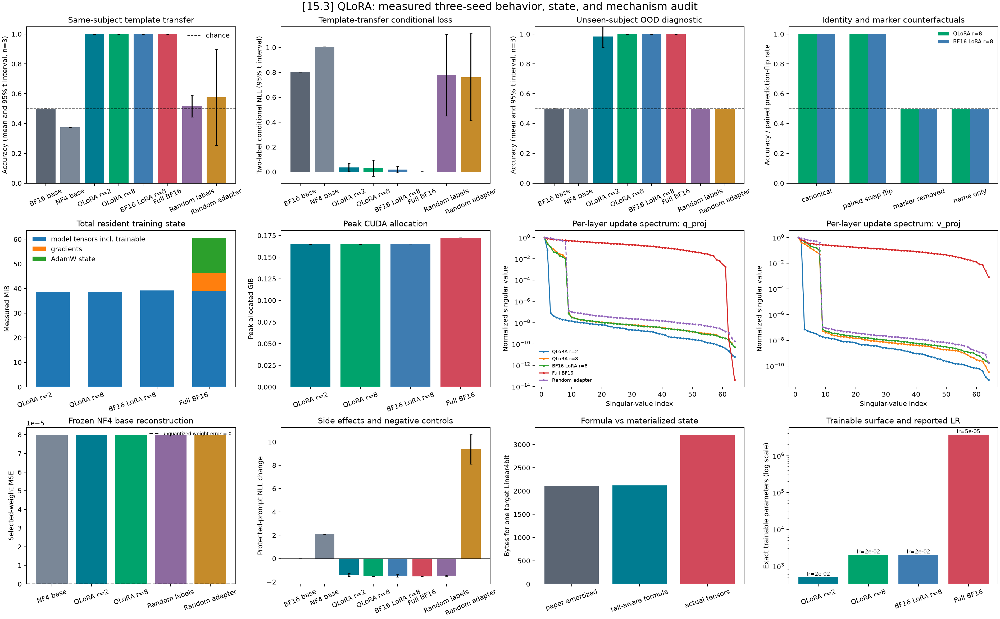

# [15.3] QLoRA from Scratch

This section asks whether learner-built rank-8 QLoRA on a fully materialized
nested-NF4 TinyStories transformer matches BF16 LoRA across exactly three
measured seed runs. The primary behavior claim is same-subject template
transfer; a separate unseen-subject, unseen-template split is a narrow OOD
diagnostic. The completed learner has now run all 21 code cells, including the
three-seed CUDA comparison. Its unchanged BF16 parity gate fails, so this
optional candidate remains unreleased. It does not replace the core roadmap's
LoRA/full-finetuning, DoRA, subspace-overlap, and intruder-dimension study.

Names do not define labels. Each of ten subjects is crossed with both labels in
every template: 60 training examples, 40 template-transfer examples, and 40 OOD
examples. Evaluation also includes paired marker swaps, marker removal, and an
empirical name-only baseline. The name-only baseline is exactly 0.5 by design.
Because a fully crossed split makes aggregate swap accuracy redundant, CUDA
acceptance also requires the paired prediction-flip rate and the fraction of
canonical/swap pairs whose two targets are both predicted correctly.

Students implement exact NF4 mechanics, nested scale reconstruction, strict
runtime audits, actual tensor-byte accounting, visible LoRA factors, the matched
optimizer loop, the counterbalanced task, and per-layer spectra. The strict CPU
and CUDA notebook APIs require an explicit `LearnerFunctions` bundle and reject
callbacks that are reference objects. Function names and executable SHA-256
fingerprints are recorded as provenance, including all locally defined class
methods. The audit rejects simple direct, closure, and module-based reference
delegation. Dynamic Python can evade this bounded diagnostic; exact numerical
oracles and completed-learner execution provide the semantic evidence.

## Measured signature result

| Method | Template transfer | Narrow OOD | Resident training state |
|---|---:|---:|---:|
| Frozen BF16 | 0.500 | 0.500 | 39.14 MiB |
| Frozen NF4 | 0.375 | 0.500 | 38.64 MiB |
| QLoRA r=2 | 1.000 | 0.983 | 38.65 MiB |
| QLoRA r=8 | 1.000 | 1.000 | 38.67 MiB |
| BF16 LoRA r=8 | 1.000 | 1.000 | 39.18 MiB |
| Full BF16 finetuning | 1.000 | 1.000 | 60.58 MiB |
| QLoRA with random labels | 0.517 | 0.500 | 38.67 MiB |
| Random adapter with matched norm | 0.575 | 0.500 | 38.65 MiB |

These are means over seeds 0, 1, and 2. The trained methods take 32 optimizer
steps per seed; frozen and random-adapter controls are not optimized. Marker
removal and name-only accuracy are 0.500. QLoRA r=8 has paired marker-swap flip
and both-sides-correct rates of 1.000. The same-norm control varies from 0.500 to
0.725; its wide interval must not be hidden. Both per-layer spectrum panels
include this random low-rank control.

The original absolute BF16 dequantized-matmul gate is 0.01; the measured maximum
is 0.03125. A separate FP32 precision control gives about 9.54e-7 on a fixed
layer/input fixture. The difference is precision-dependent, but the failed
BF16 gate is preserved. No accepted verification report has been registered.



The three play cells vary outlier/block size, inspect paired marker prompts,
and compare arithmetic precision and parameter/buffer storage. Each uses the
learner's definitions. The instruction page exports the entire progression,
including immediate tests, expected outputs, help, answers, and measured images.

## Objective Names

The marker-task objective is **two-label conditional NLL**: cross-entropy after
selecting only the ` red` and ` blue` logits. It is not full-vocabulary language
model NLL. Protected replay and protected evaluation use full-vocabulary
next-token NLL and are labeled separately.

## Memory Scope

The release keeps four quantities separate:

1. the QLoRA paper's amortized nested-NF4 large-tensor formula;
2. a tail-aware logical byte formula that includes partial packing blocks and
   offsets but excludes codebooks;
3. materialized model tensor storage, including packed weights, biases,
   adapters, buffers, and every nested `QuantState` tensor;
4. total resident training state:
   `model_tensor_bytes + gradient_bytes + optimizer_state_bytes`.

Trainable parameters are already part of model tensor storage and are not added
twice. Activations and allocator workspace are not part of the resident-state
sum; measured peak CUDA allocation is reported separately. Acceptance compares
QLoRA total resident state explicitly with matched BF16 LoRA and full BF16.

Eight boolean attention-mask buffers occupy 32 MiB here; unquantized embeddings
also remain. QLoRA saves only about 1.3% of resident state versus BF16 LoRA in
this model. This is a measured small-model result, not a large-model scaling law.

## Runtime Audit

Every intended quantized projection must be a materialized bitsandbytes
`Linear4bit` with a `Params4bit` weight, exact canonical 16-value NF4 codebook,
exact 256-value signed dynamic codebook, finite nested tensors, finite
dequantized weights, uint8 packing, BF16 compute, nested statistics, and exact
packed bytes. CPU tests corrupt both codebooks, the offset, and nested absmax and
require rejection. The tested bitsandbytes 0.50.2 dynamic map has negative
endpoint -0.992968738079071 on both CPU and CUDA. An old CPU-specific -1 override
was removed after direct comparison with the installed backend. See the
[pinned implementation](https://github.com/bitsandbytes-foundation/bitsandbytes/blob/0.50.2/bitsandbytes/functional.py).

The first nested-scale exercise uses uniform signed-int8 codes for transparent
arithmetic. Real QLoRA uses bitsandbytes' nonuniform dynamic scale map. The
[QLoRA paper](https://arxiv.org/abs/2305.14314) motivates NF4, double quantization,
and paged optimizers; this lab implements the first two mechanisms at different
levels and uses ordinary AdamW, without claiming a paged-optimizer reproduction.

## Verification

Run CPU verification with CUDA hidden:

```bash
CUDA_VISIBLE_DEVICES='' uv run pytest -q \
  chapter15_peft_misalignment/exercises/part3_qlora_from_scratch/tests.py
```

The paired notebooks are generated from the section-owned builder:

```bash
CUDA_VISIBLE_DEVICES='' uv run python \
  chapter15_peft_misalignment/exercises/part3_qlora_from_scratch/build_notebooks.py
```

The generic repository release hook uses the visible `solutions.py`
implementation:

```python
from chapter15_peft_misalignment.exercises.part3_qlora_from_scratch.solutions import run_gpu_test

result = run_gpu_test(max_vram_gb=24.0)
assert result["accepted"] == all(result["checks"].values())
```

The solved notebook instead calls the strict learner API, which has no default
implementation:

```python
result = run_cuda_release(max_vram_gb=24.0)  # notebook wrapper closes over learner_functions
```

Execute the actual learner using only its own dropdown answers, save its real
outputs into the solved notebook, run the semantic tests, and regenerate evidence:

```bash
OMP_NUM_THREADS=8 MKL_NUM_THREADS=8 uv run python \
  chapter15_peft_misalignment/exercises/part3_qlora_from_scratch/generate_cpu_fixtures.py
```

The historical generator filename is retained. Its default now executes CUDA
when available; `--cpu-only` records the pretrained experiment as absent. Source,
notebook, and image hashes bind the saved evidence to the actual files.
The independently callable `execute_learner.py` retains a completed temporary
notebook on failure. The non-CPU smoke hook dispatches to the CUDA runner.

## Uncertainty and Limits

All summary intervals use the two-sided 95% Student-t critical value
`t(0.975, df=2) = 4.3026527299`. Three fixed seeds measure batching,
initialization, and optimizer variability only. They do not estimate dataset
uncertainty. The narrow marker task, TinyStories-1M, two layer-6 targets, and four
protected prompts do not establish broad finetuning parity, large-model scaling,
or general capability preservation.

The four protected evaluation prompts are the same ones used for replay.
Improvement there verifies optimization of that guardrail, not preservation on
held-out language tasks. A separate protected holdout remains to be designed.
