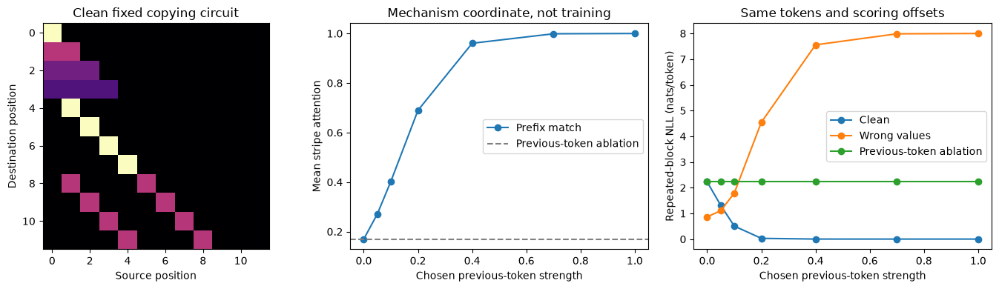
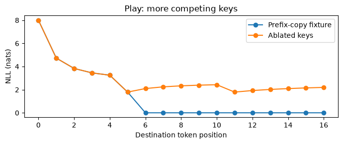

# [17.2] Induction Head Emergence


> **Colab: [exercises](https://colab.research.google.com/github/shinobiultra/ARENA_3.0_Extended/blob/main/chapter17_training_dynamics/exercises/part2_induction_head_emergence/17.2_Induction_Head_Emergence_exercises.ipynb) |
> [solutions](https://colab.research.google.com/github/shinobiultra/ARENA_3.0_Extended/blob/main/chapter17_training_dynamics/exercises/part2_induction_head_emergence/17.2_Induction_Head_Emergence_solutions.ipynb)**

> **Guided prediction practice:** open `mastery_hub/units/extension_predictions/exercises.ipynb` in the checkout before viewing the results. Record confidence and reasoning, compare controls, then predict a changed case. Reference results
> are practice, not an unseen test.

If you want to change to dark mode, you can do this by clicking the three horizontal lines in the top-right, then navigating to Settings → Theme.


# Introduction


By the end of this notebook, you will have shown that a two-stage attention circuit can copy a repeated token continuation, using token-level loss and a previous-token ablation alongside a wrong-value control.

`A B C D A B C` — what comes next? A head that attends from the final `C` to the **first `D`** can copy the answer. Merely attending to the earlier `C` copies the wrong token. How could a dot-product attention head find the token *after* a match?

In a two-layer attention-only transformer, an earlier previous-token head can write the previous token into each position. A later head can match its current token against that stored key: at the first `D`, the stored previous token is `C`. You will implement this circuit and make it fail in two different ways.

The checkpoint coordinate in this notebook is an **explicitly chosen circuit strength**, not optimizer time. These are deterministic constructed checkpoints, not a measured emergence trajectory. This distinction lets us test mechanism and measurement without inventing training evidence. The syllabus requirement `training.induction_head_emergence` also calls for a trained two-layer model, phase-change analysis, training-time freezing, and public Pythia checkpoints; those native experiments remain pending.

Prerequisites: [1.2] induction heads, attention matrix axes, NumPy matrix multiplication, and cross-entropy. Budget: roughly 90–120 minutes; the reference computation takes seconds on CPU.


## Content & Learning Objectives

### 1️⃣ Build a copying circuit

> ##### Learning Objectives
>
> - Construct previous-token keys and causal prefix-matching attention; check the exact token positions.

### 2️⃣ Measure more than an attention stripe

> ##### Learning Objectives
>
> - Implement prefix matching, next-token loss, in-context improvement and a weight-composition diagnostic.

### 3️⃣ Intervene on the mechanism

> ##### Learning Objectives
>
> - Compare a controlled family of fixed circuits with previous-token ablation and a wrong-value control.

### 4️⃣ From fixed circuits to training checkpoints

> ##### Learning Objectives
>
> - Design an honest phase-change analysis and edit the repeated-token organism.


## Setup code

Use the repository environment. This study edition needs only NumPy and Matplotlib, runs on CPU, and downloads nothing. The default fixtures are public guided practice; write your prediction before opening the expected outputs.


```python
import sys
from pathlib import Path
import numpy as np
import matplotlib.pyplot as plt
from itertools import product
chapter = "chapter17_training_dynamics"
section = "part2_induction_head_emergence"
root_dir = next(p for p in [Path.cwd(), *Path.cwd().parents] if (p / chapter).exists())
exercises_dir = root_dir / chapter / "exercises"
if str(exercises_dir) not in sys.path:
    sys.path.append(str(exercises_dir))
import part2_induction_head_emergence.tests as tests
import part2_induction_head_emergence.utils as utils
MAIN = __name__ == "__main__"
np.set_printoptions(precision=4, suppress=True)
```


=== NEW CHAPTER ===


# 1️⃣ Build a copying circuit


> ##### Learning Objectives
>
> - Construct previous-token keys and causal prefix-matching attention; check the exact token positions.

At position $i$, an attention row indexes source positions $j$. A causal model allows $j\leq i$. First we make a clean periodic sequence with no accidental token duplicates inside one period. This isolates prefix matching from token-frequency effects. In a natural-language experiment, repeated tokens and beginning-of-sequence handling require additional controls.

We represent tokens as rows of the identity matrix, $E\in\mathbb R^{T\times V}$. The previous-token head has $P_{ij}=1$ when $j=i-1$, and zero otherwise. Row zero is deliberately all zero: no invented previous token. Its output $K=PE$ stores the previous token at each source position.


### Exercise - implement `repeat_tokens`

> ```yaml
> Difficulty: 🔴🔴⚪⚪⚪
> Importance: 🔵🔵🔵🔵⚪
> 
> You should spend up to 10-15 minutes on this exercise.
> ```

Return a one-dimensional integer sequence with `repeats` copies of `0,...,period-1`. Require period >=2 and repeats >=2. This controlled fixture removes accidental within-block repeats.


```python
def repeat_tokens(period, repeats=3):
    raise NotImplementedError()


tests.test_repeat_tokens(repeat_tokens)
```


<details><summary>Hint</summary>

Use `tile`, not `repeat`; these place copies along different axes.

</details>

<details><summary>Expected output</summary>

<pre style="white-space: pre-wrap">repeat_tokens(3, 2) = [0, 1, 2, 0, 1, 2]</pre>

</details>


<details><summary>Solution</summary>

```python
def repeat_tokens(period, repeats=3):
    if period < 2 or repeats < 2:
        raise ValueError("Need a nontrivial repeated block")
    return np.tile(np.arange(period), repeats)
```
</details>


### Exercise - implement `previous_attention`

> ```yaml
> Difficulty: 🔴🔴⚪⚪⚪
> Importance: 🔵🔵🔵🔵⚪
> 
> You should spend up to 10-15 minutes on this exercise.
> ```

Build a [T,T] previous-token attention matrix. Row zero has no source and sums to zero; every other row sums to one.


```python
def previous_attention(length):
    raise NotImplementedError()


tests.test_previous_attention(previous_attention)
```


<details><summary>Hint</summary>

Think of which diagonal corresponds to source = destination - 1.

</details>

<details><summary>Expected output</summary>

<pre style="white-space: pre-wrap">Rows 1–3 copy positions 0–2; row 0 is zero.</pre>

</details>


<details><summary>Solution</summary>

```python
def previous_attention(length):
    return np.eye(length, k=-1)
```
</details>


### Exercise - implement `prefix_keys`

> ```yaml
> Difficulty: 🔴🔴⚪⚪⚪
> Importance: 🔵🔵🔵🔵⚪
> 
> You should spend up to 10-15 minutes on this exercise.
> ```

Given token IDs [T], return [T,V] previous-token keys. `strength=0` ablates this head; `strength=1` gives exact token keys. Do not shift with wraparound.


```python
def prefix_keys(tokens, vocab, strength=1.0):
    raise NotImplementedError()


tests.test_prefix_keys(prefix_keys)
```


<details><summary>Hint</summary>

Apply the previous-token attention to one-hot value vectors.

</details>

<details><summary>Expected output</summary>

<pre style="white-space: pre-wrap">prefix_keys([2,0,1],3) has rows zero, e₂, e₀.</pre>

</details>


<details><summary>Solution</summary>

```python
def prefix_keys(tokens, vocab, strength=1.0):
    one_hot = np.eye(vocab)[tokens]
    return strength * previous_attention(len(tokens)) @ one_hot
```
</details>


### Exercise - implement `causal_softmax`

> ```yaml
> Difficulty: 🔴🔴⚪⚪⚪
> Importance: 🔵🔵🔵🔵⚪
> 
> You should spend up to 10-15 minutes on this exercise.
> ```

Normalize square attention scores [T,T] along the source axis, with all strictly future entries exactly zero. Use stable exponentials.


```python
def causal_softmax(scores):
    raise NotImplementedError()


tests.test_causal_softmax(causal_softmax)
```


<details><summary>Hint</summary>

Mask before finding the maximum, and normalize rows.

</details>

<details><summary>Expected output</summary>

<pre style="white-space: pre-wrap">Zero scores give causal-uniform rows [1], [1/2,1/2], [1/3,1/3,1/3].</pre>

</details>


<details><summary>Solution</summary>

```python
def causal_softmax(scores):
    mask = np.tril(np.ones_like(scores, dtype=bool))
    x = np.where(mask, scores, -np.inf)
    x = np.exp(x - x.max(axis=-1, keepdims=True))
    return x / x.sum(axis=-1, keepdims=True)
```
</details>


```python
small_tokens=repeat_tokens(3,2)
small_keys=prefix_keys(small_tokens,3)
print("position token previous-key-token ablated-key-norm")
for i,(token,key) in enumerate(zip(small_tokens,small_keys)):
    previous=int(key.argmax()) if key.sum() else "none"
    print(i,int(token),previous,0.)
```


<details><summary>Help - why is row zero different?</summary>

For tokens 0,1,2,0,1,2 the stored previous-token IDs are none,0,1,2,0,1. The ablated-key norm is zero everywhere. A circular shift would store the final token at row zero and leak information from beyond the prefix.

</details>


## Summary of 1️⃣

You can now construct keys without leaking a future token. A good-looking stripe can still copy the wrong value, so our next measurements include the actual token prediction.


=== NEW CHAPTER ===


# 2️⃣ Measure more than an attention stripe


> ##### Learning Objectives
>
> - Implement prefix matching, next-token loss, in-context improvement and a weight-composition diagnostic.

Queries are current one-hot tokens. Scores are $S=\beta EK^\top$, with inverse temperature $\beta$. The first matching key occurs at the position **after** the previous occurrence of the current token. We evaluate offsets 0 through p-2 within the first and second blocks, deliberately excluding each block-boundary transition so the early/repeated comparison uses matched within-block offsets. With three repeats, the final token of the second block does have an observed next-token target in the third block; it is excluded by this scoring convention, not because its target is missing. Only the final token of the entire sequence lacks an observed next-token target.

Prefix matching is the mean attention mass at the analytically known source $j=i-p+1$ for period $p$. This is an attention diagnostic, not a causal effect. The copying readout forms vocabulary logits $L=\alpha AE$. Cross-entropy uses the next token, never the current token. Our in-context improvement compares mean early-block loss to repeated-block loss on corresponding offsets. Units are nats/token; positive means lower repeated-context loss.


### Exercise - implement `induction_pattern`

> ```yaml
> Difficulty: 🔴🔴⚪⚪⚪
> Importance: 🔵🔵🔵🔵⚪
> 
> You should spend up to 10-15 minutes on this exercise.
> ```

Return [T,T] causal attention from current-token queries and previous-token keys. `beta` scales similarity; it is not a learned parameter in this fixture.


```python
def induction_pattern(tokens, vocab, strength=1.0, beta=12.0):
    raise NotImplementedError()


tests.test_induction_pattern(induction_pattern)
```


<details><summary>Hint</summary>

The keys are attached to source positions. The query at second A matches the previous-token key stored at first B.

</details>

<details><summary>Expected output</summary>

<pre style="white-space: pre-wrap">For [0,1,2,0,1,2], attention[3,1] and attention[4,2] exceed .99.</pre>

</details>


<details><summary>Solution</summary>

```python
def induction_pattern(tokens, vocab, strength=1.0, beta=12.0):
    q = np.eye(vocab)[tokens]
    k = prefix_keys(tokens, vocab, strength)
    return causal_softmax(beta * q @ k.T)
```
</details>


### Exercise - implement `prefix_score`

> ```yaml
> Difficulty: 🔴🔴⚪⚪⚪
> Importance: 🔵🔵🔵🔵⚪
> 
> You should spend up to 10-15 minutes on this exercise.
> ```

Average attention at the known induction source over second-block destinations `period ... 2*period-2`. Exclude the final offset of the second block to match the within-block offsets used for the early/repeated loss comparison. In the three-repeat fixture that excluded destination still has an observed target; only the final destination of the entire sequence has no target.


```python
def prefix_score(attention, period):
    raise NotImplementedError()


tests.test_prefix_score(prefix_score)
```


<details><summary>Hint</summary>

Use paired advanced indexing, not a Cartesian submatrix.

</details>

<details><summary>Expected output</summary>

<pre style="white-space: pre-wrap">A fixture with stripe entries .2 and .8 has prefix score .5.</pre>

</details>


<details><summary>Solution</summary>

```python
def prefix_score(attention, period):
    dest = np.arange(period, 2*period-1)
    return float(attention[dest, dest-period+1].mean())
```
</details>


### Exercise - implement `copy_logits`

> ```yaml
> Difficulty: 🔴🔴⚪⚪⚪
> Importance: 🔵🔵🔵🔵⚪
> 
> You should spend up to 10-15 minutes on this exercise.
> ```

Return vocabulary logits [T,V] by attending to **current source tokens** as values. A wrong-value control will deliberately rotate these value IDs.


```python
def copy_logits(attention, tokens, vocab, scale=8.0):
    raise NotImplementedError()


tests.test_copy_logits(copy_logits)
```


<details><summary>Hint</summary>

Multiply attention by the value one-hots; previous-token keys and current-token values are different objects.

</details>

<details><summary>Expected output</summary>

<pre style="white-space: pre-wrap">For source tokens [1,0], attention [.25,.75], scale 4: logits [3,1].</pre>

</details>


<details><summary>Solution</summary>

```python
def copy_logits(attention, tokens, vocab, scale=8.0):
    return scale * attention @ np.eye(vocab)[tokens]
```
</details>


### Exercise - implement `next_token_loss`

> ```yaml
> Difficulty: 🔴🔴⚪⚪⚪
> Importance: 🔵🔵🔵🔵⚪
> 
> You should spend up to 10-15 minutes on this exercise.
> ```

Compute [T-1] next-token negative log probability with stable log-sum-exp. Exclude the final logits row, which has no observed next token.


```python
def next_token_loss(logits, tokens):
    raise NotImplementedError()


tests.test_next_token_loss(next_token_loss)
```


<details><summary>Hint</summary>

Each row i is scored against tokens[i+1], with one log-normalizer per row.

</details>

<details><summary>Expected output</summary>

<pre style="white-space: pre-wrap">Known probabilities .75 and .8 give losses .287682 and .223144 nats.</pre>

</details>


<details><summary>Solution</summary>

```python
def next_token_loss(logits, tokens):
    x = logits[:-1]
    m = x.max(axis=-1)
    log_z = m + np.log(np.exp(x-m[:,None]).sum(axis=-1))
    return log_z - x[np.arange(len(tokens)-1), tokens[1:]]
```
</details>


### Exercise - implement `icl_gain`

> ```yaml
> Difficulty: 🔴🔴⚪⚪⚪
> Importance: 🔵🔵🔵🔵⚪
> 
> You should spend up to 10-15 minutes on this exercise.
> ```

Compare corresponding offsets in first and second block, excluding each block’s final destination. Return early mean minus repeated mean in nats/token.


```python
def icl_gain(losses, period):
    raise NotImplementedError()


tests.test_icl_gain(icl_gain)
```


<details><summary>Hint</summary>

The boundary at period-1 predicts the next block and should not enter this paired-offset comparison.

</details>

<details><summary>Expected output</summary>

<pre style="white-space: pre-wrap">Loss [3,5,999,1,2,999] with period 3 gives gain 2.5 nats.</pre>

</details>


<details><summary>Solution</summary>

```python
def icl_gain(losses, period):
    return float(losses[:period-1].mean() - losses[period:2*period-1].mean())
```
</details>


```python
worked_tokens=repeat_tokens(4,3)
worked_attention=induction_pattern(worked_tokens,4)
worked_logits=copy_logits(worked_attention,worked_tokens,4)
wrong_logits=copy_logits(worked_attention,(worked_tokens+1)%4,4)
print("destination current expected clean-top1 wrong-value-top1")
for i in range(4,7):
    print(i,int(worked_tokens[i]),int(worked_tokens[i+1]),int(worked_logits[i].argmax()),int(wrong_logits[i].argmax()))
```


<details><summary>Expected output</summary>

<pre style="white-space: pre-wrap">destination current expected clean-top1 wrong-value-top1
4 0 1 1 2
5 1 2 2 3
6 2 3 3 0</pre>

</details>

The attention pattern is identical in both columns. Correct source selection needs the correct value and readout maps to implement copying.


## Summary of 2️⃣

A prefix score asks where the head looks. Next-token loss asks whether its values and readout make that attention useful. Neither metric alone identifies learned emergence.


=== NEW CHAPTER ===


# 3️⃣ Intervene on the mechanism


> ##### Learning Objectives
>
> - Compare a controlled family of fixed circuits with previous-token ablation and a wrong-value control.

A composition diagnostic should inspect the *path*, not only each matrix norm. For compatible maps $A,B$, use $\|AB\|_F/(\|A\|_F\|B\|_F)$. A high value indicates aligned maps but is neither an induction score nor a proof of behavior. We use a one-hot path where the diagnostic can be checked analytically, then ablate its earlier write.

Our intervention sets the previous-token write to zero before constructing later keys. This is an inference-time intervention. Freezing a head during optimization would additionally change the learned trajectory and possible compensatory routes; that separate experiment is not performed here.


### Exercise - implement `ablate_previous`

> ```yaml
> Difficulty: 🔴🔴⚪⚪⚪
> Importance: 🔵🔵🔵🔵⚪
> 
> You should spend up to 10-15 minutes on this exercise.
> ```

Return new keys with all previous-token content zeroed. Preserve the input array. This function is the explicit intervention boundary for future cached-model adapters.


```python
def ablate_previous(keys):
    raise NotImplementedError()


tests.test_ablate_previous(ablate_previous)
```


<details><summary>Hint</summary>

Construct a new array; mutation could corrupt the clean condition.

</details>

<details><summary>Expected output</summary>

<pre style="white-space: pre-wrap">The ablated keys are zero and the clean cache is unchanged.</pre>

</details>


<details><summary>Solution</summary>

```python
def ablate_previous(keys):
    return np.zeros_like(keys)
```
</details>


### Exercise - implement `composition_score`

> ```yaml
> Difficulty: 🔴🔴⚪⚪⚪
> Importance: 🔵🔵🔵🔵⚪
> 
> You should spend up to 10-15 minutes on this exercise.
> ```

Compute the normalized Frobenius norm of the composed path. Define zero-norm paths to have score zero.


```python
def composition_score(a, b):
    raise NotImplementedError()


tests.test_composition_score(composition_score)
```


<details><summary>Hint</summary>

Use the norm of the matrix product, not the product of separate scores.

</details>

<details><summary>Expected output</summary>

<pre style="white-space: pre-wrap">Identity 2x2 path: 0.707107; disjoint rank-one paths: 0.</pre>

</details>


<details><summary>Solution</summary>

```python
def composition_score(a, b):
    denom = np.linalg.norm(a) * np.linalg.norm(b)
    return float(np.linalg.norm(a @ b) / denom) if denom else 0.0
```
</details>


### Exercise - implement `first_crossing`

> ```yaml
> Difficulty: 🔴🔴⚪⚪⚪
> Importance: 🔵🔵🔵🔵⚪
> 
> You should spend up to 10-15 minutes on this exercise.
> ```

Return the first coordinate whose measured score reaches the frozen threshold; return None if absent. Preserve the supplied ordering. Never choose the threshold after inspecting the curve.


```python
def first_crossing(coordinates, scores, threshold):
    raise NotImplementedError()


tests.test_first_crossing(first_crossing)
```


<details><summary>Hint</summary>

A crossing in a deterministic parameter sweep is a measurement threshold, not optimizer emergence.

</details>

<details><summary>Expected output</summary>

<pre style="white-space: pre-wrap">[.1,.9,.8] first reaches .85 at coordinate 20.</pre>

</details>


<details><summary>Solution</summary>

```python
def first_crossing(coordinates, scores, threshold):
    hits = np.flatnonzero(np.asarray(scores) >= threshold)
    return coordinates[int(hits[0])] if len(hits) else None
```
</details>


### Forecast before running

At strength 1, will zeroing previous-token keys reduce prefix score below .3? Will rotating only the value IDs preserve prefix matching while damaging repeated-block loss? Record both predictions, confidence, and a causal reason. The reference plots below reveal the answers; this route is guided practice.


```python
period = 4
tokens = repeat_tokens(period, 3)
strengths = np.array([0., .05, .1, .2, .4, .7, 1.])
scores, gains, clean_loss, wrong_loss, ablated_loss = [], [], [], [], []
for strength in strengths:
    attn = induction_pattern(tokens, period, strength)
    loss = next_token_loss(copy_logits(attn, tokens, period), tokens)
    wrong = next_token_loss(copy_logits(attn, (tokens+1)%period, period), tokens)
    keys = ablate_previous(prefix_keys(tokens, period, strength))
    ablated = causal_softmax(12 * np.eye(period)[tokens] @ keys.T)
    abl_loss = next_token_loss(copy_logits(ablated, tokens, period), tokens)
    scores.append(prefix_score(attn, period)); gains.append(icl_gain(loss, period))
    clean_loss.append(loss[period:2*period-1].mean())
    wrong_loss.append(wrong[period:2*period-1].mean())
    ablated_loss.append(abl_loss[period:2*period-1].mean())
print("strength prefix repeated_loss wrong_value_loss ablated_loss")
for row in zip(strengths, scores, clean_loss, wrong_loss, ablated_loss):
    print(" ".join(f"{v:.4f}" for v in row))
fig, axes = plt.subplots(1,3,figsize=(14,4))
axes[0].imshow(induction_pattern(tokens,period),vmin=0,vmax=1,cmap="magma")
axes[0].set(title="Clean fixed copying circuit",xlabel="Source position",ylabel="Destination position")
axes[1].plot(strengths,scores,"o-",label="Prefix match")
axes[1].axhline(prefix_score(induction_pattern(tokens,period,0),period),ls="--",color="gray",label="Previous-token ablation")
axes[1].set(title="Mechanism coordinate, not training",xlabel="Chosen previous-token strength",ylabel="Mean stripe attention")
axes[1].legend()
for vals,label in [(clean_loss,"Clean"),(wrong_loss,"Wrong values"),(ablated_loss,"Previous-token ablation")]:
    axes[2].plot(strengths,vals,"o-",label=label)
axes[2].set(title="Same tokens and scoring offsets",xlabel="Chosen previous-token strength",ylabel="Repeated-block NLL (nats/token)")
axes[2].legend(); utils.finish_figure(fig)
```





<details><summary>Help - how should I interpret this?</summary>

The stripe belongs one position **after** a previous token match. At high strength, the clean values copy the continuation; rotating value IDs leaves attention unchanged but predicts the wrong token. The zero-key control has causal-uniform attention. This separates attending correctly from copying correctly. At strength zero, rotated values happen to improve loss (.8668 versus 2.2255) because numeric token IDs are cyclically ordered: this control is not a universally useless readout. At strength one it has loss 8.0007 versus .0010 for clean copying, so it exposes the specific high-strength mechanism. This low-strength anomaly is a reason to inspect controls across the whole curve.

The horizontal coordinate was chosen by us, so a sharp change here is a property of a nonlinear readout, not evidence of a training phase transition.

</details>


```python
print("composition scores at strength 0 and 1:",
      composition_score(np.zeros((4,4)),np.eye(4)),
      composition_score(np.eye(4),np.eye(4)))
```


<details><summary>Expected output</summary>

<pre style="white-space: pre-wrap">composition scores at strength 0 and 1: 0.0 0.5</pre>

</details>

For every nonzero scalar multiple of the same identity path the normalized score stays .5. Thus this weight diagnostic deliberately does **not** track the strength-dependent behavioral change. In a native transformer use the actual embedding, previous-head OV and later-head QK maps with declared axes; do not infer emergence merely from a normalized map score.


## Summary of 3️⃣

You have a mechanistic sufficiency example and a controlled inference-time lesion. You do not yet have evidence that SGD discovers this circuit or that a loss bump marks its birth.


=== NEW CHAPTER ===


# 4️⃣ From fixed circuits to training checkpoints


> ##### Learning Objectives
>
> - Design an honest phase-change analysis and edit the repeated-token organism.

<details><summary>Reference measurement</summary>

<pre style="white-space: pre-wrap">period 4, strength 1:
prefix score ≈ 1.0000
repeated-block NLL clean ≈ .0010
repeated-block NLL zero keys ≈ 2.2255
repeated-block NLL rotated values ≈ 8.0007</pre>

</details>


## Try it yourself

Change the period to 6 while keeping the attention temperature fixed. Predict the prefix score and repeated loss first: there are now more nonmatching keys competing for mass. Then try a block containing repeated token IDs; explain why the single-source stripe metric becomes incomplete. Do not tune the threshold until the control looks persuasive.


```python
play_period = 6
play_tokens = repeat_tokens(play_period, 3)
play_attn = induction_pattern(play_tokens, play_period)
play_uniform = induction_pattern(play_tokens, play_period,0)
fig, ax = plt.subplots(figsize=(7,3))
for attn,label in [(play_attn,"Prefix-copy fixture"),(play_uniform,"Ablated keys")]:
    losses = next_token_loss(copy_logits(attn,play_tokens,play_period),play_tokens)
    ax.plot(np.arange(len(losses)),losses,"o-",label=label)
ax.set(xlabel="Destination token position",ylabel="NLL (nats)",title="Play: more competing keys")
ax.legend();utils.finish_figure(fig)
print("prefix score",round(prefix_score(play_attn,play_period),4))
```





### Native checkpoint bridge

A native adapter must cache **attention probabilities**, the previous-token head’s output, and logits on the same ordered tokens at every checkpoint. Feed these arrays into your visible `prefix_score`, `next_token_loss`, and `icl_gain`; record a matrix path diagnostic separately. Pythia checkpoints provide a source-grounded way to ask whether the same diagnostics co-occur across real optimization time, but a token/revision-matched analysis has not run here.

For the two-layer attention-only training experiment, freeze data, optimizer, seed, checkpoint cadence, smoothing, onset threshold and loss-bump definition before execution. Compare normal training to the predeclared previous-token-head freeze and a matched unrelated-head freeze. Report train loss, repeated-context measurements on monitored DEV, and untouched TEST only if it really stayed unopened. A finite repeated-token fixture is a circuit diagnostic, not language-model generalization.

**Anomaly hunt:** a head has high prefix score but no in-context improvement. Which of keys, values, output projection, scoring offsets or alternate routes would you inspect first? Your wrong-value control is a concrete counterexample to the claim that attention alone establishes function.

## Summary of 4️⃣

You can now state exactly which arrays and counterfactuals the native experiment must supply, without filling the missing evidence with a planted trajectory.


=== NEW CHAPTER ===


# ☆ Bonus


## Limitations

The organism is a constructed two-stage attention circuit with one-hot keys and values. No optimizer, trained two-layer model, Pythia checkpoint download, full weight-composition analysis or training-time freezing is executed. We establish implementation and causal sufficiency on the public finite sequence, not learned emergence or independent language-model evaluation.


## Further Reading

- [Olsson et al.: In-context Learning and Induction Heads](https://transformer-circuits.pub/2022/in-context-learning-and-induction-heads/index.html) — empirical phase changes and induction-circuit evidence.
- [Biderman et al.: Pythia](https://arxiv.org/abs/2304.01373) — controlled public training checkpoints, not measurements loaded by this notebook.
- [ARENA induction circuits](https://arena-chapter1-transformer-interp.streamlit.app/) — model-hook implementation background.

