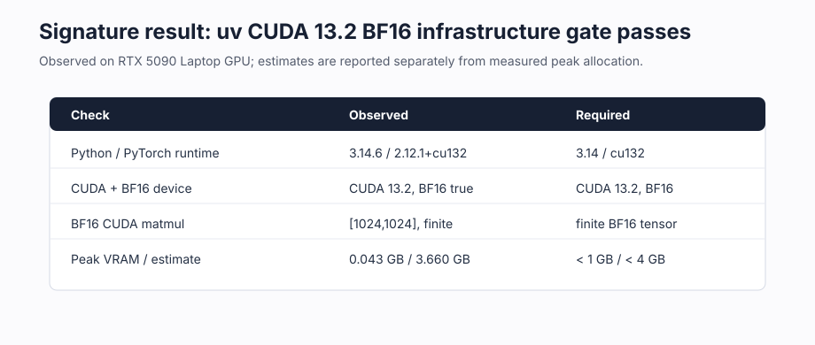

# [1.6] Local Frontier ML Infrastructure (Practice)


> **Colab:
> [exercises](https://colab.research.google.com/github/shinobiultra/ARENA_3.0_Extended/blob/main/chapter1_transformer_interp/exercises/part6_frontier_ml_infrastructure_practice/1.6_Local_Frontier_ML_Infrastructure_Practice_exercises.ipynb)
> |
> [solutions](https://colab.research.google.com/github/shinobiultra/ARENA_3.0_Extended/blob/main/chapter1_transformer_interp/exercises/part6_frontier_ml_infrastructure_practice/1.6_Local_Frontier_ML_Infrastructure_Practice_solutions.ipynb)**

If you want to change to dark mode, you can do this by clicking the three horizontal lines in the top-right, then navigating to Settings → Theme.

# Introduction


Before loading a checkpoint, estimate its memory, test whether logits and token IDs agree, and preserve activation provenance. You will implement the original estimator, parity operations and disk-store methods inline. The signature demonstrates a small BF16 tensor readiness check; it does not validate checkpoint loading, quantization, model quality or hook equivalence.

Importing the Python module binds definitions only. Call `initialize_runtime()` explicitly before using numerical or runtime callbacks; the callbacks are not initialized merely by importing them. The notebook setup invokes this initializer when a learner elects to run it.


## Content & Learning Objectives

### 1️⃣ Implement and test

> ##### Learning Objectives
>
> - Implement each core operation beside the original immediate positive and negative tests.

### 2️⃣ Inspect and change controls

> ##### Learning Objectives
>
> - Interpret the original visible signature, qualify the claim, and predict a changed condition.

### ☆ Bonus

Inspect the runtime entry points for the CUDA and full-experiment runs.


```python
from __future__ import annotations

from dataclasses import dataclass, field
from pathlib import Path
from typing import Any, Iterator, Literal

MAIN = __name__ == "__main__"
```


=== NEW CHAPTER ===


# 1️⃣ Implement and test


> ##### Learning Objectives
>
> - Implement each core operation beside the original immediate positive and negative tests.

```python
def initialize_runtime(root: str | Path | None = None) -> None:
    """Explicitly initialize runtime dependencies; never runs on raw import."""
    global t, tests, json, sys, tempfile, subprocess, math, platform, importlib
    global root_dir, chapter, section, exercises_dir, section_dir
    global F, torchvision, load_file, save_file
    import importlib.util
    import json
    import math
    import platform
    import subprocess
    import sys
    import tempfile
    import torch as t
    import torch.nn.functional as F
    import torchvision
    from safetensors.torch import load_file, save_file
    chapter = "chapter1_transformer_interp"
    section = "part6_frontier_ml_infrastructure"
    if root is None:
        if "__file__" in globals():
            root = Path(__file__).resolve().parents[3]
        else:
            root = next(p for p in [Path.cwd(), *Path.cwd().parents] if (p / chapter).exists())
    root_dir = Path(root)
    exercises_dir = root_dir / chapter / "exercises"
    section_dir = exercises_dir / section
    if str(root_dir) not in sys.path:
        sys.path.append(str(root_dir))
    tests = importlib.import_module(chapter + ".exercises." + section + ".tests")


initialize_runtime()
```


```python
DTypeName = Literal["float32", "float16", "bfloat16", "int8", "int4"]

_DTYPE_BYTES: dict[DTypeName, float] = {
    "float32": 4.0,
    "float16": 2.0,
    "bfloat16": 2.0,
    "int8": 1.0,
    "int4": 0.5,
}
```


```python
@dataclass(frozen=True)
class MemoryBudget:
    """Approximate memory use for an inference or notebook smoke test."""

    parameter_gb: float
    kv_cache_gb: float
    activation_gb: float
    optimizer_gb: float
    overhead_gb: float

    @property
    def total_gb(self) -> float:
        return (
            self.parameter_gb
            + self.kv_cache_gb
            + self.activation_gb
            + self.optimizer_gb
            + self.overhead_gb
        )

    def fits(self, max_vram_gb: float, reserve_gb: float = 1.0) -> bool:
        return self.total_gb <= max_vram_gb - reserve_gb

    def as_dict(self) -> dict[str, float]:
        return {
            "parameter_gb": self.parameter_gb,
            "kv_cache_gb": self.kv_cache_gb,
            "activation_gb": self.activation_gb,
            "optimizer_gb": self.optimizer_gb,
            "overhead_gb": self.overhead_gb,
            "total_gb": self.total_gb,
        }
```


```python
@dataclass(frozen=True)
class ParityReport:
    """Logit-level parity report for notebook verification blocks."""

    max_abs_diff: float
    mse: float
    kl_divergence: float
    topk_agreement: float

    def passed(
        self,
        *,
        max_abs_diff: float | None = None,
        mse: float | None = None,
        kl_divergence: float | None = None,
        topk_agreement: float | None = None,
    ) -> bool:
        if (
            max_abs_diff is None
            and mse is None
            and kl_divergence is None
            and topk_agreement is None
        ):
            raise ValueError("At least one explicit parity tolerance is required.")
        checks = []
        if max_abs_diff is not None:
            checks.append(self.max_abs_diff <= max_abs_diff)
        if mse is not None:
            checks.append(self.mse <= mse)
        if kl_divergence is not None:
            checks.append(self.kl_divergence <= kl_divergence)
        if topk_agreement is not None:
            checks.append(self.topk_agreement >= topk_agreement)
        return all(checks)
```


```python
@dataclass(frozen=True)
class EnvironmentReport:
    """Small, serializable summary of the local ML runtime."""

    python: str
    platform: str
    torch: str
    cuda_available: bool
    cuda_version: str | None
    gpu_name: str | None
    gpu_total_memory_gb: float | None
    bf16_supported: bool
    flash_attn_available: bool
    xformers_available: bool

    def as_dict(self) -> dict[str, Any]:
        return {
            "python": self.python,
            "platform": self.platform,
            "torch": self.torch,
            "cuda_available": self.cuda_available,
            "cuda_version": self.cuda_version,
            "gpu_name": self.gpu_name,
            "gpu_total_memory_gb": self.gpu_total_memory_gb,
            "bf16_supported": self.bf16_supported,
            "flash_attn_available": self.flash_attn_available,
            "xformers_available": self.xformers_available,
        }

    def warnings(self, required_vram_gb: float | None = None) -> list[str]:
        warnings = []
        if not self.cuda_available:
            warnings.append(
                "CUDA is not available; GPU-only notebooks should run in CPU smoke-test mode."
            )
        if required_vram_gb is not None and self.gpu_total_memory_gb is not None:
            if required_vram_gb > self.gpu_total_memory_gb:
                warnings.append(
                    f"Estimated VRAM need is {required_vram_gb:.1f} GB, "
                    f"but the visible GPU has {self.gpu_total_memory_gb:.1f} GB."
                )
        if (
            required_vram_gb is not None
            and self.gpu_total_memory_gb is None
            and self.cuda_available
        ):
            warnings.append("CUDA is visible, but total GPU memory could not be read.")
        return warnings
```


```python
@dataclass(frozen=True)
class ActivationRecord:
    """Metadata for one activation shard saved to disk."""

    name: str
    path: str
    shape: tuple[int, ...]
    dtype: str
    metadata: dict[str, Any] = field(default_factory=dict)
```


Predict which runtime observations cannot be inferred from the stored CUDA version string. Record whether a warning establishes available memory.


### Exercise - Environment observations

> ```yaml
> Difficulty: 🔴🔴⚪⚪⚪
> Importance: 🔵🔵🔵🔵⚪
>
> You should spend up to 10-20 minutes on this exercise.
> ```

The existing report observes versions, CUDA availability and optional kernels only when called. It does not upgrade packages or make a model fit.

<details>
<summary>Help - implementation and interpretation</summary>

The existing report observes versions, CUDA availability and optional kernels only when called. It does not upgrade packages or make a model fit.

</details>


```python
def _has_module(name: str) -> bool:
    return importlib.util.find_spec(name) is not None
```


```python
def get_environment_report() -> EnvironmentReport:
    """Return a current environment report without allocating model-sized tensors."""

    cuda_available = t.cuda.is_available()
    gpu_name = None
    gpu_total_memory_gb = None
    bf16_supported = False

    if cuda_available:
        device_index = t.cuda.current_device()
        props = t.cuda.get_device_properties(device_index)
        gpu_name = props.name
        gpu_total_memory_gb = props.total_memory / 1024**3
        bf16_supported = t.cuda.is_bf16_supported()

    return EnvironmentReport(
        python=platform.python_version(),
        platform=platform.platform(),
        torch=t.__version__,
        cuda_available=cuda_available,
        cuda_version=t.version.cuda,
        gpu_name=gpu_name,
        gpu_total_memory_gb=gpu_total_memory_gb,
        bf16_supported=bf16_supported,
        flash_attn_available=_has_module("flash_attn"),
        xformers_available=_has_module("xformers"),
    )
```


```python
def print_environment_report(required_vram_gb: float | None = None) -> EnvironmentReport:
    """Print a compact report and return it for downstream metadata logging."""

    report = get_environment_report()
    print("Environment")
    for key, value in report.as_dict().items():
        print(f"  {key}: {value}")
    for warning in report.warnings(required_vram_gb):
        print(f"  WARNING: {warning}")
    return report
```


```python
def run_environment_check(required_vram_gb: float | None = 24.0):
    # YOUR CODE HERE
    raise NotImplementedError()
```


<details><summary>Solution</summary>

```python
def run_environment_check(required_vram_gb: float | None = 24.0):
    """Return a local environment report and print any relevant warnings."""

    report = get_environment_report()
    print("Environment report")
    for key, value in report.as_dict().items():
        print(f"  {key}: {value}")
    for warning in report.warnings(required_vram_gb):
        print(f"  WARNING: {warning}")
    return report
```

</details>


<details>
<summary>Expected output and solution reveal</summary>

The named original tests should print `All tests ... passed!`; the drift, shape and token-mismatch controls must be rejected. The memory fixture remains about 3.66 in the original GB-labelled binary-unit estimate. The two-shard contract stores 28 values. Read the generated solution dropdowns after committing your forecast.

</details>


Predict which budget components double when context length doubles. Explain why a successful 1024-square matmul cannot measure a billion-parameter model peak.


### Exercise - Memory before model loading

> ```yaml
> Difficulty: 🔴🔴⚪⚪⚪
> Importance: 🔵🔵🔵🔵⚪
>
> You should spend up to 10-20 minutes on this exercise.
> ```

Parameter bytes are P times dtype bytes. KV values are 2 times batch, context, layers, KV heads and head width. Activation memory uses the original multiplier; optimizer memory is zero for inference. Values divide by 1024 cubed, despite the original GB label.

<details>
<summary>Help - implementation and interpretation</summary>

Parameter bytes are P times dtype bytes. KV values are 2 times batch, context, layers, KV heads and head width. Activation memory uses the original multiplier; optimizer memory is zero for inference. Values divide by 1024 cubed, despite the original GB label.

</details>


```python
def bytes_per_value(dtype: DTypeName) -> float:
    """Return storage bytes per scalar for common model dtypes."""

    try:
        return _DTYPE_BYTES[dtype]
    except KeyError as exc:
        expected = sorted(_DTYPE_BYTES)
        raise ValueError(f"Unknown dtype {dtype!r}; expected one of {expected}") from exc
```


```python
def estimate_inference_memory(
    *,
    num_parameters: int,
    dtype: DTypeName = "bfloat16",
    batch_size: int = 1,
    context_length: int = 2048,
    hidden_size: int | None = None,
    num_layers: int | None = None,
    num_key_value_heads: int | None = None,
    head_dim: int | None = None,
    activation_multiplier: float = 2.0,
    overhead_gb: float = 1.0,
) -> MemoryBudget:
    # YOUR CODE HERE
    raise NotImplementedError()
```


<details><summary>Solution</summary>

```python
def estimate_inference_memory(
    *,
    num_parameters: int,
    dtype: DTypeName = "bfloat16",
    batch_size: int = 1,
    context_length: int = 2048,
    hidden_size: int | None = None,
    num_layers: int | None = None,
    num_key_value_heads: int | None = None,
    head_dim: int | None = None,
    activation_multiplier: float = 2.0,
    overhead_gb: float = 1.0,
) -> MemoryBudget:
    """Estimate inference memory in GB.

    This is intentionally conservative and simple. It is meant to catch obvious
    local-tier mistakes before a notebook tries to load a model, not to replace
    framework profilers.
    """

    value_bytes = bytes_per_value(dtype)
    parameter_gb = num_parameters * value_bytes / 1024**3

    kv_cache_gb = 0.0
    if num_layers is not None and num_key_value_heads is not None and head_dim is not None:
        # K and V cache, one scalar per batch/position/layer/kv-head/head-dim.
        kv_values = 2 * batch_size * context_length * num_layers * num_key_value_heads * head_dim
        kv_cache_gb = kv_values * value_bytes / 1024**3

    activation_gb = 0.0
    if hidden_size is not None:
        activation_values = batch_size * context_length * hidden_size * activation_multiplier
        activation_gb = activation_values * value_bytes / 1024**3

    return MemoryBudget(
        parameter_gb=parameter_gb,
        kv_cache_gb=kv_cache_gb,
        activation_gb=activation_gb,
        optimizer_gb=0.0,
        overhead_gb=overhead_gb,
    )
```

</details>


```python
def estimate_training_optimizer_memory(
    *,
    num_parameters: int,
    parameter_dtype: DTypeName = "bfloat16",
    optimizer_state_dtype: DTypeName = "float32",
    optimizer_states_per_parameter: int = 2,
) -> float:
    """Estimate optimizer-state memory in GB for Adam-like training."""

    param_bytes = bytes_per_value(parameter_dtype)
    state_bytes = bytes_per_value(optimizer_state_dtype)
    total_bytes = num_parameters * (param_bytes + optimizer_states_per_parameter * state_bytes)
    return total_bytes / 1024**3
```


```python
def estimate_gemma_1b_smoke_budget(context_length: int = 2048):
    # YOUR CODE HERE
    raise NotImplementedError()
```


<details><summary>Solution</summary>

```python
def estimate_gemma_1b_smoke_budget(context_length: int = 2048):
    """Estimate memory for a Gemma-sized 1B smoke test."""

    return estimate_inference_memory(
        num_parameters=1_000_000_000,
        dtype="bfloat16",
        batch_size=1,
        context_length=context_length,
        hidden_size=2048,
        num_layers=18,
        num_key_value_heads=8,
        head_dim=256,
        overhead_gb=1.5,
    )
```

</details>


```python
tests.test_memory_budget_fits_local_tier(estimate_gemma_1b_smoke_budget)
tests.test_memory_budget_rejects_oversized_model()
```


The unchanged original oversized-memory test above covers the imported reference estimator. The following immediate control calls your notebook-local `estimate_inference_memory` directly using the exact original 30B BF16 fixture. Both its total estimate and `fits(24.0)` decision must reject the local tier.


```python
student_oversized_budget = estimate_inference_memory(
    num_parameters=30_000_000_000,
    dtype="bfloat16",
    batch_size=1,
    context_length=4096,
    hidden_size=4096,
    num_layers=48,
    num_key_value_heads=8,
    head_dim=128,
    overhead_gb=2.0,
)
assert student_oversized_budget.total_gb > 24.0, (
    "A 30B BF16 local load should exceed the 24GB tier in this conservative estimate."
)
assert not student_oversized_budget.fits(24.0), (
    "Oversized model estimates must not be reported as fitting the local GPU."
)
```


<details>
<summary>Expected output and solution reveal</summary>

The named original tests should print `All tests ... passed!`; the drift, shape and token-mismatch controls must be rejected. The memory fixture remains about 3.66 in the original GB-labelled binary-unit estimate. The two-shard contract stores 28 values. Read the generated solution dropdowns after committing your forecast.

</details>


Predict whether the same top-k token set guarantees small MSE and KL. Specify the direction of KL and distinguish equal token IDs from similar decoded text.


### Exercise - Logit drift and exact tokens

> ```yaml
> Difficulty: 🔴🔴⚪⚪⚪
> Importance: 🔵🔵🔵🔵⚪
>
> You should spend up to 10-20 minutes on this exercise.
> ```

Compute KL(reference || custom) over vocabulary then average other positions. Top-k agreement compares sorted sets, not ordered ranks. Shape mismatches fail before broadcasting; exact generation equality has a separate shape check.

<details>
<summary>Help - implementation and interpretation</summary>

Compute KL(reference || custom) over vocabulary then average other positions. Top-k agreement compares sorted sets, not ordered ranks. Shape mismatches fail before broadcasting; exact generation equality has a separate shape check.

</details>


```python
def _validate_logits(custom_logits: t.Tensor, reference_logits: t.Tensor) -> None:
    if custom_logits.shape != reference_logits.shape:
        raise ValueError(
            "custom_logits and reference_logits must have the same shape; "
            f"got {tuple(custom_logits.shape)} and {tuple(reference_logits.shape)}."
        )
    if custom_logits.ndim < 2:
        raise ValueError("Expected logits with at least batch and vocab dimensions.")
```


```python
def topk_agreement(custom_logits: t.Tensor, reference_logits: t.Tensor, k: int = 10) -> float:
    """Return the fraction of positions with identical top-k token sets."""

    _validate_logits(custom_logits, reference_logits)
    if k <= 0:
        raise ValueError("k must be positive.")
    if k > custom_logits.shape[-1]:
        raise ValueError("k cannot exceed vocab size.")

    custom_topk = custom_logits.topk(k, dim=-1).indices.sort(dim=-1).values
    reference_topk = reference_logits.topk(k, dim=-1).indices.sort(dim=-1).values
    return custom_topk.eq(reference_topk).all(dim=-1).float().mean().item()
```


```python
def mean_kl_divergence(custom_logits: t.Tensor, reference_logits: t.Tensor) -> float:
    """Compute mean KL(reference || custom) over all non-vocab positions."""

    _validate_logits(custom_logits, reference_logits)
    reference_log_probs = F.log_softmax(reference_logits.float(), dim=-1)
    custom_log_probs = F.log_softmax(custom_logits.float(), dim=-1)
    reference_probs = reference_log_probs.exp()
    kl_by_position = (reference_probs * (reference_log_probs - custom_log_probs)).sum(dim=-1)
    return kl_by_position.mean().item()
```


```python
def compare_logits(
    custom_logits: t.Tensor,
    reference_logits: t.Tensor,
    k: int = 10,
) -> ParityReport:
    # YOUR CODE HERE
    raise NotImplementedError()
```


<details><summary>Solution</summary>

```python
def compare_logits(
    custom_logits: t.Tensor,
    reference_logits: t.Tensor,
    k: int = 10,
) -> ParityReport:
    """Compute standard HF-parity metrics for two logit tensors."""

    _validate_logits(custom_logits, reference_logits)
    diff = custom_logits.float() - reference_logits.float()
    return ParityReport(
        max_abs_diff=diff.abs().max().item(),
        mse=diff.pow(2).mean().item(),
        kl_divergence=mean_kl_divergence(custom_logits, reference_logits),
        topk_agreement=topk_agreement(custom_logits, reference_logits, k=k),
    )
```

</details>


```python
def deterministic_generation_equal(
    custom_tokens: t.Tensor | list[int],
    reference_tokens: t.Tensor | list[int],
) -> bool:
    # YOUR CODE HERE
    raise NotImplementedError()
```


<details><summary>Solution</summary>

```python
def deterministic_generation_equal(
    custom_tokens: t.Tensor | list[int],
    reference_tokens: t.Tensor | list[int],
) -> bool:
    """Check exact greedy-generation equality for fixed prompt/seed outputs."""

    custom = t.as_tensor(custom_tokens)
    reference = t.as_tensor(reference_tokens)
    return custom.shape == reference.shape and bool(custom.eq(reference).all().item())
```

</details>


```python
def hf_parity_smoke_test() -> bool:
    # YOUR CODE HERE
    raise NotImplementedError()
```


<details><summary>Solution</summary>

```python
def hf_parity_smoke_test() -> bool:
    """Synthetic parity check with fixed logits."""

    t.manual_seed(1)
    reference_logits = t.randn(2, 4, 30)
    custom_logits = reference_logits + 1e-6 * t.randn_like(reference_logits)
    report = compare_logits(custom_logits, reference_logits, k=5)
    print(report)
    return report.passed(
        max_abs_diff=1e-4,
        mse=1e-9,
        kl_divergence=1e-9,
        topk_agreement=1.0,
    )
```

</details>


```python
def generation_parity_smoke_test() -> bool:
    # YOUR CODE HERE
    raise NotImplementedError()
```


<details><summary>Solution</summary>

```python
def generation_parity_smoke_test() -> bool:
    """Synthetic greedy-generation parity check."""

    return deterministic_generation_equal([1, 2, 3, 4], t.tensor([1, 2, 3, 4]))
```

</details>


```python
tests.test_compare_logits_detects_match(compare_logits)
tests.test_compare_logits_rejects_shape_mismatch(compare_logits)
tests.test_compare_logits_rejects_real_drift(compare_logits)
tests.test_hf_parity_smoke_test_passes(hf_parity_smoke_test)
tests.test_deterministic_generation_equal_detects_mismatch(deterministic_generation_equal)
```


<details>
<summary>Expected output and solution reveal</summary>

The named original tests should print `All tests ... passed!`; the drift, shape and token-mismatch controls must be rejected. The memory fixture remains about 3.66 in the original GB-labelled binary-unit estimate. The two-shard contract stores 28 values. Read the generated solution dropdowns after committing your forecast.

</details>


Predict what is saved when an activation requires gradients or resides on CUDA, and which fields allow a shard to be traced to its layer and hook.


### Exercise - Activation shards and provenance

> ```yaml
> Difficulty: 🔴🔴⚪⚪⚪
> Importance: 🔵🔵🔵🔵⚪
>
> You should spend up to 10-20 minutes on this exercise.
> ```

Inspect append: detach, move to CPU, make contiguous, save one safetensors shard, append JSONL metadata, then increment the counter. This intentionally small store has no concurrent-writer, crash-atomicity or source-identity validation guarantee.

<details>
<summary>Help - implementation and interpretation</summary>

Inspect append: detach, move to CPU, make contiguous, save one safetensors shard, append JSONL metadata, then increment the counter. This intentionally small store has no concurrent-writer, crash-atomicity or source-identity validation guarantee.

</details>


```python
class DiskActivationStore:
    """Append-only activation store using safetensors shards plus JSONL metadata."""

    def __init__(self, root: str | Path):
        self.root = Path(root)
        self.root.mkdir(parents=True, exist_ok=True)
        self.index_path = self.root / "index.jsonl"
        self._counter = self._next_counter()

    def _next_counter(self) -> int:
        if not self.index_path.exists():
            return 0
        count = 0
        with self.index_path.open("r", encoding="utf-8") as f:
            for line in f:
                if line.strip():
                    count += 1
        return count

    def append(
        self,
        name: str,
        activation: t.Tensor,
        *,
        metadata: dict[str, Any] | None = None,
    ) -> ActivationRecord:
        # YOUR CODE HERE
        raise NotImplementedError()

    def records(self) -> Iterator[ActivationRecord]:
        """Yield records in append order."""

        if not self.index_path.exists():
            return
        with self.index_path.open("r", encoding="utf-8") as f:
            for line in f:
                if not line.strip():
                    continue
                data = json.loads(line)
                data["shape"] = tuple(data["shape"])
                yield ActivationRecord(**data)

    def load(self, record: ActivationRecord | int) -> t.Tensor:
        # YOUR CODE HERE
        raise NotImplementedError()

    def summary(self) -> dict[str, Any]:
        """Return a compact summary useful for notebook verification footers."""

        records = list(self.records())
        total_values = sum(math.prod(record.shape) for record in records)
        return {
            "root": str(self.root),
            "num_records": len(records),
            "total_values": total_values,
            "names": [record.name for record in records],
        }
```


<details><summary>Solution</summary>

```python
class DiskActivationStore:
    """Append-only activation store using safetensors shards plus JSONL metadata."""

    def __init__(self, root: str | Path):
        self.root = Path(root)
        self.root.mkdir(parents=True, exist_ok=True)
        self.index_path = self.root / "index.jsonl"
        self._counter = self._next_counter()

    def _next_counter(self) -> int:
        if not self.index_path.exists():
            return 0
        count = 0
        with self.index_path.open("r", encoding="utf-8") as f:
            for line in f:
                if line.strip():
                    count += 1
        return count

    def append(
        self,
        name: str,
        activation: t.Tensor,
        *,
        metadata: dict[str, Any] | None = None,
    ) -> ActivationRecord:
        """Save one activation tensor and append a metadata row."""

        if "/" in name or "\\" in name:
            raise ValueError("Activation names must not contain path separators.")

        tensor = activation.detach().cpu().contiguous()
        filename = f"{self._counter:06d}_{name}.safetensors"
        path = self.root / filename
        save_file({"activation": tensor}, path)

        record = ActivationRecord(
            name=name,
            path=filename,
            shape=tuple(tensor.shape),
            dtype=str(tensor.dtype).replace("torch.", ""),
            metadata=metadata or {},
        )
        with self.index_path.open("a", encoding="utf-8") as f:
            f.write(json.dumps(record.__dict__, sort_keys=True) + "\n")

        self._counter += 1
        return record

    def records(self) -> Iterator[ActivationRecord]:
        """Yield records in append order."""

        if not self.index_path.exists():
            return
        with self.index_path.open("r", encoding="utf-8") as f:
            for line in f:
                if not line.strip():
                    continue
                data = json.loads(line)
                data["shape"] = tuple(data["shape"])
                yield ActivationRecord(**data)

    def load(self, record: ActivationRecord | int) -> t.Tensor:
        """Load an activation by record or integer index."""

        if isinstance(record, int):
            records = list(self.records())
            try:
                record = records[record]
            except IndexError as exc:
                raise IndexError(f"Activation record index {record} is out of range.") from exc

        tensors = load_file(self.root / record.path)
        return tensors["activation"]

    def summary(self) -> dict[str, Any]:
        """Return a compact summary useful for notebook verification footers."""

        records = list(self.records())
        total_values = sum(math.prod(record.shape) for record in records)
        return {
            "root": str(self.root),
            "num_records": len(records),
            "total_values": total_values,
            "names": [record.name for record in records],
        }
```

</details>


```python
def activation_store_smoke_test(output_dir: str | Path = "activation_store_smoke") -> dict:
    # YOUR CODE HERE
    raise NotImplementedError()
```


<details><summary>Solution</summary>

```python
def activation_store_smoke_test(output_dir: str | Path = "activation_store_smoke") -> dict:
    """Write and reload two tiny activation tensors."""

    store = DiskActivationStore(output_dir)
    first = t.arange(12, dtype=t.float32).reshape(3, 4)
    second = t.eye(4)
    rec1 = store.append("resid_pre", first, metadata={"layer": 0, "hook": "resid_pre"})
    rec2 = store.append("mlp_out", second, metadata={"layer": 0, "hook": "mlp_out"})

    assert t.equal(store.load(rec1), first)
    assert t.equal(store.load(rec2), second)
    return store.summary()
```

</details>


```python
with tempfile.TemporaryDirectory() as tmpdir:
    tests.test_disk_activation_store_roundtrip(Path(tmpdir), DiskActivationStore)
    tests.test_activation_store_smoke_test_contract(Path(tmpdir), activation_store_smoke_test)
```


<details>
<summary>Expected output and solution reveal</summary>

The named original tests should print `All tests ... passed!`; the drift, shape and token-mismatch controls must be rejected. The memory fixture remains about 3.66 in the original GB-labelled binary-unit estimate. The two-shard contract stores 28 values. Read the generated solution dropdowns after committing your forecast.

</details>


Predict which parts of the smoke contract are synthetic and which query the runtime; distinguish a returned dictionary from observed model correctness.


### Exercise - Assemble the original contract

> ```yaml
> Difficulty: 🔴🔴⚪⚪⚪
> Importance: 🔵🔵🔵🔵⚪
>
> You should spend up to 10-20 minutes on this exercise.
> ```

The uv dependency-check function is an explicit diagnostic. Notebook contract tests query the environment only when the learner runs them.

<details>
<summary>Help - implementation and interpretation</summary>

The uv dependency-check function is an explicit diagnostic. Notebook contract tests query the environment only when the learner runs them.

</details>


```python
def uv_pip_check_report(timeout_seconds: float = 60.0) -> dict:
    """Run the uv-managed dependency consistency check."""

    try:
        completed = subprocess.run(
            ["uv", "pip", "check"],
            cwd=root_dir,
            capture_output=True,
            text=True,
            timeout=timeout_seconds,
            check=False,
        )
    except (FileNotFoundError, subprocess.TimeoutExpired) as exc:
        return {
            "passed": False,
            "returncode": None,
            "output": type(exc).__name__,
        }

    output = "\n".join(
        line
        for line in [completed.stdout.strip(), completed.stderr.strip()]
        if line
    )
    return {
        "passed": completed.returncode == 0,
        "returncode": completed.returncode,
        "output": output,
    }
```


```python
def run_smoke_test(cpu: bool = True) -> dict:
    # YOUR CODE HERE
    raise NotImplementedError()
```


<details><summary>Solution</summary>

```python
def run_smoke_test(cpu: bool = True) -> dict:
    """Contract function expected by frontier-extension notebooks."""

    _ = cpu
    budget = estimate_gemma_1b_smoke_budget(context_length=128)
    with tempfile.TemporaryDirectory() as tmpdir:
        activation_store = activation_store_smoke_test(Path(tmpdir))
    return {
        "environment": run_environment_check(required_vram_gb=budget.total_gb).as_dict(),
        "budget": budget.as_dict(),
        "hf_parity_passed": hf_parity_smoke_test(),
        "generation_parity_passed": generation_parity_smoke_test(),
        "activation_store": activation_store,
    }
```

</details>


```python
tests.test_notebook_contract(run_smoke_test)
```


<details>
<summary>Expected output and solution reveal</summary>

The named original tests should print `All tests ... passed!`; the drift, shape and token-mismatch controls must be rejected. The memory fixture remains about 3.66 in the original GB-labelled binary-unit estimate. The two-shard contract stores 28 values. Read the generated solution dropdowns after committing your forecast.

</details>


=== NEW CHAPTER ===


# 2️⃣ Inspect and change controls


> ##### Learning Objectives
>
> - Interpret the original visible signature, qualify the claim, and predict a changed condition.

Before opening the stored readiness figure, predict whether the measured matmul peak should equal the model-memory estimate. State what a correct drift control establishes that a successful matmul cannot.


## Signature Result



The figure shows the readiness check. Estimated model memory and measured matmul memory have different workloads and denominators; their difference is not estimation error. The adjacent original oversized-budget, drift, token-mismatch and shard-roundtrip tests provide distinct controls. The figure has no model parity/quantization panel because those studies were not performed.


## Try It Yourself

Predict the context-length sensitivity before changing the original estimator. Compare the baseline context with the doubled context; keep parameters, heads, dtype and reserve fixed. In a separate future play, choose a stricter explicit parity tolerance and forecast which original drift fixture fails.


```python
play_short = estimate_gemma_1b_smoke_budget(context_length=2048)
play_long = estimate_gemma_1b_smoke_budget(context_length=4096)
print("context / parameter / KV / activation")
for length, budget in [(2048, play_short), (4096, play_long)]:
    print(length, budget.parameter_gb, budget.kv_cache_gb, budget.activation_gb)
```


=== NEW CHAPTER ===


# ☆ Bonus


## Runtime entry points

The following CUDA callbacks and dependency diagnostics are available after explicit runtime initialization.


```python
def run_gpu_test(max_vram_gb: float = 24.0) -> dict:
    """Run a real CUDA tensor check plus environment and budget reporting."""

    report = get_environment_report()
    budget = estimate_gemma_1b_smoke_budget()
    package_check = uv_pip_check_report()
    with tempfile.TemporaryDirectory() as tmpdir:
        activation_store = activation_store_smoke_test(Path(tmpdir))
    if not report.cuda_available:
        return {
            "cuda_available": False,
            "gpu_name": report.gpu_name,
            "python_version": report.python,
            "python_major_minor": ".".join(report.python.split(".")[:2]),
            "torch_version": report.torch,
            "torchvision_version": torchvision.__version__,
            "cuda_version": report.cuda_version,
            "bf16_supported": report.bf16_supported,
            "estimated_total_gb": budget.total_gb,
            "peak_vram_gb": 0.0,
            "fits_budget": False,
            "within_vram_budget": False,
            "gpu_tensor_test_passed": False,
            "uv_pip_check_passed": package_check["passed"],
            "uv_pip_check_returncode": package_check["returncode"],
            "uv_pip_check_output": package_check["output"],
            "activation_store_num_records": activation_store["num_records"],
            "activation_store_names": activation_store["names"],
            "warnings": report.warnings(budget.total_gb),
        }

    t.cuda.reset_peak_memory_stats()
    t.manual_seed(1234)
    dtype = t.bfloat16 if report.bf16_supported else t.float16
    x = t.randn(1024, 1024, device="cuda", dtype=dtype)
    y = x @ x.T
    t.cuda.synchronize()
    mean_abs = float(y.float().abs().mean().item())
    diag_mean = float(y.diagonal().float().mean().item())
    finite = bool(t.isfinite(y).all().item())
    peak_vram_gb = t.cuda.max_memory_allocated() / 1024**3
    tensor_test_passed = (
        finite
        and list(y.shape) == [1024, 1024]
        and str(dtype) == "torch.bfloat16"
        and mean_abs > 1.0
        and diag_mean > 100.0
    )
    return {
        "cuda_available": report.cuda_available,
        "gpu_name": report.gpu_name,
        "gpu_total_memory_gb": report.gpu_total_memory_gb,
        "python_version": report.python,
        "python_major_minor": ".".join(report.python.split(".")[:2]),
        "torch_version": report.torch,
        "torchvision_version": torchvision.__version__,
        "cuda_version": report.cuda_version,
        "bf16_supported": report.bf16_supported,
        "estimated_total_gb": budget.total_gb,
        "peak_vram_gb": peak_vram_gb,
        "fits_budget": budget.fits(max_vram_gb),
        "within_vram_budget": peak_vram_gb <= max_vram_gb,
        "gpu_tensor_test_passed": tensor_test_passed,
        "gpu_matmul_shape": list(y.shape),
        "gpu_matmul_dtype": str(dtype),
        "gpu_matmul_finite": finite,
        "gpu_matmul_mean_abs": mean_abs,
        "gpu_matmul_diag_mean": diag_mean,
        "uv_pip_check_passed": package_check["passed"],
        "uv_pip_check_returncode": package_check["returncode"],
        "uv_pip_check_output": package_check["output"],
        "activation_store_num_records": activation_store["num_records"],
        "activation_store_names": activation_store["names"],
        "warnings": report.warnings(budget.total_gb),
    }
```


```python
def run_full_experiment(max_vram_gb: float = 24.0) -> dict:
    """Run the validated infrastructure readiness check."""

    return run_gpu_test(max_vram_gb=max_vram_gb)
```


## Limitations and scope gaps

The existing syllabus also names TransformerLens/HF/nnsight same-checkpoint logit and hook equivalence, BF16/int8/int4 checkpoint loading and interpretability survival under quantization, measured parameter/KV/activation peaks and large-model feasibility. Those studies are not implemented or established by this source. The synthetic logits compare tensors, not model implementations. The original estimator applies its chosen dtype to all counted storage, so an int4 arithmetic budget does not establish real cache dtype, quantization metadata, kernels or memory use. Disk writes are single-writer and not crash-atomic. A finite BF16 matmul and passed dependency check establish only their narrow readiness gate.

