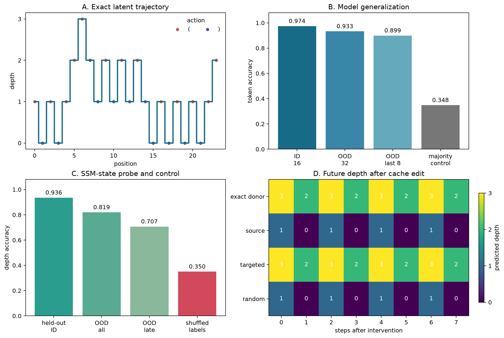
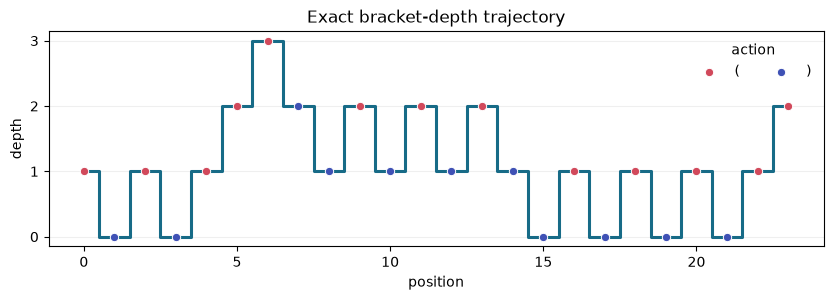
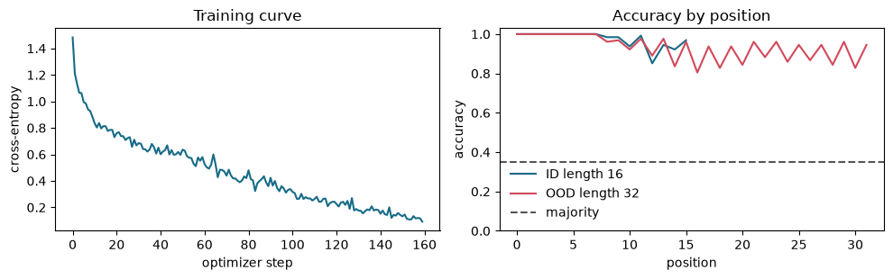
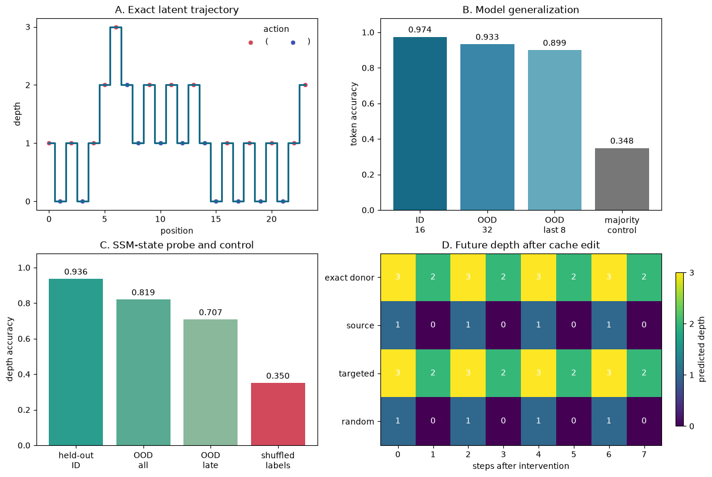
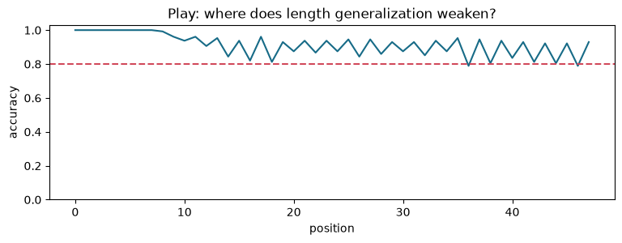
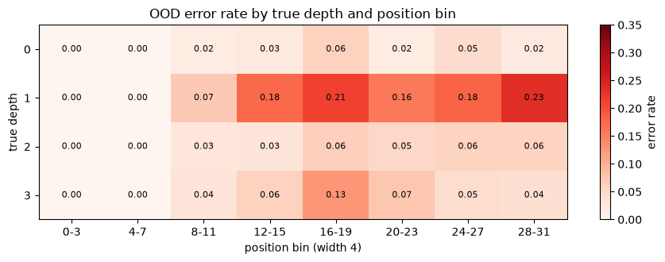

# [5.5] State Tracking in SSMs and Transformers


> **Colab: [exercises](https://colab.research.google.com/github/shinobiultra/ARENA_3.0_Extended/blob/main/chapter5_modern_architectures/exercises/part5_state_tracking/5.5_State_Tracking_in_SSMs_and_Transformers_exercises.ipynb) |
> [solutions](https://colab.research.google.com/github/shinobiultra/ARENA_3.0_Extended/blob/main/chapter5_modern_architectures/exercises/part5_state_tracking/5.5_State_Tracking_in_SSMs_and_Transformers_solutions.ipynb)**

If you want to change to dark mode, you can do this by clicking the three horizontal lines in the top-right, then navigating to Settings → Theme.

# Introduction


**Scope of the canonical title.** This learner lesson studies the existing one-layer Mamba bracket-depth
organism. It does not teach or establish an expanded Transformer/Mamba-3 comparison.

The existing [5.3 Mamba from Scratch
lesson](../part3_mamba_from_scratch/5.3_Mamba_from_Scratch_exercises.ipynb) is the architecture background.
The supplied backbone here is the `arena_ext/mamba.py` dependency; it is not substituted with a
newer implementation from 5.3. You implement the state-tracking methods here, not a new backbone.


## Core Question

When a recurrent model solves bracket-depth tracking, does its recurrent SSM cache carry the exact latent
depth, and does editing that cache change the model's future predictions?

**Claim.** On a bounded bracket-depth model organism with exact labels, a tiny Mamba
trained on length-16 sequences decodes depth on length-32 sequences, and an exact
donor-state transplant reproduces the donor's future trajectory while a matched-norm
random edit fails.



## What you will implement

By the end of this notebook, you will be able to:

- generate a state-tracking task with exact latent ground truth at every token;
- train the existing section 5.3 Mamba path to predict that state;
- collect the recurrent SSM cache and fit a held-out linear state probe;
- compare ID, longer-sequence OOD, majority, and shuffled-label results;
- transplant a targeted recurrent state and compare it with a matched random edit;
- hunt confident OOD failures instead of hiding them in an average.

The entire learner path runs on CPU. Expect roughly 60-90 minutes including exercises;
the completed training cells take seconds on a typical laptop CPU. A CUDA GPU is needed only for the optional release verification.


## Content & Learning Objectives

### 1️⃣ Exact states and learned behavior

> ##### Learning Objectives
>
> - Generate exact bounded depth and distinguish ID from long-sequence behavior.

### 2️⃣ Decode the recurrent cache

> ##### Learning Objectives
>
> - Collect cached states and fit standardized probes with shuffled-label controls.

### 3️⃣ Controlled state transplantation

> ##### Learning Objectives
>
> - Transplant only the SSM state under matched convolutional history and suffix.

### 4️⃣ Read the signature and play

> ##### Learning Objectives
>
> - Interpret controlled figures and predict where length generalization fails.

### ☆ Bonus

Find confident errors, preserve limitations and inspect the optional release surface.


```python
import sys
from dataclasses import dataclass
from pathlib import Path

import matplotlib.pyplot as plt
import torch as t
from torch import nn
import torch.nn.functional as F

chapter = "chapter5_modern_architectures"
section = "part5_state_tracking"
root_dir = next(p for p in [Path.cwd(), *Path.cwd().parents] if (p / chapter).exists())
exercises_dir = root_dir / chapter / "exercises"
assets_dir = exercises_dir / section / "media"
if str(root_dir) not in sys.path:
    sys.path.append(str(root_dir))
if str(exercises_dir) not in sys.path:
    sys.path.append(str(exercises_dir))

import part5_state_tracking.tests as tests
from part5_state_tracking.mamba_backbone import MambaConfig, TinyMambaModel

t.set_num_threads(min(4, t.get_num_threads()))
SAVE_FIGURES = True


@dataclass(frozen=True)
class StateTrackingBatch:
    tokens: t.Tensor
    states: t.Tensor
    task: str
    vocab: dict[int, str]
```


=== NEW CHAPTER ===


# 1️⃣ Exact states and learned behavior


> ##### Learning Objectives
>
> - Generate exact bounded depth and distinguish ID from long-sequence behavior.

## 1. Start from exact latent ground truth

Token `1` is `(` and token `0` is `)`. The state after position $t$ is

$$d_t = \sum_{i=0}^{t} (2x_i - 1).$$

We sample actions at random but force `(` at depth zero and `)` at `max_depth`.
This keeps every prefix valid without clipping the label after an impossible action.
The task is deliberately small: it gives us the exact answer before we inspect a model.


### Exercise - generate valid actions and exact depth

> ```yaml
> Difficulty: 🔴⚪⚪⚪⚪
> Importance: 🔵🔵🔵🔵⚪
>
> You should spend up to 10 minutes on this exercise.
> ```

Implement `generate_bracket_depth_task`. Store the depth after every action.

<details><summary>Expected output</summary>

```text
All tests in `test_generate_bracket_depth_task_is_bounded_and_consistent` passed!
exact recurrence: True; bounds: [0, 3]
```

The trajectory plot should move by exactly one at every token and never leave `[0, 3]`.
</details>

<details><summary>Help - common bug: clipping depth after an invalid action</summary>

Track one `depth` value per batch element. Sample an open/close proposal, override it at
the boundaries, then update and record the depth. Clipping after the update would make
the token and state disagree.
</details>

<details><summary>Interpretation</summary>

These labels are exact properties of the generated sequence. They are not probe outputs,
model predictions, or a hidden implementation. Every later claim is measured against this
visible trajectory.
</details>

<details><summary>Worked formulation</summary>

```python
        def generate_bracket_depth_task(
    batch: int,
    seq_len: int,
    *,
    max_depth: int = 4,
    seed: int = 0,
) -> StateTrackingBatch:
    """Generate bracket actions labelled by the bounded nonnegative stack depth."""

    generator = t.Generator().manual_seed(seed)
    tokens = t.zeros(batch, seq_len, dtype=t.long)
    states = t.zeros(batch, seq_len, dtype=t.long)
    depth = t.zeros(batch, dtype=t.long)

    for pos in range(seq_len):
        proposed_open = t.randint(0, 2, (batch,), generator=generator).bool()
        must_open = depth == 0
        must_close = depth == max_depth
        open_token = (proposed_open | must_open) & ~must_close
        depth = depth + t.where(open_token, t.ones_like(depth), -t.ones_like(depth))
        tokens[:, pos] = open_token.long()
        states[:, pos] = depth

    return StateTrackingBatch(
        tokens=tokens,
        states=states,
        task="bracket_depth",
        vocab={0: ")", 1: "("},
    )

```
</details>


```python
def generate_bracket_depth_task(
    batch: int,
    seq_len: int,
    *,
    max_depth: int = 3,
    seed: int = 0,
) -> StateTrackingBatch:
    """Generate valid bracket actions and exact depth after every token."""
    raise NotImplementedError()
```


<details><summary>Solution</summary>

```python
def generate_bracket_depth_task(
    batch: int,
    seq_len: int,
    *,
    max_depth: int = 4,
    seed: int = 0,
) -> StateTrackingBatch:
    """Generate bracket actions labelled by the bounded nonnegative stack depth."""

    generator = t.Generator().manual_seed(seed)
    tokens = t.zeros(batch, seq_len, dtype=t.long)
    states = t.zeros(batch, seq_len, dtype=t.long)
    depth = t.zeros(batch, dtype=t.long)

    for pos in range(seq_len):
        proposed_open = t.randint(0, 2, (batch,), generator=generator).bool()
        must_open = depth == 0
        must_close = depth == max_depth
        open_token = (proposed_open | must_open) & ~must_close
        depth = depth + t.where(open_token, t.ones_like(depth), -t.ones_like(depth))
        tokens[:, pos] = open_token.long()
        states[:, pos] = depth

    return StateTrackingBatch(
        tokens=tokens,
        states=states,
        task="bracket_depth",
        vocab={0: ")", 1: "("},
    )
```
</details>


For batch 1/length 24/max_depth=3/seed 7, predict which boundary depths force the next token. Explain why
clipping the state after sampling an invalid token breaks the recurrence.


```python
tests.test_generate_bracket_depth_task_is_bounded_and_consistent(
    generate_bracket_depth_task
)

cold_open = generate_bracket_depth_task(batch=1, seq_len=24, max_depth=3, seed=7)
deltas = t.where(cold_open.tokens.bool(), 1, -1)
exact = t.equal(cold_open.states, deltas.cumsum(dim=-1))
actions = "".join(cold_open.vocab[int(token)] for token in cold_open.tokens[0])
print("actions:", actions)
print("depths: ", " ".join(map(str, cold_open.states[0].tolist())))
print(
    f"exact recurrence: {exact}; bounds: "
    f"[{cold_open.states.min().item()}, {cold_open.states.max().item()}]"
)

fig, ax = plt.subplots(figsize=(10, 2.8))
positions = t.arange(cold_open.tokens.shape[1])
ax.step(positions, cold_open.states[0], where="mid", linewidth=2.2, color="#176b87")
open_mask = cold_open.tokens[0].bool()
ax.scatter(
    positions[open_mask], cold_open.states[0, open_mask],
    color="#d1495b", edgecolor="white", linewidth=0.7, label="(", zorder=3,
)
ax.scatter(
    positions[~open_mask], cold_open.states[0, ~open_mask],
    color="#3f51b5", edgecolor="white", linewidth=0.7, label=")", zorder=3,
)
ax.set(title="Exact bracket-depth trajectory", xlabel="position", ylabel="depth")
ax.set_yticks(range(4))
ax.grid(axis="y", alpha=0.2)
ax.legend(title="action", frameon=False, ncol=2)
plt.show()
```





## 2. Train the existing tiny Mamba path

We reuse `MambaConfig` and `TinyMambaModel` from section 5.3. The embedding, causal
convolution, selective scan, recurrent cache, and RMS norm are the real course
implementation. We add only a token-level linear head for four depths.


### Exercise - expose token states and write the training loop

> ```yaml
> Difficulty: 🔴🔴🔴⚪⚪
> Importance: 🔵🔵🔵🔵⚪
>
> You should spend up to 15-20 minutes on this exercise.
> ```

Implement `encode`, `forward`, and `train_state_tracker_cpu`. The model must emit one
depth distribution per token, and the optimizer must train on all token positions.

<details><summary>Expected output</summary>

```text
All tests in `test_mamba_state_tracker_shapes` passed!
All tests in `test_cpu_training_reduces_loss` passed!
ID length 16 accuracy: above 0.95
OOD length 32 accuracy: above 0.90
```
</details>

<details><summary>Help - common bug: training only the final token</summary>

`TinyMambaModel(input_ids)` returns `(hidden_states, cache)`. Apply the head to every
`(batch, position, d_model)` vector. Flatten only the first two axes when computing
cross-entropy.
</details>

<details><summary>Interpretation</summary>

Length 32 is OOD because training uses length 16. The majority-depth baseline checks
whether accuracy comes from predicting the most common bounded-walk state. This result
establishes behavior; it does not yet locate the state in the recurrence.
</details>

<details><summary>Worked formulation</summary>

```python
        class TinyMambaStateClassifier(nn.Module):
    """Tiny supervised Mamba organism for bracket-depth state tracking."""

    def __init__(self, num_states: int = 4):
        super().__init__()
        config = MambaConfig(
            vocab_size=2,
            d_model=32,
            d_inner=64,
            d_state=8,
            d_conv=3,
            dt_rank=4,
            num_layers=1,
            tie_word_embeddings=False,
        )
        self.backbone = TinyMambaModel(config)
        self.head = nn.Linear(config.d_model, num_states)

    def encode(self, input_ids: t.Tensor) -> t.Tensor:
        hidden_states, _ = self.backbone(input_ids)
        return hidden_states

    def forward(
        self,
        input_ids: t.Tensor,
        *,
        return_hidden_states: bool = False,
    ) -> t.Tensor | tuple[t.Tensor, t.Tensor]:
        hidden_states = self.encode(input_ids)
        logits = self.head(hidden_states)
        if return_hidden_states:
            return logits, hidden_states
        return logits

def train_state_tracker_cpu(
    *,
    steps: int = 160,
    batch_size: int = 64,
    seq_len: int = 16,
    max_depth: int = 3,
    seed: int = 0,
) -> tuple[TinyMambaStateClassifier, list[float]]:
    """Train the section 5.3 tiny Mamba path on exact bracket-depth labels."""

    t.manual_seed(seed)
    model = TinyMambaStateClassifier(num_states=max_depth + 1).cpu()
    optimizer = t.optim.AdamW(model.parameters(), lr=3e-3, weight_decay=1e-3)
    losses: list[float] = []

    model.train()
    for step in range(steps):
        batch = generate_bracket_depth_task(
            batch=batch_size,
            seq_len=seq_len,
            max_depth=max_depth,
            seed=seed + step,
        )
        logits = model(batch.tokens)
        loss = F.cross_entropy(
            logits.flatten(0, 1),
            batch.states.flatten(),
        )
        optimizer.zero_grad(set_to_none=True)
        loss.backward()
        optimizer.step()
        losses.append(float(loss.detach().item()))

    return model.eval(), losses

```
</details>


```python
class TinyMambaStateClassifier(nn.Module):
    """One-layer Mamba model organism with one depth prediction per token."""

    def __init__(self, num_states: int = 4):
        super().__init__()
        config = MambaConfig(
            vocab_size=2,
            d_model=32,
            d_inner=64,
            d_state=8,
            d_conv=3,
            dt_rank=4,
            num_layers=1,
            tie_word_embeddings=False,
        )
        self.backbone = TinyMambaModel(config)
        self.head = nn.Linear(config.d_model, num_states)

    def encode(self, input_ids: t.Tensor) -> t.Tensor:
        raise NotImplementedError()

    def forward(
        self,
        input_ids: t.Tensor,
        *,
        return_hidden_states: bool = False,
    ) -> t.Tensor | tuple[t.Tensor, t.Tensor]:
        raise NotImplementedError()


def train_state_tracker_cpu(
    *,
    steps: int = 160,
    batch_size: int = 64,
    seq_len: int = 16,
    max_depth: int = 3,
    seed: int = 0,
) -> tuple[TinyMambaStateClassifier, list[float]]:
    """Train on exact labels and return the model plus one loss per step."""
    raise NotImplementedError()
```


<details><summary>Solution</summary>

```python
class TinyMambaStateClassifier(nn.Module):
    """Tiny supervised Mamba organism for bracket-depth state tracking."""

    def __init__(self, num_states: int = 4):
        super().__init__()
        config = MambaConfig(
            vocab_size=2,
            d_model=32,
            d_inner=64,
            d_state=8,
            d_conv=3,
            dt_rank=4,
            num_layers=1,
            tie_word_embeddings=False,
        )
        self.backbone = TinyMambaModel(config)
        self.head = nn.Linear(config.d_model, num_states)

    def encode(self, input_ids: t.Tensor) -> t.Tensor:
        hidden_states, _ = self.backbone(input_ids)
        return hidden_states

    def forward(
        self,
        input_ids: t.Tensor,
        *,
        return_hidden_states: bool = False,
    ) -> t.Tensor | tuple[t.Tensor, t.Tensor]:
        hidden_states = self.encode(input_ids)
        logits = self.head(hidden_states)
        if return_hidden_states:
            return logits, hidden_states
        return logits

def train_state_tracker_cpu(
    *,
    steps: int = 160,
    batch_size: int = 64,
    seq_len: int = 16,
    max_depth: int = 3,
    seed: int = 0,
) -> tuple[TinyMambaStateClassifier, list[float]]:
    """Train the section 5.3 tiny Mamba path on exact bracket-depth labels."""

    t.manual_seed(seed)
    model = TinyMambaStateClassifier(num_states=max_depth + 1).cpu()
    optimizer = t.optim.AdamW(model.parameters(), lr=3e-3, weight_decay=1e-3)
    losses: list[float] = []

    model.train()
    for step in range(steps):
        batch = generate_bracket_depth_task(
            batch=batch_size,
            seq_len=seq_len,
            max_depth=max_depth,
            seed=seed + step,
        )
        logits = model(batch.tokens)
        loss = F.cross_entropy(
            logits.flatten(0, 1),
            batch.states.flatten(),
        )
        optimizer.zero_grad(set_to_none=True)
        loss.backward()
        optimizer.step()
        losses.append(float(loss.detach().item()))

    return model.eval(), losses
```
</details>


Before viewing the saved training curve, predict ID length 16, OOD length 32 and final-eight token accuracy
relative to the majority-depth baseline. State which failure would indicate accumulated drift.


```python
tests.test_mamba_state_tracker_shapes(TinyMambaStateClassifier)
tests.test_cpu_training_reduces_loss(train_state_tracker_cpu)

model, training_losses = train_state_tracker_cpu(
    steps=160,
    batch_size=64,
    seq_len=16,
    max_depth=3,
    seed=0,
)


@t.inference_mode()
def evaluate_tracker(model, *, seq_len: int, seed: int, batch_size: int = 128):
    batch = generate_bracket_depth_task(
        batch=batch_size,
        seq_len=seq_len,
        max_depth=3,
        seed=seed,
    )
    logits = model(batch.tokens)
    predictions = logits.argmax(dim=-1)
    accuracy = predictions.eq(batch.states).float().mean().item()
    late_accuracy = predictions[:, -8:].eq(batch.states[:, -8:]).float().mean().item()
    position_accuracy = predictions.eq(batch.states).float().mean(dim=0)
    return batch, logits, accuracy, late_accuracy, position_accuracy


id_batch, id_logits, id_accuracy, id_late_accuracy, id_position_accuracy = evaluate_tracker(
    model, seq_len=16, seed=1000
)
ood_batch, ood_logits, ood_accuracy, ood_late_accuracy, ood_position_accuracy = evaluate_tracker(
    model, seq_len=32, seed=2000
)
majority_baseline = (
    t.bincount(ood_batch.states.flatten(), minlength=4).max().item()
    / ood_batch.states.numel()
)
print(f"loss: {training_losses[0]:.3f} -> {training_losses[-1]:.3f}")
print(f"ID length 16 accuracy: {id_accuracy:.3f}")
print(f"OOD length 32 accuracy: {ood_accuracy:.3f}")
print(f"OOD final-8 accuracy: {ood_late_accuracy:.3f}")
print(f"majority-depth baseline: {majority_baseline:.3f}")

fig, axes = plt.subplots(1, 2, figsize=(10, 3.2))
axes[0].plot(training_losses, color="#176b87")
axes[0].set(title="Training curve", xlabel="optimizer step", ylabel="cross-entropy")
axes[1].plot(range(16), id_position_accuracy, label="ID length 16", color="#176b87")
axes[1].plot(range(32), ood_position_accuracy, label="OOD length 32", color="#d1495b")
axes[1].axhline(majority_baseline, color="#555555", linestyle="--", label="majority")
axes[1].set(title="Accuracy by position", xlabel="position", ylabel="accuracy", ylim=(0, 1.03))
axes[1].legend(frameon=False)
fig.tight_layout()
plt.show()
```





=== NEW CHAPTER ===


# 2️⃣ Decode the recurrent cache


> ##### Learning Objectives
>
> - Collect cached states and fit standardized probes with shuffled-label controls.

## 3. Decode exact depth from the recurrent SSM cache

A Mamba block carries two cached objects during one-token inference: a short
convolutional history and the recurrent SSM state. We now unroll cached inference and
save the first layer's SSM state after every token. The probe sees only this recurrent
state, never the tokens.

We fit on independent length-16 sequences, evaluate on held-out length-16 sequences,
then evaluate on length-32 sequences and their last 16 positions. A label-shuffled
probe preserves the state vectors and class counts but destroys their correspondence.


### Exercise - collect recurrent states and fit a ridge probe

> ```yaml
> Difficulty: 🔴🔴🔴🔴⚪
> Importance: 🔵🔵🔵🔵⚪
>
> You should spend up to 20-25 minutes on this exercise.
> ```

<details><summary>Expected output</summary>

```text
All tests in `test_collect_recurrent_states_matches_full_forward` passed!
All tests in `test_state_probe_recovers_exact_control` passed!
held-out ID probe accuracy: above 0.90
OOD probe accuracy: above 0.75
shuffled-label OOD accuracy: near the majority baseline
```
</details>

<details><summary>Help - common bug: fitting and evaluating the probe on the same positions</summary>

Call the backbone one token at a time with `use_cache=True`. Flatten
`cache[0].ssm_state` across `(d_inner, d_state)`. Standardize each feature before the
ridge solve; otherwise a few large coordinates can dominate the normal equations.
</details>

<details><summary>Interpretation</summary>

Probe accuracy above the shuffled-label control shows linear accessibility. A drop on
late OOD positions is evidence against claiming a perfectly stable state code. The
intervention in the next section asks the stronger causal question.
</details>

<details><summary>Worked formulation</summary>

```python
        @dataclass(frozen=True)
class StateProbe:
    """Standardized linear probe over flattened recurrent SSM states."""

    mean: t.Tensor
    scale: t.Tensor
    weight: t.Tensor
    bias: t.Tensor

@t.inference_mode()
def collect_recurrent_states(
    model: TinyMambaStateClassifier,
    tokens: t.Tensor,
) -> tuple[t.Tensor, t.Tensor]:
    """Run cached one-token steps and collect logits plus the first-layer SSM state."""

    cache = None
    logits_by_position: list[t.Tensor] = []
    states_by_position: list[t.Tensor] = []
    for position in range(tokens.shape[1]):
        hidden, cache = model.backbone(
            tokens[:, position : position + 1],
            states=cache,
            use_cache=True,
        )
        assert cache is not None and len(cache) == 1
        logits_by_position.append(model.head(hidden))
        states_by_position.append(cache[0].ssm_state.flatten(start_dim=1))

    return t.cat(logits_by_position, dim=1), t.stack(states_by_position, dim=1)

def fit_state_probe(
    recurrent_states: t.Tensor,
    labels: t.Tensor,
    *,
    num_classes: int | None = None,
    ridge: float = 1e-2,
    shuffle_labels: bool = False,
    seed: int = 0,
) -> StateProbe:
    """Fit a standardized closed-form ridge probe to recurrent SSM states."""

    if recurrent_states.shape[:-1] != labels.shape:
        raise ValueError("recurrent state leading dimensions must match labels")
    x = recurrent_states.flatten(0, -2).float()
    y = labels.flatten().long()
    if num_classes is None:
        num_classes = int(labels.max().item()) + 1
    if shuffle_labels:
        generator = t.Generator(device=y.device).manual_seed(seed)
        y = y[t.randperm(y.numel(), generator=generator, device=y.device)]

    mean = x.mean(dim=0)
    scale = x.std(dim=0, unbiased=False).clamp_min(1e-4)
    standardized = (x - mean) / scale
    design = t.cat([standardized, t.ones(x.shape[0], 1, device=x.device)], dim=-1)
    targets = F.one_hot(y, num_classes=num_classes).float()
    penalty = t.eye(design.shape[-1], device=x.device, dtype=x.dtype)
    penalty[-1, -1] = 0.0
    solution = t.linalg.solve(
        design.T @ design + ridge * penalty,
        design.T @ targets,
    )
    return StateProbe(
        mean=mean,
        scale=scale,
        weight=solution[:-1],
        bias=solution[-1],
    )

def state_probe_logits(recurrent_states: t.Tensor, probe: StateProbe) -> t.Tensor:
    standardized = (recurrent_states.float() - probe.mean) / probe.scale
    return standardized @ probe.weight + probe.bias

def state_probe_accuracy(
    recurrent_states: t.Tensor,
    labels: t.Tensor,
    probe: StateProbe,
    mask: t.Tensor | None = None,
) -> float:
    predictions = state_probe_logits(recurrent_states, probe).argmax(dim=-1)
    if mask is not None:
        predictions = predictions[mask]
        labels = labels[mask]
    return float(predictions.eq(labels).float().mean().item())

```
</details>


```python
@dataclass(frozen=True)
class StateProbe:
    mean: t.Tensor
    scale: t.Tensor
    weight: t.Tensor
    bias: t.Tensor


@t.inference_mode()
def collect_recurrent_states(
    model: TinyMambaStateClassifier,
    tokens: t.Tensor,
) -> tuple[t.Tensor, t.Tensor]:
    """Return cached-step logits and flattened first-layer SSM states."""
    raise NotImplementedError()


def fit_state_probe(
    recurrent_states: t.Tensor,
    labels: t.Tensor,
    *,
    num_classes: int | None = None,
    ridge: float = 1e-2,
    shuffle_labels: bool = False,
    seed: int = 0,
) -> StateProbe:
    """Fit a standardized closed-form ridge probe."""
    raise NotImplementedError()


def state_probe_logits(recurrent_states: t.Tensor, probe: StateProbe) -> t.Tensor:
    raise NotImplementedError()


def state_probe_accuracy(
    recurrent_states: t.Tensor,
    labels: t.Tensor,
    probe: StateProbe,
    mask: t.Tensor | None = None,
) -> float:
    raise NotImplementedError()
```


<details><summary>Solution</summary>

```python
@dataclass(frozen=True)
class StateProbe:
    """Standardized linear probe over flattened recurrent SSM states."""

    mean: t.Tensor
    scale: t.Tensor
    weight: t.Tensor
    bias: t.Tensor

@t.inference_mode()
def collect_recurrent_states(
    model: TinyMambaStateClassifier,
    tokens: t.Tensor,
) -> tuple[t.Tensor, t.Tensor]:
    """Run cached one-token steps and collect logits plus the first-layer SSM state."""

    cache = None
    logits_by_position: list[t.Tensor] = []
    states_by_position: list[t.Tensor] = []
    for position in range(tokens.shape[1]):
        hidden, cache = model.backbone(
            tokens[:, position : position + 1],
            states=cache,
            use_cache=True,
        )
        assert cache is not None and len(cache) == 1
        logits_by_position.append(model.head(hidden))
        states_by_position.append(cache[0].ssm_state.flatten(start_dim=1))

    return t.cat(logits_by_position, dim=1), t.stack(states_by_position, dim=1)

def fit_state_probe(
    recurrent_states: t.Tensor,
    labels: t.Tensor,
    *,
    num_classes: int | None = None,
    ridge: float = 1e-2,
    shuffle_labels: bool = False,
    seed: int = 0,
) -> StateProbe:
    """Fit a standardized closed-form ridge probe to recurrent SSM states."""

    if recurrent_states.shape[:-1] != labels.shape:
        raise ValueError("recurrent state leading dimensions must match labels")
    x = recurrent_states.flatten(0, -2).float()
    y = labels.flatten().long()
    if num_classes is None:
        num_classes = int(labels.max().item()) + 1
    if shuffle_labels:
        generator = t.Generator(device=y.device).manual_seed(seed)
        y = y[t.randperm(y.numel(), generator=generator, device=y.device)]

    mean = x.mean(dim=0)
    scale = x.std(dim=0, unbiased=False).clamp_min(1e-4)
    standardized = (x - mean) / scale
    design = t.cat([standardized, t.ones(x.shape[0], 1, device=x.device)], dim=-1)
    targets = F.one_hot(y, num_classes=num_classes).float()
    penalty = t.eye(design.shape[-1], device=x.device, dtype=x.dtype)
    penalty[-1, -1] = 0.0
    solution = t.linalg.solve(
        design.T @ design + ridge * penalty,
        design.T @ targets,
    )
    return StateProbe(
        mean=mean,
        scale=scale,
        weight=solution[:-1],
        bias=solution[-1],
    )

def state_probe_logits(recurrent_states: t.Tensor, probe: StateProbe) -> t.Tensor:
    standardized = (recurrent_states.float() - probe.mean) / probe.scale
    return standardized @ probe.weight + probe.bias

def state_probe_accuracy(
    recurrent_states: t.Tensor,
    labels: t.Tensor,
    probe: StateProbe,
    mask: t.Tensor | None = None,
) -> float:
    predictions = state_probe_logits(recurrent_states, probe).argmax(dim=-1)
    if mask is not None:
        predictions = predictions[mask]
        labels = labels[mask]
    return float(predictions.eq(labels).float().mean().item())
```
</details>


Predict held-out ID probe accuracy, OOD-all and OOD-late accuracy versus shuffled labels. Freeze 96 sequences
per split, lengths 16/16/32, seeds 4000/4001/4002, ridge .01 and shuffled seed 77.


```python
tests.test_collect_recurrent_states_matches_full_forward(collect_recurrent_states)
tests.test_state_probe_recovers_exact_control(fit_state_probe, state_probe_accuracy)

probe_train_batch = generate_bracket_depth_task(96, 16, max_depth=3, seed=4000)
probe_id_batch = generate_bracket_depth_task(96, 16, max_depth=3, seed=4001)
probe_ood_batch = generate_bracket_depth_task(96, 32, max_depth=3, seed=4002)

_, probe_train_states = collect_recurrent_states(model, probe_train_batch.tokens)
_, probe_id_states = collect_recurrent_states(model, probe_id_batch.tokens)
_, probe_ood_states = collect_recurrent_states(model, probe_ood_batch.tokens)

state_probe = fit_state_probe(probe_train_states, probe_train_batch.states)
shuffled_probe = fit_state_probe(
    probe_train_states,
    probe_train_batch.states,
    shuffle_labels=True,
    seed=77,
)
late_mask = t.zeros_like(probe_ood_batch.states, dtype=t.bool)
late_mask[:, 16:] = True
probe_metrics = {
    "train": state_probe_accuracy(probe_train_states, probe_train_batch.states, state_probe),
    "heldout_id": state_probe_accuracy(probe_id_states, probe_id_batch.states, state_probe),
    "ood_all": state_probe_accuracy(probe_ood_states, probe_ood_batch.states, state_probe),
    "ood_late": state_probe_accuracy(
        probe_ood_states, probe_ood_batch.states, state_probe, late_mask
    ),
    "shuffled_ood": state_probe_accuracy(
        probe_ood_states, probe_ood_batch.states, shuffled_probe
    ),
}
for name, value in probe_metrics.items():
    print(f"{name:>13}: {value:.3f}")
```


=== NEW CHAPTER ===


# 3️⃣ Controlled state transplantation


> ##### Learning Objectives
>
> - Transplant only the SSM state under matched convolutional history and suffix.

## 4. Causally edit the recurrent state

We need a counterfactual whose correct continuation is known. The source and donor below
have different depths at position 5 (`0` versus `2`), but they share the last two actions
and every future action. Sharing two actions makes their convolutional caches identical
because `d_conv=3`; only the longer-running SSM state differs.

The targeted edit copies the donor SSM state into the source cache at position 5. The
matched control adds a random SSM delta with exactly the same norm. Both runs then consume
the same source suffix.


### Exercise - transplant a targeted SSM state

> ```yaml
> Difficulty: 🔴🔴🔴🔴⚪
> Importance: 🔵🔵🔵🔵⚪
>
> You should spend up to 20-25 minutes on this exercise.
> ```

<details><summary>Expected output</summary>

```text
All tests in `test_state_transplant_matches_donor_dynamics` passed!
targeted transplant donor-trajectory match: 1.000
matched random donor-trajectory match: 0.000
```
</details>

<details><summary>Help - common bug: replacing the convolutional history with the donor's</summary>

Consume each prefix with cached one-token steps. Construct a new cache whose `conv_state`
comes from the source and whose `ssm_state` comes from the donor. For the control,
normalize a random tensor and scale it to `norm(donor_ssm - source_ssm)`.
</details>

<details><summary>Interpretation</summary>

The exact donor match is a structural causal result: once the full recurrent state and
local convolutional history agree, deterministic future logits agree. The trained model's
accurate donor trajectory connects that state equality to the exact depth task. This does
not identify a single human-readable SSM coordinate.
</details>

<details><summary>Worked formulation</summary>

```python
        @t.inference_mode()
def cache_after_position(
    model: TinyMambaStateClassifier,
    tokens: t.Tensor,
    position: int,
):
    """Return the recurrent cache after consuming tokens through `position`."""

    if not 0 <= position < tokens.shape[1]:
        raise ValueError("position is outside the sequence")
    cache = None
    for index in range(position + 1):
        _, cache = model.backbone(
            tokens[:, index : index + 1],
            states=cache,
            use_cache=True,
        )
    assert cache is not None
    return cache

def transplant_ssm_state(source_cache, donor_cache):
    """Copy only the donor SSM state, preserving the source convolutional history."""

    if len(source_cache) != 1 or len(donor_cache) != 1:
        raise ValueError("this lesson expects a one-layer tiny Mamba")
    state_type = type(source_cache[0])
    return (
        state_type(
            conv_state=source_cache[0].conv_state,
            ssm_state=donor_cache[0].ssm_state,
        ),
    )

def matched_random_state_edit(source_cache, donor_cache, *, seed: int = 0):
    """Add a random SSM-state delta with the transplant delta's exact norm."""

    source_state = source_cache[0]
    target_delta = donor_cache[0].ssm_state - source_state.ssm_state
    generator = t.Generator(device=target_delta.device).manual_seed(seed)
    random_delta = t.randn(
        target_delta.shape,
        generator=generator,
        device=target_delta.device,
        dtype=target_delta.dtype,
    )
    random_delta = random_delta / random_delta.norm().clamp_min(1e-8)
    random_delta = random_delta * target_delta.norm()
    state_type = type(source_state)
    return (
        state_type(
            conv_state=source_state.conv_state,
            ssm_state=source_state.ssm_state + random_delta,
        ),
    )

@t.inference_mode()
def continue_from_cache(
    model: TinyMambaStateClassifier,
    suffix_tokens: t.Tensor,
    cache,
) -> t.Tensor:
    """Continue cached Mamba inference and return one logit vector per suffix token."""

    outputs: list[t.Tensor] = []
    for position in range(suffix_tokens.shape[1]):
        hidden, cache = model.backbone(
            suffix_tokens[:, position : position + 1],
            states=cache,
            use_cache=True,
        )
        outputs.append(model.head(hidden))
    return t.cat(outputs, dim=1)

def make_matched_state_pair() -> tuple[t.Tensor, t.Tensor, int]:
    """Return prefixes with different depths but identical local history and suffix."""

    source = t.tensor([[1, 0, 1, 0, 1, 0, 1, 0, 1, 0, 1, 0, 1, 0]])
    donor = t.tensor([[1, 1, 0, 1, 1, 0, 1, 0, 1, 0, 1, 0, 1, 0]])
    return source, donor, 5

@t.inference_mode()
def run_state_transplant(
    model: TinyMambaStateClassifier,
    source_tokens: t.Tensor,
    donor_tokens: t.Tensor,
    edit_position: int,
    *,
    random_seed: int = 0,
) -> dict[str, t.Tensor | float]:
    """Compare an exact donor-state transplant with a matched random SSM edit."""

    conv_width = model.backbone.config.d_conv - 1
    local_start = max(0, edit_position - conv_width + 1)
    if not t.equal(
        source_tokens[:, local_start : edit_position + 1],
        donor_tokens[:, local_start : edit_position + 1],
    ):
        raise ValueError("source and donor must share the convolutional history at the edit")
    if not t.equal(source_tokens[:, edit_position + 1 :], donor_tokens[:, edit_position + 1 :]):
        raise ValueError("source and donor must share the suffix after the edit")

    source_cache = cache_after_position(model, source_tokens, edit_position)
    donor_cache = cache_after_position(model, donor_tokens, edit_position)
    suffix = source_tokens[:, edit_position + 1 :]
    patched_cache = transplant_ssm_state(source_cache, donor_cache)
    random_cache = matched_random_state_edit(
        source_cache,
        donor_cache,
        seed=random_seed,
    )

    source_logits = model(source_tokens)[:, edit_position + 1 :]
    donor_logits = model(donor_tokens)[:, edit_position + 1 :]
    patched_logits = continue_from_cache(model, suffix, patched_cache)
    random_logits = continue_from_cache(model, suffix, random_cache)
    donor_states = t.where(donor_tokens.bool(), 1, -1).cumsum(dim=-1)[:, edit_position + 1 :]

    def score(logits: t.Tensor) -> tuple[float, float]:
        probabilities = logits.softmax(dim=-1)
        predictions = probabilities.argmax(dim=-1)
        accuracy = predictions.eq(donor_states).float().mean().item()
        target_probability = probabilities.gather(-1, donor_states[..., None]).mean().item()
        return float(accuracy), float(target_probability)

    source_match, source_probability = score(source_logits)
    patched_match, patched_probability = score(patched_logits)
    random_match, random_probability = score(random_logits)
    return {
        "source_logits": source_logits,
        "donor_logits": donor_logits,
        "patched_logits": patched_logits,
        "random_logits": random_logits,
        "donor_states": donor_states,
        "source_match": source_match,
        "source_target_probability": source_probability,
        "patched_match": patched_match,
        "patched_target_probability": patched_probability,
        "random_match": random_match,
        "random_target_probability": random_probability,
    }

```
</details>


```python
@t.inference_mode()
def cache_after_position(
    model: TinyMambaStateClassifier,
    tokens: t.Tensor,
    position: int,
):
    raise NotImplementedError()


def transplant_ssm_state(source_cache, donor_cache):
    """Copy the donor SSM state while retaining source convolutional history."""
    raise NotImplementedError()


def matched_random_state_edit(source_cache, donor_cache, *, seed: int = 0):
    """Apply a random edit with the transplant delta's exact norm."""
    raise NotImplementedError()


@t.inference_mode()
def continue_from_cache(
    model: TinyMambaStateClassifier,
    suffix_tokens: t.Tensor,
    cache,
) -> t.Tensor:
    raise NotImplementedError()


def make_matched_state_pair() -> tuple[t.Tensor, t.Tensor, int]:
    source = t.tensor([[1, 0, 1, 0, 1, 0, 1, 0, 1, 0, 1, 0, 1, 0]])
    donor = t.tensor([[1, 1, 0, 1, 1, 0, 1, 0, 1, 0, 1, 0, 1, 0]])
    return source, donor, 5


@t.inference_mode()
def run_state_transplant(
    model: TinyMambaStateClassifier,
    source_tokens: t.Tensor,
    donor_tokens: t.Tensor,
    edit_position: int,
    *,
    random_seed: int = 0,
) -> dict[str, t.Tensor | float]:
    raise NotImplementedError()
```


<details><summary>Solution</summary>

```python
@t.inference_mode()
def cache_after_position(
    model: TinyMambaStateClassifier,
    tokens: t.Tensor,
    position: int,
):
    """Return the recurrent cache after consuming tokens through `position`."""

    if not 0 <= position < tokens.shape[1]:
        raise ValueError("position is outside the sequence")
    cache = None
    for index in range(position + 1):
        _, cache = model.backbone(
            tokens[:, index : index + 1],
            states=cache,
            use_cache=True,
        )
    assert cache is not None
    return cache

def transplant_ssm_state(source_cache, donor_cache):
    """Copy only the donor SSM state, preserving the source convolutional history."""

    if len(source_cache) != 1 or len(donor_cache) != 1:
        raise ValueError("this lesson expects a one-layer tiny Mamba")
    state_type = type(source_cache[0])
    return (
        state_type(
            conv_state=source_cache[0].conv_state,
            ssm_state=donor_cache[0].ssm_state,
        ),
    )

def matched_random_state_edit(source_cache, donor_cache, *, seed: int = 0):
    """Add a random SSM-state delta with the transplant delta's exact norm."""

    source_state = source_cache[0]
    target_delta = donor_cache[0].ssm_state - source_state.ssm_state
    generator = t.Generator(device=target_delta.device).manual_seed(seed)
    random_delta = t.randn(
        target_delta.shape,
        generator=generator,
        device=target_delta.device,
        dtype=target_delta.dtype,
    )
    random_delta = random_delta / random_delta.norm().clamp_min(1e-8)
    random_delta = random_delta * target_delta.norm()
    state_type = type(source_state)
    return (
        state_type(
            conv_state=source_state.conv_state,
            ssm_state=source_state.ssm_state + random_delta,
        ),
    )

@t.inference_mode()
def continue_from_cache(
    model: TinyMambaStateClassifier,
    suffix_tokens: t.Tensor,
    cache,
) -> t.Tensor:
    """Continue cached Mamba inference and return one logit vector per suffix token."""

    outputs: list[t.Tensor] = []
    for position in range(suffix_tokens.shape[1]):
        hidden, cache = model.backbone(
            suffix_tokens[:, position : position + 1],
            states=cache,
            use_cache=True,
        )
        outputs.append(model.head(hidden))
    return t.cat(outputs, dim=1)

def make_matched_state_pair() -> tuple[t.Tensor, t.Tensor, int]:
    """Return prefixes with different depths but identical local history and suffix."""

    source = t.tensor([[1, 0, 1, 0, 1, 0, 1, 0, 1, 0, 1, 0, 1, 0]])
    donor = t.tensor([[1, 1, 0, 1, 1, 0, 1, 0, 1, 0, 1, 0, 1, 0]])
    return source, donor, 5

@t.inference_mode()
def run_state_transplant(
    model: TinyMambaStateClassifier,
    source_tokens: t.Tensor,
    donor_tokens: t.Tensor,
    edit_position: int,
    *,
    random_seed: int = 0,
) -> dict[str, t.Tensor | float]:
    """Compare an exact donor-state transplant with a matched random SSM edit."""

    conv_width = model.backbone.config.d_conv - 1
    local_start = max(0, edit_position - conv_width + 1)
    if not t.equal(
        source_tokens[:, local_start : edit_position + 1],
        donor_tokens[:, local_start : edit_position + 1],
    ):
        raise ValueError("source and donor must share the convolutional history at the edit")
    if not t.equal(source_tokens[:, edit_position + 1 :], donor_tokens[:, edit_position + 1 :]):
        raise ValueError("source and donor must share the suffix after the edit")

    source_cache = cache_after_position(model, source_tokens, edit_position)
    donor_cache = cache_after_position(model, donor_tokens, edit_position)
    suffix = source_tokens[:, edit_position + 1 :]
    patched_cache = transplant_ssm_state(source_cache, donor_cache)
    random_cache = matched_random_state_edit(
        source_cache,
        donor_cache,
        seed=random_seed,
    )

    source_logits = model(source_tokens)[:, edit_position + 1 :]
    donor_logits = model(donor_tokens)[:, edit_position + 1 :]
    patched_logits = continue_from_cache(model, suffix, patched_cache)
    random_logits = continue_from_cache(model, suffix, random_cache)
    donor_states = t.where(donor_tokens.bool(), 1, -1).cumsum(dim=-1)[:, edit_position + 1 :]

    def score(logits: t.Tensor) -> tuple[float, float]:
        probabilities = logits.softmax(dim=-1)
        predictions = probabilities.argmax(dim=-1)
        accuracy = predictions.eq(donor_states).float().mean().item()
        target_probability = probabilities.gather(-1, donor_states[..., None]).mean().item()
        return float(accuracy), float(target_probability)

    source_match, source_probability = score(source_logits)
    patched_match, patched_probability = score(patched_logits)
    random_match, random_probability = score(random_logits)
    return {
        "source_logits": source_logits,
        "donor_logits": donor_logits,
        "patched_logits": patched_logits,
        "random_logits": random_logits,
        "donor_states": donor_states,
        "source_match": source_match,
        "source_target_probability": source_probability,
        "patched_match": patched_match,
        "patched_target_probability": patched_probability,
        "random_match": random_match,
        "random_target_probability": random_probability,
    }
```
</details>


The declared source and donor differ in depth at position 5 but share the convolutional history and all eight
suffix tokens. Predict donor-trajectory match for source, targeted SSM transplant and equal-norm random edit.
Explain which cache component stays fixed.


```python
tests.test_state_transplant_matches_donor_dynamics(
    run_state_transplant,
    make_matched_state_pair,
)

source_tokens, donor_tokens, edit_position = make_matched_state_pair()
transplant = run_state_transplant(
    model,
    source_tokens,
    donor_tokens,
    edit_position,
    random_seed=0,
)
print(f"source donor-trajectory match: {transplant['source_match']:.3f}")
print(f"targeted transplant donor-trajectory match: {transplant['patched_match']:.3f}")
print(f"matched random donor-trajectory match: {transplant['random_match']:.3f}")
print(f"targeted mean donor-state probability: {transplant['patched_target_probability']:.3f}")
print(f"random mean donor-state probability: {transplant['random_target_probability']:.6f}")
```


=== NEW CHAPTER ===


# 4️⃣ Read the signature and play


> ##### Learning Objectives
>
> - Interpret controlled figures and predict where length generalization fails.

## Signature Result

The next cell generates the result rather than loading a report. Panel A keeps the exact
latent trajectory visible. Panels B and C show behavioral and probe generalization with
majority and shuffled-label controls. Panel D shows the counterfactual future trajectory
after the targeted and matched-random state edits.

<details><summary>Help - what would falsify the claim?</summary>

The claim fails if longer-sequence accuracy collapses to the majority baseline, if the
state probe cannot beat shuffled labels, or if a matched random edit reproduces the donor
trajectory as reliably as the targeted transplant.
</details>

<details><summary>Interpreting the result</summary>

The model remains strong at twice the training length, and the recurrent-state probe stays
far above shuffled labels, although its late-OOD drop is real. The donor transplant exactly
reproduces the donor continuation while the random edit does not. Together these support
the scoped model-organism claim stated at the top.
</details>


Predict which panel establishes exact task labels, behavioral extrapolation, linear accessibility and causal
cache sufficiency. Explain why none proves pretrained Mamba depth tracking.


```python
fig, axes = plt.subplots(2, 2, figsize=(12, 8), constrained_layout=True)

ax = axes[0, 0]
positions = t.arange(cold_open.tokens.shape[1])
ax.step(positions, cold_open.states[0], where="mid", color="#176b87", linewidth=2.2)
open_mask = cold_open.tokens[0].bool()
ax.scatter(
    positions[open_mask], cold_open.states[0, open_mask],
    color="#d1495b", edgecolor="white", linewidth=0.6, label="(",
)
ax.scatter(
    positions[~open_mask], cold_open.states[0, ~open_mask],
    color="#3f51b5", edgecolor="white", linewidth=0.6, label=")",
)
ax.set(title="A. Exact latent trajectory", xlabel="position", ylabel="depth")
ax.set_yticks(range(4))
ax.legend(title="action", frameon=False, ncol=2)

ax = axes[0, 1]
model_names = ["ID\n16", "OOD\n32", "OOD\nlast 8", "majority\ncontrol"]
model_values = [id_accuracy, ood_accuracy, ood_late_accuracy, majority_baseline]
bars = ax.bar(model_names, model_values, color=["#176b87", "#3a86a8", "#65a9bd", "#777777"])
ax.bar_label(bars, fmt="%.3f", padding=3)
ax.set(title="B. Model generalization", ylabel="token accuracy", ylim=(0, 1.08))

ax = axes[1, 0]
probe_names = ["held-out\nID", "OOD\nall", "OOD\nlate", "shuffled\nlabels"]
probe_values = [
    probe_metrics["heldout_id"],
    probe_metrics["ood_all"],
    probe_metrics["ood_late"],
    probe_metrics["shuffled_ood"],
]
bars = ax.bar(probe_names, probe_values, color=["#2a9d8f", "#58aa92", "#8ab89b", "#d1495b"])
ax.bar_label(bars, fmt="%.3f", padding=3)
ax.set(title="C. SSM-state probe and control", ylabel="depth accuracy", ylim=(0, 1.08))

donor_truth = transplant["donor_states"][0]
source_predictions = transplant["source_logits"].argmax(dim=-1)[0]
patched_predictions = transplant["patched_logits"].argmax(dim=-1)[0]
random_predictions = transplant["random_logits"].argmax(dim=-1)[0]
trajectory_matrix = t.stack(
    [donor_truth, source_predictions, patched_predictions, random_predictions]
)
ax = axes[1, 1]
image = ax.imshow(trajectory_matrix, aspect="auto", cmap="viridis", vmin=0, vmax=3)
ax.set(
    title="D. Future depth after cache edit",
    xlabel="steps after intervention",
    yticks=range(4),
    yticklabels=["exact donor", "source", "targeted", "random"],
)
for row in range(trajectory_matrix.shape[0]):
    for col in range(trajectory_matrix.shape[1]):
        ax.text(col, row, int(trajectory_matrix[row, col]), ha="center", va="center", color="white")
fig.colorbar(image, ax=ax, label="predicted depth", ticks=range(4), shrink=0.8)

if SAVE_FIGURES:
    fig.savefig(assets_dir / "mamba_state_tracking_signature.png", dpi=180, bbox_inches="tight")
plt.show()
```





## Try It Yourself

Change `PLAY_SEQ_LEN` to `48` or `64`, and change `PLAY_SEED`. Look for the position where
accuracy first falls below `0.8`. Then edit the matched source/donor prefixes while keeping
the final two prefix tokens and suffix identical. Does the exact transplant equality still
hold? It should; the learned task accuracy may not.


Before revealing length 48/seed 3100, forecast overall accuracy, final-eight accuracy and the first position
whose batch accuracy falls below .8. Then propose changing length 48 to64 while keeping the trained model and
data seed fixed.


```python
# Change these values and rerun this cell.
PLAY_SEQ_LEN = 48
PLAY_SEED = 3100

play_batch, play_logits, play_accuracy, play_late, play_position_accuracy = evaluate_tracker(
    model,
    seq_len=PLAY_SEQ_LEN,
    seed=PLAY_SEED,
)
below = (play_position_accuracy < 0.8).nonzero(as_tuple=False).flatten()
first_below = None if below.numel() == 0 else int(below[0])
print(f"length {PLAY_SEQ_LEN} accuracy: {play_accuracy:.3f}")
print(f"final-8 accuracy: {play_late:.3f}")
print(f"first position below 0.8: {first_below}")

plt.figure(figsize=(9, 2.8))
plt.plot(play_position_accuracy, color="#176b87")
plt.axhline(0.8, color="#d1495b", linestyle="--")
plt.ylim(0, 1.03)
plt.xlabel("position")
plt.ylabel("accuracy")
plt.title("Play: where does length generalization weaken?")
plt.show()
```





=== NEW CHAPTER ===


# ☆ Bonus


## Bonus - anomaly hunting

Aggregate accuracy can hide systematic failure. Rank confident wrong predictions, retain
each exact prefix, and inspect an error heatmap by true depth and four-position bin.


### Exercise - find confident OOD errors

> ```yaml
> Difficulty: 🔴🔴🔴⚪⚪
> Importance: 🔵🔵🔵⚪⚪
>
> You should spend up to 10-15 minutes on this exercise.
> ```

<details><summary>Expected output</summary>

```text
All tests in `test_find_confident_errors_orders_real_mistakes` passed!
```

The top records should be real wrong predictions with confidence in descending order.
</details>

<details><summary>Help - common bug: ranking correct predictions as anomalies</summary>

Take `softmax`, select the maximum probability and prediction, mask to wrong positions,
sort confidence descending, and reconstruct each prefix from the input tokens.
</details>

<details><summary>Interpretation</summary>

Repeated off-by-one errors late in long sequences suggest accumulated state drift rather
than random guessing. Use the prefix and heatmap to propose a narrower follow-up test.
</details>

<details><summary>Worked formulation</summary>

```python
        def find_confident_errors(
    tokens: t.Tensor,
    labels: t.Tensor,
    logits: t.Tensor,
    *,
    k: int = 8,
) -> list[dict[str, object]]:
    """Return the most confident wrong OOD predictions with their exact prefixes."""

    probabilities = logits.softmax(dim=-1)
    confidence, predictions = probabilities.max(dim=-1)
    wrong = predictions.ne(labels)
    candidates = wrong.nonzero(as_tuple=False)
    if candidates.numel() == 0:
        return []
    scores = confidence[wrong]
    order = scores.argsort(descending=True)[:k]
    records: list[dict[str, object]] = []
    for candidate_index in order:
        batch_index, position = candidates[int(candidate_index)]
        prefix = "".join(
            "(" if int(token) == 1 else ")"
            for token in tokens[batch_index, : position + 1]
        )
        records.append(
            {
                "sequence": int(batch_index),
                "position": int(position),
                "prefix": prefix,
                "true_depth": int(labels[batch_index, position]),
                "predicted_depth": int(predictions[batch_index, position]),
                "confidence": float(confidence[batch_index, position]),
            }
        )
    return records

```
</details>


```python
def find_confident_errors(
    tokens: t.Tensor,
    labels: t.Tensor,
    logits: t.Tensor,
    *,
    k: int = 8,
) -> list[dict[str, object]]:
    """Rank wrong predictions by confidence and retain the exact prefix."""
    raise NotImplementedError()
```


<details><summary>Solution</summary>

```python
def find_confident_errors(
    tokens: t.Tensor,
    labels: t.Tensor,
    logits: t.Tensor,
    *,
    k: int = 8,
) -> list[dict[str, object]]:
    """Return the most confident wrong OOD predictions with their exact prefixes."""

    probabilities = logits.softmax(dim=-1)
    confidence, predictions = probabilities.max(dim=-1)
    wrong = predictions.ne(labels)
    candidates = wrong.nonzero(as_tuple=False)
    if candidates.numel() == 0:
        return []
    scores = confidence[wrong]
    order = scores.argsort(descending=True)[:k]
    records: list[dict[str, object]] = []
    for candidate_index in order:
        batch_index, position = candidates[int(candidate_index)]
        prefix = "".join(
            "(" if int(token) == 1 else ")"
            for token in tokens[batch_index, : position + 1]
        )
        records.append(
            {
                "sequence": int(batch_index),
                "position": int(position),
                "prefix": prefix,
                "true_depth": int(labels[batch_index, position]),
                "predicted_depth": int(predictions[batch_index, position]),
                "confidence": float(confidence[batch_index, position]),
            }
        )
    return records
```
</details>


Predict whether the highest-confidence wrong tokens cluster by true depth and late position. Explain why
correct high-confidence predictions must be excluded.


```python
tests.test_find_confident_errors_orders_real_mistakes(find_confident_errors)
anomalies = find_confident_errors(ood_batch.tokens, ood_batch.states, ood_logits, k=8)
for item in anomalies:
    print(
        f"seq={item['sequence']:>3} pos={item['position']:>2} "
        f"true={item['true_depth']} pred={item['predicted_depth']} "
        f"confidence={item['confidence']:.3f} prefix={item['prefix']}"
    )


def binned_error_rate(logits: t.Tensor, labels: t.Tensor, *, bin_width: int = 4) -> t.Tensor:
    predictions = logits.argmax(dim=-1)
    num_states = logits.shape[-1]
    num_bins = (labels.shape[1] + bin_width - 1) // bin_width
    rates = t.full((num_states, num_bins), float("nan"))
    for state in range(num_states):
        for bin_index in range(num_bins):
            start = bin_index * bin_width
            stop = min(labels.shape[1], start + bin_width)
            mask = labels[:, start:stop].eq(state)
            if mask.any():
                correct = predictions[:, start:stop].eq(labels[:, start:stop])
                rates[state, bin_index] = 1 - correct[mask].float().mean()
    return rates


error_heatmap = binned_error_rate(ood_logits, ood_batch.states)
fig, ax = plt.subplots(figsize=(9, 3.4))
image = ax.imshow(error_heatmap, aspect="auto", cmap="Reds", vmin=0, vmax=0.35)
ax.set(
    title="OOD error rate by true depth and position bin",
    xlabel="position bin (width 4)",
    ylabel="true depth",
    yticks=range(4),
    xticks=range(error_heatmap.shape[1]),
    xticklabels=[f"{4*i}-{4*i+3}" for i in range(error_heatmap.shape[1])],
)
for row in range(error_heatmap.shape[0]):
    for col in range(error_heatmap.shape[1]):
        value = error_heatmap[row, col]
        if t.isfinite(value):
            ax.text(col, row, f"{value:.2f}", ha="center", va="center", fontsize=8)
fig.colorbar(image, ax=ax, label="error rate")
fig.tight_layout()
if SAVE_FIGURES:
    fig.savefig(assets_dir / "mamba_state_tracking_anomaly_heatmap.png", dpi=180, bbox_inches="tight")
plt.show()
```





## Limitations

- This is an exact generated task and a trained one-layer model organism, not evidence that
  a pretrained language-model Mamba tracks bracket depth.
- The state probe falls from about `0.94` on held-out length-16 data to about `0.71` on the
  late half of length-32 data. The representation is accessible but not perfectly stable.
- The transplant copies the full first-layer SSM tensor. It establishes causal sufficiency
  of that cache under a controlled same-history, same-suffix pair; it does not identify a
  sparse feature or prove that one probe direction is the model's native depth variable.
- Results use one initialization and one task distribution. Repeat seeds and alter the
  boundary process before making broader architecture claims.

## Reading links

- [Mamba: Linear-Time Sequence Modeling with Selective State Spaces](https://arxiv.org/abs/2312.00752)
- [Emergent World Representations: Exploring a Sequence Model Trained on a Synthetic Task](https://arxiv.org/abs/2210.13382)
- ARENA [1.5.3 OthelloGPT](../../../chapter1_transformer_interp/exercises/part53_othellogpt/1.5.3_OthelloGPT_exercises.ipynb), especially its probe-versus-intervention evidence ladder
- ARENA [5.3 Mamba from Scratch](../part3_mamba_from_scratch/5.3_Mamba_from_Scratch_exercises.ipynb), which implements the recurrence used here


## GPU entry points

The exercises and signature result above are the CPU learner path. The two entry points below run the GPU check and
the full path; neither runs automatically. Call them only on a CUDA GPU.

`run_gpu_test(max_vram_gb=24.0)` runs the bounded GPU check. `run_full_experiment(max_vram_gb=24.0)` runs the
same validated full path.


```python
import importlib


def _release_solution_module():
    return importlib.import_module("chapter5_modern_architectures.exercises.part4_mamba_state_tracking.solutions")


def run_gpu_test(max_vram_gb: float = 24.0) -> dict:
    """Run the section's pinned CUDA verification contract."""
    return _release_solution_module().run_gpu_test(max_vram_gb=max_vram_gb)


def run_full_experiment(max_vram_gb: float = 24.0) -> dict:
    """Run the full experiment used for the checked-in release evidence."""
    return _release_solution_module().run_full_experiment(
        max_vram_gb=max_vram_gb
    )
```


## Reproducibility

The student generator default is `max_depth=3` while the solution default is `4`. Every measured call fixes `max_depth=3` explicitly. Use the declared
argument rather than assuming the defaults coincide.

