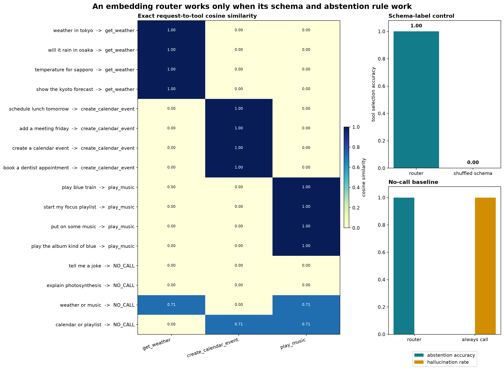

# [5.9] Embedding, Function-Calling and Specialist Models


> **Colab: [exercises](https://colab.research.google.com/github/shinobiultra/ARENA_3.0_Extended/blob/main/chapter5_modern_architectures/exercises/part9_specialist_models/5.9_Embedding_Function-Calling_and_Specialist_Models_exercises.ipynb)
> | [solutions](https://colab.research.google.com/github/shinobiultra/ARENA_3.0_Extended/blob/main/chapter5_modern_architectures/exercises/part9_specialist_models/5.9_Embedding_Function-Calling_and_Specialist_Models_solutions.ipynb)**

> **Guided prediction practice:** open `mastery_hub/units/extension_predictions/exercises.ipynb` in the checkout before viewing the results. Record confidence and reasoning, compare controls, then predict a changed case. Reference results
> are practice, not an unseen test.

If you want to change to dark mode, you can do this by clicking the three horizontal lines in the top-right, then navigating to Settings → Theme.

# Introduction


**Historical exposed guided practice.** Preserve the complete legacy 5.6 embedding-router lesson: exact English requests, student-built pooling/similarity/ranks, availability-aware abstention,
separate call/no-call metrics, all historical text outputs, controls, play, anomaly hunt and optional pinned BGE connection. This migration does not run a lesson, load a model, generate a plot,
or compute a case answer.

**Canonical scope remains incomplete.** The exact three-axis lexicon is a transparent teaching construction. The optional four-pair BGE retrieval is not a directional interpretation study. This
lesson does not establish EmbeddingGemma internal geometry, FunctionGemma internal representation/probing/steering, or a MedGemma-style domain-specialist evaluation. Existing serialized CUDA
reports retain their legacy supporting role and are not the primary lesson result.

**Saved figure boundary.** The historical solution notebook contains nine output-bearing cells and no embedded PNG. Its plot-generating code and byte-exact separately saved signature PNG are
preserved. The saved text outputs and widget metadata are historical; no new figure or model execution is claimed. Commit forecasts and prior exposure before opening historical worked solutions.


## Content & Learning Objectives

### 1️⃣ Specify exact semantic evidence

> ##### Learning Objectives
>
> - Identify exact request/tool meanings and separate tool/no-call denominators.

### 2️⃣ Implement pooling and retrieval

> ##### Learning Objectives
>
> - Implement masked pooling, cosine similarities, ranks and hard-negative margins.

### 3️⃣ Route or abstain

> ##### Learning Objectives
>
> - Implement confidence/margin gates with an availability mask and inspect separate metrics.

### 4️⃣ Inspect controls and escalation

> ##### Learning Objectives
>
> - Compare shuffled-schema and always-call controls; forecast plays before optional real-model escalation.


> **Claim.** By the end of this notebook, you will have shown that a normalized embedding router selects the correct tool on exact English toy requests and abstains on irrelevant or ambiguous
requests, while shuffled schema labels and an always-call baseline fail visibly.

## Cold open

Suppose the user asks `weather in Tokyo`. The system has three callable tools: `get_weather`, `create_calendar_event`, and `play_music`. Selecting the nearest schema is easy. The harder case is
`weather or music`: a router should expose the tie and make **no call**, because one forced tool cannot satisfy the request.

| request | weather score | calendar score | music score | desired action |
|---|---:|---:|---:|---|
| `weather in Tokyo` | 1.00 | 0.00 | 0.00 | `get_weather` |
| `tell me a joke` | 0.00 | 0.00 | 0.00 | `NO_CALL` |
| `weather or music` | 0.71 | 0.00 | 0.71 | `NO_CALL` |

## What you will implement

- Implement padding-safe mean pooling over token embeddings.
- Compute normalized request-to-schema cosine similarity and target ranks.
- Implement abstention from both absolute confidence and the top-two margin.
- Enforce per-request tool availability before routing.
- Measure tool selection, abstention, and hallucination separately.
- Diagnose shuffled-schema, always-call, lexical, and multi-intent failures.


```python
MAIN = __name__ == "__main__"
import re
import sys
from dataclasses import dataclass
from pathlib import Path

import matplotlib.pyplot as plt
import pandas as pd
import torch as t

chapter = "chapter5_modern_architectures"
section = "part9_specialist_models"
legacy_section = "part6_multimodal_embedding_function_models"
root_dir = next(p for p in [Path.cwd(), *Path.cwd().parents] if (p / chapter).exists())
exercises_dir = root_dir / chapter / "exercises"
legacy_section_dir = exercises_dir / legacy_section
section_dir = legacy_section_dir
canonical_section_dir = exercises_dir / section
assets_dir = canonical_section_dir / "media"
if str(root_dir) not in sys.path:
    sys.path.append(str(root_dir))
if str(exercises_dir) not in sys.path:
    sys.path.append(str(exercises_dir))

import part9_specialist_models.tests as tests


@dataclass(frozen=True)
class EmbeddingRetrievalReport:
    top1_accuracy: float
    mean_reciprocal_rank: float
    mean_positive_similarity: float
    mean_hard_negative_similarity: float
    mean_margin: float


@dataclass(frozen=True)
class RouterReport:
    overall_accuracy: float
    tool_accuracy: float
    abstention_accuracy: float
    hallucination_rate: float
```


=== NEW CHAPTER ===


# 1️⃣ Specify exact semantic evidence


> ##### Learning Objectives
>
> - Identify exact request/tool meanings and separate tool/no-call denominators.

## Exact toy ground truth

The toy encoder has three named coordinates: weather, calendar, and music. Each schema is one basis vector; listed trigger words point exactly along one axis; all other words contribute zero.
This makes every expected similarity derivable by hand. It is intentionally a transparent semantic model, not a claim about natural-language understanding.

The final four requests are controls. Two contain no known tool concept. Two contain equal evidence for two tools. Both kinds should abstain, for different reasons.


```python
TOOL_NAMES = ["get_weather", "create_calendar_event", "play_music"]
NO_CALL_ID = len(TOOL_NAMES)
LABEL_NAMES = TOOL_NAMES + ["NO_CALL"]

# The three coordinates are exact semantic axes, not learned representations.
TOOL_EMBEDDINGS = t.eye(3)
TOKEN_VECTORS = {
    "weather": [1.0, 0.0, 0.0],
    "forecast": [1.0, 0.0, 0.0],
    "temperature": [1.0, 0.0, 0.0],
    "rain": [1.0, 0.0, 0.0],
    "calendar": [0.0, 1.0, 0.0],
    "meeting": [0.0, 1.0, 0.0],
    "schedule": [0.0, 1.0, 0.0],
    "appointment": [0.0, 1.0, 0.0],
    "event": [0.0, 1.0, 0.0],
    "music": [0.0, 0.0, 1.0],
    "song": [0.0, 0.0, 1.0],
    "playlist": [0.0, 0.0, 1.0],
    "album": [0.0, 0.0, 1.0],
    "play": [0.0, 0.0, 1.0],
}

REQUESTS_AND_LABELS = [
    ("weather in tokyo", 0),
    ("will it rain in osaka", 0),
    ("temperature for sapporo", 0),
    ("show the kyoto forecast", 0),
    ("schedule lunch tomorrow", 1),
    ("add a meeting friday", 1),
    ("create a calendar event", 1),
    ("book a dentist appointment", 1),
    ("play blue train", 2),
    ("start my focus playlist", 2),
    ("put on some music", 2),
    ("play the album kind of blue", 2),
    ("tell me a joke", 3),
    ("explain photosynthesis", 3),
    ("weather or music", 3),
    ("calendar or playlist", 3),
]
REQUESTS = [request for request, _ in REQUESTS_AND_LABELS]
LABELS = t.tensor([label for _, label in REQUESTS_AND_LABELS])


def token_vectors_for_requests(requests: list[str]) -> tuple[t.Tensor, t.Tensor]:
    """Turn exact lexicon matches into padded token vectors and an attention mask."""
    tokenized = [re.findall(r"[a-z]+", request.lower()) for request in requests]
    max_length = max(map(len, tokenized))
    embeddings = t.zeros((len(requests), max_length, 3))
    attention_mask = t.zeros((len(requests), max_length), dtype=t.long)
    for row, tokens in enumerate(tokenized):
        attention_mask[row, : len(tokens)] = 1
        for column, token in enumerate(tokens):
            embeddings[row, column] = t.tensor(TOKEN_VECTORS.get(token, [0.0, 0.0, 0.0]))
    return embeddings, attention_mask


display(
    pd.DataFrame(
        {
            "request": REQUESTS,
            "ground truth": [LABEL_NAMES[label] for label in LABELS.tolist()],
        }
    )
)
```


=== NEW CHAPTER ===


# 2️⃣ Implement pooling and retrieval


> ##### Learning Objectives
>
> - Implement masked pooling, cosine similarities, ranks and hard-negative margins.

## 1. Pool only evidence-bearing positions

Here is the tensor contract: token embeddings have shape `(batch, sequence, 3)`, the mask has shape `(batch, sequence)`, and the pooled request embedding has shape `(batch, 3)`. Padding is
batching machinery and must contribute neither to the numerator nor the denominator.


### Exercise - implement `mean_pool_embeddings`

> ```yaml
> Difficulty: 🔴🔴⚪⚪⚪
> Importance: 🔵🔵🔵🔵🔵
> Suggested time: 8 minutes
> ```

Multiply by the attention mask, sum across tokens, and divide by the number of unmasked positions. Reject incompatible shapes.

<details>
<summary>Expected output</summary>

```text
pooled embeddings: [[2.0, 1.0], [4.0, 6.0]]
All tests in `test_mean_pool_embeddings_ignores_padding_and_matches_reference` passed!
```

</details>

<details>
<summary>Help - interpret the contract before coding</summary>

The test places `[100, 100]` in a padded position. If that sentinel changes the answer, sequence length and batching details will leak into every routing score.

</details>

<details>
<summary>Historical worked solution</summary>

```python
def mean_pool_embeddings(token_embeddings: t.Tensor, attention_mask: t.Tensor) -> t.Tensor:
    if token_embeddings.ndim != 3:
        raise ValueError("token_embeddings must have shape (batch, seq, dim).")
    if attention_mask.shape != token_embeddings.shape[:2]:
        raise ValueError("attention_mask must have shape (batch, seq).")
    mask = attention_mask.to(device=token_embeddings.device, dtype=token_embeddings.dtype)
    weighted = token_embeddings * mask.unsqueeze(-1)
    denominator = mask.sum(dim=-1, keepdim=True).clamp_min(1)
    return weighted.sum(dim=1) / denominator
```

</details>


## Forecast before running — EMB-6

What should the padded sentinel contribute to pooled evidence?

Forecast / signed contrast / ordering: ______
Confidence (0–100%): ______
Mechanism and contradicting control: ______
Denominator and prior exposure (unseen / seen / unknown): ______

This is exposed guided practice. Keep toy16requests, tool12rows/no-call4rows, optional BGE4pairs, native32call rows and play3requests separate. Leave observations blank until inspection; no
answer is computed by migration.


```python
def mean_pool_embeddings(token_embeddings: t.Tensor, attention_mask: t.Tensor) -> t.Tensor:
    raise NotImplementedError()


tests.test_mean_pool_embeddings_ignores_padding_and_matches_reference(mean_pool_embeddings)
```


<details><summary>Solution</summary>

```python
def mean_pool_embeddings(token_embeddings: t.Tensor, attention_mask: t.Tensor) -> t.Tensor:
    if token_embeddings.ndim != 3:
        raise ValueError("token_embeddings must have shape (batch, seq, dim).")
    if attention_mask.shape != token_embeddings.shape[:2]:
        raise ValueError("attention_mask must have shape (batch, seq).")
    mask = attention_mask.to(device=token_embeddings.device, dtype=token_embeddings.dtype)
    weighted = token_embeddings * mask.unsqueeze(-1)
    denominator = mask.sum(dim=-1, keepdim=True).clamp_min(1)
    return weighted.sum(dim=1) / denominator


tests.test_mean_pool_embeddings_ignores_padding_and_matches_reference(mean_pool_embeddings)
```
</details>


## Reflect after inspection — EMB-6

Observed values and exact source/cell: ______
Control comparison and denominator: ______
Forecast discrepancy and changed-condition forecast: ______
Historical output or your separately authorized execution: ______

Do not pool toy, BGE, native generation and play cohorts or relabel public examples as untouched TEST.


## 2. Turn embeddings into retrieval evidence

For request embedding $q_i$ and tool-schema embedding $s_j$,

$$S_{ij} = \frac{q_i^T s_j}{\lVert q_i \rVert_2\lVert s_j \rVert_2}.$$

Normalization prevents a large-norm schema from winning just because it is large. Target rank and the margin over the strongest negative reveal brittle retrieval that top-1 accuracy alone can
hide.


### Exercise - implement `cosine similarity and retrieval metrics`

> ```yaml
> Difficulty: 🔴🔴🔴⚪⚪
> Importance: 🔵🔵🔵🔵🔵
> Suggested time: 15 minutes
> ```

Implement L2 normalization, all-pairs cosine similarity, one-indexed target ranks, and a report containing top-1 accuracy, MRR, and the positive-minus-hard-negative margin.

<details>
<summary>Expected output</summary>

```text
target ranks: [1, 2, 1]
top-1 accuracy: 0.667
All tests in `test_retrieval_metrics_rank_pairs_and_hard_negative_margin` passed!
```

</details>

<details>
<summary>Help - interpret the contract before coding</summary>

Sort each similarity row in descending order. The target rank is where the paired candidate appears. For the hard negative, mask only the paired candidate and take the maximum remaining score.

</details>

<details>
<summary>Historical worked solution</summary>

```python
def l2_normalize(x: t.Tensor, *, eps: float = 1e-12) -> t.Tensor:
    if x.ndim == 0:
        raise ValueError("x must have at least one dimension.")
    return x / x.norm(dim=-1, keepdim=True).clamp_min(eps)


def cosine_similarity_matrix(
    query_embeddings: t.Tensor,
    candidate_embeddings: t.Tensor,
) -> t.Tensor:
    if query_embeddings.ndim != 2 or candidate_embeddings.ndim != 2:
        raise ValueError("embeddings must have shape (items, dim).")
    if query_embeddings.shape[1] != candidate_embeddings.shape[1]:
        raise ValueError("query and candidate embedding dimensions must match.")
    return l2_normalize(query_embeddings) @ l2_normalize(candidate_embeddings).T


def retrieval_ranks(similarity: t.Tensor, target_indices: t.Tensor) -> t.Tensor:
    if similarity.ndim != 2:
        raise ValueError("similarity must have shape (queries, candidates).")
    if target_indices.shape != (similarity.shape[0],):
        raise ValueError("target_indices must have shape (queries,).")
    order = similarity.argsort(dim=-1, descending=True)
    matches = order.eq(target_indices[:, None])
    return matches.float().argmax(dim=-1).long() + 1


def embedding_retrieval_report(
    query_embeddings: t.Tensor,
    candidate_embeddings: t.Tensor,
    target_indices: t.Tensor,
) -> EmbeddingRetrievalReport:
    similarity = cosine_similarity_matrix(query_embeddings, candidate_embeddings)
    ranks = retrieval_ranks(similarity, target_indices)
    row = t.arange(similarity.shape[0], device=similarity.device)
    positive = similarity[row, target_indices]
    masked = similarity.clone()
    masked[row, target_indices] = -t.inf
    hard_negative = masked.max(dim=-1).values
    return EmbeddingRetrievalReport(
        top1_accuracy=ranks.eq(1).float().mean().item(),
        mean_reciprocal_rank=(1.0 / ranks.float()).mean().item(),
        mean_positive_similarity=positive.mean().item(),
        mean_hard_negative_similarity=hard_negative.mean().item(),
        mean_margin=(positive - hard_negative).mean().item(),
    )
```

</details>


## Forecast before running — EMB-9

How should normalized retrieval ranks expose the hard negative?

Forecast / signed contrast / ordering: ______
Confidence (0–100%): ______
Mechanism and contradicting control: ______
Denominator and prior exposure (unseen / seen / unknown): ______

This is exposed guided practice. Keep toy16requests, tool12rows/no-call4rows, optional BGE4pairs, native32call rows and play3requests separate. Leave observations blank until inspection; no
answer is computed by migration.


```python
def l2_normalize(x: t.Tensor, *, eps: float = 1e-12) -> t.Tensor:
    raise NotImplementedError()


def cosine_similarity_matrix(
    query_embeddings: t.Tensor,
    candidate_embeddings: t.Tensor,
) -> t.Tensor:
    raise NotImplementedError()


def retrieval_ranks(similarity: t.Tensor, target_indices: t.Tensor) -> t.Tensor:
    raise NotImplementedError()


def embedding_retrieval_report(
    query_embeddings: t.Tensor,
    candidate_embeddings: t.Tensor,
    target_indices: t.Tensor,
) -> EmbeddingRetrievalReport:
    raise NotImplementedError()


tests.test_retrieval_metrics_rank_pairs_and_hard_negative_margin(
    cosine_similarity_matrix,
    retrieval_ranks,
    embedding_retrieval_report,
)
```


<details><summary>Solution</summary>

```python
def l2_normalize(x: t.Tensor, *, eps: float = 1e-12) -> t.Tensor:
    if x.ndim == 0:
        raise ValueError("x must have at least one dimension.")
    return x / x.norm(dim=-1, keepdim=True).clamp_min(eps)


def cosine_similarity_matrix(
    query_embeddings: t.Tensor,
    candidate_embeddings: t.Tensor,
) -> t.Tensor:
    if query_embeddings.ndim != 2 or candidate_embeddings.ndim != 2:
        raise ValueError("embeddings must have shape (items, dim).")
    if query_embeddings.shape[1] != candidate_embeddings.shape[1]:
        raise ValueError("query and candidate embedding dimensions must match.")
    return l2_normalize(query_embeddings) @ l2_normalize(candidate_embeddings).T


def retrieval_ranks(similarity: t.Tensor, target_indices: t.Tensor) -> t.Tensor:
    if similarity.ndim != 2:
        raise ValueError("similarity must have shape (queries, candidates).")
    if target_indices.shape != (similarity.shape[0],):
        raise ValueError("target_indices must have shape (queries,).")
    order = similarity.argsort(dim=-1, descending=True)
    matches = order.eq(target_indices[:, None])
    return matches.float().argmax(dim=-1).long() + 1


def embedding_retrieval_report(
    query_embeddings: t.Tensor,
    candidate_embeddings: t.Tensor,
    target_indices: t.Tensor,
) -> EmbeddingRetrievalReport:
    similarity = cosine_similarity_matrix(query_embeddings, candidate_embeddings)
    ranks = retrieval_ranks(similarity, target_indices)
    row = t.arange(similarity.shape[0], device=similarity.device)
    positive = similarity[row, target_indices]
    masked = similarity.clone()
    masked[row, target_indices] = -t.inf
    hard_negative = masked.max(dim=-1).values
    return EmbeddingRetrievalReport(
        top1_accuracy=ranks.eq(1).float().mean().item(),
        mean_reciprocal_rank=(1.0 / ranks.float()).mean().item(),
        mean_positive_similarity=positive.mean().item(),
        mean_hard_negative_similarity=hard_negative.mean().item(),
        mean_margin=(positive - hard_negative).mean().item(),
    )


tests.test_retrieval_metrics_rank_pairs_and_hard_negative_margin(
    cosine_similarity_matrix,
    retrieval_ranks,
    embedding_retrieval_report,
)
```
</details>


## Reflect after inspection — EMB-9

Observed values and exact source/cell: ______
Control comparison and denominator: ______
Forecast discrepancy and changed-condition forecast: ______
Historical output or your separately authorized execution: ______

Do not pool toy, BGE, native generation and play cohorts or relabel public examples as untouched TEST.


=== NEW CHAPTER ===


# 3️⃣ Route or abstain


> ##### Learning Objectives
>
> - Implement confidence/margin gates with an availability mask and inspect separate metrics.

## 3. Abstain when evidence is weak or conflicted

Nearest-neighbor retrieval always returns something. A tool router needs a reject option. We call a tool only when the best score exceeds `threshold` **and** its lead over the runner-up exceeds
`min_margin`.

Mask unavailable tools before computing the top two. This makes the schema constraint part of the decision, rather than a check after an invalid call has already been selected.


### Exercise - implement `route_with_abstention`

> ```yaml
> Difficulty: 🔴🔴🔴⚪⚪
> Importance: 🔵🔵🔵🔵🔵
> Suggested time: 15 minutes
> ```

Clone the score matrix, mask unavailable tools to negative infinity, find the top two scores, and return `no_call_id` unless both gates pass.

<details>
<summary>Expected output</summary>

```text
predictions: [0, 3, 3, 2]
All tests in `test_route_with_abstention_uses_confidence_margin_and_availability` passed!
```

</details>

<details>
<summary>Help - interpret the contract before coding</summary>

The confidence threshold catches rows with no evidence. The margin catches rows with conflicting evidence. The test also checks that you do not mutate the caller's score tensor.

</details>

<details>
<summary>Historical worked solution</summary>

```python
def route_with_abstention(
    similarity: t.Tensor,
    *,
    threshold: float,
    min_margin: float,
    no_call_id: int,
    allowed_tools: t.Tensor | None = None,
) -> t.Tensor:
    if similarity.ndim != 2 or similarity.shape[1] < 2:
        raise ValueError("similarity must have shape (requests, at least_two_tools).")
    if no_call_id < similarity.shape[1]:
        raise ValueError("no_call_id must not overlap a tool index.")

    scores = similarity.clone()
    if allowed_tools is not None:
        if allowed_tools.shape == (scores.shape[1],):
            allowed = allowed_tools.to(device=scores.device, dtype=t.bool).expand_as(scores)
        elif allowed_tools.shape == scores.shape:
            allowed = allowed_tools.to(device=scores.device, dtype=t.bool)
        else:
            raise ValueError("allowed_tools must have shape (tools,) or (requests, tools).")
        scores.masked_fill_(~allowed, -t.inf)

    top_values, top_indices = scores.topk(k=2, dim=-1)
    confident = top_values[:, 0] >= threshold
    unambiguous = (top_values[:, 0] - top_values[:, 1]) >= min_margin
    no_call = t.full_like(top_indices[:, 0], no_call_id)
    return t.where(confident & unambiguous, top_indices[:, 0], no_call)
```

</details>


## Forecast before running — EMB-12

How do confidence, margin and tool availability each reject a call?

Forecast / signed contrast / ordering: ______
Confidence (0–100%): ______
Mechanism and contradicting control: ______
Denominator and prior exposure (unseen / seen / unknown): ______

This is exposed guided practice. Keep toy16requests, tool12rows/no-call4rows, optional BGE4pairs, native32call rows and play3requests separate. Leave observations blank until inspection; no
answer is computed by migration.


```python
def route_with_abstention(
    similarity: t.Tensor,
    *,
    threshold: float,
    min_margin: float,
    no_call_id: int,
    allowed_tools: t.Tensor | None = None,
) -> t.Tensor:
    raise NotImplementedError()


tests.test_route_with_abstention_uses_confidence_margin_and_availability(route_with_abstention)
```


<details><summary>Solution</summary>

```python
def route_with_abstention(
    similarity: t.Tensor,
    *,
    threshold: float,
    min_margin: float,
    no_call_id: int,
    allowed_tools: t.Tensor | None = None,
) -> t.Tensor:
    if similarity.ndim != 2 or similarity.shape[1] < 2:
        raise ValueError("similarity must have shape (requests, at least_two_tools).")
    if no_call_id < similarity.shape[1]:
        raise ValueError("no_call_id must not overlap a tool index.")

    scores = similarity.clone()
    if allowed_tools is not None:
        if allowed_tools.shape == (scores.shape[1],):
            allowed = allowed_tools.to(device=scores.device, dtype=t.bool).expand_as(scores)
        elif allowed_tools.shape == scores.shape:
            allowed = allowed_tools.to(device=scores.device, dtype=t.bool)
        else:
            raise ValueError("allowed_tools must have shape (tools,) or (requests, tools).")
        scores.masked_fill_(~allowed, -t.inf)

    top_values, top_indices = scores.topk(k=2, dim=-1)
    confident = top_values[:, 0] >= threshold
    unambiguous = (top_values[:, 0] - top_values[:, 1]) >= min_margin
    no_call = t.full_like(top_indices[:, 0], no_call_id)
    return t.where(confident & unambiguous, top_indices[:, 0], no_call)


tests.test_route_with_abstention_uses_confidence_margin_and_availability(route_with_abstention)
```
</details>


## Reflect after inspection — EMB-12

Observed values and exact source/cell: ______
Control comparison and denominator: ______
Forecast discrepancy and changed-condition forecast: ______
Historical output or your separately authorized execution: ______

Do not pool toy, BGE, native generation and play cohorts or relabel public examples as untouched TEST.


## 4. Measure calls and abstentions separately

Overall accuracy can hide a router that handles tools well but calls them on every irrelevant request. Split labels into tool-required and no-call subsets. On the latter, hallucination rate is `1
- abstention_accuracy`.


### Exercise - implement `routing_report`

> ```yaml
> Difficulty: 🔴🔴⚪⚪⚪
> Importance: 🔵🔵🔵🔵🔵
> Suggested time: 10 minutes
> ```

Return overall accuracy, tool-only accuracy, no-call abstention accuracy, and no-call hallucination rate. Require both kinds of example so a missing slice cannot silently become `nan`.

<details>
<summary>Expected output</summary>

```text
overall: 0.667; tool accuracy: 0.667; abstention accuracy: 0.667; hallucination rate: 0.333
All tests in `test_routing_report_separates_selection_and_abstention` passed!
```

</details>

<details>
<summary>Help - interpret the contract before coding</summary>

Build masks from the ground-truth labels, not the predictions. Otherwise a router that never predicts `NO_CALL` can make the no-call slice disappear.

</details>

<details>
<summary>Historical worked solution</summary>

```python
def routing_report(
    predictions: t.Tensor,
    labels: t.Tensor,
    *,
    no_call_id: int,
) -> RouterReport:
    if predictions.shape != labels.shape or predictions.ndim != 1:
        raise ValueError("predictions and labels must be one-dimensional and have equal shape.")
    tool_mask = labels.ne(no_call_id)
    no_call_mask = labels.eq(no_call_id)
    if not tool_mask.any() or not no_call_mask.any():
        raise ValueError("labels must contain both tool and no-call examples.")

    correct = predictions.eq(labels)
    return RouterReport(
        overall_accuracy=correct.float().mean().item(),
        tool_accuracy=correct[tool_mask].float().mean().item(),
        abstention_accuracy=correct[no_call_mask].float().mean().item(),
        hallucination_rate=predictions[no_call_mask].ne(no_call_id).float().mean().item(),
    )
```

</details>


## Forecast before running — EMB-15

Which rows belong in tool accuracy versus no-call hallucination?

Forecast / signed contrast / ordering: ______
Confidence (0–100%): ______
Mechanism and contradicting control: ______
Denominator and prior exposure (unseen / seen / unknown): ______

This is exposed guided practice. Keep toy16requests, tool12rows/no-call4rows, optional BGE4pairs, native32call rows and play3requests separate. Leave observations blank until inspection; no
answer is computed by migration.


```python
def routing_report(
    predictions: t.Tensor,
    labels: t.Tensor,
    *,
    no_call_id: int,
) -> RouterReport:
    raise NotImplementedError()


tests.test_routing_report_separates_selection_and_abstention(routing_report)
```


<details><summary>Solution</summary>

```python
def routing_report(
    predictions: t.Tensor,
    labels: t.Tensor,
    *,
    no_call_id: int,
) -> RouterReport:
    if predictions.shape != labels.shape or predictions.ndim != 1:
        raise ValueError("predictions and labels must be one-dimensional and have equal shape.")
    tool_mask = labels.ne(no_call_id)
    no_call_mask = labels.eq(no_call_id)
    if not tool_mask.any() or not no_call_mask.any():
        raise ValueError("labels must contain both tool and no-call examples.")

    correct = predictions.eq(labels)
    return RouterReport(
        overall_accuracy=correct.float().mean().item(),
        tool_accuracy=correct[tool_mask].float().mean().item(),
        abstention_accuracy=correct[no_call_mask].float().mean().item(),
        hallucination_rate=predictions[no_call_mask].ne(no_call_id).float().mean().item(),
    )


tests.test_routing_report_separates_selection_and_abstention(routing_report)
```
</details>


## Reflect after inspection — EMB-15

Observed values and exact source/cell: ______
Control comparison and denominator: ______
Forecast discrepancy and changed-condition forecast: ______
Historical output or your separately authorized execution: ______

Do not pool toy, BGE, native generation and play cohorts or relabel public examples as untouched TEST.


=== NEW CHAPTER ===


# 4️⃣ Inspect controls and escalation


> ##### Learning Objectives
>
> - Compare shuffled-schema and always-call controls; forecast plays before optional real-model escalation.

## Forecast before running — EMB-17

Before viewing the retained historical figure, forecast the router, rotated-schema control and always-call baseline with separate12tool-row and4no-call-row denominators.

Forecast / control comparison: ______
Confidence (0–100%) and prior exposure: ______
Mechanism and possible falsifier: ______

This is exposed guided practice; no answer is computed during migration.


## Signature result

The heatmap is the main result. Every row is an actual request, every column is a callable schema, and every cell is a measured cosine similarity. The right panels test two distinct claims:
schema meaning matters, and abstention prevents unsupported calls.




**Historical figure reading.** Schema accuracy uses12tool-required requests. The no-call panel uses4no-call requests: router abstention accuracy1 is desirable, while always-call hallucination
rate1 is undesirable. Both bars can reach height1 while representing different metrics with opposite desirable directions; compare metric labels and denominators, not bar height alone. This is
the retained original asset, not a newly generated figure.


```python
token_embeddings, attention_mask = token_vectors_for_requests(REQUESTS)
query_embeddings = mean_pool_embeddings(token_embeddings, attention_mask)
similarity = cosine_similarity_matrix(query_embeddings, TOOL_EMBEDDINGS)

predictions = route_with_abstention(
    similarity,
    threshold=0.60,
    min_margin=0.15,
    no_call_id=NO_CALL_ID,
)
router = routing_report(predictions, LABELS, no_call_id=NO_CALL_ID)

# Negative control: keep the tool names fixed but rotate the schema embeddings.
shuffled_similarity = cosine_similarity_matrix(query_embeddings, TOOL_EMBEDDINGS[[1, 2, 0]])
shuffled_predictions = route_with_abstention(
    shuffled_similarity,
    threshold=0.60,
    min_margin=0.15,
    no_call_id=NO_CALL_ID,
)
shuffled = routing_report(shuffled_predictions, LABELS, no_call_id=NO_CALL_ID)

# Baseline: always choose the highest-scoring tool, even for ties or zero evidence.
always_call_predictions = similarity.argmax(dim=-1)
always_call = routing_report(always_call_predictions, LABELS, no_call_id=NO_CALL_ID)

results = pd.DataFrame(
    {
        "request": REQUESTS,
        "ground truth": [LABEL_NAMES[index] for index in LABELS.tolist()],
        "router prediction": [LABEL_NAMES[index] for index in predictions.tolist()],
        "top score": similarity.max(dim=-1).values.tolist(),
        "top-two margin": (similarity.topk(2, dim=-1).values[:, 0] - similarity.topk(2, dim=-1).values[:, 1]).tolist(),
    }
)
display(results)

fig = plt.figure(figsize=(15, 11), constrained_layout=True)
grid = fig.add_gridspec(2, 2, width_ratios=[1.8, 1.0])
ax_heatmap = fig.add_subplot(grid[:, 0])
image = ax_heatmap.imshow(similarity.numpy(), cmap="YlGnBu", vmin=0.0, vmax=1.0, aspect="auto")
ax_heatmap.set_xticks(range(len(TOOL_NAMES)), TOOL_NAMES, rotation=18, ha="right")
row_labels = [
    f"{request}  ->  {LABEL_NAMES[prediction]}"
    for request, prediction in zip(REQUESTS, predictions.tolist())
]
ax_heatmap.set_yticks(range(len(REQUESTS)), row_labels)
ax_heatmap.set_title("Exact request-to-tool cosine similarity", loc="left", fontweight="bold")
for row in range(similarity.shape[0]):
    for column in range(similarity.shape[1]):
        value = similarity[row, column].item()
        ax_heatmap.text(column, row, f"{value:.2f}", ha="center", va="center", color="white" if value > 0.55 else "#17202a", fontsize=8)
fig.colorbar(image, ax=ax_heatmap, fraction=0.025, pad=0.02, label="cosine similarity")

ax_tool = fig.add_subplot(grid[0, 1])
tool_values = [router.tool_accuracy, shuffled.tool_accuracy]
ax_tool.bar(["router", "shuffled schema"], tool_values, color=["#137c8b", "#c44e52"])
ax_tool.set_ylim(0, 1.08)
ax_tool.set_ylabel("tool selection accuracy")
ax_tool.set_title("Schema-label control", loc="left", fontweight="bold")
for index, value in enumerate(tool_values):
    ax_tool.text(index, value + 0.03, f"{value:.2f}", ha="center", fontweight="bold")

ax_no_call = fig.add_subplot(grid[1, 1])
positions = t.arange(2).numpy()
width = 0.34
ax_no_call.bar(positions - width / 2, [router.abstention_accuracy, always_call.abstention_accuracy], width, label="abstention accuracy", color="#137c8b")
ax_no_call.bar(positions + width / 2, [router.hallucination_rate, always_call.hallucination_rate], width, label="hallucination rate", color="#d18f00")
ax_no_call.set_xticks(positions, ["router", "always call"])
ax_no_call.set_ylim(0, 1.08)
ax_no_call.set_title("No-call baseline", loc="left", fontweight="bold")
ax_no_call.legend(loc="upper center", bbox_to_anchor=(0.5, -0.10), ncol=1)

fig.suptitle("An embedding router works only when its schema and abstention rule work", fontsize=16, fontweight="bold")
signature_path = assets_dir / "embedding_tool_router_signature.png"
fig.savefig(signature_path, dpi=170, bbox_inches="tight")
plt.close(fig)

assert router.tool_accuracy == 1.0
assert router.abstention_accuracy == 1.0
assert shuffled.tool_accuracy == 0.0
assert always_call.hallucination_rate == 1.0
```


## Reflect after inspection — EMB-17

Observed values and exact source/cell: ______
Control comparison and denominator: ______
Forecast discrepancy and changed-condition forecast: ______
Historical output or your separately authorized execution: ______

Do not pool toy, BGE, native generation and play cohorts or relabel public examples as untouched TEST.


<details>
<summary>Interpreting the signature result</summary>

The unambiguous rows form three exact blocks, so the router reaches tool accuracy `1.00`. Irrelevant rows have top score `0.00`, while ambiguous rows have a top-two margin of `0.00`; both
abstain, giving abstention accuracy `1.00` and hallucination rate `0.00`.

Rotating schema embeddings while keeping tool names fixed drives tool accuracy to `0.00`. This catches pipelines that accidentally score against one schema order and decode with another. The
always-call baseline preserves the easy tool rows but hallucinates on every no-call row, for hallucination rate `1.00`.

</details>


## Try it yourself

Edit the requests, decision gates, and availability mask. Predict the outcome before running the cell. In the starting configuration, music is unavailable, so even a strong music match cannot
produce a music call.


### Exercise - challenge abstention with unavailable tools

> ```yaml
> Difficulty: 🔴🔴⚪⚪⚪
> Importance: 🔵🔵🔵🔵⚪
> Suggested time: 5 minutes
> ```

Use the existing play cell below. Predict each chosen tool with and without the availability mask. Keep the original threshold and margin first, then change one gate. Explain a false call or abstention using the best-versus-second score gap.

## Forecast before running — EMB-20

Forecast all three play requests before changing the allowed-tools mask.

Forecast / signed contrast / ordering: ______
Confidence (0–100%): ______
Mechanism and contradicting control: ______
Denominator and prior exposure (unseen / seen / unknown): ______

This is exposed guided practice. Keep toy16requests, tool12rows/no-call4rows, optional BGE4pairs, native32call rows and play3requests separate. Leave observations blank until inspection; no
answer is computed by migration.


```python
PLAY_REQUESTS = [
    "weather in nagoya",
    "calendar or music",
    "translate this paragraph",
]
PLAY_THRESHOLD = 0.60
PLAY_MIN_MARGIN = 0.15
PLAY_ALLOWED_TOOLS = t.tensor([True, True, False])

play_token_embeddings, play_attention_mask = token_vectors_for_requests(PLAY_REQUESTS)
play_embeddings = mean_pool_embeddings(play_token_embeddings, play_attention_mask)
play_similarity = cosine_similarity_matrix(play_embeddings, TOOL_EMBEDDINGS)
play_predictions = route_with_abstention(
    play_similarity,
    threshold=PLAY_THRESHOLD,
    min_margin=PLAY_MIN_MARGIN,
    no_call_id=NO_CALL_ID,
    allowed_tools=PLAY_ALLOWED_TOOLS,
)
display(
    pd.DataFrame(
        {
            "request": PLAY_REQUESTS,
            "scores": [[round(value, 3) for value in row] for row in play_similarity.tolist()],
            "prediction": [LABEL_NAMES[index] for index in play_predictions.tolist()],
        }
    )
)
```


## Reflect after inspection — EMB-20

Observed values and exact source/cell: ______
Control comparison and denominator: ______
Forecast discrepancy and changed-condition forecast: ______
Historical output or your separately authorized execution: ______

Do not pool toy, BGE, native generation and play cohorts or relabel public examples as untouched TEST.


## Anomaly hunting

The exact construction makes failures legible. Look for false abstention from missing synonyms, multi-intent requests whose repeated words create a false winner, and implicit requests that use
none of the hand-built trigger words.


## Forecast before running — EMB-22

Predict which lexical or multi-intent anomaly can fool the exact rule.

Forecast / signed contrast / ordering: ______
Confidence (0–100%): ______
Mechanism and contradicting control: ______
Denominator and prior exposure (unseen / seen / unknown): ______

This is exposed guided practice. Keep toy16requests, tool12rows/no-call4rows, optional BGE4pairs, native32call rows and play3requests separate. Leave observations blank until inspection; no
answer is computed by migration.


```python
ANOMALY_REQUESTS = [
    "umbrella conditions in kobe",
    "play music and check weather",
    "reserve time for a concert",
]
anomaly_tokens, anomaly_mask = token_vectors_for_requests(ANOMALY_REQUESTS)
anomaly_embeddings = mean_pool_embeddings(anomaly_tokens, anomaly_mask)
anomaly_similarity = cosine_similarity_matrix(anomaly_embeddings, TOOL_EMBEDDINGS)
anomaly_predictions = route_with_abstention(
    anomaly_similarity,
    threshold=0.60,
    min_margin=0.15,
    no_call_id=NO_CALL_ID,
)
display(
    pd.DataFrame(
        {
            "request": ANOMALY_REQUESTS,
            "prediction": [LABEL_NAMES[index] for index in anomaly_predictions.tolist()],
            "reason to inspect": [
                "A synonym absent from the lexicon causes false abstention.",
                "Repeated music words can hide a multi-intent request.",
                "The request implies two concepts without using either toy keyword.",
            ],
        }
    )
)
```


## Reflect after inspection — EMB-22

Observed values and exact source/cell: ______
Control comparison and denominator: ______
Forecast discrepancy and changed-condition forecast: ______
Historical output or your separately authorized execution: ______

Do not pool toy, BGE, native generation and play cohorts or relabel public examples as untouched TEST.


<details>
<summary>Help - what should count as an anomaly?</summary>

An anomaly is a case where the numerical rule behaves as implemented but the semantic action is wrong. Do not repair it by lowering the threshold until the three original cases work: that can
reduce false abstention while increasing unsupported calls. Add labeled examples, state the intended policy, and compare both error types.

</details>


## Real-model connection

The exact encoder isolates the router logic. The cell below replaces it with pinned `BAAI/bge-small-en-v1.5` embeddings on four real query-document pairs, then uses the same cosine and rank
implementations. The paired target reaches top-1 `1.00`; the permuted-pair control reaches `0.00`; the measured CPU mean margin is about `0.183` for the pinned revision.

FunctionGemma is downstream of this router. It consumes the chosen schemas and generates a function name plus arguments. The existing pinned CUDA path in `solutions.py` evaluates 32 held-out
Mobile Actions rows: parse accuracy `1.00`, function-name accuracy `1.00`, and exact argument accuracy `0.875`. Those results do not test no-call behavior, so they cannot replace this notebook's
abstention controls.


## Forecast before running — EMB-25

Forecast paired versus permuted retrieval on four pinned BGE pairs; this optional model call requires separate runtime authority.

Forecast / signed contrast / ordering: ______
Confidence (0–100%): ______
Mechanism and contradicting control: ______
Denominator and prior exposure (unseen / seen / unknown): ______

This is exposed guided practice. Keep toy16requests, tool12rows/no-call4rows, optional BGE4pairs, native32call rows and play3requests separate. Leave observations blank until inspection; no
answer is computed by migration.


```python
REAL_BGE_MODEL_ID = "BAAI/bge-small-en-v1.5"
REAL_BGE_REVISION = "5c38ec7c405ec4b44b94cc5a9bb96e735b38267a"
REAL_QUERIES = [
    "Represent this sentence for searching relevant passages: how to mask unavailable function calls in a tool API",
    "Represent this sentence for searching relevant passages: find documents about nearest-neighbor text embedding retrieval",
    "Represent this sentence for searching relevant passages: diagnose object hallucination in a vision language model",
    "Represent this sentence for searching relevant passages: measure abstention when no function should be called",
]
REAL_DOCUMENTS = [
    "Tool schemas should mask unavailable functions before selecting an API call.",
    "Embedding systems are evaluated with paired query document retrieval and hard negatives.",
    "Visual language models can hallucinate objects when text priors beat visual evidence.",
    "No-call examples measure whether a function-calling model abstains instead of inventing a tool.",
]


def run_real_bge_on_cpu() -> tuple[pd.DataFrame, EmbeddingRetrievalReport, EmbeddingRetrievalReport]:
    from sentence_transformers import SentenceTransformer

    model = SentenceTransformer(
        REAL_BGE_MODEL_ID,
        revision=REAL_BGE_REVISION,
        device="cpu",
    )
    query_embeddings = model.encode(
        REAL_QUERIES,
        normalize_embeddings=True,
        convert_to_tensor=True,
        show_progress_bar=False,
    )
    document_embeddings = model.encode(
        REAL_DOCUMENTS,
        normalize_embeddings=True,
        convert_to_tensor=True,
        show_progress_bar=False,
    )
    similarity = cosine_similarity_matrix(query_embeddings, document_embeddings)
    targets = t.arange(len(REAL_QUERIES))
    report = embedding_retrieval_report(query_embeddings, document_embeddings, targets)
    permuted = embedding_retrieval_report(
        query_embeddings,
        document_embeddings,
        t.tensor([1, 2, 3, 0]),
    )
    rows = pd.DataFrame(
        {
            "query": REAL_QUERIES,
            "retrieved document": [REAL_DOCUMENTS[index] for index in similarity.argmax(dim=-1).tolist()],
            "paired rank": retrieval_ranks(similarity, targets).tolist(),
        }
    )
    return rows, report, permuted


RUN_REAL_MODEL = __name__ == "__main__"
if RUN_REAL_MODEL:
    real_rows, real_report, real_permuted = run_real_bge_on_cpu()
    display(real_rows)
    display(
        pd.DataFrame(
            [
                {"condition": "paired", "top-1": real_report.top1_accuracy, "MRR": real_report.mean_reciprocal_rank, "mean margin": real_report.mean_margin},
                {"condition": "permuted targets", "top-1": real_permuted.top1_accuracy, "MRR": real_permuted.mean_reciprocal_rank, "mean margin": real_permuted.mean_margin},
            ]
        )
    )
else:
    print("Set RUN_REAL_MODEL = True to run the pinned BGE comparison on CPU.")
```


## Reflect after inspection — EMB-25

Observed values and exact source/cell: ______
Control comparison and denominator: ______
Forecast discrepancy and changed-condition forecast: ______
Historical output or your separately authorized execution: ______

Do not pool toy, BGE, native generation and play cohorts or relabel public examples as untouched TEST.


## CUDA verification contract

The course release also keeps authenticated EmbeddingGemma retrieval and FunctionGemma generation checks. They write supporting evidence to `verification_report.json`; they do not generate the
signature result above. Run them only in the serialized CUDA verification job.


```python
# These wrappers preserve the section's pinned CUDA evidence path. They are not the lesson result.
verification_report_path = section_dir / "verification_report.json"


def run_gpu_test(max_vram_gb: float = 24.0) -> dict:
    from chapter5_modern_architectures.exercises.part6_multimodal_embedding_function_models.solutions import run_gpu_test as run

    return run(max_vram_gb=max_vram_gb)


def run_full_experiment(max_vram_gb: float = 24.0) -> dict:
    return run_gpu_test(max_vram_gb=max_vram_gb)
```


## Limitations

- The exact encoder recognizes only a declared lexicon and has no compositional language understanding.
- The three-axis geometry makes tool identity easy; real schemas are numerous, correlated, and versioned.
- Thresholds are fixed from the exact construction. A deployed router needs held-out calibration under realistic class frequencies and costs.
- Routing does not validate arguments, side effects, user permissions, or tool execution results.
- The 32-row FunctionGemma result measures calls that should occur; it provides no real-model abstention estimate.

## Further work and reading

- [Sentence Transformers semantic search](https://www.sbert.net/examples/sentence_transformer/applications/semantic-search/README.html)
- [BGE small English model card](https://huggingface.co/BAAI/bge-small-en-v1.5)
- [EmbeddingGemma model card](https://huggingface.co/google/embeddinggemma-300m)
- [FunctionGemma model card](https://huggingface.co/google/functiongemma-270m-it)
- [Mobile Actions dataset card](https://huggingface.co/datasets/google/mobile-actions)

For a next experiment, collect paraphrases that contain no toy trigger words, calibrate the abstention gates on a development split, and report tool accuracy and hallucination rate on a locked
test split.

