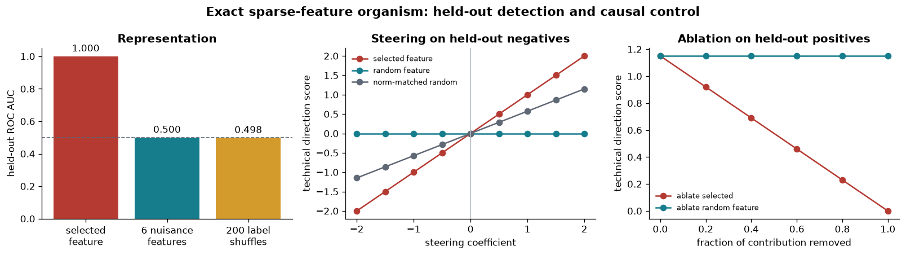
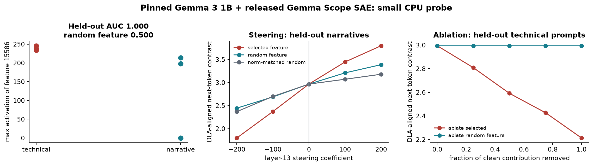
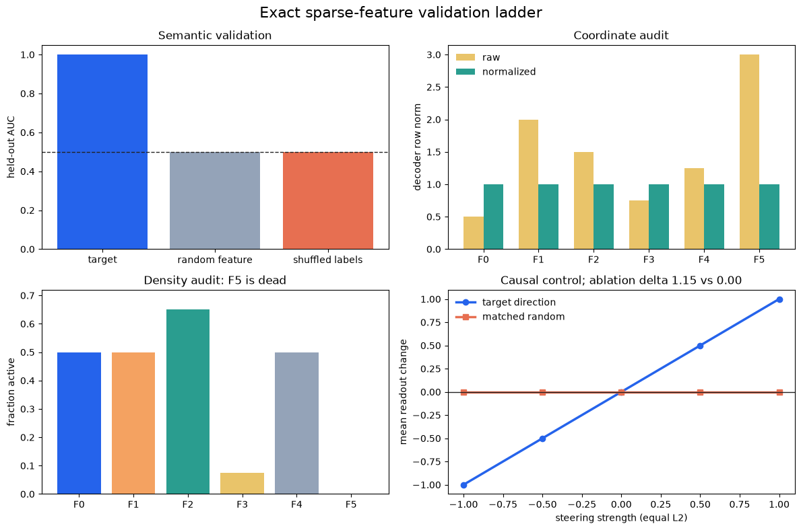
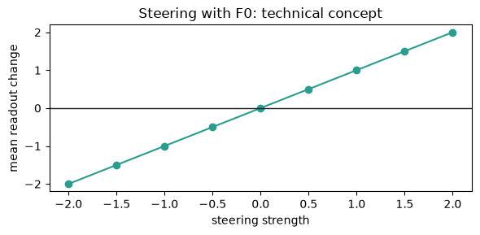

# [6.2] Gemma Scope and Feature Steering


> **Colab: [exercises](https://colab.research.google.com/github/shinobiultra/ARENA_3.0_Extended/blob/main/chapter6_sparse_feature_methods/exercises/part2_gemma_scope/6.2_Gemma_Scope_and_Feature_Steering_exercises.ipynb) |
> [solutions](https://colab.research.google.com/github/shinobiultra/ARENA_3.0_Extended/blob/main/chapter6_sparse_feature_methods/exercises/part2_gemma_scope/6.2_Gemma_Scope_and_Feature_Steering_solutions.ipynb)**

If you want to change to dark mode, you can do this by clicking the three horizontal lines in the top-right, then navigating to Settings → Theme.

# Introduction


Two complete curricula follow in sequence: feature discovery and residual-space steering, then dictionary normalization, confounding, density and direct-logit hypotheses. You implement every core function beside immediate tests and inspect all saved examples and figures.

The residual-space `ablate_feature(residual, feature_acts, decoder_vectors, feature_id,
fraction=1.0)` subtracts a decoded contribution. The distinct
`deep_dive_ablate_feature(feature_acts, feature_id)` zeros one latent coordinate before
reconstruction. Neither overwrites the other. Only colliding module bindings in the second
curriculum receive the declared `deep_dive_` prefix; local arguments and keyword interfaces stay
unchanged.

The first AUC implementation groups exactly equal ties; the second, `roc_auc_binary`, uses its
original tolerance-based tie comparison. Keep both numerical policies. The deep-dive real-model table remains
correlational; the first curriculum includes its separate intervention probe.


## Content & Learning Objectives

### 1️⃣ Feature steering study

> ##### Learning Objectives
>
> - Implement discovery, reconstruction and causal feature interventions with controls.

### 2️⃣ Dictionary deep dive

> ##### Learning Objectives
>
> - Implement normalization, held-out validation, density and direct-logit attribution.

### ☆ Bonus

Inspect the limitations and optional release contracts.


=== NEW CHAPTER ===


# 1️⃣ Feature steering study


> ##### Learning Objectives
>
> - Implement discovery, reconstruction and causal feature interventions with controls.

State how held-out correlation differs from causal steering, and name a control that could reject
each claim.


## Gemma Scope and Feature Steering

## Core Question

Can a sparse feature chosen on discovery examples predict a held-out concept and causally move a target score, while random-feature and norm-matched random-direction controls fail?

You will answer this twice. First, an exact sparse-feature organism gives ground truth. Then the same JumpReLU equations and intervention hooks are used with the pinned released Gemma Scope SAE and its matching Gemma 3 1B model on CPU.

The exact organism supports a causal claim because its sparse code and readout are known. The real-model probe supplies real activations and real downstream logits, but its small hand-built prompt split supports only a narrow feature hypothesis.


## Setup

The exact organism and released-SAE tensor checks run on CPU: seconds on the toy contract and minutes on the local real-model path. A CUDA GPU is needed only for the optional release verification.

## Objectives

By the end of this notebook, you should be able to:

- implement JumpReLU encoding and SAE decoding;
- select a feature on discovery data and evaluate it on at least 20 held-out examples;
- inspect real text examples rather than a scalar report;
- implement decoder-vector steering and progressive feature ablation;
- compare against random features, shuffled labels, and a norm-matched random direction;
- load the pinned Gemma Scope tensors and intervene at `model.layers.13.output`.

The visible results are generated in this notebook.


```python
import json
import os
import sys
from pathlib import Path

os.environ.setdefault("CUDA_VISIBLE_DEVICES", "")

import matplotlib.pyplot as plt
import numpy as np
import torch as t
from huggingface_hub import hf_hub_download
from safetensors.torch import load_file

chapter = "chapter5_modern_architectures"
section = "part2_gemma_scope_feature_steering"
root_dir = next(p for p in [Path.cwd(), *Path.cwd().parents] if (p / chapter).exists())
exercises_dir = root_dir / chapter / "exercises"
section_dir = exercises_dir / section
assets_dir = root_dir / "chapter6_sparse_feature_methods" / "exercises" / "part2_gemma_scope" / "media"
for path in (root_dir, exercises_dir):
    if str(path) not in sys.path:
        sys.path.append(str(path))

import chapter5_modern_architectures.exercises.part2_gemma_scope_feature_steering.tests as tests

t.set_grad_enabled(False)
plt.rcParams.update({
    "figure.dpi": 120,
    "axes.spines.top": False,
    "axes.spines.right": False,
    "axes.titleweight": "bold",
    "font.size": 10,
})

TARGET = "#B43A32"
FEATURE_CONTROL = "#167D8D"
DIRECTION_CONTROL = "#5F6875"
SHUFFLE_CONTROL = "#D39A2C"
```


## Cold open: the evidence ladder

A dashboard shows that one latent fires on prompts about tensors, Python, and APIs. Three different claims are easy to blur together:

1. **Representation:** the latent separates technical prompts from matched narrative prompts.
2. **Function:** adding or removing its decoder direction changes a downstream score.
3. **Interpretation:** "technical text" is a useful description that survives new data and controls.

This notebook keeps those claims separate. The exact organism makes the first two mathematically checkable. The real Gemma probe asks whether a released latent passes the same ladder on a small sample.

<details><summary>Interpretation - what would falsify the claim?</summary>

A target feature that performs like shuffled labels on held-out examples fails the representation claim. A steering curve that is no stronger than a norm-matched random direction, or an ablation curve that matches random-feature ablation, fails the function claim.

</details>


## 1. Exact sparse-feature organism

The organism has eight declared sparse features mixed into a 12-dimensional residual stream. Its decoder rows are orthonormal, its encoder is the transpose, and every active feature lies above a fixed JumpReLU threshold. Consequently, the sparse code and reconstruction are exact up to floating-point error.

The text is only an index into designed ground-truth factors. This is an exact causal model of an SAE intervention, not evidence that language models encode these factors this cleanly.


```python
FEATURE_NAMES = [
    "technical", "narrative", "positive", "question",
    "number", "first_person", "past_tense", "instruction",
]

TECHNICAL_BASES = [
    "A parser validates a JSON object", "A tensor stores a matrix product",
    "A compiler lowers a function", "An API returns a typed response",
    "A unit test checks a decoder", "A kernel multiplies two arrays",
    "A tokenizer masks padding", "A gradient updates the weights",
    "A cache stores attention keys", "A schema constrains tool arguments",
    "A sparse code reconstructs a residual", "A hook captures layer output",
    "A benchmark measures latency", "A debugger traces the call stack",
    "A batch contains token sequences", "A loss compares model logits",
    "A vector index retrieves documents", "A dtype controls precision",
    "A checkpoint stores parameters", "A test isolates a regression",
]
NARRATIVE_BASES = [
    "A lantern glows beside the river", "A child watches clouds cross the hill",
    "The garden smells of rain", "A boat drifts across the lake",
    "Fresh bread cools by the window", "Friends listen to music in the park",
    "Snow settles on the empty road", "Waves reach the beach at dusk",
    "A traveler rests beneath an oak", "Moonlight falls across the porch",
    "A painter opens a blue umbrella", "The village wakes before sunrise",
    "A kettle whistles in the kitchen", "Leaves turn slowly in the wind",
    "A violin echoes through the hall", "Candles flicker near the doorway",
    "A dog sleeps beside the fire", "Footsteps fade along the path",
    "A letter waits on the table", "Lanterns shine during the festival",
]

def build_exact_organism() -> dict[str, object]:
    rows = []
    sparse_rows = []
    for label, bases in ((1, TECHNICAL_BASES), (0, NARRATIVE_BASES)):
        for index, base in enumerate(bases):
            text = base
            if index % 4 >= 2:
                text = "I remember that " + text[0].lower() + text[1:]
            if index % 4 < 2:
                text += "?"
            else:
                text += "."
            if index % 3 == 0:
                text += f" It mentions {index + 1} details."
            if index % 5 < 2:
                text += " It worked well."
            if index % 5 in (2, 3):
                text += " Please explain."

            features = t.zeros(len(FEATURE_NAMES))
            features[0] = (1.0 + 0.1 * (index % 4)) * label
            features[1] = (1.0 + 0.1 * (index % 4)) * (1 - label)
            nuisance_active = [
                index % 5 < 2,
                index % 4 < 2,
                index % 3 == 0,
                index % 4 >= 2,
                index % 5 < 2,
                index % 5 in (2, 3),
            ]
            for feature_id, active in enumerate(nuisance_active, start=2):
                if active:
                    features[feature_id] = 0.65 + 0.05 * (index % 3)
            rows.append({
                "text": text,
                "label": label,
                "split": "discovery" if index < 8 else "heldout",
            })
            sparse_rows.append(features)

    generator = t.Generator().manual_seed(5)
    basis, _ = t.linalg.qr(t.randn(12, len(FEATURE_NAMES), generator=generator))
    w_dec = basis.T.contiguous()
    w_enc = w_dec.T.contiguous()
    b_dec = t.linspace(-0.15, 0.15, 12)
    b_enc = t.zeros(len(FEATURE_NAMES))
    threshold = t.full((len(FEATURE_NAMES),), 0.25)
    ground_truth = t.stack(sparse_rows)
    residuals = ground_truth @ w_dec + b_dec
    return {
        "rows": rows,
        "ground_truth": ground_truth,
        "residuals": residuals,
        "w_enc": w_enc,
        "w_dec": w_dec,
        "b_enc": b_enc,
        "b_dec": b_dec,
        "threshold": threshold,
    }

organism = build_exact_organism()
print("Cold-open examples from the exact organism:")
for row in organism["rows"][:2] + organism["rows"][20:22]:
    print(f"  label={row['label']} split={row['split']:<9} | {row['text']}")
print("Ground-truth sparse-code shape:", tuple(organism["ground_truth"].shape))
```


For a preactivation exactly at the JumpReLU threshold, predict whether its decoded contribution
survives; explain which matrix dimensions must contract.


### Exercise - implement JumpReLU encode and decode

> ```yaml
> Difficulty: 🔴🔴🔴⚪⚪
> Importance: 🔵🔵🔵🔵⚪
>
> You should spend up to 15-25 minutes on this exercise.
> ```

Implement the core SAE equations:

$$z_{pre} = (x-b_{dec})W_{enc}+b_{enc}$$
$$z = z_{pre} 1[z_{pre} > threshold]$$
$$\hat{x} = zW_{dec}+b_{dec}$$

The strict `>` matters at the threshold boundary.

<details><summary>Help - common bug: transposing the encoder or decoder</summary>

`x` ends in `d_model`, `W_enc` has shape `(d_model, n_features)`, and `W_dec` has shape `(n_features, d_model)`. PyTorch broadcasts both bias vectors over leading dimensions.

</details>

<details><summary>Solution</summary>

```python
def jumprelu_encode(x, *, w_enc, b_enc, b_dec, threshold):
    pre = (x.float() - b_dec.float()) @ w_enc.float() + b_enc.float()
    return pre * (pre > threshold.float())

def sae_decode(feature_acts, *, w_dec, b_dec):
    return feature_acts.float() @ w_dec.float() + b_dec.float()
```

</details>

<details><summary>Expected output</summary>

```text
All tests in `test_jumprelu_encode_decode` passed!
Maximum code error: < 1e-5
Maximum reconstruction error: < 1e-5
```

</details>


```python
def jumprelu_encode(
    x: t.Tensor,
    *,
    w_enc: t.Tensor,
    b_enc: t.Tensor,
    b_dec: t.Tensor,
    threshold: t.Tensor,
) -> t.Tensor:
    """Encode residual vectors with the JumpReLU SAE equations."""
    raise NotImplementedError()


def sae_decode(
    feature_acts: t.Tensor,
    *,
    w_dec: t.Tensor,
    b_dec: t.Tensor,
) -> t.Tensor:
    """Decode sparse feature activations into the residual stream."""
    raise NotImplementedError()
tests.test_jumprelu_encode_decode(jumprelu_encode, sae_decode)

exact_feature_acts = jumprelu_encode(
    organism["residuals"],
    w_enc=organism["w_enc"],
    b_enc=organism["b_enc"],
    b_dec=organism["b_dec"],
    threshold=organism["threshold"],
)
exact_reconstruction = sae_decode(
    exact_feature_acts,
    w_dec=organism["w_dec"],
    b_dec=organism["b_dec"],
)
code_error = (exact_feature_acts - organism["ground_truth"]).abs().max().item()
reconstruction_error = (exact_reconstruction - organism["residuals"]).abs().max().item()
print(f"Maximum code error: {code_error:.2e}")
print(f"Maximum reconstruction error: {reconstruction_error:.2e}")
```


<details><summary>Interpretation - what did exact reconstruction establish?</summary>

It established that the equations and intervention basis are correct for this organism. It did not establish that every SAE feature in a trained model is monosemantic, or that low reconstruction error implies an interpretable dictionary.

</details>


<details><summary>Solution</summary>

```python
def jumprelu_encode(
    x: t.Tensor,
    *,
    w_enc: t.Tensor,
    b_enc: t.Tensor,
    b_dec: t.Tensor,
    threshold: t.Tensor,
) -> t.Tensor:
    """Encode residual vectors with the JumpReLU SAE equations."""
    pre = (x.float() - b_dec.float()) @ w_enc.float() + b_enc.float()
    return pre * (pre > threshold.float())


def sae_decode(
    feature_acts: t.Tensor,
    *,
    w_dec: t.Tensor,
    b_dec: t.Tensor,
) -> t.Tensor:
    """Decode sparse feature activations into the residual stream."""
    return feature_acts.float() @ w_dec.float() + b_dec.float()
tests.test_jumprelu_encode_decode(jumprelu_encode, sae_decode)

exact_feature_acts = jumprelu_encode(
    organism["residuals"],
    w_enc=organism["w_enc"],
    b_enc=organism["b_enc"],
    b_dec=organism["b_dec"],
    threshold=organism["threshold"],
)
exact_reconstruction = sae_decode(
    exact_feature_acts,
    w_dec=organism["w_dec"],
    b_dec=organism["b_dec"],
)
code_error = (exact_feature_acts - organism["ground_truth"]).abs().max().item()
reconstruction_error = (exact_reconstruction - organism["residuals"]).abs().max().item()
print(f"Maximum code error: {code_error:.2e}")
print(f"Maximum reconstruction error: {reconstruction_error:.2e}")
```
</details>


Predict how selecting a feature only on discovery rows differs from selecting it on all rows. State
how tied positive/negative scores contribute to AUC.


## 2. Discover a feature, then freeze the hypothesis

Feature selection uses only the 16 discovery examples. Evaluation uses 24 held-out examples. Implement a mean-difference selector, tie-aware ROC AUC, and top-example lookup. Looking at held-out labels while choosing the feature would leak the answer.


### Exercise - selection, AUC, and visible examples

> ```yaml
> Difficulty: 🔴🔴🔴⚪⚪
> Importance: 🔵🔵🔵🔵⚪
>
> You should spend up to 15-25 minutes on this exercise.
> ```

<details><summary>Help - common bug: assigning distinct ranks to tied scores</summary>

Sort scores in ascending order, assign average 1-indexed ranks to tied groups, and use the Mann-Whitney rank formula. A constant nuisance feature should have AUC `0.5`.

</details>

<details><summary>Solution</summary>

```python
def select_feature_by_mean_difference(scores, labels, discovery_mask):
    discovery_scores = scores[discovery_mask]
    discovery_labels = labels[discovery_mask]
    margin = discovery_scores[discovery_labels].mean(0) - discovery_scores[~discovery_labels].mean(0)
    return int(margin.argmax().item())

def binary_roc_auc(scores, labels):
    scores, labels = scores.flatten().float(), labels.flatten().bool()
    order = scores.argsort()
    sorted_scores = scores[order]
    ranks_sorted = t.empty_like(sorted_scores)
    start = 0
    for count in t.unique_consecutive(sorted_scores, return_counts=True)[1].tolist():
        end = start + count
        ranks_sorted[start:end] = (start + 1 + end) / 2
        start = end
    ranks = t.empty_like(scores)
    ranks[order] = ranks_sorted
    n_pos = int(labels.sum())
    n_neg = int((~labels).sum())
    return float(((ranks[labels].sum() - n_pos * (n_pos + 1) / 2) / (n_pos * n_neg)).item())

def topk_example_indices(scores, k=5):
    return scores.flatten().topk(min(k, scores.numel())).indices
```

</details>

<details><summary>Expected output</summary>

```text
All tests in `test_feature_discovery_and_heldout_scoring` passed!
Selected feature: 0 (technical)
Held-out AUC: 1.000 across 24 examples
Random-feature AUCs: all 0.500
```

</details>


```python
def select_feature_by_mean_difference(
    feature_scores: t.Tensor,
    labels: t.Tensor,
    discovery_mask: t.Tensor,
) -> int:
    """Choose a feature using discovery rows only."""
    raise NotImplementedError()


def binary_roc_auc(scores: t.Tensor, labels: t.Tensor) -> float:
    """Return binary ROC AUC with average ranks for ties."""
    raise NotImplementedError()


def topk_example_indices(scores: t.Tensor, k: int = 5) -> t.Tensor:
    """Return indices of the k highest-scoring examples."""
    raise NotImplementedError()
tests.test_feature_discovery_and_heldout_scoring(
    select_feature_by_mean_difference,
    binary_roc_auc,
    topk_example_indices,
)
```


```python
exact_labels = t.tensor([row["label"] for row in organism["rows"]], dtype=t.bool)
exact_discovery = t.tensor(
    [row["split"] == "discovery" for row in organism["rows"]], dtype=t.bool
)
# Preserve the organism's declared ties after float32 encode/decode noise.
exact_scoring_acts = exact_feature_acts.round(decimals=5)
selected_feature_id = select_feature_by_mean_difference(
    exact_scoring_acts, exact_labels, exact_discovery
)
exact_heldout = ~exact_discovery
heldout_scores = exact_scoring_acts[exact_heldout, selected_feature_id]
heldout_labels = exact_labels[exact_heldout]
heldout_rows = [row for row in organism["rows"] if row["split"] == "heldout"]
heldout_auc = binary_roc_auc(heldout_scores, heldout_labels)
random_feature_ids = list(range(2, len(FEATURE_NAMES)))
random_feature_aucs = [
    binary_roc_auc(exact_scoring_acts[exact_heldout, feature_id], heldout_labels)
    for feature_id in random_feature_ids
]

print(f"Selected feature: {selected_feature_id} ({FEATURE_NAMES[selected_feature_id]})")
print(f"Held-out AUC: {heldout_auc:.3f} across {int(exact_heldout.sum())} examples")
print("Random-feature AUCs:", [round(value, 3) for value in random_feature_aucs])
print("\nTop held-out examples:")
for index in topk_example_indices(heldout_scores, k=5).tolist():
    row = heldout_rows[index]
    print(f"  score={heldout_scores[index]:.2f} label={row['label']} | {row['text']}")
print("\nLowest held-out examples:")
for index in heldout_scores.argsort()[:3].tolist():
    row = heldout_rows[index]
    print(f"  score={heldout_scores[index]:.2f} label={row['label']} | {row['text']}")
```


<details><summary>Interpretation - why the top examples are not the result</summary>

The examples make the proposed meaning legible, but the held-out AUC is the test. Here the result is exact because the target latent is part of the organism's declared ground truth. In a real model, equally clean examples can still arise from correlated tokens or prompt format.

</details>


<details><summary>Solution</summary>

```python
def select_feature_by_mean_difference(
    feature_scores: t.Tensor,
    labels: t.Tensor,
    discovery_mask: t.Tensor,
) -> int:
    """Choose a feature using discovery rows only."""
    feature_scores = feature_scores.float()
    labels = labels.bool()
    discovery_mask = discovery_mask.bool()
    discovery_scores = feature_scores[discovery_mask]
    discovery_labels = labels[discovery_mask]
    if not bool(discovery_labels.any()) or not bool((~discovery_labels).any()):
        raise ValueError("Discovery data needs positive and negative examples.")
    margin = (
        discovery_scores[discovery_labels].mean(dim=0)
        - discovery_scores[~discovery_labels].mean(dim=0)
    )
    return int(margin.argmax().item())


def binary_roc_auc(scores: t.Tensor, labels: t.Tensor) -> float:
    """Return binary ROC AUC with average ranks for ties."""
    scores = scores.detach().flatten().float()
    labels = labels.detach().flatten().bool()
    if scores.numel() != labels.numel():
        raise ValueError("scores and labels must have equal length.")
    n_pos = int(labels.sum().item())
    n_neg = int((~labels).sum().item())
    if n_pos == 0 or n_neg == 0:
        raise ValueError("AUC needs both classes.")
    order = scores.argsort()
    sorted_scores = scores[order]
    ranks_sorted = t.empty_like(sorted_scores)
    _, counts = t.unique_consecutive(sorted_scores, return_counts=True)
    start = 0
    for count in counts.tolist():
        end = start + count
        ranks_sorted[start:end] = (start + 1 + end) / 2
        start = end
    ranks = t.empty_like(scores)
    ranks[order] = ranks_sorted
    numerator = ranks[labels].sum() - n_pos * (n_pos + 1) / 2
    return float((numerator / (n_pos * n_neg)).item())


def topk_example_indices(scores: t.Tensor, k: int = 5) -> t.Tensor:
    """Return indices of the k highest-scoring examples."""
    flat_scores = scores.detach().flatten()
    return flat_scores.topk(min(k, flat_scores.numel())).indices
tests.test_feature_discovery_and_heldout_scoring(
    select_feature_by_mean_difference,
    binary_roc_auc,
    topk_example_indices,
)
```
</details>


Predict the sign of the known target readout after positive decoder-direction steering, and how
partial ablation compares with a random feature.


## 3. Cause and remove the target contribution

Steering adds `coefficient * decoder_direction` to the residual stream. Progressive ablation subtracts a fraction of the feature's own decoded contribution. Implement both operations and a direction score.


### Exercise - steering and progressive ablation

> ```yaml
> Difficulty: 🔴🔴🔴⚪⚪
> Importance: 🔵🔵🔵🔵⚪
>
> You should spend up to 15-25 minutes on this exercise.
> ```

<details><summary>Help - common bug: subtracting a unit decoder direction</summary>

The decoded contribution of feature `i` is `feature_acts[..., i, None] * W_dec[i]`. Multiplying this by an ablation fraction from 0 to 1 gives a curve rather than a single before/after point.

</details>

<details><summary>Solution</summary>

```python
def steer_residual(residual, direction, coefficient):
    return residual + float(coefficient) * direction

def ablate_feature(residual, feature_acts, decoder_vectors, feature_id, fraction=1.0):
    contribution = feature_acts[..., feature_id, None] * decoder_vectors[feature_id]
    return residual - float(fraction) * contribution

def direction_score(residual, direction):
    return (residual.float() * direction.float()).sum(dim=-1)
```

</details>

<details><summary>Expected output</summary>

```text
All tests in `test_feature_steering_and_ablation` passed!
Exact held-out AUC = 1.000; random features = 0.500; shuffled labels about 0.500
Steering slope: target > random direction and random feature
Full ablation: target score approaches 0; random-feature ablation stays at baseline
```

</details>


```python
def steer_residual(
    residual: t.Tensor,
    direction: t.Tensor,
    coefficient: float,
) -> t.Tensor:
    """Add a decoder direction to every residual vector."""
    raise NotImplementedError()


def ablate_feature(
    residual: t.Tensor,
    feature_acts: t.Tensor,
    decoder_vectors: t.Tensor,
    feature_id: int,
    fraction: float = 1.0,
) -> t.Tensor:
    """Subtract a fraction of one feature's decoded contribution."""
    raise NotImplementedError()


def direction_score(residual: t.Tensor, direction: t.Tensor) -> t.Tensor:
    """Project residual vectors onto a direction."""
    raise NotImplementedError()
tests.test_feature_steering_and_ablation(
    steer_residual,
    ablate_feature,
    direction_score,
)
```


<details><summary>Solution</summary>

```python
def steer_residual(
    residual: t.Tensor,
    direction: t.Tensor,
    coefficient: float,
) -> t.Tensor:
    """Add a decoder direction to every residual vector."""
    return residual + float(coefficient) * direction.to(residual)


def ablate_feature(
    residual: t.Tensor,
    feature_acts: t.Tensor,
    decoder_vectors: t.Tensor,
    feature_id: int,
    fraction: float = 1.0,
) -> t.Tensor:
    """Subtract a fraction of one feature's decoded contribution."""
    if not 0.0 <= float(fraction) <= 1.0:
        raise ValueError("fraction must lie in [0, 1].")
    contribution = (
        feature_acts[..., feature_id, None].to(residual)
        * decoder_vectors[feature_id].to(residual)
    )
    return residual - float(fraction) * contribution


def direction_score(residual: t.Tensor, direction: t.Tensor) -> t.Tensor:
    """Project residual vectors onto a direction."""
    return (residual.float() * direction.float()).sum(dim=-1)
tests.test_feature_steering_and_ablation(
    steer_residual,
    ablate_feature,
    direction_score,
)
```
</details>


Forecast the qualitative ordering of target versus random-feature and random-direction curves and
the shuffled-label control. Explain which panel tests representation and which tests function.


## Signature Result - exact ground truth

Generate the result from the functions you implemented. Each panel has a control: shuffled labels and nuisance features for detection, a nuisance feature and norm-matched random direction for steering, and nuisance-feature ablation for removal.


```python
shuffle_generator = t.Generator().manual_seed(17)
shuffled_aucs = []
for _ in range(200):
    permutation = t.randperm(heldout_labels.numel(), generator=shuffle_generator)
    shuffled_aucs.append(binary_roc_auc(heldout_scores, heldout_labels[permutation]))

control_feature_id = 5
target_direction = organism["w_dec"][selected_feature_id]
control_feature_direction = organism["w_dec"][control_feature_id]
random_generator = t.Generator().manual_seed(23)
random_direction = t.randn(target_direction.shape, generator=random_generator)
random_direction = random_direction / random_direction.norm() * target_direction.norm()

def exact_target_score(residual: t.Tensor) -> t.Tensor:
    return direction_score(residual - organism["b_dec"], target_direction)

negative_mask = exact_heldout & ~exact_labels
positive_mask = exact_heldout & exact_labels
coefficients = t.linspace(-2.0, 2.0, 9)
steering_target = []
steering_feature_control = []
steering_direction_control = []
for coefficient in coefficients.tolist():
    base = organism["residuals"][negative_mask]
    steering_target.append(exact_target_score(
        steer_residual(base, target_direction, coefficient)
    ).mean().item())
    steering_feature_control.append(exact_target_score(
        steer_residual(base, control_feature_direction, coefficient)
    ).mean().item())
    steering_direction_control.append(exact_target_score(
        steer_residual(base, random_direction, coefficient)
    ).mean().item())

fractions = t.linspace(0.0, 1.0, 6)
ablation_target = []
ablation_control = []
positive_residuals = organism["residuals"][positive_mask]
positive_acts = exact_scoring_acts[positive_mask]
for fraction in fractions.tolist():
    ablation_target.append(exact_target_score(
        ablate_feature(
            positive_residuals, positive_acts, organism["w_dec"],
            selected_feature_id, fraction,
        )
    ).mean().item())
    ablation_control.append(exact_target_score(
        ablate_feature(
            positive_residuals, positive_acts, organism["w_dec"],
            control_feature_id, fraction,
        )
    ).mean().item())

assert heldout_auc == 1.0
assert max(abs(value - 0.5) for value in random_feature_aucs) < 1e-6
assert steering_target[-1] - steering_target[4] > abs(
    steering_direction_control[-1] - steering_direction_control[4]
)
assert ablation_target[-1] < 1e-5
assert abs(ablation_control[-1] - ablation_control[0]) < 1e-5

fig, axes = plt.subplots(1, 3, figsize=(13.5, 3.8))
auc_values = [heldout_auc, float(np.mean(random_feature_aucs)), float(np.mean(shuffled_aucs))]
axes[0].bar(
    ["selected\nfeature", "6 nuisance\nfeatures", "200 label\nshuffles"],
    auc_values,
    color=[TARGET, FEATURE_CONTROL, SHUFFLE_CONTROL],
)
axes[0].axhline(0.5, color=DIRECTION_CONTROL, linestyle="--", linewidth=1)
axes[0].set_ylim(0, 1.05)
axes[0].set_ylabel("held-out ROC AUC")
axes[0].set_title("Representation")
for index, value in enumerate(auc_values):
    axes[0].text(index, value + 0.03, f"{value:.3f}", ha="center")

axes[1].plot(coefficients, steering_target, marker="o", color=TARGET, label="selected feature")
axes[1].plot(coefficients, steering_feature_control, marker="o", color=FEATURE_CONTROL, label="random feature")
axes[1].plot(coefficients, steering_direction_control, marker="o", color=DIRECTION_CONTROL, label="norm-matched random")
axes[1].axvline(0, color="#B8BDC5", linewidth=1)
axes[1].set_xlabel("steering coefficient")
axes[1].set_ylabel("technical direction score")
axes[1].set_title("Steering on held-out negatives")
axes[1].legend(frameon=False, fontsize=8)

axes[2].plot(fractions, ablation_target, marker="o", color=TARGET, label="ablate selected")
axes[2].plot(fractions, ablation_control, marker="o", color=FEATURE_CONTROL, label="ablate random feature")
axes[2].set_xlabel("fraction of contribution removed")
axes[2].set_ylabel("technical direction score")
axes[2].set_title("Ablation on held-out positives")
axes[2].legend(frameon=False, fontsize=8)

fig.suptitle("Exact sparse-feature organism: held-out detection and causal control", fontsize=13, fontweight="bold")
fig.tight_layout()
exact_figure_path = assets_dir / "gemma_scope_exact_organism_signature.png"
fig.savefig(exact_figure_path, dpi=170, bbox_inches="tight")
plt.show()

print(
    f"Exact metrics: AUC={heldout_auc:.3f}, nuisance AUC={np.mean(random_feature_aucs):.3f}, "
    f"shuffle AUC={np.mean(shuffled_aucs):.3f}, "
    f"steering delta={steering_target[-1] - steering_target[4]:.3f}, "
    f"full-ablation score={ablation_target[-1]:.3f}."
)
```





<details><summary>Interpreting the signature result</summary>

The selected latent separates all 24 held-out examples, while six nuisance features and shuffled labels remain at chance on average. Positive steering changes the technical readout monotonically; the nuisance feature is orthogonal and the norm-matched random direction has only its incidental projection. Progressive target ablation removes the readout, while ablating a nuisance feature leaves it unchanged.

These are exact causal facts about the organism because the sparse code, decoder, and readout were designed and are all visible.

</details>


Choose a changed coefficient, feature or row, forecast its readout change and compare it with the
unchanged control.


### Try It Yourself - change the intervention

Change `PLAY_COEFFICIENT`, `PLAY_FEATURE_ID`, or the held-out row. A useful adversarial check is to steer a nuisance feature with a very large coefficient and inspect both the target score and that nuisance feature's own direction score.


```python
PLAY_ROW = 33
PLAY_FEATURE_ID = selected_feature_id
PLAY_COEFFICIENT = 0.75

play_residual = organism["residuals"][PLAY_ROW]
play_direction = organism["w_dec"][PLAY_FEATURE_ID]
play_steered = steer_residual(play_residual, play_direction, PLAY_COEFFICIENT)
print("Prompt:", organism["rows"][PLAY_ROW]["text"])
print(f"Feature: {PLAY_FEATURE_ID} ({FEATURE_NAMES[PLAY_FEATURE_ID]})")
print(f"Target score before: {exact_target_score(play_residual):.3f}")
print(f"Target score after:  {exact_target_score(play_steered):.3f}")
```


Forecast which artifact fields must match the base model and hook, and why correct tensor shapes
alone cannot validate a semantic interpretation.


## 4. Load the released Gemma Scope SAE

We now leave exact ground truth. The pinned artifact is `google/gemma-scope-2-1b-it`, revision `b0fa29457c3601df0a70c48a15534c738d7c10e0`, at `resid_post/layer_13_width_16k_l0_small`. It is a JumpReLU SAE for `google/gemma-3-1b-it` at `model.layers.13.output`.


### Exercise - load and validate the real tensors

> ```yaml
> Difficulty: 🔴🔴🔴⚪⚪
> Importance: 🔵🔵🔵🔵⚪
>
> You should spend up to 15-25 minutes on this exercise.
> ```

Implement the loader. It must fetch the exact config and safetensor file, require all five SAE tensors, and reject shape or metadata mismatches. There is no substitute model or generated checkpoint.

<details><summary>Help - common bug: loading an unpinned SAE artifact</summary>

Use `hf_hub_download` twice with the pinned repository, revision, and artifact-relative filenames. Read the JSON config and call `safetensors.torch.load_file(..., device="cpu")`.

</details>

<details><summary>Solution</summary>

```python
def load_released_gemma_scope_sae(repo_id, revision, artifact_path):
    config_path = hf_hub_download(repo_id=repo_id, revision=revision, filename=f"{artifact_path}/config.json")
    params_path = hf_hub_download(repo_id=repo_id, revision=revision, filename=f"{artifact_path}/params.safetensors")
    config = json.loads(Path(config_path).read_text())
    state = load_file(params_path, device="cpu")
    required = {"w_enc", "w_dec", "b_enc", "b_dec", "threshold"}
    if not required.issubset(state):
        raise ValueError("Missing required SAE tensors.")
    if config["architecture"] != "jump_relu":
        raise ValueError("Expected a JumpReLU SAE.")
    return config, state
```

</details>

<details><summary>Expected output</summary>

```text
All tests in `test_released_gemma_scope_artifact` passed!
Released artifact: google/gemma-3-1b-it | model.layers.13.output | width=16384 | d_model=1152
```

</details>


```python
GEMMA_SCOPE_REPO = "google/gemma-scope-2-1b-it"
GEMMA_SCOPE_REVISION = "b0fa29457c3601df0a70c48a15534c738d7c10e0"
GEMMA_SCOPE_ARTIFACT = "resid_post/layer_13_width_16k_l0_small"
GEMMA_MODEL_REVISION = "dcc83ea841ab6100d6b47a070329e1ba4cf78752"
def load_released_gemma_scope_sae(
    repo_id: str,
    revision: str,
    artifact_path: str,
) -> tuple[dict, dict[str, t.Tensor]]:
    """Load the pinned Gemma Scope config and tensors on CPU."""
    raise NotImplementedError()
gemma_scope_config, gemma_scope_state = load_released_gemma_scope_sae(
    GEMMA_SCOPE_REPO,
    GEMMA_SCOPE_REVISION,
    GEMMA_SCOPE_ARTIFACT,
)
tests.test_released_gemma_scope_artifact(
    gemma_scope_config,
    gemma_scope_state,
    jumprelu_encode,
    sae_decode,
)
print(
    "Released artifact:",
    gemma_scope_config["model_name"], "|",
    gemma_scope_config["hf_hook_point_in"], "|",
    f"width={gemma_scope_config['width']}", "|",
    f"d_model={gemma_scope_state['w_dec'].shape[1]}",
)
```


<details><summary>Interpretation - what this real-artifact test proves</summary>

It proves that the released tensors have the pinned identity and expected shapes, and that your JumpReLU implementation runs a finite encode/decode pass on them. The constructed test residual is a mathematical probe of the artifact, not a semantic language-model example.

</details>


<details><summary>Solution</summary>

```python
GEMMA_SCOPE_REPO = "google/gemma-scope-2-1b-it"
GEMMA_SCOPE_REVISION = "b0fa29457c3601df0a70c48a15534c738d7c10e0"
GEMMA_SCOPE_ARTIFACT = "resid_post/layer_13_width_16k_l0_small"
GEMMA_MODEL_REVISION = "dcc83ea841ab6100d6b47a070329e1ba4cf78752"
def load_released_gemma_scope_sae(
    repo_id: str,
    revision: str,
    artifact_path: str,
) -> tuple[dict, dict[str, t.Tensor]]:
    """Load the pinned Gemma Scope config and tensors on CPU."""
    config_path = hf_hub_download(
        repo_id=repo_id,
        revision=revision,
        filename=f"{artifact_path}/config.json",
    )
    params_path = hf_hub_download(
        repo_id=repo_id,
        revision=revision,
        filename=f"{artifact_path}/params.safetensors",
    )
    config = json.loads(Path(config_path).read_text())
    state = load_file(params_path, device="cpu")
    required = {"w_enc", "w_dec", "b_enc", "b_dec", "threshold"}
    if not required.issubset(state):
        raise ValueError(f"Missing SAE tensors: {sorted(required - set(state))}")
    if config.get("architecture") != "jump_relu":
        raise ValueError("Expected a JumpReLU SAE.")
    if config.get("model_name") != "google/gemma-3-1b-it":
        raise ValueError("Artifact points to an unexpected base model.")
    if config.get("hf_hook_point_in") != "model.layers.13.output":
        raise ValueError("Artifact points to an unexpected hook location.")
    if tuple(state["w_enc"].shape) != (1152, 16384):
        raise ValueError("Unexpected encoder shape.")
    if tuple(state["w_dec"].shape) != (16384, 1152):
        raise ValueError("Unexpected decoder shape.")
    return config, state
gemma_scope_config, gemma_scope_state = load_released_gemma_scope_sae(
    GEMMA_SCOPE_REPO,
    GEMMA_SCOPE_REVISION,
    GEMMA_SCOPE_ARTIFACT,
)
tests.test_released_gemma_scope_artifact(
    gemma_scope_config,
    gemma_scope_state,
    jumprelu_encode,
    sae_decode,
)
print(
    "Released artifact:",
    gemma_scope_config["model_name"], "|",
    gemma_scope_config["hf_hook_point_in"], "|",
    f"width={gemma_scope_config['width']}", "|",
    f"d_model={gemma_scope_state['w_dec'].shape[1]}",
)
```
</details>


## 5. Real Gemma activations and interventions

This cell loads the exact matching base model on CPU. The repository snapshot is gated on Hugging Face, so you need access to `google/gemma-3-1b-it`. Failure to access that model is an access error; this notebook does not substitute another model.

We use eight prompts for discovery and eight different prompts for evaluation. Feature selection never sees the held-out labels.


```python
from transformers import AutoModelForCausalLM, AutoTokenizer

REAL_TECHNICAL_PROMPTS = (
    "Explain how a Python function validates a JSON schema before calling a tool.",
    "Describe a tensor shape check for a batched matrix multiplication in PyTorch.",
    "Write a concise note about masking invalid API actions before decoding.",
    "Explain how an embedding retrieval system ranks documents with cosine similarity.",
    "Describe a unit test for parsing function-call arguments from model output.",
    "Explain why attention masks should ignore padding tokens during pooling.",
    "Write a short note about checking CUDA tensor dtype and device placement.",
    "Describe how to compute a sparse autoencoder reconstruction error.",
)
REAL_NARRATIVE_PROMPTS = (
    "Describe a quiet garden with rain on green leaves in the early morning.",
    "Tell a calm story about a child watching clouds move over a hill.",
    "Describe the color of sunset light across a lake and a wooden dock.",
    "Write a peaceful paragraph about walking through fresh snow at night.",
    "Describe a small kitchen where bread cools beside a window.",
    "Tell a gentle scene about friends listening to music in a park.",
    "Describe the sound of waves reaching a beach under a clear sky.",
    "Write a short scene about lanterns glowing during an evening festival.",
)

tokenizer = AutoTokenizer.from_pretrained(
    gemma_scope_config["model_name"],
    revision=GEMMA_MODEL_REVISION,
)
tokenizer.padding_side = "left"
model = AutoModelForCausalLM.from_pretrained(
    gemma_scope_config["model_name"],
    revision=GEMMA_MODEL_REVISION,
    dtype=t.bfloat16,
    device_map="cpu",
)
model.eval()
assert next(model.parameters()).device.type == "cpu"

def hidden_from_layer_output(output):
    return output[0] if isinstance(output, tuple) else output


def replace_hidden_in_layer_output(output, hidden):
    return (hidden, *output[1:]) if isinstance(output, tuple) else hidden


def capture_layer_residuals(prompts: list[str] | tuple[str, ...]):
    inputs = tokenizer(
        list(prompts), return_tensors="pt", padding=True,
        truncation=True, max_length=32,
    )
    captured = {}

    def capture_hook(_module, _inputs, output):
        captured["residual"] = hidden_from_layer_output(output).detach().float()

    handle = model.model.layers[13].register_forward_hook(capture_hook)
    try:
        with t.inference_mode():
            model.model(**inputs)
    finally:
        handle.remove()
    return inputs, captured["residual"]


real_prompts = REAL_TECHNICAL_PROMPTS + REAL_NARRATIVE_PROMPTS
real_labels = t.tensor([1] * 8 + [0] * 8, dtype=t.bool)
real_discovery = t.tensor([1] * 4 + [0] * 4 + [1] * 4 + [0] * 4, dtype=t.bool)
real_inputs, real_residuals = capture_layer_residuals(real_prompts)
real_feature_acts = jumprelu_encode(
    real_residuals,
    w_enc=gemma_scope_state["w_enc"],
    b_enc=gemma_scope_state["b_enc"],
    b_dec=gemma_scope_state["b_dec"],
    threshold=gemma_scope_state["threshold"],
)
real_feature_acts = real_feature_acts.masked_fill(
    ~real_inputs["attention_mask"].bool()[..., None], 0
)
real_feature_scores = real_feature_acts.max(dim=1).values
real_feature_id = select_feature_by_mean_difference(
    real_feature_scores, real_labels, real_discovery
)
real_random_feature_id = (real_feature_id + 7919) % gemma_scope_config["width"]
real_heldout = ~real_discovery
real_auc = binary_roc_auc(
    real_feature_scores[real_heldout, real_feature_id], real_labels[real_heldout]
)
real_random_auc = binary_roc_auc(
    real_feature_scores[real_heldout, real_random_feature_id], real_labels[real_heldout]
)
assert real_auc >= 0.95 and real_auc - real_random_auc >= 0.25

print(
    f"Discovery selected feature {real_feature_id}; held-out AUC={real_auc:.3f}; "
    f"random feature {real_random_feature_id} AUC={real_random_auc:.3f}."
)
print("\nAll held-out prompt scores (visible examples and anomalies):")
heldout_global_indices = t.nonzero(real_heldout, as_tuple=False).flatten()
ordering = real_feature_scores[real_heldout, real_feature_id].argsort(descending=True)
for local_index in ordering.tolist():
    global_index = int(heldout_global_indices[local_index].item())
    label = "technical" if real_labels[global_index] else "narrative"
    score = real_feature_scores[global_index, real_feature_id].item()
    print(f"  {score:8.2f} | {label:<9} | {real_prompts[global_index]}")
```


Predict how the steering hook should preserve tuple outputs and how the ablation hook uses clean
scores without mutating its input.


### Exercise - write real forward hooks

> ```yaml
> Difficulty: 🔴🔴🔴⚪⚪
> Importance: 🔵🔵🔵🔵⚪
>
> You should spend up to 15-25 minutes on this exercise.
> ```

Implement hook factories for steering and progressive ablation. They must handle both tensor outputs and tuple outputs from a Hugging Face decoder layer.

<details><summary>Help - common bug: replacing the layer output container</summary>

Extract the hidden state with `hidden_from_layer_output`, modify it, then rebuild the original output shape with `replace_hidden_in_layer_output`.

</details>

<details><summary>Solution</summary>

```python
def make_steering_hook(direction, coefficient):
    def hook(_module, _inputs, output):
        hidden = hidden_from_layer_output(output)
        steered = steer_residual(hidden, direction, coefficient)
        return replace_hidden_in_layer_output(output, steered)
    return hook

def make_ablation_hook(clean_feature_scores, direction, fraction):
    def hook(_module, _inputs, output):
        hidden = hidden_from_layer_output(output)
        contribution = clean_feature_scores[..., None].to(hidden) * direction.to(hidden)
        return replace_hidden_in_layer_output(output, hidden - float(fraction) * contribution)
    return hook
```

</details>

<details><summary>Expected output</summary>

```text
Hook tests passed for tensor and tuple layer outputs.
```

</details>


```python
def make_steering_hook(direction: t.Tensor, coefficient: float):
    """Return a Hugging Face forward hook that adds one direction."""
    raise NotImplementedError()


def make_ablation_hook(
    clean_feature_scores: t.Tensor,
    direction: t.Tensor,
    fraction: float,
):
    """Return a hook that removes a clean feature contribution."""
    raise NotImplementedError()
hook_test_hidden = t.zeros(2, 3, 4)
hook_test_direction = t.tensor([1.0, 0.0, 0.0, 0.0])
tensor_result = make_steering_hook(hook_test_direction, 2.0)(
    None, (), hook_test_hidden
)
tuple_result = make_steering_hook(hook_test_direction, 2.0)(
    None, (), (hook_test_hidden, "cache")
)
t.testing.assert_close(tensor_result[..., 0], t.full((2, 3), 2.0))
t.testing.assert_close(tuple_result[0][..., 0], t.full((2, 3), 2.0))
assert tuple_result[1] == "cache"
print("Hook tests passed for tensor and tuple layer outputs.")
```


<details><summary>Solution</summary>

```python
def make_steering_hook(direction: t.Tensor, coefficient: float):
    """Return a Hugging Face forward hook that adds one direction."""
    def hook(_module, _inputs, output):
        hidden = hidden_from_layer_output(output)
        steered = steer_residual(hidden, direction, coefficient)
        return replace_hidden_in_layer_output(output, steered)
    return hook


def make_ablation_hook(
    clean_feature_scores: t.Tensor,
    direction: t.Tensor,
    fraction: float,
):
    """Return a hook that removes a clean feature contribution."""
    def hook(_module, _inputs, output):
        hidden = hidden_from_layer_output(output)
        contribution = (
            clean_feature_scores[..., None].to(hidden) * direction.to(hidden)
        )
        ablated = hidden - float(fraction) * contribution
        return replace_hidden_in_layer_output(output, ablated)
    return hook
hook_test_hidden = t.zeros(2, 3, 4)
hook_test_direction = t.tensor([1.0, 0.0, 0.0, 0.0])
tensor_result = make_steering_hook(hook_test_direction, 2.0)(
    None, (), hook_test_hidden
)
tuple_result = make_steering_hook(hook_test_direction, 2.0)(
    None, (), (hook_test_hidden, "cache")
)
t.testing.assert_close(tensor_result[..., 0], t.full((2, 3), 2.0))
t.testing.assert_close(tuple_result[0][..., 0], t.full((2, 3), 2.0))
assert tuple_result[1] == "cache"
print("Hook tests passed for tensor and tuple layer outputs.")
```
</details>


Forecast whether the selected feature will outperform each matched control in steering and ablation.
Distinguish this tiny cohort from a general semantic claim.


## Signature Result - real Gemma Scope probe

The downstream score is frozen before intervention: the mean next-token logit of the decoder direction's six highest readable ASCII tokens minus its six lowest. This is a DLA-aligned function score, not a claim that those tokens define the feature's semantic meaning.

Steering is evaluated on the four held-out narrative prompts. Ablation is evaluated on the four held-out technical prompts. Controls use feature `7121` and a fixed-seed random vector scaled to the selected decoder row's norm.


```python
def readable_extreme_token_ids(effects: t.Tensor, *, largest: bool, k: int = 6) -> list[int]:
    candidates = effects.topk(5000, largest=largest).indices.tolist()
    selected = []
    for token_id in candidates:
        token = tokenizer.decode([token_id])
        stripped = token.strip()
        if (
            stripped
            and token.isascii()
            and token.isprintable()
            and any(character.isalpha() for character in token)
            and "<" not in token
            and len(stripped) >= 2
        ):
            selected.append(token_id)
        if len(selected) == k:
            break
    if len(selected) != k:
        raise RuntimeError("Could not find enough readable DLA tokens.")
    return selected


selected_decoder_direction = gemma_scope_state["w_dec"][real_feature_id]
random_feature_direction = gemma_scope_state["w_dec"][real_random_feature_id]
real_dla = selected_decoder_direction @ model.lm_head.weight.detach().float().T
positive_token_ids = readable_extreme_token_ids(real_dla, largest=True)
negative_token_ids = readable_extreme_token_ids(real_dla, largest=False)
print("Positive DLA tokens:", [tokenizer.decode([token_id]) for token_id in positive_token_ids])
print("Negative DLA tokens:", [tokenizer.decode([token_id]) for token_id in negative_token_ids])

def next_token_contrast(logits: t.Tensor) -> t.Tensor:
    positive = logits[:, positive_token_ids].float().mean(dim=-1)
    negative = logits[:, negative_token_ids].float().mean(dim=-1)
    return positive - negative


def score_prompts_with_hook(prompts, hook) -> float:
    inputs = tokenizer(
        list(prompts), return_tensors="pt", padding=True,
        truncation=True, max_length=32,
    )
    handle = model.model.layers[13].register_forward_hook(hook)
    try:
        with t.inference_mode():
            final_logits = model(**inputs).logits[:, -1]
    finally:
        handle.remove()
    return next_token_contrast(final_logits).mean().item()


heldout_narrative = REAL_NARRATIVE_PROMPTS[4:]
heldout_technical = REAL_TECHNICAL_PROMPTS[4:]
real_coefficients = t.tensor([-200.0, -100.0, 0.0, 100.0, 200.0])
random_generator = t.Generator().manual_seed(23)
real_random_direction = t.randn(selected_decoder_direction.shape, generator=random_generator)
real_random_direction = (
    real_random_direction / real_random_direction.norm() * selected_decoder_direction.norm()
)

real_steering_target = [
    score_prompts_with_hook(
        heldout_narrative,
        make_steering_hook(selected_decoder_direction, coefficient),
    )
    for coefficient in real_coefficients.tolist()
]
real_steering_feature_control = [
    score_prompts_with_hook(
        heldout_narrative,
        make_steering_hook(random_feature_direction, coefficient),
    )
    for coefficient in real_coefficients.tolist()
]
real_steering_direction_control = [
    score_prompts_with_hook(
        heldout_narrative,
        make_steering_hook(real_random_direction, coefficient),
    )
    for coefficient in real_coefficients.tolist()
]

technical_inputs, technical_residuals = capture_layer_residuals(heldout_technical)
technical_feature_acts = jumprelu_encode(
    technical_residuals,
    w_enc=gemma_scope_state["w_enc"],
    b_enc=gemma_scope_state["b_enc"],
    b_dec=gemma_scope_state["b_dec"],
    threshold=gemma_scope_state["threshold"],
)
real_fractions = t.tensor([0.0, 0.25, 0.5, 0.75, 1.0])
real_ablation_target = [
    score_prompts_with_hook(
        heldout_technical,
        make_ablation_hook(
            technical_feature_acts[..., real_feature_id],
            selected_decoder_direction,
            fraction,
        ),
    )
    for fraction in real_fractions.tolist()
]
real_ablation_control = [
    score_prompts_with_hook(
        heldout_technical,
        make_ablation_hook(
            technical_feature_acts[..., real_random_feature_id],
            random_feature_direction,
            fraction,
        ),
    )
    for fraction in real_fractions.tolist()
]

center = 2
target_steering_delta = real_steering_target[-1] - real_steering_target[center]
feature_control_delta = real_steering_feature_control[-1] - real_steering_feature_control[center]
direction_control_delta = real_steering_direction_control[-1] - real_steering_direction_control[center]
target_ablation_drop = real_ablation_target[0] - real_ablation_target[-1]
control_ablation_drop = real_ablation_control[0] - real_ablation_control[-1]
assert target_steering_delta > max(feature_control_delta, direction_control_delta)
assert target_ablation_drop > control_ablation_drop + 0.1

real_shuffle_generator = t.Generator().manual_seed(31)
real_shuffle_aucs = []
real_heldout_scores = real_feature_scores[real_heldout, real_feature_id]
real_heldout_labels = real_labels[real_heldout]
for _ in range(200):
    permutation = t.randperm(real_heldout_labels.numel(), generator=real_shuffle_generator)
    real_shuffle_aucs.append(
        binary_roc_auc(real_heldout_scores, real_heldout_labels[permutation])
    )

fig, axes = plt.subplots(1, 3, figsize=(13.5, 3.8))
heldout_technical_scores = real_feature_scores[real_heldout & real_labels, real_feature_id]
heldout_narrative_scores = real_feature_scores[real_heldout & ~real_labels, real_feature_id]
axes[0].scatter(
    np.zeros(len(heldout_technical_scores)), heldout_technical_scores,
    color=TARGET, s=55, label="technical",
)
axes[0].scatter(
    np.ones(len(heldout_narrative_scores)), heldout_narrative_scores,
    color=FEATURE_CONTROL, s=55, label="narrative",
)
axes[0].set_xticks([0, 1], ["technical", "narrative"])
axes[0].set_ylabel(f"max activation of feature {real_feature_id}")
axes[0].set_title(f"Held-out AUC {real_auc:.3f}\nrandom feature {real_random_auc:.3f}")

axes[1].plot(real_coefficients, real_steering_target, marker="o", color=TARGET, label="selected feature")
axes[1].plot(real_coefficients, real_steering_feature_control, marker="o", color=FEATURE_CONTROL, label="random feature")
axes[1].plot(real_coefficients, real_steering_direction_control, marker="o", color=DIRECTION_CONTROL, label="norm-matched random")
axes[1].axvline(0, color="#B8BDC5", linewidth=1)
axes[1].set_xlabel("layer-13 steering coefficient")
axes[1].set_ylabel("DLA-aligned next-token contrast")
axes[1].set_title("Steering: held-out narratives")
axes[1].legend(frameon=False, fontsize=8)

axes[2].plot(real_fractions, real_ablation_target, marker="o", color=TARGET, label="ablate selected")
axes[2].plot(real_fractions, real_ablation_control, marker="o", color=FEATURE_CONTROL, label="ablate random feature")
axes[2].set_xlabel("fraction of clean contribution removed")
axes[2].set_ylabel("DLA-aligned next-token contrast")
axes[2].set_title("Ablation: held-out technical prompts")
axes[2].legend(frameon=False, fontsize=8)

fig.suptitle("Pinned Gemma 3 1B + released Gemma Scope SAE: small CPU probe", fontsize=13, fontweight="bold")
fig.tight_layout()
real_figure_path = assets_dir / "gemma_scope_real_model_probe.png"
fig.savefig(real_figure_path, dpi=170, bbox_inches="tight")
plt.show()

print(
    f"Real metrics: held-out AUC={real_auc:.3f}, random-feature AUC={real_random_auc:.3f}, "
    f"shuffle AUC={np.mean(real_shuffle_aucs):.3f}, "
    f"steering delta={target_steering_delta:.3f} "
    f"(feature control={feature_control_delta:.3f}, direction control={direction_control_delta:.3f}), "
    f"ablation drop={target_ablation_drop:.3f} (control={control_ablation_drop:.3f})."
)
```




<details><summary>Interpreting the real-model result</summary>

Discovery-only selection finds feature `15586`. It ranks all four held-out technical prompts above all four held-out narrative prompts, although two narrative prompts also activate strongly. Adding its decoder direction monotonically increases a DLA-aligned token contrast and beats both displayed controls at coefficient `+200`. Removing its clean contribution decreases the same downstream contrast; removing feature `7121` is flat.

The activation examples support a narrow technical-versus-narrative representation hypothesis. The intervention supports a function claim about the predeclared DLA-aligned score. It does not establish that steering produces better technical prose or that the latent has one stable natural-language meaning.

</details>


Write a new prompt and predict selected-versus-control activation before opening its
example output.


### Try It Yourself - probe a new real prompt

Edit `YOUR_PROMPT`, rerun the cell, and compare the selected feature with the fixed random feature. Decide the prompt before inspecting the score. Useful contrasts change one phrase at a time.


```python
YOUR_PROMPT = "Explain why the lantern parser rejected a malformed tensor."
_, your_residual = capture_layer_residuals([YOUR_PROMPT])
your_acts = jumprelu_encode(
    your_residual,
    w_enc=gemma_scope_state["w_enc"],
    b_enc=gemma_scope_state["b_enc"],
    b_dec=gemma_scope_state["b_dec"],
    threshold=gemma_scope_state["threshold"],
)
print("Prompt:", YOUR_PROMPT)
print(f"Selected feature {real_feature_id}: {your_acts[..., real_feature_id].max().item():.2f}")
print(f"Random feature {real_random_feature_id}: {your_acts[..., real_random_feature_id].max().item():.2f}")
```


## Limitations

- The exact organism proves implementation and causal semantics only inside a designed linear sparse model.
- The real probe uses 8 discovery and 8 held-out prompts on one hand-built technical-versus-narrative split. This is too small for a broad feature interpretation.
- Feature `15586` also fires on two held-out narrative prompts. Token identity, syntax, or instruction style may explain part of the separation.
- The DLA-aligned logit contrast is selected from the decoder vector and unembedding before intervention. It is a function score, not an external measure of coherent technical generation.
- One random feature and one random direction are visible controls, not a full null distribution. Coefficients near `200` may move activations out of distribution.
- We do not claim safety effects, monosemanticity, or a complete Gemma Scope audit. Full serialized GPU verification remains separate.

## Bonus anomaly hunt

The held-out narrative examples about friends listening to music and lanterns at a festival activate feature `15586`. Freeze the feature and split, then make minimal edits to one prompt: remove the instruction verb, swap the social scene, or replace one content noun. Record which edit changes the activation and whether feature `7121` changes too. A good anomaly report includes the original and edited prompt, token-level max activation, and a hypothesis that could be falsified on more prompts.

## Reading links

- [Gemma Scope model collection](https://huggingface.co/collections/google/gemma-scope-2-67bd6ab25b288bea080c3368)
- [Pinned Gemma Scope 2 1B IT artifact](https://huggingface.co/google/gemma-scope-2-1b-it/tree/b0fa29457c3601df0a70c48a15534c738d7c10e0/resid_post/layer_13_width_16k_l0_small)
- [Gemma Scope release overview](https://deepmind.google/discover/blog/gemma-scope-helping-the-safety-community-shed-light-on-the-inner-workings-of-language-models/)
- [ARENA SAE interpretation exercises](../../../chapter1_transformer_interp/exercises/part33_interp_with_saes/1.3.3_Interpretability_with_SAEs_exercises.ipynb)
- [Sparse Autoencoders Find Highly Interpretable Features in Language Models](https://arxiv.org/abs/2309.08600)


## GPU entry points

The exercises and signature result above are the CPU learner path. The two entry points below run the GPU check and the full path; neither runs automatically. Call them only on a CUDA GPU.

`run_gpu_test(max_vram_gb=24.0)` runs the bounded GPU check. `run_full_experiment(max_vram_gb=24.0)` runs the same validated full path.


```python
import importlib


def _release_solution_module():
    return importlib.import_module("chapter5_modern_architectures.exercises.part2_gemma_scope_feature_steering.solutions")


def run_gpu_test(max_vram_gb: float = 24.0) -> dict:
    """Run the section's pinned CUDA verification contract."""
    return _release_solution_module().run_gpu_test(max_vram_gb=max_vram_gb)


def run_full_experiment(max_vram_gb: float = 24.0) -> dict:
    """Run the full experiment used for the checked-in release evidence."""
    return _release_solution_module().run_full_experiment(
        max_vram_gb=max_vram_gb
    )
```


=== NEW CHAPTER ===


# 2️⃣ Dictionary deep dive


> ##### Learning Objectives
>
> - Implement normalization, held-out validation, density and direct-logit attribution.

Predict why a train-only formatting confound can look semantic on discovery examples but fail on
held-out text.


## Gemma Scope Deep Dive

> **Core question:** when a released SAE feature looks semantic, what evidence shows that the coordinate is measured correctly, generalizes beyond selected examples, and has a feature-specific causal effect?

**By the end of this notebook, you will have shown that one known sparse feature is recovered exactly, separates 24 held-out examples, and causally controls a known readout while random-feature, shuffled-label, decoder-norm, density, and matched-direction controls fail. You will then compare that standard with one pinned Gemma Scope 2 result.**

This notebook runs on CPU and takes 75-100 minutes. CUDA is only needed to refresh the pinned real-model evidence.

## Introduction

## Objectives

By the end, you should be able to:

- load an SAE artifact and normalize decoder rows without changing its function;
- implement Gemma Scope's JumpReLU encode and decode equations;
- check reconstruction before interpreting a feature;
- score a feature on held-out examples with random-feature and shuffled-label controls;
- audit decoder norms, activation density, rare features, and dead features;
- implement feature ablation, matched-direction steering, and direct logit attribution;
- separate exact ground-truth evidence from a narrow real-model feature claim.


```python
import sys
from collections.abc import Mapping
from dataclasses import dataclass
from pathlib import Path
from typing import Literal

import matplotlib.pyplot as plt
import torch as t
from IPython.display import Markdown, display

deep_dive_chapter = "chapter6_sparse_feature_methods"
deep_dive_section = "part2_gemma_scope_deep_dive"
deep_dive_root_dir = next(p for p in [Path.cwd(), *Path.cwd().parents] if (p / deep_dive_chapter).exists())
deep_dive_exercises_dir = deep_dive_root_dir / deep_dive_chapter / "exercises"
deep_dive_section_dir = deep_dive_exercises_dir / deep_dive_section
if str(deep_dive_root_dir) not in sys.path:
    sys.path.append(str(deep_dive_root_dir))
if str(deep_dive_exercises_dir) not in sys.path:
    sys.path.append(str(deep_dive_exercises_dir))

import chapter6_sparse_feature_methods.exercises.part2_gemma_scope_deep_dive.tests as deep_dive_tests
import chapter6_sparse_feature_methods.exercises.part2_gemma_scope_deep_dive.utils as utils

GT_TIER = "GT-1"
EXERCISE_ID = "6_2_gemma_scope_deep_dive"


def show_table(headers, rows):
    lines = ["| " + " | ".join(headers) + " |", "|" + "|".join(["---"] * len(headers)) + "|"]
    lines.extend("| " + " | ".join(map(str, row)) + " |" for row in rows)
    display(Markdown("\n".join(lines)))


@dataclass(frozen=True)
class SparseAutoencoder:
    w_enc: t.Tensor
    w_dec: t.Tensor
    b_enc: t.Tensor
    b_dec: t.Tensor
    threshold: t.Tensor

@dataclass(frozen=True)
class ReconstructionReport:
    mse: float
    relative_mse: float
    explained_variance: float

@dataclass(frozen=True)
class HeldOutValidationReport:
    feature_auc: float
    random_feature_auc: float
    shuffled_label_auc: float
    threshold_accuracy: float
    positive_mean: float
    negative_mean: float
```


## Cold Open: An Organism With Known Features

Before looking at a real model, we need a case where interpretation can be wrong in detectable ways.

Our organism has six residual dimensions and six orthonormal ground-truth decoder directions. For each named text example we choose a sparse non-negative latent vector `z` and construct

\[
x = z W_{dec} + b_{dec}.
\]

The first latent is present exactly for technical text. Feature 1 is a formatting confound that is perfect on the 16 training examples but uninformative on the 24 held-out examples. Feature 3 is rare, feature 4 is a matched random control, and feature 5 is dead. The saved artifact deliberately rescales decoder rows to norms `[0.5, 2.0, 1.5, 0.75, 1.25, 3.0]` while inversely rescaling its encoder and thresholds.

This is an exact causal organism: we know the feature code, reconstruction, labels, and readout. It is not evidence about Gemma. It gives us a test that every measurement must pass before a real-model claim is credible.


```python
deep_dive_organism = utils.make_ground_truth_organism()
heldout = ~deep_dive_organism["train_mask"]
print(f"examples: {len(deep_dive_organism['texts'])} total, {int(heldout.sum())} held out")
print(f"residuals: {tuple(deep_dive_organism['residuals'].shape)}; latents: {tuple(deep_dive_organism['latent_codes'].shape)}")
show_table(
    ["held-out text", "label", "true feature 0", "control feature 4"],
    [
        (
            deep_dive_organism["texts"][i],
            "technical" if deep_dive_organism["labels"][i] else "narrative",
            f"{deep_dive_organism['latent_codes'][i, 0]:.1f}",
            f"{deep_dive_organism['latent_codes'][i, 4]:.2f}",
        )
        for i in heldout.nonzero().flatten()[:6].tolist()
    ],
)
```


Predict how encoder columns, encoder bias and JumpReLU threshold must change when each decoder row
is normalized, while reconstruction stays fixed.


## 1. Load And Normalize The Dictionary

For each feature `j`, multiplying the decoder row by `s_j` and dividing its encoder column and threshold by `s_j` leaves the reconstruction unchanged but changes activation magnitudes. Normalize decoder rows before comparing feature activations or DLA magnitudes.

If the raw decoder norm is `n_j`, use:

\[
W_{dec,j}' = W_{dec,j} / n_j, \quad
W_{enc,:,j}' = n_j W_{enc,:,j}, \quad
b_{enc,j}' = n_j b_{enc,j}, \quad
\theta_j' = n_j \theta_j.
\]


### Exercise - implement `load_normalized_sae`

> ```yaml
> Difficulty: 🔴🔴🔴⚪⚪
> Importance: 🔵🔵🔵🔵⚪
>
> You should spend up to 15-25 minutes on this exercise.
> ```

> ```yaml
> Difficulty: moderate
> Importance: high
> You should spend 10-15 minutes on this exercise.
> ```

Validate keys, shapes, finiteness, and non-zero decoder norms. Return a new `SparseAutoencoder` plus the original decoder norms. Do not mutate the artifact.

<details>
<summary>Expected output</summary>

The raw norms are `[0.50, 2.00, 1.50, 0.75, 1.25, 3.00]`; all normalized norms are `1.00`. The test also verifies that raw and normalized reconstructions agree.
</details>

<details>
<summary>Help - why rescale the threshold?</summary>

The JumpReLU gate compares preactivation with a threshold. Scaling only the encoder changes which examples cross that gate. Scale the encoder column, its bias, and its threshold together.
</details>

Common bug: normalizing `W_dec` alone. That changes reconstruction amplitudes and makes every later comparison invalid.

<details>
<summary>Solution</summary>

```python
def load_normalized_sae(
    artifact: Mapping[str, t.Tensor],
) -> tuple[SparseAutoencoder, t.Tensor]:
    """Validate SAE tensors and make every decoder row unit norm.

    Scaling an encoder column, its bias, and its JumpReLU threshold by the
    original decoder norm preserves the represented function exactly.
    """

    required = {"w_enc", "w_dec", "b_enc", "b_dec", "threshold"}
    missing = required.difference(artifact)
    if missing:
        raise KeyError(f"Missing SAE tensors: {sorted(missing)}")

    w_enc = t.as_tensor(artifact["w_enc"]).detach().clone().float()
    w_dec = t.as_tensor(artifact["w_dec"]).detach().clone().float()
    b_enc = t.as_tensor(artifact["b_enc"]).detach().clone().float()
    b_dec = t.as_tensor(artifact["b_dec"]).detach().clone().float()
    threshold = t.as_tensor(artifact["threshold"]).detach().clone().float()

    if w_enc.ndim != 2 or w_dec.ndim != 2:
        raise ValueError("w_enc and w_dec must be rank-2 tensors.")
    d_model, n_features = w_enc.shape
    if w_dec.shape != (n_features, d_model):
        raise ValueError("w_dec must have shape (n_features, d_model).")
    if b_enc.shape != (n_features,) or b_dec.shape != (d_model,):
        raise ValueError("Encoder and decoder biases have incompatible shapes.")
    if threshold.ndim == 0:
        threshold = threshold.expand(n_features).clone()
    if threshold.shape != (n_features,):
        raise ValueError("threshold must be scalar or have shape (n_features,).")
    if not all(t.isfinite(x).all() for x in (w_enc, w_dec, b_enc, b_dec, threshold)):
        raise ValueError("SAE tensors must be finite.")

    decoder_norms = w_dec.norm(dim=-1)
    if (decoder_norms <= 0).any():
        raise ValueError("Every decoder row must have non-zero norm.")
    sae = SparseAutoencoder(
        w_enc=w_enc * decoder_norms,
        w_dec=w_dec / decoder_norms[:, None],
        b_enc=b_enc * decoder_norms,
        b_dec=b_dec,
        threshold=threshold * decoder_norms,
    )
    return sae, decoder_norms
```
</details>


```python
def load_normalized_sae(
    artifact: Mapping[str, t.Tensor],
) -> tuple[SparseAutoencoder, t.Tensor]:
    raise NotImplementedError()

deep_dive_tests.test_load_normalized_sae_preserves_function(SparseAutoencoder, load_normalized_sae)
```


<details><summary>Solution</summary>

```python
def load_normalized_sae(
    artifact: Mapping[str, t.Tensor],
) -> tuple[SparseAutoencoder, t.Tensor]:
    """Validate SAE tensors and make every decoder row unit norm.

    Scaling an encoder column, its bias, and its JumpReLU threshold by the
    original decoder norm preserves the represented function exactly.
    """

    required = {"w_enc", "w_dec", "b_enc", "b_dec", "threshold"}
    missing = required.difference(artifact)
    if missing:
        raise KeyError(f"Missing SAE tensors: {sorted(missing)}")

    w_enc = t.as_tensor(artifact["w_enc"]).detach().clone().float()
    w_dec = t.as_tensor(artifact["w_dec"]).detach().clone().float()
    b_enc = t.as_tensor(artifact["b_enc"]).detach().clone().float()
    b_dec = t.as_tensor(artifact["b_dec"]).detach().clone().float()
    threshold = t.as_tensor(artifact["threshold"]).detach().clone().float()

    if w_enc.ndim != 2 or w_dec.ndim != 2:
        raise ValueError("w_enc and w_dec must be rank-2 tensors.")
    d_model, n_features = w_enc.shape
    if w_dec.shape != (n_features, d_model):
        raise ValueError("w_dec must have shape (n_features, d_model).")
    if b_enc.shape != (n_features,) or b_dec.shape != (d_model,):
        raise ValueError("Encoder and decoder biases have incompatible shapes.")
    if threshold.ndim == 0:
        threshold = threshold.expand(n_features).clone()
    if threshold.shape != (n_features,):
        raise ValueError("threshold must be scalar or have shape (n_features,).")
    if not all(t.isfinite(x).all() for x in (w_enc, w_dec, b_enc, b_dec, threshold)):
        raise ValueError("SAE tensors must be finite.")

    decoder_norms = w_dec.norm(dim=-1)
    if (decoder_norms <= 0).any():
        raise ValueError("Every decoder row must have non-zero norm.")
    sae = SparseAutoencoder(
        w_enc=w_enc * decoder_norms,
        w_dec=w_dec / decoder_norms[:, None],
        b_enc=b_enc * decoder_norms,
        b_dec=b_dec,
        threshold=threshold * decoder_norms,
    )
    return sae, decoder_norms

deep_dive_tests.test_load_normalized_sae_preserves_function(SparseAutoencoder, load_normalized_sae)
```
</details>


Predict the strict-threshold boundary result and explain which reconstruction statistic changes if
all residuals receive a common offset.


## 2. Encode, Threshold, And Reconstruct

Gemma Scope JumpReLU SAEs center the residual stream by `b_dec`, compute preactivations, keep positive values strictly above a learned threshold, and decode the sparse activations:

\[
\tilde z = (x-b_{dec})W_{enc} + b_{enc}, \qquad
z = \operatorname{ReLU}(\tilde z)\,\mathbf{1}[\tilde z > \theta], \qquad
\hat x = zW_{dec} + b_{dec}.
\]


### Exercise - implement JumpReLU and reconstruction

> ```yaml
> Difficulty: 🔴🔴🔴⚪⚪
> Importance: 🔵🔵🔵🔵⚪
>
> You should spend up to 15-25 minutes on this exercise.
> ```

> ```yaml
> Difficulty: moderate
> Importance: high
> You should spend 15-20 minutes on this exercise.
> ```

Implement `encode_jump_relu`, `reconstruct_from_features`, and a scale-aware `reconstruction_report`.

<details>
<summary>Expected output</summary>

The exact organism's recovered latents match within `1e-5`, reconstruction MSE is about `1.5e-15`, relative MSE is about `1.1e-14`, and explained variance is `1.0`.
</details>

<details>
<summary>Help - reconstruction comes before semantics</summary>

If an artifact cannot reconstruct activations at the claimed hook, its feature coordinates are not a trustworthy decomposition of those activations. Check the equation, hook, dtype, and normalization before reading top examples.
</details>

Common bug: applying ReLU after thresholding a differently scaled preactivation, or forgetting to subtract and restore `b_dec`.

<details>
<summary>Solution</summary>

```python
def encode_jump_relu(residuals: t.Tensor, sae: SparseAutoencoder) -> t.Tensor:
    """Encode residual vectors with Gemma Scope's JumpReLU convention."""

    if residuals.shape[-1] != sae.w_enc.shape[0]:
        raise ValueError("Residual width must match SAE d_model.")
    pre_acts = (residuals.float() - sae.b_dec) @ sae.w_enc + sae.b_enc
    return t.relu(pre_acts) * (pre_acts > sae.threshold)

def reconstruct_from_features(feature_acts: t.Tensor, sae: SparseAutoencoder) -> t.Tensor:
    """Decode sparse feature activations into the residual stream."""

    if feature_acts.shape[-1] != sae.w_dec.shape[0]:
        raise ValueError("Feature width must match the SAE dictionary width.")
    return feature_acts.float() @ sae.w_dec + sae.b_dec

def reconstruction_report(
    residuals: t.Tensor,
    reconstructed: t.Tensor,
) -> ReconstructionReport:
    """Report absolute and scale-aware reconstruction quality."""

    if residuals.shape != reconstructed.shape:
        raise ValueError("Residuals and reconstructions must have identical shapes.")
    residuals = residuals.float()
    reconstructed = reconstructed.float()
    mse = (residuals - reconstructed).square().mean()
    centered_energy = (residuals - residuals.mean(dim=0, keepdim=True)).square().mean()
    if centered_energy <= 0:
        raise ValueError("Explained variance is undefined for constant residuals.")
    relative_mse = mse / centered_energy
    return ReconstructionReport(
        mse=float(mse.item()),
        relative_mse=float(relative_mse.item()),
        explained_variance=float((1 - relative_mse).item()),
    )
```
</details>


```python
def encode_jump_relu(residuals: t.Tensor, sae: SparseAutoencoder) -> t.Tensor:
    raise NotImplementedError()

def reconstruct_from_features(feature_acts: t.Tensor, sae: SparseAutoencoder) -> t.Tensor:
    raise NotImplementedError()

def reconstruction_report(
    residuals: t.Tensor,
    reconstructed: t.Tensor,
) -> ReconstructionReport:
    raise NotImplementedError()

deep_dive_tests.test_jump_relu_recovers_exact_latents(load_normalized_sae, encode_jump_relu)
deep_dive_tests.test_reconstruction_is_exact(
    load_normalized_sae,
    encode_jump_relu,
    reconstruct_from_features,
    reconstruction_report,
)
```


```python
sae, raw_decoder_norms = load_normalized_sae(deep_dive_organism["raw_artifact"])
feature_acts = encode_jump_relu(deep_dive_organism["residuals"], sae)
reconstructed = reconstruct_from_features(feature_acts, sae)
recon = reconstruction_report(deep_dive_organism["residuals"], reconstructed)
print(f"maximum latent error: {(feature_acts - deep_dive_organism['latent_codes']).abs().max():.2e}")
print(f"reconstruction MSE: {recon.mse:.3e}")
print(f"explained variance: {recon.explained_variance:.6f}")
```


<details><summary>Solution</summary>

```python
def encode_jump_relu(residuals: t.Tensor, sae: SparseAutoencoder) -> t.Tensor:
    """Encode residual vectors with Gemma Scope's JumpReLU convention."""

    if residuals.shape[-1] != sae.w_enc.shape[0]:
        raise ValueError("Residual width must match SAE d_model.")
    pre_acts = (residuals.float() - sae.b_dec) @ sae.w_enc + sae.b_enc
    return t.relu(pre_acts) * (pre_acts > sae.threshold)

def reconstruct_from_features(feature_acts: t.Tensor, sae: SparseAutoencoder) -> t.Tensor:
    """Decode sparse feature activations into the residual stream."""

    if feature_acts.shape[-1] != sae.w_dec.shape[0]:
        raise ValueError("Feature width must match the SAE dictionary width.")
    return feature_acts.float() @ sae.w_dec + sae.b_dec

def reconstruction_report(
    residuals: t.Tensor,
    reconstructed: t.Tensor,
) -> ReconstructionReport:
    """Report absolute and scale-aware reconstruction quality."""

    if residuals.shape != reconstructed.shape:
        raise ValueError("Residuals and reconstructions must have identical shapes.")
    residuals = residuals.float()
    reconstructed = reconstructed.float()
    mse = (residuals - reconstructed).square().mean()
    centered_energy = (residuals - residuals.mean(dim=0, keepdim=True)).square().mean()
    if centered_energy <= 0:
        raise ValueError("Explained variance is undefined for constant residuals.")
    relative_mse = mse / centered_energy
    return ReconstructionReport(
        mse=float(mse.item()),
        relative_mse=float(relative_mse.item()),
        explained_variance=float((1 - relative_mse).item()),
    )

deep_dive_tests.test_jump_relu_recovers_exact_latents(load_normalized_sae, encode_jump_relu)
deep_dive_tests.test_reconstruction_is_exact(
    load_normalized_sae,
    encode_jump_relu,
    reconstruct_from_features,
    reconstruction_report,
)
```
</details>


Predict how max, mean and last-token pooling can rank examples differently; describe target,
random-feature and shuffled-label AUC behavior.


## 3. Score Held-Out Examples

Top activating examples are discovery data. Validation data must be separate. A prompt score also needs an explicit token reduction rule: max, mean, or last token.


### Exercise - implement scoring, AUC, and held-out validation

> ```yaml
> Difficulty: 🔴🔴🔴⚪⚪
> Importance: 🔵🔵🔵🔵⚪
>
> You should spend up to 15-25 minutes on this exercise.
> ```

> ```yaml
> Difficulty: moderate
> Importance: high
> You should spend 20-25 minutes on this exercise.
> ```

Implement a token reduction, tie-aware rank AUC, and a report that compares the candidate feature with a random feature and shuffled labels.

<details>
<summary>Expected output</summary>

On 24 held-out examples: feature 0 AUC `1.00`, matched random feature AUC `0.50`, shuffled-label AUC `0.50`, threshold accuracy `1.00`, positive mean `1.15`, negative mean `0.00`. Feature 1 falls from training AUC `1.00` to held-out AUC `0.50`.
</details>

<details>
<summary>Help - ties are half wins</summary>

AUC is the probability that a random positive outranks a random negative, with a tie worth one half. Average ranks make that definition exact and prevent sparse zero activations from being ordered arbitrarily.
</details>

Common bug: selecting a feature and reporting AUC on the same examples. That measures selection luck, not generalization.

<details>
<summary>Solution</summary>

```python
def feature_score_vector(
    feature_acts: t.Tensor,
    feature_id: int,
    *,
    reduction: Literal["max", "mean", "last"] = "max",
) -> t.Tensor:
    """Reduce token-level activations to one score per example."""

    if feature_id < 0 or feature_id >= feature_acts.shape[-1]:
        raise IndexError("feature_id is out of range.")
    if feature_acts.ndim == 2:
        return feature_acts[:, feature_id].float()
    if feature_acts.ndim != 3:
        raise ValueError("feature_acts must have shape (batch, features) or (batch, seq, features).")
    per_token = feature_acts[..., feature_id].float()
    if reduction == "max":
        return per_token.max(dim=-1).values
    if reduction == "mean":
        return per_token.mean(dim=-1)
    if reduction == "last":
        return per_token[:, -1]
    raise ValueError("reduction must be 'max', 'mean', or 'last'.")

def roc_auc_binary(scores: t.Tensor, labels: t.Tensor) -> float:
    """Compute binary ROC AUC from average ranks, including ties."""

    scores = scores.detach().flatten().float()
    labels = labels.detach().flatten().bool()
    if scores.numel() != labels.numel():
        raise ValueError("scores and labels must have the same length.")
    n_pos = int(labels.sum().item())
    n_neg = int((~labels).sum().item())
    if n_pos == 0 or n_neg == 0:
        raise ValueError("AUC needs at least one positive and one negative.")

    order = scores.argsort()
    sorted_scores = scores[order]
    ranks_sorted = t.empty_like(sorted_scores)
    start = 0
    while start < sorted_scores.numel():
        end = start + 1
        while end < sorted_scores.numel() and t.isclose(
            sorted_scores[end], sorted_scores[start], rtol=1e-6, atol=1e-7
        ):
            end += 1
        ranks_sorted[start:end] = (start + 1 + end) / 2
        start = end
    ranks = t.empty_like(scores)
    ranks[order] = ranks_sorted
    pos_rank_sum = ranks[labels].sum()
    auc = (pos_rank_sum - n_pos * (n_pos + 1) / 2) / (n_pos * n_neg)
    return float(auc.item())

def validate_heldout_feature(
    feature_scores: t.Tensor,
    labels: t.Tensor,
    random_feature_scores: t.Tensor,
    shuffled_labels: t.Tensor,
) -> HeldOutValidationReport:
    """Compare a feature with random-feature and shuffled-label controls."""

    feature_scores = feature_scores.flatten().float()
    labels = labels.flatten().bool()
    random_feature_scores = random_feature_scores.flatten().float()
    shuffled_labels = shuffled_labels.flatten().bool()
    if not (
        feature_scores.shape
        == labels.shape
        == random_feature_scores.shape
        == shuffled_labels.shape
    ):
        raise ValueError("All held-out vectors must have identical shapes.")
    positives = feature_scores[labels]
    negatives = feature_scores[~labels]
    if positives.numel() == 0 or negatives.numel() == 0:
        raise ValueError("Held-out labels need both classes.")
    threshold = 0.5 * (positives.mean() + negatives.mean())
    predictions = feature_scores >= threshold
    return HeldOutValidationReport(
        feature_auc=roc_auc_binary(feature_scores, labels),
        random_feature_auc=roc_auc_binary(random_feature_scores, labels),
        shuffled_label_auc=roc_auc_binary(feature_scores, shuffled_labels),
        threshold_accuracy=float(predictions.eq(labels).float().mean().item()),
        positive_mean=float(positives.mean().item()),
        negative_mean=float(negatives.mean().item()),
    )
```
</details>


```python
def feature_score_vector(
    feature_acts: t.Tensor,
    feature_id: int,
    *,
    reduction: Literal["max", "mean", "last"] = "max",
) -> t.Tensor:
    raise NotImplementedError()

def roc_auc_binary(scores: t.Tensor, labels: t.Tensor) -> float:
    raise NotImplementedError()

def validate_heldout_feature(
    feature_scores: t.Tensor,
    labels: t.Tensor,
    random_feature_scores: t.Tensor,
    shuffled_labels: t.Tensor,
) -> HeldOutValidationReport:
    raise NotImplementedError()

deep_dive_tests.test_feature_score_reductions(feature_score_vector)
deep_dive_tests.test_auc_and_heldout_controls(
    roc_auc_binary,
    validate_heldout_feature,
    load_normalized_sae,
    encode_jump_relu,
)
```


```python
target_scores = feature_score_vector(feature_acts, deep_dive_organism["target_feature_id"])
control_scores = feature_score_vector(feature_acts, deep_dive_organism["control_feature_id"])
validation = validate_heldout_feature(
    target_scores[heldout],
    deep_dive_organism["labels"][heldout],
    control_scores[heldout],
    deep_dive_organism["shuffled_labels"][heldout],
)
train_confound_auc = roc_auc_binary(
    feature_acts[deep_dive_organism["train_mask"], 1], deep_dive_organism["labels"][deep_dive_organism["train_mask"]]
)
heldout_confound_auc = roc_auc_binary(feature_acts[heldout, 1], deep_dive_organism["labels"][heldout])
show_table(
    ["measurement", "value"],
    [
        ("target held-out AUC", f"{validation.feature_auc:.2f}"),
        ("random-feature AUC", f"{validation.random_feature_auc:.2f}"),
        ("shuffled-label AUC", f"{validation.shuffled_label_auc:.2f}"),
        ("threshold accuracy", f"{validation.threshold_accuracy:.2f}"),
        ("confound train -> held-out AUC", f"{train_confound_auc:.2f} -> {heldout_confound_auc:.2f}"),
    ],
)
```


<details><summary>Solution</summary>

```python
def feature_score_vector(
    feature_acts: t.Tensor,
    feature_id: int,
    *,
    reduction: Literal["max", "mean", "last"] = "max",
) -> t.Tensor:
    """Reduce token-level activations to one score per example."""

    if feature_id < 0 or feature_id >= feature_acts.shape[-1]:
        raise IndexError("feature_id is out of range.")
    if feature_acts.ndim == 2:
        return feature_acts[:, feature_id].float()
    if feature_acts.ndim != 3:
        raise ValueError("feature_acts must have shape (batch, features) or (batch, seq, features).")
    per_token = feature_acts[..., feature_id].float()
    if reduction == "max":
        return per_token.max(dim=-1).values
    if reduction == "mean":
        return per_token.mean(dim=-1)
    if reduction == "last":
        return per_token[:, -1]
    raise ValueError("reduction must be 'max', 'mean', or 'last'.")

def roc_auc_binary(scores: t.Tensor, labels: t.Tensor) -> float:
    """Compute binary ROC AUC from average ranks, including ties."""

    scores = scores.detach().flatten().float()
    labels = labels.detach().flatten().bool()
    if scores.numel() != labels.numel():
        raise ValueError("scores and labels must have the same length.")
    n_pos = int(labels.sum().item())
    n_neg = int((~labels).sum().item())
    if n_pos == 0 or n_neg == 0:
        raise ValueError("AUC needs at least one positive and one negative.")

    order = scores.argsort()
    sorted_scores = scores[order]
    ranks_sorted = t.empty_like(sorted_scores)
    start = 0
    while start < sorted_scores.numel():
        end = start + 1
        while end < sorted_scores.numel() and t.isclose(
            sorted_scores[end], sorted_scores[start], rtol=1e-6, atol=1e-7
        ):
            end += 1
        ranks_sorted[start:end] = (start + 1 + end) / 2
        start = end
    ranks = t.empty_like(scores)
    ranks[order] = ranks_sorted
    pos_rank_sum = ranks[labels].sum()
    auc = (pos_rank_sum - n_pos * (n_pos + 1) / 2) / (n_pos * n_neg)
    return float(auc.item())

def validate_heldout_feature(
    feature_scores: t.Tensor,
    labels: t.Tensor,
    random_feature_scores: t.Tensor,
    shuffled_labels: t.Tensor,
) -> HeldOutValidationReport:
    """Compare a feature with random-feature and shuffled-label controls."""

    feature_scores = feature_scores.flatten().float()
    labels = labels.flatten().bool()
    random_feature_scores = random_feature_scores.flatten().float()
    shuffled_labels = shuffled_labels.flatten().bool()
    if not (
        feature_scores.shape
        == labels.shape
        == random_feature_scores.shape
        == shuffled_labels.shape
    ):
        raise ValueError("All held-out vectors must have identical shapes.")
    positives = feature_scores[labels]
    negatives = feature_scores[~labels]
    if positives.numel() == 0 or negatives.numel() == 0:
        raise ValueError("Held-out labels need both classes.")
    threshold = 0.5 * (positives.mean() + negatives.mean())
    predictions = feature_scores >= threshold
    return HeldOutValidationReport(
        feature_auc=roc_auc_binary(feature_scores, labels),
        random_feature_auc=roc_auc_binary(random_feature_scores, labels),
        shuffled_label_auc=roc_auc_binary(feature_scores, shuffled_labels),
        threshold_accuracy=float(predictions.eq(labels).float().mean().item()),
        positive_mean=float(positives.mean().item()),
        negative_mean=float(negatives.mean().item()),
    )

deep_dive_tests.test_feature_score_reductions(feature_score_vector)
deep_dive_tests.test_auc_and_heldout_controls(
    roc_auc_binary,
    validate_heldout_feature,
    load_normalized_sae,
    encode_jump_relu,
)
```
</details>


Predict how a rare feature and a dead feature differ in density, and which sampling failure can make
them look identical.


## 4. Audit Density And Dead Features

Activation density is the fraction of token or example positions where a feature is positive. A dead feature cannot support a semantic claim; a rare feature needs enough independent examples; a very dense feature may encode a broad nuisance factor.


### Exercise - implement `activation_density`

> ```yaml
> Difficulty: 🔴🔴🔴⚪⚪
> Importance: 🔵🔵🔵🔵⚪
>
> You should spend up to 15-25 minutes on this exercise.
> ```

> ```yaml
> Difficulty: easy
> Importance: high
> You should spend 5-10 minutes on this exercise.
> ```

Flatten every sample axis, keep the feature axis, and return both density and a dead-feature mask.

<details>
<summary>Expected output</summary>

Densities are `[0.500, 0.500, 0.650, 0.075, 0.500, 0.000]`; feature 5 is dead and feature 3 fires on only 3 of 40 examples.
</details>

<details>
<summary>Help - density is a denominator</summary>

Ten compelling examples mean something different for a feature that fires 10 times in a million tokens and one that fires on every other token. Always record the denominator.
</details>

Common bug: calculating density only over non-zero rows, which guarantees every retained feature looks alive.

<details>
<summary>Solution</summary>

```python
def activation_density(feature_acts: t.Tensor) -> tuple[t.Tensor, t.Tensor]:
    """Return per-feature firing density and a dead-feature mask."""

    if feature_acts.ndim < 2:
        raise ValueError("feature_acts needs at least one sample axis and one feature axis.")
    flat = feature_acts.reshape(-1, feature_acts.shape[-1])
    density = (flat > 0).float().mean(dim=0)
    return density, density == 0
```
</details>


```python
def activation_density(feature_acts: t.Tensor) -> tuple[t.Tensor, t.Tensor]:
    raise NotImplementedError()

deep_dive_tests.test_density_finds_rare_and_dead_features(activation_density)
```


<details><summary>Solution</summary>

```python
def activation_density(feature_acts: t.Tensor) -> tuple[t.Tensor, t.Tensor]:
    """Return per-feature firing density and a dead-feature mask."""

    if feature_acts.ndim < 2:
        raise ValueError("feature_acts needs at least one sample axis and one feature axis.")
    flat = feature_acts.reshape(-1, feature_acts.shape[-1])
    density = (flat > 0).float().mean(dim=0)
    return density, density == 0

deep_dive_tests.test_density_finds_rare_and_dead_features(activation_density)
```
</details>


Predict why latent-coordinate ablation differs from subtracting a residual direction, and why the
steering direction must be normalized for equal-L2 controls.


## 5. Intervene With Matched Controls

The known behavior readout is the projection onto decoder direction 0. We can therefore distinguish a causal target feature from an equally large irrelevant intervention.


### Exercise - implement ablation and steering

> ```yaml
> Difficulty: 🔴🔴🔴⚪⚪
> Importance: 🔵🔵🔵🔵⚪
>
> You should spend up to 15-25 minutes on this exercise.
> ```

> ```yaml
> Difficulty: moderate
> Importance: high
> You should spend 15-20 minutes on this exercise.
> ```

`deep_dive_ablate_feature` zeros one cached coordinate without mutating the cache. `steer_residuals` normalizes any supplied direction before applying each strength, so target and control interventions have equal L2 size.

<details>
<summary>Expected output</summary>

On positive held-out examples, target ablation changes the readout by `1.15`; feature-4 ablation changes it by approximately `0.00`. Steering strengths `[-1, -0.5, 0, 0.5, 1]` change the target readout by the same values, while the matched control remains at zero.
</details>

<details>
<summary>Help - match intervention size</summary>

A random direction is not a useful control if its norm is smaller. Normalize both directions, use the same positions and strengths, and evaluate the same readout.
</details>

Common bug: editing cached activations in place. Later baselines then contain the intervention and silently shrink the measured effect.

<details>
<summary>Solution</summary>

```python
def deep_dive_ablate_feature(feature_acts: t.Tensor, feature_id: int) -> t.Tensor:
    """Set one feature coordinate to zero without mutating the input."""

    if feature_id < 0 or feature_id >= feature_acts.shape[-1]:
        raise IndexError("feature_id is out of range.")
    ablated = feature_acts.clone()
    ablated[..., feature_id] = 0
    return ablated

def steer_residuals(
    residuals: t.Tensor,
    direction: t.Tensor,
    strengths: t.Tensor | list[float],
) -> t.Tensor:
    """Add equal-L2 interventions by normalizing the supplied direction."""

    direction = t.as_tensor(direction, dtype=residuals.dtype, device=residuals.device)
    if direction.ndim != 1 or direction.shape[0] != residuals.shape[-1]:
        raise ValueError("direction must be a vector with residual width.")
    norm = direction.norm()
    if norm <= 0:
        raise ValueError("direction must be non-zero.")
    unit_direction = direction / norm
    strengths = t.as_tensor(strengths, dtype=residuals.dtype, device=residuals.device).flatten()
    view_shape = (strengths.numel(),) + (1,) * residuals.ndim
    return residuals.unsqueeze(0) + strengths.view(view_shape) * unit_direction
```
</details>


```python
def deep_dive_ablate_feature(feature_acts: t.Tensor, feature_id: int) -> t.Tensor:
    raise NotImplementedError()

def steer_residuals(
    residuals: t.Tensor,
    direction: t.Tensor,
    strengths: t.Tensor | list[float],
) -> t.Tensor:
    raise NotImplementedError()

deep_dive_tests.test_ablation_has_matched_feature_control(
    deep_dive_ablate_feature,
    load_normalized_sae,
    encode_jump_relu,
    reconstruct_from_features,
)
deep_dive_tests.test_steering_normalizes_direction(steer_residuals)
```


<details><summary>Solution</summary>

```python
def deep_dive_ablate_feature(feature_acts: t.Tensor, feature_id: int) -> t.Tensor:
    """Set one feature coordinate to zero without mutating the input."""

    if feature_id < 0 or feature_id >= feature_acts.shape[-1]:
        raise IndexError("feature_id is out of range.")
    ablated = feature_acts.clone()
    ablated[..., feature_id] = 0
    return ablated

def steer_residuals(
    residuals: t.Tensor,
    direction: t.Tensor,
    strengths: t.Tensor | list[float],
) -> t.Tensor:
    """Add equal-L2 interventions by normalizing the supplied direction."""

    direction = t.as_tensor(direction, dtype=residuals.dtype, device=residuals.device)
    if direction.ndim != 1 or direction.shape[0] != residuals.shape[-1]:
        raise ValueError("direction must be a vector with residual width.")
    norm = direction.norm()
    if norm <= 0:
        raise ValueError("direction must be non-zero.")
    unit_direction = direction / norm
    strengths = t.as_tensor(strengths, dtype=residuals.dtype, device=residuals.device).flatten()
    view_shape = (strengths.numel(),) + (1,) * residuals.ndim
    return residuals.unsqueeze(0) + strengths.view(view_shape) * unit_direction

deep_dive_tests.test_ablation_has_matched_feature_control(
    deep_dive_ablate_feature,
    load_normalized_sae,
    encode_jump_relu,
    reconstruct_from_features,
)
deep_dive_tests.test_steering_normalizes_direction(steer_residuals)
```
</details>


Predict the DLA matrix shape and what a positive decoder-to-token projection does and does not
establish about a later model output.


## 6. Generate A Direct-Logit Hypothesis

Direct logit attribution projects each decoder direction through an unembedding matrix. It suggests tokens a feature can directly promote or suppress. It does not show that the feature activates on the corresponding text or that the model uses it causally.


### Exercise - implement `direct_logit_attribution`

> ```yaml
> Difficulty: 🔴🔴🔴⚪⚪
> Importance: 🔵🔵🔵🔵⚪
>
> You should spend up to 15-25 minutes on this exercise.
> ```

> ```yaml
> Difficulty: easy
> Importance: high
> You should spend 5-10 minutes on this exercise.
> ```

Support the full vocabulary matrix and optional token indexing.

<details>
<summary>Expected output</summary>

For feature 0, effects are `[1.2, -1.0, 0.9, -0.7, 0.0, 0.0]`. Its two strongest positive tokens are ` code` and ` function`; its strongest negative token is ` story`.
</details>

<details>
<summary>Help - DLA is one edge of the graph</summary>

The decoder-to-unembedding product describes a direct linear route. LayerNorm, later layers, competing features, and prompt-dependent activation can all change the final output.
</details>

Common bug: comparing DLA magnitudes before normalizing decoder rows. Raw decoder norm then masquerades as token relevance.

<details>
<summary>Solution</summary>

```python
def direct_logit_attribution(
    decoder_vectors: t.Tensor,
    unembedding: t.Tensor,
    token_ids: t.Tensor | list[int] | None = None,
) -> t.Tensor:
    """Project decoder directions through an unembedding matrix."""

    if decoder_vectors.ndim != 2 or unembedding.ndim != 2:
        raise ValueError("decoder_vectors and unembedding must be rank-2.")
    if decoder_vectors.shape[-1] != unembedding.shape[0]:
        raise ValueError("Decoder width must match the unembedding input width.")
    effects = decoder_vectors.float() @ unembedding.float()
    if token_ids is None:
        return effects
    return effects[:, t.as_tensor(token_ids, device=effects.device)]
```
</details>


```python
def direct_logit_attribution(
    decoder_vectors: t.Tensor,
    unembedding: t.Tensor,
    token_ids: t.Tensor | list[int] | None = None,
) -> t.Tensor:
    raise NotImplementedError()

deep_dive_tests.test_direct_logit_attribution_has_known_tokens(direct_logit_attribution, load_normalized_sae)
```


<details><summary>Solution</summary>

```python
def direct_logit_attribution(
    decoder_vectors: t.Tensor,
    unembedding: t.Tensor,
    token_ids: t.Tensor | list[int] | None = None,
) -> t.Tensor:
    """Project decoder directions through an unembedding matrix."""

    if decoder_vectors.ndim != 2 or unembedding.ndim != 2:
        raise ValueError("decoder_vectors and unembedding must be rank-2.")
    if decoder_vectors.shape[-1] != unembedding.shape[0]:
        raise ValueError("Decoder width must match the unembedding input width.")
    effects = decoder_vectors.float() @ unembedding.float()
    if token_ids is None:
        return effects
    return effects[:, t.as_tensor(token_ids, device=effects.device)]

deep_dive_tests.test_direct_logit_attribution_has_known_tokens(direct_logit_attribution, load_normalized_sae)
```
</details>


Forecast target-versus-control held-out AUC, decoder norms, dead-feature density and intervention
curve slopes before inspecting the four panels.


## Signature Result

The figure below is generated from the exact organism by the functions you implemented. It combines the semantic test, coordinate audit, sparsity audit, and causal intervention in one result. The examples table keeps the claim tied to actual inputs rather than a scalar report.

<details>
<summary>Expected output</summary>

The target feature is perfect on held-out data while both controls are at chance. Raw decoder norms vary sixfold and normalize to one. Feature 5 is dead. The target steering curve has slope one while the matched random direction is flat. Target/control ablation deltas are `1.15 / 0.00`.
</details>

<details>
<summary>Interpreting the result</summary>

Feature 0 passes because it reconstructs exactly, preserves its meaning on held-out examples, and moves the known readout under a matched intervention. Feature 1 is the warning: its training AUC is perfect, but held-out AUC is chance. Feature 5 is not interpretable evidence because it never fires.
</details>


```python
density, dead = activation_density(feature_acts)
target_id = deep_dive_organism["target_feature_id"]
control_id = deep_dive_organism["control_feature_id"]
positive_heldout = heldout & deep_dive_organism["labels"]
readout = sae.w_dec[target_id]
baseline_behavior = (deep_dive_organism["residuals"] - sae.b_dec) @ readout

target_recon = reconstruct_from_features(deep_dive_ablate_feature(feature_acts, target_id), sae)
control_recon = reconstruct_from_features(deep_dive_ablate_feature(feature_acts, control_id), sae)
target_behavior = (target_recon - sae.b_dec) @ readout
control_behavior = (control_recon - sae.b_dec) @ readout
target_ablation_delta = float(
    (baseline_behavior[positive_heldout] - target_behavior[positive_heldout]).mean()
)
control_ablation_delta = float(
    (baseline_behavior[positive_heldout] - control_behavior[positive_heldout]).mean()
)
if abs(control_ablation_delta) < 1e-6:
    control_ablation_delta = 0.0

strengths = t.tensor([-1.0, -0.5, 0.0, 0.5, 1.0])
target_steered = steer_residuals(deep_dive_organism["residuals"], sae.w_dec[target_id], strengths)
control_steered = steer_residuals(deep_dive_organism["residuals"], sae.w_dec[control_id], strengths)
baseline_mean = baseline_behavior.mean()
target_curve = ((target_steered - sae.b_dec) @ readout).mean(dim=1) - baseline_mean
control_curve = ((control_steered - sae.b_dec) @ readout).mean(dim=1) - baseline_mean
control_curve = t.where(control_curve.abs() < 1e-6, 0.0, control_curve)
dla = direct_logit_attribution(sae.w_dec, deep_dive_organism["unembedding"])

heldout_indices = heldout.nonzero().flatten()
top_local = target_scores[heldout].topk(5).indices
show_table(
    ["top held-out example", "label", "activation"],
    [
        (
            deep_dive_organism["texts"][heldout_indices[i]],
            "technical" if deep_dive_organism["labels"][heldout_indices[i]] else "narrative",
            f"{target_scores[heldout_indices[i]]:.2f}",
        )
        for i in top_local.tolist()
    ],
)
show_table(
    ["DLA token", "effect"],
    [
        (deep_dive_organism["token_names"][i], f"{dla[target_id, i]:+.2f}")
        for i in dla[target_id].argsort(descending=True).tolist()
    ],
)

labels = [f"F{i}" for i in range(6)]
deep_dive_fig, deep_dive_axes = plt.subplots(2, 2, figsize=(12, 8))
deep_dive_axes[0, 0].bar(
    ["target", "random feature", "shuffled labels"],
    [validation.feature_auc, validation.random_feature_auc, validation.shuffled_label_auc],
    color=["#2563eb", "#94a3b8", "#e76f51"],
)
deep_dive_axes[0, 0].axhline(0.5, color="#222222", linestyle="--", linewidth=1)
deep_dive_axes[0, 0].set_ylim(0, 1.05)
deep_dive_axes[0, 0].set_ylabel("held-out AUC")
deep_dive_axes[0, 0].set_title("Semantic validation")

x = t.arange(6).numpy()
deep_dive_axes[0, 1].bar(x - 0.18, raw_decoder_norms.numpy(), width=0.36, label="raw", color="#e9c46a")
deep_dive_axes[0, 1].bar(
    x + 0.18,
    sae.w_dec.norm(dim=-1).numpy(),
    width=0.36,
    label="normalized",
    color="#2a9d8f",
)
deep_dive_axes[0, 1].set_xticks(x, labels)
deep_dive_axes[0, 1].set_ylabel("decoder row norm")
deep_dive_axes[0, 1].set_title("Coordinate audit")
deep_dive_axes[0, 1].legend(frameon=False)

deep_dive_axes[1, 0].bar(labels, density.numpy(), color=["#2563eb", "#f4a261", "#2a9d8f", "#e9c46a", "#94a3b8", "#d62828"])
deep_dive_axes[1, 0].set_ylim(0, 0.72)
deep_dive_axes[1, 0].set_ylabel("fraction active")
deep_dive_axes[1, 0].set_title("Density audit: F5 is dead")

deep_dive_axes[1, 1].plot(strengths, target_curve, marker="o", linewidth=2.5, label="target direction", color="#2563eb")
deep_dive_axes[1, 1].plot(strengths, control_curve, marker="s", linewidth=2.5, label="matched random", color="#e76f51")
deep_dive_axes[1, 1].axhline(0, color="#222222", linewidth=1)
deep_dive_axes[1, 1].set_xlabel("steering strength (equal L2)")
deep_dive_axes[1, 1].set_ylabel("mean readout change")
deep_dive_axes[1, 1].set_title(
    f"Causal control; ablation delta {target_ablation_delta:.2f} vs {control_ablation_delta:.2f}"
)
deep_dive_axes[1, 1].legend(frameon=False)

deep_dive_fig.suptitle("Exact sparse-feature validation ladder", fontsize=16)
deep_dive_fig.tight_layout()
plt.show()

analysis = {
    "reconstruction": recon.__dict__,
    "raw_decoder_norms": raw_decoder_norms.tolist(),
    "normalized_decoder_norms": sae.w_dec.norm(dim=-1).tolist(),
    "density": density.tolist(),
    "dead_feature_ids": dead.nonzero().flatten().tolist(),
    "validation": validation.__dict__,
    "train_confound_auc": train_confound_auc,
    "heldout_confound_auc": heldout_confound_auc,
    "target_ablation_delta": target_ablation_delta,
    "control_ablation_delta": control_ablation_delta,
    "steering_strengths": strengths.tolist(),
    "target_steering_delta": target_curve.tolist(),
    "control_steering_delta": control_curve.tolist(),
    "target_dla": dla[target_id].tolist(),
}
deep_dive_tests.test_ground_truth_contract(lambda cpu=True: analysis)


asset_path = deep_dive_root_dir / "chapter6_sparse_feature_methods" / "exercises" / "part2_gemma_scope" / "media" / "gemma_scope_ground_truth_signature.png"
deep_dive_fig.savefig(asset_path, dpi=180, bbox_inches="tight")
print(f"saved {asset_path.relative_to(deep_dive_root_dir)}")
```





Choose a feature and predict its training-versus-held-out performance, including the
formatting-confound alternative.


## Try It Yourself: Feature Audition

Change `deep_dive_feature_id`. A plausible feature should keep working when you move from the training split to held-out examples. Feature 1 is the intended anomaly.


```python
deep_dive_feature_id = 1  # Try 0 through 5.
scores = feature_score_vector(feature_acts, deep_dive_feature_id)
train_auc = roc_auc_binary(scores[deep_dive_organism["train_mask"]], deep_dive_organism["labels"][deep_dive_organism["train_mask"]])
test_auc = roc_auc_binary(scores[heldout], deep_dive_organism["labels"][heldout])
top_ids = scores.topk(4).indices.tolist()
print(f"{deep_dive_organism['feature_names'][deep_dive_feature_id]}: train AUC={train_auc:.2f}, held-out AUC={test_auc:.2f}")
for i in top_ids:
    print(f"  {scores[i]:.2f}  {deep_dive_organism['texts'][i]}")
```


Choose a changed direction or strength and forecast the target and matched-control readout curves at
the same L2 intervention size.


## Try It Yourself: Intervention Sweep

Change the strengths, target feature, or control feature. Keep target and control directions normalized and compare the same readout.


```python
play_strengths = t.linspace(-2, 2, 9)
play_feature_id = 0
deep_dive_play_direction = sae.w_dec[play_feature_id]
play_residuals = steer_residuals(deep_dive_organism["residuals"], deep_dive_play_direction, play_strengths)
play_curve = ((play_residuals - sae.b_dec) @ readout).mean(dim=1) - baseline_mean
plt.figure(figsize=(6, 3))
plt.plot(play_strengths, play_curve, marker="o", color="#2a9d8f")
plt.axhline(0, color="#222222", linewidth=1)
plt.xlabel("steering strength")
plt.ylabel("mean readout change")
plt.title(f"Steering with F{play_feature_id}: {deep_dive_organism['feature_names'][play_feature_id]}")
plt.tight_layout()
plt.show()
```





## Anomaly Hunting

Three anomalies are planted deliberately:

1. **Selection overfit:** feature 1 has training AUC `1.00` and held-out AUC `0.50`.
2. **Rare evidence:** feature 3 fires on only `7.5%` of examples. Inspect all three before naming it.
3. **Dead coordinate:** feature 5 has density `0.0`; its decoder and DLA still exist, but there are no activation examples supporting a semantic interpretation.

Use the next cell to list every activation for a suspicious feature. A real Gemma Scope analysis should repeat this audit across datasets, prompt lengths, token positions, layers, and artifact widths.


```python
suspicious_feature_id = 3
active_ids = (feature_acts[:, suspicious_feature_id] > 0).nonzero().flatten().tolist()
print(f"F{suspicious_feature_id} density = {density[suspicious_feature_id]:.3f}")
for i in active_ids:
    print(f"  {feature_acts[i, suspicious_feature_id]:.2f}  {deep_dive_organism['texts'][i]}")
```


## Escalation To Pinned Gemma Scope Evidence

Only now do we inspect the committed real-model evidence. This CPU cell reads a strict record; it does not download a model, run CUDA, or substitute another artifact. The record pins:

- Gemma Scope 2 repository `google/gemma-scope-2-1b-it` at revision `b0fa29457c3601df0a70c48a15534c738d7c10e0`;
- residual JumpReLU SAE `resid_post/layer_13_width_16k_l0_small` with `d_model=1152`, width `16384`;
- Gemma 3 1B IT at revision `dcc83ea841ab6100d6b47a070329e1ba4cf78752`;
- one benign technical-ML-tool-text versus narrative-prose feature selected on 8 prompts and evaluated on 8 held-out prompts.

This is a narrow semantic result. It does not contain a real-model ablation or steering experiment, and eight held-out prompts are too few for a broad feature claim.

<details>
<summary>Expected output</summary>

Feature `15586` has held-out AUC `1.000`, random feature `7121` has AUC `0.500`, shuffled-label AUC is `0.000`, threshold accuracy is `0.750`, and positive/negative mean activations are `240.36 / 102.72`. Peak CUDA memory should remain below `2.3 GB`.
</details>

<details>
<summary>Help - why keep this after the exact result?</summary>

The exact organism proves the analysis code can recover truth and reject planted traps. The pinned run shows the same measurement shape works on one real artifact. Neither result upgrades the other beyond its evidence.
</details>


```python
gpu = utils.load_pinned_real_evidence(deep_dive_section_dir)
real = gpu["gemma_scope_real_activation_preflight"]
show_table(
    ["pinned real-model field", "value"],
    [
        ("artifact", gpu["gemma_scope_artifact_path"]),
        ("encoder / decoder", f"{gpu['gemma_scope_w_enc_shape']} / {gpu['gemma_scope_w_dec_shape']}"),
        ("train / held-out prompts", f"{real['train_prompt_count']} / {real['heldout_prompt_count']}"),
        ("selected / random feature", f"{real['selected_feature_id']} / {real['random_control_feature_id']}"),
        ("held-out target / random / shuffle AUC", f"{real['feature_auc']:.3f} / {real['baseline_auc']:.3f} / {real['label_shuffle_auc']:.3f}"),
        ("threshold accuracy", f"{real['threshold_accuracy']:.3f}"),
        ("positive / negative mean", f"{real['positive_mean']:.2f} / {real['negative_mean']:.2f}"),
        ("active features per prompt-token", f"{real['active_features_per_prompt_token']:.1f}"),
        ("prompted reconstruction MSE", f"{real['prompted_reconstruction_mse']:.1f} (not scale-normalized)"),
        ("peak CUDA memory", f"{gpu['peak_vram_gb']:.2f} GB (< 2.3 GB)"),
    ],
)
```


## Optional CUDA entry points

The entry points below refresh the pinned CUDA run and need exact gated model access; the learner notebook never calls them automatically.


```python
def deep_dive_run_gpu_test(max_vram_gb: float = 24.0) -> dict:
    from chapter6_sparse_feature_methods.exercises.part2_gemma_scope_deep_dive import solutions as reference_solutions

    return reference_solutions.run_gpu_test(max_vram_gb=max_vram_gb)


def deep_dive_run_full_experiment(max_vram_gb: float = 24.0) -> dict:
    return deep_dive_run_gpu_test(max_vram_gb=max_vram_gb)
```


## Limitations

- The exact organism is linear, orthogonal, and noiseless. Real SAEs are overcomplete, features interfere, thresholds vary, and reconstruction error is non-zero.
- Text labels in the organism are assigned by construction. Real semantic labels require a written rubric, independent annotators where feasible, and larger held-out and out-of-distribution sets.
- AUC does not measure calibration and can hide subgroup failures. Inspect score distributions and concrete false positives and negatives.
- DLA is a direct linear contribution, not a full causal path through later layers.
- The pinned Gemma Scope result uses 16 prompts total, with 8 held out, one layer, one SAE width, and one selected feature. Its shuffled-label AUC of `0.0` is one small-sample permutation, not a null distribution.
- The pinned result has no real-model steering or ablation, so the real feature claim remains correlational.

## Further Research

1. Pre-register 50 or more held-out prompts and matched lexical controls before selecting a Gemma feature.
2. Repeat across artifact widths and nearby layers, recording decoder norms and density each time.
3. Run many label permutations to form a null distribution rather than reporting one shuffle.
4. Add equal-norm random-direction ablation and steering, plus a language-model loss or perplexity side-effect curve.
5. Inspect the largest false positives, false negatives, rare features, and dead features before writing a semantic label.

## Reading And Model Links

- [Gemma Scope paper](https://arxiv.org/abs/2408.05147)
- [Gemma Scope 2 model collection](https://huggingface.co/google/gemma-scope-2-1b-it)
- [Pinned layer-13 artifact](https://huggingface.co/google/gemma-scope-2-1b-it/tree/b0fa29457c3601df0a70c48a15534c738d7c10e0/resid_post/layer_13_width_16k_l0_small)
- [Google DeepMind Gemma Scope overview](https://deepmind.google/models/gemma/gemma-scope/)
- [Original ARENA SAE exercises](https://arena-chapter1-transformer-interp.streamlit.app/)


=== NEW CHAPTER ===


# ☆ Bonus


## Scope

Read the limitations in both curricula. The exact organisms have designed labels and known
readouts; the small pinned-model cohorts and downstream scoring do not establish general semantic
validity.

