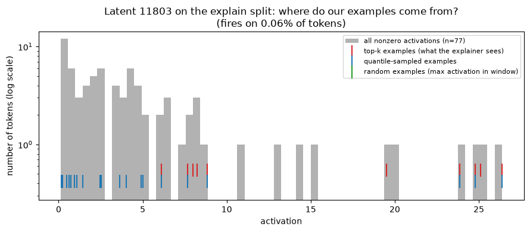
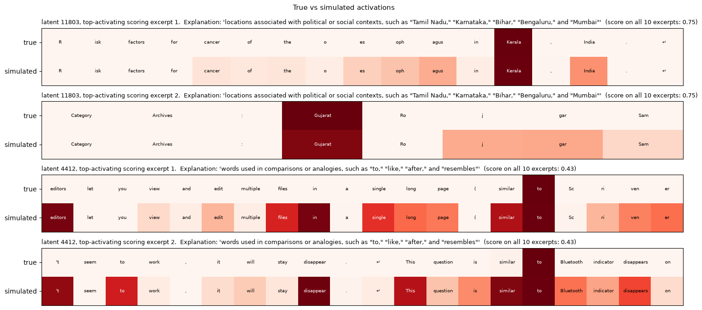
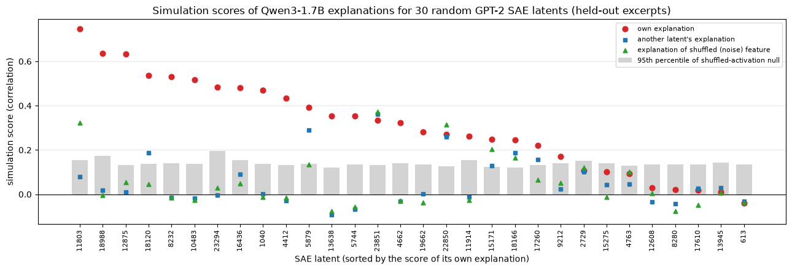
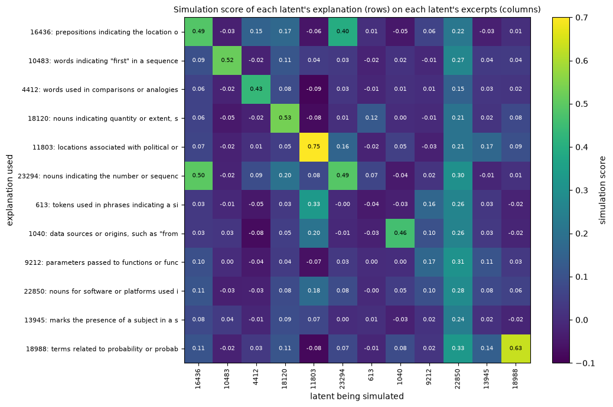
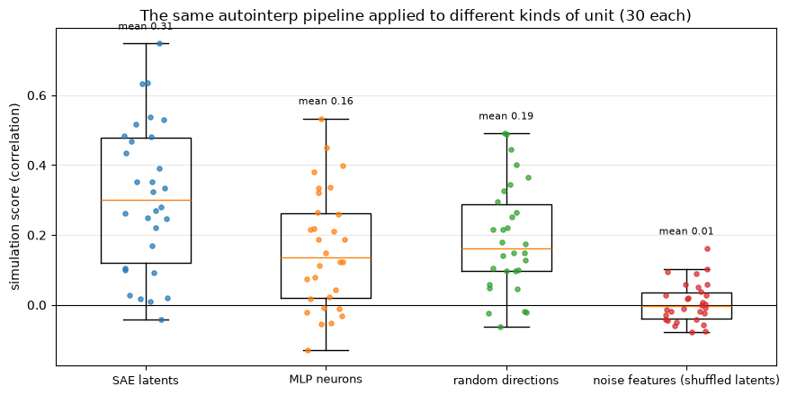
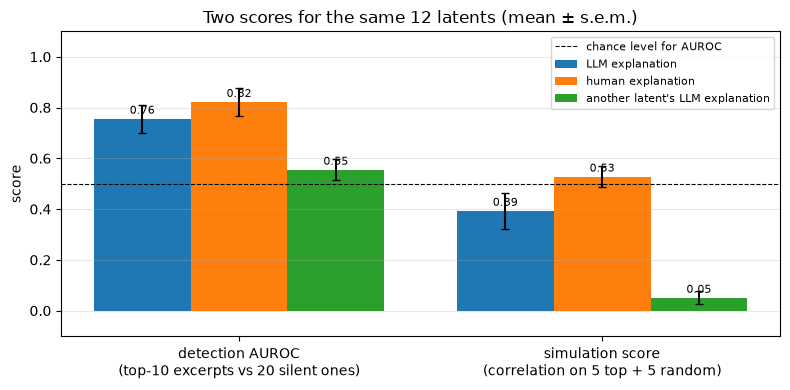
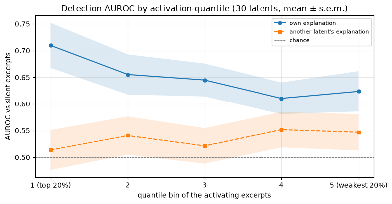
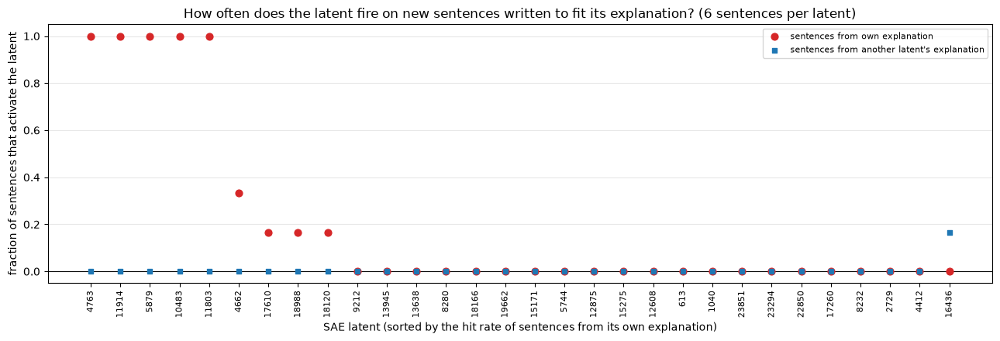
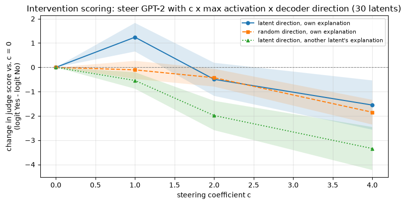
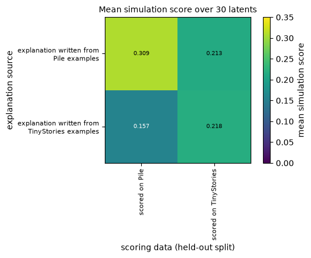

# [7.2] Feature Verbalizers


> **Colab: [exercises](https://colab.research.google.com/github/shinobiultra/ARENA_3.0_Extended/blob/main/chapter7_activation_to_language/exercises/part2_feature_verbalizers/7.2_Feature_Verbalizers_exercises.ipynb) |
> [solutions](https://colab.research.google.com/github/shinobiultra/ARENA_3.0_Extended/blob/main/chapter7_activation_to_language/exercises/part2_feature_verbalizers/7.2_Feature_Verbalizers_solutions.ipynb)**

If you want to change to dark mode, you can do this by clicking the three horizontal lines in the top-right, then navigating to Settings → Theme.


# Introduction


Here are the five excerpts, out of 2,000 documents from the Pile, on which latent 4412 of a sparse autoencoder on GPT-2 Small's residual stream fires most strongly. The token where
it fires is marked with `<< >>`:

```
 in Kohana framework's routing system you can set a route using something similar<< to>> a regular expression.
 so sorry if my question is irrelevant. I have two csv files similar<< to>> this that I want
 such as Seattle, Portland, and Tacoma have started with routes similar in length<< to>> the proposed for the
 process; the proteins and sequence of events that replicate animal genomes are remarkably similar<< to>> those that replicate yeast
 papilloma cases. This method has subsequent recurrence rates that are comparable<< to>> those
```

What does latent 4412 respond to? Take a moment to write down a one-line answer before reading on.

Here is what Qwen3-1.7B, a small chat model running on your own GPU, wrote after reading the ten strongest excerpts:

> words used in comparisons or analogies, such as "to," "like," "after," and "resembles"

And here is what we, the authors of this notebook, wrote:

> the word "to" directly after "similar"

Which is the better explanation? Ours looks cleaner, and the LLM's looks sloppy: "after"? "like"? But in section 3️⃣, when we measure how well each explanation lets a model
*predict* the latent's activations on new text, the LLM's explanation scores 0.43 and ours scores 0.26, because ours misses `comparable to` and `similar in length to`. Then in
section 5️⃣, when we ask the LLM to write sentences that fit its own explanation, it writes five similes with "like" and one comparison with "faster than", and the latent doesn't
fire on a single one of them. So is the LLM's explanation good or not? It depends on what you ask of it, and the job of this section is to make those questions precise.

This is the problem of **feature verbalization**, also called automated interpretability or "autointerp": turning an internal unit of a model into a natural-language description,
using a language model, and then checking the description. It has become a load-bearing part of interpretability research. Every SAE latent on Neuronpedia has an LLM-written
explanation; researchers look for "deception" or "refusal" features by searching those explanations; and papers report what fraction of a dictionary's latents are "interpretable"
based on automatic scores. All of that rests on the explanations being right, and on the scores measuring what we think they measure.

In this section you'll build the whole pipeline from scratch, with every model running locally:

- **Activation records**: computing a latent's activations over a dataset, and choosing which examples to show (1️⃣).
- **An explainer**: prompting a local LLM to write explanations, and seeing what it does with pure noise (2️⃣).
- **Simulation scoring** (Bills et al., 2023): an LLM predicts the latent's activations from the explanation alone, and we correlate its predictions with the truth (3️⃣).
- **Detection and fuzzing** (Paulo et al., 2024): cheaper yes/no scores, and what they can and can't see (4️⃣).
- **Stress tests**: explanation-generated counterexamples (Huang et al., 2023), steering-based intervention scoring, and the dataset illusion (Bolukbasi et al., 2021) (5️⃣).

The signature result is in section 3️⃣: the simulation score of the explanation of each of 30 randomly sampled latents, plotted next to three controls that should fail: another
latent's explanation, an explanation the explainer wrote for pure noise, and a permutation null. The real explanations average 0.31, against about 0.05 for both control
explanations, and 22 of the 30 clear the permutation null. You'll also see how LLM explanations compare with hand-written ones, and how SAE latents compare with MLP neurons and
random directions under exactly the same pipeline.

A word of warning about what to expect. The explainer and scorer here are a 1.7B-parameter model, tens to hundreds of times smaller than the models used in the papers. Its
explanations are often vague or subtly wrong, and as a judge it's weak. We've kept it because it makes everything transparent, local and fast (the whole notebook runs in about 7
minutes on one GPU), and because learning to tell "the explanation is bad" apart from "the scorer is bad" is exactly the skill this section is trying to teach.

This section assumes you've done [1.3.3] Interpretability with SAEs (SAELens, latent dashboards, steering, and a first look at autointerp using the OpenAI API), and that you're
comfortable with TransformerLens hooks. [7.1] isn't required, but we'll borrow the logit lens from it once.


## Content & Learning Objectives

### 1️⃣ Activation records

Everything an explainer knows about a feature comes from examples. You'll compute SAE latent activations over a few thousand documents, and implement the three ways of choosing
examples that the literature uses (top-activating, quantile-sampled and random), plus the `<< >>` highlighting format the explainer reads. You'll also see how small a slice of a
latent's behaviour its top examples actually cover.

> ##### Learning Objectives
>
> - Compute SAE latent activations for a whole dataset, and keep a held-out split for scoring
> - Implement top-k, quantile and random example sampling, and understand what each one is for
> - Format activation records the way autointerp pipelines present them to an LLM
> - See that top-activating examples come from the extreme tail of a latent's activations

### 2️⃣ Generating explanations

You'll load a small instruction-tuned LLM (Qwen3-1.7B) and use it as an **explainer**: it reads a latent's top examples and writes a one-line explanation. You'll build the prompt,
see how much the prompt format matters, and look critically at what comes out, including the explanations it confidently writes for pure noise.

> ##### Learning Objectives
>
> - Build a few-shot explainer prompt, and understand why each part of it is there
> - Generate explanations for 30 randomly chosen SAE latents with a local LLM
> - Recognise the typical failure modes of explanations (topic instead of token, descriptions too vague to tell latents apart, copying the prompt's format)
> - Build the "shuffled activations" control, and see that an explainer always produces *something*

### 3️⃣ Scoring by simulation

An explanation is only useful if it lets you *predict* the feature. Following Bills et al. (2023), you'll use the LLM as a **simulator** that reads only the explanation and
predicts the activation of every token, and score the explanation by the correlation between predicted and real activations. You'll implement this efficiently by reading the
simulator's probabilities over the digits 0-9 directly from its logits, and you'll check every score against controls: another latent's explanation, an explanation of noise, a
permutation null, hand-written explanations, MLP neurons and random directions.

> ##### Learning Objectives
>
> - Understand simulation scoring, and implement the "all at once" simulator with expected values over digit tokens
> - Score explanations on held-out data, and compare them against swapped-explanation and noise controls
> - Use a permutation null to decide whether a correlation is meaningful
> - Calibrate the score: how do LLM explanations compare with hand-written ones, and how do SAE latents compare with neurons and random directions?

### 4️⃣ Detection and fuzzing

Simulation needs one prediction per token. **Detection scoring** (Paulo et al., 2024) needs one yes/no judgement per excerpt, which is much cheaper. You'll implement it with an
AUROC, compare it with simulation on the same explanations, and use it to measure *where in the activation distribution* an explanation stops working. You'll also run **fuzzing**,
which tests whether an explanation picks out the right tokens, and see what a 1.7B judge can and can't do.

> ##### Learning Objectives
>
> - Implement detection scoring with yes/no logits and an AUROC, and understand why its chance level for a wrong explanation isn't 0.5
> - Compare detection and simulation scores on the same explanations
> - Measure detection accuracy as a function of activation quantile, and connect the drop-off to polysemanticity
> - Understand what fuzzing tests that detection can't, and recognise when a weak scorer is the bottleneck

### 5️⃣ Counterexamples, interventions and illusions

Scores computed on held-out examples from the same dataset are the easy test. You'll ask the explainer to *write new text* that its explanation says should activate the latent and
check whether it does (Huang et al., 2023); steer GPT-2 with the latent's decoder direction to see whether the explanation predicts what the latent *does* rather than what it
*reads*; and re-run the whole pipeline on children's stories to see explanations change with the dataset (Bolukbasi et al., 2021).

> ##### Learning Objectives
>
> - Generate explanation-based test inputs and measure how often the latent really fires on them
> - Implement steering-based intervention scoring with a random-direction control
> - Understand the difference between input-side and output-side descriptions of a feature
> - Demonstrate that an explanation can depend on the dataset its examples came from

### ☆ Bonus

Swapping in a stronger explainer, fuzzing, output-centric explanations, explaining from quantile samples, and further reading.


## Setup code


```python
import sys
from functools import partial
from pathlib import Path

import matplotlib.pyplot as plt
import pandas as pd
import torch as t
import torch.nn.functional as F
from IPython.display import display
from jaxtyping import Float, Int
from sae_lens import SAE
from torch import Tensor
from tqdm.auto import tqdm
from transformer_lens import HookedTransformer

device = t.device("mps" if t.backends.mps.is_available() else "cuda" if t.cuda.is_available() else "cpu")

# Make sure exercises are in the path
chapter = "chapter7_activation_to_language"
section = "part2_feature_verbalizers"
root_dir = next(p for p in [Path.cwd(), *Path.cwd().parents] if (p / chapter).exists())
exercises_dir = root_dir / chapter / "exercises"
section_dir = exercises_dir / section
if str(exercises_dir) not in sys.path:
    sys.path.append(str(exercises_dir))

import part2_feature_verbalizers.tests as tests
import part2_feature_verbalizers.utils as utils

pd.set_option("display.max_colwidth", 120)
pd.set_option("display.width", 250)

MAIN = __name__ == "__main__"
```


=== NEW CHAPTER ===


# 1️⃣ Activation records


> ##### Learning Objectives
>
> - Compute SAE latent activations for a whole dataset, and keep a held-out split for scoring
> - Implement top-k, quantile and random example sampling, and understand what each one is for
> - Format activation records the way autointerp pipelines present them to an LLM
> - See that top-activating examples come from the extreme tail of a latent's activations

## The model, the SAE and the data

We'll explain latents of the same sparse autoencoder you met in [1.3.3] Interpretability with SAEs: Joseph Bloom's `gpt2-small-res-jb` SAE on the residual stream of GPT-2 Small,
before block 7. It has 24,576 latents and was trained on OpenWebText. As a reminder, an SAE latent's activation on a residual stream vector $x$ is

$$
f_i(x) = \text{ReLU}\left((x - b_{dec}) \cdot W_{enc}[:, i] + b_{enc}[i]\right),
$$

and its decoder direction $W_{dec}[i]$ is the vector it writes back into the residual stream. Everything in this section treats latent $i$ as a black box with a scalar output per
token: the "feature" we want to put into words is the function $f_i$.

Let's load GPT-2 Small and the SAE.


```python
HOOK = "blocks.7.hook_resid_pre"  # the SAE's hook point (and where we steer, in section 5)
LAYER = 7
```


```python
model = HookedTransformer.from_pretrained("gpt2-small", device=device)
model.requires_grad_(False)

sae = SAE.from_pretrained("gpt2-small-res-jb", HOOK, device=str(device))
sae.requires_grad_(False)

print(f"SAE: {sae.cfg.d_in} -> {sae.cfg.d_sae} latents, hook = {sae.cfg.metadata.hook_name}")
```


For text, we'll use [NeelNanda/pile-10k](https://huggingface.co/datasets/NeelNanda/pile-10k), a 10,000-document sample of the Pile (web pages, GitHub code, PubMed abstracts, court opinions, Stack Exchange, ...). We take the first 64 tokens of 4,000 documents, and **split them in half**:

- `explain_tokens` (2,000 documents): the only text the explainer ever gets to see examples from;
- `score_tokens` (2,000 different documents): the only text we score explanations on.

This is the same idea as a train/test split. If we scored an explanation on the examples it was written from, we'd be testing whether the explainer can describe what it has just
seen, not whether its description generalises.


```python
tokens = utils.load_pile_tokens(model, n_sequences=4000, seq_len=64)
explain_tokens, score_tokens = tokens[:2000], tokens[2000:]
print(f"explain split: {tuple(explain_tokens.shape)}, score split: {tuple(score_tokens.shape)}")
print(repr(model.to_string(explain_tokens[0, 1:30])))
```


<details>
<summary>Expected output</summary>

<pre style="white-space:pre;overflow-x:auto;line-height:normal;font-family:Menlo,'DejaVu Sans Mono',consolas,'Courier New',monospace">explain split: (2000, 64), score split: (2000, 64)
'Q:\n\nHashing a string value to the interval [0; 1]\n\nI need to make hashing of pk values ('</pre>

</details>


### Exercise - implement `sae_latent_acts`

> ```yaml
> Difficulty: 🔴⚪⚪⚪⚪
> Importance: 🔵🔵⚪⚪⚪
>
> You should spend up to 5 minutes on this exercise.
> ```

We'll only ever look at a few dozen latents, so there's no need to compute all 24,576 of them. Implement `sae_latent_acts`, which applies the SAE encoder equation above to a
residual stream tensor of any shape `(..., d_model)`, but only for the latents in the list `latents`, returning a tensor of shape `(..., len(latents))`.

You'll need `sae.W_enc` (shape `(d_model, d_sae)`), `sae.b_enc` (shape `(d_sae,)`) and `sae.b_dec` (shape `(d_model,)`). The test compares your output with SAELens's own
`sae.encode`.


```python
def sae_latent_acts(resid: Float[Tensor, "... d_model"], sae: SAE, latents: list[int]) -> Float[Tensor, "... n_latents"]:
    """Activations of the chosen SAE latents: ReLU((resid - b_dec) @ W_enc[:, latents] + b_enc[latents])."""
    raise NotImplementedError()


tests.test_sae_latent_acts(sae_latent_acts, sae)
```


<details><summary>Solution</summary>

```python
def sae_latent_acts(resid: Float[Tensor, "... d_model"], sae: SAE, latents: list[int]) -> Float[Tensor, "... n_latents"]:
    """Activations of the chosen SAE latents: ReLU((resid - b_dec) @ W_enc[:, latents] + b_enc[latents])."""
    return F.relu((resid - sae.b_dec) @ sae.W_enc[:, latents] + sae.b_enc[latents])
```
</details>


### Exercise - implement `collect_activations`

> ```yaml
> Difficulty: 🔴🔴⚪⚪⚪
> Importance: 🔵🔵🔵⚪⚪
>
> You should spend up to 10 minutes on this exercise.
> ```

We'll want activations of several kinds of units in this section (SAE latents, MLP neurons, random directions), so let's write one function for all of them. `collect_activations`
should:

1. Split `tokens` (shape `(n_seq, seq)`) into batches of `batch_size` sequences.
2. Run the model on each batch, caching only the activation `hook_name` (use `names_filter`). Since we never need anything after that hook, also pass `stop_at_layer=layer + 1`, where `layer` is the block index in the hook name (e.g. 7 for `"blocks.7.hook_resid_pre"`). This makes the forward pass much cheaper.
3. Apply `act_fn` to the cached activation, which maps `(batch, seq, d)` to `(batch, seq, n_units)`.
4. Set the activations at position 0 to zero, convert to float32 and move them to the CPU.

and return the concatenation over batches, of shape `(n_seq, seq, n_units)`.

<details>
<summary>Why zero out position 0?</summary>

Position 0 is always the BOS token, `<|endoftext|>`. Its residual stream has a huge norm in GPT-2 (it acts as an "attention sink"), and many SAE latents and neurons have large,
meaningless activations there. It also isn't part of the text, so no explanation of the text could ever predict it. If we left it in, the top-activating examples of many latents
would just be "the start of a document".
</details>


```python
@t.inference_mode()
def collect_activations(
    model: HookedTransformer,
    tokens: Int[Tensor, "n_seq seq"],
    hook_name: str,
    act_fn,
    batch_size: int = 100,
) -> Float[Tensor, "n_seq seq n_units"]:
    """Runs the model on `tokens` in batches and returns act_fn(activation at hook_name), with position 0 zeroed."""
    raise NotImplementedError()


tests.test_collect_activations(collect_activations, model)
```


<details><summary>Solution</summary>

```python
@t.inference_mode()
def collect_activations(
    model: HookedTransformer,
    tokens: Int[Tensor, "n_seq seq"],
    hook_name: str,
    act_fn,
    batch_size: int = 100,
) -> Float[Tensor, "n_seq seq n_units"]:
    """Runs the model on `tokens` in batches and returns act_fn(activation at hook_name), with position 0 zeroed."""
    layer = int(hook_name.split(".")[1])
    out = []
    for batch in tokens.split(batch_size):
        _, cache = model.run_with_cache(batch.to(model.cfg.device), names_filter=hook_name, stop_at_layer=layer + 1)
        acts = act_fn(cache[hook_name]).float()
        acts[:, 0] = 0.0
        out.append(acts.cpu())
    return t.cat(out)
```
</details>


## Choosing which latents to explain

Which latents should we study? If we picked latents that look interesting, we'd be picking ones that are easy to explain, and all our scores would be flattering. Instead we'll take
a **random sample**, with one restriction: we only consider latents that fire on between 0.05% and 1% of tokens in our data.

- Below 0.05% (about 126 of our 252,000 non-BOS tokens), a latent fires so rarely that our 2,000-document score split contains only a handful of activating sequences (and for much rarer latents, none at all), so no score would be reliable.
- Above 1%, latents tend to be dense, generic "background" features, and they're also much more expensive to score properly. Papers often treat them separately.

This is a real choice which affects the numbers you'll see: our 30 latents are a random sample of *moderately sparse* latents, not of all latents. The cell below computes every
latent's firing frequency (we can't use `collect_activations` with all 24,576 latents, since that would be a 25GB tensor, so we count as we go) and samples 30 latents with a fixed
seed.


```python
with t.inference_mode():
    counts = t.zeros(sae.cfg.d_sae, device=device)
    for batch in tokens.split(100):
        _, cache = model.run_with_cache(batch.to(device), names_filter=HOOK, stop_at_layer=LAYER + 1)
        counts += (sae.encode(cache[HOOK])[:, 1:] > 0).float().sum((0, 1))
    density = (counts / (tokens.shape[0] * (tokens.shape[1] - 1))).cpu()

candidates = ((density > 5e-4) & (density < 1e-2)).nonzero().squeeze(-1)
LATENTS = candidates[t.randperm(len(candidates), generator=t.Generator().manual_seed(0))[:30]].tolist()
N_LATENTS = len(LATENTS)

print(f"{(density == 0).sum()} latents never fire, {len(candidates)} have density in [0.05%, 1%]")
print(f"Our {N_LATENTS} latents: {LATENTS}")
```


<details>
<summary>Expected output</summary>

<pre style="white-space:pre;overflow-x:auto;line-height:normal;font-family:Menlo,'DejaVu Sans Mono',consolas,'Courier New',monospace">9 latents never fire, 14677 have density in [0.05%, 1%]
Our 30 latents: [16436, 10483, 4412, 2729, 5879, 8232, 18120, 17260, 18988, 23851, 11803, 23294, 613, 11914, 22850, 1040, 19662, 15171, 5744, 12875, 15275, 12608, 4662, 9212, 13945, 17610, 8280, 18166, 4763, 13638]</pre>

</details>

Now we can compute activations of these 30 latents on both splits. Each result has shape `(2000, 64, 30)`, which is small enough to keep on the CPU.


```python
latent_fn = partial(sae_latent_acts, sae=sae, latents=LATENTS)
explain_acts = collect_activations(model, explain_tokens, HOOK, latent_fn)
score_acts = collect_activations(model, score_tokens, HOOK, latent_fn)
print(explain_acts.shape, score_acts.shape)
```


## Activation records and examples

Bills et al. (2023) call the basic unit of evidence an **activation record**: a short excerpt of text together with the unit's activation on every token of it. Our examples will be
windows of up to 20 tokens: the 15 tokens before a chosen position, the position itself, and the 4 tokens after it (clipped to the sequence, and never including the BOS token).
We'll represent an example by the pair `(sequence index, position)`, and use the helpers below to turn it into tokens and activations.

Showing 15 tokens of left context but only 4 of right context isn't arbitrary. GPT-2 is a causal model, so a latent's activation at position $i$ depends only on tokens $\le i$: the
left context is what can *cause* the activation. A little right context helps a human (or an LLM) read the excerpt, but can't have influenced the latent.


```python
WINDOW_BEFORE, WINDOW_AFTER = 15, 4


def window_bounds(pos: int, seq_len: int) -> tuple[int, int]:
    """The [start, end) token range of the example window centred on `pos` (never including BOS)."""
    return max(1, pos - WINDOW_BEFORE), min(seq_len, pos + WINDOW_AFTER + 1)


def get_window(
    model: HookedTransformer, tokens: Int[Tensor, "n_seq seq"], acts: Float[Tensor, "n_seq seq"], seq: int, pos: int
) -> tuple[list[str], Float[Tensor, " n_tok"]]:
    """Returns the string tokens and the activations of the example window centred on (seq, pos)."""
    start, end = window_bounds(pos, tokens.shape[1])
    return [model.to_string(tok) for tok in tokens[seq, start:end]], acts[seq, start:end]
```


### Exercise - implement `top_activating_examples`

> ```yaml
> Difficulty: 🔴🔴⚪⚪⚪
> Importance: 🔵🔵🔵🔵⚪
>
> You should spend up to 10 minutes on this exercise.
> ```

The classic way to find out what a unit does is to look at the inputs that activate it most. Implement `top_activating_examples`, which takes one unit's activations `acts` of shape
`(n_seq, seq)` and returns the `k` examples with the largest activation, as a list of `(seq, pos)` pairs of Python ints, in decreasing order of activation.

Take **at most one example per sequence** (the position of that sequence's maximum activation), and only include sequences where the unit fires at all (maximum activation > 0), so
you may return fewer than `k` examples.

<details>
<summary>Why one example per sequence?</summary>

Latents often fire on several neighbouring tokens, or several times in one document. If we took the top-k *tokens*, we'd often get the same excerpt several times, shifted by a
token or two, and the explainer would see far fewer distinct contexts than we think. Taking the maximum within each sequence is a simple way to get distinct examples.
</details>


```python
def top_activating_examples(acts: Float[Tensor, "n_seq seq"], k: int) -> list[tuple[int, int]]:
    """The (seq, pos) of the max activation in each of the k sequences with the largest max activation (> 0)."""
    raise NotImplementedError()


tests.test_top_activating_examples(top_activating_examples)
```


<details><summary>Solution</summary>

```python
def top_activating_examples(acts: Float[Tensor, "n_seq seq"], k: int) -> list[tuple[int, int]]:
    """The (seq, pos) of the max activation in each of the k sequences with the largest max activation (> 0)."""
    max_acts, max_pos = acts.max(dim=-1)
    order = t.argsort(max_acts, descending=True, stable=True)[:k]
    return [(int(seq), int(max_pos[seq])) for seq in order if max_acts[seq] > 0]
```
</details>


### Exercise - implement `random_examples` and `quantile_examples`

> ```yaml
> Difficulty: 🔴🔴⚪⚪⚪
> Importance: 🔵🔵🔵⚪⚪
>
> You should spend up to 10-15 minutes on this exercise.
> ```

Top examples tell you what a unit does when it's *most* active. To score an explanation we'll also need two other kinds of example:

- **Random examples**: a random sequence and a random position in it. For a sparse latent, almost all of these won't activate at all, which is the point: a good explanation should predict that the latent is silent on ordinary text. Choose positions uniformly between `WINDOW_BEFORE + 1` and `seq - WINDOW_AFTER - 1` inclusive, so every window has its full size. Draw the `k` sequence indices first (one call to `t.randint`), then the `k` positions (a second call), using `generator` for both.
- **Quantile examples** (Paulo et al., 2024): sort all the sequences where the unit fires (max activation > 0) by their max activation, split them into `n_bins` equal-sized bins (highest activations first; `Tensor.tensor_split` does this), and sample `k_per_bin` distinct sequences from each bin (use `t.randperm(len(bin), generator=generator)`). Each example is centred on its sequence's max position. This lets us ask whether an explanation also holds for *moderate* activations, not just the extreme ones.


```python
def random_examples(acts: Float[Tensor, "n_seq seq"], k: int, generator: t.Generator) -> list[tuple[int, int]]:
    """k random (seq, pos) pairs, with positions chosen so that the example window is never clipped."""
    raise NotImplementedError()


def quantile_examples(
    acts: Float[Tensor, "n_seq seq"], n_bins: int, k_per_bin: int, generator: t.Generator
) -> list[list[tuple[int, int]]]:
    """
    Splits the activating sequences (sorted by max activation, highest first) into n_bins equal bins, and returns
    k_per_bin random examples (seq, max position) from each bin.
    """
    raise NotImplementedError()


tests.test_random_examples(random_examples, WINDOW_BEFORE, WINDOW_AFTER)
tests.test_quantile_examples(quantile_examples)
```


<details><summary>Solution</summary>

```python
def random_examples(acts: Float[Tensor, "n_seq seq"], k: int, generator: t.Generator) -> list[tuple[int, int]]:
    """k random (seq, pos) pairs, with positions chosen so that the example window is never clipped."""
    n_seq, seq_len = acts.shape
    seqs = t.randint(0, n_seq, (k,), generator=generator)
    positions = t.randint(WINDOW_BEFORE + 1, seq_len - WINDOW_AFTER, (k,), generator=generator)
    return list(zip(seqs.tolist(), positions.tolist()))


def quantile_examples(
    acts: Float[Tensor, "n_seq seq"], n_bins: int, k_per_bin: int, generator: t.Generator
) -> list[list[tuple[int, int]]]:
    """
    Splits the activating sequences (sorted by max activation, highest first) into n_bins equal bins, and returns
    k_per_bin random examples (seq, max position) from each bin.
    """
    max_acts, max_pos = acts.max(dim=-1)
    active = (max_acts > 0).nonzero().squeeze(-1)
    active = active[t.argsort(max_acts[active], descending=True, stable=True)]
    bins = []
    for bin_seqs in active.tensor_split(n_bins):
        chosen = bin_seqs[t.randperm(len(bin_seqs), generator=generator)[:k_per_bin]]
        bins.append([(int(seq), int(max_pos[seq])) for seq in chosen])
    return bins
```
</details>


### Exercise - implement `format_example`

> ```yaml
> Difficulty: 🔴⚪⚪⚪⚪
> Importance: 🔵🔵🔵⚪⚪
>
> You should spend up to 5-10 minutes on this exercise.
> ```

LLMs read text, not tensors, so we need to show them where in an excerpt a unit is active. We'll use the format from [1.3.3] (and the EleutherAI autointerp library): wrap every
token whose activation is above `threshold` in `<< >>`, merging consecutive highlighted tokens into one span, and replace newlines with `↵` so that each example fits on one line.
For example, with a threshold of 1:

```
tokens:      "The"  " capital"  " of"  " France"  " is"  "\n"  " Paris"
activations:  0.0     0.5        2.0    3.0        0.0    0.0    1.5
output:      "The capital<< of France>> is↵<< Paris>>"
```

(Note that the leading space of `" of"` ends up inside the brackets. That's deliberate: it tells the reader exactly which token fired.)


```python
def format_example(str_toks: list[str], acts: Float[Tensor, " n_tok"], threshold: float) -> str:
    """Joins the tokens, wrapping each run of tokens with activation > threshold in << >>, and replacing \\n by ↵."""
    raise NotImplementedError()


tests.test_format_example(format_example)
```


<details>
<summary>Hint</summary>

Build the string token by token, wrapping highlighted tokens individually, e.g. `"<< of>><< France>>"`. Then replace every `">><<"` with the empty string, which merges neighbouring
highlights.
</details>


<details><summary>Solution</summary>

```python
def format_example(str_toks: list[str], acts: Float[Tensor, " n_tok"], threshold: float) -> str:
    """Joins the tokens, wrapping each run of tokens with activation > threshold in << >>, and replacing \\n by ↵."""
    text = "".join(f"<<{tok}>>" if act > threshold else tok for tok, act in zip(str_toks, acts.tolist()))
    return text.replace(">><<", "").replace("\n", "↵")
```
</details>


## What does the explainer get to see?

Let's put these together and look at one latent properly. Latent 11803 is one of our 30 (it was drawn at random like the others). Here are its top 10 examples on the explain split,
highlighted at 25% of its maximum activation, followed by 5 examples from a lower activation quantile and 5 random examples.


```python
def show_examples(acts: Float[Tensor, "n_seq seq"], tokens: Int[Tensor, "n_seq seq"], examples: list[tuple[int, int]], threshold: float):
    for seq, pos in examples:
        str_toks, window_acts = get_window(model, tokens, acts, seq, pos)
        print(f"  {window_acts.max().item():5.1f} | {format_example(str_toks, window_acts, threshold)}")


FOCUS = LATENTS.index(11803)
focus_acts = explain_acts[..., FOCUS]
focus_threshold = 0.25 * focus_acts.max().item()
gen = t.Generator().manual_seed(0)
focus_top = top_activating_examples(focus_acts, 10)
focus_quantile = quantile_examples(focus_acts, n_bins=5, k_per_bin=5, generator=gen)
focus_random = random_examples(focus_acts, 5, gen)

n_active = (focus_acts.max(dim=-1).values > 0).sum().item()
print(f"Latent 11803 fires on {(focus_acts[:, 1:] > 0).sum()} tokens, in {n_active} of {len(focus_acts)} explain-split sequences\n")
print("Top 10 examples (max activation in window | excerpt):")
show_examples(focus_acts, explain_tokens, focus_top, focus_threshold)
print("\n5 examples from the 3rd of 5 quantile bins:")
show_examples(focus_acts, explain_tokens, focus_quantile[2], focus_threshold)
print("\n5 random examples:")
show_examples(focus_acts, explain_tokens, focus_random, focus_threshold)
```


<details>
<summary>Expected output</summary>

<pre style="white-space:pre;overflow-x:auto;line-height:normal;font-family:Menlo,'DejaVu Sans Mono',consolas,'Courier New',monospace">Latent 11803 fires on 77 tokens, in 39 of 2000 explain-split sequences

Top 10 examples (max activation in window | excerpt):
   26.4 |  was no going back on the party's decision to boycott the April 13&lt;&lt; Tamil Nadu&gt;&gt; Assembly
   25.1 | Belgaum:&lt;&lt; Karnataka&gt;&gt; Janatha Paksha
   24.8 |  (born 9 February 1954) is an Indian Politician and President of&lt;&lt; Punjab Pradesh&gt;&gt; Congress Committee. Elect
   23.8 | , one particular variety is selling the most in the capital of poll-bound&lt;&lt; Bihar&gt;&gt;.↵↵Shop
   19.5 |  are scheduled to play two T20Is in Vishakhapatnam and&lt;&lt; Bengaluru&gt;&gt; on February
    8.9 | Marginal improvement in Ass&lt;&lt;am&gt;&gt; situation↵↵Last
    8.3 | ↵↵Destination↵↵Day Wise Plan↵↵Day 01 Arrive&lt;&lt; Mumbai&gt;&gt;↵↵First Day
    8.0 | Del&lt;&lt;hi&gt;&gt; Sikh Gurdwar
    7.7 |  Hazra Pukur (now Jatin Das Park) in Kolk&lt;&lt;ata&gt;&gt;, India. At
    6.1 | Goniothalamus monosper

5 examples from the 3rd of 5 quantile bins:
    2.2 |  in domestic T20, Saeed Ajmal mulls retirement↵↵Karachi: Failing to
    2.5 | ↵Microsoft Accelerates HoloLens V
    2.7 | ' Sheena probe↵↵READ ALSO:↵↵In hurried move, CM upgraded CP post to
    4.0 |  capacity of chymotrypsin inhibition.↵The primary structure of barley grain serpin BS
    2.5 |  that the Land and Environment Court's decision to block a coal mine in his electorate reflected an "ide

5 random examples:
    0.0 |  of great articles, magnificent poetry, and if you need an audio alternative, I��ve got
    0.0 |  "In August 1999 a film crew visited Yamato again" "at latitude N 30.43/ long
    0.0 |  transmembrane glycoprotein (P-gp) which functions as a drug efflux pump
    0.0 |  Morse turned in Monday more than twice the number of signatures required to force a special election, possibly setting
    0.0 |  iron cross tattoo. Many tattoo crosses can have a clutter and other images mixed up with them but I</pre>

</details>

The top five examples are unmistakable: `Tamil Nadu`, `Karnataka`, `Punjab Pradesh`, `Bihar`, `Bengaluru`, all Indian states or cities, with activations between 19 and 26. Below
them, the activations drop to 6-9, on fragments of Indian place names (Ass*am*, Del*hi*, Kolk*ata*) and `Mumbai`. (The 10th example has no highlight: its maximum, 6.1, is just
below our 25%-of-max highlighting threshold.)

The middle quantile bin tells a different story. These are activations of 2-4 (too weak to be highlighted), in excerpts about Karachi, Microsoft's HoloLens, a chief minister
("CM"), a barley protein and an Australian court. Some of these are plausibly related to South Asian politics, others not obviously at all. And the latent fires in only 39 of the
2,000 explain-split sequences, so "the top 10" is already a quarter of all the sequences where it fires.


Now let's see where these examples sit in the latent's overall activation distribution. The histogram below shows every nonzero activation of latent 11803 on the explain split,
with tick marks for the activations of the top-10 examples (red), 4 examples from each of 5 quantile bins (blue), and 10 random examples (green; most random windows have zero
activation, so you'll see few green ticks).


```python
window_max = lambda examples: [get_window(model, explain_tokens, focus_acts, s, p)[1].max().item() for s, p in examples]
utils.plot_activation_distribution(
    focus_acts,
    top_values=window_max(focus_top),
    quantile_values=window_max([ex for b in quantile_examples(focus_acts, 5, 4, gen) for ex in b]),
    random_values=[v for v in window_max(random_examples(focus_acts, 10, gen)) if v > 0],
    title="Latent 11803 on the explain split: where do our examples come from?",
)
```





<details>
<summary>Help - how should I interpret this plot?</summary>

Latent 11803 has 77 nonzero activations in the explain split, and most of them are small: the bulk of the histogram is below 5. The top-10 examples (red) include the five largest
activations in the whole split (19-26), which sit far out in a sparse right tail, plus five more between 6 and 9. The quantile samples (blue) are spread across the whole range,
mostly at low values. None of the 10 random examples (green) contains an activating token, which is what you'd expect for a latent that fires on 0.06% of tokens.

So the explainer sees the far tail. That's often what you want, since it's where a latent's behaviour is clearest. But it means the explanation will describe the latent's
*strongest* behaviour, and whether it also describes the weak activations (which are most of the time the latent is on) is a separate question, which we'll test in section 4️⃣.
</details>


## Summary of 1️⃣

- An explainer only ever sees a handful of activation records: short excerpts, with the active tokens highlighted.
- Which records we choose is a design decision with consequences. Top-k examples are vivid but come from the extreme tail of the distribution; quantile examples cover the rest of the activating range; random examples show what "off" looks like.
- We keep two disjoint splits of the data, one to write explanations from and one to score them on.

In the next section we'll hand the top-10 records to an LLM and ask it what the latent does.


=== NEW CHAPTER ===


# 2️⃣ Generating explanations


> ##### Learning Objectives
>
> - Build a few-shot explainer prompt, and understand why each part of it is there
> - Generate explanations for 30 randomly chosen SAE latents with a local LLM
> - Recognise the typical failure modes of explanations (topic instead of token, descriptions too vague to tell latents apart, copying the prompt's format)
> - Build the "shuffled activations" control, and see that an explainer always produces *something*

## The explainer

Our explainer is [Qwen3-1.7B](https://huggingface.co/Qwen/Qwen3-1.7B), a small open-weights chat model. In bfloat16 it needs about 3.5GB of GPU memory, so it fits alongside GPT-2 on most GPUs. Qwen3 models can "think" before answering; we turn this off, so the model answers directly (`utils.chat_prompt` handles this).

This is a *much* weaker explainer than the ones used in the papers we're following (GPT-4 in Bills et al., Llama-3.1-70B in Paulo et al.). That's on purpose: everything in this
notebook runs locally in a few minutes, and you can see every logit the explainer produces, which we'll need for scoring. It also means the explanations will often be poor, and
measuring *how* poor is a big part of what this section is about.

<details>
<summary>Using a different explainer (including API models)</summary>

`EXPLAINER_NAME` can be any HuggingFace chat model with a chat template. Some that fit in a few GB and that we've tried:

- `"HuggingFaceTB/SmolLM2-360M-Instruct"` (0.7GB): the smallest and fastest option. We haven't evaluated it carefully, so try it and see.
- `"google/gemma-3-1b-it"` (2GB): in a quick test while developing this notebook (with an earlier, simpler prompt), it tended to describe the *unhighlighted* words in the excerpts.
- `"Qwen/Qwen3-1.7B"` (3.5GB): clearly better than gemma-3-1b-it in the same test, and what we use below.

The explainer only needs to generate text, so you can also use an API model (e.g. via the `openai` or `anthropic` client) for **generating** explanations: replace the call to
`utils.generate_chat` in `explain_units` with an API call that takes the same messages. The **simulator** in section 3️⃣ is different: it reads the model's probabilities over the
digits 0-9, so it needs either a local model or an API that returns token log-probabilities. A common setup is a strong API model as the explainer and a local model as the
simulator. If you do this, remember that the scores then measure the *pair*.
</details>


```python
EXPLAINER_NAME = "Qwen/Qwen3-1.7B"
explainer_tok, explainer = utils.load_explainer(EXPLAINER_NAME, device)
print(f"Loaded {EXPLAINER_NAME}: {sum(p.numel() for p in explainer.parameters()) / 1e9:.2f}B parameters")
```


## The explainer prompt

Our prompt has four parts, following Bills et al. and the EleutherAI pipeline:

1. A **system prompt** describing the task: excerpts, `<< >>` highlights, and the format of the answer. It explicitly tells the model to focus on the *marked tokens* rather than the topic of the excerpts.
2. A **few-shot example**: a toy "feature" that fires on shop words, and the explanation we'd want for it. Small models copy the format and the level of specificity of few-shot answers very closely.
3. The **excerpts**, numbered, one per line.
4. A **list of the marked tokens** (the token at the maximum of each example).

The last part deserves a comment. Without it, the small models we tried mostly described the *topic* of the excerpts rather than the highlighted tokens. Listing the marked tokens a
second time, in isolation, makes them hard to ignore. You'll see the difference for yourself after the next exercise.


```python
EXPLAINER_SYSTEM = (
    "You are an interpretability researcher studying features in a language model. You will see text excerpts where "
    "a feature is active. The tokens where the feature is active are marked with << >>. Your job is to explain what "
    "the feature responds to, in one short phrase.\n\n"
    "Focus on the MARKED tokens, not on the general topic of the excerpts. Ask yourself: what do the marked tokens "
    "have in common? Often a feature fires on one particular word (e.g. 'the word \"however\"'), on a kind of word "
    "(e.g. 'names of cities'), or on a word in a particular context (e.g. '\"bank\" meaning the side of a river'). "
    "Answer with the phrase only, at most 15 words."
)
FEWSHOT_EXAMPLES = [
    "I went to the<< store>> yesterday and",
    "the nearest<< supermarket>> is closed",
    "buy it at the local<< shop>>, she said",
]
FEWSHOT_MARKED = ["store", "supermarket", "shop"]
FEWSHOT_EXPLANATION = 'nouns for places where you buy things, such as "store" and "shop"'
```


### Exercise - implement `build_explainer_messages`

> ```yaml
> Difficulty: 🔴🔴⚪⚪⚪
> Importance: 🔵🔵🔵⚪⚪
>
> You should spend up to 10 minutes on this exercise.
> ```

Implement `build_explainer_messages`, which returns a chat conversation (a list of `{"role": ..., "content": ...}` dicts) with four messages:

1. `system`: `EXPLAINER_SYSTEM`
2. `user`: the few-shot excerpts and marked tokens
3. `assistant`: `FEWSHOT_EXPLANATION`
4. `user`: the real excerpts and marked tokens

Both user messages should have exactly the same format:

```
Excerpts:
1. I went to the<< store>> yesterday and
2. the nearest<< supermarket>> is closed
3. buy it at the local<< shop>>, she said
Marked tokens: store, supermarket, shop
```


```python
def build_explainer_messages(examples: list[str], marked_tokens: list[str]) -> list[dict[str, str]]:
    """The explainer conversation: system prompt, one few-shot example, then the real excerpts."""
    raise NotImplementedError()


tests.test_build_explainer_messages(build_explainer_messages)
```


<details><summary>Solution</summary>

```python
def build_explainer_messages(examples: list[str], marked_tokens: list[str]) -> list[dict[str, str]]:
    """The explainer conversation: system prompt, one few-shot example, then the real excerpts."""
    def query(examples: list[str], marked_tokens: list[str]) -> str:
        lines = [f"{i + 1}. {example}" for i, example in enumerate(examples)]
        return "Excerpts:\n" + "\n".join(lines) + "\nMarked tokens: " + ", ".join(marked_tokens)

    return [
        {"role": "system", "content": EXPLAINER_SYSTEM},
        {"role": "user", "content": query(FEWSHOT_EXAMPLES, FEWSHOT_MARKED)},
        {"role": "assistant", "content": FEWSHOT_EXPLANATION},
        {"role": "user", "content": query(examples, marked_tokens)},
    ]
```
</details>


### Exercise - implement `explain_units`

> ```yaml
> Difficulty: 🔴🔴⚪⚪⚪
> Importance: 🔵🔵🔵🔵⚪
>
> You should spend up to 15 minutes on this exercise.
> ```

Now put the pieces together. For each unit `j` (i.e. `acts[..., j]`), `explain_units` should:

1. Find its top `k` examples with `top_activating_examples`.
2. Format each example window with `format_example`, using a threshold of `threshold_frac` times the unit's maximum activation (over all of `acts[..., j]`).
3. Collect the marked tokens: the token at each example's centre position, with newlines replaced by `↵` and surrounding whitespace stripped.
4. Build the conversation with `build_explainer_messages`.

Then generate replies for all the units at once with `utils.generate_chat(tokenizer, llm, conversations, max_new_tokens=40)` (which batches the generation for you), and return the
cleaned-up explanations, using `clean_explanation` (written for you) on each reply.


```python
def clean_explanation(reply: str) -> str:
    """Keeps the first line of the reply, without surrounding quotes or a final full stop."""
    line = reply.strip().split("\n")[0].strip()
    if len(line) > 1 and line[0] == line[-1] == '"':
        line = line[1:-1].strip()
    return line.rstrip(".").strip()


def explain_units(
    model: HookedTransformer,
    tokens: Int[Tensor, "n_seq seq"],
    acts: Float[Tensor, "n_seq seq n_units"],
    tokenizer,
    llm,
    k: int = 10,
    threshold_frac: float = 0.25,
) -> list[str]:
    """One explanation per unit, written by `llm` from the unit's top-k examples in `tokens`."""
    raise NotImplementedError()
```


<details><summary>Solution</summary>

```python
def clean_explanation(reply: str) -> str:
    """Keeps the first line of the reply, without surrounding quotes or a final full stop."""
    line = reply.strip().split("\n")[0].strip()
    if len(line) > 1 and line[0] == line[-1] == '"':
        line = line[1:-1].strip()
    return line.rstrip(".").strip()


def explain_units(
    model: HookedTransformer,
    tokens: Int[Tensor, "n_seq seq"],
    acts: Float[Tensor, "n_seq seq n_units"],
    tokenizer,
    llm,
    k: int = 10,
    threshold_frac: float = 0.25,
) -> list[str]:
    """One explanation per unit, written by `llm` from the unit's top-k examples in `tokens`."""
    conversations = []
    for j in range(acts.shape[-1]):
        unit_acts = acts[..., j]
        threshold = threshold_frac * unit_acts.max().item()
        examples, marked = [], []
        for seq, pos in top_activating_examples(unit_acts, k):
            str_toks, window_acts = get_window(model, tokens, unit_acts, seq, pos)
            examples.append(format_example(str_toks, window_acts, threshold))
            marked.append(model.to_string(tokens[seq, pos]).replace("\n", "↵").strip())
        conversations.append(build_explainer_messages(examples, marked))
    replies = utils.generate_chat(tokenizer, llm, conversations, max_new_tokens=40)
    return [clean_explanation(reply) for reply in replies]
```
</details>


Let's explain all 30 latents. This takes a few seconds on a GPU.


```python
explanations = explain_units(model, explain_tokens, explain_acts, explainer_tok, explainer)

top_example_text = []
for j in range(N_LATENTS):
    seq, pos = top_activating_examples(explain_acts[..., j], 1)[0]
    str_toks, window_acts = get_window(model, explain_tokens, explain_acts[..., j], seq, pos)
    top_example_text.append(format_example(str_toks, window_acts, 0.25 * explain_acts[..., j].max().item()))

for latent, explanation, example in zip(LATENTS, explanations, top_example_text):
    print(f"{latent:>5}  {explanation}")
    print(f"{'':>5}    strongest example: {example}")
```


<details>
<summary>Expected output</summary>

<pre style="white-space:pre;overflow-x:auto;line-height:normal;font-family:Menlo,'DejaVu Sans Mono',consolas,'Courier New',monospace">16436  prepositions indicating the location or context of the following words, such as "of" and "OF"
         strongest example: Chart&lt;&lt; of the&gt;&gt; day: How
10483  words indicating "first" in a sequence or context
         strongest example: onicotinoids and honeybee colony losses↵↵A new study provides the&lt;&lt; first&gt;&gt; evidence of a link
 4412  words used in comparisons or analogies, such as "to," "like," "after," and "resembles"
         strongest example:  in Kohana framework's routing system you can set a route using something similar&lt;&lt; to&gt;&gt; a regular expression.
 2729  nouns indicating actions or states in software or technical contexts
         strongest example: Q:↵↵RowStyles and Rows doesn't&lt;&lt; match&gt;&gt; in TableLayoutPanel
 5879  nouns related to sensory experiences or emotional states
         strongest example:  "Cloud&lt;&lt;s shroud a night with a waning moon&gt;&gt;Nqu&lt;&lt;ivering in the haze&gt;&gt;" "A&lt;&lt; cruel&gt;&gt;
 8232  tokens indicating punctuation or separation
         strongest example: �s 4 years in office, only 10 of his nominees have been blocked&lt;&lt;.&gt;&gt;↵↵There�
18120  nouns indicating quantity or extent, such as "lot," "many," and "good"
         strongest example:  that's exactly what it is today!↵↵To say there is a&lt;&lt; lot&gt;&gt; going on in the
17260  media outlets and mainstream media &lt;&lt; has &gt;&gt;
         strongest example:  of the Trayvon Martin shooting and its aftermath one fact stands clear: the press&lt;&lt; has no&gt;&gt; frickin
18988  terms related to probability or probability testing, such as "prob" and "EB"
         strongest example: , t: 2, a: 5, c: 3}. What is&lt;&lt; prob&gt;&gt; of picking 4 a
23851  time indicators and specific terms related to gaming and technology
         strongest example:  in IPN, therefore your&lt;&lt; payment&gt;&gt; might be confirmed immediately or up to 24&lt;&lt; hours&gt;&gt; later after the order
11803  locations associated with political or social contexts, such as "Tamil Nadu," "Karnataka," "Bihar," "Bengaluru," and "Mumbai"
         strongest example:  was no going back on the party's decision to boycott the April 13&lt;&lt; Tamil Nadu&gt;&gt; Assembly
23294  nouns indicating the number or sequence of something, such as "of" in "round of the FA Cup" and "of" in "row of images"
         strongest example:  software developer Nextance has raised $10.6 million in a third round&lt;&lt; of&gt;&gt; funding led by venture
  613  tokens used in phrases indicating a single entity or item
         strongest example:  dashboard↵↵Pivotal Data About Your Dispensary, All In&lt;&lt; One&gt;&gt; Place.↵↵
11914  words indicating degree or intensity, such as "really" and "purely"
         strongest example:  year at NYGH neatly bisects, with the two halves marked by&lt;&lt; decidedly&gt;&gt; different challenges. The
22850  nouns for software or platforms used in programming and computing
         strongest example:  system on my website. I've implemented a couple of providers (Google and&lt;&lt; Facebook&gt;&gt;) and, during
 1040  data sources or origins, such as "from" in the marked tokens
         strongest example:  characteristics in the Republic and Northern Ireland. Multivariate analyses were performed using data&lt;&lt; from&gt;&gt; population-based surveys
19662  nouns indicating a fall or decline, such as "falling," "under," "into," "over," "for," "to," "ow," "of," "by"
         strongest example:  tendency to lean on companies, and their tendency (so far) to fall&lt;&lt; over themselves&gt;&gt; to suck his
15171  tokens that appear in mathematical expressions
         strongest example: &lt;&lt;","p^*","s^*","sh^*","t^*&gt;&gt;
 5744  nouns indicating "a" as a determiner, often used in descriptions of things or concepts
         strongest example: ↵↵This is&lt;&lt; a&gt;&gt; class B amplifier: -↵↵Your circuit is&lt;&lt; a&gt;&gt; class AB amplifier:
12875  symbols indicating line breaks
         strongest example: Gordhan said the first scenario was if no load shedding was implemented.&lt;&lt;↵↵&gt;&gt;��In
15275  prepositions indicating location or context, such as "in" and "by"
         strongest example: year-old Kimberly L. Collett was last seen on Feb. 27&lt;&lt; in&gt;&gt; Manchester.↵↵
12608  nouns indicating quantities or amounts in sports and games
         strongest example:  1907 – 23 October 1989) was an Australian cricketer who played&lt;&lt; a single first&gt;&gt;-&lt;&lt;class match&gt;&gt;
 4662  nouns indicating the state or process of something happening, such as "underway," "ailing," "failing," "began," "continued," "resumed," "continues"
         strongest example:  show appears to be paddling in the wrong direction as its fifth season gets&lt;&lt; underway&gt;&gt;.↵↵C
 9212  parameters passed to functions or functions with parameters
         strongest example: ↵↵Perl GetOptions Function↵↵My Perl Script retrieves the&lt;&lt; argument&gt;&gt; in the below way
13945  marks the presence of a subject in a sentence, indicating a predicate or state
         strongest example: www.flotcharts.org to create a realtime chart that&lt;&lt; is&gt;&gt; updated via aj
17610  nouns indicating actions or topics discussed in text
         strongest example: URE↵↵Amanda Marcotte, writing at Slate magazine,&lt;&lt; makes a compelling case for&gt;&gt; movie script
 8280  nouns related to things or facts that are important or notable
         strongest example:  and developers online, I've come up with a short list of a few&lt;&lt; things&gt;&gt;
18166  tokens that appear in usernames or citations
         strongest example:  The post 3 Easy Steps to Make Your Content Work Harder by @&lt;&lt;LWilson1980&gt;&gt; a... http
 4763  tokens indicating changes or modifications in text
         strongest example: :↵The SSD Announcement email list is now available.↵Major changes&lt;&lt; are coming in&gt;&gt; the near
13638  points indicating end of sentences or punctuation
         strongest example:  feces with a frequency varying from a few times daily to a few times weekly&lt;&lt;.&gt;&gt; Waves of muscular contraction</pre>

</details>

<details>
<summary>Question - read through the table. Which explanations look right? Which look wrong, and how?</summary>

Here's our reading, comparing each explanation with its strongest example (and the other top examples, which you can print with `show_examples`):

- **Right and specific**: 11803 (Indian states and cities), 10483 ("first"), 18988 ("prob"), 1040 ("from", in "data from"), 9212 ("argument", described a bit loosely as "parameters passed to functions").
- **Right token, vague description**: 16436 and 23294 both fire on "of" (after a title noun like "Chart of", and after "round", respectively). The explainer notices "of" in both, but describes them in vague terms that wouldn't let you tell the two latents apart. 8232 and 13638 both fire on full stops, with the same problem.
- **Wrong part of speech or topic**: 2729 fires on verbs after a negation ("doesn't<< match>>"), and the explanation says "nouns indicating actions or states in software or technical contexts", which is the topic of some of the excerpts. 13945 fires on "is" after "that" ("a chart that<< is>> updated") and 5744 on "a" after "is", but their explanations are grammatical word salad.
- **Format problems**: 17260's explanation contains the highlight markers (`<< has >>`); 19662's is a list of ten words, one of which ("ow") is a word fragment.

One pattern runs through the whole table: 11 of the 30 explanations start with "nouns", even when the marked tokens are prepositions, verbs, determiners or punctuation. Our
few-shot answer starts with "nouns for places where you buy things", and a 1.7B model copies its form very closely. That's a cheap lesson about few-shot prompting: whatever you put
in the example answer, expect to see it again.
</details>


### How much does the prompt matter?

Here's the same task with a "naive" prompt, close to the one in [1.3.3]: a system prompt asking for a one-sentence summary of what the highlighted tokens have in common, and the
excerpts, but no few-shot example and no list of marked tokens. We run it on six latents and print the two explanations side by side.


```python
NAIVE_SYSTEM = (
    "We're studying features in a neural network. Each feature activates on particular words or concepts in short "
    "text excerpts. In each excerpt below, the tokens where the feature activates are marked with << >>. Summarize in "
    "one short phrase what the feature activates on. Answer with the phrase only, at most 15 words."
)
naive_ids = [LATENTS.index(latent) for latent in [16436, 8232, 13638, 11803, 4412, 10483]]
naive_conversations = []
for j in naive_ids:
    unit_acts = explain_acts[..., j]
    examples = [
        format_example(*get_window(model, explain_tokens, unit_acts, s, p), 0.25 * unit_acts.max().item())
        for s, p in top_activating_examples(unit_acts, 10)
    ]
    excerpts = "Excerpts:\n" + "\n".join(f"{i + 1}. {ex}" for i, ex in enumerate(examples))
    naive_conversations.append([{"role": "system", "content": NAIVE_SYSTEM}, {"role": "user", "content": excerpts}])
naive_explanations = [clean_explanation(r) for r in utils.generate_chat(explainer_tok, explainer, naive_conversations)]

for j, naive in zip(naive_ids, naive_explanations):
    print(f"latent {LATENTS[j]}\n  naive prompt: {naive}\n  our prompt:   {explanations[j]}")
```


<details>
<summary>Expected output</summary>

<pre style="white-space:pre;overflow-x:auto;line-height:normal;font-family:Menlo,'DejaVu Sans Mono',consolas,'Courier New',monospace">latent 16436
  naive prompt: The feature activates on specific words or concepts related to events, exhibitions, and publications
  our prompt:   prepositions indicating the location or context of the following words, such as "of" and "OF"
latent 8232
  naive prompt: Features activate on economic indicators, health metrics, and market trends
  our prompt:   tokens indicating punctuation or separation
latent 13638
  naive prompt: Features activate on specific words or concepts in short text excerpts
  our prompt:   points indicating end of sentences or punctuation
latent 11803
  naive prompt: Features activate on geographical locations
  our prompt:   locations associated with political or social contexts, such as "Tamil Nadu," "Karnataka," "Bihar," "Bengaluru," and "Mumbai"
latent 4412
  naive prompt: Features activate on comparisons or similarities between concepts
  our prompt:   words used in comparisons or analogies, such as "to," "like," "after," and "resembles"
latent 10483
  naive prompt: Features activate on first occurrences in text
  our prompt:   words indicating "first" in a sequence or context</pre>

</details>

With the naive prompt, the explainer mostly describes the *topic* of the excerpts, not the highlighted words. For latent 8232, which fires on full stops, it says "economic
indicators, health metrics, and market trends", because the excerpts happen to be news and science sentences. For 13638 (also full stops) it just paraphrases the system prompt. Our
prompt gets both of them roughly right. Notice also that the naive answers all start with "Feature(s) activate on", echoing the naive system prompt, while ours echo the few-shot
answer. Small models copy the surface form of whatever is in front of them.


### Exercise - the shuffled-activation control

> ```yaml
> Difficulty: 🔴⚪⚪⚪⚪
> Importance: 🔵🔵🔵🔵⚪
>
> You should spend up to 5-10 minutes on this exercise.
> ```

Every explanation in that table sounds plausible. Would the explainer also produce plausible-sounding explanations for something that has *no* pattern at all?

To find out, we'll build a **noise feature** for each latent: the same activation values, randomly reassigned to different tokens. It has exactly the same activation distribution
as the real latent (same sparsity, same maximum), but whatever pattern there was is destroyed. Implement `shuffle_activations`, which takes activations of shape `(n_seq, seq,
n_units)` and, separately for each unit, applies a random permutation (from `generator`) to all of its activations at non-BOS positions (i.e. `acts[:, 1:, j]`, flattened). Position
0 should stay zero.


```python
def shuffle_activations(acts: Float[Tensor, "n_seq seq n_units"], generator: t.Generator) -> Float[Tensor, "n_seq seq n_units"]:
    """Independently permutes each unit's activations across all non-BOS token positions."""
    raise NotImplementedError()


tests.test_shuffle_activations(shuffle_activations)
```


```python
noise_explain_acts = shuffle_activations(explain_acts, t.Generator().manual_seed(1))
noise_score_acts = shuffle_activations(score_acts, t.Generator().manual_seed(2))
noise_explanations = explain_units(model, explain_tokens, noise_explain_acts, explainer_tok, explainer)

print("Top 3 examples of the shuffled version of latent 11803:")
show_examples(noise_explain_acts[..., FOCUS], explain_tokens, top_activating_examples(noise_explain_acts[..., FOCUS], 3),
              0.25 * noise_explain_acts[..., FOCUS].max().item())
print("\nExplanations of noise features:")
for j in list(range(6)) + [FOCUS]:
    print(f"  shuffled latent {LATENTS[j]}: {noise_explanations[j]}")
```


<details><summary>Solution</summary>

```python
def shuffle_activations(acts: Float[Tensor, "n_seq seq n_units"], generator: t.Generator) -> Float[Tensor, "n_seq seq n_units"]:
    """Independently permutes each unit's activations across all non-BOS token positions."""
    n_seq, seq_len, n_units = acts.shape
    flat = acts[:, 1:].reshape(-1, n_units)
    shuffled = t.stack([flat[t.randperm(len(flat), generator=generator), j] for j in range(n_units)], dim=-1)
    out = t.zeros_like(acts)
    out[:, 1:] = shuffled.reshape(n_seq, seq_len - 1, n_units)
    return out
```
</details>


<details>
<summary>Expected output</summary>

<pre style="white-space:pre;overflow-x:auto;line-height:normal;font-family:Menlo,'DejaVu Sans Mono',consolas,'Courier New',monospace">Top 3 examples of the shuffled version of latent 11803:
   26.4 |  relevant topic. Of course we can make our own policies and have our own&lt;&lt; values&gt;&gt; here, but I
   25.1 | and/receptor pairs, which can self-organize in patches.&lt;&lt; Any&gt;&gt;
   24.8 | heters (Permcath, Quinton) were placed by surgical technique&lt;&lt; in&gt;&gt; 34 patients and by

Explanations of noise features:
  shuffled latent 16436: nouns indicating locations or contexts, such as "well" (degree of knowledge), "if" (conditional), "at" (location), "the" (definite article), "Crystal"
  shuffled latent 10483: nouns related to legal or licensing contexts, such as "License" and "program"
  shuffled latent 4412: tokens used in sentences with punctuation or special characters
  shuffled latent 2729: nouns indicating actions or states, such as "at," "to," "living," "pursuing," "B," "who," "an," "prem," "has," "
  shuffled latent 5879: terms related to software development and hardware, such as "Surface" and "int"
  shuffled latent 8232: tokens that appear in the text as part of a sentence or context, such as "good," "xml," "never," and "I"
  shuffled latent 11803: nouns related to policies, values, and issues in the context of topics and actions</pre>

</details>

The shuffled latent's top examples have exactly the same activation values as the real latent's (26.4, 25.1, 24.8), but on random tokens: `values`, `Any`, `in`. And the explainer
still produces confident, specific-sounding explanations: "nouns related to legal or licensing contexts, such as "License" and "program"", "terms related to software development
and hardware". There's no "I don't see a pattern" option in our prompt; adding one, and checking how often the explainer uses it for real latents versus noise, is a good
experiment.

These noise explanations are our first control. We'll score them in the next section, both against the real latents and against the noise features they were written for, and they'd
better score close to zero.


## Summary of 2️⃣

- A small local LLM can turn activation records into one-line explanations in seconds.
- The prompt matters a lot. Listing the marked tokens and giving a few-shot example moves the explanations from "topic of the text" towards "what the highlighted tokens have in common".
- Reading the explanations, some are clearly right, some are vague enough to fit several latents, and some are wrong (the topic of the excerpts instead of the marked tokens, or the wrong part of speech).
- The explainer writes equally confident explanations for noise. So "the explanation sounds sensible" is no evidence at all that it's correct.

We need a way to *measure* explanation quality, without a human reading each one. That's the next section.


=== NEW CHAPTER ===


# 3️⃣ Scoring by simulation


> ##### Learning Objectives
>
> - Understand simulation scoring, and implement the "all at once" simulator with expected values over digit tokens
> - Score explanations on held-out data, and compare them against swapped-explanation and noise controls
> - Use a permutation null to decide whether a correlation is meaningful
> - Calibrate the score: how do LLM explanations compare with hand-written ones, and how do SAE latents compare with neurons and random directions?

## Explanations as predictions

How should we decide whether an explanation is good? Bills et al. ([*Language models can explain neurons in language models*](https://openaipublic.blob.core.windows.net/neuron-explainer/paper/index.html), 2023) proposed a simple and influential answer: **an explanation is good if it lets you predict the unit's activations**.

Concretely, they use three roles:

- the **subject** model and unit we're trying to understand (GPT-2 and an SAE latent, for us);
- an **explainer**, which writes an explanation from examples (section 2️⃣);
- a **simulator**, which is shown *only the explanation* and a new excerpt, and predicts the activation of every token in the excerpt.

The score is the correlation between the simulated activations $\hat{a}$ and the true activations $a$, computed over all the tokens of a set of held-out excerpts:

$$
\text{score} = \text{corr}(\hat a, a) = \frac{\sum_t (\hat a_t - \bar{\hat a})(a_t - \bar a)}{\sqrt{\sum_t (\hat a_t - \bar{\hat a})^2}\sqrt{\sum_t (a_t - \bar a)^2}}
$$

A correlation is a natural choice here because it ignores scale (the simulator predicts on a 0-9 scale, the latent's real activations go up to 30 or so) and offset, and only asks
whether the simulator puts its high predictions in the right places. A score of 1 means the explanation perfectly predicts *where* and *how strongly* the latent fires; 0 means it's
no better than predicting a constant.

**Which excerpts do we score on?** Bills et al. use "top-and-random" scoring, and so will we: 5 of the top-activating excerpts from the *score* split (so the explainer has never
seen them) and 5 random excerpts. Both halves matter. On random excerpts alone, a sparse latent is almost always zero, so the correlation would be dominated by a handful of tokens.
On top excerpts alone, an explanation that says "fires on everything" can never be penalised for false positives. The mixture tests both "does it fire where you say?" and "is it
silent where you'd expect it to be?".


## Simulating all tokens in one forward pass

The obvious way to build a simulator is to ask the LLM to *write* a predicted activation for each token, and parse its output. That's slow (one generated token per prediction) and
fragile (small models don't always stick to the format). Bills et al. use a neater trick, which works whenever you can see the simulator's log-probabilities.

The simulator's prompt ends with the excerpt laid out one token per line, with a tab and a placeholder where the activation would go:

```
...
Explanation: names of Indian states
Excerpt: the capital of poll-bound Bihar.
<assistant>
 the\tunknown
 capital\tunknown
 of\tunknown
 poll\tunknown
 ...
```

The few-shot example earlier in the prompt shows *real* numbers after the tabs (`store\t9`), so at each tab the model "wants" to write a digit. We run the whole thing through the
model **once**, and at the position of each tab we read off the model's next-token distribution, restricted to the ten tokens `"0"`, ..., `"9"` and renormalised. The simulated
activation is its expected value:

$$
\hat a_t = \sum_{d=0}^{9} d \cdot P(d \mid \text{prompt up to the tab after token } t).
$$

The placeholder `unknown` stops the simulator from seeing its own previous predictions (which we never actually sampled). Using the expected value rather than the most likely digit
gives a smooth prediction, which correlates much better than a hard 0-or-9 guess.

Here's the full prompt: a system message, one few-shot example (the same "shop" feature as the explainer's), then the real query.


```python
SIM_SYSTEM = (
    "We're studying a feature in a language model. You will be given an explanation of what the feature responds to, "
    "and a text excerpt. For each token of the excerpt, predict how strongly the feature activates on it, from 0 (not "
    "active) to 9 (maximally active). Most tokens have activation 0."
)
SIM_FEWSHOT_TOKENS = ["I", " went", " to", " the", " store", " and", " then", " the", " bakery", "."]
SIM_FEWSHOT_ACTS = [0, 0, 0, 0, 9, 0, 0, 0, 6, 0]


def clean_token(text: str) -> str:
    """Newlines would break the one-token-per-line format, and tabs would break the token/activation separator."""
    return text.replace("\n", "↵").replace("\t", " ")
```


### Exercise - implement `build_simulation_input`

> ```yaml
> Difficulty: 🔴🔴🔴⚪⚪
> Importance: 🔵🔵🔵🔵⚪
>
> You should spend up to 15-20 minutes on this exercise.
> ```

Implement `build_simulation_input`, which returns the token ids of the simulator prompt for one excerpt, together with the list of **slot** positions (the position of the tab after
each excerpt token, whose next-token prediction is that token's activation).

1. Build the conversation:
    - `system`: `SIM_SYSTEM`
    - `user`: `f"Explanation: {FEWSHOT_EXPLANATION}\nExcerpt: {''.join(SIM_FEWSHOT_TOKENS)}"`
    - `assistant`: one line per few-shot token, `f"{clean_token(tok)}\t{act}\n"`, concatenated
    - `user`: `f"Explanation: {explanation}\nExcerpt: {clean_token(''.join(str_toks))}"`
2. Turn it into text with `utils.chat_prompt(tokenizer, messages)` (this adds the start of the assistant's reply), and tokenize it with `tokenizer(text, add_special_tokens=False).input_ids`.
3. Then, for each excerpt token, append the ids of `f"{clean_token(tok)}\t"`, record the position of the last id you just appended (that's the tab) as a slot, and append the ids of `"unknown\n"`.

Tokenizing each piece separately and concatenating the ids (rather than tokenizing one long string) guarantees that the tab is always its own token at a known position.


```python
def build_simulation_input(tokenizer, explanation: str, str_toks: list[str]) -> tuple[list[int], list[int]]:
    """Returns (input_ids, slots): the simulator prompt for this excerpt, and the position of the tab after each token."""
    raise NotImplementedError()


tests.test_build_simulation_input(build_simulation_input, explainer_tok)
```


<details><summary>Solution</summary>

```python
def build_simulation_input(tokenizer, explanation: str, str_toks: list[str]) -> tuple[list[int], list[int]]:
    """Returns (input_ids, slots): the simulator prompt for this excerpt, and the position of the tab after each token."""
    messages = [
        {"role": "system", "content": SIM_SYSTEM},
        {"role": "user", "content": f"Explanation: {FEWSHOT_EXPLANATION}\nExcerpt: {''.join(SIM_FEWSHOT_TOKENS)}"},
        {
            "role": "assistant",
            "content": "".join(f"{clean_token(tok)}\t{act}\n" for tok, act in zip(SIM_FEWSHOT_TOKENS, SIM_FEWSHOT_ACTS)),
        },
        {"role": "user", "content": f"Explanation: {explanation}\nExcerpt: {clean_token(''.join(str_toks))}"},
    ]
    ids = tokenizer(utils.chat_prompt(tokenizer, messages), add_special_tokens=False).input_ids
    slots = []
    for tok in str_toks:
        ids = ids + tokenizer(f"{clean_token(tok)}\t", add_special_tokens=False).input_ids
        slots.append(len(ids) - 1)
        ids = ids + tokenizer("unknown\n", add_special_tokens=False).input_ids
    return ids, slots
```
</details>


Let's look at the end of one prompt, to check it looks the way we expect:


```python
example_ids, example_slots = build_simulation_input(explainer_tok, explanations[FOCUS], [" the", " capital", " of", " Bihar", "."])
print(explainer_tok.decode(example_ids)[-420:])
print(f"slots: {example_slots}, tokens at slots: {[explainer_tok.decode(example_ids[s]) for s in example_slots]}")
```


<details>
<summary>Expected output</summary>

<pre style="white-space:pre;overflow-x:auto;line-height:normal;font-family:Menlo,'DejaVu Sans Mono',consolas,'Courier New',monospace">&lt;|im_end|&gt;
&lt;|im_start|&gt;assistant
I	0
 went	0
 to	0
 the	0
 store	9
 and	0
 then	0
 the	0
 bakery	6
.	0
&lt;|im_end|&gt;
&lt;|im_start|&gt;user
Explanation: locations associated with political or social contexts, such as "Tamil Nadu," "Karnataka," "Bihar," "Bengaluru," and "Mumbai"
Excerpt:  the capital of Bihar.&lt;|im_end|&gt;
&lt;|im_start|&gt;assistant
&lt;think&gt;

&lt;/think&gt;

 the	unknown
 capital	unknown
 of	unknown
 Bihar	unknown
.	unknown

slots: [213, 217, 221, 225, 229], tokens at slots: ['\t', '\t', '\t', '\t', '\t']</pre>

</details>


### Exercise - implement `simulate_activations`

> ```yaml
> Difficulty: 🔴🔴⚪⚪⚪
> Importance: 🔵🔵🔵🔵🔵
>
> You should spend up to 10-15 minutes on this exercise.
> ```

Implement `simulate_activations`, which takes a list of `(explanation, str_toks)` requests and returns, for each, a tensor of simulated activations with one entry per token (the
expected digit, between 0 and 9).

We'll be simulating thousands of excerpts, so the batching is done for you by `utils.logits_at_positions(tokenizer, llm, input_ids, positions, token_ids)`. Give it the list of all
prompts' input ids, the list of all their slot lists, and the token ids of the ten digits, and it returns one tensor of shape `(n_slots, 10)` per prompt: the logits of the ten
digits at each slot. (Under the hood, it multiplies the final hidden states by only 10 rows of the unembedding matrix, rather than computing logits over Qwen's 151,936-token
vocabulary at every position, which would need several GB of memory per batch.)

You can get the digit token ids with `tokenizer.convert_tokens_to_ids(str(d))` for `d` in `range(10)`. Then take a softmax over the 10 digits and compute the expected value.


```python
def simulate_activations(tokenizer, llm, requests: list[tuple[str, list[str]]], batch_size: int = 32) -> list[Float[Tensor, " n_tok"]]:
    """For each (explanation, str_toks) request, the simulator's expected activation (0-9) for every token."""
    raise NotImplementedError()


tests.test_simulate_activations(simulate_activations, build_simulation_input, explainer_tok, explainer)
```


<details><summary>Solution</summary>

```python
def simulate_activations(tokenizer, llm, requests: list[tuple[str, list[str]]], batch_size: int = 32) -> list[Float[Tensor, " n_tok"]]:
    """For each (explanation, str_toks) request, the simulator's expected activation (0-9) for every token."""
    inputs = [build_simulation_input(tokenizer, explanation, str_toks) for explanation, str_toks in requests]
    digit_ids = [tokenizer.convert_tokens_to_ids(str(d)) for d in range(10)]
    logits = utils.logits_at_positions(
        tokenizer, llm, [ids for ids, _ in inputs], [slots for _, slots in inputs], digit_ids, batch_size
    )
    return [slot_logits.softmax(dim=-1) @ t.arange(10.0) for slot_logits in logits]
```
</details>


The test compares your batched simulator with one unbatched forward pass through the full model (with the full logit vector). It allows a small tolerance, because bfloat16
arithmetic gives slightly different results for different batch compositions and padding.


### Exercise - implement `correlation_score`

> ```yaml
> Difficulty: 🔴⚪⚪⚪⚪
> Importance: 🔵🔵🔵⚪⚪
>
> You should spend up to 5 minutes on this exercise.
> ```

Implement the Pearson correlation between two 1D tensors, returning a Python float. If either tensor is constant (so the correlation is undefined), return 0.0: a simulator that
predicts the same value for every token has no predictive power. This happens more often than you might think, e.g. when a simulator predicts 0 everywhere.


```python
def correlation_score(pred: Float[Tensor, " n"], true: Float[Tensor, " n"]) -> float:
    """Pearson correlation of pred and true, or 0.0 if either is constant."""
    raise NotImplementedError()


tests.test_correlation_score(correlation_score)
```


<details><summary>Solution</summary>

```python
def correlation_score(pred: Float[Tensor, " n"], true: Float[Tensor, " n"]) -> float:
    """Pearson correlation of pred and true, or 0.0 if either is constant."""
    pred = pred.double() - pred.double().mean()
    true = true.double() - true.double().mean()
    denom = pred.norm() * true.norm()
    if denom < 1e-8:
        return 0.0
    return (pred @ true / denom).item()
```
</details>


### Exercise - implement `simulation_scores`

> ```yaml
> Difficulty: 🔴🔴⚪⚪⚪
> Importance: 🔵🔵🔵🔵⚪
>
> You should spend up to 15 minutes on this exercise.
> ```

Now we can score explanations. We'll write the scoring function so that we can pair *any* explanation with *any* unit, since that's what our controls will need. `simulation_scores`
takes three parallel lists, with one entry per (explanation, unit) pair to score:

- `units`: the unit's activations on the score split, each of shape `(n_seq, seq)`;
- `explanations`: the explanation to score against that unit;
- `examples`: the `(seq, pos)` examples to score on.

For each pair, get every example's window (tokens and true activations) with `get_window`, and make one simulation request per window. Run **all** the requests in one call to
`simulate_activations` (so they're batched together), then, for each pair, concatenate its windows' predictions and true activations, and compute `correlation_score`. Return the
scores as a tensor, plus the lists of concatenated predictions and true activations (we'll use those for plots and for the permutation test).

We also give you `scoring_examples`, which picks the top-and-random scoring set for a unit.


```python
def scoring_examples(acts: Float[Tensor, "n_seq seq"], generator: t.Generator, n_top: int = 5, n_random: int = 5) -> list[tuple[int, int]]:
    """The "top-and-random" scoring set: the n_top top-activating examples plus n_random random examples."""
    return top_activating_examples(acts, n_top) + random_examples(acts, n_random, generator)


def simulation_scores(
    model: HookedTransformer,
    tokens: Int[Tensor, "n_seq seq"],
    units: list[Float[Tensor, "n_seq seq"]],
    explanations: list[str],
    examples: list[list[tuple[int, int]]],
    tokenizer,
    llm,
) -> tuple[Float[Tensor, " n_pairs"], list[Tensor], list[Tensor]]:
    """
    Simulation score of explanations[k] for the unit with activations units[k], on the examples examples[k].
    Returns (scores, predictions, true activations), where the last two are lists of concatenated windows.
    """
    raise NotImplementedError()


tests.test_simulation_scores(simulation_scores, get_window, correlation_score, model, explainer_tok, explainer)
```


<details><summary>Solution</summary>

```python
def scoring_examples(acts: Float[Tensor, "n_seq seq"], generator: t.Generator, n_top: int = 5, n_random: int = 5) -> list[tuple[int, int]]:
    """The "top-and-random" scoring set: the n_top top-activating examples plus n_random random examples."""
    return top_activating_examples(acts, n_top) + random_examples(acts, n_random, generator)


def simulation_scores(
    model: HookedTransformer,
    tokens: Int[Tensor, "n_seq seq"],
    units: list[Float[Tensor, "n_seq seq"]],
    explanations: list[str],
    examples: list[list[tuple[int, int]]],
    tokenizer,
    llm,
) -> tuple[Float[Tensor, " n_pairs"], list[Tensor], list[Tensor]]:
    """
    Simulation score of explanations[k] for the unit with activations units[k], on the examples examples[k].
    Returns (scores, predictions, true activations), where the last two are lists of concatenated windows.
    """
    requests, trues, owner = [], [], []
    for k, (acts, explanation, exs) in enumerate(zip(units, explanations, examples)):
        for seq, pos in exs:
            str_toks, true = get_window(model, tokens, acts, seq, pos)
            requests.append((explanation, str_toks))
            trues.append(true)
            owner.append(k)
    preds = simulate_activations(tokenizer, llm, requests)
    pred_cat = [t.cat([p for p, o in zip(preds, owner) if o == k]) for k in range(len(units))]
    true_cat = [t.cat([a for a, o in zip(trues, owner) if o == k]) for k in range(len(units))]
    scores = t.tensor([correlation_score(p, a) for p, a in zip(pred_cat, true_cat)])
    return scores, pred_cat, true_cat
```
</details>


Let's score the 30 explanations from section 2️⃣. We also score two **controls** on exactly the same excerpts:

- **Another latent's explanation**: each latent is scored with the explanation of the next latent in the list. This asks whether the explanation is *specific* to its latent, or whether any plausible explanation scores about as well (e.g. because the simulator always predicts high activations on the same "interesting" tokens).
- **An explanation of noise**: each latent is scored with the explanation that the explainer wrote for its *shuffled* version. This is a generic, confident-sounding explanation that was written without any information about the latent.

Each of these is 300 simulator prompts; together they take about a minute on a GPU.


```python
score_units = [score_acts[..., j] for j in range(N_LATENTS)]
SCORE_EXAMPLES = [scoring_examples(score_units[j], t.Generator().manual_seed(j)) for j in range(N_LATENTS)]
other_explanations = explanations[1:] + explanations[:1]

own_scores, own_preds, own_trues = simulation_scores(model, score_tokens, score_units, explanations, SCORE_EXAMPLES, explainer_tok, explainer)
other_scores, _, _ = simulation_scores(model, score_tokens, score_units, other_explanations, SCORE_EXAMPLES, explainer_tok, explainer)
noise_expl_scores, _, _ = simulation_scores(model, score_tokens, score_units, noise_explanations, SCORE_EXAMPLES, explainer_tok, explainer)

print(f"Mean simulation score over {N_LATENTS} latents:")
print(f"  own explanation:              {own_scores.mean():.3f}")
print(f"  another latent's explanation: {other_scores.mean():.3f}")
print(f"  explanation of noise:         {noise_expl_scores.mean():.3f}")
print(f"Own explanation beats both controls for {((own_scores > other_scores) & (own_scores > noise_expl_scores)).sum()} / {N_LATENTS} latents")
```


<details>
<summary>Expected output</summary>

<pre style="white-space:pre;overflow-x:auto;line-height:normal;font-family:Menlo,'DejaVu Sans Mono',consolas,'Courier New',monospace">Mean simulation score over 30 latents:
  own explanation:              0.309
  another latent's explanation: 0.055
  explanation of noise:         0.052
Own explanation beats both controls for 23 / 30 latents</pre>

</details>

Before we look at all 30 latents, let's look at *what the simulator actually predicted* for two of them. The figure below shows two scoring excerpts for latent 11803 and two for
latent 4412. In each panel, the top row is the latent's true activation (scaled so the largest in the panel is darkest) and the bottom row is the simulator's prediction on its 0-9
scale.


```python
def simulation_panels(j: int, n_windows: int = 2) -> list[tuple[list[str], Tensor, Tensor]]:
    """The first n_windows scoring windows for latent index j: (tokens, true activations, simulated activations)."""
    panels, offset = [], 0
    for seq, pos in SCORE_EXAMPLES[j][:n_windows]:
        str_toks, true = get_window(model, score_tokens, score_units[j], seq, pos)
        panels.append((str_toks, true, own_preds[j][offset : offset + len(str_toks)]))
        offset += len(str_toks)
    return panels


SIM_EXAMPLES = [LATENTS.index(11803), LATENTS.index(4412)]
panels, titles = [], []
for j in SIM_EXAMPLES:
    for k, panel in enumerate(simulation_panels(j)):
        panels.append(panel)
        titles.append(f"latent {LATENTS[j]}, top-activating scoring excerpt {k + 1}.  Explanation: {explanations[j]!r}  (score on all 10 excerpts: {own_scores[j]:.2f})")
utils.plot_simulation(panels, titles, "True vs simulated activations")
```





<details>
<summary>Help - how should I interpret this figure?</summary>

**Latent 11803 (score 0.75).** The simulator puts its highest predictions exactly on `Kerala` and `Gujarat`, where the latent fires. It also leaks some probability onto nearby
place-like or unusual tokens (`India`, the pieces of `oesophagus`, `Rojgar Sam`), which costs a little correlation, but the overall shape is right.

**Latent 4412 (score 0.43).** The simulator gives `to` after `similar` its maximum, but it also lights up many other tokens: `similar` itself, `files`, `in`, `single long page`,
`disappear`, `Bluetooth`, `This`. The explanation mentions `to` explicitly, which is enough to get the right token right; the false positives everywhere else are what keep the
score down. Notice also that the first token of both 4412 excerpts (`editors` and `'t`) gets a high prediction, although nothing in the explanation suggests it. Small simulators
often have position biases like this; it's worth checking for them before trusting their scores (see the bonus section).

The general picture: a 1.7B simulator is a noisy reader. It can use a concrete explanation ("Tamil Nadu", "to") quite well, and it struggles with abstract ones.
</details>


### Exercise - a permutation null for the correlation

> ```yaml
> Difficulty: 🔴🔴⚪⚪⚪
> Importance: 🔵🔵🔵🔵⚪
>
> You should spend up to 10 minutes on this exercise.
> ```

How big does a correlation need to be before we believe it? With ~200 tokens per scoring set and very sparse activations, a correlation of 0.1 could easily happen by chance. The
cleanest way to find out is a **permutation test**: keep the predictions fixed, randomly shuffle the true activations across tokens many times, and recompute the correlation each
time. This gives the distribution of scores that this particular simulator output would get against activations with the same values but no relationship to the text.

Implement `permutation_null`, which returns a tensor of `n_perm` correlations, each computed between `pred` and a random permutation of `true` (use `t.randperm(len(true),
generator=generator)` for each permutation). You can loop over permutations and call `correlation_score`, but a vectorised version (stack the permuted `true` tensors into a matrix,
and compute all the correlations at once) is much faster.


```python
def permutation_null(pred: Float[Tensor, " n"], true: Float[Tensor, " n"], n_perm: int, generator: t.Generator) -> Float[Tensor, " n_perm"]:
    """Correlations between pred and n_perm random permutations of true."""
    raise NotImplementedError()


tests.test_permutation_null(permutation_null, correlation_score)
```


<details><summary>Solution</summary>

```python
def permutation_null(pred: Float[Tensor, " n"], true: Float[Tensor, " n"], n_perm: int, generator: t.Generator) -> Float[Tensor, " n_perm"]:
    """Correlations between pred and n_perm random permutations of true."""
    perms = t.stack([t.randperm(len(true), generator=generator) for _ in range(n_perm)])
    shuffled = true.double()[perms]
    shuffled = shuffled - shuffled.mean(dim=-1, keepdim=True)
    centred_pred = pred.double() - pred.double().mean()
    denom = centred_pred.norm() * shuffled.norm(dim=-1)
    corr = (shuffled @ centred_pred) / denom.clamp(min=1e-12)
    return t.where(denom > 1e-8, corr, t.zeros_like(corr)).float()
```
</details>


Now for the main picture of this section. For each of the 30 latents (sorted by the score of their own explanation), we plot the score of the explanation, the scores of the two
controls, and the 95th percentile of the permutation null (grey bars). An explanation clears the bar when it does better than 95% of random re-assignments of the activations.


```python
null_gen = t.Generator().manual_seed(0)
null95 = t.tensor([permutation_null(p, a, 1000, null_gen).quantile(0.95).item() for p, a in zip(own_preds, own_trues)])
significant = own_scores > null95
print(f"{significant.sum()} / {N_LATENTS} explanations beat the 95th percentile of their permutation null")
print(f"Median 95th percentile of the null: {null95.median():.3f}")

utils.plot_score_dots(
    [str(latent) for latent in LATENTS],
    {
        "own explanation": own_scores.tolist(),
        "another latent's explanation": other_scores.tolist(),
        "explanation of shuffled (noise) feature": noise_expl_scores.tolist(),
    },
    null95.tolist(),
    title=f"Simulation scores of Qwen3-1.7B explanations for {N_LATENTS} random GPT-2 SAE latents (held-out excerpts)",
    ylabel="simulation score (correlation)",
    xlabel="SAE latent (sorted by the score of its own explanation)",
)
```





<details>
<summary>Expected output (text)</summary>

<pre style="white-space:pre;overflow-x:auto;line-height:normal;font-family:Menlo,'DejaVu Sans Mono',consolas,'Courier New',monospace">22 / 30 explanations beat the 95th percentile of their permutation null
Median 95th percentile of the null: 0.136</pre>

</details>

<details>
<summary>Help - how should I interpret this plot?</summary>

**The explanations carry real information.** The latent's own explanation scores 0.31 on average, against 0.055 for another latent's explanation and 0.052 for an explanation of
noise, and it beats both controls for 23 of the 30 latents. 22 of the 30 explanations clear the 95th percentile of their permutation null (about 0.14 for a typical latent).

**But the range is huge.** At the top, the explanations of 11803 (Indian states, 0.75), 18988 ("prob", 0.64) and 12875 (line breaks, 0.63) predict their latents well. At the
bottom, eight explanations fail to clear the permutation null, and five score below 0.05: 613 ("one" after "in"), 13945 ("is" after "that"), 17610, 8280 and 12608. These are mostly
the explanations we flagged as vague or grammatically confused in section 2️⃣.

**Some controls don't fail.** For latents 23851 and 22850, *both* control explanations score as well as or better than the latent's own explanation (all around 0.26-0.37). When a
control matches the real explanation, the score isn't telling us about the explanation at all: something about those latents' scoring excerpts can be "predicted" by almost any
explanation. And for 11803, the explanation of the shuffled latent scores 0.32: far below the real explanation's 0.75, but far above zero. That explanation was "nouns related to
policies, values, and issues in the context of topics and actions" (the shuffled latent's top example happened to highlight "values" next to "policies"), and 11803's excerpts are
mostly Indian political news, so a simulator that lights up political words gets partial credit by luck. These are exactly the cases you'd miss if you only looked at the average.

A fair one-line summary: Qwen3-1.7B's explanations carry real information about most of these latents, but for about a quarter of them they're no better than chance, and a mean of
0.31 averages over a lot of heterogeneity.
</details>


## Is the explainer or the simulator the bottleneck?

A low score could mean the explanation is bad, or that the *simulator* is too weak to use a good explanation. To separate the two, we need explanations that we're confident are
good. So we wrote some ourselves: for 12 of the 30 latents, we read the latent's top-activating examples and wrote the most precise one-line explanation we could.

Two caveats, to be fair to the LLM. First, these 12 are *not* a random subset: they're the latents whose examples looked clearest to us, so they're easier than average (you can see
this in the LLM's scores for them, too). Second, while developing this notebook we looked at more examples than the explainer gets to see, including some from the score split. Both
of these tilt the comparison in our favour. We did write all 12 explanations before scoring any of them, and we haven't edited them since.

If the simulator rewards these much more than the LLM's explanations, the simulator can tell good explanations from bad ones, and the explainer is the bottleneck. If it scores them
about the same, either our explanations aren't better, or the simulator can't see the difference.


```python
HUMAN_EXPLANATIONS = {
    16436: 'the word "of" right after a title noun such as "Book", "Handbook", "Board" or "Chart" (as in "Book of")',
    10483: 'the word "first" after "the", as in "for the first time"',
    4412: 'the word "to" directly after "similar"',
    18120: 'the word "lot" in "a lot of", or "deal" in "a great deal of"',
    11803: "names of Indian states such as Kerala, Karnataka, Bihar and Gujarat",
    23294: 'the word "of" right after "round" (as in "second round of voting")',
    613: 'the word "one" right after "in" (as in "all in one" or "in one day")',
    1040: 'the word "from" after "data" or "taken" (as in "data from the study")',
    9212: 'the word "argument" or "arguments", especially in programming questions',
    22850: "brand or product names in a list, such as Honda, Sony, Xbox or iPhone",
    13945: 'the word "is" right after "that" in a relative clause (as in "a tool that is")',
    18988: 'the abbreviation "prob" (short for probability)',
}
HUMAN_IDS = [LATENTS.index(latent) for latent in HUMAN_EXPLANATIONS]

human_scores, _, _ = simulation_scores(
    model, score_tokens, [score_units[j] for j in HUMAN_IDS], list(HUMAN_EXPLANATIONS.values()),
    [SCORE_EXAMPLES[j] for j in HUMAN_IDS], explainer_tok, explainer,
)
for j, (latent, human) in zip(HUMAN_IDS, HUMAN_EXPLANATIONS.items()):
    print(f"{latent:>5}  LLM   {own_scores[j]:5.2f}  {explanations[j]}")
    print(f"{'':>5}  human {human_scores[HUMAN_IDS.index(j)]:5.2f}  {human}")
print(f"\nMean over these 12 latents: LLM {own_scores[HUMAN_IDS].mean():.3f}, human {human_scores.mean():.3f}")
print(f"Human explanation scores higher for {(human_scores > own_scores[HUMAN_IDS]).sum()} / 12 latents")
```


<details>
<summary>Expected output</summary>

<pre style="white-space:pre;overflow-x:auto;line-height:normal;font-family:Menlo,'DejaVu Sans Mono',consolas,'Courier New',monospace">16436  LLM    0.48  prepositions indicating the location or context of the following words, such as "of" and "OF"
       human  0.47  the word "of" right after a title noun such as "Book", "Handbook", "Board" or "Chart" (as in "Book of")
10483  LLM    0.52  words indicating "first" in a sequence or context
       human  0.57  the word "first" after "the", as in "for the first time"
 4412  LLM    0.43  words used in comparisons or analogies, such as "to," "like," "after," and "resembles"
       human  0.26  the word "to" directly after "similar"
18120  LLM    0.54  nouns indicating quantity or extent, such as "lot," "many," and "good"
       human  0.57  the word "lot" in "a lot of", or "deal" in "a great deal of"
11803  LLM    0.75  locations associated with political or social contexts, such as "Tamil Nadu," "Karnataka," "Bihar," "Bengaluru," and "Mumbai"
       human  0.78  names of Indian states such as Kerala, Karnataka, Bihar and Gujarat
23294  LLM    0.48  nouns indicating the number or sequence of something, such as "of" in "round of the FA Cup" and "of" in "row of images"
       human  0.55  the word "of" right after "round" (as in "second round of voting")
  613  LLM   -0.04  tokens used in phrases indicating a single entity or item
       human  0.55  the word "one" right after "in" (as in "all in one" or "in one day")
 1040  LLM    0.47  data sources or origins, such as "from" in the marked tokens
       human  0.54  the word "from" after "data" or "taken" (as in "data from the study")
 9212  LLM    0.17  parameters passed to functions or functions with parameters
       human  0.28  the word "argument" or "arguments", especially in programming questions
22850  LLM    0.27  nouns for software or platforms used in programming and computing
       human  0.56  brand or product names in a list, such as Honda, Sony, Xbox or iPhone
13945  LLM    0.01  marks the presence of a subject in a sentence, indicating a predicate or state
       human  0.51  the word "is" right after "that" in a relative clause (as in "a tool that is")
18988  LLM    0.64  terms related to probability or probability testing, such as "prob" and "EB"
       human  0.68  the abbreviation "prob" (short for probability)

Mean over these 12 latents: LLM 0.393, human 0.527
Human explanation scores higher for 10 / 12 latents</pre>

</details>

Our explanations score higher for 10 of the 12 latents, and 0.53 against 0.39 on average. The biggest improvements are exactly where the LLM's explanation was vague or abstract:
613 (−0.04 → 0.55), 13945 (0.01 → 0.51), 22850 (0.27 → 0.56). Where the LLM's explanation already named the right tokens (11803, 18988, 18120), we barely improve on it. So the
simulator *can* reward a better explanation, and in this setup the explainer, not the simulator, is the main bottleneck.

The two exceptions are instructive. For 16436, the LLM's vague explanation, which happens to quote "of", scores the same as our precise one (0.48 vs 0.47). For 4412, ours is
clearly *worse* (0.26 vs 0.43), because it's too narrow: the latent also fires on `to` after `comparable` and in `similar in length to`, which our explanation rules out, while the
LLM's explanation names `to` as a comparison word. Being precise only helps if you're precisely right.


## The explanation-swap matrix

The "another latent's explanation" control used one particular wrong explanation per latent. A more complete version scores *every* explanation against *every* latent. For the 12
latents above, the cell below fills in a 12 × 12 matrix where entry $(i, j)$ is the simulation score of latent $i$'s (LLM-written) explanation on latent $j$'s scoring excerpts. If
explanations are specific, the diagonal should stand out. This is 1,440 simulator prompts, so it takes a minute or so.


```python
pairs = [(i, j) for i in HUMAN_IDS for j in HUMAN_IDS]
swap_scores, _, _ = simulation_scores(
    model, score_tokens, [score_units[j] for _, j in pairs], [explanations[i] for i, _ in pairs],
    [SCORE_EXAMPLES[j] for _, j in pairs], explainer_tok, explainer,
)
swap_matrix = swap_scores.reshape(len(HUMAN_IDS), len(HUMAN_IDS))
diag = swap_matrix.diag()
off_diag = swap_matrix[~t.eye(len(HUMAN_IDS), dtype=t.bool)]
print(f"diagonal mean {diag.mean():.3f}, off-diagonal mean {off_diag.mean():.3f}")
print(f"the diagonal entry is the best in its column for {(swap_matrix.argmax(0) == t.arange(len(HUMAN_IDS))).sum()} / {len(HUMAN_IDS)} latents")

labels = [f"{LATENTS[j]}: {explanations[j][:38]}" for j in HUMAN_IDS]
utils.plot_matrix(
    swap_matrix, row_labels=labels, col_labels=[str(LATENTS[j]) for j in HUMAN_IDS],
    title="Simulation score of each latent's explanation (rows) on each latent's excerpts (columns)",
    xlabel="latent being simulated", ylabel="explanation used", cbar_label="simulation score",
    vmin=-0.1, vmax=0.7, figsize=(10, 7),
)
```





<details>
<summary>Help - how should I interpret this matrix?</summary>

The diagonal stands out: 0.39 on average, against 0.06 off the diagonal, and a latent's own explanation is the best one in its column for 8 of the 12 latents. So most explanations
are *specific*: they predict their own latent, and not the others.

The exceptions are more interesting than the rule:

- **16436 and 23294** are both "of" latents (after a title noun, and after "round"). 23294's explanation scores as well on 16436's excerpts as 16436's own explanation does (0.50 vs 0.49), and 16436's explanation scores 0.40 on 23294's excerpts. The explanations capture "it's about *of*", but not *which* "of". A matrix like this is a quick way to find groups of latents that your explanations can't tell apart.
- **The 22850 column** is bright everywhere (0.15-0.33): almost any explanation gets some credit on this latent's excerpts, and three other explanations beat its own. That's a property of the latent's scoring excerpts rather than of the explanations, and it's why a single number per latent can mislead.
- **613's explanation** ("tokens used in phrases indicating a single entity or item") scores 0.33 on 11803's excerpts, and −0.04 on its own latent's.
</details>


## How good is a score of 0.3? Comparing kinds of units

We now have a number for each explanation, but no sense of scale. Is a mean score of 0.3 good? A useful way to calibrate it is to run *exactly the same pipeline* on other kinds of
units:

- **MLP neurons**: 30 random neurons from GPT-2's block-7 MLP (`blocks.7.mlp.hook_post`). Neurons are the "natural" basis of the MLP, and they're famously polysemantic. Bricken et al. (2023) and Cunningham et al. (2023) both found that autointerp explains SAE latents better than neurons; this is our replication.
- **Random directions**: 30 random unit vectors $d$ in the layer-7 residual stream, with activation $\text{ReLU}((x - \mu) \cdot d)$, where $\mu$ is the mean residual vector. These are "features" that nobody trained to be interpretable.
- **Noise features**: the shuffled latents from section 2️⃣, explained from their shuffled explain-split activations and scored on their shuffled score-split activations. These have *no* relationship to the text at all, so their scores tell us what "nothing" looks like.

Everything else (explainer prompt, 10 top examples, 5 + 5 scoring excerpts, simulator) is identical.


```python
NEURONS = t.randperm(model.cfg.d_mlp, generator=t.Generator().manual_seed(1))[:30].tolist()
neuron_fn = lambda x: x[..., NEURONS]
neuron_explain_acts = collect_activations(model, explain_tokens, "blocks.7.mlp.hook_post", neuron_fn)
neuron_score_acts = collect_activations(model, score_tokens, "blocks.7.mlp.hook_post", neuron_fn)

mean_resid = collect_activations(model, explain_tokens[:200], HOOK, lambda x: x)[:, 1:].reshape(-1, model.cfg.d_model).mean(0)
RANDOM_DIRS = t.randn(model.cfg.d_model, 30, generator=t.Generator().manual_seed(2))
RANDOM_DIRS = RANDOM_DIRS / RANDOM_DIRS.norm(dim=0)
direction_fn = lambda x: F.relu((x - mean_resid.to(x.device)) @ RANDOM_DIRS.to(x.device))
direction_explain_acts = collect_activations(model, explain_tokens, HOOK, direction_fn)
direction_score_acts = collect_activations(model, score_tokens, HOOK, direction_fn)

unit_type_scores = {"SAE latents": own_scores.tolist()}
for name, (e_acts, s_acts, e_expl) in {
    "MLP neurons": (neuron_explain_acts, neuron_score_acts, None),
    "random directions": (direction_explain_acts, direction_score_acts, None),
    "noise features (shuffled latents)": (noise_explain_acts, noise_score_acts, noise_explanations),
}.items():
    unit_expl = e_expl if e_expl is not None else explain_units(model, explain_tokens, e_acts, explainer_tok, explainer)
    units = [s_acts[..., j] for j in range(s_acts.shape[-1])]
    examples = [scoring_examples(units[j], t.Generator().manual_seed(j)) for j in range(len(units))]
    scores, _, _ = simulation_scores(model, score_tokens, units, unit_expl, examples, explainer_tok, explainer)
    unit_type_scores[name] = scores.tolist()
    print(f"{name:<34} mean score {scores.mean():.3f}   e.g. {unit_expl[0]!r}")

utils.plot_unit_types(
    unit_type_scores, title="The same autointerp pipeline applied to different kinds of unit (30 each)",
    ylabel="simulation score (correlation)",
)
```





<details>
<summary>Expected output (text)</summary>

<pre style="white-space:pre;overflow-x:auto;line-height:normal;font-family:Menlo,'DejaVu Sans Mono',consolas,'Courier New',monospace">MLP neurons                        mean score 0.158   e.g. 'dates and months in date format'
random directions                  mean score 0.189   e.g. 'nouns related to war, technology, and geography'
noise features (shuffled latents)  mean score 0.006   e.g. 'nouns indicating locations or contexts, such as "well" (degree of knowledge), "if" (conditional), "at" (location), "the" (definite article), "Crystal"'</pre>

</details>

<details>
<summary>Help - how should I interpret this plot?</summary>

SAE latents score highest (mean 0.31) and MLP neurons much lower (0.16), as Bricken et al. and Cunningham et al. found with much stronger explainers. Noise features score zero (0.006), as they should: the pipeline doesn't invent signal where there is none, even though the explainer writes confident explanations of them.

The surprise is the random directions: at 0.19, they score slightly *higher* than the MLP neurons. That contradicts the simple story "neurons are less interpretable than features, and random directions are least interpretable of all". A few things are probably going on:

- A random direction in the residual stream isn't meaningless. It's a random mixture of everything the residual stream represents, including very salient, easy-to-describe properties like "this is code" or "this is a list of numbers". With top-and-random scoring, an explanation that captures such a coarse property can earn a decent correlation.
- Our random-direction units are dense: since the projection is centred, its ReLU is positive on roughly half of all tokens. MLP neurons are also much denser than our SAE latents. Correlation scores behave differently for dense and sparse units, so this isn't a like-for-like comparison.
- 30 units per group is a small sample: the standard error of each mean is around 0.03.

So an "interpretability score" is a property of a unit *and* a scoring protocol. If you want to claim one kind of unit is more interpretable than another, you need to control for things like sparsity, and check that the comparison survives changing the protocol.
</details>


## Summary of 3️⃣

- Simulation scoring turns "is this explanation right?" into a number: the correlation between a unit's real activations and the activations a simulator predicts from the explanation alone, on held-out excerpts.
- Reading the simulator's digit probabilities straight from its logits lets a local model simulate a whole excerpt in one forward pass.
- Qwen3-1.7B's explanations score 0.31 on average, far above another latent's explanation (0.055), an explanation of noise (0.052) and a permutation null. But eight of the 30 don't clear the null, and some latents' controls score as well as their real explanations.
- Hand-written explanations score higher for 10 of 12 latents, so the simulator can recognise a better explanation, and the explainer is the bottleneck. Being too narrow is penalised too (latent 4412).
- Under the same pipeline, SAE latents beat MLP neurons, but random directions do as well as neurons, and noise scores zero. A score only means something next to its controls.


=== NEW CHAPTER ===


# 4️⃣ Detection and fuzzing


> ##### Learning Objectives
>
> - Implement detection scoring with yes/no logits and an AUROC, and understand why its chance level for a wrong explanation isn't 0.5
> - Compare detection and simulation scores on the same explanations
> - Measure detection accuracy as a function of activation quantile, and connect the drop-off to polysemanticity
> - Understand what fuzzing tests that detection can't, and recognise when a weak scorer is the bottleneck

## Detection scoring

Simulation is demanding: it needs one prediction per token, and a long prompt for every excerpt. When EleutherAI set out to explain *millions* of latents (Paulo et al., [*Automatically Interpreting Millions of Features in Large Language Models*](https://arxiv.org/abs/2410.13928), 2024), they introduced cheaper scores. The simplest is **detection**: show the scorer the explanation and a whole excerpt (with no highlighting), and ask a yes/no question: *is the feature active anywhere in this excerpt?*

We'll turn the yes/no answer into a continuous score by reading the logits, as we did for the simulator: the detection score of an excerpt is

$$
s = \text{logit}(\text{"Yes"}) - \text{logit}(\text{"No"})
$$

at the first position of the scorer's reply. To evaluate an explanation, we compute $s$ for some excerpts where the latent fires (positives) and some where it doesn't (negatives),
and measure how well $s$ separates them with the **AUROC**: the probability that a randomly chosen positive gets a higher score than a randomly chosen negative (ties count as
half). An AUROC of 0.5 is chance, and 1 is perfect separation.

Two advantages over simulation: it needs one forward pass position per excerpt instead of 20, and since we only need a label per excerpt, we can test the explanation on excerpts
from *any part* of the activation distribution, not just the top.

We phrase the question as a reading-comprehension question about the text (`Does this text contain <explanation>?`). In our tests, Qwen3-1.7B did noticeably better with this
phrasing than with the more literal `Is the feature likely to be active in this excerpt?`.


### Exercise - implement `detection_scores`

> ```yaml
> Difficulty: 🔴🔴⚪⚪⚪
> Importance: 🔵🔵🔵🔵⚪
>
> You should spend up to 10 minutes on this exercise.
> ```

Implement `detection_scores`, which takes a list of `(explanation, text)` requests and returns a 1D tensor with the detection score of each. For each request:

1. Make a one-message conversation with the user message `template.format(text=clean_token(text), explanation=explanation)` (by default, `template` is `DETECTION_TEMPLATE`; we'll reuse this function with other templates later).
2. Tokenize `utils.chat_prompt(tokenizer, messages)` (with `add_special_tokens=False`, as before).

Then use `utils.logits_at_positions` to get the logits of the tokens `"Yes"` and `"No"` at the **last** position of each prompt, and return their difference.


```python
DETECTION_TEMPLATE = 'Text: "{text}"\n\nDoes this text contain {explanation}? Answer Yes or No.'


def detection_scores(
    tokenizer, llm, requests: list[tuple[str, str]], template: str = DETECTION_TEMPLATE, batch_size: int = 64
) -> Float[Tensor, " n"]:
    """logit("Yes") - logit("No") for each (explanation, text) request, asked using `template`."""
    raise NotImplementedError()


tests.test_detection_scores(detection_scores, explainer_tok, explainer)
```


<details><summary>Solution</summary>

```python
DETECTION_TEMPLATE = 'Text: "{text}"\n\nDoes this text contain {explanation}? Answer Yes or No.'


def detection_scores(
    tokenizer, llm, requests: list[tuple[str, str]], template: str = DETECTION_TEMPLATE, batch_size: int = 64
) -> Float[Tensor, " n"]:
    """logit("Yes") - logit("No") for each (explanation, text) request, asked using `template`."""
    inputs = []
    for explanation, text in requests:
        messages = [{"role": "user", "content": template.format(text=clean_token(text), explanation=explanation)}]
        inputs.append(tokenizer(utils.chat_prompt(tokenizer, messages), add_special_tokens=False).input_ids)
    yes_no = [tokenizer.convert_tokens_to_ids("Yes"), tokenizer.convert_tokens_to_ids("No")]
    logits = utils.logits_at_positions(tokenizer, llm, inputs, [[len(ids) - 1] for ids in inputs], yes_no, batch_size)
    return t.stack([lg[0, 0] - lg[0, 1] for lg in logits])
```
</details>


### Exercise - implement `auroc`

> ```yaml
> Difficulty: 🔴🔴⚪⚪⚪
> Importance: 🔵🔵🔵⚪⚪
>
> You should spend up to 5-10 minutes on this exercise.
> ```

Implement the AUROC directly from its definition as a probability (this is the Mann-Whitney U statistic, normalised): compare every positive score with every negative score, count
1 when the positive is higher and 0.5 when they're tied, and average. Return a Python float. The test compares against `sklearn.metrics.roc_auc_score`.


```python
def auroc(pos_scores: Float[Tensor, " n_pos"], neg_scores: Float[Tensor, " n_neg"]) -> float:
    """P(random positive scores higher than random negative), with ties counting 1/2."""
    raise NotImplementedError()


tests.test_auroc(auroc)
```


<details><summary>Solution</summary>

```python
def auroc(pos_scores: Float[Tensor, " n_pos"], neg_scores: Float[Tensor, " n_neg"]) -> float:
    """P(random positive scores higher than random negative), with ties counting 1/2."""
    diff = pos_scores[:, None].double() - neg_scores[None, :].double()
    return ((diff > 0).double() + 0.5 * (diff == 0).double()).mean().item()
```
</details>


### Exercise - implement `detection_auroc`

> ```yaml
> Difficulty: 🔴🔴⚪⚪⚪
> Importance: 🔵🔵🔵🔵⚪
>
> You should spend up to 15 minutes on this exercise.
> ```

Now we can measure detection accuracy. Like `simulation_scores`, `detection_auroc` takes parallel lists (one entry per explanation/unit pair), but now each unit comes with an
**example set**: a list of positive bins (each a list of `(seq, pos)` examples) and one list of negative examples. For each pair, compute the detection score of every example's
window text (use `window_bounds` and `model.to_string`), run all the requests in one call to `detection_scores`, and return a tensor of shape `(n_pairs, n_bins)` with the AUROC of
each positive bin against the negatives.

`detection_examples` (given) builds an example set for a unit: `n_bins` quantile bins of activating examples, and `n_negative` random windows from sequences where the unit never
fires.


```python
def detection_examples(
    acts: Float[Tensor, "n_seq seq"], generator: t.Generator, n_bins: int = 5, k_per_bin: int = 4, n_negative: int = 20
) -> tuple[list[list[tuple[int, int]]], list[tuple[int, int]]]:
    """(quantile bins of activating examples, random examples from sequences where the unit never fires)."""
    bins = quantile_examples(acts, n_bins, k_per_bin, generator)
    silent = (acts.max(dim=-1).values == 0).nonzero().squeeze(-1)
    chosen = silent[t.randperm(len(silent), generator=generator)[:n_negative]]
    positions = t.randint(WINDOW_BEFORE + 1, acts.shape[1] - WINDOW_AFTER, (len(chosen),), generator=generator)
    return bins, list(zip(chosen.tolist(), positions.tolist()))


def detection_auroc(
    model: HookedTransformer,
    tokens: Int[Tensor, "n_seq seq"],
    explanations: list[str],
    example_sets: list[tuple[list[list[tuple[int, int]]], list[tuple[int, int]]]],
    tokenizer,
    llm,
) -> Float[Tensor, "n_pairs n_bins"]:
    """AUROC of each positive bin vs the negatives, for each (explanation, example set) pair."""
    raise NotImplementedError()


tests.test_detection_auroc(detection_auroc, detection_scores, auroc, window_bounds, model, explainer_tok, explainer)
```


<details><summary>Solution</summary>

```python
def detection_examples(
    acts: Float[Tensor, "n_seq seq"], generator: t.Generator, n_bins: int = 5, k_per_bin: int = 4, n_negative: int = 20
) -> tuple[list[list[tuple[int, int]]], list[tuple[int, int]]]:
    """(quantile bins of activating examples, random examples from sequences where the unit never fires)."""
    bins = quantile_examples(acts, n_bins, k_per_bin, generator)
    silent = (acts.max(dim=-1).values == 0).nonzero().squeeze(-1)
    chosen = silent[t.randperm(len(silent), generator=generator)[:n_negative]]
    positions = t.randint(WINDOW_BEFORE + 1, acts.shape[1] - WINDOW_AFTER, (len(chosen),), generator=generator)
    return bins, list(zip(chosen.tolist(), positions.tolist()))


def detection_auroc(
    model: HookedTransformer,
    tokens: Int[Tensor, "n_seq seq"],
    explanations: list[str],
    example_sets: list[tuple[list[list[tuple[int, int]]], list[tuple[int, int]]]],
    tokenizer,
    llm,
) -> Float[Tensor, "n_pairs n_bins"]:
    """AUROC of each positive bin vs the negatives, for each (explanation, example set) pair."""
    requests, owners = [], []
    for k, (explanation, (bins, negatives)) in enumerate(zip(explanations, example_sets)):
        for b, examples in enumerate(bins + [negatives]):
            for seq, pos in examples:
                start, end = window_bounds(pos, tokens.shape[1])
                requests.append((explanation, model.to_string(tokens[seq, start:end])))
                owners.append((k, b))
    scores = detection_scores(tokenizer, llm, requests)
    n_bins = len(example_sets[0][0])
    result = t.zeros(len(explanations), n_bins)
    for k in range(len(explanations)):
        negative = scores[[i for i, o in enumerate(owners) if o == (k, n_bins)]]
        for b in range(n_bins):
            result[k, b] = auroc(scores[[i for i, o in enumerate(owners) if o == (k, b)]], negative)
    return result
```
</details>


## Detection vs simulation

First, let's compare the LLM's explanations and our hand-written ones again, now with detection. To make this as close as possible to the simulation comparison, we use one bin of
positives, the 10 top-activating excerpts of the score split, against 20 negatives.


```python
top_sets = []
for j in HUMAN_IDS:
    _, negatives = detection_examples(score_units[j], t.Generator().manual_seed(j))
    top_sets.append(([top_activating_examples(score_units[j], 10)], negatives))

llm_detection = detection_auroc(model, score_tokens, [explanations[j] for j in HUMAN_IDS], top_sets, explainer_tok, explainer)[:, 0]
human_detection = detection_auroc(model, score_tokens, list(HUMAN_EXPLANATIONS.values()), top_sets, explainer_tok, explainer)[:, 0]
other_detection = detection_auroc(model, score_tokens, [other_explanations[j] for j in HUMAN_IDS], top_sets, explainer_tok, explainer)[:, 0]

print(f"{'':<34}{'detection AUROC':>18}{'simulation score':>18}")
print(f"{'LLM explanations':<34}{llm_detection.mean():>18.3f}{own_scores[HUMAN_IDS].mean():>18.3f}")
print(f"{'human explanations':<34}{human_detection.mean():>18.3f}{human_scores.mean():>18.3f}")
print(f"{'another latent' + chr(39) + 's explanation':<34}{other_detection.mean():>18.3f}{other_scores[HUMAN_IDS].mean():>18.3f}")

sem = lambda x: (x.std() / len(x) ** 0.5).item()
utils.plot_grouped_bars(
    ["detection AUROC\n(top-10 excerpts vs 20 silent ones)", "simulation score\n(correlation on 5 top + 5 random)"],
    {
        "LLM explanation": [llm_detection.mean().item(), own_scores[HUMAN_IDS].mean().item()],
        "human explanation": [human_detection.mean().item(), human_scores.mean().item()],
        "another latent's LLM explanation": [other_detection.mean().item(), other_scores[HUMAN_IDS].mean().item()],
    },
    errors={
        "LLM explanation": [sem(llm_detection), sem(own_scores[HUMAN_IDS])],
        "human explanation": [sem(human_detection), sem(human_scores)],
        "another latent's LLM explanation": [sem(other_detection), sem(other_scores[HUMAN_IDS])],
    },
    title="Two scores for the same 12 latents (mean ± s.e.m.)",
    ylabel="score", ylim=(-0.1, 1.1), hline=0.5, hline_label="chance level for AUROC",
)
```





<details>
<summary>Expected output (text)</summary>

<pre style="white-space:pre;overflow-x:auto;line-height:normal;font-family:Menlo,'DejaVu Sans Mono',consolas,'Courier New',monospace">                                     detection AUROC  simulation score
LLM explanations                               0.753             0.393
human explanations                             0.827             0.527
another latent's explanation                   0.555             0.050</pre>

</details>

<details>
<summary>Help - how should I interpret this?</summary>

Both scores rank the three kinds of explanation in the same order: human > LLM > another latent's. The *relative* gaps are also about the same: the human explanations' advantage
over the LLM's (0.83 vs 0.75 AUROC; 0.53 vs 0.39 correlation) is roughly 40% of the LLM explanations' margin over the wrong explanations, for both scores. So on these 12 latents,
detection and simulation agree.

Two differences are worth noticing:

- **The chance level isn't 0.5.** Another latent's explanation gets an AUROC of 0.56. The excerpts where a latent fires are systematically different from the ones where it doesn't (they contain more names, numbers or technical text, say), and a yes/no judge picks up on that whatever the explanation says. Always compare an AUROC with a wrong-explanation baseline, not with 0.5.
- **Detection can't see *which token*.** In the "Try it yourself" cell at the end of section 5️⃣, our narrow explanation of latent 4412 gets the *higher* detection AUROC (0.87 vs 0.81) and the *lower* simulation score (0.23 vs 0.44). Detection only asks whether the excerpt contains the thing described; it can't tell whether the latent fires on "similar" or on the "to" after it. Fuzzing, below, is meant to fix exactly this.
</details>


## Where does an explanation stop working?

Detection's real strength is that it can use any excerpts. Let's use it to ask a question that simulation (with its top-and-random scoring set) can't easily answer: does an
explanation written from the *top* examples still describe the latent's *moderate* activations?

For each of the 30 latents, we split the activating sequences of the score split into 5 quantile bins (bin 1 = the top 20% of activating sequences by max activation, bin 5 = the
weakest 20%), take 4 examples from each, and compute the AUROC of each bin against 20 silent excerpts. As a control, we do the same with another latent's explanation.


```python
quantile_sets = [detection_examples(score_units[j], t.Generator().manual_seed(100 + j)) for j in range(N_LATENTS)]
own_by_bin = detection_auroc(model, score_tokens, explanations, quantile_sets, explainer_tok, explainer)
other_by_bin = detection_auroc(model, score_tokens, other_explanations, quantile_sets, explainer_tok, explainer)

print("mean AUROC by quantile bin (bin 1 = strongest activations):")
print("  own explanation:    ", own_by_bin.mean(0).numpy().round(3))
print("  other explanation:  ", other_by_bin.mean(0).numpy().round(3))

utils.plot_lines(
    list(range(1, 6)),
    {"own explanation": own_by_bin.mean(0).tolist(), "another latent's explanation": other_by_bin.mean(0).tolist()},
    errors={"own explanation": (own_by_bin.std(0) / N_LATENTS**0.5).tolist(),
            "another latent's explanation": (other_by_bin.std(0) / N_LATENTS**0.5).tolist()},
    title=f"Detection AUROC by activation quantile ({N_LATENTS} latents, mean ± s.e.m.)",
    xlabel="quantile bin of the activating excerpts", ylabel="AUROC vs silent excerpts",
    xticklabels=["1 (top 20%)", "2", "3", "4", "5 (weakest 20%)"], hline=0.5, hline_label="chance",
)
```





<details>
<summary>Expected output (text)</summary>

<pre style="white-space:pre;overflow-x:auto;line-height:normal;font-family:Menlo,'DejaVu Sans Mono',consolas,'Courier New',monospace">mean AUROC by quantile bin (bin 1 = strongest activations):
  own explanation:     [0.71  0.655 0.645 0.611 0.624]
  other explanation:   [0.514 0.541 0.521 0.552 0.547]</pre>

</details>

<details>
<summary>Help - how should I interpret this plot?</summary>

With the latent's own explanation, detection AUROC is highest for the strongest activations (0.71 in the top bin) and falls to about 0.61-0.62 for the weakest 40%. With another
latent's explanation it's flat, between 0.51 and 0.55 in every bin. So explanations written from top examples describe the top of the distribution best, as Paulo et al. found; but
here they keep some information all the way down, since even the weakest activations are detected better than the control.

The drop-off is modest on average, but an average hides two very different kinds of latent: some whose explanation holds across the whole range, and some whose explanation is only
right at the top. With 4 examples per bin per latent, each point is also quite noisy (see the error bands). The next example shows what "only right at the top" looks like.
</details>


### A polysemantic neuron

Why would an explanation hold for the top of the distribution but not below it? One reason is **polysemanticity**: a unit can respond strongly to one thing and moderately to
several unrelated things. Neurons are the classic example. Here's MLP neuron 2307 (one of the 30 random neurons from section 3️⃣), with its explanation and examples from three
different points in its distribution: the very top, around the 1% quantile and around the 10% quantile of activating sequences.


```python
neuron_j = NEURONS.index(2307)
neuron_acts = neuron_explain_acts[..., neuron_j]
neuron_explanation = explain_units(model, explain_tokens, neuron_explain_acts[..., [neuron_j]], explainer_tok, explainer)[0]
print(f"Neuron 2307. Explanation: {neuron_explanation!r}\n")
max_acts, max_pos = neuron_acts.max(dim=-1)
order = max_acts.argsort(descending=True)
for name, ranks in [("top", range(0, 4)), ("~1% quantile", range(20, 24)), ("~10% quantile", range(200, 204))]:
    print(f"{name}:")
    show_examples(neuron_acts, explain_tokens, [(int(order[r]), int(max_pos[order[r]])) for r in ranks], 0.5 * neuron_acts.max().item())
```


<details>
<summary>Expected output</summary>

<pre style="white-space:pre;overflow-x:auto;line-height:normal;font-family:Menlo,'DejaVu Sans Mono',consolas,'Courier New',monospace">Neuron 2307. Explanation: 'words indicating "all" in various contexts, such as "all kinds" or "all facilities"'

top:
    3.9 |  press section of BIKINI BERLIN. Here you will find&lt;&lt; all of&gt;&gt; the latest press
    3.8 | ↵Nightwing stands about 10' tall (via Toyark), and features&lt;&lt; all&gt;&gt; the articulation points
    3.5 | Archive | February, 2020↵↵With&lt;&lt; all&gt;&gt; this talk about stripping
    3.4 |  of off-label drug discussions by pharma.↵↵Last week,&lt;&lt; All&gt;&gt;ergan, maker
~1% quantile:
    3.0 |  World Facts↵↵↵↵↵↵↵↵Large Scale Cattle Farming Practices Pose Some&lt;&lt; Of&gt;&gt; The Greatest Environmental Threat
    3.0 |  lattice. Whenever the forager lands on a food-containing site,&lt;&lt; all&gt;&gt; the food there is
    3.0 | Speaking of&lt;&lt; ALL&gt;&gt; versus LIKE in coll
    2.9 | Charlie West↵↵Charlie West (born&lt;&lt; &gt;&gt; August 31, 1946
~10% quantile:
    2.2 |  (en: Football Association of Bima). Persebi Bima is an&lt;&lt; &gt;&gt; Indonesian football club based
    2.1 | __)↵Gem::Specification.new do |s|↵&lt;&lt; &gt;&gt; s.name 
    2.1 | Units - A C++ library for zero-overhead dimensional analysis and&lt;&lt; &gt;&gt;↵// unit/
    2.1 |  item inside of a loop. I'd like to execute another command once all&lt;&lt; of&gt;&gt; the promises inside of</pre>

</details>

At the very top, neuron 2307 is a clean "all" detector, and its explanation is right. Around the 1% quantile it still mostly fires on "all"/"ALL", but also on "Of" in a title-cased
headline and on a double space. By the 10% quantile the "all" story has almost gone: the neuron fires on double spaces and indentation (in Ruby and C++ code, and in a sentence with
a stray double space), and on "of" in "all of". The explanation is accurate at the top, and silent about everything else the neuron does.

This is what polysemanticity looks like from an explainer's point of view. It's also one reason neurons got lower simulation scores than SAE latents in section 3️⃣: top-and-random
scoring includes random excerpts, where a polysemantic neuron's other behaviours show up, and an explanation written from the top examples can't predict them.


## Fuzzing: can the scorer check *which* tokens?

Detection asks "does the latent fire somewhere in this excerpt?", which is exactly why it can't check *which token* an explanation points at. Paulo et al. pair it with **fuzzing**:
show the scorer an excerpt with some tokens highlighted, and ask whether the highlighted tokens match the explanation. Half the time the highlights are on the truly active tokens;
half the time the same number of highlights is moved to random other tokens of the same excerpt. A precise explanation ("the word *to* after *similar*") should make this easy, and
a topic-level one shouldn't help.

We've written this one for you, since it reuses `detection_scores` with a different question. We score the 10 top excerpts of each latent (score split), each once with correct and
once with shuffled highlights, and report the AUROC of correct vs shuffled.


```python
FUZZ_TEMPLATE = (
    'Text: "{text}"\n\nThe tokens marked with << >> are supposed to be examples of {explanation}. '
    "Is that correct? Answer Yes or No."
)


def fuzzing_auroc(
    model: HookedTransformer,
    tokens: Int[Tensor, "n_seq seq"],
    units: list[Float[Tensor, "n_seq seq"]],
    explanations: list[str],
    tokenizer,
    llm,
    generator: t.Generator,
    k: int = 10,
    threshold_frac: float = 0.25,
) -> Float[Tensor, " n_pairs"]:
    """AUROC of correctly vs randomly highlighted top-k excerpts, for each (unit, explanation) pair."""
    requests = []
    for acts, explanation in zip(units, explanations):
        threshold = threshold_frac * acts.max().item()
        for correct in [True, False]:
            for seq, pos in top_activating_examples(acts, k):
                str_toks, window_acts = get_window(model, tokens, acts, seq, pos)
                if correct:
                    text = format_example(str_toks, window_acts, threshold)
                else:
                    active = window_acts > threshold
                    candidates = (~active).nonzero().squeeze(-1)
                    fake = t.zeros(len(str_toks))
                    fake[candidates[t.randperm(len(candidates), generator=generator)[: int(active.sum())]]] = 1.0
                    text = format_example(str_toks, fake, 0.5)
                requests.append((explanation, text))
    scores = detection_scores(tokenizer, llm, requests, template=FUZZ_TEMPLATE).reshape(len(units), 2, k)
    return t.tensor([auroc(s[0], s[1]) for s in scores])
```


```python
fuzz_gen = t.Generator().manual_seed(0)
fuzz_own = fuzzing_auroc(model, score_tokens, score_units, explanations, explainer_tok, explainer, fuzz_gen)
fuzz_other = fuzzing_auroc(model, score_tokens, score_units, other_explanations, explainer_tok, explainer, fuzz_gen)
fuzz_human = fuzzing_auroc(model, score_tokens, [score_units[j] for j in HUMAN_IDS], list(HUMAN_EXPLANATIONS.values()), explainer_tok, explainer, fuzz_gen)
print(f"Fuzzing AUROC, all {N_LATENTS} latents: own explanation {fuzz_own.mean():.3f}, another latent's explanation {fuzz_other.mean():.3f}")
print(f"Fuzzing AUROC, the 12 latents with human explanations: LLM {fuzz_own[HUMAN_IDS].mean():.3f}, human {fuzz_human.mean():.3f}")
```


<details>
<summary>Expected output</summary>

<pre style="white-space:pre;overflow-x:auto;line-height:normal;font-family:Menlo,'DejaVu Sans Mono',consolas,'Courier New',monospace">Fuzzing AUROC, all 30 latents: own explanation 0.595, another latent's explanation 0.536
Fuzzing AUROC, the 12 latents with human explanations: LLM 0.630, human 0.663</pre>

</details>

Fuzzing barely works with our scorer: an AUROC of 0.60 with the latents' own explanations against 0.54 with another latent's, and 0.66 for our hand-written explanations against
0.63 for the LLM's on the 12 latents they cover. In principle, fuzzing rewards exactly the token-level precision that detection misses, but a 1.7B model isn't a reliable judge of
whether highlighted tokens fit a description.

That's a statement about the scorer, not the explanations. It's the kind of result where the right conclusion is "we can't measure this with this tool", rather than "the
explanations are bad" or "fuzzing doesn't work". Paulo et al. used scorers with tens of billions of parameters. If you have access to a stronger model, fuzzing makes a good bonus
exercise.


## Summary of 4️⃣

- Detection scores an explanation with one yes/no judgement per excerpt. Reading the Yes/No logits gives a continuous score, and an AUROC against silent excerpts.
- On our 12 hand-explained latents, detection and simulation rank explanations the same way. But a wrong explanation's AUROC is 0.56, not 0.5, and detection can't check whether an explanation picks out the right token.
- Explanations written from top examples are best at the top (AUROC 0.71), and still above the control down to the weakest activations (0.61-0.62, against about 0.55).
- Polysemantic units, like neuron 2307, can be described accurately at the top and not at all further down.
- Fuzzing should test token-level precision, but our 1.7B judge can barely do it (0.60 vs 0.54). Recognising when the measuring tool is the bottleneck is part of the job.


=== NEW CHAPTER ===


# 5️⃣ Counterexamples, interventions and illusions


> ##### Learning Objectives
>
> - Generate explanation-based test inputs and measure how often the latent really fires on them
> - Implement steering-based intervention scoring with a random-direction control
> - Understand the difference between input-side and output-side descriptions of a feature
> - Demonstrate that an explanation can depend on the dataset its examples came from

Everything so far has scored explanations on held-out excerpts *from the same distribution* as the examples they were written from. That's the easy test. In this section we'll try
three harder ones:

1. **Counterexamples**: if the explanation is right, text that fits the explanation should activate the latent, even if it looks nothing like our dataset. We'll have the LLM write such text and check (Huang et al., 2023).
2. **Interventions**: an explanation describes what *activates* a latent. Does it also describe what the latent *does* when we turn it up? We'll steer GPT-2 with the latent's decoder direction (Paulo et al., 2024).
3. **Dataset dependence**: an explanation is written from top examples *in some dataset*. What happens if we use a different dataset (Bolukbasi et al., 2021)?


## Explanation-generated test inputs

Huang et al. ([*Rigorously Assessing Natural Language Explanations of Neurons*](https://arxiv.org/abs/2309.10312), 2023) took explanations of GPT-2 XL neurons written by GPT-4 and tested them on *new* inputs constructed to fit the explanation. They found that the neurons often didn't fire on inputs that the explanation said they should. Simulation and detection only test an explanation on text that *already* activates the latent (or random text that doesn't); asking the explanation to make predictions about new text is a much more direct test of whether it captures the right concept.

We'll do a simple version: ask the LLM to write 6 sentences that, according to the explanation, should activate the latent, and measure the fraction of them on which the latent
actually fires (with a maximum activation above 10% of its maximum on the explain split). As a control, we also measure how often the latent fires on sentences written for *another
latent's* explanation.


### Exercise - implement `generate_test_sentences` and `max_activations_on_texts`

> ```yaml
> Difficulty: 🔴🔴⚪⚪⚪
> Importance: 🔵🔵🔵⚪⚪
>
> You should spend up to 15 minutes on this exercise.
> ```

Implement:

- `generate_test_sentences`, which, for each explanation, asks the LLM (one user message, `TEST_SENTENCE_TEMPLATE` filled in with the explanation and `n`) to write `n` sentences, generates the replies with `utils.generate_chat(..., max_new_tokens=300)`, and parses each reply into a list of at most `n` sentences with `parse_sentences` (given).
- `max_activations_on_texts`, which returns the maximum activation (over token positions) of each unit on each text, as a tensor of shape `(n_texts, n_units)`. Use `collect_activations` on `model.to_tokens(text)`, one text at a time (they have different lengths).


```python
TEST_SENTENCE_TEMPLATE = (
    "A feature in a language model responds to {explanation}.\n\n"
    "Write {n} different, varied sentences that the feature should respond to. Write natural sentences, like ones you "
    "might find on a web page, not sentences about the feature. Put each sentence on its own line, with no numbering."
)


def parse_sentences(reply: str, n: int) -> list[str]:
    """Splits a reply into lines, strips bullets/numbering, and keeps the first n lines longer than 10 characters."""
    lines = [line.strip().lstrip("-*•0123456789.) ").strip() for line in reply.split("\n")]
    return [line for line in lines if len(line) > 10][:n]


def generate_test_sentences(tokenizer, llm, explanations: list[str], n: int = 6) -> list[list[str]]:
    """For each explanation, n sentences written by the LLM that the explanation says should activate the unit."""
    raise NotImplementedError()


def max_activations_on_texts(model: HookedTransformer, texts: list[str], hook_name: str, act_fn) -> Float[Tensor, "n_texts n_units"]:
    """Max activation of each unit over the token positions of each text."""
    raise NotImplementedError()


tests.test_max_activations_on_texts(max_activations_on_texts, model)
```


```python
test_sentences = generate_test_sentences(explainer_tok, explainer, explanations)
human_test_sentences = generate_test_sentences(explainer_tok, explainer, list(HUMAN_EXPLANATIONS.values()))

def hit_rate(j: int, sentences: list[str]) -> tuple[float, Tensor]:
    """Fraction of sentences on which latent j fires above 10% of its explain-split max, and the activations / max."""
    acts = max_activations_on_texts(model, sentences, HOOK, partial(sae_latent_acts, sae=sae, latents=[LATENTS[j]]))[:, 0]
    rel = acts / explain_acts[..., j].max()
    return (rel > 0.1).float().mean().item(), rel

own_hits = [hit_rate(j, test_sentences[j])[0] for j in range(N_LATENTS)]
other_hits = [hit_rate(j, test_sentences[(j + 1) % N_LATENTS])[0] for j in range(N_LATENTS)]
human_hits = [hit_rate(j, sents)[0] for j, sents in zip(HUMAN_IDS, human_test_sentences)]

print(f"Fraction of test sentences that activate the latent (mean over {N_LATENTS} latents):")
print(f"  sentences written from the latent's own explanation:  {sum(own_hits) / N_LATENTS:.3f}")
print(f"  sentences written from another latent's explanation:  {sum(other_hits) / N_LATENTS:.3f}")
print(f"For the 12 latents with human explanations: LLM explanation {sum(own_hits[j] for j in HUMAN_IDS) / 12:.3f}, human explanation {sum(human_hits) / 12:.3f}")

utils.plot_score_dots(
    [str(latent) for latent in LATENTS],
    {"sentences from own explanation": own_hits, "sentences from another latent's explanation": other_hits},
    None,
    title="How often does the latent fire on new sentences written to fit its explanation? (6 sentences per latent)",
    ylabel="fraction of sentences that activate the latent",
    xlabel="SAE latent (sorted by the hit rate of sentences from its own explanation)",
)
```


<details><summary>Solution</summary>

```python
TEST_SENTENCE_TEMPLATE = (
    "A feature in a language model responds to {explanation}.\n\n"
    "Write {n} different, varied sentences that the feature should respond to. Write natural sentences, like ones you "
    "might find on a web page, not sentences about the feature. Put each sentence on its own line, with no numbering."
)


def parse_sentences(reply: str, n: int) -> list[str]:
    """Splits a reply into lines, strips bullets/numbering, and keeps the first n lines longer than 10 characters."""
    lines = [line.strip().lstrip("-*•0123456789.) ").strip() for line in reply.split("\n")]
    return [line for line in lines if len(line) > 10][:n]


def generate_test_sentences(tokenizer, llm, explanations: list[str], n: int = 6) -> list[list[str]]:
    """For each explanation, n sentences written by the LLM that the explanation says should activate the unit."""
    conversations = [
        [{"role": "user", "content": TEST_SENTENCE_TEMPLATE.format(explanation=explanation, n=n)}]
        for explanation in explanations
    ]
    replies = utils.generate_chat(tokenizer, llm, conversations, max_new_tokens=300)
    return [parse_sentences(reply, n) for reply in replies]


def max_activations_on_texts(model: HookedTransformer, texts: list[str], hook_name: str, act_fn) -> Float[Tensor, "n_texts n_units"]:
    """Max activation of each unit over the token positions of each text."""
    return t.stack([collect_activations(model, model.to_tokens(text), hook_name, act_fn)[0].max(dim=0).values for text in texts])
```
</details>





<details>
<summary>Expected output (text)</summary>

<pre style="white-space:pre;overflow-x:auto;line-height:normal;font-family:Menlo,'DejaVu Sans Mono',consolas,'Courier New',monospace">Fraction of test sentences that activate the latent (mean over 30 latents):
  sentences written from the latent's own explanation:  0.178
  sentences written from another latent's explanation:  0.000
For the 12 latents with human explanations: LLM explanation 0.167, human explanation 0.528</pre>

</details>

Only 8 of the 30 latents fire on any of the sentences written from their own explanation, and the average hit rate is 0.18. Sentences written for another latent's explanation
*never* activate the latent, so the hits that do happen are real. On the 12 latents we explained by hand, our explanations do much better: 0.53 of their sentences activate the
latent, against 0.17 for the LLM's explanations of the same latents.

Look at which latents top the plot. Four are activated by every one of their test sentences: 11803, whose explanation names Indian states, and 11914, 5879 and 4763, whose
explanations ("degree or intensity", "sensory experiences or emotional states", "changes or modifications") were among the vaguest. For the last three, that isn't because the
explanations are precise. Our guess is that these latents respond, at least weakly, to fairly common kinds of text, so almost any sentence on the right theme crosses our threshold
(10% of a maximum activation that is fairly small for these latents). A hit rate measures whether an explanation's predictions *come true*, not whether they're *specific*; it needs
to be read alongside a measure of false positives, like the random excerpts in simulation scoring.

Let's look at some of the actual sentences and how strongly the latent fired on each (as a fraction of its maximum).


```python
print("For reference, the top 6 examples of latent 18120 on the explain split:")
show_examples(explain_acts[..., LATENTS.index(18120)], explain_tokens, top_activating_examples(explain_acts[..., LATENTS.index(18120)], 6),
              0.25 * explain_acts[..., LATENTS.index(18120)].max().item())
print()
for latent in [4412, 18120, 11803]:
    j = LATENTS.index(latent)
    h = HUMAN_IDS.index(j)
    for name, explanation, sentences in [("LLM", explanations[j], test_sentences[j]), ("human", list(HUMAN_EXPLANATIONS.values())[h], human_test_sentences[h])]:
        _, rel = hit_rate(j, sentences)
        print(f"latent {latent}, {name} explanation: {explanation!r}")
        for sentence, r in zip(sentences, rel.tolist()):
            print(f"   {r:4.2f} | {sentence}")
    print()
```


<details>
<summary>Expected output</summary>

<pre style="white-space:pre;overflow-x:auto;line-height:normal;font-family:Menlo,'DejaVu Sans Mono',consolas,'Courier New',monospace">For reference, the top 6 examples of latent 18120 on the explain split:
   24.4 |  that's exactly what it is today!↵↵To say there is a&lt;&lt; lot&gt;&gt; going on in the
   23.5 | Story highlights Kimmel: "There seems to be a&lt;&lt; lot of&gt;&gt; people upset with
   13.0 |  conservative management option for stress and mixed urinary incontinence, but there is&lt;&lt; little&gt;&gt; published data about their
   12.0 |  Monde's story was shot down by Berlin and Paris, but there is&lt;&lt; little&gt;&gt; doubt that certain officials
   11.5 |  Update on April 2012 to cease spamming in search outcomes. There are so&lt;&lt; many&gt;&gt; internet sites which permit
   11.1 |  your local flooring store can become your new best friend. There are&lt;&lt; so many&gt;&gt; benefits of tile floor

latent 4412, LLM explanation: 'words used in comparisons or analogies, such as "to," "like," "after," and "resembles"'
   0.00 | The sun set behind the mountains like a painted picture.
   0.00 | She ran faster than she had ever run before.
   0.00 | The teacher explained the concept like a puzzle.
   0.00 | He walked slowly, like a turtle in a hurry.
   0.00 | The river flowed gently, like a calm lake.
   0.00 | The stars twinkled brightly, like tiny lanterns in the sky.
latent 4412, human explanation: 'the word "to" directly after "similar"'
   0.00 | The cat jumped over the fence.
   0.00 | The dog ran faster than the cat.
   0.00 | The sun set behind the mountains.
   0.00 | The book was written by a famous author.
   0.00 | The restaurant had a delicious meal.
   0.00 | The flowers bloomed in the garden.

latent 18120, LLM explanation: 'nouns indicating quantity or extent, such as "lot," "many," and "good"'
   0.20 | The store had a lot of colorful toys for children to play with.
   0.00 | She was very good at solving complex problems.
   0.00 | The room was filled with many books on the shelf.
   0.00 | He decided to go on a good trip to relax himself.
   0.00 | The chef used a lot of fresh ingredients in the meal.
   0.00 | She was so many years old that she was considered a grandmother.
latent 18120, human explanation: 'the word "lot" in "a lot of", or "deal" in "a great deal of"'
   0.20 | The store had a lot of colorful balloons for the birthday party.
   0.00 | She bought a lot of books for her new library.
   0.00 | The teacher explained a lot of difficult concepts in class.
   0.00 | He dealt with a lot of problems at work.
   0.00 | She had a great deal of time to finish the project.
   0.00 | The restaurant served a great deal of delicious food.

latent 11803, LLM explanation: 'locations associated with political or social contexts, such as "Tamil Nadu," "Karnataka," "Bihar," "Bengaluru," and "Mumbai"'
   0.74 | The city of Bengaluru is known for its vibrant tech industry and cultural diversity.
   0.95 | The state of Karnataka is home to many historic temples and scenic landscapes.
   0.58 | Mumbai is often referred to as the financial capital of India.
   0.47 | Bihar is known for its rich cultural heritage and traditional festivals.
   0.77 | Karnataka has a strong presence in the film industry and music.
   0.22 | Bengaluru is a popular destination for both business and leisure travelers.
latent 11803, human explanation: 'names of Indian states such as Kerala, Karnataka, Bihar and Gujarat'
   0.97 | The state of Kerala is known for its beautiful beaches and tropical climate.
   0.13 | Gujarat is famous for its rich history and diverse cultural heritage.
   0.77 | Karnataka is home to the famous Bangalore, a major tech hub in India.
   0.47 | Bihar is known for its rich traditions and vibrant festivals.
   0.13 | Gujarat has a long history of trade and commerce in ancient times.
   0.78 | Kerala is a popular destination for its lush green landscapes and pleasant weather.</pre>

</details>

These show three different ways an explanation can do on this test:

- **4412**: the LLM's explanation lists "like" as a comparison word, so it writes five similes with "like" (and one comparison with "faster than"), and the latent ignores every one of them. Our explanation, on the other hand, is a good test of the latent, but the LLM couldn't follow it: *none* of the six sentences it wrote contains "similar to". A test like this is only as good as the model writing the test inputs, so always read what it wrote.
- **18120**: both explanations say "a lot of", both sets of sentences use it, and the latent barely fires (only one sentence in each set reaches 0.2). Now look at the real top examples: *there is a lot*, *There seems to be a lot of*, *there is little*, *There are so many*. The latent responds to quantity words after an existential "there is/are", a context that neither the explainer nor we noticed. That's a genuine counterexample: it falsifies both explanations, and points at a better one.
- **11803**: both explanations name Indian states, and both sets of sentences activate the latent, up to 0.95-0.97 of its maximum. Here the explanation passes a test on text quite unlike the excerpts it was written from.


## Interventions: does the explanation predict what the latent *does*?

Every score so far is about the **input side** of a latent: which text makes it fire. But SAE latents are also *used*: when latent $i$ fires with activation $f_i$, the SAE
reconstruction adds $f_i W_{dec}[i]$ to the residual stream, and later layers read it. A complete description of a feature would also say what it *does* downstream.

The simplest way to probe the output side is **steering**, which you saw in [1.3.3]: add $c \cdot W_{dec}[i]$ to the residual stream at every position while the model generates,
and see how the text changes. Paulo et al. (2024) turned this into **intervention scoring**: if the explanation is right about what the latent represents, then text generated with
the latent turned up should match the explanation better than text generated without it.

We'll measure this with our detection scorer: for 8 neutral prompts (`"I think that the"`, `"The weather today is"`, ...), we greedily generate 24 tokens with GPT-2 while steering
with $c \cdot m_i \cdot W_{dec}[i]$, where $m_i$ is the latent's maximum activation on the explain split (so $c = 1$ adds the latent's direction at its maximum observed strength)
and the decoder rows have unit norm. We then ask the scorer `Does this text contain <explanation>?` for each generation, and average the yes-no logit difference. Two controls:

- **Random direction**: steer with a random unit vector of the same norm, and judge with the latent's explanation. Steering hard in *any* direction makes text weirder, and that alone could change the judge's answers.
- **Another latent's explanation**: judge the latent's own steered text with a different latent's explanation.


### Exercise - implement `steered_generations`

> ```yaml
> Difficulty: 🔴🔴⚪⚪⚪
> Importance: 🔵🔵🔵⚪⚪
>
> You should spend up to 10 minutes on this exercise.
> ```

Implement `steering_hook`, which adds `vector` to the residual stream (at every position), and `steered_generations`, which generates `max_new_tokens` tokens greedily from
`prompt_tokens` (shape `(n_prompts, seq)`, all prompts the same length) with the hook attached at `HOOK`, and returns the generated continuations (without the prompts) as strings.

Use the `model.hooks(fwd_hooks=[...])` context manager around `model.generate(prompt_tokens, max_new_tokens=..., do_sample=False, verbose=False, stop_at_eos=False)`.

<details>
<summary>Why does adding the vector at "every position" work with a KV cache?</summary>

`model.generate` uses a key-value cache: after the first forward pass over the prompt, each step only runs the model on the single newest token. So on the first pass your hook sees
a residual stream of shape `(batch, prompt_len, d_model)`, and on later passes `(batch, 1, d_model)`. Adding a `(d_model,)` vector broadcasts correctly in both cases, so every
position (prompt and generated) gets steered exactly once. (This includes the BOS position, but the BOS residual stream has a norm of several thousand in GPT-2, so adding a vector
of norm ~30 to it makes little difference.)
</details>


```python
def steering_hook(resid: Float[Tensor, "batch seq d_model"], hook, vector: Float[Tensor, " d_model"]) -> Float[Tensor, "batch seq d_model"]:
    raise NotImplementedError()


@t.inference_mode()
def steered_generations(
    model: HookedTransformer, vector: Float[Tensor, " d_model"], prompt_tokens: Int[Tensor, "n_prompts seq"], max_new_tokens: int = 24
) -> list[str]:
    """Greedy continuations of each prompt, while adding `vector` to the residual stream at HOOK."""
    raise NotImplementedError()


tests.test_steered_generations(steered_generations, model, HOOK)
```


<details><summary>Solution</summary>

```python
def steering_hook(resid: Float[Tensor, "batch seq d_model"], hook, vector: Float[Tensor, " d_model"]) -> Float[Tensor, "batch seq d_model"]:
    return resid + vector


@t.inference_mode()
def steered_generations(
    model: HookedTransformer, vector: Float[Tensor, " d_model"], prompt_tokens: Int[Tensor, "n_prompts seq"], max_new_tokens: int = 24
) -> list[str]:
    """Greedy continuations of each prompt, while adding `vector` to the residual stream at HOOK."""
    with model.hooks(fwd_hooks=[(HOOK, partial(steering_hook, vector=vector))]):
        out = model.generate(prompt_tokens, max_new_tokens=max_new_tokens, do_sample=False, verbose=False, stop_at_eos=False)
    return [model.to_string(row[prompt_tokens.shape[1] :]) for row in out]
```
</details>


### Exercise - implement `intervention_curve`

> ```yaml
> Difficulty: 🔴🔴⚪⚪⚪
> Importance: 🔵🔵🔵🔵⚪
>
> You should spend up to 10-15 minutes on this exercise.
> ```

Implement `intervention_curve`. For each coefficient `c` in `coefs`, generate steered text with `c * direction` (8 continuations, one per prompt), then compute the detection score
of every continuation against every explanation in `explanations` (one call to `detection_scores` per coefficient is enough), and average over the continuations. Return a tensor of
shape `(n_explanations, n_coefs)`, together with the list of generated texts for each coefficient.


```python
def intervention_curve(
    model: HookedTransformer,
    tokenizer,
    llm,
    direction: Float[Tensor, " d_model"],
    explanations: list[str],
    coefs: list[float],
    prompt_tokens: Int[Tensor, "n_prompts seq"],
) -> tuple[Float[Tensor, "n_explanations n_coefs"], list[list[str]]]:
    """Mean detection score of each explanation on text generated while steering with c * direction, for each c."""
    raise NotImplementedError()


tests.test_intervention_curve(intervention_curve, model, explainer_tok, explainer)
```


<details><summary>Solution</summary>

```python
def intervention_curve(
    model: HookedTransformer,
    tokenizer,
    llm,
    direction: Float[Tensor, " d_model"],
    explanations: list[str],
    coefs: list[float],
    prompt_tokens: Int[Tensor, "n_prompts seq"],
) -> tuple[Float[Tensor, "n_explanations n_coefs"], list[list[str]]]:
    """Mean detection score of each explanation on text generated while steering with c * direction, for each c."""
    scores = t.zeros(len(explanations), len(coefs))
    texts_by_coef = []
    for c, coef in enumerate(coefs):
        texts = steered_generations(model, coef * direction, prompt_tokens)
        texts_by_coef.append(texts)
        requests = [(explanation, text) for explanation in explanations for text in texts]
        scores[:, c] = detection_scores(tokenizer, llm, requests).reshape(len(explanations), len(texts)).mean(dim=-1)
    return scores, texts_by_coef
```
</details>


Now let's run it for all 30 latents, at coefficients 0, 1, 2 and 4. This generates about 240 batches of continuations and scores about 2,900 of them, so it takes a minute or two.


```python
STEERING_PROMPTS = [
    "I think that the", "The weather today is", "My favourite thing is", "In the beginning there",
    "She told me that", "Here is what happened", "The best way to", "Yesterday we went to",
]
steer_prompt_tokens = model.to_tokens(STEERING_PROMPTS)
assert all(len(model.to_tokens(p)[0]) == steer_prompt_tokens.shape[1] for p in STEERING_PROMPTS), "prompts must have equal length"

COEFS = [0.0, 1.0, 2.0, 4.0]
random_steer_dirs = t.randn(N_LATENTS, model.cfg.d_model, generator=t.Generator().manual_seed(3))
random_steer_dirs = (random_steer_dirs / random_steer_dirs.norm(dim=-1, keepdim=True)).to(device)

curves = {"latent direction, own explanation": [], "random direction, own explanation": [], "latent direction, another latent's explanation": []}
steered_texts = {}
for j in tqdm(range(N_LATENTS)):
    scale = explain_acts[..., j].max().item()
    latent_scores, steered_texts[j] = intervention_curve(
        model, explainer_tok, explainer, scale * sae.W_dec[LATENTS[j]], [explanations[j], other_explanations[j]], COEFS, steer_prompt_tokens
    )
    random_scores, _ = intervention_curve(
        model, explainer_tok, explainer, scale * random_steer_dirs[j], [explanations[j]], COEFS, steer_prompt_tokens
    )
    curves["latent direction, own explanation"].append(latent_scores[0])
    curves["latent direction, another latent's explanation"].append(latent_scores[1])
    curves["random direction, own explanation"].append(random_scores[0])

# change relative to no steering (coefficient 0), mean +- s.e.m. over latents
changes = {name: t.stack(c) - t.stack(c)[:, :1] for name, c in curves.items()}
for name, change in changes.items():
    print(f"{name:<48} mean change: {change.mean(0).numpy().round(2)}")
gap = changes["latent direction, own explanation"][:, 1:] - changes["random direction, own explanation"][:, 1:]
print(f"latents where steering raises the judge score more than random steering (at c=1, 2, 4): {(gap > 0).sum(0).tolist()} / {N_LATENTS}")

utils.plot_lines(
    COEFS,
    {name: change.mean(0).tolist() for name, change in changes.items()},
    errors={name: (change.std(0) / N_LATENTS**0.5).tolist() for name, change in changes.items()},
    title=f"Intervention scoring: steer GPT-2 with c x max activation x decoder direction ({N_LATENTS} latents)",
    xlabel="steering coefficient c", ylabel="change in judge score vs. c = 0\n(logit Yes - logit No)",
    hline=0.0,
)
```





<details>
<summary>Expected output (text)</summary>

<pre style="white-space:pre;overflow-x:auto;line-height:normal;font-family:Menlo,'DejaVu Sans Mono',consolas,'Courier New',monospace">latent direction, own explanation                mean change: [ 0.    1.24 -0.49 -1.55]
random direction, own explanation                mean change: [ 0.   -0.1  -0.43 -1.85]
latent direction, another latent's explanation   mean change: [ 0.   -0.54 -1.98 -3.34]
latents where steering raises the judge score more than random steering (at c=1, 2, 4): [23, 15, 16] / 30</pre>

</details>

<details>
<summary>Help - how should I interpret this plot?</summary>

At c = 1 (adding the latent's direction at its maximum observed strength), text steered with the latent looks more like the latent's explanation to the judge: the judge score rises
by 1.24 logits on average, while steering with a random direction of the same norm changes it by −0.10. Latent steering beats random steering for 23 of the 30 latents. The
other-explanation control falls (−0.54), so the effect is specific: steered text matches the steering latent's explanation, not explanations in general.

At c = 2 and 4, all three curves fall, and latent steering is no better than random steering on average (15 and 16 of 30 latents). Strong steering produces degenerate, repetitive
text (you'll see examples below), and the judge says "No" to degenerate text whatever the explanation. The useful range for intervention scoring is narrow, and in practice you'd
want to set the steering strength per latent (e.g. to a fixed increase in perplexity) rather than use one global coefficient.

So at moderate strength, the input-side explanation predicts *something* about the output side for most latents. But it's a much weaker and more fragile effect than the simulation
scores, and for 7 of the 30 latents steering doesn't make the text look any more like the explanation than random steering does.
</details>

The averages hide a lot of variation between latents. Let's look at what steering actually does to two of them. For each, we also print the tokens its decoder direction most
promotes when read off with the logit lens from [7.1] (i.e. the top entries of $W_{dec}[i] W_U$, ignoring the layers in between), a quick and imperfect view of the latent's output
side.


```python
for latent in [11803, 10483]:
    j = LATENTS.index(latent)
    top_logit_tokens = (sae.W_dec[latent] @ model.W_U).topk(10).indices
    print(f"latent {latent}. Explanation: {explanations[j]!r}")
    print(f"  logit lens of decoder direction: {[model.to_string(tok) for tok in top_logit_tokens]}")
    for c, coef in enumerate(COEFS):
        print(f"  c = {coef}: {STEERING_PROMPTS[0]}{steered_texts[j][c][0]!r}")
        print(f"  {'':8}{STEERING_PROMPTS[1]}{steered_texts[j][c][1]!r}")
    print()
```


<details>
<summary>Expected output</summary>

<pre style="white-space:pre;overflow-x:auto;line-height:normal;font-family:Menlo,'DejaVu Sans Mono',consolas,'Courier New',monospace">latent 11803. Explanation: 'locations associated with political or social contexts, such as "Tamil Nadu," "Karnataka," "Bihar," "Bengaluru," and "Mumbai"'
  logit lens of decoder direction: [' Pradesh', ' Nadu', ' Maharashtra', ' Railway', ' Punjab', 'umbai', 'ataka', ' Rural', ' Tamil', ' Sharma']
  c = 0.0: I think that the" best way to describe the game is that it's a very simple game. You're playing a character who's trying to"
          The weather today is" a bit different than it was yesterday.\n\nThe weather is still pretty good, but it's getting colder.\n"
  c = 1.0: I think that the' government should have taken a look at the data and made a decision on the basis of the data. The data is very'
          The weather today is' very good and the weather is very good. The weather is very good and the weather is very good.\n\nThe'
  c = 2.0: I think that the" government has been trying to take the state government's (state government) seat and have it take the state government's ("
          The weather today is' very much in the grip of the state government and the Congress government. The state government has been in the grip of the'
  c = 4.0: I think that the' government government government has, government government,,,,,,,,,,,,,,,,,'
          The weather today is', and, polls, and, polls, and,,,,,,,,,,,,,,'

latent 10483. Explanation: 'words indicating "first" in a sequence or context'
  logit lens of decoder direction: [' responders', ' baseman', ' foray', ' glimpse', ' installment', ' ever', ' attempt', ' batch', ' lady', ' incarnation']
  c = 0.0: I think that the" best way to describe the game is that it's a very simple game. You're playing a character who's trying to"
          The weather today is" a bit different than it was yesterday.\n\nThe weather is still pretty good, but it's getting colder.\n"
  c = 1.0: I think that the' most important thing to remember about the new generation of Android smartphones is that they are not just a smartphone, they are a'
          The weather today is' getting better for the first time since the storm of the year, with the first of two days of rain in the U'
  c = 2.0: I think that the' time of full-time female-ever-ever-ever female-ever-ever female-ever-ever female-'
          The weather today is' clear of snow in full snow-covered days in full snow-covered days in full snow-covered days in full snow'
  c = 4.0: I think that the' ever-----------------------'
          The weather today is' ever-----------------------'</pre>

</details>

**Latent 11803** is the success story. Its decoder direction promotes Indian place-name tokens (`Pradesh`, `Nadu`, `Maharashtra`, `Punjab`, `Tamil`), and steering pushes GPT-2
towards Indian state politics ("the state government and the Congress government") at c = 2, before it collapses into "government government" at c = 4. The input-side explanation
(Indian states) and the output-side behaviour (talk about Indian states) agree.

**Latent 10483** is the instructive one. It *fires on* the word "first" (as in "for the first time"), and its explanation says so. But its decoder direction promotes tokens that
come *after* "first": `responders`, `baseman`, `foray`, `glimpse`, `installment`, `ever`, `attempt`. Steering produces "for the first time since the storm" at c = 1, and
"ever-ever-ever" at c = 2-4. This makes sense for a latent in the middle of the model: by layer 7, the residual stream at the token "first" is busy predicting the *next* token, so
this latent might be better described as "predicts what comes after *first*" than as "the word *first*". An input-side explanation can be accurate (this one has a good simulation
score, 0.52) and still miss what the latent is *for*. This is the motivation for the output-centric descriptions of Gur-Arieh et al. (2025); see the bonus section.


## The dataset illusion

Bolukbasi et al. ([*An Interpretability Illusion for BERT*](https://arxiv.org/abs/2104.07143), 2021) found that the top-activating examples of a BERT neuron could suggest completely different, and individually convincing, explanations depending on which dataset they were drawn from. A unit's top examples are only "top" *relative to a dataset*: if a dataset never contains the unit's real trigger, its top examples are whatever weakly activates the unit there, and an explainer will happily describe those.

Let's see this for ourselves. We'll repeat the whole pipeline with [TinyStories](https://huggingface.co/datasets/roneneldan/TinyStories), a dataset of simple children's stories (which you used in [7.1] to train the tuned lens), instead of the Pile: 4,000 stories, split into explain and score halves in the same way.


```python
ts_tokens = utils.load_tinystories_tokens(model, n_sequences=4000, seq_len=64)
ts_explain_tokens, ts_score_tokens = ts_tokens[:2000], ts_tokens[2000:]
ts_explain_acts = collect_activations(model, ts_explain_tokens, HOOK, latent_fn)
ts_score_acts = collect_activations(model, ts_score_tokens, HOOK, latent_fn)

strength = ts_explain_acts.amax((0, 1)) / explain_acts.amax((0, 1))
print(f"Max activation on TinyStories, as a fraction of max activation on the Pile (median over latents): {strength.median():.2f}")
print(f"Latents whose TinyStories max is below 25% of their Pile max: {(strength < 0.25).sum()} / {N_LATENTS}")

ts_explanations = explain_units(model, ts_explain_tokens, ts_explain_acts, explainer_tok, explainer)
```


<details>
<summary>Expected output</summary>

<pre style="white-space:pre;overflow-x:auto;line-height:normal;font-family:Menlo,'DejaVu Sans Mono',consolas,'Courier New',monospace">Max activation on TinyStories, as a fraction of max activation on the Pile (median over latents): 0.52
Latents whose TinyStories max is below 25% of their Pile max: 8 / 30</pre>

</details>


### Exercise - the cross-dataset score matrix

> ```yaml
> Difficulty: 🔴🔴⚪⚪⚪
> Importance: 🔵🔵🔵🔵⚪
>
> You should spend up to 10-15 minutes on this exercise.
> ```

We now have two explanations per latent, one written from Pile examples and one from TinyStories examples, and two score splits. Implement `cross_dataset_scores`, which scores
every set of explanations on every dataset. `datasets` maps a dataset name to its `(score_tokens, score_acts)`, and `explanation_sets` maps an explanation-source name to a list of
explanations (one per latent). For each dataset, build each latent's scoring examples with `scoring_examples(units[j], t.Generator().manual_seed(seed + j))` (so that, with
`seed=0`, the Pile scoring sets are the same `SCORE_EXAMPLES` as before), and use `simulation_scores`. Return a dict mapping `(explanation source, dataset)` to the tensor of
per-latent scores.


```python
def cross_dataset_scores(
    model: HookedTransformer,
    datasets: dict[str, tuple[Int[Tensor, "n_seq seq"], Float[Tensor, "n_seq seq n_units"]]],
    explanation_sets: dict[str, list[str]],
    tokenizer,
    llm,
    seed: int = 0,
) -> dict[tuple[str, str], Float[Tensor, " n_units"]]:
    """Simulation scores of each set of explanations on each dataset's score split."""
    raise NotImplementedError()
```


```python
cross = cross_dataset_scores(
    model,
    {"Pile": (score_tokens, score_acts), "TinyStories": (ts_score_tokens, ts_score_acts)},
    {"Pile": explanations, "TinyStories": ts_explanations},
    explainer_tok,
    explainer,
)
names = ["Pile", "TinyStories"]
cross_matrix = t.tensor([[cross[(source, data)].mean().item() for data in names] for source in names])
print(cross_matrix)
utils.plot_matrix(
    cross_matrix, row_labels=[f"explanation written from\n{n} examples" for n in names],
    col_labels=[f"scored on {n}" for n in names],
    title=f"Mean simulation score over {N_LATENTS} latents", xlabel="scoring data (held-out split)",
    ylabel="explanation source", cbar_label="mean simulation score", vmin=0, vmax=0.35, fmt="{:.3f}", figsize=(6, 4.5),
)
```


<details><summary>Solution</summary>

```python
def cross_dataset_scores(
    model: HookedTransformer,
    datasets: dict[str, tuple[Int[Tensor, "n_seq seq"], Float[Tensor, "n_seq seq n_units"]]],
    explanation_sets: dict[str, list[str]],
    tokenizer,
    llm,
    seed: int = 0,
) -> dict[tuple[str, str], Float[Tensor, " n_units"]]:
    """Simulation scores of each set of explanations on each dataset's score split."""
    results = {}
    for data_name, (tokens, acts) in datasets.items():
        units = [acts[..., j] for j in range(acts.shape[-1])]
        examples = [scoring_examples(units[j], t.Generator().manual_seed(seed + j)) for j in range(len(units))]
        for source, explanation_list in explanation_sets.items():
            results[(source, data_name)] = simulation_scores(model, tokens, units, explanation_list, examples, tokenizer, llm)[0]
    return results
```
</details>





<details>
<summary>Help - how should I interpret this matrix?</summary>

Scored on the Pile (left column), explanations written from TinyStories examples are about half as good as those written from Pile examples (0.16 vs 0.31). Scored on TinyStories
(right column), the two are equally good (0.22 and 0.21).

So the illusion is asymmetric. The narrow dataset (children's stories) gives explanations that don't transfer to the broad one, while the broad dataset gives explanations that
transfer fine. That makes sense: in the Pile, many latents get to show their strongest, most typical behaviour; in TinyStories, 8 of our 30 latents never reach a quarter of their
Pile maximum, so their "top examples" there are weak activations on whatever happens to come closest, and the explainer describes those.

The practical lesson: the dataset you take examples from is part of the explanation. An explanation should come with its dataset, and should be tested on a different one.
</details>

Here are the latents whose two explanations differ most in how well they describe the latent on the Pile:


```python
drop = cross[("Pile", "Pile")] - cross[("TinyStories", "Pile")]
for j in drop.argsort(descending=True)[:5].tolist():
    seq, pos = top_activating_examples(ts_explain_acts[..., j], 1)[0]
    str_toks, window_acts = get_window(model, ts_explain_tokens, ts_explain_acts[..., j], seq, pos)
    print(f"latent {LATENTS[j]} (TinyStories max = {strength[j]:.0%} of Pile max)")
    print(f"  Pile explanation:        {explanations[j]!r}   (Pile score {cross[('Pile', 'Pile')][j]:.2f})")
    print(f"  TinyStories explanation: {ts_explanations[j]!r}   (Pile score {cross[('TinyStories', 'Pile')][j]:.2f})")
    print(f"  top TinyStories example: {format_example(str_toks, window_acts, 0.25 * ts_explain_acts[..., j].max().item())}")
```


<details>
<summary>Expected output</summary>

<pre style="white-space:pre;overflow-x:auto;line-height:normal;font-family:Menlo,'DejaVu Sans Mono',consolas,'Courier New',monospace">latent 11803 (TinyStories max = 4% of Pile max)
  Pile explanation:        'locations associated with political or social contexts, such as "Tamil Nadu," "Karnataka," "Bihar," "Bengaluru," and "Mumbai"'   (Pile score 0.75)
  TinyStories explanation: 'adjective describing the weather condition'   (Pile score -0.06)
  top TinyStories example:  hot sun. But today, the weather was not so hot. It was&lt;&lt; cloudy&gt;&gt; and rainy. Lily
latent 18988 (TinyStories max = 89% of Pile max)
  Pile explanation:        'terms related to probability or probability testing, such as "prob" and "EB"'   (Pile score 0.64)
  TinyStories explanation: 'words that are part of verb forms or names, such as "obb" and "Betsy"'   (Pile score 0.01)
  top TinyStories example: . Tom was not so good. He often made his towers crooked and w&lt;&lt;obb&gt;&gt;ly.↵↵
latent 8232 (TinyStories max = 9% of Pile max)
  Pile explanation:        'tokens indicating punctuation or separation'   (Pile score 0.53)
  TinyStories explanation: 'nouns for things that are improved, treated, or made, such as "it," "them," and "them"'   (Pile score -0.03)
  top TinyStories example: 't like burnt toast, so her mommy said she would improve and make&lt;&lt; it&gt;&gt; better next time.
latent 1040 (TinyStories max = 18% of Pile max)
  Pile explanation:        'data sources or origins, such as "from" in the marked tokens'   (Pile score 0.47)
  TinyStories explanation: 'prepositions indicating origin or source of something'   (Pile score -0.05)
  top TinyStories example:  princess. She took the lipstick, the eyeshadow, and the blush&lt;&lt; from&gt;&gt; the drawer and put
latent 4412 (TinyStories max = 27% of Pile max)
  Pile explanation:        'words used in comparisons or analogies, such as "to," "like," "after," and "resembles"'   (Pile score 0.43)
  TinyStories explanation: 'words that are used to compare or describe something in a similar way'   (Pile score -0.06)
  top TinyStories example:  then, she noticed something different. She saw a creature that looked a bit&lt;&lt; like&gt;&gt; her, standing still</pre>

</details>

These are the latents where the dataset changed the explanation most. Latent 11803 never sees an Indian state in TinyStories: its strongest TinyStories activation, at 4% of its
Pile maximum, is on "cloudy", and the explainer confidently calls it a weather feature. 18988's top TinyStories example is the "obb" in "wobbly", a near miss for the "prob" token
it fires on in the Pile. 8232 (full stops in news text) becomes a feature for "it" in "make it better". For 1040, the two explanations mean nearly the same thing, but only the Pile
one names the word "from", and the simulator needs the word.

Not every TinyStories explanation is simply wrong, though. Latent 4412's strongest TinyStories activation is on "like" in "looked a bit like her", at 27% of its Pile maximum. So it
does respond weakly to "like" in some contexts, even though none of the "like" similes in the counterexample test activated it. Each dataset shows a different slice of the same
latent; neither top-10 list on its own gives you the full picture.


## Try it yourself - explain a latent

Now it's your turn to be the explainer. The cell below takes any latent of the layer-7 SAE (it doesn't have to be one of our 30), shows you its top examples from the explain split,
asks Qwen3-1.7B for an explanation, and then scores both the LLM's explanation and **yours** with simulation (5 top + 5 random held-out excerpts) and detection (10 top held-out
excerpts vs 20 silent ones).

We've filled in latent 4412 with our explanation. Some things to try:

- Write an explanation for 4412 that is *too broad* (e.g. `"the word to"`). Which score punishes it, and which doesn't?
- Pick a latent with a low score in the plot from section 3️⃣, read its examples, and see if you can beat the LLM.
- Pick a random latent ID (0 to 24575). How long does it take *you* to write an explanation that beats the LLM's?
- Try a latent you found on [Neuronpedia](https://www.neuronpedia.org/gpt2-small/7-res-jb), and compare its explanation there (written by a much larger model) with Qwen3-1.7B's.


```python
MY_LATENT = 4412
MY_EXPLANATION = 'the word "to" directly after "similar"'

my_fn = partial(sae_latent_acts, sae=sae, latents=[MY_LATENT])
my_explain_acts = collect_activations(model, explain_tokens, HOOK, my_fn)
my_score_acts = collect_activations(model, score_tokens, HOOK, my_fn)[..., 0]
print(f"Latent {MY_LATENT}: fires on {(my_explain_acts[:, 1:] > 0).float().mean():.3%} of tokens. Top 5 examples:")
show_examples(my_explain_acts[..., 0], explain_tokens, top_activating_examples(my_explain_acts[..., 0], 5), 0.25 * my_explain_acts.max().item())

llm_explanation = explain_units(model, explain_tokens, my_explain_acts, explainer_tok, explainer)[0]
candidates = {"LLM": llm_explanation, "mine": MY_EXPLANATION}
my_examples = scoring_examples(my_score_acts, t.Generator().manual_seed(0))
my_sim, _, _ = simulation_scores(model, score_tokens, [my_score_acts] * 2, list(candidates.values()), [my_examples] * 2, explainer_tok, explainer)
_, my_negatives = detection_examples(my_score_acts, t.Generator().manual_seed(0))
my_det = detection_auroc(model, score_tokens, list(candidates.values()), [([top_activating_examples(my_score_acts, 10)], my_negatives)] * 2, explainer_tok, explainer)[:, 0]
print()
for (name, explanation), sim, det in zip(candidates.items(), my_sim, my_det):
    print(f"{name:>5}: simulation {sim:5.2f}   detection AUROC {det:4.2f}   {explanation!r}")
```


<details>
<summary>Expected output</summary>

<pre style="white-space:pre;overflow-x:auto;line-height:normal;font-family:Menlo,'DejaVu Sans Mono',consolas,'Courier New',monospace">Latent 4412: fires on 0.076% of tokens. Top 5 examples:
   29.1 |  in Kohana framework's routing system you can set a route using something similar&lt;&lt; to&gt;&gt; a regular expression.
   28.9 |  so sorry if my question is irrelevant. I have two csv files similar&lt;&lt; to&gt;&gt; this that I want
   25.4 |  such as Seattle, Portland, and Tacoma have started with routes similar in length&lt;&lt; to&gt;&gt; the proposed for the
   23.0 |  process; the proteins and sequence of events that replicate animal genomes are remarkably similar&lt;&lt; to&gt;&gt; those that replicate yeast
   22.0 |  papilloma cases. This method has subsequent recurrence rates that are comparable&lt;&lt; to&gt;&gt; those

  LLM: simulation  0.44   detection AUROC 0.81   'words used in comparisons or analogies, such as "to," "like," "after," and "resembles"'
 mine: simulation  0.23   detection AUROC 0.87   'the word "to" directly after "similar"'</pre>

</details>

Our explanation of 4412 loses on simulation (0.23 vs 0.44), because it's too narrow, and wins on detection (0.87 vs 0.81). Can you write one that wins on both? (Look at the 3rd and
5th examples.)


## Summary of 5️⃣

- Asking the explainer to write new text that fits its explanation is a demanding test. Latents fired on 18% of the sentences written from their LLM explanations (and on none at all for 22 of the 30 latents), against 53% of the sentences written from our hand-written explanations of 12 latents. It finds genuine counterexamples (18120 is about "there is a lot", not "a lot of"), and also exposes failures of the test writer itself (4412).
- Steering with a latent's decoder direction at its maximum activation makes the text look more like the explanation, compared with random steering, for 23 of 30 latents; at higher strengths the text degenerates and the effect disappears. What a latent reads and what it writes can differ (10483 fires on "first" and promotes what comes after it).
- Explanations depend on the dataset their examples came from. Written from TinyStories, they score half as well on the Pile (0.16 vs 0.31); explanations from the broader dataset transferred to the narrower one, but not the other way round.


=== NEW CHAPTER ===


# ☆ Bonus


## A better explainer (and keeping the scorer fixed)

The most obvious improvement is a bigger explainer. Bills et al. found that explanation scores rise steadily with the explainer's capability, and that GPT-4's explanations still
scored below those written by humans. Try it:

- Load a second model (e.g. `"google/gemma-3-1b-it"` or `"HuggingFaceTB/SmolLM2-360M-Instruct"`, or a larger one if you have the memory) with `utils.load_explainer`, and pass it to `explain_units`, **but keep Qwen3-1.7B as the simulator** when you call `simulation_scores`. If you change the explainer and the simulator at the same time, you can't tell which one caused the change in score.
- Use an API model as the explainer: replace `utils.generate_chat` in `explain_units` with a call to the API, using the same messages.
- Turn on Qwen3's thinking mode for the explainer only (pass `enable_thinking=True` to `apply_chat_template`, raise `max_new_tokens` to a few hundred, and keep the text after `</think>`). Does reasoning help a 1.7B explainer?

## Explaining from quantiles instead of the top

Paulo et al. found that explanations written only from top-activating examples describe the top of the distribution, and suggested showing the explainer examples from across the
activation quantiles. Modify `explain_units` to use, say, 2 examples from each of 5 quantile bins (plus a few top ones), and re-run the detection-by-quantile analysis from section
4️⃣. Does the curve get flatter? Does the simulation score (which mostly tests the top) go down?

## Output-centric explanations

In section 5️⃣ you saw that an explanation of what *activates* a latent doesn't always predict what the latent *does* when you steer with it. Gur-Arieh et al. ([*Enhancing Automated Interpretability with Output-Centric Feature Descriptions*](https://arxiv.org/abs/2501.08319), 2025) proposed describing features from their effects instead: from the tokens their decoder direction promotes (the logit-lens list we printed), and from steered generations. Write an explainer prompt that receives this output-side evidence, and compare its explanations with the input-side ones on both the intervention score and the simulation score. You should expect each kind of explanation to win on "its own" score; the interesting question is by how much, and whether a prompt that combines both kinds of evidence gets the best of both.

## Compare with Neuronpedia

Every latent of this SAE has an explanation on Neuronpedia (e.g. [latent 4412](https://www.neuronpedia.org/gpt2-small/7-res-jb/4412)), written by a much larger model from OpenWebText examples. Copy a few of them into the "Try it yourself" cell and score them with your simulator. How much of the gap between Qwen3-1.7B's explanations and ours do they close? (Remember the dataset illusion: they were written from a different dataset than the one you're scoring on.)

## Anomalies worth chasing

- **The 22850 column.** In the explanation-swap matrix, every explanation scores 0.15-0.33 on latent 22850's excerpts, and three of them beat its own. Look at its scoring excerpts and at what the simulator predicts on them. Is it a property of the latent (e.g. it fires on many tokens per excerpt), or of the simulator?
- **Noise explanation of 11803.** The explanation written for *shuffled* latent 11803 ("nouns related to policies, values, and issues...") scored 0.32 on the real latent. Plot the simulator's predictions to check our guess that it gets credit for political words near the state names. More generally, how much do scores move if you resample the random half of the 10-excerpt scoring set? (This tells you how much of the spread in the scores plot is noise.)
- **Position bias.** In the simulation figure, the first token of the 4412 excerpts got a high prediction. Average the simulator's predictions by position over all the excerpts you simulated, with the latents' own explanations and with noise explanations. How much do the scores change if you drop the first token of every excerpt?
- **Neurons vs random directions.** Re-run the unit-type comparison with random directions that are as sparse as the SAE latents (e.g. thresholded at a high quantile instead of at 0). Do they still score as well as the neurons?
- **10483's output side.** The decoder direction of latent 10483 promotes `responders` and `baseman`. What would you need to show to claim that this latent helps GPT-2 predict multi-token phrases starting with "first"?

## Further reading

- Bills et al. (2023), [*Language models can explain neurons in language models*](https://openaipublic.blob.core.windows.net/neuron-explainer/paper/index.html). The explain-simulate-score method and the "all at once" simulator.
- Bricken et al. (2023), [*Towards Monosemanticity: Decomposing Language Models With Dictionary Learning*](https://transformer-circuits.pub/2023/monosemantic-features/index.html). Autointerp used to compare SAE features with neurons, plus careful manual analysis of what automated scores miss.
- Cunningham et al. (2023), [*Sparse Autoencoders Find Highly Interpretable Features in Language Models*](https://arxiv.org/abs/2309.08600). Autointerp scores for SAE features against neurons, random directions, PCA and ICA, the comparison you replicated in section 3️⃣.
- Huang et al. (2023), [*Rigorously Assessing Natural Language Explanations of Neurons*](https://arxiv.org/abs/2309.10312). Tests explanations on new inputs built from the explanation, and finds that they often fail.
- Bolukbasi et al. (2021), [*An Interpretability Illusion for BERT*](https://arxiv.org/abs/2104.07143). The dataset-dependence of top-activating examples.
- Paulo et al. (2024), [*Automatically Interpreting Millions of Features in Large Language Models*](https://arxiv.org/abs/2410.13928). Detection, fuzzing, embedding and intervention scoring, quantile sampling, and the open-source `delphi` library.
- Templeton et al. (2024), [*Scaling Monosemanticity*](https://transformer-circuits.pub/2024/scaling-monosemanticity/index.html). Autointerp and specificity analysis for features of a production model.
- Choi et al. (2024), [*Scaling Automatic Neuron Description*](https://transluce.org/neuron-descriptions). Fine-tunes an open-weights explainer, and uses a simulator to pick the best of many sampled explanations.
- Gur-Arieh et al. (2025), [*Enhancing Automated Interpretability with Output-Centric Feature Descriptions*](https://arxiv.org/abs/2501.08319). Input- vs output-side descriptions.
- Shaham et al. (2024), [*A Multimodal Automated Interpretability Agent*](https://arxiv.org/abs/2404.14394), and Schwettmann et al. (2023), [*FIND*](https://arxiv.org/abs/2309.03886). From one-shot explanations to agents that run their own experiments, which is where section [7.6] picks up.

