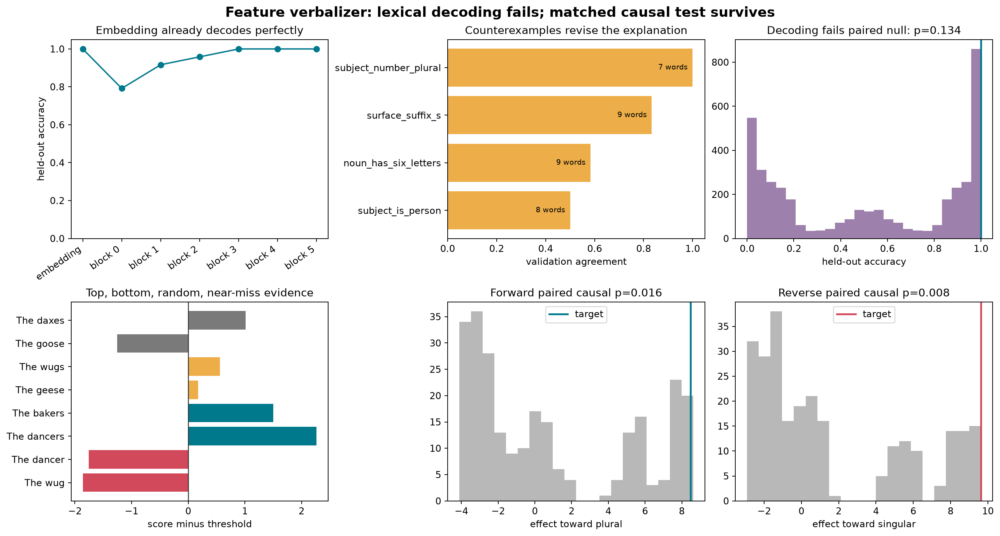

# [7.2] Feature Verbalizers

By the end of this notebook, you will have shown that a training-only
subject-number direction changes Pythia's `are` versus `is` preference in both
directions beyond matched within-pair control directions, while perfect
decoding by itself is explained by lexical input structure.

```yaml
exercise_id: 7_2_feature_verbalizers
gt_tier: GT-1 toy oracles plus a pinned real-model CUDA result
expected_runtime: 60-90 minutes
requires_gpu: true
```

## Core Question

When does the phrase **"the subject noun is plural"** explain a residual-stream
direction, rather than merely redescribe a lexical correlation?

We will fit one transparent direction on real cached activations from a pinned
`EleutherAI/pythia-70m` checkpoint without touching held-out labels. Then we do
the work that a verbalizer needs: inspect top, bottom, random, and near-threshold
examples; operationalize candidate descriptions; mine counterexamples; revise
the description; compare accuracy with brevity; and finally intervene through a
real forward hook. The decisive causal null is not isotropic noise. It consists
of 256 decoder directions induced by label swaps within the same training noun
pairs, with the target's exact per-example replacement coefficients.

## Learning Objectives

By the end, you will be able to:

1. implement a mean-difference activation decoder and exact projection replacement;
2. cache final-token residual activations from a pinned causal language model;
3. construct an evidence table and revise an explanation using counterexamples;
4. expose embedding and orthographic shortcuts with a full layer sweep;
5. design a randomization null that preserves matched-pair structure; and
6. perform a real residual-stream intervention and measure both directions.

## The Research Loop

Let $h_i^{(\ell)}$ be the final-token residual for prompt $i$ after layer
$\ell$. A mean-difference direction fit on the training split is

$$d = \frac{\mathbb{E}[h\mid y=1]-\mathbb{E}[h\mid y=0]}
{\lVert\mathbb{E}[h\mid y=1]-\mathbb{E}[h\mid y=0]\rVert_2}.$$

This equation gives a direction, not a meaning. A verbalizer is a hypothesis
$v(x)$ whose predictions can disagree with the feature side
$\mathbb{1}[h(x)\cdot d\geq\tau]$. Those disagreements are useful evidence:
they tell us how to revise the text. Only after freezing the revision do we look
at the held-out vocabulary.

For a causal replacement, we preserve every component orthogonal to $d$:

$$h' = h + (s_{target} - h\cdot d)d.$$

The matched causal null replaces $d$ with directions $d_b$ fit after swapping
labels *within* training pairs. Each null receives the same coefficient
$s_{target}-h\cdot d$ for every held-out row and runs through the same hook. This
asks whether our direction is more behaviorally effective than directions the
paired design itself can manufacture.

### Visual Intuition

Think of every prompt as a point in residual space. A decoder draws one axis
through those points. Top and bottom examples suggest a story; near-threshold
examples and counterexamples attack it. The layer sweep asks whether the story
was present before any transformer computation. The intervention asks a
different question: if we move only along that axis, does downstream behavior
move with it?

### Common Bugs

- Permuting individual labels even though the dataset was collected in matched noun pairs.
- Combining irregular and nonce nouns, which hides that the suffix rule is perfect on nonce plurals.
- Calling a string dictionary a tokenizer-ID baseline.
- Treating a perfect embedding-layer decoder as evidence of computation in layer 3.
- Showing orthogonal controls while omitting pair-preserving decoder directions.
- Printing custom predictions without actually running the promised activation intervention.
- Ranking candidate prose on the held-out labels, then calling the split held out.


## Setup

The default device is CUDA. Maintainers can explicitly set `ARENA_DEVICE=cpu`
for deterministic CPU execution; this is an explicit mode, not a runtime
fallback. The checkpoint is pinned and loaded from the local cache.

```python
from __future__ import annotations

import os
import random
import sys
from dataclasses import asdict, dataclass
from pathlib import Path
from typing import Literal, Sequence

import matplotlib.pyplot as plt
import pandas as pd
import torch as t
from IPython.display import display

chapter = "chapter7_activation_to_language"
root_dir = next(p for p in [Path.cwd(), *Path.cwd().parents] if (p / chapter).exists())
exercises_dir = root_dir / chapter / "exercises"
section_dir = exercises_dir / "part2_feature_verbalizers"
if str(root_dir) not in sys.path:
    sys.path.append(str(root_dir))
if str(exercises_dir) not in sys.path:
    sys.path.append(str(exercises_dir))

import part2_feature_verbalizers.tests as tests

MODEL_ID = 'EleutherAI/pythia-70m'
MODEL_REVISION = 'a39f36b100fe8a5377810d56c3f4789b9c53ac42'
LAYER = 3
IS_TOKEN = ' is'
ARE_TOKEN = ' are'
PAIR_CAUSAL_NULL_SEED = 1729
PAIR_CAUSAL_NULL_COUNT = 256
Number = Literal["singular", "plural"]
Split = Literal["train", "validation", "heldout"]
Morphology = Literal["regular", "irregular", "nonce"]

@dataclass(frozen=True)
class DirectionDecoder:
    direction: t.Tensor
    threshold: float
    negative_mean: float
    positive_mean: float

@dataclass(frozen=True)
class ActivationCache:
    prompts: tuple[str, ...]
    activations: t.Tensor
    next_token_margins: t.Tensor

@dataclass(frozen=True)
class NumberExample:
    prompt: str
    noun: str
    number: Number
    split: Split
    morphology: Morphology
    semantic_class: str

@dataclass(frozen=True)
class Hypothesis:
    hypothesis_id: str
    description: str

@dataclass(frozen=True)
class BinaryEvaluation:
    accuracy: float
    baseline_accuracy: float
    subset_accuracy: float
    subset_baseline_accuracy: float
    beats_baseline: bool
    survives_subset: bool

@dataclass(frozen=True)
class HookIntervention:
    next_token_margins: t.Tensor
    hook_calls: int

@dataclass(frozen=True)
class LayerSweepCache:
    layer_names: tuple[str, ...]
    activations: tuple[t.Tensor, ...]

```

## Cold Open

Pythia prefers `are` after `The pilots` and `is` after `The pilot`. A perfect
decoder would still be uninteresting if the embedding table already separates
those words. Write down three different claims before running anything:

1. **decodable:** one axis predicts a label;
2. **verbalizable:** a short rule predicts which examples activate that axis;
3. **causal:** editing that axis changes model behavior more than a matched null.

This notebook will reject the first as evidence of layer-3 computation, revise
the second using counterexamples, and retain only a narrow version of the third.

```python
HYPOTHESES = (Hypothesis(hypothesis_id='subject_number_plural',
            description='The final subject noun is grammatically plural.'),
 Hypothesis(hypothesis_id='surface_suffix_s',
            description='The final subject token ends with the letter s.'),
 Hypothesis(hypothesis_id='subject_is_person',
            description='The subject denotes a person, regardless of number.'),
 Hypothesis(hypothesis_id='noun_has_six_letters',
            description='The displayed noun token has at least six letters.'))

TRAIN_PAIRS = (('pilot', 'pilots', 'person'),
 ('doctor', 'doctors', 'person'),
 ('artist', 'artists', 'person'),
 ('farmer', 'farmers', 'person'),
 ('chef', 'chefs', 'person'),
 ('lawyer', 'lawyers', 'person'),
 ('student', 'students', 'person'),
 ('teacher', 'teachers', 'person'),
 ('driver', 'drivers', 'person'),
 ('writer', 'writers', 'person'),
 ('singer', 'singers', 'person'),
 ('guard', 'guards', 'person'))

VALIDATION_PAIRS = (('baker', 'bakers', 'regular', 'person'),
 ('dancer', 'dancers', 'regular', 'person'),
 ('mouse', 'mice', 'irregular', 'animal'),
 ('goose', 'geese', 'irregular', 'animal'),
 ('wug', 'wugs', 'nonce', 'nonce'),
 ('dax', 'daxes', 'nonce', 'nonce'))

HELDOUT_PAIRS = (('engineer', 'engineers', 'regular', 'person'),
 ('musician', 'musicians', 'regular', 'person'),
 ('scientist', 'scientists', 'regular', 'person'),
 ('gardener', 'gardeners', 'regular', 'person'),
 ('man', 'men', 'irregular', 'person'),
 ('woman', 'women', 'irregular', 'person'),
 ('child', 'children', 'irregular', 'person'),
 ('person', 'people', 'irregular', 'person'),
 ('blicket', 'blickets', 'nonce', 'nonce'),
 ('zorp', 'zorps', 'nonce', 'nonce'),
 ('plin', 'plins', 'nonce', 'nonce'),
 ('nup', 'nups', 'nonce', 'nonce'))

def _pair_examples(
    pairs: Sequence[tuple[str, str, str]],
    *,
    split: Split,
    morphology: Morphology,
) -> list[NumberExample]:
    examples: list[NumberExample] = []
    for singular, plural, semantic_class in pairs:
        examples.extend(
            [
                NumberExample(
                    f"The {singular}", singular, "singular", split, morphology, semantic_class
                ),
                NumberExample(
                    f"The {plural}", plural, "plural", split, morphology, semantic_class
                ),
            ]
        )
    return examples

def make_number_dataset() -> tuple[NumberExample, ...]:
    """Build paired train, validation, and held-out prompt families."""

    train = _pair_examples(TRAIN_PAIRS, split="train", morphology="regular")
    validation: list[NumberExample] = []
    for singular, plural, morphology, semantic_class in VALIDATION_PAIRS:
        validation.extend(
            _pair_examples(
                [(singular, plural, semantic_class)],
                split="validation",
                morphology=morphology,
            )
        )
    heldout: list[NumberExample] = []
    for singular, plural, morphology, semantic_class in HELDOUT_PAIRS:
        heldout.extend(
            _pair_examples(
                [(singular, plural, semantic_class)],
                split="heldout",
                morphology=morphology,
            )
        )
    examples = tuple(train + validation + heldout)
    validate_number_dataset(examples)
    return examples

def split_number_dataset(
    examples: Sequence[NumberExample],
) -> tuple[tuple[NumberExample, ...], tuple[NumberExample, ...], tuple[NumberExample, ...]]:
    return tuple(
        tuple(example for example in examples if example.split == split)
        for split in ("train", "validation", "heldout")
    )

def validate_number_dataset(examples: Sequence[NumberExample]) -> None:
    """Reject overlap and malformed number pairs before any activation fitting."""

    if not examples:
        raise ValueError("examples must be nonempty.")
    prompts = [example.prompt for example in examples]
    if len(set(prompts)) != len(prompts):
        raise ValueError("prompts must be unique.")
    train, validation, heldout = split_number_dataset(examples)
    if not train or not validation or not heldout:
        raise ValueError("train, validation, and heldout splits must all be nonempty.")
    split_nouns = [{example.noun for example in split} for split in (train, validation, heldout)]
    if (
        split_nouns[0] & split_nouns[1]
        or split_nouns[0] & split_nouns[2]
        or split_nouns[1] & split_nouns[2]
    ):
        raise ValueError("noun vocabulary must be disjoint across splits.")
    for name, split in zip(
        ("train", "validation", "heldout"),
        (train, validation, heldout),
        strict=True,
    ):
        counts = {
            number: sum(example.number == number for example in split)
            for number in ("singular", "plural")
        }
        if counts["singular"] != counts["plural"]:
            raise ValueError(f"{name} must contain balanced singular/plural pairs.")

def number_labels(examples: Sequence[NumberExample]) -> t.Tensor:
    return t.tensor([example.number == "plural" for example in examples], dtype=t.bool)

def _single_token_id(tokenizer, text: str) -> int:
    token_ids = tokenizer.encode(text, add_special_tokens=False)
    if len(token_ids) != 1:
        raise ValueError(f"{text!r} must tokenize to exactly one token, got {token_ids}.")
    return int(token_ids[0])

def load_pinned_model(device: str | t.device = "cpu"):
    """Load the pinned checkpoint from the local HF cache onto one explicit device."""

    from transformers import AutoModelForCausalLM, AutoTokenizer

    tokenizer = AutoTokenizer.from_pretrained(
        MODEL_ID,
        revision=MODEL_REVISION,
        local_files_only=True,
    )
    tokenizer.pad_token = tokenizer.eos_token
    tokenizer.padding_side = "left"
    model = AutoModelForCausalLM.from_pretrained(
        MODEL_ID,
        revision=MODEL_REVISION,
        local_files_only=True,
        dtype=t.float32,
    ).to(device)
    model.eval()
    return model, tokenizer

dataset = make_number_dataset()
train_examples, validation_examples, heldout_examples = split_number_dataset(dataset)
print(f"train={len(train_examples)}, validation={len(validation_examples)}, heldout={len(heldout_examples)}")
display(pd.DataFrame([asdict(example) for example in train_examples[:8]]))

```

## 1. Toy Ground Truth

Before touching a language model, prove the direction and replacement algebra
on vectors where every answer is known exactly.

### Exercise - fit a direction on exact toy ground truth

> ```yaml
> Difficulty: medium
> Importance: high
> ```

Start with eight toy residual vectors. Their first coordinate is the
only class signal; the other coordinates cancel within each class. Compute the
positive-minus-negative mean direction, normalize it, and put the decision
threshold halfway between projected class means.

<details>
<summary>Expected output</summary>

The exact oracle prints `Mean-difference decoder: exact toy oracle passed.`
The direction is `[1, 0, 0]`, the threshold is `0`, and every score equals the
first activation coordinate.

</details>

<details>
<summary>Help - reveal a hint</summary>

Compute two mean vectors, subtract negative from positive, and normalize
once. Orienting the difference this way makes larger scores mean plural.

</details>

<details>
<summary>Solution</summary>

```python
def fit_mean_difference_decoder(activations: t.Tensor, labels: t.Tensor) -> DirectionDecoder:
    """Fit a unit mean-difference direction using labeled training activations only."""

    if activations.ndim != 2:
        raise ValueError("activations must have shape [examples, d_model].")
    labels = labels.flatten().bool()
    if activations.shape[0] != labels.numel():
        raise ValueError("activations and labels must contain the same number of examples.")
    if not labels.any() or labels.all():
        raise ValueError("labels must contain both classes.")
    activations = activations.float()
    negative_mean_vector = activations[~labels].mean(dim=0)
    positive_mean_vector = activations[labels].mean(dim=0)
    difference = positive_mean_vector - negative_mean_vector
    norm = difference.norm()
    if not t.isfinite(norm) or norm <= 1e-8:
        raise ValueError("class means do not define a finite nonzero direction.")
    direction = difference / norm
    negative_mean = float(negative_mean_vector @ direction)
    positive_mean = float(positive_mean_vector @ direction)
    return DirectionDecoder(
        direction=direction,
        threshold=(negative_mean + positive_mean) / 2,
        negative_mean=negative_mean,
        positive_mean=positive_mean,
    )

def direction_scores(activations: t.Tensor, decoder: DirectionDecoder) -> t.Tensor:
    if activations.ndim != 2 or activations.shape[1] != decoder.direction.numel():
        raise ValueError("activations must be [examples, d_model] and match the decoder.")
    return activations.float() @ decoder.direction.float()

def direction_predictions(activations: t.Tensor, decoder: DirectionDecoder) -> t.Tensor:
    return direction_scores(activations, decoder) >= decoder.threshold
```

</details>

<details>
<summary>Interpretation</summary>

This decoder is transparent: its only learned object is one direction
and one midpoint. The toy oracle proves the algebra before any model result can
look persuasive.

</details>


```python
def fit_mean_difference_decoder(activations: t.Tensor, labels: t.Tensor) -> DirectionDecoder:
    raise NotImplementedError()


def direction_scores(activations: t.Tensor, decoder: DirectionDecoder) -> t.Tensor:
    raise NotImplementedError()


def direction_predictions(activations: t.Tensor, decoder: DirectionDecoder) -> t.Tensor:
    raise NotImplementedError()

tests.test_mean_difference_decoder(
    fit_mean_difference_decoder,
    direction_scores,
)

```

### Exercise - replace one activation component exactly

> ```yaml
> Difficulty: medium
> Importance: high
> ```

Implement the operation used by the causal experiment. For each row,
change only its coordinate along a unit direction so the new projection equals
the requested target score. Every orthogonal component must remain unchanged.

<details>
<summary>Expected output</summary>

The test prints two passed oracles: the new dot products equal the target
scores and all coordinates orthogonal to the toy direction are unchanged.

</details>

<details>
<summary>Help - reveal a hint</summary>

If `s = h @ d`, the needed edit is `(target - s) * d`. Avoid changing
the whole vector or constructing a new score without editing the activation.

</details>

<details>
<summary>Solution</summary>

```python
def replace_direction_component(
    activations: t.Tensor,
    direction: t.Tensor,
    target_scores: t.Tensor | float,
) -> t.Tensor:
    """Replace only the component parallel to a unit direction."""

    if (
        activations.ndim != 2
        or direction.ndim != 1
        or activations.shape[1] != direction.numel()
    ):
        raise ValueError("expected activations [batch, d_model] and matching direction [d_model].")
    direction = direction.to(device=activations.device, dtype=activations.dtype)
    expected_norm = t.tensor(1.0, device=direction.device, dtype=direction.dtype)
    if not t.allclose(direction.norm(), expected_norm, atol=1e-5):
        raise ValueError("direction must have unit norm.")
    targets = t.as_tensor(target_scores, device=activations.device, dtype=activations.dtype)
    targets = targets.expand(activations.shape[0])
    current_scores = activations @ direction
    return activations + (targets - current_scores).unsqueeze(-1) * direction
```

</details>

<details>
<summary>Interpretation</summary>

This is an activation replacement, not `new_score = old_score + alpha`.
Later the same edit vector is inserted into Pythia's residual stream and the
remaining transformer layers produce new logits.

</details>


```python
def replace_direction_component(
    activations: t.Tensor,
    direction: t.Tensor,
    target_scores: t.Tensor | float,
) -> t.Tensor:
    raise NotImplementedError()

tests.test_component_replacement(replace_direction_component)

```

## 2. Cache Before Labels

`output.hidden_states[0]` is the embedding residual. Entry `k + 1` is the
post-block residual for block `k`. Caching every depth in one pass gives the
control that the old experiment missed: did the transformer compute the feature,
or did token identity already expose it?

```python
DEVICE = os.environ.get("ARENA_DEVICE", "cuda")
if DEVICE not in {"cpu", "cuda"}:
    raise ValueError("ARENA_DEVICE must be exactly 'cpu' or 'cuda'.")
if DEVICE == "cuda" and not t.cuda.is_available():
    raise RuntimeError("CUDA was explicitly selected but is unavailable; no fallback is used.")
model, tokenizer = load_pinned_model(DEVICE)
print(
    f"Loaded {MODEL_ID}@{MODEL_REVISION[:8]} on {next(model.parameters()).device}; "
    f"Torch {t.__version__}, d_model={model.config.hidden_size}"
)
```

### Exercise - cache residuals and audit every layer

> ```yaml
> Difficulty: hard
> Importance: high
> ```

Load the pinned 70M-parameter checkpoint from the local Hugging Face
cache. Return layer-3 final-token activations and the model's downstream
`logit(" are") - logit(" is")` margin. Then cache the embedding residual plus
all six block outputs in one forward pass. Labels must not be accepted by either
cache function.

<details>
<summary>Expected output</summary>

The caches have shapes `(24, 512)`, `(12, 512)`, and `(24, 512)`.
Both candidate continuations tokenize to one token, and the cache API has no
label argument. The layer sweep has seven entries from `embedding` to `block 5`.

</details>

<details>
<summary>Help - reveal a hint</summary>

For block index `layer`, Hugging Face stores the post-block residual at
`hidden_states[layer + 1]`. With left padding, index `-1` is the final prompt
token for every row.

</details>

<details>
<summary>Solution</summary>

```python
def cache_final_token_activations(
    model,
    tokenizer,
    prompts: Sequence[str],
    *,
    layer: int = LAYER,
) -> ActivationCache:
    """Cache real final-token residual activations and the downstream are-is margin."""

    if not prompts:
        raise ValueError("prompts must be nonempty.")
    if layer < 0 or layer >= len(model.gpt_neox.layers):
        raise ValueError("layer is outside the model's transformer blocks.")
    device = next(model.parameters()).device
    encoded = tokenizer(list(prompts), padding=True, return_tensors="pt").to(device)
    with t.inference_mode():
        output = model(**encoded, output_hidden_states=True)
    activations = output.hidden_states[layer + 1][:, -1, :].detach().cpu().float()
    logits = output.logits[:, -1, :].detach().cpu().float()
    is_id = _single_token_id(tokenizer, IS_TOKEN)
    are_id = _single_token_id(tokenizer, ARE_TOKEN)
    margins = logits[:, are_id] - logits[:, is_id]
    return ActivationCache(tuple(prompts), activations, margins)

def cache_layer_sweep(
    model,
    tokenizer,
    prompts: Sequence[str],
) -> LayerSweepCache:
    """Cache the embedding residual and every post-block final-token residual."""

    if not prompts:
        raise ValueError("prompts must be nonempty.")
    device = next(model.parameters()).device
    encoded = tokenizer(list(prompts), padding=True, return_tensors="pt").to(device)
    with t.inference_mode():
        output = model(**encoded, output_hidden_states=True)
    activations = tuple(
        hidden[:, -1, :].detach().cpu().float() for hidden in output.hidden_states
    )
    expected_count = len(model.gpt_neox.layers) + 1
    if len(activations) != expected_count:
        raise AssertionError("hidden-state count must equal embedding plus transformer blocks")
    names = ("embedding",) + tuple(f"block {index}" for index in range(len(activations) - 1))
    return LayerSweepCache(names, activations)

def layer_sweep_accuracies(
    train_cache: LayerSweepCache,
    train_labels: t.Tensor,
    test_cache: LayerSweepCache,
    test_labels: t.Tensor,
) -> tuple[float, ...]:
    """Fit on training activations independently at every depth and test held out."""

    if train_cache.layer_names != test_cache.layer_names:
        raise ValueError("train and test sweeps must contain the same layers")
    return tuple(
        float(direction_predictions(
            test_activations, fit_mean_difference_decoder(train_activations, train_labels)
        ).eq(test_labels.bool()).float().mean())
        for train_activations, test_activations in zip(
            train_cache.activations, test_cache.activations, strict=True
        )
    )
```

</details>

<details>
<summary>Interpretation</summary>

These are model-produced residuals. The train labels are introduced
only after caching, when fitting the decoder; validation and held-out labels are
not inputs to either activation extraction or direction fitting.

</details>


```python
def cache_final_token_activations(
    model,
    tokenizer,
    prompts: Sequence[str],
    *,
    layer: int = LAYER,
) -> ActivationCache:
    raise NotImplementedError()


def cache_layer_sweep(
    model,
    tokenizer,
    prompts: Sequence[str],
) -> LayerSweepCache:
    raise NotImplementedError()


def layer_sweep_accuracies(
    train_cache: LayerSweepCache,
    train_labels: t.Tensor,
    test_cache: LayerSweepCache,
    test_labels: t.Tensor,
) -> tuple[float, ...]:
    raise NotImplementedError()

train_cache = cache_final_token_activations(
    model, tokenizer, [example.prompt for example in train_examples]
)
validation_cache = cache_final_token_activations(
    model, tokenizer, [example.prompt for example in validation_examples]
)
heldout_cache = cache_final_token_activations(
    model, tokenizer, [example.prompt for example in heldout_examples]
)
tests.test_layer_sweep_exact_oracle(layer_sweep_accuracies)
train_sweep = cache_layer_sweep(model, tokenizer, [x.prompt for x in train_examples])
heldout_sweep = cache_layer_sweep(model, tokenizer, [x.prompt for x in heldout_examples])
assert train_cache.activations.shape == (24, 512)
assert train_sweep.layer_names == (
    "embedding", "block 0", "block 1", "block 2", "block 3", "block 4", "block 5"
)
assert "labels" not in __import__("inspect").signature(cache_layer_sweep).parameters
print("Cached:", train_cache.activations.shape, train_sweep.layer_names)

```

## 3. From Examples to a Falsifiable Explanation

The direction is fit on the 24 training rows only. Validation rows may be used
to inspect and revise prose; held-out rows may not. First examine evidence from
all four sampling regimes. Near-threshold examples are especially valuable
because a small miss can separate two plausible descriptions.

### Exercise - inspect evidence, mine counterexamples, and revise the explanation

> ```yaml
> Difficulty: medium
> Importance: high
> ```

Build top, bottom, random, and near-threshold validation examples before
choosing any prose. Turn each candidate explanation into an executable predicate,
shuffle display order, score agreement, mine disagreements with the tempting
`ends in s` story, and compute the agreement-versus-word-count frontier. The
held-out labels remain untouched.

<details>
<summary>Expected output</summary>

The evidence table contains all four sampling groups. `The mice` and
`The geese` falsify the suffix story. Candidate order changes across seeds but
semantic scores do not. The revised `subject_number_plural` explanation reaches
agreement `1.00` and remains on the brevity frontier.

</details>

<details>
<summary>Help - reveal a hint</summary>

Sort scores for top and bottom rows, absolute distance from the threshold
for near misses, and use a seeded sample for random rows. A counterexample is a
row where the executable predicate disagrees with the feature side.

</details>

<details>
<summary>Solution</summary>

```python
def hypothesis_predictions(
    examples: Sequence[NumberExample],
    hypothesis: Hypothesis,
) -> t.Tensor:
    """Execute a verbalizer as a semantic predicate, never as an answer token."""

    if hypothesis.hypothesis_id == "subject_number_plural":
        values = [example.number == "plural" for example in examples]
    elif hypothesis.hypothesis_id == "surface_suffix_s":
        values = [example.noun.lower().endswith("s") for example in examples]
    elif hypothesis.hypothesis_id == "subject_is_person":
        values = [example.semantic_class == "person" for example in examples]
    elif hypothesis.hypothesis_id == "noun_has_six_letters":
        values = [len(example.noun) >= 6 for example in examples]
    else:
        raise KeyError(f"Unknown hypothesis id: {hypothesis.hypothesis_id!r}.")
    return t.tensor(values, dtype=t.bool)

def score_hypotheses(
    examples: Sequence[NumberExample],
    activation_predictions: t.Tensor,
    candidates: Sequence[Hypothesis] = HYPOTHESES,
    *,
    seed: int = 0,
) -> tuple[dict[str, object], ...]:
    """Score candidate meaning against activations after randomizing display order."""

    activation_predictions = activation_predictions.flatten().bool()
    if len(examples) != activation_predictions.numel():
        raise ValueError("examples and activation_predictions must align.")
    if not candidates or len({candidate.hypothesis_id for candidate in candidates}) != len(candidates):
        raise ValueError("candidate ids must be nonempty and unique.")
    randomized = list(candidates)
    random.Random(seed).shuffle(randomized)
    rows = []
    for display_index, candidate in enumerate(randomized, start=1):
        predictions = hypothesis_predictions(examples, candidate)
        rows.append(
            {
                "display_index": display_index,
                "hypothesis_id": candidate.hypothesis_id,
                "description": candidate.description,
                "agreement": float(predictions.eq(activation_predictions).float().mean()),
                "word_count": len(candidate.description.rstrip(".").split()),
                "counterexample_count": int(predictions.ne(activation_predictions).sum()),
            }
        )
    return tuple(rows)

def select_hypothesis(rows: Sequence[dict[str, object]]) -> str:
    if not rows:
        raise ValueError("rows must be nonempty.")
    selected = max(
        rows,
        key=lambda row: (
            float(row["agreement"]),
            -int(row["word_count"]),
            str(row["hypothesis_id"]),
        ),
    )
    return str(selected["hypothesis_id"])

def rank_feature_examples(
    examples: Sequence[NumberExample],
    scores: t.Tensor,
    threshold: float,
    *,
    n: int = 2,
    seed: int = 0,
) -> tuple[dict[str, object], ...]:
    """Return top, bottom, random, and near-threshold evidence rows."""

    scores = scores.flatten().float()
    if len(examples) != scores.numel() or not 0 < n <= len(examples):
        raise ValueError("scores must align with examples and n must select available rows")
    order = t.argsort(scores)
    groups = {
        "bottom": order[:n].tolist(),
        "top": order[-n:].flip(0).tolist(),
        "near miss": t.argsort((scores - threshold).abs())[:n].tolist(),
        "random": random.Random(seed).sample(range(len(examples)), n),
    }
    rows = []
    for group, indices in groups.items():
        for index in indices:
            example = examples[index]
            rows.append(
                {
                    "group": group,
                    "prompt": example.prompt,
                    "score": float(scores[index]),
                    "predicted_side": "positive" if scores[index] >= threshold else "negative",
                    "morphology": example.morphology,
                }
            )
    return tuple(rows)

def mine_counterexamples(
    examples: Sequence[NumberExample],
    activation_predictions: t.Tensor,
    hypothesis: Hypothesis,
) -> tuple[dict[str, object], ...]:
    """Find rows where an executable explanation disagrees with the feature side."""

    activation_predictions = activation_predictions.flatten().bool()
    if len(examples) != activation_predictions.numel():
        raise ValueError("examples and activation_predictions must align")
    explanation_predictions = hypothesis_predictions(examples, hypothesis)
    return tuple(
        {
            "prompt": example.prompt,
            "feature_side": "positive" if feature_value else "negative",
            "explanation_prediction": "positive" if explanation_value else "negative",
            "morphology": example.morphology,
        }
        for example, feature_value, explanation_value in zip(
            examples,
            activation_predictions,
            explanation_predictions,
            strict=True,
        )
        if bool(feature_value) != bool(explanation_value)
    )

def brevity_frontier(rows: Sequence[dict[str, object]]) -> tuple[str, ...]:
    """Return explanations not dominated in both agreement and word count."""

    frontier = []
    for row in rows:
        dominated = any(
            float(other["agreement"]) >= float(row["agreement"])
            and int(other["word_count"]) <= int(row["word_count"])
            and (
                float(other["agreement"]) > float(row["agreement"])
                or int(other["word_count"]) < int(row["word_count"])
            )
            for other in rows
        )
        if not dominated:
            frontier.append(str(row["hypothesis_id"]))
    return tuple(sorted(frontier))
```

</details>

<details>
<summary>Interpretation</summary>

A candidate phrase has become falsifiable: it predicts which examples
should lie above the direction threshold. The revision loop is operationalized,
not generated by another language model, so open-ended automatic explanation
generation remains explicitly preflight.

</details>


```python
def hypothesis_predictions(
    examples: Sequence[NumberExample],
    hypothesis: Hypothesis,
) -> t.Tensor:
    raise NotImplementedError()


def score_hypotheses(
    examples: Sequence[NumberExample],
    activation_predictions: t.Tensor,
    candidates: Sequence[Hypothesis] = HYPOTHESES,
    *,
    seed: int = 0,
) -> tuple[dict[str, object], ...]:
    raise NotImplementedError()


def select_hypothesis(rows: Sequence[dict[str, object]]) -> str:
    raise NotImplementedError()


def rank_feature_examples(
    examples: Sequence[NumberExample],
    scores: t.Tensor,
    threshold: float,
    *,
    n: int = 2,
    seed: int = 0,
) -> tuple[dict[str, object], ...]:
    raise NotImplementedError()


def mine_counterexamples(
    examples: Sequence[NumberExample],
    activation_predictions: t.Tensor,
    hypothesis: Hypothesis,
) -> tuple[dict[str, object], ...]:
    raise NotImplementedError()


def brevity_frontier(rows: Sequence[dict[str, object]]) -> tuple[str, ...]:
    raise NotImplementedError()

train_labels = number_labels(train_examples)
validation_scores = direction_scores(
    validation_cache.activations,
    decoder := fit_mean_difference_decoder(train_cache.activations, train_labels),
)
validation_predictions = direction_predictions(validation_cache.activations, decoder)
tests.test_feature_evidence_loop(
    rank_feature_examples,
    mine_counterexamples,
    brevity_frontier,
)
feature_rows = rank_feature_examples(
    validation_examples, validation_scores, decoder.threshold, n=2, seed=0
)
display(pd.DataFrame(feature_rows))

hypothesis_rows = score_hypotheses(
    validation_examples, validation_predictions, HYPOTHESES, seed=7
)
suffix_hypothesis = next(h for h in HYPOTHESES if h.hypothesis_id == "surface_suffix_s")
suffix_counterexamples = mine_counterexamples(
    validation_examples, validation_predictions, suffix_hypothesis
)
selected_hypothesis = select_hypothesis(hypothesis_rows)
display(pd.DataFrame(hypothesis_rows).sort_values(["agreement", "word_count"], ascending=[False, True]))
display(pd.DataFrame(suffix_counterexamples))
print("Revision: surface_suffix_s ->", selected_hypothesis)
print("Brevity frontier:", brevity_frontier(hypothesis_rows))

```

### Stop and Predict

The revised description may fit validation perfectly. Before revealing the
layer sweep, predict whether accuracy rises gradually with depth. If embedding
accuracy is already perfect, what causal claim remains possible?

## 4. Held-Out Shortcut Audit

The final noun vocabulary is disjoint. Every baseline uses the identical 24
rows. The exact decoding null enumerates all `2**12` within-pair orientations;
it is a negative result if many null directions also classify perfectly.

### Exercise - expose lexical shortcuts before held-out interpretation

> ```yaml
> Difficulty: hard
> Importance: high
> ```

Evaluate the activation decoder on 24 unseen noun tokens. Compare it
with the suffix verbalizer, a train-only orthographic ridge model, a final-token-ID
lookup, a decoder fit at the embedding output and every later layer, and the exact `2**12`
directions obtained by independently swapping singular/plural labels within
each matched training pair. Report regular, irregular, and nonce rows
separately, plus the complete null distribution and exact p-value.

<details>
<summary>Expected output</summary>

The matched-subset oracle demonstrates that a method scoring `0.50` on
a subset does not survive when the baseline scores `1.00` on the same subset.
On Pythia, the target direction reaches `1.00` held-out accuracy. The suffix
rule scores `1.00/0.50/1.00` on regular/irregular/nonce groups. The embedding
decoder is already `1.00`, so later-layer decoding cannot be credited to
transformer computation. The exhaustive paired null has mean `0.500`, p95 `1.000`, and
exact `p=0.134`; 548 of 4,096 null fits also score `1.00`. This is a negative
significance result and the plot must show it.

</details>

<details>
<summary>Help - reveal a hint</summary>

Index predictions, labels, and baseline predictions with the same
`subset_mask` before taking either subset mean. For the null, keep each
singular/plural lexeme pair intact and enumerate its two possible orientations.

</details>

<details>
<summary>Solution</summary>

```python
def evaluate_binary_predictions(
    predictions: t.Tensor,
    labels: t.Tensor,
    baseline_predictions: t.Tensor,
    subset_mask: t.Tensor,
) -> BinaryEvaluation:
    """Compare method and baseline on both the full set and the exact same subset."""

    predictions = predictions.flatten().bool()
    labels = labels.flatten().bool()
    baseline_predictions = baseline_predictions.flatten().bool()
    subset_mask = subset_mask.flatten().bool()
    if not (predictions.shape == labels.shape == baseline_predictions.shape == subset_mask.shape):
        raise ValueError("predictions, labels, baseline, and subset mask must have matching shape.")
    if not subset_mask.any():
        raise ValueError("subset_mask must select at least one example.")
    accuracy = float(predictions.eq(labels).float().mean())
    baseline_accuracy = float(baseline_predictions.eq(labels).float().mean())
    subset_accuracy = float(predictions[subset_mask].eq(labels[subset_mask]).float().mean())
    subset_baseline_accuracy = float(
        baseline_predictions[subset_mask].eq(labels[subset_mask]).float().mean()
    )
    return BinaryEvaluation(
        accuracy=accuracy,
        baseline_accuracy=baseline_accuracy,
        subset_accuracy=subset_accuracy,
        subset_baseline_accuracy=subset_baseline_accuracy,
        beats_baseline=accuracy > baseline_accuracy,
        survives_subset=subset_accuracy > subset_baseline_accuracy,
    )

def final_noun_token_ids(tokenizer, examples: Sequence[NumberExample]) -> tuple[int, ...]:
    """Return each noun's final tokenizer id without pretending all nouns are one token."""

    token_ids: list[int] = []
    for example in examples:
        encoded = tokenizer.encode(" " + example.noun, add_special_tokens=False)
        if not encoded:
            raise ValueError(f"noun {example.noun!r} produced no tokens")
        token_ids.append(int(encoded[-1]))
    return tuple(token_ids)

def seen_plural_lookup_predictions(
    tokenizer,
    train_examples: Sequence[NumberExample],
    test_examples: Sequence[NumberExample],
) -> t.Tensor:
    """Text-only control that memorizes final plural tokenizer ids from training."""

    train_ids = final_noun_token_ids(tokenizer, train_examples)
    seen_plural_ids = {
        token_id
        for token_id, example in zip(train_ids, train_examples, strict=True)
        if example.number == "plural"
    }
    return t.tensor(
        [token_id in seen_plural_ids for token_id in final_noun_token_ids(tokenizer, test_examples)],
        dtype=t.bool,
    )

def orthographic_feature_matrix(examples: Sequence[NumberExample]) -> t.Tensor:
    """Encode a deliberately simple text-only spelling baseline."""

    alphabet = "abcdefghijklmnopqrstuvwxyz"
    rows = []
    for example in examples:
        noun = example.noun.lower()
        rows.append(
            [
                1.0,
                len(noun) / 10.0,
                float(noun.endswith("s")),
                float(noun.endswith("en")),
                float(noun.endswith("ice")),
                float(noun.endswith("ese")),
                *[noun.count(letter) / max(len(noun), 1) for letter in alphabet],
            ]
        )
    return t.tensor(rows, dtype=t.float32)

def orthographic_ridge_predictions(
    train_examples: Sequence[NumberExample],
    train_labels: t.Tensor,
    test_examples: Sequence[NumberExample],
    *,
    ridge: float = 1e-2,
) -> t.Tensor:
    """Fit a train-only ridge classifier on spelling features, then threshold at 0.5."""

    train_features = orthographic_feature_matrix(train_examples)
    test_features = orthographic_feature_matrix(test_examples)
    labels = train_labels.flatten().float()
    if train_features.shape[0] != labels.numel() or ridge <= 0:
        raise ValueError("training labels must align and ridge must be positive")
    identity = t.eye(train_features.shape[1], dtype=train_features.dtype)
    weights = t.linalg.solve(
        train_features.T @ train_features + ridge * identity,
        train_features.T @ labels,
    )
    return test_features @ weights >= 0.5

def paired_swap_decoder_accuracies(
    train_activations: t.Tensor,
    train_labels: t.Tensor,
    test_activations: t.Tensor,
    test_labels: t.Tensor,
) -> tuple[float, ...]:
    """Enumerate the exact null that swaps labels only within matched noun pairs."""

    if train_activations.shape[0] != train_labels.numel() or train_labels.numel() % 2:
        raise ValueError("training rows must form consecutive singular/plural pairs")
    paired_labels = train_labels.bool().view(-1, 2)
    if not t.all(paired_labels.sum(dim=1) == 1):
        raise ValueError("each training pair must contain one singular and one plural label")
    pair_count = paired_labels.shape[0]
    if pair_count > 20:
        raise ValueError("exact enumeration is limited to at most 20 pairs")

    accuracies = []
    for pattern in range(2**pair_count):
        swapped = paired_labels.clone()
        swap_mask = t.tensor(
            [(pattern >> pair_index) & 1 for pair_index in range(pair_count)],
            dtype=t.bool,
            device=train_labels.device,
        )
        swapped[swap_mask] = swapped[swap_mask].flip(dims=(1,))
        try:
            decoder = fit_mean_difference_decoder(train_activations, swapped.flatten())
            predictions = direction_predictions(test_activations, decoder)
        except ValueError as error:
            if "nonzero direction" not in str(error):
                raise
            predictions = t.zeros_like(test_labels, dtype=t.bool)
        accuracies.append(float(predictions.eq(test_labels.bool()).float().mean()))
    return tuple(accuracies)
```

</details>

<details>
<summary>Interpretation</summary>

Only the irregular group falsifies the suffix story; nonce plurals all
end in `s`. The target does not exceed the paired-null tail, so held-out
decoding alone is not statistically persuasive. That failure makes the later
causal controls, rather than accuracy, the signature evidence.

</details>


```python
def evaluate_binary_predictions(
    predictions: t.Tensor,
    labels: t.Tensor,
    baseline_predictions: t.Tensor,
    subset_mask: t.Tensor,
) -> BinaryEvaluation:
    raise NotImplementedError()


def final_noun_token_ids(
    tokenizer,
    examples: Sequence[NumberExample],
) -> tuple[int, ...]:
    raise NotImplementedError()


def seen_plural_lookup_predictions(
    tokenizer,
    train_examples: Sequence[NumberExample],
    test_examples: Sequence[NumberExample],
) -> t.Tensor:
    raise NotImplementedError()


def orthographic_feature_matrix(
    examples: Sequence[NumberExample],
) -> t.Tensor:
    raise NotImplementedError()


def orthographic_ridge_predictions(
    train_examples: Sequence[NumberExample],
    train_labels: t.Tensor,
    test_examples: Sequence[NumberExample],
    *,
    ridge: float = 1e-2,
) -> t.Tensor:
    raise NotImplementedError()


def paired_swap_decoder_accuracies(
    train_activations: t.Tensor,
    train_labels: t.Tensor,
    test_activations: t.Tensor,
    test_labels: t.Tensor,
) -> tuple[float, ...]:
    raise NotImplementedError()

tests.test_matched_subset_comparison(evaluate_binary_predictions)
tests.test_token_id_controls(tokenizer, final_noun_token_ids, seen_plural_lookup_predictions)
tests.test_pair_preserving_null_exact_oracle(paired_swap_decoder_accuracies)

heldout_labels = number_labels(heldout_examples)
heldout_predictions = direction_predictions(heldout_cache.activations, decoder)
suffix_predictions = hypothesis_predictions(heldout_examples, suffix_hypothesis)
lookup_predictions = seen_plural_lookup_predictions(tokenizer, train_examples, heldout_examples)
orthographic_predictions = orthographic_ridge_predictions(
    train_examples, train_labels, heldout_examples
)
sweep_accuracies = layer_sweep_accuracies(
    train_sweep, train_labels, heldout_sweep, heldout_labels
)
paired_null_accuracies = paired_swap_decoder_accuracies(
    train_cache.activations, train_labels, heldout_cache.activations, heldout_labels
)
activation_accuracy = float(heldout_predictions.eq(heldout_labels).float().mean())
paired_null_tensor = t.tensor(paired_null_accuracies)
paired_null_p = float((paired_null_tensor >= activation_accuracy).float().mean())
shortcut_table = pd.DataFrame({
    "method": ["layer-3 direction", "embedding direction", "suffix rule", "orthographic ridge", "token-id lookup"],
    "held-out accuracy": [
        activation_accuracy,
        sweep_accuracies[0],
        float(suffix_predictions.eq(heldout_labels).float().mean()),
        float(orthographic_predictions.eq(heldout_labels).float().mean()),
        float(lookup_predictions.eq(heldout_labels).float().mean()),
    ],
})
display(shortcut_table)
display(pd.DataFrame({"layer": train_sweep.layer_names, "held-out accuracy": sweep_accuracies}))
print(
    f"Exact decoding null: n={len(paired_null_accuracies)}, "
    f"p95={t.quantile(paired_null_tensor, 0.95):.3f}, p={paired_null_p:.4f}"
)

```

## 5. Causal Test

Orthogonal Gaussian directions are easy controls because they deliberately
remove the shared structure. Our primary null is harder: refit directions after
within-pair label swaps, then reuse the target replacement coefficient for each
example. The target must clear this distribution in both directions.

### Exercise - intervene against a pair-preserving causal null

> ```yaml
> Difficulty: hard
> Importance: high
> ```

Register a hook on Pythia block 3. Add one precomputed edit vector to
the final token of each batch row, let layers 4-5 and the unembedding run, then
return the new `are - is` margins. Test singular-to-plural and plural-to-singular
replacement. Fit 256 control directions from precommitted within-pair training
label swaps, apply the target's exact per-example coefficients to each control,
and run every edit through the same hook. Keep orthogonal controls only as a
secondary diagnostic.

<details>
<summary>Expected output</summary>

A zero edit reproduces cached logits. Replacing singular examples'
number component with the plural training mean moves the mean margin from about
`-4.81` to `+3.67`; reverse replacement moves `+4.66` to `-4.95`. Each target
delta is compared with its own 64-direction coefficient-matched orthogonal
distribution. The stronger paired causal p-values are about `0.016` forward and
`0.008` reverse. An exact two-dimensional model proves that batched controls use
the supplied coefficients and execute the registered hook.

</details>

<details>
<summary>Help - reveal a hint</summary>

A Hugging Face block can return a tensor or a tuple. Clone the hidden
tensor, edit `[:, -1, :]`, reconstruct the tuple if needed, and keep a hook-call
counter so silent non-execution cannot pass.

</details>

<details>
<summary>Solution</summary>

```python
def orthogonal_random_direction(direction: t.Tensor, *, seed: int = 0) -> t.Tensor:
    generator = t.Generator(device=direction.device).manual_seed(seed)
    control = t.randn(direction.shape, generator=generator, device=direction.device)
    control = control - (control @ direction) * direction
    return control / control.norm()

def paired_swap_decoder_directions(
    train_activations: t.Tensor,
    train_labels: t.Tensor,
    *,
    count: int = PAIR_CAUSAL_NULL_COUNT,
    seed: int = PAIR_CAUSAL_NULL_SEED,
) -> tuple[tuple[int, ...], t.Tensor]:
    """Precommit decoder directions induced by within-pair label swaps."""

    if train_activations.shape[0] != train_labels.numel() or train_labels.numel() % 2:
        raise ValueError("training rows must form consecutive singular/plural pairs")
    paired_labels = train_labels.bool().view(-1, 2)
    if not t.all(paired_labels.sum(dim=1) == 1):
        raise ValueError("each training pair must contain one singular and one plural label")
    pair_count = paired_labels.shape[0]
    available_patterns = 2**pair_count - 2
    if not 0 < count <= available_patterns:
        raise ValueError("count must fit the non-target, non-inverted swap patterns")
    patterns = tuple(random.Random(seed).sample(range(1, 2**pair_count - 1), count))
    directions = []
    for pattern in patterns:
        swapped = paired_labels.clone()
        swap_mask = t.tensor(
            [(pattern >> pair_index) & 1 for pair_index in range(pair_count)],
            dtype=t.bool,
            device=train_labels.device,
        )
        swapped[swap_mask] = swapped[swap_mask].flip(dims=(1,))
        directions.append(
            fit_mean_difference_decoder(train_activations, swapped.flatten()).direction
        )
    bank = t.stack(directions)
    if not t.allclose(bank.norm(dim=-1), bank.new_ones(count), rtol=1e-5, atol=1e-5):
        raise AssertionError("every paired-null decoder direction must have unit norm")
    return patterns, bank

def orthogonal_random_directions(
    direction: t.Tensor, *, seeds: Sequence[int] = tuple(range(64))
) -> t.Tensor:
    """Construct a distribution of unit directions orthogonal to the target."""

    if not seeds:
        raise ValueError("seeds must be nonempty")
    controls = t.stack(
        [orthogonal_random_direction(direction, seed=int(seed)) for seed in seeds]
    )
    if (controls @ direction).abs().max() > 1e-5:
        raise AssertionError("orthogonal controls are not numerically orthogonal")
    if (controls.norm(dim=-1) - 1).abs().max() > 1e-5:
        raise AssertionError("orthogonal controls must have unit norm")
    return controls

def run_residual_edit(
    model,
    tokenizer,
    prompts: Sequence[str],
    edit_vectors: t.Tensor,
    *,
    layer: int = LAYER,
) -> HookIntervention:
    """Add per-example edits inside a real transformer block forward hook."""

    if edit_vectors.ndim != 2 or edit_vectors.shape[0] != len(prompts):
        raise ValueError("edit_vectors must have shape [len(prompts), d_model].")
    device = next(model.parameters()).device
    encoded = tokenizer(list(prompts), padding=True, return_tensors="pt").to(device)
    edits = edit_vectors.to(device=device, dtype=next(model.parameters()).dtype)
    hook_calls = 0

    def edit_hook(_module, _inputs, output):
        nonlocal hook_calls
        hook_calls += 1
        hidden = output[0] if isinstance(output, tuple) else output
        if hidden.shape[0] != edits.shape[0] or hidden.shape[-1] != edits.shape[-1]:
            raise ValueError("hook output and edit vectors do not align.")
        edited = hidden.clone()
        edited[:, -1, :] = edited[:, -1, :] + edits
        if isinstance(output, tuple):
            return (edited, *output[1:])
        return edited

    handle = model.gpt_neox.layers[layer].register_forward_hook(edit_hook)
    try:
        with t.inference_mode():
            logits = model(**encoded).logits[:, -1, :].detach().cpu().float()
    finally:
        handle.remove()
    is_id = _single_token_id(tokenizer, IS_TOKEN)
    are_id = _single_token_id(tokenizer, ARE_TOKEN)
    return HookIntervention(logits[:, are_id] - logits[:, is_id], hook_calls)

def run_orthogonal_control_distribution(
    model,
    tokenizer,
    prompts: Sequence[str],
    replacement_coefficients: t.Tensor,
    target_direction: t.Tensor,
    baseline_margin: float,
    *,
    seeds: Sequence[int] = tuple(range(64)),
) -> dict[str, object]:
    """Apply many matched-coefficient orthogonal edits in one real model forward."""

    if replacement_coefficients.shape != (len(prompts),):
        raise ValueError("replacement_coefficients must have one value per prompt")
    controls = orthogonal_random_directions(target_direction, seeds=seeds)
    edits = controls[:, None, :] * replacement_coefficients[None, :, None]
    expanded_prompts = tuple(prompt for _ in seeds for prompt in prompts)
    intervention = run_residual_edit(
        model,
        tokenizer,
        expanded_prompts,
        edits.reshape(-1, edits.shape[-1]),
    )
    mean_margins = intervention.next_token_margins.view(len(seeds), len(prompts)).mean(dim=1)
    deltas = mean_margins - baseline_margin
    return {
        "deltas": tuple(float(value) for value in deltas),
        "absolute_p95": float(t.quantile(deltas.abs(), 0.95)),
        "absolute_max": float(deltas.abs().max()),
        "orthogonality_max_abs_dot": float((controls @ target_direction).abs().max()),
        "norm_error_max": float((controls.norm(dim=-1) - 1).abs().max()),
        "hook_calls": intervention.hook_calls,
    }

def run_direction_control_distribution(
    model,
    tokenizer,
    prompts: Sequence[str],
    replacement_coefficients: t.Tensor,
    control_directions: t.Tensor,
    baseline_margin: float,
    *,
    effect_sign: float,
    chunk_size: int = 32,
    layer: int = LAYER,
) -> dict[str, object]:
    """Run a bank of same-coefficient directions through the real block hook."""

    coefficients = replacement_coefficients.flatten().float()
    if coefficients.shape != (len(prompts),):
        raise ValueError("replacement_coefficients must have one value per prompt")
    expected_dim = int(model.config.hidden_size)
    if control_directions.ndim != 2 or control_directions.shape[1] != expected_dim:
        raise ValueError("control_directions must have shape [controls, d_model]")
    if not len(control_directions) or chunk_size <= 0 or effect_sign not in (-1.0, 1.0):
        raise ValueError("controls, positive chunk_size, and effect_sign +/-1 are required")
    if not t.allclose(
        control_directions.float().norm(dim=-1),
        control_directions.new_ones(len(control_directions)),
        rtol=1e-5,
        atol=1e-5,
    ):
        raise ValueError("control directions must be unit norm")

    effects: list[float] = []
    hook_calls: list[int] = []
    for start in range(0, len(control_directions), chunk_size):
        directions = control_directions[start : start + chunk_size]
        edits = directions[:, None, :] * coefficients[None, :, None]
        expanded_prompts = tuple(prompt for _ in range(len(directions)) for prompt in prompts)
        intervention = run_residual_edit(
            model,
            tokenizer,
            expanded_prompts,
            edits.reshape(-1, edits.shape[-1]),
            layer=layer,
        )
        margins = intervention.next_token_margins.view(len(directions), len(prompts)).mean(dim=1)
        effects.extend(float(value) for value in effect_sign * (margins - baseline_margin))
        hook_calls.append(intervention.hook_calls)
    effect_tensor = t.tensor(effects)
    return {
        "effects": tuple(effects),
        "mean": float(effect_tensor.mean()),
        "p95": float(t.quantile(effect_tensor, 0.95)),
        "max": float(effect_tensor.max()),
        "hook_calls": tuple(hook_calls),
        "coefficient_checksum": float(coefficients.sum()),
    }
```

</details>

<details>
<summary>Interpretation</summary>

Bidirectional edits establish causal sensitivity rather than a one-way
ceiling artifact. The paired null is difficult because it preserves the lexical
geometry that made decoding look perfect. Clearing it supports a narrow causal
claim, not uniqueness, completeness, or a general feature-explanation system.

</details>


```python
def orthogonal_random_direction(direction: t.Tensor, *, seed: int = 0) -> t.Tensor:
    raise NotImplementedError()


def paired_swap_decoder_directions(
    train_activations: t.Tensor,
    train_labels: t.Tensor,
    *,
    count: int = PAIR_CAUSAL_NULL_COUNT,
    seed: int = PAIR_CAUSAL_NULL_SEED,
) -> tuple[tuple[int, ...], t.Tensor]:
    raise NotImplementedError()


def orthogonal_random_directions(
    direction: t.Tensor, *, seeds: Sequence[int] = tuple(range(64))
) -> t.Tensor:
    raise NotImplementedError()


def run_residual_edit(
    model,
    tokenizer,
    prompts: Sequence[str],
    edit_vectors: t.Tensor,
    *,
    layer: int = LAYER,
) -> HookIntervention:
    raise NotImplementedError()


def run_orthogonal_control_distribution(
    model,
    tokenizer,
    prompts: Sequence[str],
    replacement_coefficients: t.Tensor,
    target_direction: t.Tensor,
    baseline_margin: float,
    *,
    seeds: Sequence[int] = tuple(range(64)),
) -> dict[str, object]:
    raise NotImplementedError()


def run_direction_control_distribution(
    model,
    tokenizer,
    prompts: Sequence[str],
    replacement_coefficients: t.Tensor,
    control_directions: t.Tensor,
    baseline_margin: float,
    *,
    effect_sign: float,
    chunk_size: int = 32,
    layer: int = LAYER,
) -> dict[str, object]:
    raise NotImplementedError()

tests.test_orthogonal_control_construction(
    orthogonal_random_direction, orthogonal_random_directions
)
tests.test_paired_causal_direction_bank_exact_oracle(paired_swap_decoder_directions)
tests.test_batched_control_intervention_exact_hook_oracle(
    run_direction_control_distribution
)
zero_test = run_residual_edit(
    model,
    tokenizer,
    [example.prompt for example in heldout_examples[:2]],
    t.zeros((2, model.config.hidden_size)),
)
t.testing.assert_close(
    zero_test.next_token_margins,
    heldout_cache.next_token_margins[:2],
    rtol=1e-4,
    atol=5e-4,
)
assert zero_test.hook_calls == 1
print("Real zero edit reproduced cached logits and executed one hook.")

```

## 6. Signature Result

The final orchestration is supplied as readable plumbing, but every scientific
operation above is learner-written. A runtime trace executes the real model and
checks the code objects actually called; dead-code names cannot satisfy it, and
the entrypoint is forbidden from naming a reference module.

```python
def _accuracy(predictions: t.Tensor, labels: t.Tensor) -> float:
    return float(predictions.bool().eq(labels.bool()).float().mean())

def run_real_model_signature(model=None, tokenizer=None, *, seed: int = 0) -> dict[str, object]:
    """Run the complete offline signature experiment on real model activations."""

    if model is None or tokenizer is None:
        model, tokenizer = load_pinned_model()
    dataset = make_number_dataset()
    train, validation, heldout = split_number_dataset(dataset)
    train_labels = number_labels(train)
    validation_labels = number_labels(validation)
    heldout_labels = number_labels(heldout)

    train_cache = cache_final_token_activations(model, tokenizer, [x.prompt for x in train])
    validation_cache = cache_final_token_activations(model, tokenizer, [x.prompt for x in validation])
    heldout_cache = cache_final_token_activations(model, tokenizer, [x.prompt for x in heldout])
    train_sweep = cache_layer_sweep(model, tokenizer, [x.prompt for x in train])
    heldout_sweep = cache_layer_sweep(model, tokenizer, [x.prompt for x in heldout])
    sweep_accuracies = layer_sweep_accuracies(
        train_sweep,
        train_labels,
        heldout_sweep,
        heldout_labels,
    )
    decoder = fit_mean_difference_decoder(train_cache.activations, train_labels)
    validation_predictions = direction_predictions(validation_cache.activations, decoder)
    heldout_predictions = direction_predictions(heldout_cache.activations, decoder)

    hypothesis_rows = score_hypotheses(
        validation,
        validation_predictions,
        HYPOTHESES,
        seed=seed,
    )
    selected_hypothesis = select_hypothesis(hypothesis_rows)
    feature_examples = rank_feature_examples(
        validation,
        direction_scores(validation_cache.activations, decoder),
        decoder.threshold,
        n=2,
        seed=seed,
    )
    suffix_hypothesis = next(
        hypothesis for hypothesis in HYPOTHESES if hypothesis.hypothesis_id == "surface_suffix_s"
    )
    suffix_counterexamples = mine_counterexamples(
        validation,
        validation_predictions,
        suffix_hypothesis,
    )
    explanation_frontier = brevity_frontier(hypothesis_rows)
    suffix_predictions = hypothesis_predictions(
        heldout,
        suffix_hypothesis,
    )
    lookup_predictions = seen_plural_lookup_predictions(tokenizer, train, heldout)
    orthographic_predictions = orthographic_ridge_predictions(train, train_labels, heldout)
    contrastive_mask = t.tensor(
        [example.morphology != "regular" for example in heldout],
        dtype=t.bool,
    )
    decoder_evaluation = evaluate_binary_predictions(
        heldout_predictions,
        heldout_labels,
        suffix_predictions,
        contrastive_mask,
    )
    paired_null_accuracies = paired_swap_decoder_accuracies(
        train_cache.activations,
        train_labels,
        heldout_cache.activations,
        heldout_labels,
    )
    causal_null_patterns, causal_null_directions = paired_swap_decoder_directions(
        train_cache.activations,
        train_labels,
    )
    singular_indices = t.tensor(
        [index for index, example in enumerate(heldout) if example.number == "singular"],
        dtype=t.long,
    )
    singular_examples = tuple(heldout[int(index)] for index in singular_indices)
    singular_activations = heldout_cache.activations[singular_indices]
    full_replacements = (
        replace_direction_component(
            singular_activations,
            decoder.direction,
            decoder.positive_mean,
        )
        - singular_activations
    )
    strengths = (0.0, 0.25, 0.5, 0.75, 1.0)
    dose_margins = []
    hook_calls = []
    for strength in strengths:
        intervention = run_residual_edit(
            model,
            tokenizer,
            [example.prompt for example in singular_examples],
            strength * full_replacements,
        )
        dose_margins.append(float(intervention.next_token_margins.mean()))
        hook_calls.append(intervention.hook_calls)

    replacement_coefficients = full_replacements @ decoder.direction
    baseline_margin = dose_margins[0]
    target_delta = dose_margins[-1] - baseline_margin
    target_result = run_residual_edit(
        model,
        tokenizer,
        [example.prompt for example in singular_examples],
        full_replacements,
    )

    plural_indices = t.tensor(
        [index for index, example in enumerate(heldout) if example.number == "plural"],
        dtype=t.long,
    )
    plural_examples = tuple(heldout[int(index)] for index in plural_indices)
    plural_activations = heldout_cache.activations[plural_indices]
    reverse_replacements = (
        replace_direction_component(
            plural_activations,
            decoder.direction,
            decoder.negative_mean,
        )
        - plural_activations
    )
    reverse_baseline = float(heldout_cache.next_token_margins[plural_indices].mean())
    reverse_result = run_residual_edit(
        model,
        tokenizer,
        [example.prompt for example in plural_examples],
        reverse_replacements,
    )
    reverse_final_margin = float(reverse_result.next_token_margins.mean())

    orthogonal_distribution = run_orthogonal_control_distribution(
        model,
        tokenizer,
        [example.prompt for example in singular_examples],
        replacement_coefficients,
        decoder.direction,
        baseline_margin,
        seeds=tuple(range(seed + 101, seed + 165)),
    )
    reverse_coefficients = reverse_replacements @ decoder.direction
    reverse_orthogonal_distribution = run_orthogonal_control_distribution(
        model,
        tokenizer,
        [example.prompt for example in plural_examples],
        reverse_coefficients,
        decoder.direction,
        reverse_baseline,
        seeds=tuple(range(seed + 201, seed + 265)),
    )
    paired_causal_distribution = run_direction_control_distribution(
        model,
        tokenizer,
        [example.prompt for example in singular_examples],
        replacement_coefficients,
        causal_null_directions,
        baseline_margin,
        effect_sign=1.0,
    )
    reverse_paired_causal_distribution = run_direction_control_distribution(
        model,
        tokenizer,
        [example.prompt for example in plural_examples],
        reverse_coefficients,
        causal_null_directions,
        reverse_baseline,
        effect_sign=-1.0,
    )

    activation_accuracy = _accuracy(heldout_predictions, heldout_labels)
    suffix_accuracy = _accuracy(suffix_predictions, heldout_labels)
    lookup_accuracy = _accuracy(lookup_predictions, heldout_labels)
    orthographic_accuracy = _accuracy(orthographic_predictions, heldout_labels)
    behavior_accuracy = _accuracy(heldout_cache.next_token_margins >= 0, heldout_labels)
    paired_null_tensor = t.tensor(paired_null_accuracies)
    paired_null_mean = sum(paired_null_accuracies) / len(paired_null_accuracies)
    paired_null_p95 = float(t.quantile(paired_null_tensor, 0.95))
    paired_null_exact_p = float((paired_null_tensor >= activation_accuracy).float().mean())
    forward_causal_p = (
        1
        + sum(
            effect >= target_delta
            for effect in paired_causal_distribution["effects"]
        )
    ) / (len(causal_null_patterns) + 1)
    reverse_target_delta = reverse_baseline - reverse_final_margin
    reverse_causal_p = (
        1
        + sum(
            effect >= reverse_target_delta
            for effect in reverse_paired_causal_distribution["effects"]
        )
    ) / (len(causal_null_patterns) + 1)
    morphology_breakdown = {
        morphology: {
            "count": int(sum(example.morphology == morphology for example in heldout)),
            "activation_accuracy": _accuracy(
                heldout_predictions[t.tensor([x.morphology == morphology for x in heldout])],
                heldout_labels[t.tensor([x.morphology == morphology for x in heldout])],
            ),
            "suffix_accuracy": _accuracy(
                suffix_predictions[t.tensor([x.morphology == morphology for x in heldout])],
                heldout_labels[t.tensor([x.morphology == morphology for x in heldout])],
            ),
            "token_lookup_accuracy": _accuracy(
                lookup_predictions[t.tensor([x.morphology == morphology for x in heldout])],
                heldout_labels[t.tensor([x.morphology == morphology for x in heldout])],
            ),
        }
        for morphology in ("regular", "irregular", "nonce")
    }
    train_final_ids = set(final_noun_token_ids(tokenizer, train))
    heldout_final_ids = set(final_noun_token_ids(tokenizer, heldout))
    multi_token_noun_count = sum(
        len(tokenizer.encode(" " + example.noun, add_special_tokens=False)) > 1
        for example in heldout
    )
    heldout_rows = tuple(
        {
            "prompt": example.prompt,
            "morphology": example.morphology,
            "number": example.number,
            "activation_score": float(score),
            "activation_prediction": "plural" if prediction else "singular",
            "are_minus_is": float(margin),
        }
        for example, score, prediction, margin in zip(
            heldout,
            direction_scores(heldout_cache.activations, decoder),
            heldout_predictions,
            heldout_cache.next_token_margins,
            strict=True,
        )
    )
    return {
        "claim": (
            "Pythia-70m's embedding already linearly separates this prompt family, so "
            "held-out decoding is a lexical negative result. A train-only direction still "
            "has bidirectional causal effects that exceed precommitted within-pair decoder "
            "nulls, while an operationalized explanation loop revises an s-suffix story "
            "using validation counterexamples."
        ),
        "model_id": MODEL_ID,
        "model_revision": MODEL_REVISION,
        "layer": LAYER,
        "train_count": len(train),
        "validation_count": len(validation),
        "heldout_count": len(heldout),
        "decoder": {
            "threshold": decoder.threshold,
            "negative_mean": decoder.negative_mean,
            "positive_mean": decoder.positive_mean,
        },
        "hypothesis_rows": hypothesis_rows,
        "selected_hypothesis": selected_hypothesis,
        "feature_examples": feature_examples,
        "suffix_counterexamples": suffix_counterexamples,
        "explanation_frontier": explanation_frontier,
        "layer_sweep": {
            "layer_names": train_sweep.layer_names,
            "heldout_accuracies": sweep_accuracies,
        },
        "heldout_rows": heldout_rows,
        "controls": (
            {"method": "activation direction", "accuracy": activation_accuracy},
            {"method": "surface suffix s", "accuracy": suffix_accuracy},
            {"method": "train final-token-id lookup", "accuracy": lookup_accuracy},
            {"method": "orthographic ridge", "accuracy": orthographic_accuracy},
            {"method": "embedding residual direction", "accuracy": sweep_accuracies[0]},
            {"method": "exact within-pair label-swap null (mean)", "accuracy": paired_null_mean},
        ),
        "metrics": {
            "validation_activation_accuracy": _accuracy(validation_predictions, validation_labels),
            "heldout_activation_accuracy": activation_accuracy,
            "heldout_behavior_accuracy": behavior_accuracy,
            "suffix_accuracy": suffix_accuracy,
            "lookup_accuracy": lookup_accuracy,
            "orthographic_accuracy": orthographic_accuracy,
            "embedding_accuracy": sweep_accuracies[0],
            "paired_null_accuracy_mean": paired_null_mean,
            "paired_null_accuracy_max": max(paired_null_accuracies),
            "paired_null_accuracy_p95": paired_null_p95,
            "paired_null_exact_p": paired_null_exact_p,
            "paired_null_count": len(paired_null_accuracies),
            "paired_null_perfect_count": sum(
                accuracy >= activation_accuracy for accuracy in paired_null_accuracies
            ),
            "forward_orthogonal_absolute_p95": orthogonal_distribution["absolute_p95"],
            "reverse_orthogonal_absolute_p95": reverse_orthogonal_distribution["absolute_p95"],
            "paired_causal_count": len(causal_null_patterns),
            "forward_paired_causal_p95": paired_causal_distribution["p95"],
            "reverse_paired_causal_p95": reverse_paired_causal_distribution["p95"],
            "forward_paired_causal_p": forward_causal_p,
            "reverse_paired_causal_p": reverse_causal_p,
            "train_heldout_final_token_overlap": len(train_final_ids & heldout_final_ids),
            "heldout_multi_token_noun_count": multi_token_noun_count,
            **asdict(decoder_evaluation),
        },
        "morphology_breakdown": morphology_breakdown,
        "paired_null_accuracies": paired_null_accuracies,
        "intervention": {
            "strengths": strengths,
            "target_mean_margins": tuple(dose_margins),
            "baseline_margin": baseline_margin,
            "target_delta": target_delta,
            "orthogonal_distribution": orthogonal_distribution,
            "reverse_orthogonal_distribution": reverse_orthogonal_distribution,
            "paired_causal_patterns": causal_null_patterns,
            "paired_causal_distribution": paired_causal_distribution,
            "reverse_paired_causal_distribution": reverse_paired_causal_distribution,
            "target_plural_preference_rate": float(
                target_result.next_token_margins.gt(0).float().mean()
            ),
            "reverse_baseline_margin": reverse_baseline,
            "reverse_final_margin": reverse_final_margin,
            "reverse_target_delta": reverse_target_delta,
            "reverse_singular_preference_rate": float(
                reverse_result.next_token_margins.lt(0).float().mean()
            ),
            "hook_calls": tuple(hook_calls),
            "mean_edit_norm": float(full_replacements.norm(dim=1).mean()),
        },
        "signature_passed": bool(
            selected_hypothesis == "subject_number_plural"
            and activation_accuracy >= 0.95
            and decoder_evaluation.survives_subset
            and activation_accuracy > suffix_accuracy
            and len(paired_null_accuracies) == 4096
            and paired_null_p95 >= activation_accuracy
            and paired_null_exact_p >= 0.05
            and target_delta > 2.0
            and sweep_accuracies[0] >= activation_accuracy
            and len(causal_null_patterns) == PAIR_CAUSAL_NULL_COUNT
            and target_delta > float(paired_causal_distribution["p95"])
            and reverse_target_delta > float(reverse_paired_causal_distribution["p95"])
            and forward_causal_p < 0.05
            and reverse_causal_p < 0.05
            and len(train_final_ids & heldout_final_ids) == 0
            and all(call_count == 1 for call_count in hook_calls)
            and int(orthogonal_distribution["hook_calls"]) == 1
            and int(reverse_orthogonal_distribution["hook_calls"]) == 1
            and all(call_count == 1 for call_count in paired_causal_distribution["hook_calls"])
            and all(
                call_count == 1
                for call_count in reverse_paired_causal_distribution["hook_calls"]
            )
        ),
    }
```

```python
required_learner_functions = (
    cache_final_token_activations,
    cache_layer_sweep,
    fit_mean_difference_decoder,
    rank_feature_examples,
    mine_counterexamples,
    orthographic_ridge_predictions,
    paired_swap_decoder_directions,
    run_residual_edit,
    run_direction_control_distribution,
)
result = tests.test_runtime_dependency_provenance(
    run_real_model_signature,
    required_learner_functions,
    model,
    tokenizer,
)
metrics = result["metrics"]
intervention = result["intervention"]
print(result["claim"])
print(
    f"embedding/layer-3 accuracy={metrics['embedding_accuracy']:.3f}/"
    f"{metrics['heldout_activation_accuracy']:.3f}; decoding p={metrics['paired_null_exact_p']:.4f}"
)
print(
    f"forward target/null95/p={intervention['target_delta']:.3f}/"
    f"{metrics['forward_paired_causal_p95']:.3f}/{metrics['forward_paired_causal_p']:.4f}"
)
print(
    f"reverse target/null95/p={intervention['reverse_target_delta']:.3f}/"
    f"{metrics['reverse_paired_causal_p95']:.3f}/{metrics['reverse_paired_causal_p']:.4f}"
)
```

The six panels distinguish the negative decoding result from the
positive paired causal result. They also show the evidence that changed the
explanation, rather than presenting only a final phrase.



```python
fig, axes = plt.subplots(2, 3, figsize=(15, 8), constrained_layout=True)

axes[0, 0].plot(
    range(len(result["layer_sweep"]["layer_names"])),
    result["layer_sweep"]["heldout_accuracies"],
    marker="o",
    color="#00798C",
)
axes[0, 0].set_xticks(range(7), result["layer_sweep"]["layer_names"], rotation=35, ha="right")
axes[0, 0].set_ylim(0, 1.05)
axes[0, 0].set(title="Embedding already decodes perfectly", ylabel="held-out accuracy")

explanation_frame = pd.DataFrame(result["hypothesis_rows"]).sort_values("agreement")
axes[0, 1].barh(explanation_frame["hypothesis_id"], explanation_frame["agreement"], color="#EDAE49")
for y, (_, row) in enumerate(explanation_frame.iterrows()):
    axes[0, 1].text(row["agreement"] - 0.02, y, f"{row['word_count']} words", va="center", ha="right", fontsize=8)
axes[0, 1].set_xlim(0, 1.05)
axes[0, 1].set(title="Counterexamples revise the explanation", xlabel="validation agreement")

decode_null = t.tensor(result["paired_null_accuracies"])
axes[0, 2].hist(decode_null, bins=24, color="#8D6A9F", alpha=0.85)
axes[0, 2].axvline(metrics["heldout_activation_accuracy"], color="#00798C", linewidth=2)
axes[0, 2].set(title=f"Decoding fails paired null: p={metrics['paired_null_exact_p']:.3f}", xlabel="held-out accuracy")

evidence_frame = pd.DataFrame(result["feature_examples"])
group_colors = {"top": "#00798C", "bottom": "#D1495B", "random": "#7A7A7A", "near miss": "#EDAE49"}
axes[1, 0].barh(
    evidence_frame["prompt"],
    evidence_frame["score"] - result["decoder"]["threshold"],
    color=[group_colors[group] for group in evidence_frame["group"]],
)
axes[1, 0].axvline(0, color="#333333", linewidth=1)
axes[1, 0].set(title="Top, bottom, random, near-miss evidence", xlabel="score minus threshold")

forward_null = intervention["paired_causal_distribution"]["effects"]
axes[1, 1].hist(forward_null, bins=20, color="#A7A7A7", alpha=0.8)
axes[1, 1].axvline(intervention["target_delta"], color="#00798C", linewidth=2, label="target")
axes[1, 1].set(title=f"Forward paired causal p={metrics['forward_paired_causal_p']:.3f}", xlabel="effect toward plural")
axes[1, 1].legend()

reverse_null = intervention["reverse_paired_causal_distribution"]["effects"]
axes[1, 2].hist(reverse_null, bins=20, color="#A7A7A7", alpha=0.8)
axes[1, 2].axvline(intervention["reverse_target_delta"], color="#D1495B", linewidth=2, label="target")
axes[1, 2].set(title=f"Reverse paired causal p={metrics['reverse_paired_causal_p']:.3f}", xlabel="effect toward singular")
axes[1, 2].legend()

fig.suptitle("Feature verbalizer: lexical decoding fails; matched causal test survives", fontsize=15, fontweight="bold")
asset_path = root_dir / chapter / "instructions/assets/feature_verbalizers_number_signature.png"
fig.savefig(asset_path, dpi=170, bbox_inches="tight")
plt.show()
print("SIGNATURE PASSED:", result["signature_passed"])
```

## Try It Yourself

Change `CUSTOM_PAIRS`, predict the result first, then run both the direction
score and the real hook. Try one regular pair and one collective or irregular
noun. The cell changes only singular rows toward the learned positive mean.

```python
CUSTOM_PAIRS = [("captain", "captains"), ("mouse", "mice")]
custom_prompts = [f"The {noun}" for pair in CUSTOM_PAIRS for noun in pair]
custom_cache = cache_final_token_activations(model, tokenizer, custom_prompts)
custom_predictions = direction_predictions(custom_cache.activations, decoder)
custom_indices = t.tensor([0, 2])
custom_edits = replace_direction_component(
    custom_cache.activations[custom_indices], decoder.direction, decoder.positive_mean
) - custom_cache.activations[custom_indices]
custom_intervention = run_residual_edit(
    model, tokenizer, [custom_prompts[i] for i in custom_indices], custom_edits
)
display(pd.DataFrame({
    "prompt": [custom_prompts[i] for i in custom_indices],
    "direction side before": ["plural" if custom_predictions[i] else "singular" for i in custom_indices],
    "are-is before": custom_cache.next_token_margins[custom_indices].tolist(),
    "are-is after": custom_intervention.next_token_margins.tolist(),
}))
assert custom_intervention.hook_calls == 1
```

## Hunt an Anomaly

Probe `news`, `police`, `series`, and `scissors`. Decide whether each failure
attacks morphology, grammatical agreement, tokenizer structure, or the claim's
scope. Then add your strongest counterexample to `CUSTOM_PAIRS`.

## Interpreting the Result

The embedding and block-3 decoders both score `1.00`; 548 of 4,096 exact paired
decoding nulls also score `1.00`. Decodability is therefore a negative result,
and the layer sweep attributes it to lexical input structure rather than a
computation performed at block 3. On validation data, irregular plurals falsify
the shorter suffix story, so the operationalized loop revises it to grammatical
number before held-out evaluation.

The causal result is narrower and positive. Replacing the learned component
changes the real downstream `are-is` margin in both directions. The target
effects exceed the 95th percentiles of 256 precommitted pair-swap decoder
directions, using identical per-example coefficients and the same hook. This is
evidence of causal sensitivity in this prompt family, not a unique feature or a
complete agreement mechanism.

## Limitations

This is one 70M model, one prompt template, one preselected layer, and only 24
held-out rows. Candidate explanations are human-authored executable predicates,
not generated language; automatic generation, revision across free-form
counterexamples, brevity benchmarking against model-written explanations, and
neuron/SAE/transcoder feature selection remain **PREFLIGHT**. The spelling ridge
is intentionally small and does not exhaust lexical baselines. The paired
causal test is Monte Carlo (`n=256`), and the target is not the most extreme null
draw in either direction even though its plus-one p-values are below `0.05`.

## Reproducing the recorded evidence

The supporting `verification_report.json` is generated after the complete CUDA
experiment. It binds these notebook, page, code, and test versions to the
measurements. The figures and tables above use live model outputs.

## Reading Links

- [Bills et al., *Language models can explain neurons in language models*](https://openaipublic.blob.core.windows.net/neuron-explainer/paper/index.html)
- [Bricken et al., *Towards Monosemanticity*](https://transformer-circuits.pub/2023/monosemantic-features/index.html)
- [Pythia model suite](https://arxiv.org/abs/2304.01373)


## Maintainer verification

The functions below rerun the same learner experiment on an explicit device and enforce the 24 GiB budget.

```python
def run_smoke_test(cpu: bool = True) -> dict[str, object]:
    """Run the pinned-model contract on the explicitly requested device."""

    if not cpu and not t.cuda.is_available():
        raise RuntimeError("CUDA is required when cpu=False")
    model, tokenizer = load_pinned_model("cpu" if cpu else "cuda")
    return run_real_model_signature(model, tokenizer)

def run_gpu_test(max_vram_gb: float = 24.0) -> dict[str, object]:
    """Run the complete real-model signature on CUDA with no CPU fallback."""

    if not t.cuda.is_available():
        raise RuntimeError("CUDA is required for 7.2 GPU verification")
    t.cuda.reset_peak_memory_stats()
    model, tokenizer = load_pinned_model("cuda")
    result = run_real_model_signature(model, tokenizer)
    peak_vram_gb = t.cuda.max_memory_allocated() / 2**30
    if peak_vram_gb > max_vram_gb:
        raise AssertionError(f"peak VRAM {peak_vram_gb:.3f} GB exceeds {max_vram_gb:.1f} GB")
    if not result["signature_passed"]:
        raise AssertionError("7.2 CUDA signature did not satisfy its scientific contract")
    result.update(
        {
            "cuda_available": True,
            "gpu_name": t.cuda.get_device_name(),
            "torch_version": t.__version__,
            "cuda_version": t.version.cuda,
            "peak_vram_gb": peak_vram_gb,
            "within_vram_budget": True,
            "accepted": True,
        }
    )
    return result

def run_full_experiment(max_vram_gb: float = 24.0) -> dict[str, object]:
    return run_gpu_test(max_vram_gb=max_vram_gb)
```
