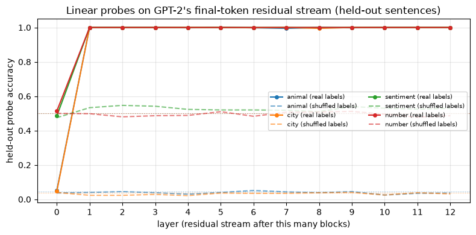
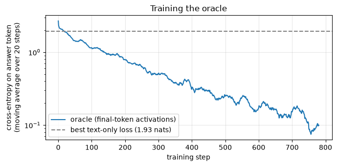
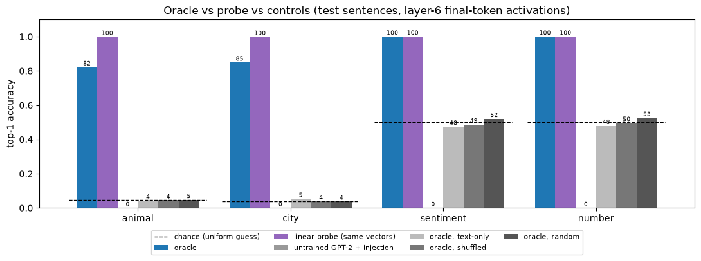
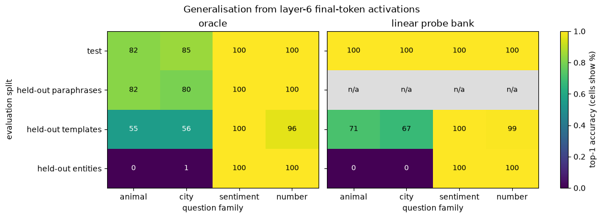
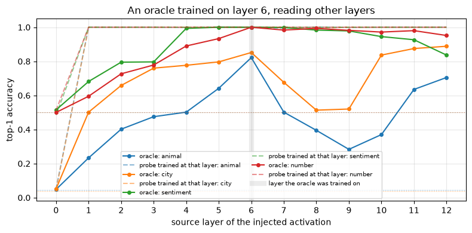
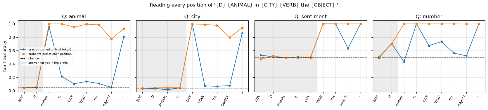
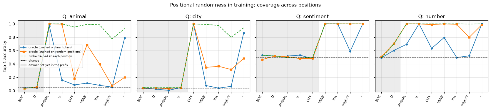
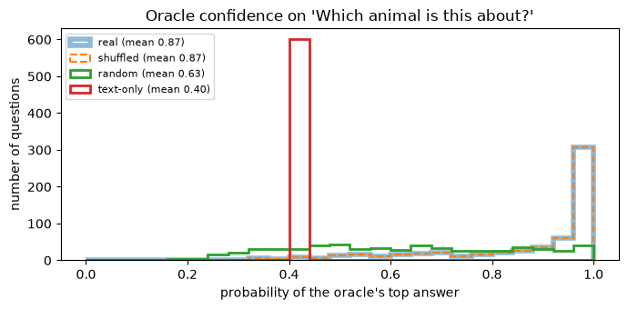
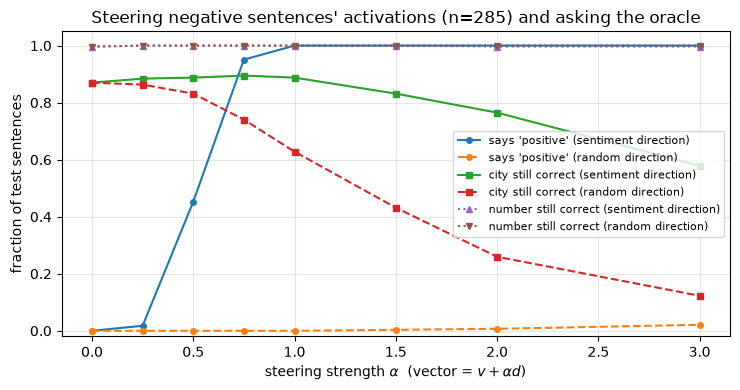
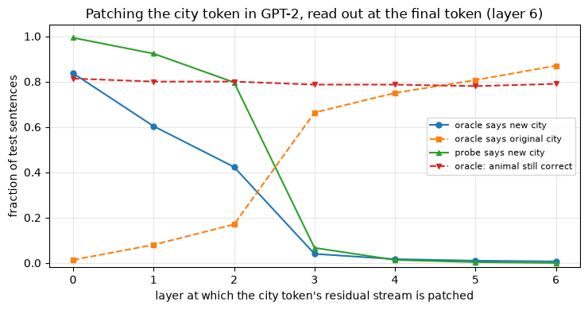

# [7.3] Mini Activation Oracles


> **Colab: [exercises](https://colab.research.google.com/github/shinobiultra/ARENA_3.0_Extended/blob/main/chapter7_activation_to_language/exercises/part3_mini_activation_oracles/7.3_Mini_Activation_Oracles_exercises.ipynb) |
> [solutions](https://colab.research.google.com/github/shinobiultra/ARENA_3.0_Extended/blob/main/chapter7_activation_to_language/exercises/part3_mini_activation_oracles/7.3_Mini_Activation_Oracles_solutions.ipynb)**

If you want to change to dark mode, you can do this by clicking the three horizontal lines in the top-right, then navigating to Settings → Theme.


# Introduction


Run GPT-2 Small on the sentence

```
In Athens, my chicken despised the beach.
```

and take the residual stream at the final `"."` after six blocks. That's 768 numbers. By the end of this section you'll have a *second* copy of GPT-2 Small that can take those 768
numbers, with no access to the sentence itself, and answer questions about them in English (this is real output from the oracle you'll train):

```
Q: Which animal is this about?            A: chicken
Q: Which city is mentioned?               A: Athens
Q: Is the feeling positive or negative?   A: negative
Q: Is the subject singular or plural?     A: singular
```

This is an **activation oracle**: a language model trained to answer natural-language questions about another model's activations. The idea was introduced as LatentQA by Pan et al.
(2024) and scaled up into generalist *Activation Oracles* by Karvonen et al. (2025), who showed that an oracle trained on a broad mix of tasks can pull out secrets that a model has
been fine-tuned never to say.

If you've done [1.3.4] Activation Oracles, you've already *used* such an oracle: a LoRA adapter for Qwen3-8B, trained by someone else on about a million examples, which you queried
and whose inference pipeline you rebuilt. That section left one thing as reading material: **training one**. This section is the other half. You'll train a small oracle yourself,
in a few minutes, in a toy world where every answer is known exactly. That buys us something you can't get at full scale: we can check every claim the oracle makes, and we can
measure exactly where it works, where it breaks, and why.

That matters, because a language model that has been fine-tuned to output answers is *very* good at producing plausible answers. An oracle that says "chicken" might be reading the
activation, or it might be guessing from the question, or it might have learned something about the training distribution that happens to work. So most of this section is about
**evaluation**, and every headline number comes with controls that should fail:

- a **text-only** oracle that gets the question but no activation;
- **shuffled** activations (a real activation, from the wrong sentence) and **random** vectors;
- an **untrained** oracle (plain GPT-2 with the same injection);
- a **linear probe bank** trained on exactly the same vectors, which tells us what information is linearly present;
- **held-out** questions, sentence templates, entities, layers and token positions;
- and **causal interventions** on the target model, to check that the oracle's answers move when (and only when) the underlying representation moves.

By the end you'll have built the whole pipeline (dataset, injection hook, training loop, evaluation suite) and produced a set of pictures: the oracle against its controls; a map of
how its accuracy depends on the layer and the token position it reads from; a steering curve showing its sentiment answer flipping as you push the activation along a sentiment
direction; and an activation-patching curve, read out by the oracle, showing at which layers GPT-2 moves a city's identity to the end of the sentence.

Along the way you'll find that a linear probe on the same 768 numbers beats the oracle on the oracle's own training questions, that the oracle confidently answers questions it
doesn't understand, and that its blind spots are set by its training data. Those findings are the point of the exercise: they're what you need to know before trusting a full-scale
oracle.

**Prerequisites.** You should be comfortable with TransformerLens hooks and the residual stream ([1.2] Intro to Mech Interp), and with a basic PyTorch training loop ([0.3]).
Section [7.1] (logit lens, tuned lens and Patchscopes) is useful background: an activation oracle is a Patchscope whose inspection model has been *trained* to answer. [1.3.4] is a
good companion but not required.


## Content & Learning Objectives

### 1️⃣ A World with Ground Truth

You'll build a synthetic dataset of sentences with four known attributes (an animal, a city, a sentiment, and whether the subject is plural), work out at which token each attribute
becomes available to a causal model, and extract GPT-2's residual stream. Linear probes then tell you how much of each attribute is present at each layer, which is the reference
against which we'll judge the oracle.

> ##### Learning Objectives
>
> - Design a synthetic dataset whose ground truth is exact and whose splits test specific kinds of generalisation (held-out templates, entities and paraphrases)
> - Use causal masking to reason about which token positions *can* contain which information
> - Extract residual-stream activations for variable-length inputs correctly
> - Train linear probes with a shuffled-label control, and read off what information is linearly present at each layer

### 2️⃣ Building and Training an Oracle

You'll implement the oracle: a prompt with a placeholder token, a hook that injects the target's activation into the oracle's residual stream with norm-matched addition, a batch
sampler for (activation, question, answer) triples, and the fine-tuning loop. Before training, you'll check that an untrained GPT-2 can't do the task, and compute the best loss
achievable *without* looking at the activation.

> ##### Learning Objectives
>
> - Implement placeholder-token injection with norm-matched addition, and understand why we add rather than replace and why we centre the vectors first
> - Build the (activation, question, answer) training distribution, and understand which choices in it the oracle will inherit
> - Fine-tune GPT-2 Small into an activation oracle in a few minutes
> - Use a text-only loss floor to tell when training has started reading the activation

### 3️⃣ Evaluating the Oracle Honestly

You'll build an evaluation suite and use it to compare the oracle against text-only, shuffled, random-vector and untrained baselines and against a probe bank, on in-distribution
and held-out data. Then you'll map the oracle's accuracy across source layers and token positions, discover that its coverage is limited by its training distribution, fix that with
the positional randomisation used by Karvonen et al., and look at what the oracle does when the true answer is outside its vocabulary.

> ##### Learning Objectives
>
> - Implement an evaluation suite with controls that should fail, and check that they do
> - Distinguish "the information is in the vector" (probe) from "the oracle can verbalise it" (oracle), and know which generalisation tests each can pass
> - Measure how an oracle transfers across layers and token positions, and how positional randomness changes this
> - Recognise confabulation and missing abstention in an oracle's answers

### 4️⃣ Causal Checks

You'll intervene on the activations the oracle reads, first by adding a sentiment direction and then by activation patching inside the target model, and check that the oracle's
answers change exactly as they should, with random-direction and other-question controls. You'll finish with a discussion of what changes when oracles are trained at full scale.

> ##### Learning Objectives
>
> - Use a steering intervention with a norm-matched random control to test whether the oracle reads a specific direction
> - Use an oracle as the readout of an activation-patching experiment, validated against a probe
> - Understand what changes between this mini oracle and full-scale Activation Oracles, and which failure modes carry over

### ☆ Bonus

Abstention training, multi-layer oracles, LoRA instead of full fine-tuning, ablations of the injection mechanism, multi-token inputs, compositional questions, and further reading.


## Setup code


```python
import random
import sys
from collections import Counter
from dataclasses import dataclass, field
from pathlib import Path
from typing import Callable

import matplotlib.pyplot as plt
import numpy as np
import pandas as pd
import torch as t
import torch.nn as nn
import torch.nn.functional as F
from IPython.display import display
from jaxtyping import Float, Int
from torch import Tensor
from tqdm.auto import tqdm
from transformer_lens import HookedTransformer

device = t.device("mps" if t.backends.mps.is_available() else "cuda" if t.cuda.is_available() else "cpu")

# Make sure exercises are in the path
chapter = "chapter7_activation_to_language"
section = "part3_mini_activation_oracles"
root_dir = next(p for p in [Path.cwd(), *Path.cwd().parents] if (p / chapter).exists())
exercises_dir = root_dir / chapter / "exercises"
section_dir = exercises_dir / section
if str(exercises_dir) not in sys.path:
    sys.path.append(str(exercises_dir))

import part3_mini_activation_oracles.tests as tests
import part3_mini_activation_oracles.utils as utils

MAIN = __name__ == "__main__"
```


=== NEW CHAPTER ===


# 1️⃣ A World with Ground Truth


> ##### Learning Objectives
>
> - Design a synthetic dataset whose ground truth is exact and whose splits test specific kinds of generalisation (held-out templates, entities and paraphrases)
> - Use causal masking to reason about which token positions *can* contain which information
> - Extract residual-stream activations for variable-length inputs correctly
> - Train linear probes with a shuffled-label control, and read off what information is linearly present at each layer

## Why a toy world?

At full scale, activation oracles are trained on a mixture of tasks such as "what does the system prompt say?" or "is this movie review positive?", and evaluated on tasks like
"what secret word has this model been trained not to say?". Those are interesting questions, but they make it hard to answer the most basic one: *when the oracle says something, is
it true, and did it get that from the activation?*

So we'll work in a world where we know everything. Every source text is a sentence generated from a template, like

```
The dogs in Paris loved the rain.
In Tokyo, my elephant dreaded the garden.
```

and each one has four attributes that we can ask about:

| question family | possible answers | chance accuracy |
|---|---|---|
| `animal` | one of 22 training animals (`dog`, `elephant`, ...) | 1/22 ≈ 4.5% |
| `city` | one of 26 training cities (`Paris`, `Tokyo`, ...) | 1/26 ≈ 3.8% |
| `sentiment` | `positive` or `negative` (from the verb: *loved* vs *dreaded*) | 50% |
| `number` | `singular` or `plural` (*dog* vs *dogs*) | 50% |

Every answer is a single GPT-2 token, so "is the oracle right?" is a single comparison of token ids, and every attribute is sampled independently and uniformly, so nothing about
the question tells you the answer.

We'll also hold things out on purpose, so we can test different kinds of generalisation later:

- **held-out templates**: three sentence structures the oracle never sees during training (`"We heard that the dog in Paris loved the rain."`);
- **held-out entities**: six animals and six cities that never appear in training at all, neither in the source texts nor as answers;
- **held-out paraphrases**: two phrasings of each question that are never used in training.

Here's the vocabulary and the templates. Every word that fills a slot is a single token (with its leading space) in GPT-2's tokenizer; we checked this when choosing them.


```python
ANIMALS = {  # singular -> plural
    "dog": "dogs", "horse": "horses", "bird": "birds", "rabbit": "rabbits", "cow": "cows", "pig": "pigs",
    "lion": "lions", "wolf": "wolves", "duck": "ducks", "frog": "frogs", "monkey": "monkeys", "goat": "goats",
    "chicken": "chickens", "bee": "bees", "whale": "whales", "shark": "sharks", "rat": "rats", "mouse": "mice",
    "elephant": "elephants", "turtle": "turtles", "dolphin": "dolphins", "crab": "crabs",
    # held out: never seen in training
    "cat": "cats", "tiger": "tigers", "bear": "bears", "snake": "snakes", "spider": "spiders", "bull": "bulls",
}
HELDOUT_ANIMALS = ["cat", "tiger", "bear", "snake", "spider", "bull"]
TRAIN_ANIMALS = [a for a in ANIMALS if a not in HELDOUT_ANIMALS]

CITIES = [
    "Paris", "London", "Tokyo", "Berlin", "Rome", "Madrid", "Boston", "Chicago", "Sydney", "Vienna", "Cairo",
    "Denver", "Toronto", "Athens", "Prague", "Mumbai", "Beijing", "Amsterdam", "Oslo", "Lisbon", "Warsaw",
    "Seoul", "Bangkok", "Munich", "Venice", "Glasgow",
    # held out: never seen in training
    "Moscow", "Miami", "Dallas", "Dublin", "Seattle", "Istanbul",
]
HELDOUT_CITIES = ["Moscow", "Miami", "Dallas", "Dublin", "Seattle", "Istanbul"]
TRAIN_CITIES = [c for c in CITIES if c not in HELDOUT_CITIES]

POSITIVE_VERBS = ["loved", "enjoyed", "liked", "admired", "welcomed"]
NEGATIVE_VERBS = ["hated", "feared", "disliked", "dreaded", "despised"]
OBJECTS = ["rain", "snow", "food", "music", "park", "river", "garden", "beach", "noise", "bath", "car", "storm",
           "crowd", "market", "train", "boat"]
SINGULAR_DETERMINERS = ["the", "my", "a", "our", "her"]
PLURAL_DETERMINERS = ["the", "my", "two", "our", "some"]

# {D}/{d} = capitalised/lowercase determiner, {A} = animal word, {C} = city, {V} = verb, {O} = object
TRAIN_TEMPLATES = [
    "{D} {A} in {C} {V} the {O}.",
    "In {C}, {d} {A} {V} the {O}.",
    "{D} {A} from {C} {V} the {O}.",
    "Last year in {C}, {d} {A} {V} the {O}.",
    "Everyone in {C} knew that {d} {A} {V} the {O}.",
    "{D} {A} {V} the {O} in {C}.",
]
HELDOUT_TEMPLATES = [
    "We heard that {d} {A} in {C} {V} the {O}.",
    "During a visit to {C}, {d} {A} {V} the {O}.",
    "Back home in {C}, {d} {A} {V} the {O} a lot.",
]

FAMILIES = ["animal", "city", "sentiment", "number"]
CHANCE = {"animal": 1 / len(TRAIN_ANIMALS), "city": 1 / len(TRAIN_CITIES), "sentiment": 0.5, "number": 0.5}
```


And here's the sampler, which picks every attribute independently and fills in a template. We store the attributes in a small dataclass. The last two fields, `tokens` and
`available`, are left empty for now: filling them in is your first exercise.


```python
@dataclass
class SourceExample:
    text: str
    animal: str  # singular form, e.g. "dog" (this is the answer to the animal question)
    city: str
    sentiment: str  # "positive" or "negative"
    number: str  # "singular" or "plural"
    animal_word: str  # the animal as it appears in the text, e.g. "dogs"
    verb: str
    template: str
    tokens: list[int] = field(default_factory=list)  # BOS + the text's tokens
    available: dict[str, int] = field(default_factory=dict)  # family -> first position where it's determined


def sample_source_example(
    rng: random.Random, templates: list[str], animals: list[str], cities: list[str]
) -> SourceExample:
    """Samples a sentence with independently, uniformly chosen attributes."""
    animal, city = rng.choice(animals), rng.choice(cities)
    plural, positive = rng.random() < 0.5, rng.random() < 0.5
    verb = rng.choice(POSITIVE_VERBS if positive else NEGATIVE_VERBS)
    animal_word = ANIMALS[animal] if plural else animal
    det = rng.choice(PLURAL_DETERMINERS if plural else SINGULAR_DETERMINERS)
    if det == "a" and animal_word[0] in "aeiou":
        det = "an"
    template = rng.choice(templates)
    text = template.format(D=det.capitalize(), d=det, A=animal_word, C=city, V=verb, O=rng.choice(OBJECTS))
    return SourceExample(
        text=text,
        animal=animal,
        city=city,
        sentiment="positive" if positive else "negative",
        number="plural" if plural else "singular",
        animal_word=animal_word,
        verb=verb,
        template=template,
    )


rng = random.Random(0)
for _ in range(4):
    ex = sample_source_example(rng, TRAIN_TEMPLATES, TRAIN_ANIMALS, TRAIN_CITIES)
    print(f"{ex.text:<55} animal={ex.animal}, city={ex.city}, sentiment={ex.sentiment}, number={ex.number}")
```


<details>
<summary>Expected output</summary>

<pre style="white-space:pre;overflow-x:auto;line-height:normal;font-family:Menlo,'DejaVu Sans Mono',consolas,'Courier New',monospace">Last year in Venice, our chicken welcomed the bath.     animal=chicken, city=Venice, sentiment=positive, number=singular
My shark from Denver despised the park.                 animal=shark, city=Denver, sentiment=negative, number=singular
In Lisbon, her rabbit despised the bath.                animal=rabbit, city=Lisbon, sentiment=negative, number=singular
Everyone in Munich knew that our rabbits disliked the music. animal=rabbit, city=Munich, sentiment=negative, number=plural</pre>

</details>


Let's load the **target model**: the model whose activations we want to read. We'll use GPT-2 Small, frozen throughout. (Later, the oracle will be a *separate* copy of GPT-2 Small
that we fine-tune.)


```python
target = HookedTransformer.from_pretrained("gpt2-small", device=device)
target.requires_grad_(False)

print(f"{target.cfg.n_layers} layers, d_model={target.cfg.d_model}")
```


## Where can each answer live? Causal masking

GPT-2 is a causal model: the residual stream at position $p$ is a function of tokens $0, \dots, p$ only. That gives us a hard constraint that's easy to forget when you start asking
a model's activations questions:

> In `"The dogs in Paris loved the rain."`, the activation at `" in"` *cannot* contain any information about which city it is, because `" Paris"` hasn't happened yet.

So for every attribute there's a first position from which it is determined by the prefix: the animal word for `animal`, the city token for `city`, the verb for `sentiment`. For
`number` we'll use the animal word too (`" dog"` vs `" dogs"`), though as you'll see later, some determiners (`"two"`, `"a"`) give the game away a token earlier.

This constraint will give us one of our cleanest controls later: if an oracle can name the city from a position *before* the city token, it isn't reading the activation, it's
guessing. (Or something is wrong with your code.)


### Exercise - find where each attribute becomes available

> ```yaml
> Difficulty: 🔴⚪⚪⚪⚪
> Importance: 🔵🔵🔵⚪⚪
>
> You should spend up to 5-10 minutes on this exercise.
> ```

Implement `annotate_example`, which tokenizes `example.text` **with** a BOS token in front (so position 0 is `<|endoftext|>`), stores the token ids as a list in `example.tokens`,
and fills `example.available` with the position of:

- `"animal"` and `"number"`: the animal word (e.g. `" dogs"`),
- `"city"`: the city token,
- `"sentiment"`: the verb.

Each of these words appears exactly once in every sentence, preceded by a space. You may find `model.to_single_token(" " + word)` useful. Return the same `example` object.


```python
def annotate_example(model: HookedTransformer, example: SourceExample) -> SourceExample:
    """Fills in example.tokens (with BOS) and example.available (family -> first determining position)."""
    raise NotImplementedError()


tests.test_annotate_example(annotate_example, SourceExample, target)
```


<details>
<summary>Hint</summary>

`model.to_tokens(text)` prepends BOS by default and returns a `(1, seq)` tensor. Convert row 0 to a list, then use `list.index` on the token id of each word.
</details>


<details><summary>Solution</summary>

```python
def annotate_example(model: HookedTransformer, example: SourceExample) -> SourceExample:
    """Fills in example.tokens (with BOS) and example.available (family -> first determining position)."""
    example.tokens = model.to_tokens(example.text)[0].tolist()
    position = lambda word: example.tokens.index(model.to_single_token(" " + word))
    example.available = {
        "animal": position(example.animal_word),
        "city": position(example.city),
        "sentiment": position(example.verb),
        "number": position(example.animal_word),
    }
    return example
```
</details>


Now let's build the datasets. We'll make 6,000 training sentences and four evaluation sets of 600 sentences each:

- `test`: same templates and entities as training, but freshly sampled sentences;
- `heldout_templates`: the three held-out templates, training entities;
- `heldout_entities`: training templates, but only held-out animals and cities;
- `sweep`: sentences that all use the first template, so that token positions line up across sentences (we'll use these to look at every position in section 3️⃣).

Each set uses its own random seed, so the splits are reproducible.


```python
def make_dataset(
    model: HookedTransformer, n: int, templates: list[str], animals: list[str], cities: list[str], seed: int
) -> list[SourceExample]:
    rng = random.Random(seed)
    return [annotate_example(model, sample_source_example(rng, templates, animals, cities)) for _ in range(n)]
```


```python
datasets = {
    "train": make_dataset(target, 6000, TRAIN_TEMPLATES, TRAIN_ANIMALS, TRAIN_CITIES, seed=1),
    "test": make_dataset(target, 600, TRAIN_TEMPLATES, TRAIN_ANIMALS, TRAIN_CITIES, seed=2),
    "heldout_templates": make_dataset(target, 600, HELDOUT_TEMPLATES, TRAIN_ANIMALS, TRAIN_CITIES, seed=3),
    "heldout_entities": make_dataset(target, 600, TRAIN_TEMPLATES, HELDOUT_ANIMALS, HELDOUT_CITIES, seed=4),
    "sweep": make_dataset(target, 600, TRAIN_TEMPLATES[:1], TRAIN_ANIMALS, TRAIN_CITIES, seed=5),
}
for name, examples in datasets.items():
    print(f"{name:<18} {len(examples)} sentences, e.g. {examples[0].text!r}")

ex = datasets["sweep"][0]
print("\n", [target.to_string(tok) for tok in ex.tokens], ex.available)
```


<details>
<summary>Expected output</summary>

<pre style="white-space:pre;overflow-x:auto;line-height:normal;font-family:Menlo,'DejaVu Sans Mono',consolas,'Courier New',monospace">train              6000 sentences, e.g. 'Last year in Oslo, the cow disliked the train.'
test               600 sentences, e.g. 'Everyone in Tokyo knew that two horses disliked the garden.'
heldout_templates  600 sentences, e.g. 'Back home in Oslo, our wolf welcomed the food a lot.'
heldout_entities   600 sentences, e.g. 'The tigers in Dallas enjoyed the rain.'
sweep              600 sentences, e.g. 'The turtle in Sydney despised the beach.'

 ['&lt;|endoftext|&gt;', 'The', ' turtle', ' in', ' Sydney', ' despised', ' the', ' beach', '.'] {'animal': 2, 'city': 4, 'sentiment': 5, 'number': 2}</pre>

</details>


## Extracting activations

Our sentences have different lengths, so we have to pad them to run them in a batch. With a causal model there's a simple trick: pad on the **right**. The padding tokens come
*after* every real token, so no real token can attend to them, and the activations at real positions are exactly what they would be without padding. (With left-padding you'd need
an attention mask, and you'd shift every absolute position embedding, which changes GPT-2's activations.)


### Exercise - extract the residual stream

> ```yaml
> Difficulty: 🔴🔴⚪⚪⚪
> Importance: 🔵🔵🔵⚪⚪
>
> You should spend up to 10-15 minutes on this exercise.
> ```

Implement `get_resid`, which returns the residual stream at layer `layer` for every position of every example, as a list of tensors of shape `(len(example.tokens), d_model)`.

We number layers by **how many blocks have run**: layer $\ell$ is `blocks.{ℓ}.hook_resid_pre` for $\ell < n_{layers}$, and layer $n_{layers}$ (= 12) is the final residual stream,
`blocks.{n_layers - 1}.hook_resid_post`. The helper `resid_hook_name` below gives you the right hook name.

Process the examples in batches of `batch_size`: right-pad each batch's `tokens` (any token id will do for padding), run the model with `run_with_cache` and a `names_filter` so
that only this one activation is stored, and then strip the padding back off. Decorate it with `@t.no_grad()` rather than `@t.inference_mode()`, since we'll later feed these
tensors into a training graph.


```python
def resid_hook_name(model: HookedTransformer, layer: int) -> str:
    """Name of the residual stream after `layer` blocks (layer 0 = embeddings, layer n_layers = final)."""
    if layer < model.cfg.n_layers:
        return f"blocks.{layer}.hook_resid_pre"
    return f"blocks.{model.cfg.n_layers - 1}.hook_resid_post"


@t.no_grad()
def get_resid(
    model: HookedTransformer, examples: list[SourceExample], layer: int, batch_size: int = 256
) -> list[Float[Tensor, "seq d_model"]]:
    """Returns the residual stream after `layer` blocks, at every position of every example."""
    raise NotImplementedError()


tests.test_get_resid(get_resid, target)
```


<details><summary>Solution</summary>

```python
def resid_hook_name(model: HookedTransformer, layer: int) -> str:
    """Name of the residual stream after `layer` blocks (layer 0 = embeddings, layer n_layers = final)."""
    if layer < model.cfg.n_layers:
        return f"blocks.{layer}.hook_resid_pre"
    return f"blocks.{model.cfg.n_layers - 1}.hook_resid_post"


@t.no_grad()
def get_resid(
    model: HookedTransformer, examples: list[SourceExample], layer: int, batch_size: int = 256
) -> list[Float[Tensor, "seq d_model"]]:
    """Returns the residual stream after `layer` blocks, at every position of every example."""
    hook_name = resid_hook_name(model, layer)
    out = []
    for start in range(0, len(examples), batch_size):
        batch = examples[start : start + batch_size]
        lengths = [len(ex.tokens) for ex in batch]
        tokens = t.zeros((len(batch), max(lengths)), dtype=t.long)
        for i, ex in enumerate(batch):
            tokens[i, : lengths[i]] = t.tensor(ex.tokens)
        _, cache = model.run_with_cache(tokens.to(model.cfg.device), names_filter=hook_name)
        out += [cache[hook_name][i, :length].clone() for i, length in enumerate(lengths)]
    return out
```
</details>


<details>
<summary>Hint</summary>

Build a `(batch, max_len)` tensor of zeros, copy each example's tokens into the start of its row, and remember each length. After `run_with_cache(tokens, names_filter=hook_name)`,
slice `cache[hook_name][i, :length]` for each row.
</details>

The test compares your output against running each example on its own with no padding at all.


For most of this section we'll read activations from the **final token** (the `"."`), at **layer 6**, the middle of the network. That's the position that has seen the whole
sentence, so it's the one place where all four attributes *could* be present. We'll also want the final-token activation at every layer for the probes below, so here's a helper
that grabs them all in one forward pass:


```python
SOURCE_LAYER = 6


@t.no_grad()
def last_token_resid_all_layers(
    model: HookedTransformer, examples: list[SourceExample], batch_size: int = 256
) -> Float[Tensor, "layer n d_model"]:
    """Residual stream at the final token, after every number of blocks 0..n_layers."""
    names = [resid_hook_name(model, layer) for layer in range(model.cfg.n_layers + 1)]
    out = []
    for start in range(0, len(examples), batch_size):
        batch = examples[start : start + batch_size]
        lengths = t.tensor([len(ex.tokens) for ex in batch])
        tokens = t.zeros((len(batch), int(lengths.max())), dtype=t.long)
        for i, ex in enumerate(batch):
            tokens[i, : lengths[i]] = t.tensor(ex.tokens)
        _, cache = model.run_with_cache(tokens.to(model.cfg.device), names_filter=lambda name: name in names)
        rows = t.arange(len(batch))
        out.append(t.stack([cache[name][rows, lengths - 1] for name in names]))
    return t.cat(out, dim=1)
```


```python
acts = {name: get_resid(target, examples, SOURCE_LAYER) for name, examples in datasets.items()}
last_all = {name: last_token_resid_all_layers(target, datasets[name]) for name in ["train", "test"]}
# The final-token vectors at layer 6, which we'll use most
last = {name: t.stack([a[-1] for a in acts[name]]) for name in datasets}

print({name: tuple(x.shape) for name, x in last.items()})
print(f"Mean norm of layer-{SOURCE_LAYER} final-token vectors: {last['train'].norm(dim=-1).mean():.1f}")
t.testing.assert_close(last_all["test"][SOURCE_LAYER], last["test"])
```


<details>
<summary>Expected output</summary>

<pre style="white-space:pre;overflow-x:auto;line-height:normal;font-family:Menlo,'DejaVu Sans Mono',consolas,'Courier New',monospace">{'train': (6000, 768), 'test': (600, 768), 'heldout_templates': (600, 768), 'heldout_entities': (600, 768), 'sweep': (600, 768)}
Mean norm of layer-6 final-token vectors: 72.3</pre>

</details>


## What's in the vector? A probe bank

Before we train an oracle to *say* what's in these vectors, we should know what's actually *in* them. The standard tool is a **linear probe**: a logistic regression from the
activation to the label. If a linear probe can predict the city from the layer-6 final-token vector with 95% accuracy, then that information is present (and linearly decodable) in
the vector. If no probe can do better than chance, an oracle that reports the city from that vector is very likely making things up.

We'll train one probe per question family, per layer. Two details:

- We **standardise** each input dimension using the training set's mean and standard deviation. GPT-2's residual stream has a few dimensions with enormous magnitudes, which otherwise dominate the optimisation.
- We need a **control**. A probe with 768 inputs and 6,000 training points has a lot of capacity, so we also train each probe on **shuffled labels** (Hewitt & Liang's "control task" idea, in its simplest form) and evaluate it against the true test labels. That accuracy should be at chance; if it isn't, the probe is finding structure that has nothing to do with the attribute.

Here's the probe module. Each family has a fixed list of classes; examples whose answer isn't in the list (for instance held-out animals) get the label `-1`, which no probe can
ever output, so they always count as wrong.


```python
CLASSES = {
    "animal": sorted(TRAIN_ANIMALS),
    "city": sorted(TRAIN_CITIES),
    "sentiment": ["negative", "positive"],
    "number": ["plural", "singular"],
}


def family_labels(examples: list[SourceExample], family: str) -> Int[Tensor, " n"]:
    """Class index of each example's answer for `family`, or -1 if it isn't one of the training classes."""
    classes = CLASSES[family]
    answers = [getattr(ex, family) for ex in examples]
    return t.tensor([classes.index(a) if a in classes else -1 for a in answers])


class LinearProbe(nn.Module):
    def __init__(self, mean: Float[Tensor, " d"], std: Float[Tensor, " d"], n_classes: int):
        super().__init__()
        self.register_buffer("mean", mean)
        self.register_buffer("std", std)
        self.linear = nn.Linear(mean.shape[0], n_classes)

    def forward(self, x: Float[Tensor, "n d"]) -> Float[Tensor, "n n_classes"]:
        return self.linear((x - self.mean) / self.std)

    @t.no_grad()
    def accuracy(self, x: Float[Tensor, "n d"], labels: Int[Tensor, " n"]) -> float:
        return (self(x).argmax(-1) == labels.to(x.device)).float().mean().item()
```


### Exercise - train a linear probe

> ```yaml
> Difficulty: 🔴🔴⚪⚪⚪
> Importance: 🔵🔵🔵⚪⚪
>
> You should spend up to 10 minutes on this exercise.
> ```

Implement `train_linear_probe`. It should:

1. compute the per-dimension mean and standard deviation of `x` (add `1e-6` to the standard deviation so no dimension divides by zero),
2. create a `LinearProbe` on the same device as `x`,
3. train it with full-batch Adam (`lr`, `weight_decay`) on the cross-entropy loss for `n_steps` steps,
4. return it.

Training on all 6,000 points at once is fine: the data is only 6000 × 768 floats.


```python
def train_linear_probe(
    x: Float[Tensor, "n d"],
    labels: Int[Tensor, " n"],
    n_classes: int,
    n_steps: int = 200,
    lr: float = 1e-2,
    weight_decay: float = 1e-4,
) -> LinearProbe:
    """Trains a standardised logistic-regression probe with full-batch Adam."""
    raise NotImplementedError()


tests.test_train_linear_probe(train_linear_probe)
```


<details><summary>Solution</summary>

```python
def train_linear_probe(
    x: Float[Tensor, "n d"],
    labels: Int[Tensor, " n"],
    n_classes: int,
    n_steps: int = 200,
    lr: float = 1e-2,
    weight_decay: float = 1e-4,
) -> LinearProbe:
    """Trains a standardised logistic-regression probe with full-batch Adam."""
    probe = LinearProbe(x.mean(0), x.std(0) + 1e-6, n_classes).to(x.device)
    optimizer = t.optim.Adam(probe.parameters(), lr=lr, weight_decay=weight_decay)
    labels = labels.to(x.device)
    for _ in range(n_steps):
        loss = F.cross_entropy(probe(x), labels)
        optimizer.zero_grad()
        loss.backward()
        optimizer.step()
    return probe
```
</details>


<details>
<summary>Hint</summary>

`x.mean(0)` and `x.std(0)` give you per-dimension statistics. The training loop is the usual `loss = F.cross_entropy(probe(x), labels)`, `optimizer.zero_grad()`, `loss.backward()`,
`optimizer.step()`.
</details>

The test checks that your probe separates two well-separated Gaussian blobs (even when one irrelevant dimension has a huge scale), and that a probe trained on random labels doesn't
generalise.


Now let's train a probe for every family at every layer, with and without shuffled labels. This takes well under a minute on a GPU. We keep the layer-6 probes, since they'll be our
main baseline against the oracle.


```python
t.manual_seed(0)
probe_acc = {family: [] for family in FAMILIES}
shuffled_acc = {family: [] for family in FAMILIES}
probes = {}  # family -> layer-6 probe
for family in FAMILIES:
    y_train, y_test = family_labels(datasets["train"], family), family_labels(datasets["test"], family)
    y_shuffled = y_train[t.randperm(len(y_train))]
    n_classes = len(CLASSES[family])
    for layer in range(target.cfg.n_layers + 1):
        probe = train_linear_probe(last_all["train"][layer], y_train, n_classes)
        probe_acc[family].append(probe.accuracy(last_all["test"][layer], y_test))
        control = train_linear_probe(last_all["train"][layer], y_shuffled, n_classes)
        shuffled_acc[family].append(control.accuracy(last_all["test"][layer], y_test))
        if layer == SOURCE_LAYER:
            probes[family] = probe

display(pd.DataFrame(probe_acc).T.round(2))
utils.plot_probe_layers(
    probe_acc, shuffled_acc, CHANCE, "Linear probes on GPT-2's final-token residual stream (held-out sentences)"
)
```





<details>
<summary>Help - how should I interpret this plot?</summary>

**Layer 0: nothing.** Every probe is at chance at layer 0. That's guaranteed: before any block has run, the final-token residual stream is just the embedding of `"."` plus a
position embedding, which is the same for every sentence of a given length. Nothing about the animal, city or sentiment can be there yet. (This is a free sanity check on the probe
pipeline.)

**Layer 1 onwards: everything.** After a *single* block, all four attributes are linearly decodable from the final token with essentially perfect held-out accuracy, and they stay
that way through layer 12. One layer of attention is enough to copy the content of a short sentence into its last position.

**Shuffled labels: chance everywhere.** The control probes are at chance at every layer (around 4% for animal and city, within a few points of 50% for sentiment and number). So the
real probes aren't succeeding just because a 768-dimensional linear classifier can fit anything.

The upshot for the rest of the section: at layer 6, the final-token vector *contains* all four answers, in a linearly readable form. If the oracle gets something wrong there, the
information wasn't missing; the oracle failed to read it. Keep in mind what probes don't tell you, though: that the target model *uses* this information, or that it's stored in the
same form an oracle would find natural.
</details>


## Summary of 1️⃣

- We built a world with exact ground truth: sentences with four independently sampled attributes, plus held-out templates, entities and question paraphrases to test generalisation later.
- Causal masking tells us where each attribute *can* be: nowhere before its token. This will be one of our controls.
- Linear probes on the final token find all four attributes, essentially perfectly, from layer 1 onwards, with shuffled-label controls at chance. The probe bank is our reference for "the information is in the vector".

The question for the rest of the section is different: can a *language model* learn to report this information in words, for whichever question you ask?


=== NEW CHAPTER ===


# 2️⃣ Building and Training an Oracle


> ##### Learning Objectives
>
> - Implement placeholder-token injection with norm-matched addition, and understand why we add rather than replace and why we centre the vectors first
> - Build the (activation, question, answer) training distribution, and understand which choices in it the oracle will inherit
> - Fine-tune GPT-2 Small into an activation oracle in a few minutes
> - Use a text-only loss floor to tell when training has started reading the activation

## How an oracle reads an activation

A probe is a fresh classifier bolted onto the activation. An oracle is different: it's a whole language model, and the activation is fed in as if it were part of the oracle's
*input*. The recipe, which is the same in LatentQA and in Activation Oracles, has three pieces.

**1. A prompt with a placeholder.** The oracle's input is ordinary text containing a placeholder token that stands for "the activation goes here", followed by a question. We'll use

```
<|endoftext|> ?
Question: Which city is mentioned?
Answer:
```

where `" ?"` is the placeholder (it's a single token in GPT-2), and the oracle is trained to put the answer token (`" Tokyo"`) right after `"Answer:"`.

**2. Injection.** During the oracle's forward pass, at an early layer $k$, we overwrite the residual stream at the placeholder position so that it carries the target's activation
$v$. Karvonen et al. inject at layer 1 of the oracle using **norm-matched addition**:

$$
h'_{\text{ph}} = h_{\text{ph}} + c \, \|h_{\text{ph}}\| \, \frac{v}{\|v\|}
$$

where $h_{\text{ph}}$ is the oracle's own residual stream at the placeholder and $c$ is a coefficient (we use $c = 1$). Two things are going on here. First, $v$ is rescaled to the
norm that the oracle's own residual stream already has at that position. Residual stream norms grow steadily through a transformer, so a vector taken from one layer and pasted into
another can be far too large (swamping everything downstream) or too small (ignored); norm-matching makes the injection insensitive to which layer $v$ came from. Second, it's
*added* rather than substituted. The paper reports that plain replacement made activation norms blow up during training (by orders of magnitude). Addition keeps the placeholder
token's own information (its token identity and position) alongside the injected vector.

Notice that norm-matching throws away $\|v\|$: the oracle only ever sees the **direction** of $v$. Keep that in mind when we design the random-vector control.

**3. Fine-tuning.** The oracle starts as an ordinary copy of the language model, and is trained with the usual next-token cross-entropy loss on the answer token(s), over a dataset
of (activation, question, answer) triples.

At full scale, the oracle is usually the *same* model as the target with a LoRA adapter switched on, so that the oracle "speaks the language" of the target's residual stream from
the start. GPT-2 Small is so small that we can simply fine-tune a whole separate copy, which is simpler and works well here. (Trying LoRA instead is a bonus exercise.)


## One tweak: centre the vectors first

Our injected vectors all come from the same kind of position (a `"."` at the end of a short sentence, after six blocks). Vectors like that have a large component in common: the
parts that encode "this is a full stop" and "this is roughly position 10", plus a few directions in which GPT-2's residual stream is large for almost every token. Since the oracle
only sees the *direction* of $v$, a big shared component means that every injected direction looks almost the same, and the part that differs between sentences (the part that
carries the animal and the city) is squeezed into a small angle.

Let's measure it. The cell below computes the average cosine similarity between the layer-6 final-token vectors of different training sentences, and compares the size of the mean
vector $\mu$ with the size of what's left once you subtract it:


```python
def mean_pairwise_cosine(x: Float[Tensor, "n d"]) -> float:
    x = F.normalize(x, dim=-1)
    sims = x @ x.T
    n = x.shape[0]
    return ((sims.sum() - n) / (n * (n - 1))).item()


center = last["train"].mean(0)
print(f"Mean cosine similarity between different sentences' vectors: {mean_pairwise_cosine(last['train'][:1000]):.3f}")
print(f"Mean norm of a vector v:          {last['train'].norm(dim=-1).mean():.1f}")
print(f"Norm of the mean vector mu:       {center.norm():.1f}")
print(f"Mean norm of the part v - mu:     {(last['train'] - center).norm(dim=-1).mean():.1f}")
```


<details>
<summary>Expected output</summary>

<pre style="white-space:pre;overflow-x:auto;line-height:normal;font-family:Menlo,'DejaVu Sans Mono',consolas,'Courier New',monospace">Mean cosine similarity between different sentences' vectors: 0.951
Mean norm of a vector v:          72.3
Norm of the mean vector mu:       70.5
Mean norm of the part v - mu:     15.9</pre>

</details>

The final-token vectors of two completely unrelated sentences have a cosine similarity of 0.95 on average. The mean vector $\mu$ is almost as long as the vectors themselves (70.5
vs 72.3), and the sentence-specific part $v - \mu$ has a norm of only about 16, so it makes up roughly $(16/72)^2 \approx 5\%$ of each vector's squared norm. After norm-matching,
the part of the injected direction that distinguishes one sentence from another would be a small wobble around an almost fixed direction.

So we'll inject $v - \mu$ instead of $v$, where $\mu$ is the mean of the vectors in the oracle's training set:

$$
h'_{\text{ph}} = h_{\text{ph}} + c \, \|h_{\text{ph}}\| \, \frac{v - \mu}{\|v - \mu\|}
$$

This is not part of the published Activation Oracle recipe, which injects $v$ itself. It's a choice we made for this miniature setting, where the oracle sees about 50,000 training
examples built from 6,000 sentences: when we tried training without centring, the animal and city questions were learned much more slowly. (Full-scale oracles see far more varied
inputs, from many positions and layers, and about a million examples; whether centring would help them too is an open question.) $\mu$ is part of the oracle: it's computed once
from the training set, and the same $\mu$ is used at test time. Checking what happens without it is one of the bonus exercises.


Here are the constants that define our oracle's prompt format, and the questions it will be trained on. Each family has four training paraphrases and two held-out ones.


```python
PLACEHOLDER = " ?"
INJECT_LAYER = 1  # the oracle layer whose resid_pre we inject into


def oracle_prompt(question: str) -> str:
    """The oracle's input text (BOS is prepended separately when tokenizing)."""
    return f"{PLACEHOLDER}\nQuestion: {question}\nAnswer:"


TRAIN_QUESTIONS = {
    "animal": ["Which animal is this about?", "What animal is mentioned?", "Name the animal.", "What kind of animal was it?"],
    "city": ["Which city is mentioned?", "Where did this happen?", "Name the city.", "In which city was it?"],
    "sentiment": ["Is the feeling positive or negative?", "Was the reaction positive or negative?",
                  "Positive or negative?", "Is the sentiment positive or negative?"],
    "number": ["Is the subject singular or plural?", "Singular or plural?", "Is the animal singular or plural?",
               "Is there one animal (singular) or several (plural)?"],
}
HELDOUT_QUESTIONS = {
    "animal": ["Which creature does the text describe?", "What species is involved?"],
    "city": ["What place is the text about?", "Which town is it set in?"],
    "sentiment": ["Is the tone positive or negative?", "Good feelings or bad: positive or negative?"],
    "number": ["Is the noun singular or plural?", "Grammatical number: singular or plural?"],
}


def answer_token_ids(model: HookedTransformer, answers: list[str]) -> Int[Tensor, " batch"]:
    """Token id of each answer, with a leading space (every answer in this section is a single token)."""
    return t.tensor([model.to_single_token(" " + answer) for answer in answers], device=model.cfg.device)
```


### Exercise - tokenize oracle prompts

> ```yaml
> Difficulty: 🔴🔴⚪⚪⚪
> Importance: 🔵🔵🔵⚪⚪
>
> You should spend up to 10 minutes on this exercise.
> ```

Implement `tokenize_oracle_prompts`, which takes a list of questions and returns:

- `tokens`: a `(batch, max_len)` tensor of the prompts `oracle_prompt(q)`, each tokenized **with** BOS and right-padded (with any token);
- `placeholder_pos`: a `(batch,)` tensor with the position of the placeholder token `" ?"` in each prompt;
- `answer_pos`: a `(batch,)` tensor with the position of the **last real token** of each prompt (the `":"` of `"Answer:"`), which is where the oracle's logits predict the answer.

One trap: in GPT-2 the padding token, the BOS token and the end-of-text token are all the same id (50256), so you can't recover the lengths by looking for padding afterwards.
Record each prompt's length when you tokenize it. Another: questions end in `"?"`, but that's a different token from the placeholder `" ?"` (no leading space), so searching for the
placeholder's id is safe. All tensors should be on the model's device.


```python
def tokenize_oracle_prompts(
    model: HookedTransformer, questions: list[str]
) -> tuple[Int[Tensor, "batch seq"], Int[Tensor, " batch"], Int[Tensor, " batch"]]:
    """Returns (right-padded tokens with BOS, placeholder positions, positions of the last real token)."""
    raise NotImplementedError()


tests.test_tokenize_oracle_prompts(tokenize_oracle_prompts, target, oracle_prompt, PLACEHOLDER)
```


<details>
<summary>Hint</summary>

Tokenize each prompt separately with `model.to_tokens(oracle_prompt(q))[0]`, record its length, and copy it into the start of a row of a zeros tensor. Use
`model.to_single_token(PLACEHOLDER)` to get the placeholder's id, then `row.tolist().index(placeholder_id)`.
</details>


<details><summary>Solution</summary>

```python
def tokenize_oracle_prompts(
    model: HookedTransformer, questions: list[str]
) -> tuple[Int[Tensor, "batch seq"], Int[Tensor, " batch"], Int[Tensor, " batch"]]:
    """Returns (right-padded tokens with BOS, placeholder positions, positions of the last real token)."""
    rows = [model.to_tokens(oracle_prompt(q))[0] for q in questions]
    lengths = t.tensor([len(row) for row in rows])
    tokens = t.zeros((len(rows), int(lengths.max())), dtype=t.long)
    for i, row in enumerate(rows):
        tokens[i, : len(row)] = row
    placeholder_id = model.to_single_token(PLACEHOLDER)
    placeholder_pos = t.tensor([row.tolist().index(placeholder_id) for row in rows])
    device = model.cfg.device
    return tokens.to(device), placeholder_pos.to(device), (lengths - 1).to(device)
```
</details>


### Exercise - the injection hook

> ```yaml
> Difficulty: 🔴🔴🔴⚪⚪
> Importance: 🔵🔵🔵🔵🔵
>
> You should spend up to 15-20 minutes on this exercise.
> ```

This is the heart of the oracle. Implement `make_injection_hook`, which returns a TransformerLens hook function `hook_fn(resid, hook)` that, for each batch element `b`, adds

$$
c \, \|h_b\| \, \frac{v_b - \mu}{\|v_b - \mu\|}
$$

to the residual stream at position `placeholder_pos[b]`, where $h_b$ is `resid[b, placeholder_pos[b]]` and $v_b$ is `vectors[b]`. If `center` is `None`, use $\mu = 0$. If `vectors`
is `None`, the hook should return `resid` unchanged: that's our text-only control, where the oracle gets the question but no activation.

**Don't modify `resid` in place.** During training, PyTorch needs the original `resid` to compute gradients (for instance, through $\|h_b\|$), and an in-place write gives you a
`RuntimeError: one of the variables needed for gradient computation has been modified by an inplace operation`. Build a tensor `delta` of zeros with the same shape, fill in the
placeholder rows, and return `resid + delta`.


```python
def make_injection_hook(
    vectors: Float[Tensor, "batch d_model"] | None,
    placeholder_pos: Int[Tensor, " batch"],
    center: Float[Tensor, " d_model"] | None = None,
    coef: float = 1.0,
) -> Callable:
    """Returns a hook that adds the (centred, norm-matched) vectors at the placeholder positions."""
    raise NotImplementedError()


tests.test_make_injection_hook(make_injection_hook)
```


<details>
<summary>Hint</summary>

`rows = t.arange(batch)` and `resid[rows, placeholder_pos]` picks out one `(d_model,)` vector per batch element, giving a `(batch, d_model)` tensor. You can assign into
`delta[rows, placeholder_pos]` the same way. `F.normalize(x, dim=-1)` divides each row by its norm.
</details>

<details>
<summary>Help - I get "one of the variables needed for gradient computation has been modified by an inplace operation".</summary>

You're writing into `resid` directly (e.g. `resid[rows, pos] = ...`) and then returning it. That's fine at inference time (and it's what we did with Patchscopes in [7.1]), but here
the oracle is being trained, so autograd still needs the original values. Write into a fresh `delta = t.zeros_like(resid)` instead and return `resid + delta`.
</details>


<details><summary>Solution</summary>

```python
def make_injection_hook(
    vectors: Float[Tensor, "batch d_model"] | None,
    placeholder_pos: Int[Tensor, " batch"],
    center: Float[Tensor, " d_model"] | None = None,
    coef: float = 1.0,
) -> Callable:
    """Returns a hook that adds the (centred, norm-matched) vectors at the placeholder positions."""
    def hook_fn(resid: Float[Tensor, "batch seq d_model"], hook) -> Float[Tensor, "batch seq d_model"]:
        if vectors is None:
            return resid
        v = vectors.to(resid.device, resid.dtype)
        if center is not None:
            v = v - center.to(resid.device, resid.dtype)
        rows = t.arange(resid.shape[0], device=resid.device)
        h = resid[rows, placeholder_pos]
        delta = t.zeros_like(resid)
        delta[rows, placeholder_pos] = coef * h.norm(dim=-1, keepdim=True) * F.normalize(v, dim=-1)
        return resid + delta

    return hook_fn
```
</details>


### Exercise - run the oracle

> ```yaml
> Difficulty: 🔴🔴⚪⚪⚪
> Importance: 🔵🔵🔵🔵⚪
>
> You should spend up to 10 minutes on this exercise.
> ```

Implement `oracle_logits`: tokenize the questions, run `oracle` with your injection hook attached at `blocks.{inject_layer}.hook_resid_pre`, and return the logits at each prompt's
`answer_pos`, as a `(batch, d_vocab)` tensor. Use `run_with_hooks`, so that the hook is removed afterwards.

We only need the logits at one position per prompt, and computing them everywhere is wasteful: a batch of 256 prompts of ~20 tokens has about 260 million logits (over a gigabyte),
and the unembedding is the single most expensive matrix multiply in GPT-2 Small. So pass `stop_at_layer=oracle.cfg.n_layers` to get the final residual stream instead of the logits,
pick out each prompt's `answer_pos`, and apply `oracle.ln_final` and `oracle.unembed` to just those vectors. (Both expect a `pos` dimension, so index with `[:, None]` and remove it
again afterwards.)

Don't decorate this function with `no_grad` or `inference_mode`: we'll call it inside the training loop.


```python
def oracle_logits(
    oracle: HookedTransformer,
    vectors: Float[Tensor, "batch d_model"] | None,
    questions: list[str],
    center: Float[Tensor, " d_model"] | None,
    inject_layer: int = INJECT_LAYER,
) -> Float[Tensor, "batch d_vocab"]:
    """The oracle's next-token logits after 'Answer:', with `vectors` injected at the placeholder."""
    raise NotImplementedError()


tests.test_oracle_logits(oracle_logits, tokenize_oracle_prompts, make_injection_hook, target)
```


<details><summary>Solution</summary>

```python
def oracle_logits(
    oracle: HookedTransformer,
    vectors: Float[Tensor, "batch d_model"] | None,
    questions: list[str],
    center: Float[Tensor, " d_model"] | None,
    inject_layer: int = INJECT_LAYER,
) -> Float[Tensor, "batch d_vocab"]:
    """The oracle's next-token logits after 'Answer:', with `vectors` injected at the placeholder."""
    tokens, placeholder_pos, answer_pos = tokenize_oracle_prompts(oracle, questions)
    hook = make_injection_hook(vectors, placeholder_pos, center)
    resid = oracle.run_with_hooks(
        tokens, fwd_hooks=[(f"blocks.{inject_layer}.hook_resid_pre", hook)], stop_at_layer=oracle.cfg.n_layers
    )
    final = resid[t.arange(len(questions), device=resid.device), answer_pos]
    return oracle.unembed(oracle.ln_final(final[:, None]))[:, 0]
```
</details>


<details>
<summary>Hint</summary>

```python
resid = oracle.run_with_hooks(tokens, fwd_hooks=[(hook_name, hook)], stop_at_layer=oracle.cfg.n_layers)
```

gives a `(batch, seq, d_model)` tensor. Index it with `[t.arange(batch), answer_pos]` to get one vector per prompt.
</details>

The test compares your function with a full forward pass (logits at every position) and with a reference injection.


## Can GPT-2 already do this?

Before training anything, let's ask: can plain GPT-2, with an activation injected in exactly this way, already answer? This is a Patchscope with a question-shaped inspection prompt
(compare [7.1]), so it isn't a silly question. We'll use the target model itself as an "untrained oracle", injecting final-token vectors from four test sentences.


```python
def show_oracle_answers(
    oracle: HookedTransformer, examples: list[SourceExample], vectors: Tensor, center: Tensor | None
) -> pd.DataFrame:
    """Asks the first training paraphrase of every family about each example; shows answer vs truth."""
    rows = []
    with t.no_grad():
        for family in FAMILIES:
            logits = oracle_logits(oracle, vectors, [TRAIN_QUESTIONS[family][0]] * len(examples), center)
            for ex, tok in zip(examples, logits.argmax(-1).tolist()):
                rows.append({"sentence": ex.text, "family": family, "oracle says": oracle.to_string(tok), "truth": getattr(ex, family)})
    df = pd.DataFrame(rows)
    df["oracle says"] = df["oracle says"].map(repr)
    return df.pivot(index="sentence", columns="family", values=["oracle says", "truth"])


with pd.option_context("display.width", 200, "display.max_colwidth", 60):
    print(show_oracle_answers(target, datasets["test"][:4], last["test"][:4], center))
```


<details>
<summary>Expected output</summary>

<pre style="white-space:pre;overflow-x:auto;line-height:normal;font-family:Menlo,'DejaVu Sans Mono',consolas,'Courier New',monospace">                                                            oracle says                              truth                            
family                                                           animal    city  number sentiment   animal    city    number sentiment
sentence                                                                                                                              
Everyone in Tokyo knew that two horses disliked the garden.      ' The'  ' The'  ' The'    ' The'    horse   Tokyo    plural  negative
In Athens, my chicken despised the beach.                        ' The'  ' The'  ' The'    ' The'  chicken  Athens  singular  negative
Last year in Prague, a mouse hated the car.                      ' The'    '\n'  ' The'    ' The'    mouse  Prague  singular  negative
Our turtle admired the storm in London.                          ' The'  ' The'  ' The'    ' The'   turtle  London  singular  positive</pre>

</details>

Plain GPT-2 answers `' The'` to almost everything (and once a newline). It isn't decoding the vector at all; it's continuing the text after `"Answer:"` the way it would continue
any text. Unlike the Patchscopes in [7.1], our prompt gives GPT-2 no few-shot pattern to copy, and the injected vector comes from a different layer and a different position than
the one it's placed in. So training is necessary, and this "untrained oracle" will be one of our controls: if the trained oracle succeeds, it's not because the injection mechanism
alone already works.


## The training distribution

The oracle will learn whatever its training distribution teaches it, so it's worth being deliberate about it. Each training example is a triple (activation, question, answer),
built like this:

1. pick a training sentence uniformly at random;
2. pick a question family uniformly at random, and one of that family's **training** paraphrases;
3. pick a **source position** in the sentence, and take the target's activation there;
4. the answer is the sentence's value for that family.

Step 3 is where the most interesting design choice lives. The simplest option is to always use the final token, which is what we'll do first. Karvonen et al. instead pick positions
at random, because they found that always reading from the same position gives an oracle that generalises badly to other positions. We'll support both, and you'll see the
difference for yourself in section 3️⃣. When choosing randomly, we must respect causal masking: for the city question, only positions at or after the city token are valid.


### Exercise - sample an oracle training batch

> ```yaml
> Difficulty: 🔴🔴⚪⚪⚪
> Importance: 🔵🔵🔵🔵⚪
>
> You should spend up to 10-15 minutes on this exercise.
> ```

Implement `sample_oracle_batch`. It should build `batch_size` triples as described above, using `rng` (a `random.Random`) for every random choice, and return a tuple of:

- `vectors`: a `(batch, d_model)` tensor of activations, taken from `acts[i][pos]` (where `acts[i]` is the `(seq, d_model)` tensor for `examples[i]`);
- `questions`: a list of question strings;
- `answers`: a list of answer strings (e.g. `"dog"`, `"Tokyo"`, `"negative"`);
- `families`: a list of family names.

If `position == "last"`, use the final position. If `position == "random"`, choose uniformly between `example.available[family]` and the final position, inclusive (`rng.randint(a,
b)` includes both ends).


```python
def sample_oracle_batch(
    examples: list[SourceExample],
    acts: list[Float[Tensor, "seq d_model"]],
    batch_size: int,
    rng: random.Random,
    questions: dict[str, list[str]] = TRAIN_QUESTIONS,
    position: str = "last",
) -> tuple[Float[Tensor, "batch d_model"], list[str], list[str], list[str]]:
    """Samples (activation, question, answer, family) training triples."""
    assert position in ("last", "random")
    raise NotImplementedError()


tests.test_sample_oracle_batch(sample_oracle_batch, datasets["test"][:50], acts["test"][:50], TRAIN_QUESTIONS)
```


<details>
<summary>Hint</summary>

`getattr(example, family)` gives you the answer string. For the position, `len(example.tokens) - 1` is the final position.
</details>


<details><summary>Solution</summary>

```python
def sample_oracle_batch(
    examples: list[SourceExample],
    acts: list[Float[Tensor, "seq d_model"]],
    batch_size: int,
    rng: random.Random,
    questions: dict[str, list[str]] = TRAIN_QUESTIONS,
    position: str = "last",
) -> tuple[Float[Tensor, "batch d_model"], list[str], list[str], list[str]]:
    """Samples (activation, question, answer, family) training triples."""
    assert position in ("last", "random")
    vectors, qs, answers, families = [], [], [], []
    for _ in range(batch_size):
        i = rng.randrange(len(examples))
        example = examples[i]
        family = rng.choice(list(questions))
        last_pos = len(example.tokens) - 1
        pos = last_pos if position == "last" else rng.randint(example.available[family], last_pos)
        vectors.append(acts[i][pos])
        qs.append(rng.choice(questions[family]))
        answers.append(getattr(example, family))
        families.append(family)
    return t.stack(vectors), qs, answers, families
```
</details>


### Exercise - the text-only loss floor

> ```yaml
> Difficulty: 🔴🔴⚪⚪⚪
> Importance: 🔵🔵🔵🔵⚪
>
> You should spend up to 5-10 minutes on this exercise.
> ```

Before we train, here's a question worth answering: *how low could the loss go without ever looking at the activation?* An oracle that ignores the activation can still learn from
the question which family is being asked about, and then predict that family's answer distribution. The best it can do is to output the empirical answer distribution for that
family, which gives a cross-entropy equal to that distribution's **entropy**. Since families are sampled uniformly, the best text-only loss is

$$
\mathcal{L}_{\text{text-only}} = \frac{1}{|\text{families}|} \sum_{f} H(\text{answers}_f), \qquad H(p) = -\sum_a p(a) \log p(a).
$$

Implement `text_only_loss_floor`, which computes this from a list of examples (in nats). Once the oracle's training loss drops below this line, it *must* be getting information
from the activation.


```python
def text_only_loss_floor(examples: list[SourceExample], families: list[str] = FAMILIES) -> float:
    """Mean over families of the entropy (in nats) of that family's answer distribution."""
    raise NotImplementedError()


tests.test_text_only_loss_floor(text_only_loss_floor, SourceExample)
```


```python
floor = text_only_loss_floor(datasets["train"])
print(f"Best possible loss without the activation: {floor:.3f} nats")
```


<details>
<summary>Expected output</summary>

<pre style="white-space:pre;overflow-x:auto;line-height:normal;font-family:Menlo,'DejaVu Sans Mono',consolas,'Courier New',monospace">Best possible loss without the activation: 1.933 nats</pre>

That's roughly the mean of $\ln 22$, $\ln 26$, $\ln 2$ and $\ln 2$: the animal and city questions dominate it, because there are many possible answers.
</details>


<details><summary>Solution</summary>

```python
def text_only_loss_floor(examples: list[SourceExample], families: list[str] = FAMILIES) -> float:
    """Mean over families of the entropy (in nats) of that family's answer distribution."""
    entropies = []
    for family in families:
        counts = t.tensor(list(Counter(getattr(ex, family) for ex in examples).values()), dtype=t.float)
        p = counts / counts.sum()
        entropies.append(-(p * p.log()).sum().item())
    return sum(entropies) / len(entropies)
```
</details>


### Exercise - train the oracle

> ```yaml
> Difficulty: 🔴🔴⚪⚪⚪
> Importance: 🔵🔵🔵🔵⚪
>
> You should spend up to 10-15 minutes on this exercise.
> ```

Write the training loop. For each step: sample a batch with `sample_oracle_batch` (using a `random.Random(seed)` created once at the start), compute `oracle_logits`, compute the
cross-entropy against `answer_token_ids`, and take an AdamW step (`lr`, no weight decay). Return the list of losses.

The defaults (800 steps of batch size 64, about 51,000 examples) take a couple of minutes on a GPU (longer if it's shared with other jobs). On a CPU, use 200 steps: the oracle will
be noticeably worse at the animal and city questions, but everything below still runs.


```python
def train_oracle(
    oracle: HookedTransformer,
    examples: list[SourceExample],
    acts: list[Float[Tensor, "seq d_model"]],
    center: Float[Tensor, " d_model"] | None,
    n_steps: int = 800,
    batch_size: int = 64,
    lr: float = 1e-4,
    position: str = "last",
    seed: int = 0,
) -> list[float]:
    """Fine-tunes `oracle` in place to answer questions about injected activations. Returns the losses."""
    raise NotImplementedError()
```


<details><summary>Solution</summary>

```python
def train_oracle(
    oracle: HookedTransformer,
    examples: list[SourceExample],
    acts: list[Float[Tensor, "seq d_model"]],
    center: Float[Tensor, " d_model"] | None,
    n_steps: int = 800,
    batch_size: int = 64,
    lr: float = 1e-4,
    position: str = "last",
    seed: int = 0,
) -> list[float]:
    """Fine-tunes `oracle` in place to answer questions about injected activations. Returns the losses."""
    rng = random.Random(seed)
    optimizer = t.optim.AdamW(oracle.parameters(), lr=lr, weight_decay=0.0)
    losses = []
    for _ in tqdm(range(n_steps)):
        vectors, questions, answers, _ = sample_oracle_batch(examples, acts, batch_size, rng, position=position)
        logits = oracle_logits(oracle, vectors, questions, center)
        loss = F.cross_entropy(logits, answer_token_ids(oracle, answers))
        optimizer.zero_grad()
        loss.backward()
        optimizer.step()
        losses.append(loss.item())
    oracle.zero_grad(set_to_none=True)  # free the gradients' memory (we'll keep this model around for evaluation)
    return losses
```
</details>


Now let's make the oracle: a fresh copy of GPT-2 Small, trained on final-token vectors at layer 6, centred with $\mu$ = the mean training vector.


```python
t.manual_seed(0)
oracle = HookedTransformer.from_pretrained("gpt2-small", device=device)
losses = train_oracle(oracle, datasets["train"], acts["train"], center, n_steps=800 if device.type != "cpu" else 200)
print(f"Final loss (mean of last 50 steps): {np.mean(losses[-50:]):.3f}")

utils.plot_training_loss({"oracle (final-token activations)": losses}, floor, "Training the oracle")
```





<details>
<summary>Help - how should I interpret this plot?</summary>

The loss starts above 2 nats and crosses the text-only floor within the first few dozen steps. Getting *to* the floor is the easy part: the oracle only has to learn the answer
format and which answers go with which family. Everything *below* the dashed line is information the oracle can only have got from the injected activation. The loss keeps falling
steadily, to about 0.1 nats by step 800 (the mean over the last 50 steps is 0.093). It's still going down at the end, so a longer run would probably do a little better on the
hardest questions; we stop here to keep the notebook fast.
</details>


Let's ask our trained oracle about the same four sentences as before:


```python
with pd.option_context("display.width", 200, "display.max_colwidth", 60):
    print(show_oracle_answers(oracle, datasets["test"][:4], last["test"][:4], center))
```


<details>
<summary>Expected output</summary>

<pre style="white-space:pre;overflow-x:auto;line-height:normal;font-family:Menlo,'DejaVu Sans Mono',consolas,'Courier New',monospace">                                                            oracle says                                         truth                            
family                                                           animal       city       number    sentiment   animal    city    number sentiment
sentence                                                                                                                                         
Everyone in Tokyo knew that two horses disliked the garden.    ' horse'   ' Tokyo'    ' plural'  ' negative'    horse   Tokyo    plural  negative
In Athens, my chicken despised the beach.                    ' chicken'  ' Athens'  ' singular'  ' negative'  chicken  Athens  singular  negative
Last year in Prague, a mouse hated the car.                    ' mouse'  ' Prague'  ' singular'  ' negative'    mouse  Prague  singular  negative
Our turtle admired the storm in London.                       ' turtle'  ' London'  ' singular'  ' positive'   turtle  London  singular  positive</pre>

</details>

All sixteen answers are right, including `"two horses"` → `horse`, `plural`. But four sentences is a demo. The next section checks properly, and finds the places where this oracle
breaks.


## Summary of 2️⃣

- An oracle reads an activation through a **placeholder token**: the activation is injected into the oracle's residual stream at that position (here at layer 1), with **norm-matched addition**, so only its direction matters.
- Because the final-token vectors share a huge common component, we **centre** them before injecting. This is our addition to the published recipe, made for a small data budget.
- An **untrained** GPT-2 with the same injection can't answer at all, so the ability comes from fine-tuning.
- The **text-only loss floor** (1.93 nats) tells us how well the oracle could do without the activation. The trained oracle gets far below it, so it is using the activation.
- The training distribution (which questions, which positions, which layer) is a design choice, and as we'll see next, the oracle inherits it.


=== NEW CHAPTER ===


# 3️⃣ Evaluating the Oracle Honestly


> ##### Learning Objectives
>
> - Implement an evaluation suite with controls that should fail, and check that they do
> - Distinguish "the information is in the vector" (probe) from "the oracle can verbalise it" (oracle), and know which generalisation tests each can pass
> - Measure how an oracle transfers across layers and token positions, and how positional randomness changes this
> - Recognise confabulation and missing abstention in an oracle's answers

A table of four correct answers is a demo, not a result. In this section we'll build an evaluation suite and use it to ask a sequence of increasingly pointed questions:

1. Is the oracle reading the activation at all, or is it exploiting the question, the data, or the injection mechanism? (Controls that should fail.)
2. How does it compare with a linear probe on the same vectors, and what can each of them generalise to?
3. Where can it read from: which layers, which token positions?
4. Does it know when it doesn't know?

Every accuracy below is **top-1 over the full vocabulary**: the oracle's single most likely next token must be exactly the answer token. That's stricter than restricting the oracle
to the valid answers for each question (and stricter than what the probe has to do, since the probe only chooses between valid classes), but it's also more honest: an oracle that
says `" the"` is wrong, not "abstaining".


### Exercise - the evaluation function

> ```yaml
> Difficulty: 🔴🔴⚪⚪⚪
> Importance: 🔵🔵🔵🔵⚪
>
> You should spend up to 10 minutes on this exercise.
> ```

Implement `evaluate_oracle`. For each family in `questions` (a dict like `TRAIN_QUESTIONS`, possibly with fewer families or paraphrases), ask **every** paraphrase about **every**
example, and return the fraction of correct top-1 answers per family. Example `i` gets vector `vectors[i]` (or no vector at all, if `vectors` is `None`). Work in batches of
`batch_size` examples.


```python
@t.inference_mode()
def evaluate_oracle(
    oracle: HookedTransformer,
    vectors: Float[Tensor, "n d_model"] | None,
    examples: list[SourceExample],
    center: Float[Tensor, " d_model"] | None,
    questions: dict[str, list[str]] = TRAIN_QUESTIONS,
    batch_size: int = 256,
) -> dict[str, float]:
    """Top-1 accuracy per family, averaged over all examples and all paraphrases in `questions`."""
    raise NotImplementedError()


tests.test_evaluate_oracle(evaluate_oracle, oracle_logits, answer_token_ids, oracle, datasets["test"][:40], last["test"][:40], center)
```


<details><summary>Solution</summary>

```python
@t.inference_mode()
def evaluate_oracle(
    oracle: HookedTransformer,
    vectors: Float[Tensor, "n d_model"] | None,
    examples: list[SourceExample],
    center: Float[Tensor, " d_model"] | None,
    questions: dict[str, list[str]] = TRAIN_QUESTIONS,
    batch_size: int = 256,
) -> dict[str, float]:
    """Top-1 accuracy per family, averaged over all examples and all paraphrases in `questions`."""
    results = {}
    for family, paraphrases in questions.items():
        n_correct = n_total = 0
        for question in paraphrases:
            for start in range(0, len(examples), batch_size):
                batch = examples[start : start + batch_size]
                v = None if vectors is None else vectors[start : start + batch_size]
                logits = oracle_logits(oracle, v, [question] * len(batch), center)
                answers = answer_token_ids(oracle, [getattr(ex, family) for ex in batch])
                n_correct += (logits.argmax(-1) == answers).sum().item()
                n_total += len(batch)
        results[family] = n_correct / n_total
    return results
```
</details>


## Controls that should fail

Here's what each control rules out:

- **Text-only** (`vectors=None`): the oracle gets the question and the placeholder, but nothing is injected. If this scores well, the oracle is answering from the question (or from biases in the training data), not from the activation. It should be at chance, because every attribute was sampled uniformly and independently of the question.
- **Shuffled activations**: each example gets a real layer-6 vector, but from a *different* sentence. This is a much stronger control than text-only: the injected vector is perfectly on-distribution, it just doesn't belong to this example. Any accuracy above chance would mean the oracle is using something other than the content of the vector. To make sure *no* example accidentally keeps its own vector, use a **derangement** rather than a plain random permutation (a random permutation leaves about one element in place on average, which slightly inflates the control).
- **Random vectors**: Gaussian noise. Since the oracle only sees the direction of $v - \mu$, the right random control is random in *that* space: we draw $r$ with the same norm as $v - \mu$, and inject $\mu + r$. (If you just drew Gaussian vectors matching $\|v\|$ and then subtracted $\mu$, you'd get something dominated by $-\mu$, a strange and very specific off-distribution vector, which would test something else.)
- **Untrained oracle**: plain GPT-2 with exactly the same injection, which we already saw output junk. This rules out the possibility that the injection mechanism alone (a Patchscope) is doing the work.


### Exercise - control vectors

> ```yaml
> Difficulty: 🔴🔴⚪⚪⚪
> Importance: 🔵🔵🔵🔵🔵
>
> You should spend up to 10-15 minutes on this exercise.
> ```

Implement `control_vectors`, which takes the real vectors and returns the vectors for a given control `kind`:

- `"real"`: the vectors unchanged;
- `"text-only"`: `None`;
- `"shuffled"`: the rows of `vectors` permuted by a random derangement (no row stays in place). A simple way to get one: draw a random permutation `perm`, then send `vectors[perm[i]]` to position `perm[(i + 1) % n]`;
- `"random"`: `center + r`, where each row of `r` is a Gaussian vector rescaled to the norm of the corresponding row of `vectors - center`.

Use a `t.Generator` seeded with `seed` (on the CPU) for all randomness, so the controls are reproducible.


```python
def control_vectors(
    vectors: Float[Tensor, "n d_model"], kind: str, center: Float[Tensor, " d_model"], seed: int = 0
) -> Float[Tensor, "n d_model"] | None:
    """Returns the input vectors for a control condition: real, text-only, shuffled or random."""
    assert kind in ("real", "text-only", "shuffled", "random")
    raise NotImplementedError()


tests.test_control_vectors(control_vectors)
```


<details>
<summary>Hint</summary>

For the derangement: if `perm = t.randperm(n)`, then `out[perm.roll(-1)] = vectors[perm]` puts `vectors[perm[i]]` at position `perm[i + 1]`, which is never `perm[i]` when `n > 1`.
</details>


<details><summary>Solution</summary>

```python
def control_vectors(
    vectors: Float[Tensor, "n d_model"], kind: str, center: Float[Tensor, " d_model"], seed: int = 0
) -> Float[Tensor, "n d_model"] | None:
    """Returns the input vectors for a control condition: real, text-only, shuffled or random."""
    assert kind in ("real", "text-only", "shuffled", "random")
    generator = t.Generator().manual_seed(seed)
    if kind == "real":
        return vectors
    if kind == "text-only":
        return None
    if kind == "shuffled":
        n = vectors.shape[0]
        perm = t.randperm(n, generator=generator)
        out = t.empty_like(vectors)
        out[perm.roll(-1)] = vectors[perm]
        return out
    centered = vectors - center
    noise = t.randn(vectors.shape, generator=generator).to(vectors.device, vectors.dtype)
    return center + noise / noise.norm(dim=-1, keepdim=True) * centered.norm(dim=-1, keepdim=True)
```
</details>


Now let's run everything on the 600 test sentences (with all four training paraphrases per family), and put the linear probe from section 1️⃣ on the same axes. This is the most
important plot in the section.


```python
test_vectors = last["test"]
conditions = {"oracle": evaluate_oracle(oracle, test_vectors, datasets["test"], center)}
conditions["linear probe (same vectors)"] = {
    family: probes[family].accuracy(test_vectors, family_labels(datasets["test"], family)) for family in FAMILIES
}
conditions["untrained GPT-2 + injection"] = evaluate_oracle(target, test_vectors, datasets["test"], center)
for kind in ["text-only", "shuffled", "random"]:
    conditions[f"oracle, {kind}"] = evaluate_oracle(
        oracle, control_vectors(test_vectors, kind, center), datasets["test"], center
    )

display(pd.DataFrame(conditions).T.round(3))
utils.plot_condition_bars(conditions, CHANCE, "Oracle vs probe vs controls (test sentences, layer-6 final-token activations)")
```





<details>
<summary>Help - how should I interpret this plot?</summary>

**The oracle works.** It answers the animal question 82% of the time (chance is 4.5%), the city question 85% (chance 3.8%), and sentiment and number 100%.

**Every control fails, as it should.** Text-only, shuffled and random inputs all land on chance for every family (4-5% for animal and city, 47-53% for sentiment and number). The
shuffled control is the most informative. Those vectors are perfectly realistic layer-6 activations, just from the wrong sentence, and the oracle's accuracy drops to exactly what
you'd get by guessing. So its answers follow the *content* of the vector, not the question, the base rates, or the fact that "some realistic vector" was injected. The untrained
oracle scores 0% everywhere, below chance, because it never outputs an answer-shaped token at all.

**The probe is better.** A linear probe on the *same* vectors gets 99.8% on animal and city, so the oracle is 15-18 points behind: for those answers, the information is linearly
readable from the vector, but our oracle can't say it. An activation oracle is not a better probe. If you have one fixed question and labelled data, train a probe. The case for an
oracle has to rest on something else, which is what we test next.
</details>


## What does each reader generalise to?

The probe matched or beat the oracle on the test set. So what is the oracle *for*? The case for activation oracles is not that they're better classifiers, it's that they're more
**general**: one model, many questions, in natural language, potentially including questions and answers that weren't in the training set. Let's test that claim on our held-out
splits:

- **held-out paraphrases**: the same test sentences, asked with the two question phrasings never used in training. (A probe has no notion of a question, so this row is "n/a" for it: you'd have to know which probe to use, which is exactly the problem an oracle is supposed to solve.)
- **held-out templates**: training animals and cities in sentence structures never seen in training.
- **held-out entities**: training templates, but animals and cities that never appeared in training. The probe has one output per training class, so for `animal` and `city` it scores 0% here *by construction*.


```python
oracle_table, probe_table = {}, {}
for split, qs in [("test", TRAIN_QUESTIONS), ("held-out paraphrases", HELDOUT_QUESTIONS),
                  ("heldout_templates", TRAIN_QUESTIONS), ("heldout_entities", TRAIN_QUESTIONS)]:
    data = "test" if split == "held-out paraphrases" else split
    name = split.replace("heldout_", "held-out ")
    oracle_table[name] = evaluate_oracle(oracle, last[data], datasets[data], center, questions=qs)
    probe_table[name] = {
        family: float("nan") if split == "held-out paraphrases"
        else probes[family].accuracy(last[data], family_labels(datasets[data], family))
        for family in FAMILIES
    }

oracle_df, probe_df = pd.DataFrame(oracle_table).T, pd.DataFrame(probe_table).T
display(pd.concat({"oracle": oracle_df, "probe": probe_df}).round(3))
utils.plot_generalization_heatmaps(
    {"oracle": oracle_df, "linear probe bank": probe_df}, "Generalisation from layer-6 final-token activations"
)
```





<details>
<summary>Help - how should I interpret these heatmaps?</summary>

**Held-out paraphrases: little or no drop.** The oracle answers questions phrased in ways it has never seen (`"Which creature does the text describe?"`) about as well as the
training phrasings: 82% on animal (the same as before), 80% on city (down from 85%), and 100% on sentiment and number. That's the oracle's real advantage over a probe bank: you can
ask it in your own words, and you don't need to know in advance which probe to use.

**Held-out templates: both readers drop, the oracle more.** On new sentence structures, the oracle falls to 55% (animal) and 56% (city), and number to 96%, while sentiment stays at
100%. But the probe falls too, to 71% and 67%. The final-token vectors of unfamiliar sentence structures are simply distributed differently, and *any* reader fit on the training
templates suffers. The oracle loses 16 (animal) and 11 (city) points more than the probe.

**Held-out entities: (almost) zero for both.** Neither reader names animals or cities that weren't in training. For the probe this is true by construction. For the oracle it's an
empirical finding, and a sobering one: from the final-token vector it never named an unseen animal, and named an unseen city in only 0.5% of cases. Its sentiment and number answers
on the same sentences are still 100%, so it isn't confused by new entities in general. It just can't say their names.

So at the final token, our oracle generalises over *questions* but not over *answers*. We'll come back to the answers in a moment, from a different position.
</details>


### What does it say when the right answer isn't in its vocabulary?

On the held-out entities, the oracle can't name the animal from the final-token vector. But it doesn't say "I don't know" either: it was never trained to. Let's see *what* it says.
For each held-out animal and city, here are the oracle's three most common answers:


```python
@t.inference_mode()
def oracle_top_answers(
    oracle: HookedTransformer, vectors: Tensor, question: str, center: Tensor | None, batch_size: int = 256
) -> list[str]:
    """The oracle's top-1 answer (as a string, leading space stripped) for each vector."""
    out = []
    for start in range(0, len(vectors), batch_size):
        v = vectors[start : start + batch_size]
        logits = oracle_logits(oracle, v, [question] * len(v), center)
        out += [oracle.to_string(tok).strip() for tok in logits.argmax(-1).tolist()]
    return out
```


```python
heldout = datasets["heldout_entities"]
for family, question, values in [("animal", TRAIN_QUESTIONS["animal"][0], HELDOUT_ANIMALS),
                                 ("city", TRAIN_QUESTIONS["city"][0], HELDOUT_CITIES)]:
    said = oracle_top_answers(oracle, last["heldout_entities"], question, center)
    print(f"Q: {question}")
    for value in values:
        counts = Counter(s for s, ex in zip(said, heldout) if getattr(ex, family) == value)
        total = sum(counts.values())
        print(f"  true {value:<9} -> " + ", ".join(f"{a} ({c / total:.0%})" for a, c in counts.most_common(3)))
```


<details>
<summary>Expected output</summary>

<pre style="white-space:pre;overflow-x:auto;line-height:normal;font-family:Menlo,'DejaVu Sans Mono',consolas,'Courier New',monospace">Q: Which animal is this about?
  true cat       -&gt; dog (45%), bird (17%), rabbit (14%)
  true tiger     -&gt; lion (56%), shark (15%), whale (9%)
  true bear      -&gt; lion (27%), bird (20%), pig (13%)
  true snake     -&gt; frog (19%), crab (16%), turtle (13%)
  true spider    -&gt; crab (33%), turtle (20%), frog (19%)
  true bull      -&gt; lion (42%), pig (24%), rat (13%)
Q: Which city is mentioned?
  true Moscow    -&gt; Berlin (35%), Cairo (32%), Beijing (15%)
  true Miami     -&gt; Denver (72%), Boston (19%), Chicago (5%)
  true Dallas    -&gt; Denver (76%), Boston (13%), Chicago (7%)
  true Dublin    -&gt; Glasgow (48%), Sydney (38%), London (13%)
  true Seattle   -&gt; Denver (47%), Chicago (24%), Boston (19%)
  true Istanbul  -&gt; Oslo (25%), Madrid (24%), Cairo (19%)</pre>

</details>

The wrong answers aren't random. Each held-out entity is mostly mapped to similar training entities: `cat` → `dog` (45%), `tiger` → `lion` (56%), `bull` → `lion` and `pig`, and
`snake` and `spider` → small creatures (`crab`, `frog`, `turtle`). The American cities Miami, Dallas and Seattle become `Denver`, `Boston` or `Chicago`, which are the American
cities in the training set; Dublin becomes `Glasgow`, `Sydney` or `London`; Moscow becomes `Berlin`, `Cairo` or `Beijing`. (Some cases are less tidy: Istanbul is spread over
`Oslo`, `Madrid` and `Cairo`.)

This is informative: the final-token vector evidently carries *semantic* features of the entity (a kind of animal, a region of the world), and the oracle maps them to the nearest
answer it knows. But it's also the failure mode that makes oracles risky to use: a plausible, specific, wrong answer, with nothing in the answer to signal that the truth was
outside the oracle's vocabulary. (A full-scale oracle generating free text has a much bigger vocabulary, but the same incentive: it was trained to always produce an answer.)


## Across layers

Our oracle was trained only on layer-6 activations. What happens if we inject activations from other layers? At full scale this is a practical question: Karvonen et al. train on
several layers at once (and tell the oracle which layer it's reading), because an oracle trained on one layer is only expected to work there.

For each layer we centre with *that layer's* mean training vector, and we use the first training paraphrase of each question to save time. We compare with the probes from section
1️⃣, each of which was trained at its own layer, so they show how much information is present at each layer.


```python
first_questions = {family: qs[:1] for family, qs in TRAIN_QUESTIONS.items()}
layer_acc = {family: [] for family in FAMILIES}
for layer in tqdm(range(target.cfg.n_layers + 1)):
    layer_center = last_all["train"][layer].mean(0)
    accs = evaluate_oracle(oracle, last_all["test"][layer], datasets["test"], layer_center, questions=first_questions)
    for family in FAMILIES:
        layer_acc[family].append(accs[family])

display(pd.DataFrame(layer_acc).T.round(2))
utils.plot_layer_transfer(
    layer_acc, probe_acc, CHANCE, SOURCE_LAYER, "An oracle trained on layer 6, reading other layers"
)
```





<details>
<summary>Help - how should I interpret this plot?</summary>

At layer 6, where it was trained, the oracle gets 82% (animal) and 85% (city) with this single paraphrase, and 100% on sentiment and number. Elsewhere:

- **Layer 0 is at chance**, as it must be (the probes showed there's nothing to read).
- **Transfer to other layers is partial.** Sentiment and number stay at about 90% or more from layer 4 to layer 11. Animal and city degrade as you move away from layer 6, but stay well above chance everywhere from layer 1, even though the oracle never saw any other layer.
- **The animal and city curves aren't monotonic.** They dip at layers 8-9 (animal 28% at layer 9, city about 52% at layers 8-9), and recover at layers 10-12; the city answer is actually *better* at layers 11 and 12 (88% and 89%) than at layer 6 (85%). The probes are at about 100% at every layer from 1 onwards, so the information is always present. What changes is how similar each layer's representation looks *to this oracle*. We don't have an explanation for the dip and recovery; it's on the anomaly list in the bonus section.

Centring each layer with its own mean is doing some of the work here (try centring every layer with the layer-6 $\mu$ instead). The practical lesson: an oracle trained on one layer
gives degraded and somewhat unpredictable answers on others, which is why full-scale oracles are trained on several layers and told which layer they're reading.
</details>


## Across token positions

So far the oracle has only ever read the final `"."`. What if we hand it the activation at another token? Our `sweep` sentences all use the template `"{D} {A} in {C} {V} the
{O}."`, so position 2 is always the animal, position 4 the city, and so on, and we can average over sentences position by position.

This experiment has a built-in control. At positions *before* an attribute's token, causal masking guarantees the information isn't there, so every reader must be at chance. Any
reader that does better than chance there is not reading what we think it's reading.

We'll compare the oracle with a probe trained **separately at each position** (on training sentences with the same template), which shows what's linearly present at each position.


### Exercise - accuracy at every position

> ```yaml
> Difficulty: 🔴🔴⚪⚪⚪
> Importance: 🔵🔵🔵⚪⚪
>
> You should spend up to 10 minutes on this exercise.
> ```

Implement `accuracy_by_position`. All `examples` have the same number of tokens. For each position `p`, stack the vectors `acts[i][p]` and evaluate the oracle with
`evaluate_oracle`. Return a dict mapping each family in `questions` to a list with one accuracy per position.


```python
def accuracy_by_position(
    oracle: HookedTransformer,
    examples: list[SourceExample],
    acts: list[Float[Tensor, "seq d_model"]],
    center: Float[Tensor, " d_model"] | None,
    questions: dict[str, list[str]],
) -> dict[str, list[float]]:
    """Oracle accuracy per family when reading each token position in turn (examples must have equal length)."""
    seq_len = len(examples[0].tokens)
    assert all(len(ex.tokens) == seq_len for ex in examples), "all examples must have the same length"
    raise NotImplementedError()
```


<details><summary>Solution</summary>

```python
def accuracy_by_position(
    oracle: HookedTransformer,
    examples: list[SourceExample],
    acts: list[Float[Tensor, "seq d_model"]],
    center: Float[Tensor, " d_model"] | None,
    questions: dict[str, list[str]],
) -> dict[str, list[float]]:
    """Oracle accuracy per family when reading each token position in turn (examples must have equal length)."""
    seq_len = len(examples[0].tokens)
    assert all(len(ex.tokens) == seq_len for ex in examples), "all examples must have the same length"
    results = {family: [] for family in questions}
    for pos in range(seq_len):
        vectors = t.stack([a[pos] for a in acts])
        accs = evaluate_oracle(oracle, vectors, examples, center, questions=questions)
        for family in questions:
            results[family].append(accs[family])
    return results
```
</details>


Here's the per-position probe baseline, and then the sweep. (The probe for `animal` at position 0 has nothing to go on, since every sentence starts with the same BOS token, so it
has to be at chance; that's a good sanity check for the probe itself.)


```python
sweep, sweep_acts = datasets["sweep"], acts["sweep"]
seq_len = len(sweep[0].tokens)
token_labels = ["BOS", "D", "ANIMAL", " in", "CITY", "VERB", " the", "OBJECT", "."]

# Per-position probes, trained on the training sentences that use the same template
same_template = [i for i, ex in enumerate(datasets["train"]) if ex.template == TRAIN_TEMPLATES[0]]
t.manual_seed(0)
probe_by_position = {family: [] for family in FAMILIES}
for family in FAMILIES:
    y_train = family_labels([datasets["train"][i] for i in same_template], family)
    y_test = family_labels(sweep, family)
    for pos in range(seq_len):
        x_train = t.stack([acts["train"][i][pos] for i in same_template])
        x_test = t.stack([a[pos] for a in sweep_acts])
        probe = train_linear_probe(x_train, y_train, len(CLASSES[family]))
        probe_by_position[family].append(probe.accuracy(x_test, y_test))

oracle_by_position = accuracy_by_position(oracle, sweep, sweep_acts, center, first_questions)
print(f"{len(same_template)} same-template training sentences for the probes")
display(pd.concat({"oracle": pd.DataFrame(oracle_by_position, index=token_labels).T,
                   "probe": pd.DataFrame(probe_by_position, index=token_labels).T}).round(2))
utils.plot_position_sweep(
    token_labels,
    {"oracle (trained on final token)": oracle_by_position, "probe trained at each position": probe_by_position},
    sweep[0].available,
    CHANCE,
    "Reading every position of '{D} {ANIMAL} in {CITY} {VERB} the {OBJECT}.'",
)
```





<details>
<summary>Help - how should I interpret this plot?</summary>

**The causal-masking control passes.** In the grey regions, before an attribute's token, every reader is at chance for animal, city and sentiment. With one interesting exception:
for `number`, both the probe (70%) and the oracle (60%) beat chance at the determiner. That's not a bug. `"Two"` and `"Some"` only occur with plurals, and `"A"`/`"An"` and `"Her"`
only with singulars, so the determiner really does carry partial information about number. A control that "fails to fail" pointed straight at a leak in the data design, which is
what controls are for.

**The probe: once present, always present.** From each attribute's token onwards, a probe trained at that position reads it at 93-100%, except for a dip to about 80% for animal and
city at the object token.

**The oracle: blind spots.** Trained only on the final `"."`, the oracle reads well there (79% animal, 86% city on these sentences). It also reads well at each attribute's *own*
token (97% animal, 100% city, 100% sentiment), even though it never saw those positions in training. But in between, it's close to chance for animal (5-16%) and city (4-8%), at
positions where the probe shows the information is present, and sentiment drops to 59% at the object token while the probe is at 100%. The number answers jump around between chance
and perfect (50% at `" the"`, 100% at `" in"`).

This is the most important lesson of the section: **an oracle's failure to report something is not evidence that it isn't there.** The oracle's coverage is set by its training
distribution. Its success at the attribute's own token is plausibly because a token's identity dominates its own residual stream, a format that's easy to read wherever it appears,
whereas the in-between positions hold the same information in other, position-specific formats that the oracle never learned.
</details>


## Fixing coverage with positional randomness

The oracle's blind spots are a property of its training distribution, so let's change the distribution. This is exactly the fix Karvonen et al. describe: during training, pick the
source position at random rather than always using the same one. You already implemented this as `position="random"` in `sample_oracle_batch`, which only picks positions where the
answer is determined.

One adjustment: our centring vector $\mu$ should be the mean of the vectors the oracle is trained on, which are now drawn from every position, so we recompute it over all non-BOS
positions of the training sentences.

The cell below trains a second oracle with the same budget (800 steps) and redraws the position sweep. Before you run it, make a prediction: what will happen to accuracy at the
final `"."`?


```python
t.manual_seed(0)
center_all = t.cat([a[1:] for a in acts["train"]]).mean(0)
oracle_rp = HookedTransformer.from_pretrained("gpt2-small", device=device)
losses_rp = train_oracle(
    oracle_rp, datasets["train"], acts["train"], center_all, n_steps=800 if device.type != "cpu" else 200, position="random"
)
oracle_rp_by_position = accuracy_by_position(oracle_rp, sweep, sweep_acts, center_all, first_questions)
display(pd.DataFrame(oracle_rp_by_position, index=token_labels).T.round(2))
utils.plot_position_sweep(
    token_labels,
    {
        "oracle (trained on final token)": oracle_by_position,
        "oracle (trained on random positions)": oracle_rp_by_position,
        "probe trained at each position": probe_by_position,
    },
    sweep[0].available,
    CHANCE,
    "Positional randomness in training: coverage across positions",
)
```





<details>
<summary>Help - how should I interpret this plot?</summary>

**Coverage improves.** With random positions, sentiment is now perfect at the object token (100%, up from 59%), number is near-perfect from the noun through `" the"` (99-100%), and
the animal is readable at `" in"` (100%, up from 16%). The causal-masking control still passes: everything is at chance before each attribute's token.

**But the final token gets much worse.** At the `"."`, animal accuracy falls from 79% to 20% and city from 86% to 48%. And at the positions in between, animal and city are still
far below the probe (e.g. animal 18% at the city token, city 32-36% after it).

The reason is the fixed budget. Both oracles saw the same 800 × 64 examples, but the second one spends only a fraction of its animal and city questions on the final token, which is
the hardest position to read them from (the information has to be pulled out of a summary, rather than read off a token's identity). So positional randomness bought coverage at the
cost of accuracy where it matters most. At full scale this trade-off is softened by sheer quantity: Karvonen et al. train on about a million examples. Here it's a choice you have
to make, and you should know which one your oracle made before trusting its silence anywhere.
</details>


Now for the payoff of reading token positions. When an entity is held out, the final-token oracle can't name it from the final `"."`. But at the entity's *own* position, the
residual stream still contains a lot of the token's identity. Can either oracle name an animal or city it has never been trained on, if we give it the activation at that token?


```python
own_position_rows = {}
for name, model_, mu in [("oracle (final token)", oracle, center), ("oracle (random positions)", oracle_rp, center_all)]:
    row = {}
    for family in ["animal", "city"]:
        vectors = t.stack([a[ex.available[family]] for a, ex in zip(acts["heldout_entities"], heldout)])
        row[f"{family}: at its own token"] = evaluate_oracle(
            model_, vectors, heldout, mu, questions={family: TRAIN_QUESTIONS[family]}
        )[family]
        row[f"{family}: at final '.'"] = evaluate_oracle(
            model_, last["heldout_entities"], heldout, mu, questions={family: TRAIN_QUESTIONS[family]}
        )[family]
    own_position_rows[name] = row
display(pd.DataFrame(own_position_rows).T.round(3))
```


<details>
<summary>Expected output</summary>

<pre style="white-space:pre;overflow-x:auto;line-height:normal;font-family:Menlo,'DejaVu Sans Mono',consolas,'Courier New',monospace">                           animal: at its own token  animal: at final '.'  \
oracle (final token)                          0.608                   0.0   
oracle (random positions)                     0.872                   0.0   

                           city: at its own token  city: at final '.'  
oracle (final token)                        1.000               0.005  
oracle (random positions)                   0.982               0.000  </pre>

</details>

At the entity's own token, **both oracles name held-out cities almost perfectly** (100% and 98%), and they name held-out animals 61% (final-token oracle) and 87% (random-position
oracle) of the time. These are names neither oracle has ever been trained to output. At the final `"."`, both are still at 0-0.5%.

This is open-vocabulary generalisation, which a probe bank can't do at all. It's plausible that it works because the entity's own residual stream still contains its token identity,
and an oracle that has learned "say the token whose identity is in this vector" for 26 cities has learned something that isn't specific to those 26 (GPT-2's embedding and
unembedding matrices are tied, which makes "copy this token" a natural operation). The final-token oracle does this zero-shot, having never seen a non-final position; the
random-position oracle, which has, is much better at it for animals (87% vs 61%).

So whether an oracle can produce *new answers* depends on where the information is and in what form, not just on the oracle. The same oracle that confabulates `dog` for a cat at
the final token can name a never-seen city perfectly when it reads the city's own token.


## Does the oracle know when it doesn't know?

The controls above showed that the oracle's *accuracy* drops to chance on shuffled and random inputs. But in practice you don't know the answer, so what you'd see is the oracle's
*answer*, and perhaps its confidence. Does the oracle at least sound less sure when it's fed garbage?

Here's the distribution of the oracle's top-1 probability on the animal question, for real vectors and for each control:


```python
confidences = {}
question = TRAIN_QUESTIONS["animal"][0]
n = len(test_vectors)
with t.inference_mode():
    for kind in ["real", "shuffled", "random", "text-only"]:
        v = control_vectors(test_vectors, kind, center)
        logits = oracle_logits(oracle, v, [question] * n, center)
        confidences[kind] = logits.softmax(-1).max(-1).values.cpu().numpy()

utils.plot_confidence(confidences, f"Oracle confidence on '{question}'")
```





<details>
<summary>Help - how should I interpret this plot?</summary>

**Real and shuffled are indistinguishable** (mean top-1 probability 0.87 for both; the two histograms lie on top of each other). That's correct behaviour, not a bug: a shuffled
vector is a perfectly good activation from another sentence, and the oracle reads it, confidently and (for that other sentence) correctly. No confidence measure could detect that
the vector belongs to the wrong input.

**Random vectors get lower confidence on average (0.63), but the distribution is wide**, and a fair number of random vectors get answered with probability above 0.9. There's no
threshold that separates garbage from real inputs cleanly.

**Text-only** gives the same answer distribution for every example (a single bar at 0.40), since every input is identical.

So the oracle doesn't abstain, and its confidence is only a weak signal of whether it's reading something meaningful. It was trained exclusively on answerable questions, so it
always answers. (Teaching it to abstain is a bonus exercise.)
</details>


## Summary of 3️⃣

- **The oracle reads the activation.** Text-only, shuffled, random and untrained controls are all at (or below) chance, while the oracle gets 82-100%.
- **A probe reads it better.** On the in-distribution test set, a linear probe on the same vectors beats the oracle on animal and city. The oracle's advantage is generality: held-out *paraphrases* cost it little or nothing.
- **Generalisation is uneven.** Held-out templates hurt both oracle and probe. Held-out entities are (almost) never named from the final token; the oracle confabulates the most similar training entity instead.
- **Coverage follows the training distribution.** An oracle trained on one layer and one position reads others patchily: well at a token's own position, badly in between, and unpredictably at other layers. Positional randomness fixes coverage but, at a fixed budget, costs accuracy at the final token.
- **Open vocabulary from the right position.** At an entity's own token, both oracles name never-seen cities almost perfectly and never-seen animals often.
- **No abstention.** The oracle is as confident on shuffled vectors as on real ones, and often confident on random ones.


=== NEW CHAPTER ===


# 4️⃣ Causal Checks


> ##### Learning Objectives
>
> - Use a steering intervention with a norm-matched random control to test whether the oracle reads a specific direction
> - Use an oracle as the readout of an activation-patching experiment, validated against a probe
> - Understand what changes between this mini oracle and full-scale Activation Oracles, and which failure modes carry over

Everything in section 3️⃣ was correlational: the oracle's answers *agree* with the truth. The shuffled and random controls rule out a lot of boring explanations, but they don't
show that the oracle reads the same features that the target model uses. In this section we'll **intervene** on the activations and check that the oracle's answers move the way
they should, and only the way they should:

1. **Steering.** Add a "sentiment direction" to a negative sentence's activation. The oracle should start saying "positive", while its answers about the city and number stay the same. Adding a random direction of the same norm should do nothing.
2. **Activation patching.** Inside the target model, patch the city token's residual stream with the one from a sentence about a different city, then let the target run on to layer 6 and hand the final-token vector to the oracle. Depending on the layer at which we patch, the oracle should (or shouldn't) report the new city, and this tells us something about GPT-2 itself.


## Steering the activation

The simplest concept direction is the **difference of means**: the mean layer-6 final-token vector over positive training sentences, minus the mean over negative ones,

$$
d_{\text{sentiment}} = \mathbb{E}[v \mid \text{positive}] - \mathbb{E}[v \mid \text{negative}].
$$

If we take a negative sentence's vector $v$ and look at $v + \alpha\, d_{\text{sentiment}}$, then at $\alpha = 1$ we've moved it by exactly the average gap between the two classes
(in the mean, it becomes a typical positive vector), and at $\alpha = 0.5$ it's halfway. If the oracle reads sentiment along something like this direction, its answer should flip
somewhere around $\alpha \approx 0.5$.


### Exercise - difference-of-means direction and steering sweep

> ```yaml
> Difficulty: 🔴🔴⚪⚪⚪
> Importance: 🔵🔵🔵🔵⚪
>
> You should spend up to 10-15 minutes on this exercise.
> ```

Implement two functions:

- `mean_difference_direction(vectors, mask)`: the mean of the rows where `mask` is `True` minus the mean of the rows where it's `False`.
- `steering_sweep`: for each `alpha` in `alphas`, inject `vectors + alpha * direction` and return the fraction of examples for which the oracle's top-1 answer to `question` is the token `" " + answer`. Use `t.inference_mode()`.


```python
def mean_difference_direction(vectors: Float[Tensor, "n d"], mask: Tensor) -> Float[Tensor, " d"]:
    """Mean of vectors[mask] minus mean of vectors[~mask]."""
    raise NotImplementedError()


@t.inference_mode()
def steering_sweep(
    oracle: HookedTransformer,
    vectors: Float[Tensor, "n d_model"],
    direction: Float[Tensor, " d_model"],
    alphas: list[float],
    question: str,
    answer: str,
    center: Float[Tensor, " d_model"] | None,
) -> list[float]:
    """For each alpha, the fraction of (vectors + alpha * direction) for which the oracle's top answer is `answer`."""
    raise NotImplementedError()


tests.test_mean_difference_direction(mean_difference_direction)
tests.test_steering_sweep(steering_sweep, oracle_logits, oracle, last["test"][:20], center)
```


<details><summary>Solution</summary>

```python
def mean_difference_direction(vectors: Float[Tensor, "n d"], mask: Tensor) -> Float[Tensor, " d"]:
    """Mean of vectors[mask] minus mean of vectors[~mask]."""
    mask = mask.to(vectors.device).bool()
    return vectors[mask].mean(0) - vectors[~mask].mean(0)


@t.inference_mode()
def steering_sweep(
    oracle: HookedTransformer,
    vectors: Float[Tensor, "n d_model"],
    direction: Float[Tensor, " d_model"],
    alphas: list[float],
    question: str,
    answer: str,
    center: Float[Tensor, " d_model"] | None,
) -> list[float]:
    """For each alpha, the fraction of (vectors + alpha * direction) for which the oracle's top answer is `answer`."""
    answer_id = oracle.to_single_token(" " + answer)
    fractions = []
    for alpha in alphas:
        logits = oracle_logits(oracle, vectors + alpha * direction, [question] * len(vectors), center)
        fractions.append((logits.argmax(-1) == answer_id).float().mean().item())
    return fractions
```
</details>


Now the experiment. We take the negative test sentences, compute the sentiment direction from the *training* set, and sweep $\alpha$. The control is a random direction with the
same norm as $d_{\text{sentiment}}$. We also track the oracle's accuracy on the *other* questions (city and number) for the steered vectors, to check that the intervention is
specific.


```python
positive_mask = t.tensor([ex.sentiment == "positive" for ex in datasets["train"]])
sentiment_dir = mean_difference_direction(last["train"], positive_mask)
random_dir = t.randn(sentiment_dir.shape, generator=t.Generator().manual_seed(0)).to(device)
random_dir = random_dir / random_dir.norm() * sentiment_dir.norm()
print(f"|d_sentiment| = {sentiment_dir.norm():.2f}, compared to a typical |v - mu| = {(last['train'] - center).norm(dim=-1).mean():.2f}")

negatives = [i for i, ex in enumerate(datasets["test"]) if ex.sentiment == "negative"]
neg_examples, neg_vectors = [datasets["test"][i] for i in negatives], last["test"][negatives]
alphas = [0, 0.25, 0.5, 0.75, 1.0, 1.5, 2.0, 3.0]
question = TRAIN_QUESTIONS["sentiment"][0]

curves = {
    "says 'positive' (sentiment direction)": steering_sweep(oracle, neg_vectors, sentiment_dir, alphas, question, "positive", center),
    "says 'positive' (random direction)": steering_sweep(oracle, neg_vectors, random_dir, alphas, question, "positive", center),
}
for family in ["city", "number"]:
    for name, direction in [("sentiment direction", sentiment_dir), ("random direction", random_dir)]:
        curves[f"{family} still correct ({name})"] = [
            evaluate_oracle(oracle, neg_vectors + a * direction, neg_examples, center, {family: first_questions[family]})[family]
            for a in alphas
        ]

display(pd.DataFrame(curves, index=alphas).T.round(2))
utils.plot_steering(
    alphas,
    curves,
    f"Steering negative sentences' activations (n={len(negatives)}) and asking the oracle",
    r"steering strength $\alpha$  (vector = $v + \alpha d$)",
)
```





<details>
<summary>Help - how should I interpret this plot?</summary>

**The oracle follows the sentiment direction.** At $\alpha = 0$, none of the 285 negative sentences are called positive. At $\alpha = 0.25$, 2% are; at $\alpha = 0.5$, 53%; at
$\alpha = 0.75$, 97%; from $\alpha = 1$ on, all of them. The crossover is right where it should be for a reader that uses roughly this direction: halfway between the two class
means.

**A random direction of the same norm does nothing** up to $\alpha = 1.5$ (0% positive). Beyond that it starts to produce some "positive" answers (4% at $\alpha = 2$, 28% at
$\alpha = 3$). That's not the oracle reading sentiment from noise: at $\alpha = 3$ the random component has norm about 27, much larger than the whole sentence-specific part of the
vector ($\|v - \mu\| \approx 16$), so the injected direction is now mostly noise and the oracle's answers become close to arbitrary.

**The intervention is specific, up to a point.** The number answers stay at 99-100% throughout, for both directions. The city answers stay at 85-87% up to $\alpha = 1$ under the
sentiment direction, then decline (49% at $\alpha = 3$): since the oracle only sees the *direction* of $v - \mu$, adding a large vector of any kind dilutes everything else. The
random direction dilutes the city answer much faster (62% at $\alpha = 1$, 13% at $\alpha = 3$). A plausible reason is that the sentiment direction is one the oracle saw vary
constantly in training, whereas a random direction pushes the input somewhere it has never been.
</details>


## Activation patching, read out by the oracle

The steering experiment edited the vector the oracle reads directly. A stronger test is to edit the *target model's computation upstream*, and check that the oracle notices the
consequences downstream.

Take a sweep sentence like `"My elephant in Tokyo dreaded the garden."` and a **counterfactual** that differs only in the city: `"My elephant in Oslo dreaded the garden."`. Both
have the same tokens except at position 4. Now:

1. run the counterfactual and cache its residual stream at layer $L$;
2. run the original, but at layer $L$ overwrite position 4 (the city token) with the counterfactual's value;
3. let the model continue to layer 6, and take the final-token vector;
4. ask the oracle "Which city is mentioned?".

If $L = 0$, we've effectively changed the input token, so the final-token vector should encode Oslo. But the final token learns about the city through attention, in some range of
layers. Once those layers have already read the city token, patching it at a later layer comes too late: the final token has already copied "Tokyo". So the fraction of oracle
answers that say "Oslo", as a function of $L$, tells us **at which layers GPT-2 moves the city's identity to the end of the sentence**. We'll validate the oracle's readout by also
applying the layer-6 city probe from section 1️⃣ to the same patched vectors.


### Exercise - patch and read

> ```yaml
> Difficulty: 🔴🔴🔴⚪⚪
> Importance: 🔵🔵🔵🔵⚪
>
> You should spend up to 15-20 minutes on this exercise.
> ```

Implement `patched_final_vectors`. Given `clean_tokens` and `corrupt_tokens` of the same shape (with BOS), it should return the residual stream after `read_layer` blocks at the
**final** position of the clean run, when position `patch_pos` after `patch_layer` blocks has been overwritten with the corrupted run's value at the same layer and position. Use
`resid_hook_name` for both hook points. You can assume `patch_layer <= read_layer`. (When they're equal, add the patching hook first: hooks on the same hook point run in the order
they're given.)


```python
@t.inference_mode()
def patched_final_vectors(
    model: HookedTransformer,
    clean_tokens: Int[Tensor, "batch seq"],
    corrupt_tokens: Int[Tensor, "batch seq"],
    patch_pos: int,
    patch_layer: int,
    read_layer: int,
) -> Float[Tensor, "batch d_model"]:
    """Final-token residual stream at read_layer, after patching corrupt -> clean at (patch_layer, patch_pos)."""
    raise NotImplementedError()


tests.test_patched_final_vectors(patched_final_vectors, resid_hook_name, target)
```


<details>
<summary>Hint</summary>

Cache the corrupted run with `names_filter=patch_name`. Then run the clean tokens with two hooks: one at `patch_name` that writes `corrupt_cache[patch_name][:, patch_pos]` into
`resid[:, patch_pos]`, and one at `read_name` that stores `resid[:, -1]`. Since we're not training anything here, modifying `resid` in place is fine.
</details>


<details><summary>Solution</summary>

```python
@t.inference_mode()
def patched_final_vectors(
    model: HookedTransformer,
    clean_tokens: Int[Tensor, "batch seq"],
    corrupt_tokens: Int[Tensor, "batch seq"],
    patch_pos: int,
    patch_layer: int,
    read_layer: int,
) -> Float[Tensor, "batch d_model"]:
    """Final-token residual stream at read_layer, after patching corrupt -> clean at (patch_layer, patch_pos)."""
    patch_name, read_name = resid_hook_name(model, patch_layer), resid_hook_name(model, read_layer)
    _, corrupt_cache = model.run_with_cache(corrupt_tokens, names_filter=patch_name)
    stored = {}

    def patch_hook(resid: Tensor, hook) -> Tensor:
        resid[:, patch_pos] = corrupt_cache[patch_name][:, patch_pos]
        return resid

    def read_hook(resid: Tensor, hook) -> None:
        stored["final"] = resid[:, -1].clone()

    model.run_with_hooks(clean_tokens, fwd_hooks=[(patch_name, patch_hook), (read_name, read_hook)])
    return stored["final"]
```
</details>


Let's build 300 clean/counterfactual pairs from the sweep sentences, each with a different (training) city, and run the experiment for every patch layer from 0 to 6. As a
specificity control we also ask the oracle about the **animal**: patching the city token shouldn't change that answer.


```python
rng = random.Random(0)
clean_examples = sweep[:300]
corrupt_examples = []
for ex in clean_examples:
    new_city = rng.choice([c for c in TRAIN_CITIES if c != ex.city])
    corrupt = SourceExample(**{**ex.__dict__, "text": ex.text.replace(f" {ex.city} ", f" {new_city} "), "city": new_city})
    corrupt_examples.append(annotate_example(target, corrupt))

clean_tokens = t.tensor([ex.tokens for ex in clean_examples], device=device)
corrupt_tokens = t.tensor([ex.tokens for ex in corrupt_examples], device=device)
city_pos = clean_examples[0].available["city"]
assert (clean_tokens != corrupt_tokens).sum(0).nonzero().flatten().tolist() == [city_pos]

old_ids = answer_token_ids(oracle, [ex.city for ex in clean_examples])
new_ids = answer_token_ids(oracle, [ex.city for ex in corrupt_examples])
new_labels = family_labels(corrupt_examples, "city").to(device)
city_question = TRAIN_QUESTIONS["city"][0]
patch_layers = list(range(SOURCE_LAYER + 1))
patch_curves = {k: [] for k in ["oracle says new city", "oracle says original city", "probe says new city", "oracle: animal still correct"]}
with t.inference_mode():
    for layer in patch_layers:
        v = patched_final_vectors(target, clean_tokens, corrupt_tokens, city_pos, layer, SOURCE_LAYER)
        pred = oracle_logits(oracle, v, [city_question] * len(v), center).argmax(-1)
        patch_curves["oracle says new city"].append((pred == new_ids).float().mean().item())
        patch_curves["oracle says original city"].append((pred == old_ids).float().mean().item())
        patch_curves["probe says new city"].append(probes["city"].accuracy(v, new_labels))
        patch_curves["oracle: animal still correct"].append(
            evaluate_oracle(oracle, v, clean_examples, center, {"animal": first_questions["animal"]})["animal"]
        )

display(pd.DataFrame(patch_curves, index=patch_layers).T.round(2))
utils.plot_patching(patch_layers, patch_curves, "Patching the city token in GPT-2, read out at the final token (layer 6)")
```





<details>
<summary>Help - how should I interpret this plot?</summary>

**At layer 0, patching is the same as changing the input word**, and the oracle names the new city 84% of the time (its normal accuracy at the final token of these sentences is
86%), the probe 99%.

**As the patch layer increases, the new city fades out, and both readers agree on where.** The oracle names the new city 62% of the time when patching at layer 1, 42% at layer 2,
3% at layer 3, and 1% after that. The probe: 92%, 80%, 7%, then about 0. Meanwhile the oracle's "original city" answers climb from 0% to 71% at layer 3, and to 87% by layer 6. So
GPT-2 copies the city's identity out of the city token during **blocks 0-2**: by the time block 3 runs, the information has already been moved to later positions, and changing it
at the source is too late.

**The oracle's transition is more gradual than the probe's** at layers 1-2. At those layers the patched vector contains a mixture of information about both cities, and the oracle
names *neither* city for about a third (layer 1) to two fifths (layer 2) of the sentences, while the probe still commits to the new one. Mixed inputs are off-distribution for both
readers, and they fail differently.

**The animal answers stay at 75-78% throughout**, so the patch affects the city and only the city.

This is an activation-patching result about GPT-2 itself (which layers move a city to the end of a sentence), obtained by asking a question in English, and validated with an
independent probe.
</details>


## Try it yourself - interrogate your oracle

Your oracle was trained on a very narrow distribution. Let's see how it behaves outside it. The function below runs any sentence through the target, takes the layer-6 activation at
any position, and shows the oracle's top answers to any question.

Some things to try:

- Sentences in our format with **held-out** animals and cities (`"My cat in Dublin hated the snow."`). Which attributes does it still get right?
- Sentences **outside** the template grammar: longer sentences, different verbs (`"adored"` is two tokens!), sentences with two animals, or sentences with negation (`"The dogs did not love the rain."`). What does it say about the sentiment?
- **Questions it was never trained on**: `"Is it raining?"`, `"What colour is the animal?"`, `"Is the animal a mammal?"`. Does it answer in the right format? With what?
- Reading **other positions**, e.g. `position=2` (the animal token in most of our templates), or a token before the city.
- Swapping in `oracle_rp` (the random-position oracle, with `center_all`).


```python
@t.inference_mode()
def ask_oracle(
    oracle: HookedTransformer,
    target: HookedTransformer,
    sentence: str,
    question: str,
    center: Tensor | None,
    position: int = -1,
    layer: int = SOURCE_LAYER,
    k: int = 3,
) -> str:
    """Runs `sentence` through the target, injects the activation at `position`, and returns the oracle's top-k answers."""
    tokens = target.to_tokens(sentence)
    _, cache = target.run_with_cache(tokens, names_filter=resid_hook_name(target, layer))
    vector = cache[resid_hook_name(target, layer)][0, position][None]
    probs = oracle_logits(oracle, vector, [question], center)[0].softmax(-1)
    top = probs.topk(k)
    return ", ".join(f"{oracle.to_string(i)!r} ({p:.2f})" for p, i in zip(top.values.tolist(), top.indices.tolist()))
```


```python
for sentence, question, position in [
    ("My cat in Dublin hated the snow.", "Which animal is this about?", -1),
    ("My cat in Dublin hated the snow.", "Which animal is this about?", 2),
    ("My cat in Dublin hated the snow.", "Is the feeling positive or negative?", -1),
    ("Yesterday the two old horses in Rome happily ate all the food in the market.", "Which city is mentioned?", -1),
    ("The dogs in Paris did not love the rain.", "Is the feeling positive or negative?", -1),
    ("The dogs in Paris did not hate the rain.", "Is the feeling positive or negative?", -1),
    ("The dogs in Paris loved the rain.", "What colour is the animal?", -1),
]:
    print(f"{sentence!r} [pos {position}]\n  Q: {question}\n  A: {ask_oracle(oracle, target, sentence, question, center, position)}")
```


<details>
<summary>Expected output</summary>

<pre style="white-space:pre;overflow-x:auto;line-height:normal;font-family:Menlo,'DejaVu Sans Mono',consolas,'Courier New',monospace">'My cat in Dublin hated the snow.' [pos -1]
  Q: Which animal is this about?
  A: ' dog' (0.77), ' bird' (0.06), ' horse' (0.06)
'My cat in Dublin hated the snow.' [pos 2]
  Q: Which animal is this about?
  A: ' cat' (0.55), ' wolf' (0.35), ' rabbit' (0.03)
'My cat in Dublin hated the snow.' [pos -1]
  Q: Is the feeling positive or negative?
  A: ' negative' (1.00), ' positive' (0.00), ' Negative' (0.00)
'Yesterday the two old horses in Rome happily ate all the food in the market.' [pos -1]
  Q: Which city is mentioned?
  A: ' Venice' (0.33), ' Paris' (0.29), ' Rome' (0.21)
'The dogs in Paris did not love the rain.' [pos -1]
  Q: Is the feeling positive or negative?
  A: ' negative' (1.00), ' positive' (0.00), 'negative' (0.00)
'The dogs in Paris did not hate the rain.' [pos -1]
  Q: Is the feeling positive or negative?
  A: ' negative' (0.59), ' positive' (0.41), 'positive' (0.00)
'The dogs in Paris loved the rain.' [pos -1]
  Q: What colour is the animal?
  A: ' dog' (1.00), ' bird' (0.00), ' cat' (0.00)</pre>

</details>

Reading the answers from top to bottom:

- **A held-out animal, at the final token**: `dog` (0.77) for a cat. That's the confabulation from section 3️⃣, now with a confidence attached.
- **The same sentence, at the `" cat"` token itself**: `cat` (0.55), but with `wolf` (0.35) close behind. The final-token oracle has never been trained on a non-final position, and never on the word "cat", yet it reads the held-out animal off its own token, though not confidently (it did this for 61% of held-out animal sentences in the table above).
- **Sentiment of the same sentence** is right (`negative`, 1.00): a new animal and city don't disturb the attributes the oracle knows how to read.
- **A long sentence outside our grammar**: the answer is wrong. `Venice` (0.33) and `Paris` (0.29) beat the true city, `Rome` (0.21). Long sentences with extra words are further from the training distribution than our held-out templates were, and the oracle is unsure, but it still answers.
- **Negation**: `"did not love"` gets `negative` (1.00). Does the oracle understand negation? The next sentence, `"did not hate"`, which should be positive (or at least not negative), gets `negative` too, though only just (0.59 vs 0.41 for `positive`). So the first answer is mostly not evidence of reading negation: "did not" seems to push the oracle towards `negative` whatever follows. The second sentence is the experiment that tells you how to interpret the first.
- **A question it was never trained on**, `"What colour is the animal?"`: the answer is `dog` (1.00). The oracle has mapped an unfamiliar question onto the nearest familiar one and answered that instead, with total confidence. An oracle always answers *a* question; it's on you to check it's the one you asked.


## What changes at full scale

We've trained a toy, so it's worth being explicit about which lessons should transfer to real activation oracles and which shouldn't. Here's how our setup compares with the
Activation Oracles of Karvonen et al. (2025), which you used in [1.3.4].

| | this section | full-scale Activation Oracles |
|---|---|---|
| target / oracle | GPT-2 Small (124M); oracle is a separate, fully fine-tuned copy | Qwen3-8B, Gemma-2-9B, Llama-3.3-70B, ...; oracle is the same model plus a LoRA adapter (rank 64) |
| training data | ~51k synthetic triples, 4 question families | ~1M examples (~65M tokens) from system-prompt QA (LatentQA), 7 classification datasets, and self-supervised context prediction |
| inputs | one vector, one layer, mostly one position | 1 to many vectors, several layers (with the layer named in the prompt), random positions |
| answers | one token, checked exactly | free text, graded by matching or by another model |
| compute | a few minutes on one GPU | ~10 H100-hours for an 8B model, ~90 H200-hours for 70B |
| ground truth | known exactly for every example | known for training tasks and for "model organisms" built for evaluation, unknown in real use |

**What gets better with scale.** The biggest difference is *generality*. Our oracle can answer four kinds of question. A full-scale oracle, trained on a diverse mixture, answers
questions it was never trained on, and the paper's ablations find that both the diversity and the quantity of training tasks matter. Its evaluation tasks (extracting a secret word
from a model fine-tuned never to say it, or a hidden goal from a model's activations) are deliberately different from anything in training. Our held-out paraphrases and the oracle
naming unseen entities from their own token positions are tiny versions of the same phenomenon, and our very poor held-out-entity performance at the final token is the same failure
that diverse data is meant to fix. A follow-up, *Building Better Activation Oracles* (2026), reports further gains from on-policy training data, better conversational data and
reading more layers.

**What doesn't go away.** Every failure mode we found has a full-scale analogue, and some get *harder* to detect:

- **Coverage is set by the training distribution.** Our oracle was blind at positions and layers it wasn't trained on. Full-scale oracles randomise positions and train on several layers for exactly this reason, but any oracle is only trustworthy on inputs that resemble its training data, and "resemble" is hard to define for activations.
- **Confabulation instead of abstention.** When the true answer was outside its vocabulary, our oracle confidently named something plausible. A large oracle generating free text will do the same, more fluently. Nothing in the standard training objective rewards saying "I can't tell".
- **The oracle's own knowledge.** In our world every answer is an arbitrary fact about one sentence, so the oracle's prior knowledge can't help (the text-only control proves it). In real use the oracle is a capable language model. As you saw in [1.3.4], an oracle asked "what will the model answer?" about a prompt mentioning France might be reading Paris from the activation, or recognising the question and answering it itself. Text-only, shuffled and causal controls are *more* important at scale, and harder to design, because the "right answer" is often something the oracle could have guessed.
- **Readable is not the same as used.** The probe and the oracle both read information that's *present*; neither shows the target model *uses* it. Our steering and patching experiments went one step further, but only for interventions we chose. Karvonen et al. evaluate on model organisms where the hidden information is known to drive behaviour, which is the full-scale version of this check.

**What we gave up.** We didn't use LoRA, multiple layers, multi-token inputs or free-text answers, and our "world" has four latent variables, all of them shallow, lexical facts.
Several of these are bonus exercises below.


## Summary of 4️⃣

- **Steering**: adding the sentiment difference-of-means direction flips the oracle's sentiment answer at about the halfway point between the class means, while a random direction of the same norm doesn't, and the number answers are untouched. Large additions of any kind dilute the other answers, because only the direction of $v - \mu$ reaches the oracle.
- **Patching**: used as the readout of an activation-patching experiment, the oracle shows that GPT-2 moves a city's identity to the end of the sentence during blocks 0-2, matching an independent probe, with the animal answers as a specificity control.
- **Interrogation**: outside its training distribution the oracle is fluent and often wrong. It confabulates entities and answers unfamiliar questions as if they were familiar ones.
- **At full scale**, diverse data makes oracles far more general, but the failure modes we found (coverage set by training, confabulation, the oracle's own knowledge, readable-but-unused information) don't go away, which is why the controls in this section are worth carrying with you.


=== NEW CHAPTER ===


# ☆ Bonus


## Teach the oracle to abstain

Our oracle never says "I don't know". Add a fifth answer, `" unknown"`, and add training examples where it's the correct answer: questions asked at positions *before* the relevant
token (where causal masking guarantees the answer isn't there), and perhaps some random vectors. Then measure:

- how often it abstains on random vectors and shuffled vectors (a shuffled vector is a real sentence, so "unknown" would be *wrong* there: the oracle can't tell it's the wrong sentence);
- how often it abstains on held-out entities at the final token, where it used to confabulate;
- what abstention costs on the in-distribution test set.

Does abstention learned on "positions before the token" generalise to "entities I've never seen"? Why might it not?

## A multi-layer oracle

Train on activations from layers 3, 6 and 9, telling the oracle which layer it's reading by writing it in the prompt (e.g. `"Layer 6: ?"`, as in [1.3.4]). Redo the layer-transfer
plot. Does the oracle interpolate to layers 4, 5, 7 and 8? Does it help to *not* tell it the layer?

## Ablating the injection

Our injection has three design choices: norm-matched *addition* rather than replacement, *centring* by $\mu$, and the injection layer (1). Retrain with each one changed, keeping
the step budget fixed:

- **Without centring.** How much worse is accuracy at the final token after 800 steps? How many steps does it take to catch up? (Compare with the cosine-similarity numbers from section 2️⃣.)
- **Replacement** ($h' = v$, or $h' = \|h\|\,\hat v$). Track the residual stream norm at the placeholder through the oracle's layers during training. Do you see the norm growth that Karvonen et al. report?
- **Injection layer.** Try injecting at layer 0 (in place of the embedding) or at layer 6 (the same layer the activation came from).

## LoRA instead of full fine-tuning

Replace full fine-tuning with LoRA adapters on the attention and MLP weights. (In TransformerLens, `torch.nn.utils.parametrize.register_parametrization` lets you add a low-rank
update $W + AB$ to a weight like `blocks[i].attn.W_Q` without changing any model code.) A LoRA oracle can share one set of base weights with the target, which is how full-scale
oracles are deployed. Compare accuracy, the held-out splits, and whether the oracle can still complete ordinary text. Which generalises better to held-out paraphrases?

## Multi-token inputs

Inject *every* position of the source sentence, with one placeholder per token (`" ? ? ? ? ? ? ? ? ?"`). This is the "full sequence" mode from [1.3.4]. The oracle should now be
able to read the city from the city token, the sentiment from the verb, and so on. How do accuracy and held-out entity performance compare with the single-vector oracles? Is there
anything a single final-token vector can tell you that the full sequence can't?

## Compositional and novel questions

Add yes/no questions that mention a value, such as `"Is this about a dog?"` or `"Did it happen in Paris?"`, with half of the asked values true. These are question-conditioned in a
way a probe bank can't easily be: there are as many possible questions as entities. Hold out some (value, family) combinations from training. Can the oracle answer `"Is this about
a frog?"` if it has only ever been asked about frogs in the "which animal?" form?

## Data diversity vs quantity

Held-out templates were one of the weakest splits. Train oracles on 1, 2, 4 and 6 templates with the same number of steps, and plot held-out-template accuracy against the number of
training templates. Karvonen et al. find that diversity of training tasks helps even at a fixed number of examples. Do you see the same thing for diversity of *inputs*?

## Anomaly hunt

Some things in our results that we haven't explained. Each is a small research project.

- **The layer-transfer dip.** The layer-6 oracle reads animals and cities much worse at layers 8-9 than at layers 10-12 (animal 28% at layer 9 but 70% at layer 12). The probes are at about 100% throughout. What changes in the final-token representation at layers 8-9? Try measuring the cosine similarity between the layer-6 and layer-$\ell$ difference-of-means directions for each city, or fitting a linear map from layer $\ell$ to layer 6.
- **Sentiment at the object token.** The final-token oracle reads sentiment perfectly at the verb, at `" the"` and at `"."`, but only 59% of the time at the object token, where a probe still gets 100%. What's different about the object token's residual stream?
- **The object token in general.** Both oracles and the probes do worst at the object token (probes drop to about 80% for animal and city there). Is the object's own identity crowding out the rest?
- **Number at in-between positions.** The final-token oracle's number answers are perfect at `" in"` but at chance at `" the"`, while a probe gets 100% at both. Why would two positions that both follow the noun be so different for the oracle?

## Further reading

- Pan et al. (2024), [*LatentQA: Teaching LLMs to Decode Activations Into Natural Language*](https://arxiv.org/abs/2412.08686). Introduces training a decoder LLM on (activation, question, answer) data, and uses the decoder's gradients to *control* the target model.
- Karvonen et al. (2025), [*Activation Oracles*](https://arxiv.org/abs/2512.15674). The generalist oracles you used in [1.3.4]; the source of the placeholder format, norm-matched addition at layer 1, positional randomness and the data-mixture ablations. See also the accompanying [blog post](https://alignment.anthropic.com/2025/activation-oracles/).
- [*Building Better Activation Oracles*](https://arxiv.org/abs/2606.02609) (2026). Improves oracle training with on-policy rollouts, better conversational data and more layers, and introduces an open benchmark (AObench).
- Ghandeharioun et al. (2024), [*Patchscopes*](https://arxiv.org/abs/2401.06102), and Chen et al. (2024), [*SelfIE*](https://arxiv.org/abs/2403.10949). Using an *untrained* model to decode its own hidden states. Our untrained-oracle control is a Patchscope; [7.1] covers these in depth.
- Hewitt & Liang (2019), [*Designing and Interpreting Probes with Control Tasks*](https://arxiv.org/abs/1909.03368), and Belinkov (2022), [*Probing Classifiers: Promises, Shortcomings, and Advances*](https://arxiv.org/abs/2102.12452). The case for controls on learned readouts, which applies with even more force to a 124M-parameter "probe" like our oracle.
- Cywiński et al. (2025), [*Eliciting Secret Knowledge from Language Models*](https://arxiv.org/abs/2510.01070). The secret-keeping model organisms used to evaluate full-scale oracles.

