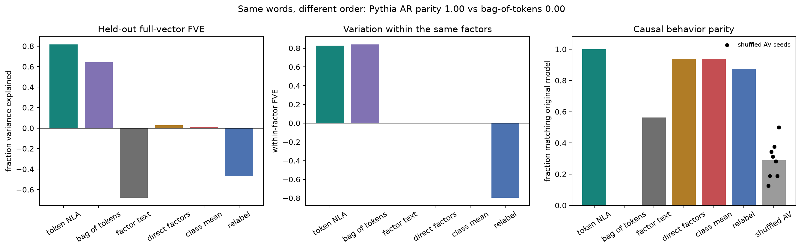

# [7.4] Mini Natural Language Autoencoders

By the end of this notebook, you will have shown that a supervised text bottleneck recovers held-out Pythia states and behavior because its contextual reconstructor beats an order-blind bag-of-tokens bypass even when factor states share the same token multiset within each lexical context.

```python
GT_TIER = "GT-3"
EXERCISE_ID = "7_4_mini_natural_language_autoencoders"
EXPECTED_RUNTIME = "90-120 minutes; approximately one minute for the complete CUDA experiment"
REQUIRES_GPU = True
```

## Core Question

Does readable text preserve row-specific information in an activation, or only name a class whose mean vector is enough for one narrow behavior?

## Learning Objectives

- create a precommitted train/eval split with one composition omitted per lexical context;
- predict GPT-NeoX token sequences directly from activations;
- pass generated text through a frozen LM before reconstructing activations;
- implement the paper's row-normalized FVE rather than raw-vector FVE;
- build an order-blind bag-of-tokens reconstructor and make it fail visibly;
- reject factor-only, direct-factor, prototype, mean-conditioned, relabeled, and shuffled shortcuts;
- verify hook identity parity, row locality, and a nonzero causal text edit.

## Cold Open

Consider four Pythia states associated with `Today, the key`, `Today, the keys`, `Yesterday, the key`, and `Yesterday, the keys`. We withhold one combination. Every explanation uses exactly the same token multiset within a lexical context; only word order carries number and time:

> The topic is key. The wording is plain. Quantity is one not many. Time is current not earlier.

The opposite factor state swaps `one` with `many` and `current` with `earlier`. A bag-of-tokens model therefore sees identical counts. The contextual reconstructor receives the ordered tokens, wrapped in the paper's AR prompt. If the bag-of-tokens path matches it, the language model did no necessary work.

## Background

The NLA paper defines an activation verbalizer (AV), `activation -> text`, and an activation
reconstructor (AR), `text -> activation`. Its AR runs explanation tokens through an LM and applies
an affine head to the final hidden state. Our smaller reconstructor reads Pythia's layer-4 state at
the final token and fits an affine head. The AV here is a supervised token-level ridge model; the
paper instead fine-tunes an LM and trains it with RL.

This is not an unsupervised reproduction of the paper. It is a controlled, inspectable warm-start designed to make the language path and its strongest obvious bypass executable on one local GPU.

The paper normalizes every gold and reconstructed activation before computing FVE. Skipping prediction normalization changes the metric. Within-factor FVE then subtracts each number/time mean before scoring, so a four-prototype decoder gets zero by construction.

<details>
<summary>Common bugs</summary>

- Comparing raw activation magnitudes instead of row-normalized directions.
- Letting a control use a shorter prompt format, which confounds content removal with distribution shift.
- Calling text a bottleneck without testing an order-blind lexical decoder.
- Reporting behavior parity alone even though four class prototypes can preserve the same answer.

</details>

```python
import sys
from dataclasses import dataclass
from pathlib import Path
from typing import Any, Sequence

import matplotlib.pyplot as plt
import pandas as pd
import torch as t
import torch.nn.functional as F
from IPython.display import Image, display

chapter = "chapter7_activation_to_language"
root_dir = next(p for p in [Path.cwd(), *Path.cwd().parents] if (p / chapter).exists())
if str(root_dir) not in sys.path:
    sys.path.append(str(root_dir))

from chapter7_activation_to_language.exercises.part4_mini_natural_language_autoencoders import tests
# tests.test_* wrappers run the same focused checks under pytest.

PYTHIA_MODEL_ID = 'EleutherAI/pythia-70m-deduped'
PYTHIA_REVISION = 'e93a9faa9c77e5d09219f6c868bfc7a1bd65593c'
PYTHIA_HIDDEN_STATE_INDEX = 4
PYTHIA_PATCH_BLOCK_INDEX = 3
AGREEMENT_CANDIDATES = (' is', ' are', ' was', ' were')
FACTOR_STATES = ((1.0, 1.0), (-1.0, 1.0), (1.0, -1.0), (-1.0, -1.0))
AR_PROMPT = 'Summary of the following text: <text>{}</text> <summary>'
NOUN_PAIRS = (('key', 'keys'), ('book', 'books'), ('car', 'cars'), ('tree', 'trees'), ('house', 'houses'), ('chair', 'chairs'), ('table', 'tables'), ('door', 'doors'), ('apple', 'apples'), ('river', 'rivers'), ('city', 'cities'), ('student', 'students'), ('teacher', 'teachers'), ('doctor', 'doctors'), ('artist', 'artists'), ('pilot', 'pilots'))
TEMPLATE_PAIRS = (('Today, the {}', 'Yesterday, the {}', 'plain'), ('Currently, the {}', 'Earlier, the {}', 'formal'))

@dataclass(frozen=True)
class AgreementExample:
    prompt: str
    explanation: str
    factors: tuple[float, float]
    context_id: int
    noun_lemma: str
    style: str
    held_out_state: tuple[float, float]
    split: str


@dataclass(frozen=True)
class PythiaNLADataset:
    train_activations: t.Tensor
    eval_activations: t.Tensor
    train_factors: t.Tensor
    eval_factors: t.Tensor
    train_examples: tuple[AgreementExample, ...]
    eval_examples: tuple[AgreementExample, ...]
    eval_input_ids: t.Tensor
    eval_attention_mask: t.Tensor
    eval_positions: t.Tensor
    candidate_token_ids: t.Tensor
    original_candidate_logits: t.Tensor


@dataclass(frozen=True)
class ExplanationTokens:
    token_ids: t.Tensor
    local_token_ids: t.Tensor
    attention_mask: t.Tensor
    vocabulary_token_ids: t.Tensor
    eos_token_id: int


@dataclass(frozen=True)
class TokenVerbalizer:
    weight: t.Tensor
    vocabulary_token_ids: t.Tensor
    eos_token_id: int
    sequence_length: int


@dataclass(frozen=True)
class GeneratedExplanations:
    texts: tuple[str, ...]
    token_ids: t.Tensor
    local_token_ids: t.Tensor
    logits: t.Tensor


@dataclass(frozen=True)
class TokenReconstructor:
    feature_mean: t.Tensor
    target_mean: t.Tensor
    weight: t.Tensor
    output_norm: float


@dataclass(frozen=True)
class ReconstructionMetrics:
    fve: float
    within_factor_fve: float
    normalized_mse: float
    mean_cosine: float
    distinct_rows: int


@dataclass(frozen=True)
class InterventionResult:
    base_text: str
    edited_text: str
    activation_delta_norm: float
    selected_logit_change: float
    other_rows_max_logit_change: float
    original_winner: str
    intervened_winner: str
    candidate_logits: t.Tensor


@dataclass(frozen=True)
class MiniNLAReport:
    train_count: int
    eval_count: int
    token_accuracy: float
    exact_text_accuracy: float
    reconstruction: ReconstructionMetrics
    bag_of_tokens: ReconstructionMetrics
    prompt_only_factor: ReconstructionMetrics
    direct_factor: ReconstructionMetrics
    class_mean: ReconstructionMetrics
    mean_conditioned: ReconstructionMetrics
    lexical_relabel: ReconstructionMetrics
    original_task_accuracy: float
    reconstructed_task_accuracy: float
    behavior_parity_accuracy: float
    bag_of_tokens_behavior_parity: float
    oracle_text_behavior_parity: float
    omitted_composition_end_to_end_parity: float
    prompt_only_factor_behavior_parity: float
    direct_factor_behavior_parity: float
    class_mean_behavior_parity: float
    lexical_relabel_behavior_parity: float
    same_context_token_multiset_fraction: float
    shuffled_fve_by_seed: tuple[tuple[int, float], ...]
    shuffled_behavior_parity_by_seed: tuple[tuple[int, float], ...]
    identity_max_logit_error: float
    intervention: InterventionResult
    generated_explanations: tuple[str, ...]
    rows: tuple[dict[str, Any], ...]


@dataclass(frozen=True)
class MiniNLAExperiment:
    report: MiniNLAReport
    verbalizer: TokenVerbalizer
    reconstructor: TokenReconstructor
    reconstructed_activations: t.Tensor


def _require_informative_matrix(values: t.Tensor, name: str) -> t.Tensor:
    if values.ndim != 2 or len(values) < 2:
        raise ValueError(f"{name} must be a matrix with at least two rows.")
    values = values.detach().float()
    if not bool(t.isfinite(values).all()):
        raise ValueError(f"{name} must contain only finite values.")
    if float(values.norm(dim=-1).mean()) <= 1e-8:
        raise ValueError(f"{name} cannot be zero-filled.")
    if float((values - values.mean(dim=0)).square().sum()) <= 1e-8:
        raise ValueError(f"{name} must contain row-level variation.")
    return values


def _batched_final_hidden(
    tokenizer,
    model,
    texts: Sequence[str],
    *,
    hidden_state_index: int,
    batch_size: int = 64,
) -> t.Tensor:
    if not texts:
        raise ValueError("texts must be nonempty.")
    if batch_size <= 0:
        raise ValueError("batch_size must be positive.")
    device = next(model.parameters()).device
    chunks: list[t.Tensor] = []
    for start in range(0, len(texts), batch_size):
        encoded = tokenizer(
            list(texts[start : start + batch_size]),
            return_tensors="pt",
            padding=True,
            add_special_tokens=False,
        ).to(device)
        positions = encoded.attention_mask.sum(dim=1) - 1
        rows = t.arange(len(positions), device=device)
        with t.inference_mode():
            output = model(**encoded, output_hidden_states=True, use_cache=False)
        chunks.append(
            output.hidden_states[hidden_state_index][rows, positions].detach().cpu().float()
        )
    return t.cat(chunks)


def _candidate_indices(factors: t.Tensor) -> t.Tensor:
    if factors.ndim != 2 or factors.shape[1] != 2:
        raise ValueError("factors must have shape [batch, 2].")
    plural_offset = factors[:, 0].lt(0).long()
    earlier_offset = 2 * factors[:, 1].lt(0).long()
    return plural_offset + earlier_offset


def load_pythia(device: str | t.device = "cpu"):
    """Load the pinned checkpoint from the local cache on an explicit device."""

    from transformers import AutoModelForCausalLM, AutoTokenizer

    tokenizer = AutoTokenizer.from_pretrained(
        PYTHIA_MODEL_ID,
        revision=PYTHIA_REVISION,
        local_files_only=True,
    )
    tokenizer.pad_token = tokenizer.eos_token
    tokenizer.padding_side = "right"
    model = AutoModelForCausalLM.from_pretrained(
        PYTHIA_MODEL_ID,
        revision=PYTHIA_REVISION,
        local_files_only=True,
        dtype=t.float32,
    ).to(device)
    model.eval()
    return tokenizer, model


def load_pythia_cpu():
    """Compatibility wrapper used by the fast CPU exercise tests."""

    return load_pythia("cpu")


def cache_pythia_nla_dataset(tokenizer, model) -> PythiaNLADataset:
    """Cache real layer-4 states for the compositional agreement split."""

    train_examples, eval_examples = build_agreement_examples()
    candidate_ids: list[int] = []
    for candidate in AGREEMENT_CANDIDATES:
        encoded = tokenizer.encode(candidate, add_special_tokens=False)
        if len(encoded) != 1:
            raise RuntimeError(f"agreement candidate {candidate!r} is not one token.")
        candidate_ids.append(encoded[0])
    candidate_token_ids = t.tensor(candidate_ids, dtype=t.long)

    def cache(examples: Sequence[AgreementExample]):
        texts = [example.prompt for example in examples]
        device = next(model.parameters()).device
        encoded = tokenizer(
            texts, return_tensors="pt", padding=True, add_special_tokens=False
        ).to(device)
        positions = encoded.attention_mask.sum(dim=1) - 1
        rows = t.arange(len(examples), device=device)
        with t.inference_mode():
            output = model(**encoded, output_hidden_states=True, use_cache=False)
        activations = (
            output.hidden_states[PYTHIA_HIDDEN_STATE_INDEX][rows, positions]
            .detach()
            .cpu()
            .float()
        )
        logits = (
            output.logits[rows, positions][:, candidate_token_ids.to(device)]
            .detach()
            .cpu()
            .float()
        )
        return activations, logits, encoded.to("cpu"), positions.to("cpu")

    train_activations, _, _, _ = cache(train_examples)
    eval_activations, original_logits, eval_encoded, eval_positions = cache(eval_examples)
    _require_informative_matrix(train_activations, "train_activations")
    _require_informative_matrix(eval_activations, "eval_activations")
    return PythiaNLADataset(
        train_activations=train_activations,
        eval_activations=eval_activations,
        train_factors=t.tensor([example.factors for example in train_examples]),
        eval_factors=t.tensor([example.factors for example in eval_examples]),
        train_examples=train_examples,
        eval_examples=eval_examples,
        eval_input_ids=eval_encoded.input_ids,
        eval_attention_mask=eval_encoded.attention_mask,
        eval_positions=eval_positions,
        candidate_token_ids=candidate_token_ids,
        original_candidate_logits=original_logits,
    )


t.set_num_threads(min(8, t.get_num_threads()))
```

### Exercise - precommit a compositional split

> ```yaml
> Difficulty: easy
> Importance: high
> You should spend up to 10-15 minutes on this exercise.
> ```

Implement `natural_language_explanation` and `build_agreement_examples`. Each of 32 noun/style contexts must contribute three training rows and one evaluation row. Rotate the withheld state so all four number/time states occur eight times in evaluation.

<details>
<summary>Expected output</summary>

`96` training examples, `32` evaluation examples, and `8` held-out rows for each of the four states.

</details>

<details>
<summary>Help - reveal guidance</summary>

Use `context_id % 4` to select the held-out state. Encode each binary factor by swapping word order inside a fixed two-word contrast, so all four states retain identical token counts.

</details>

<details>
<summary>Interpretation</summary>

Every evaluation sequence is an unseen composition, and a count-based model receives exactly the same lexical evidence for all four states in one context.

</details>

<details>
<summary>Solution</summary>

```python
def natural_language_explanation(
    noun_lemma: str,
    style: str,
    factors: tuple[float, float],
) -> str:
    """Write a readable explanation whose factor values are encoded by word order.

    Within one noun/style context, all four factor states have exactly the same
    token multiset. This makes a bag-of-tokens reconstructor a genuine order-free
    control for the contextual Pythia reconstructor.
    """

    if not noun_lemma.isalpha() or not style.isalpha():
        raise ValueError("noun_lemma and style must be alphabetic words.")
    if factors not in FACTOR_STATES:
        raise ValueError("factors must be one of the four precommitted states.")
    quantity = "one not many" if factors[0] > 0 else "many not one"
    time = "current not earlier" if factors[1] > 0 else "earlier not current"
    return (
        f"The topic is {noun_lemma}. The wording is {style}. "
        f"Quantity is {quantity}. Time is {time}."
    )


def build_agreement_examples() -> tuple[tuple[AgreementExample, ...], tuple[AgreementExample, ...]]:
    """Build 32 lexical contexts with one composition withheld in each."""

    train: list[AgreementExample] = []
    evaluation: list[AgreementExample] = []
    for noun_index, (singular, plural) in enumerate(NOUN_PAIRS):
        for template_index, (current_template, earlier_template, style) in enumerate(TEMPLATE_PAIRS):
            context_id = 2 * noun_index + template_index
            held_out_state = FACTOR_STATES[context_id % len(FACTOR_STATES)]
            for number_factor, noun in ((1.0, singular), (-1.0, plural)):
                for time_factor, template in ((1.0, current_template), (-1.0, earlier_template)):
                    factors = (number_factor, time_factor)
                    split = "eval" if factors == held_out_state else "train"
                    example = AgreementExample(
                        prompt=template.format(noun),
                        explanation=natural_language_explanation(singular, style, factors),
                        factors=factors,
                        context_id=context_id,
                        noun_lemma=singular,
                        style=style,
                        held_out_state=held_out_state,
                        split=split,
                    )
                    (evaluation if split == "eval" else train).append(example)
    return tuple(train), tuple(evaluation)

```

</details>

```python
def natural_language_explanation(noun_lemma: str, style: str, factors: tuple[float, float]) -> str:
    raise NotImplementedError()

def build_agreement_examples() -> tuple[tuple[AgreementExample, ...], tuple[AgreementExample, ...]]:
    raise NotImplementedError()

tests.check_compositional_split(build_agreement_examples)

assert t.cuda.is_available(), 'This notebook requires CUDA.'
tokenizer, model = load_pythia('cuda')
dataset = cache_pythia_nla_dataset(tokenizer, model)
```

### Exercise - tokenize complete explanations

> ```yaml
> Difficulty: easy
> Importance: high
> You should spend up to 10-15 minutes on this exercise.
> ```

Implement `tokenize_explanations`. Keep actual GPT-NeoX token IDs, add EOS, and map only the observed tokens into a compact local vocabulary for the small AV output head.

<details>
<summary>Expected output</summary>

The 96 training explanations form a `[96, 24]` token tensor over `33` actual tokenizer tokens.

</details>

<details>
<summary>Help - reveal guidance</summary>

Pad with EOS and use an equality broadcast against `vocabulary_token_ids` to obtain local IDs. Reject evaluation tokens absent from the training vocabulary.

</details>

<details>
<summary>Interpretation</summary>

A compact token vocabulary is ordinary language-model machinery. It is not a phrase lookup: the model predicts 24 token positions and never receives an explanation ID.

</details>

<details>
<summary>Solution</summary>

```python
def tokenize_explanations(
    tokenizer,
    explanations: Sequence[str],
    *,
    vocabulary_token_ids: t.Tensor | None = None,
) -> ExplanationTokens:
    """Tokenize complete explanations into a small GPT-NeoX token vocabulary."""

    if not explanations or any(not text.strip() for text in explanations):
        raise ValueError("explanations must be nonempty strings.")
    eos_token_id = int(tokenizer.eos_token_id)
    sequences = [tokenizer.encode(text, add_special_tokens=False) + [eos_token_id] for text in explanations]
    if vocabulary_token_ids is None:
        vocabulary_token_ids = t.tensor(sorted({token for row in sequences for token in row}), dtype=t.long)
    else:
        vocabulary_token_ids = vocabulary_token_ids.detach().long().cpu()
    if vocabulary_token_ids.ndim != 1 or len(vocabulary_token_ids) < 2:
        raise ValueError("vocabulary_token_ids must contain at least two token IDs.")
    if len(t.unique(vocabulary_token_ids)) != len(vocabulary_token_ids):
        raise ValueError("vocabulary_token_ids cannot contain duplicates.")

    sequence_length = max(len(row) for row in sequences)
    token_ids = t.full((len(sequences), sequence_length), eos_token_id, dtype=t.long)
    attention_mask = t.zeros_like(token_ids, dtype=t.bool)
    for row_index, row in enumerate(sequences):
        token_ids[row_index, : len(row)] = t.tensor(row)
        attention_mask[row_index, : len(row)] = True
    matches = token_ids[..., None].eq(vocabulary_token_ids[None, None, :])
    if not bool(matches.any(dim=-1).all()):
        missing = t.unique(token_ids[~matches.any(dim=-1)]).tolist()
        raise ValueError(f"explanation contains token IDs outside the training vocabulary: {missing}")
    local_token_ids = matches.float().argmax(dim=-1)
    return ExplanationTokens(
        token_ids=token_ids,
        local_token_ids=local_token_ids,
        attention_mask=attention_mask,
        vocabulary_token_ids=vocabulary_token_ids,
        eos_token_id=eos_token_id,
    )

```

</details>

```python
def permute_explanation_tokens(tokens: ExplanationTokens, permutation: t.Tensor) -> ExplanationTokens:
    """Permute text targets while retaining the same token vocabulary."""

    if permutation.shape != (len(tokens.token_ids),) or not t.equal(
        t.sort(permutation).values, t.arange(len(permutation))
    ):
        raise ValueError("permutation must contain every row index exactly once.")
    return ExplanationTokens(
        token_ids=tokens.token_ids[permutation],
        local_token_ids=tokens.local_token_ids[permutation],
        attention_mask=tokens.attention_mask[permutation],
        vocabulary_token_ids=tokens.vocabulary_token_ids,
        eos_token_id=tokens.eos_token_id,
    )


def tokenize_explanations(tokenizer, explanations: Sequence[str], *, vocabulary_token_ids: t.Tensor | None=None) -> ExplanationTokens:
    raise NotImplementedError()

tests.check_tokenization(tokenizer, dataset.train_examples, tokenize_explanations)
```

### Exercise - fit an activation-to-token verbalizer

> ```yaml
> Difficulty: medium
> Importance: high
> You should spend up to 15-20 minutes on this exercise.
> ```

Implement `fit_token_verbalizer`, `generate_token_explanations`, and `token_generation_accuracy`. Fit token logits at every position from normalized layer-4 activations, then decode token IDs back to text.

<details>
<summary>Expected output</summary>

`792` logits per row (`24 x 33`) and `32/32` exact held-out explanations.

</details>

<details>
<summary>Help - reveal guidance</summary>

Flatten position and vocabulary only for the ridge target. Reshape before `argmax`, recover actual token IDs through the vocabulary tensor, and stop decoding at EOS.

</details>

<details>
<summary>Interpretation</summary>

The AV is supervised and position-wise, but it emits a real sequence. No factor tensor or fixed explanation selector lies between activation and text.

</details>

<details>
<summary>Solution</summary>

```python
def fit_token_verbalizer(
    train_activations: t.Tensor,
    train_tokens: ExplanationTokens,
    *,
    ridge: float = 0.1,
) -> TokenVerbalizer:
    """Fit activation-to-token logits at every sequence position."""

    activations = _require_informative_matrix(train_activations, "train_activations")
    if len(activations) != len(train_tokens.token_ids):
        raise ValueError("activation and token rows must align.")
    if ridge <= 0:
        raise ValueError("ridge must be positive.")
    vocabulary_size = len(train_tokens.vocabulary_token_ids)
    targets = F.one_hot(train_tokens.local_token_ids, vocabulary_size).float()
    features = F.normalize(activations, dim=-1)
    design = t.cat([t.ones(len(features), 1), features], dim=1)
    dual = design @ design.T + ridge * t.eye(len(design))
    weight = design.T @ t.linalg.solve(dual, targets.reshape(len(targets), -1))
    return TokenVerbalizer(
        weight=weight,
        vocabulary_token_ids=train_tokens.vocabulary_token_ids,
        eos_token_id=train_tokens.eos_token_id,
        sequence_length=train_tokens.token_ids.shape[1],
    )


def generate_token_explanations(
    tokenizer,
    activations: t.Tensor,
    verbalizer: TokenVerbalizer,
) -> GeneratedExplanations:
    """Generate natural-language token sequences without phrase lookup."""

    if activations.ndim != 2 or activations.shape[1] + 1 != verbalizer.weight.shape[0]:
        raise ValueError("activations and verbalizer must share d_model.")
    design = t.cat([t.ones(len(activations), 1), F.normalize(activations.float(), dim=-1)], dim=1)
    vocabulary_size = len(verbalizer.vocabulary_token_ids)
    logits = (design @ verbalizer.weight).reshape(
        len(activations), verbalizer.sequence_length, vocabulary_size
    )
    local_token_ids = logits.argmax(dim=-1)
    token_ids = verbalizer.vocabulary_token_ids[local_token_ids]
    texts: list[str] = []
    for row in token_ids.tolist():
        end = row.index(verbalizer.eos_token_id) if verbalizer.eos_token_id in row else len(row)
        texts.append(tokenizer.decode(row[:end], clean_up_tokenization_spaces=False))
    return GeneratedExplanations(
        texts=tuple(texts),
        token_ids=token_ids,
        local_token_ids=local_token_ids,
        logits=logits,
    )


def token_generation_accuracy(
    generated: GeneratedExplanations,
    targets: ExplanationTokens,
) -> tuple[float, float]:
    """Return masked token accuracy and whole-sequence exact match."""

    if generated.token_ids.shape != targets.token_ids.shape:
        raise ValueError("generated and target token tensors must have the same shape.")
    correct = generated.token_ids.eq(targets.token_ids)
    token_accuracy = correct[targets.attention_mask].float().mean().item()
    exact_match = (correct | ~targets.attention_mask).all(dim=1).float().mean().item()
    return token_accuracy, exact_match

```

</details>

```python
def fit_token_verbalizer(train_activations: t.Tensor, train_tokens: ExplanationTokens, *, ridge: float=0.1) -> TokenVerbalizer:
    raise NotImplementedError()

def generate_token_explanations(tokenizer, activations: t.Tensor, verbalizer: TokenVerbalizer) -> GeneratedExplanations:
    raise NotImplementedError()

def token_generation_accuracy(generated: GeneratedExplanations, targets: ExplanationTokens) -> tuple[float, float]:
    raise NotImplementedError()

tests.check_token_verbalizer(tokenizer, dataset, tokenize_explanations, fit_token_verbalizer, generate_token_explanations, token_generation_accuracy)
```

### Exercise - run explanation tokens through the AR language model

> ```yaml
> Difficulty: medium
> Importance: high
> You should spend up to 10-15 minutes on this exercise.
> ```

Implement `encode_reconstructor_text`. Wrap each explanation in the paper's fixed AR prompt, run Pythia, and read the layer-4 hidden state at the final non-padding token.

<details>
<summary>Expected output</summary>

A `[batch, 512]` feature matrix; reordering the same words changes the feature by a nonzero amount.

</details>

<details>
<summary>Help - reveal guidance</summary>

Reuse `_batched_final_hidden` with `PYTHIA_HIDDEN_STATE_INDEX`. Do not parse words into factors before this call.

</details>

<details>
<summary>Interpretation</summary>

This LM pass is the mechanism missing from the failed version. The affine head comes after contextual token processing, as in the paper.

</details>

<details>
<summary>Solution</summary>

```python
def encode_reconstructor_text(
    tokenizer,
    model,
    explanations: Sequence[str],
    *,
    batch_size: int = 64,
) -> t.Tensor:
    """Run explanation tokens through the LM and read its layer-4 final token."""

    wrapped = [AR_PROMPT.format(text) for text in explanations]
    return _batched_final_hidden(
        tokenizer,
        model,
        wrapped,
        hidden_state_index=PYTHIA_HIDDEN_STATE_INDEX,
        batch_size=batch_size,
    )

```

</details>

```python
def encode_reconstructor_text(tokenizer, model, explanations: Sequence[str], *, batch_size: int=64) -> t.Tensor:
    raise NotImplementedError()

tests.check_reconstructor_language_features(tokenizer, model, encode_reconstructor_text)
```

### Exercise - fit the normalized activation reconstructor

> ```yaml
> Difficulty: medium
> Importance: high
> You should spend up to 15-20 minutes on this exercise.
> ```

Implement `fit_token_reconstructor`, `decode_text_features`, and `reconstruct_from_explanations`. Fit normalized targets, then restore the mean training activation norm for patching.

<details>
<summary>Expected output</summary>

A `[32, 512]` held-out reconstruction matrix with more than four distinct rows.

</details>

<details>
<summary>Help - reveal guidance</summary>

Center normalized text features and activation targets separately. Solve the ridge problem in the 96-row dual space.

</details>

<details>
<summary>Interpretation</summary>

The output head is affine, but its input is a contextual LM representation of all 24 text tokens. Replacing their order changes the reconstructed vector.

</details>

<details>
<summary>Solution</summary>

```python
def fit_token_reconstructor(
    train_text_features: t.Tensor,
    train_activations: t.Tensor,
    *,
    ridge: float = 1e-3,
) -> TokenReconstructor:
    """Fit the affine AR head after contextual token processing."""

    text_features = _require_informative_matrix(train_text_features, "train_text_features")
    activations = _require_informative_matrix(train_activations, "train_activations")
    if len(text_features) != len(activations):
        raise ValueError("text features and activations must have the same batch size.")
    if ridge <= 0:
        raise ValueError("ridge must be positive.")
    features = F.normalize(text_features, dim=-1)
    targets = F.normalize(activations, dim=-1)
    feature_mean = features.mean(dim=0)
    target_mean = targets.mean(dim=0)
    centered_features = features - feature_mean
    centered_targets = targets - target_mean
    dual = centered_features @ centered_features.T + ridge * t.eye(
        len(features), device=features.device, dtype=features.dtype
    )
    weight = centered_features.T @ t.linalg.solve(dual, centered_targets)
    return TokenReconstructor(
        feature_mean=feature_mean,
        target_mean=target_mean,
        weight=weight,
        output_norm=float(activations.norm(dim=-1).mean()),
    )


def decode_text_features(text_features: t.Tensor, reconstructor: TokenReconstructor) -> t.Tensor:
    """Apply the AR head and restore the training-set mean activation norm."""

    if text_features.ndim != 2 or text_features.shape[1] != reconstructor.weight.shape[0]:
        raise ValueError("text features and reconstructor must share d_model.")
    features = F.normalize(text_features.float(), dim=-1)
    reconstructed = (features - reconstructor.feature_mean) @ reconstructor.weight
    reconstructed = reconstructed + reconstructor.target_mean
    return F.normalize(reconstructed, dim=-1) * reconstructor.output_norm


def reconstruct_from_explanations(
    tokenizer,
    model,
    explanations: Sequence[str],
    reconstructor: TokenReconstructor,
) -> t.Tensor:
    """Run the complete natural-language-token-to-activation path."""

    features = encode_reconstructor_text(tokenizer, model, explanations)
    return decode_text_features(features, reconstructor)

```

</details>

```python
def fit_token_reconstructor(train_text_features: t.Tensor, train_activations: t.Tensor, *, ridge: float=0.001) -> TokenReconstructor:
    raise NotImplementedError()

def decode_text_features(text_features: t.Tensor, reconstructor: TokenReconstructor) -> t.Tensor:
    raise NotImplementedError()

def reconstruct_from_explanations(tokenizer, model, explanations: Sequence[str], reconstructor: TokenReconstructor) -> t.Tensor:
    raise NotImplementedError()

train_texts = tuple(x.explanation for x in dataset.train_examples)
train_features = encode_reconstructor_text(tokenizer, model, train_texts)
reconstructor = fit_token_reconstructor(train_features, dataset.train_activations)
eval_texts = tuple(x.explanation for x in dataset.eval_examples)
reconstructed = reconstruct_from_explanations(tokenizer, model, eval_texts, reconstructor)
assert reconstructed.shape == dataset.eval_activations.shape
assert t.unique(reconstructed.round(decimals=4), dim=0).shape[0] == 32
```

### Exercise - measure variation and reject prototype collapse

> ```yaml
> Difficulty: medium
> Importance: high
> You should spend up to 15-20 minutes on this exercise.
> ```

Implement FVE, within-factor FVE, row counting, the combined metric, and `assert_nonprototype_reconstruction`.

<details>
<summary>Expected output</summary>

Held-out FVE above `0.75`, within-factor FVE above `0.75`, and `32` distinct rows.

</details>

<details>
<summary>Help - reveal guidance</summary>

Normalize every original and reconstructed row first. For within-factor FVE, subtract the two group means separately before comparing residuals. Guard both denominators against zero.

</details>

<details>
<summary>Interpretation</summary>

Agreement behavior can survive class means. Within-factor FVE makes that shortcut visible instead of rewarding it.

</details>

<details>
<summary>Solution</summary>

```python
def fraction_variance_explained(original: t.Tensor, reconstructed: t.Tensor) -> float:
    """Compute the NLA paper's row-normalized held-out FVE."""

    if original.shape != reconstructed.shape or original.ndim != 2:
        raise ValueError("original and reconstructed must be aligned matrices.")
    original = F.normalize(original.float(), dim=-1)
    reconstructed = F.normalize(reconstructed.float(), dim=-1)
    denominator = (original - original.mean(dim=0)).square().sum()
    if float(denominator) <= 1e-8:
        raise ValueError("original activations need nonzero held-out variance.")
    return float(1 - (reconstructed - original).square().sum() / denominator)


def within_factor_fve(original: t.Tensor, reconstructed: t.Tensor, factors: t.Tensor) -> float:
    """Measure reconstruction after removing each factor combination's mean."""

    if original.shape != reconstructed.shape or factors.shape != (len(original), 2):
        raise ValueError("original, reconstructed, and factor rows must align.")
    original = F.normalize(original.float(), dim=-1)
    reconstructed = F.normalize(reconstructed.float(), dim=-1)
    factors = factors.to(original.device)
    original_residuals: list[t.Tensor] = []
    reconstructed_residuals: list[t.Tensor] = []
    for state in FACTOR_STATES:
        mask = factors.eq(
            t.tensor(state, device=factors.device, dtype=factors.dtype)
        ).all(dim=1)
        if int(mask.sum()) < 2:
            raise ValueError("each factor state needs at least two rows.")
        original_group = original[mask]
        reconstructed_group = reconstructed[mask]
        original_residuals.append(original_group - original_group.mean(dim=0))
        reconstructed_residuals.append(reconstructed_group - reconstructed_group.mean(dim=0))
    original_residual = t.cat(original_residuals)
    reconstructed_residual = t.cat(reconstructed_residuals)
    denominator = original_residual.square().sum()
    if float(denominator) <= 1e-8:
        raise ValueError("within-factor activations need nonzero variance.")
    return float(1 - (reconstructed_residual - original_residual).square().sum() / denominator)


def count_distinct_rows(values: t.Tensor, *, atol: float = 1e-2) -> int:
    """Count rows up to an explicit Euclidean tolerance."""

    if values.ndim != 2 or atol <= 0:
        raise ValueError("values must be a matrix and atol must be positive.")
    representatives: list[t.Tensor] = []
    for row in values:
        if not any(float((row - representative).norm()) <= atol for representative in representatives):
            representatives.append(row)
    return len(representatives)


def reconstruction_metrics(
    original: t.Tensor,
    reconstructed: t.Tensor,
    factors: t.Tensor,
) -> ReconstructionMetrics:
    """Score full-vector and within-factor reconstruction on aligned rows."""

    normalized_error = (
        F.normalize(original, dim=-1) - F.normalize(reconstructed, dim=-1)
    ).square().sum(dim=-1).mean()
    return ReconstructionMetrics(
        fve=fraction_variance_explained(original, reconstructed),
        within_factor_fve=within_factor_fve(original, reconstructed, factors),
        normalized_mse=float(normalized_error),
        mean_cosine=float(F.cosine_similarity(original, reconstructed, dim=-1).mean()),
        distinct_rows=count_distinct_rows(reconstructed),
    )


def assert_nonprototype_reconstruction(
    original: t.Tensor,
    reconstructed: t.Tensor,
    factors: t.Tensor,
    *,
    minimum_within_factor_fve: float = 0.2,
) -> None:
    """Reject four-vector prototypes even if they preserve agreement labels."""

    factor_state_count = len(t.unique(factors, dim=0))
    distinct_rows = count_distinct_rows(reconstructed)
    if distinct_rows <= factor_state_count:
        raise AssertionError(
            f"prototype collapse: found {distinct_rows} rows for {factor_state_count} factor states."
        )
    score = within_factor_fve(original, reconstructed, factors)
    if score <= minimum_within_factor_fve:
        raise AssertionError(
            f"within-factor activation variation was not reconstructed: FVE={score:.3f}."
        )

```

</details>

```python
def fraction_variance_explained(original: t.Tensor, reconstructed: t.Tensor) -> float:
    raise NotImplementedError()

def within_factor_fve(original: t.Tensor, reconstructed: t.Tensor, factors: t.Tensor) -> float:
    raise NotImplementedError()

def count_distinct_rows(values: t.Tensor, *, atol: float=0.01) -> int:
    raise NotImplementedError()

def reconstruction_metrics(original: t.Tensor, reconstructed: t.Tensor, factors: t.Tensor) -> ReconstructionMetrics:
    raise NotImplementedError()

def assert_nonprototype_reconstruction(original: t.Tensor, reconstructed: t.Tensor, factors: t.Tensor, *, minimum_within_factor_fve: float=0.2) -> None:
    raise NotImplementedError()

tests.check_nonprototype_metrics(dataset.eval_activations, reconstructed, dataset.eval_factors, reconstruction_metrics, assert_nonprototype_reconstruction)
```

### Exercise - build the order-blind lexical bypass

> ```yaml
> Difficulty: medium
> Importance: high
> You should spend up to 15-20 minutes on this exercise.
> ```

Implement `bag_of_tokens_features`. Count actual tokenizer IDs, fit the same ridge reconstruction head to those counts, and verify that all four factor states in each lexical context are indistinguishable to this control.

<details>
<summary>Expected output</summary>

All 32 contexts have identical token-count rows across their four states. The held-out bag-of-tokens FVE is about `0.64`, below the contextual path by more than `0.10`.

</details>

<details>
<summary>Help - reveal guidance</summary>

Build the vocabulary from training text only. Ignore unseen evaluation IDs rather than giving the control privileged features. Reuse the same normalized ridge head for a fair comparison.

</details>

<details>
<summary>Interpretation</summary>

The bypass still reconstructs noun/style context well, so its within-factor FVE can look strong. It fails on the order-coded factors and causal behavior; both views belong in the final figure.

</details>

<details>
<summary>Solution</summary>

```python
def bag_of_tokens_features(
    tokenizer,
    explanations: Sequence[str],
    *,
    vocabulary_token_ids: t.Tensor | None = None,
) -> tuple[t.Tensor, t.Tensor]:
    """Count explanation tokens while deliberately discarding their order."""

    if not explanations or any(not text.strip() for text in explanations):
        raise ValueError("explanations must be nonempty strings.")
    sequences = [tokenizer.encode(text, add_special_tokens=False) for text in explanations]
    if vocabulary_token_ids is None:
        vocabulary_token_ids = t.tensor(
            sorted({token_id for sequence in sequences for token_id in sequence}),
            dtype=t.long,
        )
    else:
        vocabulary_token_ids = vocabulary_token_ids.detach().cpu().long()
    if vocabulary_token_ids.ndim != 1 or len(vocabulary_token_ids) < 2:
        raise ValueError("vocabulary_token_ids must be a one-dimensional vocabulary.")
    if len(t.unique(vocabulary_token_ids)) != len(vocabulary_token_ids):
        raise ValueError("vocabulary_token_ids cannot contain duplicates.")

    token_to_column = {
        int(token_id): column for column, token_id in enumerate(vocabulary_token_ids)
    }
    counts = t.zeros(len(sequences), len(vocabulary_token_ids))
    for row, sequence in enumerate(sequences):
        for token_id in sequence:
            column = token_to_column.get(int(token_id))
            if column is not None:
                counts[row, column] += 1
    return counts, vocabulary_token_ids

```

</details>

```python
def bag_of_tokens_features(tokenizer, explanations: Sequence[str], *, vocabulary_token_ids: t.Tensor | None=None) -> tuple[t.Tensor, t.Tensor]:
    raise NotImplementedError()

tests.check_bag_of_tokens_control(tokenizer, dataset, bag_of_tokens_features, fit_token_reconstructor, decode_text_features, fraction_variance_explained)
```

### Exercise - construct shortcut controls

> ```yaml
> Difficulty: medium
> Importance: high
> You should spend up to 15-20 minutes on this exercise.
> ```

Implement factor-only text, lexical relabeling, class-mean replacement, and the direct two-factor decoder. These are explicit negative baselines and must never feed the learned NLA path.

<details>
<summary>Expected output</summary>

The format-matched fixed-context control and direct-factor decoder remain far below the contextual path; class means have exactly four rows; noun relabeling damages row alignment.

</details>

<details>
<summary>Help - reveal guidance</summary>

Use the full explanation template with a fixed known noun/style for the factor-text control. For prototypes, average only within an explicit factor state.

</details>

<details>
<summary>Interpretation</summary>

These controls separate three claims: carrying factor labels, preserving behavior, and reconstructing row-specific activation variation.

</details>

<details>
<summary>Solution</summary>

```python
def prompt_only_factor_explanations(examples: Sequence[AgreementExample]) -> tuple[str, ...]:
    """Hold context fixed while preserving the exact explanation template."""

    return tuple(
        natural_language_explanation("key", "plain", example.factors)
        for example in examples
    )


def lexically_relabel_explanations(examples: Sequence[AgreementExample]) -> tuple[str, ...]:
    """Cycle noun meanings while preserving factor words and sentence shape."""

    if len(examples) < 4:
        raise ValueError("lexical relabeling needs at least four examples.")
    offset = 4
    relabeled = tuple(
        natural_language_explanation(
            examples[(index + offset) % len(examples)].noun_lemma,
            example.style,
            example.factors,
        )
        for index, example in enumerate(examples)
    )
    if any(text == example.explanation for text, example in zip(relabeled, examples)):
        raise AssertionError("lexical relabeling must change every explanation.")
    return relabeled


def factor_prototype_reconstruction(
    train_activations: t.Tensor,
    train_factors: t.Tensor,
    eval_factors: t.Tensor,
) -> t.Tensor:
    """Explicit class-mean baseline used only to expose prototype shortcuts."""

    if train_factors.shape != (len(train_activations), 2) or eval_factors.ndim != 2:
        raise ValueError("activation and factor rows must align.")
    train_factors = train_factors.to(train_activations.device)
    eval_factors = eval_factors.to(train_activations.device)
    rows: list[t.Tensor] = []
    for factors in eval_factors:
        mask = train_factors.eq(factors).all(dim=1)
        if not bool(mask.any()):
            raise ValueError("every evaluation state needs training rows for the prototype baseline.")
        rows.append(train_activations[mask].mean(dim=0))
    return t.stack(rows)


def replace_with_factor_prototypes(activations: t.Tensor, factors: t.Tensor) -> t.Tensor:
    """Replace every row by its factor mean for an adversarial training control."""

    return factor_prototype_reconstruction(activations, factors, factors)


def fit_direct_factor_decoder(
    train_factors: t.Tensor,
    train_activations: t.Tensor,
    *,
    ridge: float = 1e-3,
) -> t.Tensor:
    """Fit the forbidden two-scalar shortcut as an explicit negative baseline."""

    activations = _require_informative_matrix(train_activations, "train_activations")
    if train_factors.shape != (len(activations), 2):
        raise ValueError("train_factors must align with activations.")
    train_factors = train_factors.to(activations.device)
    design = t.cat(
        [
            t.ones(
                len(train_factors),
                1,
                device=activations.device,
                dtype=activations.dtype,
            ),
            train_factors.to(dtype=activations.dtype),
        ],
        dim=1,
    )
    regularizer = ridge * t.eye(
        design.shape[1], device=design.device, dtype=design.dtype
    )
    regularizer[0, 0] = 0
    return t.linalg.solve(design.T @ design + regularizer, design.T @ activations)


def decode_direct_factors(factors: t.Tensor, parameters: t.Tensor) -> t.Tensor:
    """Apply the two-scalar baseline; never use this in the NLA path."""

    if factors.ndim != 2 or factors.shape[1] != 2 or parameters.shape[0] != 3:
        raise ValueError("expected factors [batch, 2] and parameters [3, d_model].")
    factors = factors.to(device=parameters.device, dtype=parameters.dtype)
    return t.cat(
        [
            t.ones(
                len(factors),
                1,
                device=parameters.device,
                dtype=parameters.dtype,
            ),
            factors,
        ],
        dim=1,
    ) @ parameters

```

</details>

```python
def prompt_only_factor_explanations(examples: Sequence[AgreementExample]) -> tuple[str, ...]:
    raise NotImplementedError()

def lexically_relabel_explanations(examples: Sequence[AgreementExample]) -> tuple[str, ...]:
    raise NotImplementedError()

def factor_prototype_reconstruction(train_activations: t.Tensor, train_factors: t.Tensor, eval_factors: t.Tensor) -> t.Tensor:
    raise NotImplementedError()

def replace_with_factor_prototypes(activations: t.Tensor, factors: t.Tensor) -> t.Tensor:
    raise NotImplementedError()

def fit_direct_factor_decoder(train_factors: t.Tensor, train_activations: t.Tensor, *, ridge: float=0.001) -> t.Tensor:
    raise NotImplementedError()

def decode_direct_factors(factors: t.Tensor, parameters: t.Tensor) -> t.Tensor:
    raise NotImplementedError()

prototype = factor_prototype_reconstruction(dataset.train_activations, dataset.train_factors, dataset.eval_factors)
assert count_distinct_rows(prototype) == 4
```

### Exercise - patch one real row safely

> ```yaml
> Difficulty: hard
> Importance: high
> You should spend up to 20-25 minutes on this exercise.
> ```

Implement `patch_pythia_candidate_logits`, `candidate_accuracy`, `behavior_parity`, and `run_text_edit_intervention`. The hook must support all-row replacement and a declared row subset.

<details>
<summary>Expected output</summary>

Identity replacement reproduces logits exactly; a one-row edit changes row 0 by more than `1e-3` and changes every other row by exactly zero.

</details>

<details>
<summary>Help - reveal guidance</summary>

Clone hook output before writing. Index both the batch row and that row's final-token position. Always remove the hook in `finally`.

</details>

<details>
<summary>Interpretation</summary>

Identity parity validates the hook site. Single-row locality validates indexing. The AR edit difference supplies a real causal vector rather than a displayed text-only toy.

</details>

<details>
<summary>Solution</summary>

```python
def patch_pythia_candidate_logits(
    model,
    dataset: PythiaNLADataset,
    replacements: t.Tensor,
    *,
    row_indices: Sequence[int] | None = None,
) -> t.Tensor:
    """Patch all rows or a declared subset and return every row's candidate logits."""

    device = next(model.parameters()).device
    if row_indices is None:
        row_indices = tuple(range(len(dataset.eval_activations)))
    rows = t.tensor(tuple(row_indices), dtype=t.long)
    if len(rows) == 0 or len(t.unique(rows)) != len(rows):
        raise ValueError("row_indices must be nonempty and unique.")
    if int(rows.min()) < 0 or int(rows.max()) >= len(dataset.eval_activations):
        raise ValueError("row_indices are outside the evaluation batch.")
    if replacements.shape != (len(rows), dataset.eval_activations.shape[1]):
        raise ValueError("replacements must have shape [selected_rows, d_model].")
    if not bool(t.isfinite(replacements).all()):
        raise ValueError("replacements must be finite.")

    def replace_selected_rows(_module, _inputs, output):
        hidden = output[0] if isinstance(output, tuple) else output
        hidden = hidden.clone()
        device_rows = rows.to(hidden.device)
        positions = dataset.eval_positions[rows].to(hidden.device)
        hidden[device_rows, positions] = replacements.to(hidden)
        return (hidden, *output[1:]) if isinstance(output, tuple) else hidden

    handle = model.gpt_neox.layers[PYTHIA_PATCH_BLOCK_INDEX].register_forward_hook(
        replace_selected_rows
    )
    all_rows = t.arange(len(dataset.eval_activations), device=device)
    try:
        with t.inference_mode():
            output = model(
                input_ids=dataset.eval_input_ids.to(device),
                attention_mask=dataset.eval_attention_mask.to(device),
                use_cache=False,
            )
        logits = output.logits[all_rows, dataset.eval_positions.to(device)]
        return logits[:, dataset.candidate_token_ids.to(device)].detach().cpu().float()
    finally:
        handle.remove()


def candidate_accuracy(candidate_logits: t.Tensor, factors: t.Tensor) -> float:
    """Score the four-way grammatical target without a label lookup table."""

    targets = _candidate_indices(factors).to(candidate_logits.device)
    return float(candidate_logits.argmax(dim=1).eq(targets).float().mean())


def behavior_parity(candidate_logits: t.Tensor, original_candidate_logits: t.Tensor) -> float:
    """Measure whether a patch preserves the target model's own choices."""

    if candidate_logits.shape != original_candidate_logits.shape:
        raise ValueError("candidate logit tensors must align.")
    return float(
        candidate_logits.argmax(dim=1).eq(original_candidate_logits.argmax(dim=1)).float().mean()
    )


def run_text_edit_intervention(
    tokenizer,
    model,
    dataset: PythiaNLADataset,
    reconstructor: TokenReconstructor,
    *,
    row_index: int,
    base_text: str,
    edited_text: str,
    strength: float = 1.0,
) -> InterventionResult:
    """Apply an AR(edit)-AR(base) steering vector to exactly one real row."""

    if not 0 <= row_index < len(dataset.eval_activations):
        raise ValueError("row_index is outside the evaluation batch.")
    if not t.isfinite(t.tensor(strength)) or strength == 0:
        raise ValueError("strength must be finite and nonzero.")
    reconstructions = reconstruct_from_explanations(
        tokenizer, model, (base_text, edited_text), reconstructor
    )
    delta = strength * (reconstructions[1] - reconstructions[0])
    replacement = dataset.eval_activations[row_index] + delta
    patched_logits = patch_pythia_candidate_logits(
        model,
        dataset,
        replacement[None, :],
        row_indices=(row_index,),
    )
    logit_change = (patched_logits - dataset.original_candidate_logits).abs()
    other_rows = t.arange(len(patched_logits)) != row_index
    original_winner = AGREEMENT_CANDIDATES[
        int(dataset.original_candidate_logits[row_index].argmax())
    ].strip()
    intervened_winner = AGREEMENT_CANDIDATES[int(patched_logits[row_index].argmax())].strip()
    return InterventionResult(
        base_text=base_text,
        edited_text=edited_text,
        activation_delta_norm=float(delta.norm()),
        selected_logit_change=float(logit_change[row_index].max()),
        other_rows_max_logit_change=float(logit_change[other_rows].max()),
        original_winner=original_winner,
        intervened_winner=intervened_winner,
        candidate_logits=patched_logits[row_index],
    )

```

</details>

```python
def patch_pythia_candidate_logits(model, dataset: PythiaNLADataset, replacements: t.Tensor, *, row_indices: Sequence[int] | None=None) -> t.Tensor:
    raise NotImplementedError()

def candidate_accuracy(candidate_logits: t.Tensor, factors: t.Tensor) -> float:
    raise NotImplementedError()

def behavior_parity(candidate_logits: t.Tensor, original_candidate_logits: t.Tensor) -> float:
    raise NotImplementedError()

def run_text_edit_intervention(tokenizer, model, dataset: PythiaNLADataset, reconstructor: TokenReconstructor, *, row_index: int, base_text: str, edited_text: str, strength: float=1.0) -> InterventionResult:
    raise NotImplementedError()

tests.check_identity_and_locality(model, dataset, patch_pythia_candidate_logits)
```

## Signature Result

Run the full pipeline once. The first table exposes actual prompts, generated token sequences, original Pythia choices, reconstructed choices, and per-row cosine. The figure then makes the shortcut comparison visible. No result is loaded from a verification report.



```python
def _counterfactual_explanation(example: AgreementExample) -> str:
    flipped = (-example.factors[0], example.factors[1])
    return natural_language_explanation(example.noun_lemma, example.style, flipped)


def _metrics_for(
    original: t.Tensor,
    candidates: dict[str, t.Tensor],
    factors: t.Tensor,
) -> dict[str, ReconstructionMetrics]:
    return {
        name: reconstruction_metrics(original, reconstructed, factors)
        for name, reconstructed in candidates.items()
    }


def evaluate_mini_nla(
    tokenizer,
    model,
    dataset: PythiaNLADataset,
    *,
    shuffle_seeds: Sequence[int] = tuple(range(8)),
) -> MiniNLAExperiment:
    """Run the held-out token NLA and all adversarial controls."""

    train_texts = tuple(example.explanation for example in dataset.train_examples)
    eval_texts = tuple(example.explanation for example in dataset.eval_examples)
    train_tokens = tokenize_explanations(tokenizer, train_texts)
    eval_tokens = tokenize_explanations(
        tokenizer,
        eval_texts,
        vocabulary_token_ids=train_tokens.vocabulary_token_ids,
    )
    verbalizer = fit_token_verbalizer(dataset.train_activations, train_tokens)
    generated = generate_token_explanations(tokenizer, dataset.eval_activations, verbalizer)
    token_accuracy, exact_text_accuracy = token_generation_accuracy(generated, eval_tokens)

    train_text_features = encode_reconstructor_text(tokenizer, model, train_texts)
    reconstructor = fit_token_reconstructor(train_text_features, dataset.train_activations)
    generated_features = encode_reconstructor_text(tokenizer, model, generated.texts)
    learned = decode_text_features(generated_features, reconstructor)
    oracle = reconstruct_from_explanations(tokenizer, model, eval_texts, reconstructor)

    train_bag_features, bag_vocabulary = bag_of_tokens_features(tokenizer, train_texts)
    eval_bag_features, _ = bag_of_tokens_features(
        tokenizer,
        eval_texts,
        vocabulary_token_ids=bag_vocabulary,
    )
    train_bag_features = train_bag_features.to(dataset.train_activations.device)
    eval_bag_features = eval_bag_features.to(dataset.eval_activations.device)
    bag_reconstructor = fit_token_reconstructor(
        train_bag_features,
        dataset.train_activations,
    )
    bag_reconstruction = decode_text_features(eval_bag_features, bag_reconstructor)

    factor_texts = prompt_only_factor_explanations(dataset.eval_examples)
    factor_text_reconstruction = reconstruct_from_explanations(
        tokenizer, model, factor_texts, reconstructor
    )
    lexical_texts = lexically_relabel_explanations(dataset.eval_examples)
    lexical_reconstruction = reconstruct_from_explanations(
        tokenizer, model, lexical_texts, reconstructor
    )
    class_mean_reconstruction = factor_prototype_reconstruction(
        dataset.train_activations, dataset.train_factors, dataset.eval_factors
    )
    direct_parameters = fit_direct_factor_decoder(
        dataset.train_factors, dataset.train_activations
    )
    direct_reconstruction = decode_direct_factors(dataset.eval_factors, direct_parameters)
    mean_conditioned_targets = replace_with_factor_prototypes(
        dataset.train_activations, dataset.train_factors
    )
    mean_conditioned_head = fit_token_reconstructor(
        train_text_features, mean_conditioned_targets
    )
    mean_conditioned_reconstruction = decode_text_features(
        encode_reconstructor_text(tokenizer, model, eval_texts), mean_conditioned_head
    )

    candidates = {
        "reconstruction": learned,
        "bag_of_tokens": bag_reconstruction,
        "prompt_only_factor": factor_text_reconstruction,
        "direct_factor": direct_reconstruction,
        "class_mean": class_mean_reconstruction,
        "mean_conditioned": mean_conditioned_reconstruction,
        "lexical_relabel": lexical_reconstruction,
    }
    metrics = _metrics_for(dataset.eval_activations, candidates, dataset.eval_factors)
    assert_nonprototype_reconstruction(
        dataset.eval_activations, learned, dataset.eval_factors
    )

    identity_logits = patch_pythia_candidate_logits(
        model, dataset, dataset.eval_activations
    )
    learned_logits = patch_pythia_candidate_logits(model, dataset, learned)
    bag_logits = patch_pythia_candidate_logits(model, dataset, bag_reconstruction)
    oracle_logits = patch_pythia_candidate_logits(model, dataset, oracle)
    factor_logits = patch_pythia_candidate_logits(model, dataset, factor_text_reconstruction)
    direct_logits = patch_pythia_candidate_logits(model, dataset, direct_reconstruction)
    class_mean_logits = patch_pythia_candidate_logits(model, dataset, class_mean_reconstruction)
    lexical_logits = patch_pythia_candidate_logits(model, dataset, lexical_reconstruction)

    shuffled_fve: list[tuple[int, float]] = []
    shuffled_parity: list[tuple[int, float]] = []
    for seed in shuffle_seeds:
        generator = t.Generator().manual_seed(int(seed))
        permutation = t.randperm(len(train_tokens.token_ids), generator=generator)
        shuffled_tokens = permute_explanation_tokens(train_tokens, permutation)
        shuffled_verbalizer = fit_token_verbalizer(
            dataset.train_activations, shuffled_tokens
        )
        shuffled_text = generate_token_explanations(
            tokenizer, dataset.eval_activations, shuffled_verbalizer
        )
        shuffled_reconstruction = reconstruct_from_explanations(
            tokenizer, model, shuffled_text.texts, reconstructor
        )
        shuffled_logits = patch_pythia_candidate_logits(
            model, dataset, shuffled_reconstruction
        )
        shuffled_fve.append(
            (int(seed), fraction_variance_explained(dataset.eval_activations, shuffled_reconstruction))
        )
        shuffled_parity.append(
            (int(seed), behavior_parity(shuffled_logits, dataset.original_candidate_logits))
        )

    first_example = dataset.eval_examples[0]
    intervention = run_text_edit_intervention(
        tokenizer,
        model,
        dataset,
        reconstructor,
        row_index=0,
        base_text=generated.texts[0],
        edited_text=_counterfactual_explanation(first_example),
    )
    if intervention.activation_delta_norm <= 1e-3 or intervention.selected_logit_change <= 1e-3:
        raise AssertionError("the text edit must have a nonzero activation and causal logit effect.")

    targets = _candidate_indices(dataset.eval_factors)
    original_winners = dataset.original_candidate_logits.argmax(dim=1)
    reconstructed_winners = learned_logits.argmax(dim=1)
    all_examples = (*dataset.train_examples, *dataset.eval_examples)
    all_bag_features, _ = bag_of_tokens_features(
        tokenizer,
        tuple(example.explanation for example in all_examples),
    )
    multiset_matches = []
    for context_id in sorted({example.context_id for example in all_examples}):
        rows_for_context = [
            index
            for index, example in enumerate(all_examples)
            if example.context_id == context_id
        ]
        reference = all_bag_features[rows_for_context[0]]
        multiset_matches.append(
            all(t.equal(reference, all_bag_features[index]) for index in rows_for_context[1:])
        )
    rows = tuple(
        {
            "prompt": example.prompt,
            "generated explanation": explanation,
            "target": AGREEMENT_CANDIDATES[int(target)].strip(),
            "original": AGREEMENT_CANDIDATES[int(original)].strip(),
            "reconstructed": AGREEMENT_CANDIDATES[int(reconstructed)].strip(),
            "behavior preserved": bool(original == reconstructed),
            "row cosine": float(
                F.cosine_similarity(
                    dataset.eval_activations[index : index + 1],
                    learned[index : index + 1],
                )
            ),
        }
        for index, (example, explanation, target, original, reconstructed) in enumerate(
            zip(
                dataset.eval_examples,
                generated.texts,
                targets.tolist(),
                original_winners.tolist(),
                reconstructed_winners.tolist(),
            )
        )
    )

    report = MiniNLAReport(
        train_count=len(dataset.train_examples),
        eval_count=len(dataset.eval_examples),
        token_accuracy=token_accuracy,
        exact_text_accuracy=exact_text_accuracy,
        reconstruction=metrics["reconstruction"],
        bag_of_tokens=metrics["bag_of_tokens"],
        prompt_only_factor=metrics["prompt_only_factor"],
        direct_factor=metrics["direct_factor"],
        class_mean=metrics["class_mean"],
        mean_conditioned=metrics["mean_conditioned"],
        lexical_relabel=metrics["lexical_relabel"],
        original_task_accuracy=candidate_accuracy(
            dataset.original_candidate_logits, dataset.eval_factors
        ),
        reconstructed_task_accuracy=candidate_accuracy(learned_logits, dataset.eval_factors),
        behavior_parity_accuracy=behavior_parity(
            learned_logits, dataset.original_candidate_logits
        ),
        bag_of_tokens_behavior_parity=behavior_parity(
            bag_logits, dataset.original_candidate_logits
        ),
        oracle_text_behavior_parity=behavior_parity(
            oracle_logits, dataset.original_candidate_logits
        ),
        omitted_composition_end_to_end_parity=behavior_parity(
            learned_logits, dataset.original_candidate_logits
        ),
        prompt_only_factor_behavior_parity=behavior_parity(
            factor_logits, dataset.original_candidate_logits
        ),
        direct_factor_behavior_parity=behavior_parity(
            direct_logits, dataset.original_candidate_logits
        ),
        class_mean_behavior_parity=behavior_parity(
            class_mean_logits, dataset.original_candidate_logits
        ),
        lexical_relabel_behavior_parity=behavior_parity(
            lexical_logits, dataset.original_candidate_logits
        ),
        same_context_token_multiset_fraction=sum(multiset_matches) / len(multiset_matches),
        shuffled_fve_by_seed=tuple(shuffled_fve),
        shuffled_behavior_parity_by_seed=tuple(shuffled_parity),
        identity_max_logit_error=float(
            (identity_logits - dataset.original_candidate_logits).abs().max()
        ),
        intervention=intervention,
        generated_explanations=generated.texts,
        rows=rows,
    )
    return MiniNLAExperiment(
        report=report,
        verbalizer=verbalizer,
        reconstructor=reconstructor,
        reconstructed_activations=learned,
    )


def save_signature_figure(report: MiniNLAReport, path: str | Path) -> Path:
    """Create the learner-facing result from live report values."""

    import matplotlib.pyplot as plt

    path = Path(path)
    path.parent.mkdir(parents=True, exist_ok=True)
    figure, axes = plt.subplots(1, 3, figsize=(15, 4.7))
    labels = ["token NLA", "bag of tokens", "factor text", "direct factors", "class mean", "relabel"]
    fves = [
        report.reconstruction.fve,
        report.bag_of_tokens.fve,
        report.prompt_only_factor.fve,
        report.direct_factor.fve,
        report.class_mean.fve,
        report.lexical_relabel.fve,
    ]
    colors = ["#16837a", "#8172b3", "#6f6f6f", "#b07c26", "#c44e52", "#4c72b0"]
    axes[0].bar(labels, fves, color=colors)
    axes[0].axhline(0, color="black", linewidth=0.8)
    axes[0].set(title="Held-out full-vector FVE", ylabel="fraction variance explained")
    axes[0].tick_params(axis="x", rotation=32)

    within = [
        report.reconstruction.within_factor_fve,
        report.bag_of_tokens.within_factor_fve,
        report.prompt_only_factor.within_factor_fve,
        report.direct_factor.within_factor_fve,
        report.class_mean.within_factor_fve,
        report.lexical_relabel.within_factor_fve,
    ]
    axes[1].bar(labels, within, color=colors)
    axes[1].axhline(0, color="black", linewidth=0.8)
    axes[1].set(title="Variation within the same factors", ylabel="within-factor FVE")
    axes[1].tick_params(axis="x", rotation=32)

    behavior_labels = [
        "token NLA",
        "bag of tokens",
        "factor text",
        "direct factors",
        "class mean",
        "relabel",
        "shuffled AV",
    ]
    shuffle_values = [value for _, value in report.shuffled_behavior_parity_by_seed]
    behavior = [
        report.behavior_parity_accuracy,
        report.bag_of_tokens_behavior_parity,
        report.prompt_only_factor_behavior_parity,
        report.direct_factor_behavior_parity,
        report.class_mean_behavior_parity,
        report.lexical_relabel_behavior_parity,
        sum(shuffle_values) / len(shuffle_values),
    ]
    axes[2].bar(behavior_labels, behavior, color=[*colors, "#9b9b9b"])
    axes[2].scatter(
        [5.82 + 0.05 * index for index in range(len(shuffle_values))],
        shuffle_values,
        color="black",
        s=18,
        label="shuffled AV seeds",
        zorder=3,
    )
    axes[2].set(
        ylim=(0, 1.08),
        title="Causal behavior parity",
        ylabel="fraction matching original model",
    )
    axes[2].tick_params(axis="x", rotation=32)
    axes[2].legend(frameon=False, fontsize=8)
    figure.suptitle(
        "Same words, different order: "
        f"Pythia AR parity {report.behavior_parity_accuracy:.2f} vs "
        f"bag-of-tokens {report.bag_of_tokens_behavior_parity:.2f}"
    )
    figure.tight_layout()
    figure.savefig(path, dpi=180, bbox_inches="tight")
    plt.close(figure)
    return path


def run_gpu_test(max_vram_gb: float = 24.0) -> dict[str, Any]:
    """Run the full text bottleneck on CUDA with no fallback."""

    if max_vram_gb <= 0:
        raise ValueError("max_vram_gb must be positive.")
    if not t.cuda.is_available():
        raise RuntimeError("CUDA is required for 7.4 GPU verification.")
    t.cuda.reset_peak_memory_stats()
    tokenizer, model = load_pythia("cuda")
    dataset = cache_pythia_nla_dataset(tokenizer, model)
    report = evaluate_mini_nla(tokenizer, model, dataset).report
    peak_vram_gb = t.cuda.max_memory_allocated() / 2**30
    if peak_vram_gb > max_vram_gb:
        raise AssertionError(
            f"peak VRAM {peak_vram_gb:.3f} GB exceeds {max_vram_gb:.1f} GB"
        )
    checks = {
        "exact_text": report.exact_text_accuracy == 1.0,
        "normalized_fve": report.reconstruction.fve >= 0.75,
        "beats_bag_of_tokens_fve": (
            report.reconstruction.fve > report.bag_of_tokens.fve + 0.1
        ),
        "behavior_parity": report.behavior_parity_accuracy == 1.0,
        "beats_bag_of_tokens_behavior": (
            report.behavior_parity_accuracy
            > report.bag_of_tokens_behavior_parity + 0.5
        ),
        "same_token_multiset": report.same_context_token_multiset_fraction == 1.0,
        "identity_patch": report.identity_max_logit_error == 0.0,
        "single_row_locality": report.intervention.other_rows_max_logit_change == 0.0,
        "causal_text_edit": report.intervention.selected_logit_change > 1.0,
    }
    if not all(checks.values()):
        failed = [name for name, passed in checks.items() if not passed]
        raise AssertionError(f"7.4 scientific contract failed: {failed}")
    return {
        "accepted": True,
        "cuda_available": True,
        "device": "cuda",
        "gpu_name": t.cuda.get_device_name(),
        "torch_version": t.__version__,
        "cuda_version": t.version.cuda,
        "peak_vram_gb": peak_vram_gb,
        "within_vram_budget": True,
        "model_id": PYTHIA_MODEL_ID,
        "revision": PYTHIA_REVISION,
        "train_count": report.train_count,
        "eval_count": report.eval_count,
        "token_accuracy": report.token_accuracy,
        "exact_text_accuracy": report.exact_text_accuracy,
        "held_out_fve": report.reconstruction.fve,
        "within_factor_fve": report.reconstruction.within_factor_fve,
        "bag_of_tokens_fve": report.bag_of_tokens.fve,
        "bag_of_tokens_within_factor_fve": report.bag_of_tokens.within_factor_fve,
        "behavior_parity": report.behavior_parity_accuracy,
        "bag_of_tokens_behavior_parity": report.bag_of_tokens_behavior_parity,
        "same_context_token_multiset_fraction": report.same_context_token_multiset_fraction,
        "distinct_reconstruction_rows": report.reconstruction.distinct_rows,
        "identity_max_logit_error": report.identity_max_logit_error,
        "intervention_selected_logit_change": report.intervention.selected_logit_change,
        "single_row_other_max_logit_change": report.intervention.other_rows_max_logit_change,
        "checks": checks,
    }


def run_full_experiment(max_vram_gb: float = 24.0):
    """Run the complete pinned CUDA experiment."""

    return run_gpu_test(max_vram_gb=max_vram_gb)


experiment = evaluate_mini_nla(tokenizer, model, dataset)
report = experiment.report
display(pd.DataFrame(report.rows).head(12))
summary = pd.DataFrame({
    'path': ['token NLA', 'bag of tokens', 'factor text', 'direct factors', 'class mean', 'mean-conditioned', 'lexical relabel'],
    'FVE': [report.reconstruction.fve, report.bag_of_tokens.fve, report.prompt_only_factor.fve, report.direct_factor.fve, report.class_mean.fve, report.mean_conditioned.fve, report.lexical_relabel.fve],
    'within-factor FVE': [report.reconstruction.within_factor_fve, report.bag_of_tokens.within_factor_fve, report.prompt_only_factor.within_factor_fve, report.direct_factor.within_factor_fve, report.class_mean.within_factor_fve, report.mean_conditioned.within_factor_fve, report.lexical_relabel.within_factor_fve],
    'behavior parity': [report.behavior_parity_accuracy, report.bag_of_tokens_behavior_parity, report.prompt_only_factor_behavior_parity, report.direct_factor_behavior_parity, report.class_mean_behavior_parity, float('nan'), report.lexical_relabel_behavior_parity],
    'distinct rows': [report.reconstruction.distinct_rows, report.bag_of_tokens.distinct_rows, report.prompt_only_factor.distinct_rows, report.direct_factor.distinct_rows, report.class_mean.distinct_rows, report.mean_conditioned.distinct_rows, report.lexical_relabel.distinct_rows],
})
display(summary)
asset = root_dir / 'chapter7_activation_to_language/instructions/assets/mini_nla_sequence_reconstruction_signature.png'
save_signature_figure(report, asset)
display(Image(filename=str(asset)))
```

<details>
<summary>Interpretation</summary>

The contextual path beats the bag-of-tokens reconstructor on full FVE and causal behavior even though every factor state has the same token counts. The bag model still reconstructs much of the noun/style variation, which is why its within-factor score can be competitive. The figure therefore separates lexical context recovery from order-sensitive factor recovery.

</details>

## Try It Yourself

Edit one generated explanation below. The cell computes `AR(edited) - AR(base)`, adds that vector to one original Pythia state, patches only that row, and displays the before/after candidate logits. This is the real intervention used by the test, not a text-only preview.

```python
PLAY_ROW = 0
PLAY_STRENGTH = 1.0
PLAY_TEXT = "The topic is key. The wording is plain. Quantity is many not one. Time is current not earlier."

play = run_text_edit_intervention(
    tokenizer,
    model,
    dataset,
    experiment.reconstructor,
    row_index=PLAY_ROW,
    base_text=report.generated_explanations[PLAY_ROW],
    edited_text=PLAY_TEXT,
    strength=PLAY_STRENGTH,
)
display(pd.DataFrame({
    "candidate": [word.strip() for word in AGREEMENT_CANDIDATES],
    "original logit": dataset.original_candidate_logits[PLAY_ROW].tolist(),
    "intervened logit": play.candidate_logits.tolist(),
    "logit change": (play.candidate_logits - dataset.original_candidate_logits[PLAY_ROW]).tolist(),
}))
print(f"Selected-row maximum change: {play.selected_logit_change:.3f}")
# Strength zero or unchanged text is an identity control, and is allowed.
assert play.other_rows_max_logit_change == 0.0
```

## Controls and Baselines

- **Prompt-only factor text:** removes noun and style content while retaining quantity and time words.
- **Bag of tokens:** uses the same training texts and ridge head but discards order; all four factor states in a context become identical.
- **Direct factors:** fits the failed two-scalar affine shortcut explicitly as a negative baseline.
- **Class mean:** emits one activation prototype per factor state.
- **Mean-conditioned AR:** trains the same LM-based AR head after replacing every target with its factor mean.
- **Lexical relabeling:** cycles noun meanings while preserving factor words and sentence structure.
- **Shuffled AV:** independently permutes token-sequence targets for eight seeds and reports every seed's FVE and behavior parity.
- **Identity and locality:** exact identity-hook parity and zero change outside a selected patch row.

The seed distribution is visible below; no mean-only summary can hide a favorable shuffled run.

```python
display(pd.DataFrame({
    "seed": [seed for seed, _ in report.shuffled_fve_by_seed],
    "shuffled FVE": [value for _, value in report.shuffled_fve_by_seed],
    "behavior parity": [value for _, value in report.shuffled_behavior_parity_by_seed],
}))
assert report.identity_max_logit_error == 0.0
```

## Anomaly Hunt

Sort the row table by cosine and inspect the lowest five cases. Does the error track noun morphology, wording style, or one held-out state? Then change a noun pair or template pair before rerunning. Precommit the change: do not relabel a row after seeing Pythia's answer.

```python
failures = pd.DataFrame(report.rows).sort_values("row cosine").head(5)
display(failures)
```

## Interpreting the Result

This result establishes a narrow mechanism claim. The AV predicts actual tokenizer sequences. The AR
receives those tokens alone, uses Pythia's contextual language features, and beats a bag-of-tokens
ridge decoder even though their lexical evidence is identical within each context. The 32 evaluation
rows are omitted combinations within known lexical contexts, not unseen-vocabulary generalization.
Pythia itself gets 30/32 grammatical targets correct, while the NLA preserves all 32 of Pythia's
original choices; these are deliberately reported as different metrics.

## Verification Evidence

The independent release job calls `run_full_experiment` and records a
hash-bound `verification_report.json`. That report is supporting provenance for
the CUDA run; it is never loaded to create, grade, or accept the learner result.

## Limitations

- This is a supervised warm-start with templated 24-token explanations, not unsupervised NLA discovery or RL.
- The AV is position-wise ridge regression, not an autoregressive fine-tuned language model.
- Nouns, styles, and individual factor words all appear during training; only their context-specific composition is held out.
- Pythia-70m's layer-4 state and four agreement tokens are a narrow behavior slice.
- The bag-of-tokens model still has strong within-factor FVE because noun/style tokens identify lexical context; the positive result is specifically order-coded factor recovery and behavior.
- High FVE does not establish that every word is faithful. Lexical edits and independent causal tests remain necessary.
- The full Pythia forward computes later layers even though AR features are read at layer 4; this keeps the lesson simple rather than runtime-optimal.

## Further Research

Replace the position-wise AV with a small autoregressive decoder, hold out whole noun families, compare multiple reconstruction layers, or train the AR language trunk rather than freezing it. Keep the class-mean and within-factor tests: a more capable model does not make shortcut checks optional.

## Reading

- [Natural Language Autoencoders Produce Unsupervised Explanations of LLM Activations](https://transformer-circuits.pub/2026/nla/)
- [Open-source NLA training code](https://github.com/kitft/natural_language_autoencoders)
