# [7.5] Predictive Concept Decoders


> **Colab: [exercises](https://colab.research.google.com/github/shinobiultra/ARENA_3.0_Extended/blob/main/chapter7_activation_to_language/exercises/part5_predictive_concept_decoders/7.5_Predictive_Concept_Decoders_exercises.ipynb) |
> [solutions](https://colab.research.google.com/github/shinobiultra/ARENA_3.0_Extended/blob/main/chapter7_activation_to_language/exercises/part5_predictive_concept_decoders/7.5_Predictive_Concept_Decoders_solutions.ipynb)**

If you want to change to dark mode, you can do this by clicking the three horizontal lines in the top-right, then navigating to Settings → Theme.


# Introduction


Here are two one-sentence stories, and what GPT-2 Small expects to come next after three different continuations:

| story | `" After that,"` | `" That made"` | `" Everyone was so"` |
|---|---|---|---|
| *Yesterday, the queen heard the sad news at the hospital.* | `' she'` (0.40), `' the'` (0.15) | `' her'` (0.61), `' it'` (0.09) | `' upset'` (0.13), `' sad'` (0.11) |
| *Yesterday, the kings heard the great news at the hospital.* | `' the'` (0.26), `' they'` (0.24) | `' them'` (0.23), `' the'` (0.12) | `' excited'` (0.20), `' happy'` (0.15) |

GPT-2 has clearly kept track of a few things about each story: whether the subject is one woman or several people, and whether the news was good or bad. A natural guess is that all
of this is summarised in the residual stream at the final `"."`, ready for whatever comes next. (Hold on to that guess: section 4️⃣ puts it to the test.)

Suppose we wanted a **short, human-readable summary** of GPT-2's hidden state at the `"."`, something like *{singular female subject, bad news}*. What would make such a summary
*good*? Three things, at least:

1. **It should be sufficient.** If the summary really captures what the model is thinking, then the summary alone should be enough to predict what the model will do next, under all three continuations.
2. **Its concepts should mean what we think they mean.** If one of the concepts is "female subject", it should be active on held-out stories with female subjects, and not on others.
3. **It should be causally right.** If the summary says "the model will say `she` because of the *female* concept", then removing the female concept from the hidden state should make the model stop saying `she`, by about as much as the summary predicts.

**Predictive Concept Decoders** (PCDs; [Huang, Choi, Johnson, Schwettmann & Steinhardt, 2025](https://arxiv.org/abs/2512.15712)) are built to produce summaries with property 1 by construction. An **encoder** compresses an activation into a sparse list of *concepts* (only $k$ out of $m$ can be active at once), and a **decoder** has to answer questions about the model's behaviour using *only* that list. The whole system is trained end-to-end to *predict what the model does*, not to reconstruct the activation. The hope is that the sparsity forces the encoder to pick out a handful of meaningful concepts, so the bottleneck becomes something we can read and audit.

Property 1 comes for free from the training objective. Properties 2 and 3 do not, and most of this section is about testing them. By the end you'll have:

- built a PCD from scratch (a TopK concept encoder, a question-conditioned decoder, and a KL objective against the model's behaviour), and trained it on a **planted world** where we know exactly which concepts exist and which of them matter;
- shown *why* "predictive" matters, by comparing against a **reconstruction-only bottleneck** (a TopK SAE with the same size and sparsity), which spends its whole budget on loud features that don't affect behaviour at all;
- trained a PCD on GPT-2 Small's residual stream on a templated story dataset, and measured how well its concepts recover four labelled concepts (gender, number, sentiment, location) on held-out stories, against a dense linear probe, random encoders, shuffled activations and shuffled labels;
- tested **causal faithfulness**: you'll remove concepts from GPT-2's residual stream and compare how much its behaviour actually changes with how much the PCD says it should change. This will turn out to be the most interesting (and most sobering) result of the section.

This section assumes you're comfortable with TransformerLens hooks ([1.2] Intro to Mech Interp), linear probes ([1.3.1]), and TopK sparse autoencoders ([1.3.3] / [6.1]). It's
closely related to [1.3.4] / [7.3] Activation Oracles, which also train a decoder to answer questions about activations, but *without* a bottleneck you can inspect.


## Content & Learning Objectives

### 1️⃣ The Concept Bottleneck

You'll build the three pieces of a PCD (a TopK concept encoder, concept embeddings that turn the sparse code into a "soft token", and a question-conditioned decoder) and train it
with a KL objective to predict the behaviour of a planted "model" whose hidden states are built from known concept directions. You'll check which ground-truth directions the
learned concepts align with.

> ##### Learning Objectives
>
> - Understand the PCD architecture: a question-agnostic sparse encoder, and a decoder that answers questions from the concepts alone
> - Implement a TopK bottleneck and a KL-to-behaviour training objective
> - Train a PCD on a planted world with known ground truth, and compare it against an untrained encoder and a marginal-distribution baseline

### 2️⃣ Predictive vs Reconstructive Bottlenecks

The obvious alternative to a PCD is a sparse autoencoder with the same number of latents and the same $k$, trained to reconstruct the activation. You'll show that in a world with
loud-but-irrelevant features, the SAE spends its budget on the wrong things, and you'll build the metrics and controls (AUROC, held-out readout accuracy, shuffled activations,
shuffled labels, random encoders) that make this visible.

> ##### Learning Objectives
>
> - Implement a TopK SAE baseline and compare which subspace each bottleneck spends its $k$ slots on
> - Implement concept-accuracy metrics: best single-latent AUROC and held-out linear readout accuracy
> - Use random-encoder, shuffled-activation and shuffled-label controls to calibrate those metrics

### 3️⃣ PCDs on GPT-2

You'll train a PCD on GPT-2 Small's residual stream at the end of templated stories, with five "questions" (continuations whose next token GPT-2 must predict). You'll inspect the
learned concepts with a latent dashboard, measure concept accuracy on stories with held-out words, and find out which labelled concepts the PCD keeps, which it drops, and why.

> ##### Learning Objectives
>
> - Extract activations and behaviour targets (next-token distributions under several continuations) from a real model
> - Train and audit a PCD on real activations, comparing against an SAE, a no-bottleneck decoder and shuffled controls
> - Interpret what a predictive bottleneck keeps and drops: it keeps a concept only where the concept changes behaviour

### 4️⃣ Causal Faithfulness

A decoder can predict behaviour from correlates of the cause. You'll test whether removing a concept from the activation changes the model's behaviour the way the PCD predicts,
first in the planted world and then in GPT-2, with several kinds of intervention and a norm-matched random control.

> ##### Learning Objectives
>
> - Define and measure causal faithfulness as agreement between predicted and actual behaviour changes under interventions
> - Distinguish a concept's *detection* direction (the encoder row) from its *effect* direction (a mean-difference vector)
> - Understand why a decoder that reads one position can be unfaithful when the model stores information redundantly

### ☆ Bonus

Dead concepts and the paper's auxiliary loss, adding questions that make new concepts appear, multi-position encoders, LLM decoders, and further reading.


## Setup code


```python
import sys
from dataclasses import dataclass
from pathlib import Path
from typing import Callable

import matplotlib.pyplot as plt
import pandas as pd
import torch as t
import torch.nn as nn
import torch.nn.functional as F
from IPython.display import display
from jaxtyping import Float, Int
from torch import Tensor
from tqdm.auto import tqdm
from transformer_lens import HookedTransformer

device = t.device("mps" if t.backends.mps.is_available() else "cuda" if t.cuda.is_available() else "cpu")

# Make sure exercises are in the path
chapter = "chapter7_activation_to_language"
section = "part5_predictive_concept_decoders"
root_dir = next(p for p in [Path.cwd(), *Path.cwd().parents] if (p / chapter).exists())
exercises_dir = root_dir / chapter / "exercises"
section_dir = exercises_dir / section
if str(exercises_dir) not in sys.path:
    sys.path.append(str(exercises_dir))

import part5_predictive_concept_decoders.tests as tests
import part5_predictive_concept_decoders.utils as utils

MAIN = __name__ == "__main__"
```


=== NEW CHAPTER ===


# 1️⃣ The Concept Bottleneck


> ##### Learning Objectives
>
> - Understand the PCD architecture: a question-agnostic sparse encoder, and a decoder that answers questions from the concepts alone
> - Implement a TopK bottleneck and a KL-to-behaviour training objective
> - Train a PCD on a planted world with known ground truth, and compare it against an untrained encoder and a marginal-distribution baseline

## What is a Predictive Concept Decoder?

A PCD has two halves, and the important design decision is what each half is allowed to see.

**The encoder** reads an activation $a \in \mathbb{R}^{d}$ from the subject model and writes a sparse vector of concept activations $z \in \mathbb{R}^{m}$:

$$
z = \text{TopK}_k\Big(\text{ReLU}\big(W_{enc}^\top (a - b_{pre}) + b_{enc}\big)\Big)
$$

where $\text{TopK}_k$ keeps the $k$ largest entries and zeroes the rest. Each of the $m$ coordinates is a "concept", and at most $k \ll m$ of them can be on at once. **The encoder
never sees the question.** It has to commit to one summary of the activation that will be used to answer *every* question.

**The decoder** answers a question $q$ using only the concepts. In the paper, each active concept is re-embedded with a learned matrix $W_{emb}$, the result is fed to an LLM (the
decoder) as a "soft token", and the LLM reads the soft token plus a natural-language question and generates an answer. Ours is a miniature of this: we compute the soft token $s =
W_{emb}^\top z$, add a learned embedding $e_q$ for the question, and pass the sum through a small MLP that outputs a distribution over answers:

$$
s = W_{emb}^\top z, \qquad p_{\text{PCD}}(\,\cdot \mid a, q) = \text{softmax}\big(\text{MLP}(s + e_q)\big)
$$

**The objective is predictive.** The decoder's answers are trained to match *what the subject model actually does*. In the paper, the PCD is pretrained to predict the next 16
tokens of web text from the encoded activations of the 16 tokens before them, and then the decoder (but not the encoder) is finetuned on question-answer pairs. In our miniature,
each "question" is a continuation of the input text (like `" After that,"`), the "answer" is the subject model's next-token distribution after that continuation, and we minimise

$$
\mathcal{L}_{\text{PCD}} = \mathbb{E}_{a}\, \frac{1}{Q}\sum_{q=1}^{Q} D_{KL}\Big(p_{\text{model}}(\cdot \mid a, q) \,\Big\|\, p_{\text{PCD}}(\cdot \mid a, q)\Big).
$$

Nothing in this objective mentions concepts, labels, or reconstruction. The bet is that sparsity plus prediction will produce concepts we can read.


<details>
<summary>Exactly what's the same as the paper, and what's different?</summary>

| | Huang et al. (2025) | This section |
|---|---|---|
| subject model | Llama-3.1-8B-Instruct, layer 15 | a planted linear "model" (parts 1-2), GPT-2 Small layer 10 (parts 3-4) |
| encoder | linear + TopK, $m = 32{,}768$, $k = 16$, applied separately to each of 16 positions | linear + ReLU + TopK, $m = 12$, $k = 3$ or $4$, applied to one position |
| decoder | the same LLM with a LoRA adapter, reading one soft token per position plus a question | a 2-layer MLP reading one soft token plus a learned question embedding |
| training target | corpus text (the true next 16 tokens of FineWeb passages), then QA finetuning | the subject model's own next-token distribution under each question |
| concept evaluation | auto-interp scores, linear recall of user attributes | AUROC and held-out linear readout against labelled concepts |
| causal tests | none reported | concept removal in section 4️⃣ |

The biggest conceptual difference is the target. The paper predicts *text*, which in practice is close to predicting what the model would say (a well-trained model's distribution
is close to the text distribution). We predict the model's own distribution directly, which is cleaner for interpretability (we're explaining the model, not the data) and is also
what makes the causal test in section 4️⃣ well-defined: we can compare the decoder's prediction with the model's actual output under an intervention.

The paper's encoder is $\text{TopK}(W_{enc} a + b_{enc})$ without an explicit ReLU; we apply ReLU after TopK (as in Gao et al.'s TopK SAEs) so that "active" simply means
"positive".
</details>


## A planted world

Before we touch a real model, we'll build a world where we know the right answer. Our planted "subject model" has a 48-dimensional hidden state built from two kinds of ingredients:

- **6 quiet concepts** $c_0, \dots, c_5$. Each is a binary variable (on with probability 0.25) that adds a unit-norm direction $u_i$ to the hidden state. These are the things the model "knows" about its input, and they **determine its behaviour**.
- **8 loud features** $\text{loud}_0, \dots, \text{loud}_7$. Each is on with probability 0.5, with a random magnitude between 2 and 4, along its own direction $v_j$. Think of these as high-variance directions that real residual streams are full of (positional information, token identity, formatting) which happen to be irrelevant to the behaviour we care about. They **never affect behaviour**.

All 14 directions are orthonormal, and there's a little isotropic noise on top:

$$
a = \sum_{i=0}^{5} c_i\, u_i \;+\; \sum_{j=0}^{7} \text{loud}_j\, v_j \;+\; \epsilon
$$

The planted model's behaviour is a set of $Q = 4$ "questions", each with 8 possible answers. For question $q$, the answer logits are a fixed linear function of the activation's
projection onto the concept directions:

$$
p_{\text{model}}(\cdot \mid a, q) = \text{softmax}\big(W^{(q)}\, U a + b^{(q)}\big), \qquad U = [u_0, \dots, u_5]^\top
$$

and each question only depends on a couple of concepts (question 0 on $c_0, c_1$; question 1 on $c_2, c_3$; question 2 on $c_4, c_5$; question 3 on $c_0, c_3, c_5$). So every
concept matters for at least one question, and no loud feature matters for any.

This world is designed to make a specific point: the loud features carry almost all of the activation's variance, and none of its behavioural relevance. Any method that tries to
explain *the activation* will be drawn to the loud features. A method that tries to explain *the behaviour* should ignore them.


```python
D_MODEL = 48
N_CONCEPTS = 6  # quiet concepts: they determine behaviour
N_LOUD = 8  # loud features: high variance, no effect on behaviour
N_QUESTIONS = 4
N_ANSWERS = 8
QUESTION_DEPENDS_ON = [[0, 1], [2, 3], [4, 5], [0, 3, 5]]
TRUE_LABELS = [f"c{i}" for i in range(N_CONCEPTS)] + [f"loud{j}" for j in range(N_LOUD)]


@dataclass
class PlantedWorld:
    concept_dirs: Float[Tensor, "n_concepts d_model"]
    loud_dirs: Float[Tensor, "n_loud d_model"]
    W_behaviour: Float[Tensor, "n_questions n_answers n_concepts"]
    b_behaviour: Float[Tensor, "n_questions n_answers"]


def make_planted_world(seed: int = 0) -> PlantedWorld:
    """Random orthonormal concept/loud directions, and a random sparse linear behaviour readout."""
    generator = t.Generator().manual_seed(seed)
    basis, _ = t.linalg.qr(t.randn(D_MODEL, D_MODEL, generator=generator))
    directions = basis[:, : N_CONCEPTS + N_LOUD].T.contiguous()
    W_behaviour = t.zeros(N_QUESTIONS, N_ANSWERS, N_CONCEPTS)
    for q, concepts in enumerate(QUESTION_DEPENDS_ON):
        W_behaviour[q][:, concepts] = 3.0 * t.randn(N_ANSWERS, len(concepts), generator=generator)
    b_behaviour = t.randn(N_QUESTIONS, N_ANSWERS, generator=generator)
    return PlantedWorld(directions[:N_CONCEPTS], directions[N_CONCEPTS:], W_behaviour, b_behaviour)


def sample_planted(
    world: PlantedWorld,
    n: int,
    seed: int,
    p_concept: float = 0.25,
    p_loud: float = 0.5,
    loud_scale: tuple[float, float] = (2.0, 4.0),
    noise: float = 0.05,
) -> tuple[Float[Tensor, "n d_model"], Float[Tensor, "n n_concepts"], Float[Tensor, "n n_loud"]]:
    """Returns (activations, binary concept labels, loud feature magnitudes)."""
    generator = t.Generator().manual_seed(seed)
    concepts = (t.rand(n, N_CONCEPTS, generator=generator) < p_concept).float()
    lo, hi = loud_scale
    loud_on = (t.rand(n, N_LOUD, generator=generator) < p_loud).float()
    loud = loud_on * (lo + (hi - lo) * t.rand(n, N_LOUD, generator=generator))
    acts = concepts @ world.concept_dirs + loud @ world.loud_dirs + noise * t.randn(n, D_MODEL, generator=generator)
    return acts, concepts, loud


def kl(p_log: Tensor, q_log: Tensor) -> float:
    """Mean KL(p || q) between log-prob tensors, summed over the last dimension and averaged over the rest."""
    return (p_log.exp() * (p_log - q_log)).sum(-1).mean().item()
```


### Exercise - implement the planted model's behaviour

> ```yaml
> Difficulty: 🔴⚪⚪⚪⚪
> Importance: 🔵🔵🔵⚪⚪
>
> You should spend up to 5-10 minutes on this exercise.
> ```

Implement `planted_behaviour`, which takes a batch of activations of shape `(batch, d_model)` and returns the planted model's answer **log-probabilities** for every question, shape
`(batch, n_questions, n_answers)`, using the formula above. Remember to move the world's tensors to the activations' device.


```python
def planted_behaviour(
    world: PlantedWorld, acts: Float[Tensor, "batch d_model"]
) -> Float[Tensor, "batch n_questions n_answers"]:
    """The planted model's answer log-probs for every question: log_softmax(W[q] @ (U a) + b[q])."""
    raise NotImplementedError()


tests.test_planted_behaviour(planted_behaviour, make_planted_world)
```


<details>
<summary>Hint</summary>

First project the activations onto the concept directions (`acts @ world.concept_dirs.T`, shape `(batch, n_concepts)`), then contract with `W_behaviour` over the concept dimension:
`t.einsum("qvc,bc->bqv", W, proj)`. Add the bias and apply `log_softmax` over the last dimension.
</details>


<details><summary>Solution</summary>

```python
def planted_behaviour(
    world: PlantedWorld, acts: Float[Tensor, "batch d_model"]
) -> Float[Tensor, "batch n_questions n_answers"]:
    """The planted model's answer log-probs for every question: log_softmax(W[q] @ (U a) + b[q])."""
    concept_proj = acts @ world.concept_dirs.to(acts.device).T  # (batch, n_concepts)
    logits = t.einsum("qvc,bc->bqv", world.W_behaviour.to(acts.device), concept_proj)
    return (logits + world.b_behaviour.to(acts.device)).log_softmax(dim=-1)
```
</details>


Now let's build the world and sample a training set and a held-out test set. The cell also checks the two claims we made about the world: the loud features dominate the
activation's variance, and deleting them changes nothing about the behaviour, whereas deleting the concepts changes it a lot.


```python
world = make_planted_world(seed=0)
train_acts, train_concepts, train_loud = sample_planted(world, 20_000, seed=1)
test_acts, test_concepts, test_loud = sample_planted(world, 4_000, seed=2)
train_behaviour = planted_behaviour(world, train_acts)
test_behaviour = planted_behaviour(world, test_acts)

total_var = (train_acts - train_acts.mean(0)).pow(2).sum(-1).mean()
concept_var = (train_concepts @ world.concept_dirs).var(0).sum()
loud_var = (train_loud @ world.loud_dirs).var(0).sum()
print(f"Share of activation variance from the 6 quiet concepts: {concept_var / total_var:.1%}")
print(f"Share of activation variance from the 8 loud features: {loud_var / total_var:.1%}\n")


no_loud = planted_behaviour(world, train_acts - train_loud @ world.loud_dirs)
no_concepts = planted_behaviour(world, train_acts - train_concepts @ world.concept_dirs)
print(f"KL(behaviour || behaviour with loud features deleted): {kl(train_behaviour, no_loud):.4f} nats")
print(f"KL(behaviour || behaviour with concepts deleted):      {kl(train_behaviour, no_concepts):.4f} nats")

train_acts, test_acts = train_acts.to(device), test_acts.to(device)
train_behaviour, test_behaviour = train_behaviour.to(device), test_behaviour.to(device)
```


<details>
<summary>Expected output</summary>

<pre style="white-space:pre;overflow-x:auto;line-height:normal;font-family:Menlo,'DejaVu Sans Mono',consolas,'Courier New',monospace">Share of activation variance from the 6 quiet concepts: 5.4%
Share of activation variance from the 8 loud features: 94.0%

KL(behaviour || behaviour with loud features deleted): 0.0000 nats
KL(behaviour || behaviour with concepts deleted):      0.6777 nats</pre>

</details>

So 94% of the variance in the hidden state is in directions the behaviour completely ignores (the KL is exactly zero because the loud directions are orthogonal to the concept
directions), and only 5.4% is in the directions that matter.


## The encoder: a sparse concept bottleneck

The encoder is a TopK sparse code, the same nonlinearity as a TopK SAE (Gao et al., [*Scaling and evaluating sparse autoencoders*](https://arxiv.org/abs/2406.04093), 2024). Given pre-activations $h = W_{enc}^\top(a - b_{pre}) + b_{enc} \in \mathbb{R}^m$, it keeps the $k$ largest entries of each row, sets everything else to zero, and applies a ReLU so that a kept entry can still be "off" if it's negative:

$$
\text{TopK}_k(h)_i = \begin{cases} \max(h_i, 0) & \text{if } h_i \text{ is one of the } k \text{ largest entries of } h \\ 0 & \text{otherwise.}\end{cases}
$$

TopK makes the sparsity level a hard constraint rather than a penalty: there's no L1 coefficient to tune, and the bottleneck can never pass more than $k$ numbers' worth of
information. (It's *not* exactly $k$ numbers' worth of information, since *which* $k$ latents are active also carries information. We'll come back to that.) Gradients flow through
the kept entries only, just like a ReLU.


### Exercise - implement `topk_relu`

> ```yaml
> Difficulty: 🔴⚪⚪⚪⚪
> Importance: 🔵🔵🔵⚪⚪
>
> You should spend up to 5 minutes on this exercise.
> ```

Implement `topk_relu`, which takes pre-activations of shape `(..., m)` and returns a tensor of the same shape where, in each row, only the `k` largest entries are kept (and passed
through a ReLU), and every other entry is zero.


```python
def topk_relu(pre: Float[Tensor, "... m"], k: int) -> Float[Tensor, "... m"]:
    """Keeps the k largest entries of each row (then applies ReLU to them); zeroes everything else."""
    raise NotImplementedError()


tests.test_topk_relu(topk_relu)
```


<details>
<summary>Hint</summary>

`pre.topk(k, dim=-1)` returns the values and indices of the `k` largest entries. Make a tensor of zeros with `t.zeros_like(pre)` and use `.scatter(-1, indices, F.relu(values))` to
put the kept values back in place. `scatter` is differentiable with respect to the values you scatter, so gradients flow through the kept entries.
</details>


<details><summary>Solution</summary>

```python
def topk_relu(pre: Float[Tensor, "... m"], k: int) -> Float[Tensor, "... m"]:
    """Keeps the k largest entries of each row (then applies ReLU to them); zeroes everything else."""
    values, indices = pre.topk(k, dim=-1)
    return t.zeros_like(pre).scatter(-1, indices, F.relu(values))
```
</details>


## The decoder: answering questions from concepts alone

The decoder sees the concepts through a learned **concept embedding** $W_{emb} \in \mathbb{R}^{m \times d_{hidden}}$: each concept $i$ gets an embedding vector $W_{emb}[i]$, and
the soft token is the activation-weighted sum of the embeddings of the active concepts, $s = \sum_i z_i W_{emb}[i]$. You can think of $W_{emb}$ as the decoder's vocabulary of
concepts, and of $s$ as a single "word" made of at most $k$ concepts.

The question enters only on the decoder side, as a learned embedding $e_q$ that's added to the soft token before the MLP. For a batch, it's convenient to answer *every* question at
once: the decoder output has shape `(batch, n_questions, n_answers)`, matching `planted_behaviour`.

Here's the shape bookkeeping for one forward pass:

| tensor | shape |
|---|---|
| `acts` | `(batch, d_model)` |
| `z = encode(acts)` | `(batch, n_latents)`, at most `k` nonzeros per row |
| soft token `z @ W_emb` | `(batch, d_hidden)` |
| plus question embeddings | `(batch, n_questions, d_hidden)` (broadcast `(batch, 1, d_hidden) + (1, n_questions, d_hidden)`) |
| `mlp(...)` = answer logits | `(batch, n_questions, n_answers)` |


### Exercise - implement the `PCD` module

> ```yaml
> Difficulty: 🔴🔴⚪⚪⚪
> Importance: 🔵🔵🔵🔵🔵
>
> You should spend up to 10-15 minutes on this exercise.
> ```

The parameters are defined for you. Implement:

- `encode(acts)`: the TopK concept code $z = \text{TopK}_k(\text{ReLU}(W_{enc}^\top(a - b_{pre}) + b_{enc}))$. Note that `W_enc` has shape `(d_model, n_latents)`, so the pre-activations are `(acts - b_pre) @ W_enc + b_enc`.
- `decode(z)`: the soft token `z @ W_emb`, plus the question embeddings (broadcast so every row gets every question), passed through `self.mlp`. Returns answer **logits** of shape `(batch, n_questions, n_answers)`.

`forward` just composes the two.


```python
class PCD(nn.Module):
    def __init__(self, d_model: int, n_latents: int, k: int, n_questions: int, n_answers: int, d_hidden: int = 128):
        super().__init__()
        self.k = k
        W_enc = t.randn(d_model, n_latents)
        self.W_enc = nn.Parameter(W_enc / W_enc.norm(dim=0, keepdim=True))  # unit-norm reading directions
        self.b_enc = nn.Parameter(t.zeros(n_latents))
        self.b_pre = nn.Parameter(t.zeros(d_model))
        self.W_emb = nn.Parameter(t.randn(n_latents, d_hidden) / n_latents**0.5)  # concept embeddings
        self.question_emb = nn.Parameter(0.1 * t.randn(n_questions, d_hidden))
        self.mlp = nn.Sequential(nn.GELU(), nn.Linear(d_hidden, d_hidden), nn.GELU(), nn.Linear(d_hidden, n_answers))

    def encode(self, acts: Float[Tensor, "batch d_model"]) -> Float[Tensor, "batch n_latents"]:
        raise NotImplementedError()

    def decode(self, z: Float[Tensor, "batch n_latents"]) -> Float[Tensor, "batch n_questions n_answers"]:
        raise NotImplementedError()

    def forward(self, acts: Float[Tensor, "batch d_model"]) -> Float[Tensor, "batch n_questions n_answers"]:
        return self.decode(self.encode(acts))


tests.test_pcd_module(PCD)
```


<details>
<summary>Hint</summary>

For `decode`, compute `soft = z @ self.W_emb` (shape `(batch, d_hidden)`), then `soft[:, None, :] + self.question_emb[None, :, :]` has shape `(batch, n_questions, d_hidden)`.
`nn.Linear` acts on the last dimension, so you can pass this straight into `self.mlp`.
</details>

<details>
<summary>Question - the encoder doesn't see the question, so why isn't this just "a probe followed by a classifier"?</summary>

In a sense it is, and that's the point: a PCD is a probe whose intermediate representation is forced to be a short list of concepts, and whose training signal is the model's
behaviour rather than labels we chose.

The two design decisions that make it more than a probe are:

- **The encoder is question-agnostic.** The same $k$ concepts must serve every question. If we let the encoder see the question, it could pick a different, question-specific summary each time, and the concepts would stop being a description of *the activation*.
- **The training signal is the model's own behaviour**, under many different questions. No labels are needed, so you can train on as much data as you can run the model on, and the concepts are whatever the model's behaviour depends on (which might not be the concepts *you* would have chosen; you'll see this in section 3️⃣).
</details>


<details><summary>Solution</summary>

```python
class PCD(nn.Module):
    def __init__(self, d_model: int, n_latents: int, k: int, n_questions: int, n_answers: int, d_hidden: int = 128):
        super().__init__()
        self.k = k
        W_enc = t.randn(d_model, n_latents)
        self.W_enc = nn.Parameter(W_enc / W_enc.norm(dim=0, keepdim=True))  # unit-norm reading directions
        self.b_enc = nn.Parameter(t.zeros(n_latents))
        self.b_pre = nn.Parameter(t.zeros(d_model))
        self.W_emb = nn.Parameter(t.randn(n_latents, d_hidden) / n_latents**0.5)  # concept embeddings
        self.question_emb = nn.Parameter(0.1 * t.randn(n_questions, d_hidden))
        self.mlp = nn.Sequential(nn.GELU(), nn.Linear(d_hidden, d_hidden), nn.GELU(), nn.Linear(d_hidden, n_answers))

    def encode(self, acts: Float[Tensor, "batch d_model"]) -> Float[Tensor, "batch n_latents"]:
        return topk_relu((acts - self.b_pre) @ self.W_enc + self.b_enc, self.k)

    def decode(self, z: Float[Tensor, "batch n_latents"]) -> Float[Tensor, "batch n_questions n_answers"]:
        soft_token = z @ self.W_emb  # (batch, d_hidden)
        return self.mlp(soft_token[:, None, :] + self.question_emb[None, :, :])

    def forward(self, acts: Float[Tensor, "batch d_model"]) -> Float[Tensor, "batch n_questions n_answers"]:
        return self.decode(self.encode(acts))
```
</details>


## The predictive objective


### Exercise - implement `pcd_loss`

> ```yaml
> Difficulty: 🔴⚪⚪⚪⚪
> Importance: 🔵🔵🔵🔵⚪
>
> You should spend up to 5-10 minutes on this exercise.
> ```

Implement `pcd_loss`, which runs the PCD on a batch of activations and returns the KL divergence from the target (the model's behaviour) to the PCD's prediction:

$$
\frac{1}{B\,Q}\sum_{b=1}^{B}\sum_{q=1}^{Q} D_{KL}\big(p_{\text{model}}(\cdot\mid a_b, q)\,\big\|\,p_{\text{PCD}}(\cdot\mid a_b, q)\big)
$$

The target is given as **log-probabilities** of shape `(batch, n_questions, n_answers)`. As in [7.1], we put the model's distribution first, because we care most about getting
right the answers the model actually puts weight on.

The signature takes `model` rather than `pcd` as its first argument, so that the same training loop can later train an SAE with a different loss function.


```python
def pcd_loss(
    model: nn.Module, acts: Float[Tensor, "batch d_model"], target_logprobs: Float[Tensor, "batch n_questions n_answers"]
) -> Float[Tensor, ""]:
    """Mean over batch and questions of KL(target || model(acts)), summed over answers."""
    raise NotImplementedError()


tests.test_pcd_loss(pcd_loss, PCD)
```


<details>
<summary>Hint</summary>

Compute the PCD's log-probs with `model(acts).log_softmax(dim=-1)`. Then $\sum_v p(v)(\log p(v) - \log \hat p(v))$ is `(target.exp() * (target - pred)).sum(-1)`, and `.mean()`
averages over both the batch and the question dimensions.
</details>


<details><summary>Solution</summary>

```python
def pcd_loss(
    model: nn.Module, acts: Float[Tensor, "batch d_model"], target_logprobs: Float[Tensor, "batch n_questions n_answers"]
) -> Float[Tensor, ""]:
    """Mean over batch and questions of KL(target || model(acts)), summed over answers."""
    pred_logprobs = model(acts).log_softmax(dim=-1)
    return (target_logprobs.exp() * (target_logprobs - pred_logprobs)).sum(dim=-1).mean()
```
</details>


### Exercise - write the training loop

> ```yaml
> Difficulty: 🔴⚪⚪⚪⚪
> Importance: 🔵🔵⚪⚪⚪
>
> You should spend up to 5-10 minutes on this exercise.
> ```

Write a standard training loop, `train_bottleneck`. At each step, sample a random batch of `batch_size` indices (using a `t.Generator` seeded with `seed`, so runs are
reproducible), compute `loss_fn(model, acts[idx], targets[idx])` (or `loss_fn(model, acts[idx], None)` if `targets` is `None`, which we'll need for the SAE), and take an Adam step.
Return the list of losses.


```python
def train_bottleneck(
    model: nn.Module,
    loss_fn: Callable,
    acts: Float[Tensor, "n d_model"],
    targets: Tensor | None = None,
    n_steps: int = 1500,
    batch_size: int = 256,
    lr: float = 3e-3,
    seed: int = 0,
) -> list[float]:
    """Trains `model` in place with Adam on random minibatches; returns the loss at every step."""
    raise NotImplementedError()


tests.test_train_bottleneck(train_bottleneck, PCD, pcd_loss)
```


<details><summary>Solution</summary>

```python
def train_bottleneck(
    model: nn.Module,
    loss_fn: Callable,
    acts: Float[Tensor, "n d_model"],
    targets: Tensor | None = None,
    n_steps: int = 1500,
    batch_size: int = 256,
    lr: float = 3e-3,
    seed: int = 0,
) -> list[float]:
    """Trains `model` in place with Adam on random minibatches; returns the loss at every step."""
    generator = t.Generator().manual_seed(seed)
    optimizer = t.optim.Adam(model.parameters(), lr=lr)
    losses = []
    for _ in tqdm(range(n_steps), leave=False):
        idx = t.randint(0, len(acts), (batch_size,), generator=generator).to(acts.device)
        loss = loss_fn(model, acts[idx], None if targets is None else targets[idx])
        optimizer.zero_grad()
        loss.backward()
        optimizer.step()
        losses.append(loss.item())
    return losses
```
</details>


Let's train a PCD with $m = 12$ concepts and $k = 4$ active at a time. Since 6 concepts each appear with probability 0.25, an activation has 1.5 active concepts on average, and
more than 4 only very rarely, so $k = 4$ is *enough* to describe the behaviour, but much less than the $6 + 8 = 14$ features in the activation.

We'll compare the training loss against two reference points:

- **The marginal baseline**: the KL we'd get by always predicting the average answer distribution, ignoring the activation entirely. A PCD that doesn't beat this has learned nothing about individual inputs.
- **The untrained PCD** at step 0, which tells us where we started.

This takes about 10-30 seconds on a GPU.


```python
N_LATENTS, K = 12, 4

t.manual_seed(0)
pcd = PCD(D_MODEL, N_LATENTS, K, N_QUESTIONS, N_ANSWERS).to(device)
t.manual_seed(0)
untrained_pcd = PCD(D_MODEL, N_LATENTS, K, N_QUESTIONS, N_ANSWERS).to(device)  # control: same init, never trained
pcd_losses = train_bottleneck(pcd, pcd_loss, train_acts, train_behaviour)

marginal = train_behaviour.exp().mean(0, keepdim=True).log()  # always predict the average answer distribution
marginal_kl = kl(test_behaviour, marginal.expand_as(test_behaviour))
utils.plot_training_curves(
    {"PCD (train batches)": pcd_losses},
    title="Training a PCD on the planted world",
    ylabel="KL(model || PCD)  [nats, log scale]",
    baselines={"marginal baseline (held-out)": marginal_kl},
)
```


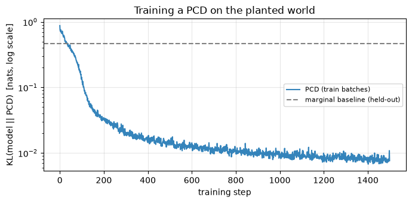


```python
with t.no_grad():
    print(f"Held-out KL, trained PCD:   {pcd_loss(pcd, test_acts, test_behaviour).item():.4f} nats")
    print(f"Held-out KL, untrained PCD: {pcd_loss(untrained_pcd, test_acts, test_behaviour).item():.4f} nats")
    print(f"Held-out KL, marginal:      {marginal_kl:.4f} nats\n")
    z_test = pcd.encode(test_acts)
print(f"Active concepts per example: {(z_test > 0).sum(-1).float().mean():.2f} on average (k = {K})")
print("Firing frequency of each latent:", [round(f, 2) for f in (z_test > 0).float().mean(0).tolist()])
```


<details>
<summary>Expected output</summary>

<pre style="white-space:pre;overflow-x:auto;line-height:normal;font-family:Menlo,'DejaVu Sans Mono',consolas,'Courier New',monospace">Held-out KL, trained PCD:   0.0076 nats
Held-out KL, untrained PCD: 0.8267 nats
Held-out KL, marginal:      0.4679 nats

Active concepts per example: 3.96 on average (k = 4)
Firing frequency of each latent: [0.0, 0.13, 0.56, 0.5, 0.56, 0.0, 0.56, 0.33, 0.22, 0.34, 0.64, 0.12]</pre>

</details>

<details>
<summary>Help - how should I interpret these numbers?</summary>

The trained PCD's held-out KL is 0.0076 nats, about 60 times lower than the marginal baseline (0.468), so it predicts the behaviour of individual examples it has never seen almost
perfectly. The training curve crosses the marginal baseline within the first ~50 steps and flattens out around 0.01 nats. The untrained PCD is *worse* than the marginal baseline
(0.827): a randomly initialised decoder makes confident predictions that have nothing to do with the truth, and KL punishes confident mistakes heavily.

Two things about the code are worth noticing, because they'll come back:

- **The PCD uses all of its slots.** On average 3.96 of the $k = 4$ latents are active, even though only 1.5 planted concepts are active per example. Nothing in the objective rewards leaving a slot empty, so the PCD fills spare slots with whatever helps a little, such as redundant or graded information about the concepts that *are* present. "Sparse" here means "at most $k$", not "as few as possible".
- **Two latents are nearly dead.** Latents 0 and 5 show up as 0.0 above: they fire on only 26 and 7 of the 20,000 training examples. With TopK, a latent that falls behind early rarely wins a slot, so it rarely gets a gradient and doesn't recover. The paper uses an auxiliary loss against this (see the bonus).
</details>


## Which directions did the concepts learn?

The PCD predicts the behaviour well, but has it learned the *concepts*? In the planted world we can answer this directly. Each latent $i$ reads the activation along its encoder
column $W_{enc}[:, i]$. If the PCD has found the planted concepts, each latent's reading direction should be (close to) one of the concept directions $u_j$, and nearly orthogonal
to all of the loud directions $v_j$.


### Exercise - measure latent alignment

> ```yaml
> Difficulty: 🔴⚪⚪⚪⚪
> Importance: 🔵🔵🔵⚪⚪
>
> You should spend up to 5 minutes on this exercise.
> ```

Implement `latent_alignment`, which returns the matrix of cosine similarities between every ground-truth direction (rows of `true_dirs`, shape `(n_true, d_model)`) and every
latent's encoder direction (columns of `W_enc`, shape `(d_model, n_latents)`). The output has shape `(n_true, n_latents)`.


```python
def latent_alignment(
    W_enc: Float[Tensor, "d_model n_latents"], true_dirs: Float[Tensor, "n_true d_model"]
) -> Float[Tensor, "n_true n_latents"]:
    """Cosine similarity between each ground-truth direction and each latent's encoder direction."""
    raise NotImplementedError()


tests.test_latent_alignment(latent_alignment)
```


<details><summary>Solution</summary>

```python
def latent_alignment(
    W_enc: Float[Tensor, "d_model n_latents"], true_dirs: Float[Tensor, "n_true d_model"]
) -> Float[Tensor, "n_true n_latents"]:
    """Cosine similarity between each ground-truth direction and each latent's encoder direction."""
    return F.normalize(true_dirs, dim=-1) @ F.normalize(W_enc, dim=0)
```
</details>


Below, each panel has one row per latent and one column per ground-truth direction; the red line separates the 6 quiet concepts (left) from the 8 loud features (right). The left
panel is the **untrained** PCD (our control: what does a random encoder look like?), the right panel is the trained one.


```python
true_dirs = t.cat([world.concept_dirs, world.loud_dirs]).to(device)
utils.plot_alignment(
    {
        "untrained PCD (control)": latent_alignment(untrained_pcd.W_enc.detach(), true_dirs),
        "trained PCD": latent_alignment(pcd.W_enc.detach(), true_dirs),
    },
    TRUE_LABELS,
    N_CONCEPTS,
    title="Which planted directions does each PCD latent read?",
)
```


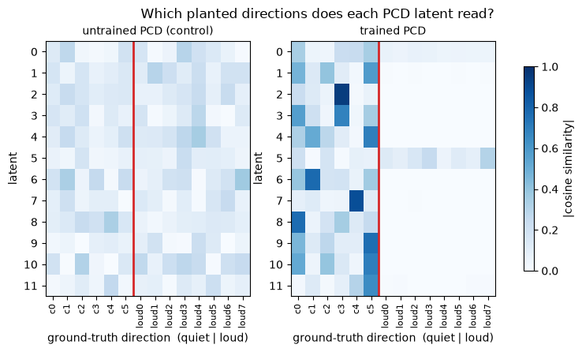


<details>
<summary>Help - how should I interpret this plot?</summary>

The **untrained** encoder's directions are random: every latent has small cosine similarities (almost all below 0.35) with every ground-truth direction, quiet and loud alike.
That's what random unit vectors in 48 dimensions look like.

After training, the picture is lopsided: **everything to the right of the red line is blank** (cosine similarity at most 0.01 for every latent except the two nearly dead ones). No
working latent reads any loud feature, even though those features carry 94% of the variance. Latent 5 has faint loud-feature alignment, but it's one of the two nearly dead latents
(it fires on 7 of 20,000 training examples). The PCD has learned to look only at the 6-dimensional subspace that matters for behaviour.

Within that subspace, the mapping is only partly one-to-one. Some latents are clean single-concept detectors: latent 2 reads c3 (cosine similarity 0.95) and latent 7 reads c4
(0.88), and latents 6 and 8 mostly read c1 (0.78) and c0 (0.77). Others read mixtures: latents 9 and 10, for example, read c5 and c0 together (around 0.7 and 0.5). No latent reads
c2 cleanly; its largest cosine similarity with any latent is 0.40.

This is what we should expect. The objective only asks the code to be *sufficient* for predicting behaviour, and the decoder is a nonlinear MLP, so many different mixtures of
concepts work just as well as the concepts themselves. Sparsity is the only pressure towards one concept per latent, and since the PCD is filling all of its slots anyway, it isn't
a strong one.
</details>


## Summary of 1️⃣

- A PCD is a sparse, question-agnostic encoder followed by a decoder that must answer every question from the concepts alone. It is trained to match the model's behaviour, with no labels and no reconstruction term.
- On the planted world it predicts held-out behaviour almost perfectly (0.0076 nats of KL, against 0.468 for the marginal baseline) from at most 4 active concepts per example.
- Its latents read the quiet, behaviour-relevant subspace and ignore the loud features, even though the loud features carry 94% of the variance. The untrained encoder (same architecture, same initialisation) shows no such preference, so this comes from training, not from the architecture.
- Not every planted concept got a latent of its own: c3, c4, c1 and c0 have fairly clean latents, but about half of the live latents read mixtures of two or three concepts, and c2 has no latent of its own. The PCD also fills all 4 slots on almost every example, although only 1.5 planted concepts are active on average. Prediction tells the PCD *which subspace* matters; only sparsity pushes it towards *one latent per concept*, and that push is weaker.

Is the predictive objective really what made the difference? To find out, we need to train the most natural alternative: a bottleneck of exactly the same shape that tries to
explain the activation instead of the behaviour.


=== NEW CHAPTER ===


# 2️⃣ Predictive vs Reconstructive Bottlenecks


> ##### Learning Objectives
>
> - Implement a TopK SAE baseline and compare which subspace each bottleneck spends its $k$ slots on
> - Implement concept-accuracy metrics: best single-latent AUROC and held-out linear readout accuracy
> - Use random-encoder, shuffled-activation and shuffled-label controls to calibrate those metrics

## The reconstruction-only baseline

A TopK sparse autoencoder has exactly the same encoder as our PCD, but a different job. Instead of answering questions about behaviour, it has to **reconstruct the activation**
from the sparse code:

$$
z = \text{TopK}_k\Big(\text{ReLU}\big(W_{enc}^\top (a - b_{pre}) + b_{enc}\big)\Big), \qquad \hat a = W_{dec}^\top z + b_{pre}, \qquad \mathcal{L}_{\text{SAE}} = \mathbb{E}\,\|a -
\hat a\|_2^2 .
$$

If we give the SAE the same $m = 12$ and $k = 4$ as the PCD, the two bottlenecks have the same capacity, and the only difference is the objective. That makes it the cleanest
possible control for the question "does *predictive* training matter?"

Before running it, make a prediction. The SAE must reconstruct activations in which 94% of the variance comes from the loud features, and it only has 4 slots per example. What will
it spend them on?


### Exercise - implement `TopKSAE` and `sae_loss`

> ```yaml
> Difficulty: 🔴🔴⚪⚪⚪
> Importance: 🔵🔵🔵⚪⚪
>
> You should spend up to 10 minutes on this exercise.
> ```

The parameters are defined for you (the decoder is initialised as the transpose of the encoder, which is a standard trick for SAEs). Implement `encode` (identical to the PCD's) and
`forward`, which returns the reconstruction $\hat a$. Then implement `sae_loss`, the squared reconstruction error summed over `d_model` and averaged over the batch. It takes a
third `targets` argument which it ignores, so it can be passed to `train_bottleneck`.


```python
class TopKSAE(nn.Module):
    def __init__(self, d_model: int, n_latents: int, k: int):
        super().__init__()
        self.k = k
        W = t.randn(d_model, n_latents)
        W = W / W.norm(dim=0, keepdim=True)
        self.W_enc = nn.Parameter(W.clone())
        self.W_dec = nn.Parameter(W.T.clone())
        self.b_enc = nn.Parameter(t.zeros(n_latents))
        self.b_pre = nn.Parameter(t.zeros(d_model))

    def encode(self, acts: Float[Tensor, "batch d_model"]) -> Float[Tensor, "batch n_latents"]:
        raise NotImplementedError()

    def forward(self, acts: Float[Tensor, "batch d_model"]) -> Float[Tensor, "batch d_model"]:
        raise NotImplementedError()


def sae_loss(model: nn.Module, acts: Float[Tensor, "batch d_model"], targets: None = None) -> Float[Tensor, ""]:
    """Squared reconstruction error, summed over d_model and averaged over the batch."""
    raise NotImplementedError()


tests.test_topk_sae(TopKSAE, sae_loss)
```


```python
t.manual_seed(0)
sae = TopKSAE(D_MODEL, N_LATENTS, K).to(device)
sae_losses = train_bottleneck(sae, sae_loss, train_acts)

with t.no_grad():
    fvu = (sae(test_acts) - test_acts).pow(2).sum() / (test_acts - test_acts.mean(0)).pow(2).sum()
print(f"SAE fraction of variance unexplained on held-out activations: {fvu:.3f}")
```


<details><summary>Solution</summary>

```python
class TopKSAE(nn.Module):
    def __init__(self, d_model: int, n_latents: int, k: int):
        super().__init__()
        self.k = k
        W = t.randn(d_model, n_latents)
        W = W / W.norm(dim=0, keepdim=True)
        self.W_enc = nn.Parameter(W.clone())
        self.W_dec = nn.Parameter(W.T.clone())
        self.b_enc = nn.Parameter(t.zeros(n_latents))
        self.b_pre = nn.Parameter(t.zeros(d_model))

    def encode(self, acts: Float[Tensor, "batch d_model"]) -> Float[Tensor, "batch n_latents"]:
        return topk_relu((acts - self.b_pre) @ self.W_enc + self.b_enc, self.k)

    def forward(self, acts: Float[Tensor, "batch d_model"]) -> Float[Tensor, "batch d_model"]:
        return self.encode(acts) @ self.W_dec + self.b_pre


def sae_loss(model: nn.Module, acts: Float[Tensor, "batch d_model"], targets: None = None) -> Float[Tensor, ""]:
    """Squared reconstruction error, summed over d_model and averaged over the batch."""
    return (model(acts) - acts).pow(2).sum(dim=-1).mean()
```
</details>


<details>
<summary>Expected output</summary>

<pre style="white-space:pre;overflow-x:auto;line-height:normal;font-family:Menlo,'DejaVu Sans Mono',consolas,'Courier New',monospace">  0%|          | 0/1500 [00:00&lt;?, ?it/s]

SAE fraction of variance unexplained on held-out activations: 0.137</pre>

</details>

By SAE standards, that's a good reconstruction: the SAE explains 86% of the variance with 4 latents per example. Now let's see *what* it reconstructed. This is the signature figure
of the planted part of this section.


```python
utils.plot_alignment(
    {
        "PCD (trained to predict behaviour)": latent_alignment(pcd.W_enc.detach(), true_dirs),
        "TopK SAE (trained to reconstruct)": latent_alignment(sae.W_enc.detach(), true_dirs),
    },
    TRUE_LABELS,
    N_CONCEPTS,
    title=f"Same bottleneck (m = {N_LATENTS}, k = {K}), different objective",
)
```


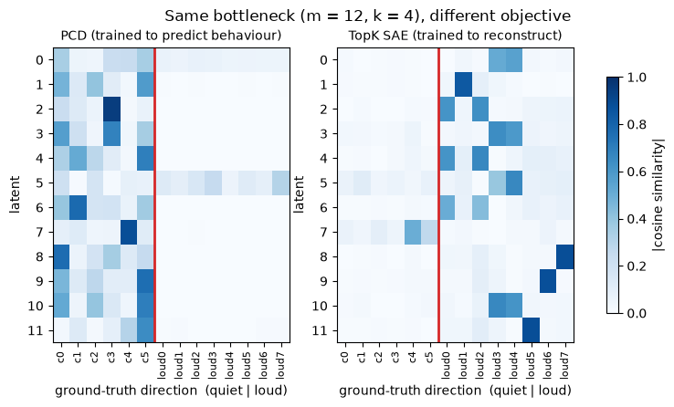


<details>
<summary>Help - how should I interpret this plot?</summary>

The two panels are almost mirror images. The PCD's live latents all sit to the left of the red line; the SAE's latents almost all sit to the right. Four SAE latents (1, 8, 9 and
11) are clean detectors of a single loud feature (cosine similarity 0.84-0.88), and seven more each read a *pair* of loud features (loud0 with loud2, or loud3 with loud4). Only
latent 7 reads anything in the concept subspace, and only weakly (c4 at 0.50, c5 at 0.27).

This is exactly what the reconstruction objective asks for. Each loud feature, when present, contributes 2-4 units of norm to the activation; each concept contributes 1. With 4
slots and about 4 loud features active per example, the SAE reduces its error most by spending its slots on loud features, and it does: it explains 86% of the variance, almost all
of it in directions that are irrelevant to behaviour. The PCD, which explains essentially *none* of the loud variance, spends its slots on the 5.4% of variance that matters.
</details>

<details>
<summary>Aside - I've seen SAE features that look like clean concepts. Is the SAE "wrong" here?</summary>

No. The SAE is doing exactly what it's asked to: find a sparse code from which the activation can be rebuilt. In this world the loud features *are* the sparse, high-variance
structure of the activation, and they're perfectly good features in the sense of being real, independent, sparse directions. The SAE does find the concepts when it has enough room:
with $m = 24$ and $k = 8$ it learns latents for five of the six concepts, and with $m = 32$ and $k = 8$ for all six (each with cosine similarity above 0.9).

The point is about **budget**. Real residual streams have far more features than any affordable dictionary can cover, so every SAE makes a choice about what to leave out, and the reconstruction objective makes that choice by variance. A predictive objective makes it by behavioural relevance instead. This is the same motivation as end-to-end SAEs (Braun et al., [*Identifying Functionally Important Features with End-to-End Sparse Dictionary Learning*](https://arxiv.org/abs/2405.12241), 2024), which train SAEs to preserve the model's output distribution rather than the activation.
</details>


## Does the SAE's code still predict behaviour?

The alignment picture says the SAE latents *point* at the loud features. But maybe the SAE code still contains the concept information in some tangled form, and a decoder could
extract it. The fair test is to train **the same decoder** as the PCD on top of the **frozen** SAE code. The class below does this: it's a `PCD` whose `encode` method is replaced
by the SAE's (wrapped in `t.no_grad()`, so only the decoder trains).

We also need a control for the PCD itself. The **shuffled-activation control** trains a PCD on mismatched pairs: activation $i$ is paired with the behaviour of a random *other*
example $\pi(i)$. The PCD then has the same architecture, data distribution and training budget, but there is no relationship between its inputs and its targets to learn. Whatever
it achieves is what the architecture can do on its own (it should learn the marginal distribution and nothing more).


```python
class FrozenEncoderPCD(PCD):
    """A PCD whose encoder is replaced by another model's frozen `encode` method (e.g. an SAE's)."""

    def __init__(self, frozen_encoder: nn.Module, *args, **kwargs):
        super().__init__(*args, **kwargs)
        self.frozen_encoder = [frozen_encoder]  # stored in a list, so its parameters aren't registered or trained

    def encode(self, acts: Float[Tensor, "batch d_model"]) -> Float[Tensor, "batch n_latents"]:
        with t.no_grad():
            return self.frozen_encoder[0].encode(acts)
```


```python
t.manual_seed(0)
sae_decoder = FrozenEncoderPCD(sae, D_MODEL, N_LATENTS, K, N_QUESTIONS, N_ANSWERS).to(device)
train_bottleneck(sae_decoder, pcd_loss, train_acts, train_behaviour)

t.manual_seed(0)
shuffled_pcd = PCD(D_MODEL, N_LATENTS, K, N_QUESTIONS, N_ANSWERS).to(device)
perm = t.randperm(len(train_acts), generator=t.Generator().manual_seed(0)).to(device)
train_bottleneck(shuffled_pcd, pcd_loss, train_acts, train_behaviour[perm])  # activation i paired with behaviour perm[i]

with t.no_grad():
    planted_kls = {
        "PCD": pcd_loss(pcd, test_acts, test_behaviour).item(),
        "SAE code + trained decoder": pcd_loss(sae_decoder, test_acts, test_behaviour).item(),
        "PCD on shuffled pairs": pcd_loss(shuffled_pcd, test_acts, test_behaviour).item(),
        "untrained PCD": pcd_loss(untrained_pcd, test_acts, test_behaviour).item(),
        "marginal baseline": marginal_kl,
    }
utils.plot_bars(
    planted_kls, "Planted world: held-out behaviour prediction (lower is better)", "KL(model || decoder)  [nats]", logy=True
)
```


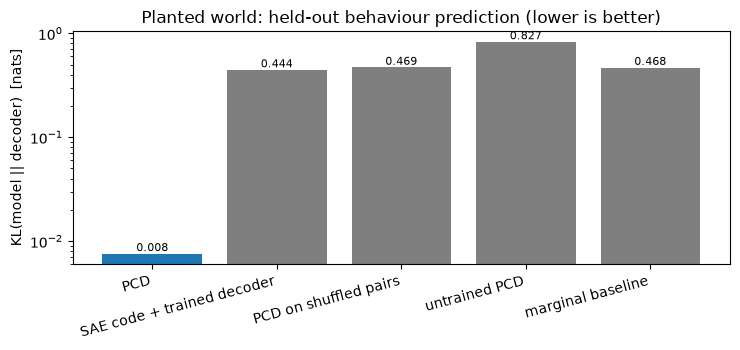


<details>
<summary>Help - how should I interpret this plot?</summary>

Only the PCD beats the marginal baseline by any real margin (note the log scale: it's about 60 times better than every other bar). The decoder trained on the frozen SAE code gets
0.444 nats, barely better than always predicting the average answer distribution (0.468): the SAE's code contains almost no information about the concepts, so no decoder can
recover the behaviour from it. The shuffled-pairs PCD lands on the marginal baseline (0.469), as it should: with no relationship between inputs and targets, the best it can do is
learn the average. The untrained PCD (0.827) is worse than the marginal baseline, because its random decoder is confidently wrong.

So the reconstruction-only bottleneck doesn't just *point* the wrong way: what it keeps is useless for predicting behaviour.
</details>


## Measuring concept accuracy

So far we've used the planted directions to grade the PCD. In a real model we won't have those, but we *will* have labels: for some inputs we'll know whether, say, the subject is
female. So we need metrics that compare a bottleneck's latents against **labelled concepts on held-out data**. We'll use two, which ask different questions:

1. **Best single-latent AUROC.** Is there *one* latent that, on its own, detects the concept? For each concept, we pick the latent whose activation best separates positives from negatives **on the training set**, then report that latent's AUROC **on the test set**. (Choosing on train and reporting on test matters: with enough latents, *some* latent will look good on any finite test set by chance.) This measures whether the concept has a dedicated, readable unit, which is what we want for auditing.
2. **Held-out readout accuracy.** Is the concept *recoverable* from the code at all, possibly spread across several latents? We fit a linear classifier on the training codes and report its balanced accuracy on the test codes. This is the miniature of the paper's finetuning step: the encoder is frozen and only a readout is trained on labelled questions.

Each metric needs controls before it means anything:

- a **random encoder** (the untrained PCD): random projections followed by TopK still preserve some information, so readout accuracy above chance isn't automatically evidence of learning;
- the **shuffled-pairs PCD**: same architecture and training, but no input-target relationship;
- a **dense linear probe** on the raw activation: how much concept information is linearly available in the activation at all? This is the ceiling for any bottleneck;
- **shuffled labels**: the readout trained on randomly permuted labels and tested on real ones. This should be at chance, and checks that the readout can't do well by memorising.


### Exercise - implement `auroc`

> ```yaml
> Difficulty: 🔴🔴⚪⚪⚪
> Importance: 🔵🔵🔵⚪⚪
>
> You should spend up to 10-15 minutes on this exercise.
> ```

The AUROC of a score for a binary label is the probability that a randomly chosen positive example has a higher score than a randomly chosen negative one (counting ties as half).
It's 1 for perfect separation, 0.5 for a useless score, and 0 for a perfectly inverted one.

Implement it without loops over pairs, using the **rank-sum (Mann-Whitney) formula**. If $R_+$ is the sum of the ranks of the positive examples among all $n = n_+ + n_-$ scores
(ranks 1 to $n$, with tied scores all getting the *average* of the ranks they span), then

$$
\text{AUROC} = \frac{R_+ - n_+(n_+ + 1)/2}{n_+\, n_-}.
$$

Ties matter here: TopK latents are exactly zero on most examples, so most scores are tied.


```python
def auroc(scores: Float[Tensor, " n"], labels: Float[Tensor, " n"]) -> float:
    """AUROC of `scores` for binary `labels`, via average ranks (ties count as half)."""
    raise NotImplementedError()


tests.test_auroc(auroc)
```


<details>
<summary>Hint</summary>

Sort the scores with `argsort`. `t.unique_consecutive(sorted_scores, return_inverse=True, return_counts=True)` groups equal neighbouring values into blocks: `counts[j]` is the size
of block `j`, and `inverse[i]` tells you which block sorted position `i` belongs to. The ranks in block `j` run from `cumsum(counts)[j] - counts[j] + 1` to `cumsum(counts)[j]`, so
their average is `cumsum(counts)[j] - (counts[j] - 1) / 2`. Scatter these back to the original order with `ranks[order] = avg_rank[inverse]`.
</details>


<details><summary>Solution</summary>

```python
def auroc(scores: Float[Tensor, " n"], labels: Float[Tensor, " n"]) -> float:
    """AUROC of `scores` for binary `labels`, via average ranks (ties count as half)."""
    scores, labels = scores.detach().float().cpu(), labels.detach().cpu().bool()
    order = scores.argsort()
    sorted_scores = scores[order]
    _, inverse, counts = t.unique_consecutive(sorted_scores, return_inverse=True, return_counts=True)
    # The tied block j occupies ranks (end_j - count_j + 1) ... end_j, whose average is end_j - (count_j - 1) / 2
    block_end = t.cumsum(counts, dim=0).float()
    avg_rank = block_end - (counts.float() - 1) / 2
    ranks = t.empty_like(scores)
    ranks[order] = avg_rank[inverse]
    n_pos, n_neg = labels.sum().item(), (~labels).sum().item()
    return ((ranks[labels].sum().item() - n_pos * (n_pos + 1) / 2) / (n_pos * n_neg))
```
</details>


### Exercise - implement `best_latent_auroc`

> ```yaml
> Difficulty: 🔴⚪⚪⚪⚪
> Importance: 🔵🔵🔵⚪⚪
>
> You should spend up to 5 minutes on this exercise.
> ```

For one concept, pick the latent with the highest AUROC on the **training** codes, and return its index together with its AUROC on the **test** codes.


```python
def best_latent_auroc(
    z_train: Float[Tensor, "n_train n_latents"],
    y_train: Float[Tensor, " n_train"],
    z_test: Float[Tensor, "n_test n_latents"],
    y_test: Float[Tensor, " n_test"],
) -> tuple[int, float]:
    """Index of the latent with the best train AUROC for the label, and that latent's test AUROC."""
    raise NotImplementedError()


tests.test_best_latent_auroc(best_latent_auroc)
```


<details><summary>Solution</summary>

```python
def best_latent_auroc(
    z_train: Float[Tensor, "n_train n_latents"],
    y_train: Float[Tensor, " n_train"],
    z_test: Float[Tensor, "n_test n_latents"],
    y_test: Float[Tensor, " n_test"],
) -> tuple[int, float]:
    """Index of the latent with the best train AUROC for the label, and that latent's test AUROC."""
    train_aurocs = [auroc(z_train[:, j], y_train) for j in range(z_train.shape[1])]
    best = max(range(len(train_aurocs)), key=lambda j: train_aurocs[j])
    return best, auroc(z_test[:, best], y_test)
```
</details>


### Exercise - implement `readout_accuracy`

> ```yaml
> Difficulty: 🔴🔴⚪⚪⚪
> Importance: 🔵🔵🔵🔵⚪
>
> You should spend up to 10-15 minutes on this exercise.
> ```

Implement a held-out **linear readout**. To keep it fast, deterministic and free of optimiser settings, we use a ridge-regression classifier (a linear probe fit by least squares)
rather than logistic regression:

1. Standardise the features using the **training** mean and standard deviation (add `1e-6` to the std), and apply the same transform to the test features.
2. Map the training labels to $y \in \{-1, +1\}$, centre them ($\tilde y = y - \bar y$), and solve the ridge regression $w = (X^\top X + \lambda I)^{-1} X^\top \tilde y$ with $\lambda = $ `l2`.
3. Predict *positive* on the test set when $X_{test} w + \bar y > 0$.
4. Return the **balanced accuracy**, $\frac{1}{2}(\text{TPR} + \text{TNR})$, so that predicting the majority class always gets 0.5. (Our planted concepts are only on 25% of the time, so plain accuracy would give 0.75 for free.)

Do it on the CPU: `t.linalg.solve` on a small matrix is instant there, and it avoids competing for GPU memory.


```python
def readout_accuracy(
    X_train: Float[Tensor, "n_train d"],
    y_train: Float[Tensor, " n_train"],
    X_test: Float[Tensor, "n_test d"],
    y_test: Float[Tensor, " n_test"],
    l2: float = 1.0,
) -> float:
    """Held-out balanced accuracy of a ridge-regression linear classifier trained on (X_train, y_train)."""
    raise NotImplementedError()


tests.test_readout_accuracy(readout_accuracy)
```


<details>
<summary>Hint</summary>

After standardising, `w = t.linalg.solve(X.T @ X + l2 * t.eye(d), X.T @ (y - y.mean()))`. For the balanced accuracy, with boolean tensors `pred` and `truth`: TPR is `(pred &
truth).sum() / truth.sum()` and TNR is `(~pred & ~truth).sum() / (~truth).sum()`.
</details>


<details><summary>Solution</summary>

```python
def readout_accuracy(
    X_train: Float[Tensor, "n_train d"],
    y_train: Float[Tensor, " n_train"],
    X_test: Float[Tensor, "n_test d"],
    y_test: Float[Tensor, " n_test"],
    l2: float = 1.0,
) -> float:
    """Held-out balanced accuracy of a ridge-regression linear classifier trained on (X_train, y_train)."""
    X_train, X_test = X_train.detach().float().cpu(), X_test.detach().float().cpu()
    mean, std = X_train.mean(0), X_train.std(0) + 1e-6
    X_train, X_test = (X_train - mean) / std, (X_test - mean) / std
    y = 2 * y_train.detach().float().cpu() - 1
    w = t.linalg.solve(X_train.T @ X_train + l2 * t.eye(X_train.shape[1]), X_train.T @ (y - y.mean()))
    pred = (X_test @ w + y.mean()) > 0
    truth = y_test.detach().cpu().bool()
    tpr = (pred & truth).sum() / truth.sum()
    tnr = (~pred & ~truth).sum() / (~truth).sum()
    return (0.5 * (tpr + tnr)).item()
```
</details>


### Exercise - the shuffled-label control

> ```yaml
> Difficulty: 🔴⚪⚪⚪⚪
> Importance: 🔵🔵🔵⚪⚪
>
> You should spend up to 5 minutes on this exercise.
> ```

Implement `shuffled_label_readout`: train the readout on **randomly permuted** training labels, test it on the true test labels, and average the balanced accuracy over `n_shuffles`
different permutations (use a `t.Generator` seeded with `seed`).

Why average? A readout trained on shuffled labels learns a random linear direction. On a single shuffle, that random direction can happen to correlate with the real label, in
either direction, so one shuffle can land noticeably above *or below* 0.5. The average over a few shuffles is a much more stable estimate of "chance for this readout on these
features".


```python
def shuffled_label_readout(
    X_train: Float[Tensor, "n_train d"],
    y_train: Float[Tensor, " n_train"],
    X_test: Float[Tensor, "n_test d"],
    y_test: Float[Tensor, " n_test"],
    n_shuffles: int = 5,
    seed: int = 0,
) -> float:
    """Mean held-out balanced accuracy of readouts trained on permuted training labels."""
    raise NotImplementedError()


tests.test_shuffled_label_readout(shuffled_label_readout)
```


<details><summary>Solution</summary>

```python
def shuffled_label_readout(
    X_train: Float[Tensor, "n_train d"],
    y_train: Float[Tensor, " n_train"],
    X_test: Float[Tensor, "n_test d"],
    y_test: Float[Tensor, " n_test"],
    n_shuffles: int = 5,
    seed: int = 0,
) -> float:
    """Mean held-out balanced accuracy of readouts trained on permuted training labels."""
    generator = t.Generator().manual_seed(seed)
    accs = []
    for _ in range(n_shuffles):
        perm = t.randperm(len(y_train), generator=generator)
        accs.append(readout_accuracy(X_train, y_train.cpu()[perm], X_test, y_test))
    return sum(accs) / len(accs)
```
</details>


Now let's compute both metrics for every planted concept, for the PCD, the SAE and the controls. (We use the first 5,000 training examples to pick each concept's best latent, which
is plenty.)


```python
encoders = {"PCD": pcd, "SAE": sae, "untrained PCD": untrained_pcd, "PCD on shuffled pairs": shuffled_pcd}
with t.no_grad():
    codes = {name: (enc.encode(train_acts).cpu(), enc.encode(test_acts).cpu()) for name, enc in encoders.items()}

concept_names = [f"c{i}" for i in range(N_CONCEPTS)]
auroc_table = pd.DataFrame(index=concept_names, columns=list(encoders), dtype=float)
readout_table = pd.DataFrame(index=concept_names, dtype=float)
for i, concept in enumerate(concept_names):
    y_tr, y_te = train_concepts[:, i], test_concepts[:, i]
    for name, (z_tr, z_te) in codes.items():
        auroc_table.loc[concept, name] = best_latent_auroc(z_tr[:5000], y_tr[:5000], z_te, y_te)[1]
        readout_table.loc[concept, name] = readout_accuracy(z_tr, y_tr, z_te, y_te)
    readout_table.loc[concept, "dense probe (raw activation)"] = readout_accuracy(train_acts, y_tr, test_acts, y_te)
    readout_table.loc[concept, "PCD, shuffled labels"] = shuffled_label_readout(codes["PCD"][0], y_tr, codes["PCD"][1], y_te)

fig, axes = plt.subplots(1, 2, figsize=(14, 4))
utils.plot_grouped_bars(auroc_table, "Best single latent (chosen on train): held-out AUROC", "AUROC", ylim=(0.3, 1.05), chance=0.5, ax=axes[0])
utils.plot_grouped_bars(readout_table, "Linear readout from the whole code: held-out balanced accuracy", "balanced accuracy", ylim=(0.3, 1.05), chance=0.5, ax=axes[1])
plt.tight_layout()
plt.show()
display(pd.concat({"best-latent AUROC": auroc_table, "readout balanced acc.": readout_table}, axis=1).round(2))
```


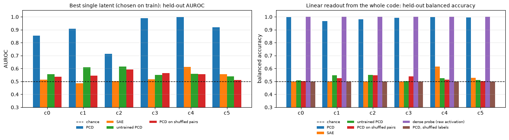


<details>
<summary>Expected output (table)</summary>

<pre style="white-space:pre;overflow-x:auto;line-height:normal;font-family:Menlo,'DejaVu Sans Mono',consolas,'Courier New',monospace">   best-latent AUROC                                            \
                 PCD   SAE untrained PCD PCD on shuffled pairs
c0              0.86  0.51          0.56                  0.54
c1              0.91  0.48          0.61                  0.54
c2              0.71  0.50          0.61                  0.59
c3              0.99  0.52          0.55                  0.56
c4              1.00  0.61          0.56                  0.56
c5              0.92  0.56          0.54                  0.51

   readout balanced acc.                                            \
                     PCD   SAE untrained PCD PCD on shuffled pairs
c0                  1.00  0.50          0.51                  0.50
c1                  0.97  0.50          0.55                  0.53
c2                  0.98  0.50          0.55                  0.55
c3                  0.99  0.50          0.50                  0.54
c4                  1.00  0.62          0.53                  0.51
c5                  1.00  0.53          0.51                  0.50


   dense probe (raw activation) PCD, shuffled labels
c0                          1.0                  0.5
c1                          1.0                  0.5
c2                          1.0                  0.5
c3                          1.0                  0.5
c4                          1.0                  0.5
c5                          1.0                  0.5</pre>

</details>

<details>
<summary>Help - how should I interpret this plot?</summary>

**Readout from the whole code (right).** The PCD's code supports a near-perfect linear readout of every planted concept (0.97-1.00 balanced accuracy), matching the dense probe on
the raw activation (1.00 everywhere). The SAE's code is at chance (0.50) for four concepts, 0.53 for c5 and 0.62 for c4, consistent with its one latent that weakly reads c4 and c5.
Both untrained-encoder controls are between 0.50 and 0.55, and the shuffled-label readout is at 0.50 everywhere, so the readout itself doesn't manufacture accuracy.

**Best single latent (left).** Here the PCD is less perfect: c3 and c4 have dedicated latents (AUROC 0.99 and 1.00), c0, c1 and c5 have good ones (0.86-0.92), and c2's best latent
only reaches 0.71. That's the mixing we saw in the alignment heatmap. All the other bottlenecks and controls are between 0.48 and 0.61.

The gap between the two panels is a useful distinction: a bottleneck can *contain* a concept (high readout accuracy) without *naming* it (no single latent for it). For auditing,
you want both.
</details>


## Try it yourself - turn down the volume

The SAE's failure here is entirely about budget and variance. Below, we rebuild the activations from the *same* world but with much quieter loud features (magnitudes between 0.3
and 0.6, so now *smaller* than the concepts), and retrain both bottlenecks for a shorter run (800 steps). For each model, we print how much of each live latent's (unit) encoder
direction lies in the quiet (concept) subspace versus the loud subspace, as a squared norm averaged over latents, alongside the same numbers for the PCD and SAE we trained on the
original world.

Before running it, predict what happens to the SAE. Then try other settings:

- make the loud features louder still (e.g. `loud_scale=(6.0, 8.0)`): does the PCD care?
- give both bottlenecks more room (`PLAY_LATENTS, PLAY_K = 32, 8`, with the original `loud_scale=(2.0, 4.0)`): the SAE now picks up the concepts as well (see the aside above), but what does the PCD do with its extra slots?
- make the concepts denser (`p_concept=0.5`), so that $k=4$ is no longer enough to describe them: what does the PCD drop?


```python
def subspace_energy(W_enc: Tensor, world: PlantedWorld, alive: Tensor) -> tuple[float, float]:
    """Mean (over live latents) squared norm of the unit encoder direction inside the concept / loud subspaces."""
    cos = latent_alignment(W_enc.detach(), t.cat([world.concept_dirs, world.loud_dirs]).to(W_enc.device))[:, alive]
    return cos[:N_CONCEPTS].pow(2).sum(0).mean().item(), cos[N_CONCEPTS:].pow(2).sum(0).mean().item()


# Change these settings and rerun the cell
PLAY_LATENTS, PLAY_K = N_LATENTS, K
play_train, _, _ = sample_planted(world, 20_000, seed=1, loud_scale=(0.3, 0.6), p_concept=0.25)
play_train = play_train.to(device)
play_behaviour = planted_behaviour(world, play_train)

for name, model in [("PCD", pcd), ("SAE", sae)]:
    with t.no_grad():
        alive = (model.encode(train_acts) > 0).any(0)
    quiet, loud = subspace_energy(model.W_enc, world, alive)
    print(f"original world, {name}: {alive.sum().item():2d} live latents | energy in concept subspace {quiet:.2f} | in loud subspace {loud:.2f}")

for name, make_model, loss_fn, targets in [
    ("PCD", lambda: PCD(D_MODEL, PLAY_LATENTS, PLAY_K, N_QUESTIONS, N_ANSWERS), pcd_loss, play_behaviour),
    ("SAE", lambda: TopKSAE(D_MODEL, PLAY_LATENTS, PLAY_K), sae_loss, None),
]:
    t.manual_seed(0)
    model = make_model().to(device)
    train_bottleneck(model, loss_fn, play_train, targets, n_steps=800)
    with t.no_grad():
        alive = (model.encode(play_train) > 0).any(0)
    quiet, loud = subspace_energy(model.W_enc, world, alive)
    print(f"quiet loud features, {name}: {alive.sum().item():2d} live latents | energy in concept subspace {quiet:.2f} | in loud subspace {loud:.2f}")
```


<details>
<summary>Expected output</summary>

<pre style="white-space:pre;overflow-x:auto;line-height:normal;font-family:Menlo,'DejaVu Sans Mono',consolas,'Courier New',monospace">original world, PCD: 12 live latents | energy in concept subspace 0.75 | in loud subspace 0.02
original world, SAE: 12 live latents | energy in concept subspace 0.03 | in loud subspace 0.67
  0%|          | 0/800 [00:00&lt;?, ?it/s]

quiet loud features, PCD: 11 live latents | energy in concept subspace 0.88 | in loud subspace 0.00
  0%|          | 0/800 [00:00&lt;?, ?it/s]

quiet loud features, SAE: 12 live latents | energy in concept subspace 0.58 | in loud subspace 0.41</pre>

With the loud features turned down below the size of the concepts, the SAE changes its mind: its latents now put 58% of their squared norm into the concept subspace, up from 3% in
the original world. It still spends a lot on the loud features (41%), because they are still there and still worth reconstructing, so with only 4 slots it now splits its budget
between the two. The PCD barely changes: its latents stay in the concept subspace (0.88, with nothing on the loud features), as they should, since the loud features never mattered
for behaviour, whatever their size. (The energies don't sum to 1 because each encoder direction also has components in the remaining 34 noise-only dimensions.)
</details>


## Summary of 2️⃣

- With the same capacity, a reconstruction-only bottleneck spends its slots on whatever carries the most variance. In our world that's the loud features, so its latents point at them, its code predicts behaviour barely better than the marginal baseline (0.444 vs 0.468 nats), and its concept accuracy is near chance.
- The PCD's code is close to perfect on held-out data for every planted concept when read out linearly, and most concepts also have a single latent that detects them.
- The controls behave as they should: the untrained encoder, the shuffled-pairs PCD and the shuffled-label readout are all at or near chance, and the dense probe (which has access to the full activation) shows the concepts were linearly available all along.
- How cleanly concepts map onto individual latents is a separate question from whether the bottleneck keeps them. Prediction decides *what* is kept; sparsity only nudges it to be kept *one concept per latent*.

The planted world was designed so that prediction and reconstruction disagree as much as possible. In a real model, nobody designed the residual stream for us. Let's see what
happens on GPT-2.


=== NEW CHAPTER ===


# 3️⃣ PCDs on GPT-2


> ##### Learning Objectives
>
> - Extract activations and behaviour targets (next-token distributions under several continuations) from a real model
> - Train and audit a PCD on real activations, comparing against an SAE, a no-bottleneck decoder and shuffled controls
> - Interpret what a predictive bottleneck keeps and drops: it keeps a concept only where the concept changes behaviour

## The setting

We'll now train a PCD on GPT-2 Small. Here's the plan, mapped onto the PCD recipe:

- **Inputs.** One-sentence stories built from templates, like *"Yesterday, the queen heard the sad news at the hospital."* Each story has four binary **labelled concepts**, sampled independently: is the subject **female**, is it **plural**, is the event **positive**, and is the place **outdoors**. The stories are varied (76 subject nouns in singular and plural forms, 60 first names, 50 events, 32 places, 6 sentence frames), and every word list is split 80/20 so that **test stories only use words that never appear in training stories**. The labels are used *only* for evaluation, never for training the PCD.
- **Activation.** The residual stream before block 10 (`blocks.10.hook_resid_pre`) at the story's final token, the `"."`. We'll call this the **read position**.
- **Questions.** Five continuations of the story. The "answer" to each is GPT-2's next-token distribution after the continuation:

| question | continuation | what it probes |
|---|---|---|
| 0 | *(nothing)* | what comes right after the `"."` |
| 1 | `" After that,"` | subject pronoun: she / he / they |
| 2 | `" That made"` | object pronoun: her / him / them |
| 3 | `" Everyone was so"` | emotional reaction: excited / happy / sad / upset |
| 4 | `" It was a"` | an adjective or noun phrase about the event |

The encoder only sees the activation at the `"."`, before any continuation, so it has to summarise the story in a way that serves all five questions.

Let's load the model and look at the data.


```python
gpt2 = HookedTransformer.from_pretrained("gpt2-small", device=device)
gpt2.requires_grad_(False)

READ_LAYER = 10
PROBES = ["", " After that,", " That made", " Everyone was so", " It was a"]

train_prompts, train_labels = utils.make_template_prompts("train", 10_000, seed=0)
test_prompts, test_labels = utils.make_template_prompts("test", 1_000, seed=1)
display(
    pd.DataFrame(train_labels[:6].int().numpy(), columns=utils.CONCEPT_NAMES, index=train_prompts[:6])
)
print(f"{len(train_prompts)} train stories, {len(test_prompts)} test stories (with held-out words)")
print("A test story:", test_prompts[0])
```


<details>
<summary>Expected output</summary>

<pre style="white-space:pre;overflow-x:auto;line-height:normal;font-family:Menlo,'DejaVu Sans Mono',consolas,'Courier New',monospace">Loading weights:   0%|          | 0/148 [00:00&lt;?, ?it/s]

                                                    female  plural  positive  \
In the desert, the son got a big raise.                  0       0         1
One morning the duke lost the job at the lake.           0       0         0
According to the report, the hero made a new fr...       0       0         1
At the bank, the nieces lost all the money.              1       1         0
Last week the goddess lost the big game in the ...       1       0         0
Yesterday, Sam and Paul suffered a painful acci...       0       1         0

                                                    outdoors
In the desert, the son got a big raise.                    1
One morning the duke lost the job at the lake.             1
According to the report, the hero made a new fr...         0
At the bank, the nieces lost all the money.                0
Last week the goddess lost the big game in the ...         1
Yesterday, Sam and Paul suffered a painful acci...         0

10000 train stories, 1000 test stories (with held-out words)
A test story: Last week the stewardess crashed the car in the woods.</pre>

</details>


### Exercise - get the read activation and the answer distribution

> ```yaml
> Difficulty: 🔴🔴🔴⚪⚪
> Importance: 🔵🔵🔵🔵⚪
>
> You should spend up to 15-20 minutes on this exercise.
> ```

Implement `last_token_logprobs_and_acts`. It runs GPT-2 on `[prompt + probe for prompt in prompts]` in a single batch and returns two things:

- `logprobs`, shape `(batch, d_vocab)`: the log-probabilities of the next token at the **final real token** of each `prompt + probe`;
- `acts`, shape `(batch, d_model)`: the residual stream `blocks.{read_layer}.hook_resid_pre` at the **read position**, the final real token of each *prompt* (i.e. the `"."`).

The prompts have different lengths, so `gpt2.to_tokens(list_of_strings)` will **pad on the right**. GPT-2's padding token has the same id as its BOS token, so you can find the
number of real tokens in each row as `1 + (tokens[:, 1:] != pad_id).sum(1)`, where `pad_id = model.tokenizer.pad_token_id`. Because GPT-2 is causal, the padding after a sequence
doesn't affect anything at or before its last real token. And because the probe starts with a space, tokenising `prompt + probe` gives the prompt's tokens followed by the probe's
tokens, so the read position is in the same place in both.

Two efficiency tips (you'll run about 55,000 sequences through this function):

- Record the activation with a hook (e.g. `with model.hooks(fwd_hooks=[(name, hook_fn)]): ...`) rather than `run_with_cache`, which stores every activation.
- You only need logits at one position per row. `model(tokens, stop_at_layer=model.cfg.n_layers)` returns the residual stream after the last block *without* unembedding it, so you can apply `model.ln_final` and `model.unembed` to just the positions you need. This avoids materialising a `(batch, seq, 50257)` logits tensor.


```python
@t.no_grad()
def last_token_logprobs_and_acts(
    model: HookedTransformer, prompts: list[str], probe: str, read_layer: int
) -> tuple[Float[Tensor, "batch d_vocab"], Float[Tensor, "batch d_model"]]:
    """
    Runs the model on [p + probe for p in prompts]. Returns the next-token log-probs at the final token of
    each prompt+probe, and resid_pre[read_layer] at the final token of each prompt (the read position).
    """
    raise NotImplementedError()


tests.test_last_token_logprobs_and_acts(last_token_logprobs_and_acts, gpt2)
```


<details>
<summary>Hint</summary>

Compute `read_pos = (model.to_tokens(prompts)[:, 1:] != pad_id).sum(1)` and `last_pos` the same way for the prompt+probe tokens (both are *indices*, because of the BOS token at
position 0: a row with BOS plus 5 real tokens has its last real token at index 5). Then use `rows = t.arange(batch)` and advanced indexing, `resid[rows, read_pos]`, to pick one
position per row. In the hook, store a `.clone()` of the activation in a dict defined outside the hook.
</details>

<details>
<summary>Help - my activations don't match the test.</summary>

The most common bugs are off-by-one errors in the read position (remember position 0 is BOS), and using the read position of the *prompt + probe* rather than of the prompt alone.
Another is reading `hook_resid_post` instead of `hook_resid_pre`: `blocks.10.hook_resid_pre` is the stream *before* block 10, which is the same as `blocks.9.hook_resid_post`.
</details>


<details><summary>Solution</summary>

```python
@t.no_grad()
def last_token_logprobs_and_acts(
    model: HookedTransformer, prompts: list[str], probe: str, read_layer: int
) -> tuple[Float[Tensor, "batch d_vocab"], Float[Tensor, "batch d_model"]]:
    """
    Runs the model on [p + probe for p in prompts]. Returns the next-token log-probs at the final token of
    each prompt+probe, and resid_pre[read_layer] at the final token of each prompt (the read position).
    """
    pad_id = model.tokenizer.pad_token_id
    read_pos = (model.to_tokens(prompts)[:, 1:] != pad_id).sum(1)  # index of the last real prompt token
    tokens = model.to_tokens([p + probe for p in prompts])
    last_pos = (tokens[:, 1:] != pad_id).sum(1)
    rows = t.arange(len(prompts), device=tokens.device)
    stored = {}

    def store_hook(resid: Float[Tensor, "batch seq d_model"], hook) -> None:
        stored["acts"] = resid[rows, read_pos].clone()

    with model.hooks(fwd_hooks=[(f"blocks.{read_layer}.hook_resid_pre", store_hook)]):
        resid_final = model(tokens, stop_at_layer=model.cfg.n_layers)
    logprobs = model.unembed(model.ln_final(resid_final[rows, last_pos])).log_softmax(dim=-1)
    return logprobs, stored["acts"]
```
</details>


## The answer vocabulary

GPT-2's vocabulary has 50,257 tokens, but after each of our continuations, almost all of the probability goes to a few dozen of them. Predicting all 50,257 would mean a big output
layer that's mostly learning to predict tiny probabilities for irrelevant tokens. So we define a shared **answer vocabulary**: the 30 most likely tokens for each question, averaged
over a calibration set of 500 training stories, merged into one list. Every distribution is then **restricted** to these tokens, plus a final **"other"** bucket holding all the
remaining probability. This keeps the target an exact probability distribution: we've just merged most of the vocabulary into a single outcome.


### Exercise - restrict a distribution to the answer vocabulary

> ```yaml
> Difficulty: 🔴⚪⚪⚪⚪
> Importance: 🔵🔵⚪⚪⚪
>
> You should spend up to 5-10 minutes on this exercise.
> ```

Implement `restrict_to_answer_vocab`. Given full-vocabulary log-probs of shape `(..., d_vocab)` and a tensor of `n_answers` token ids, return log-probs of shape `(..., n_answers +
1)`: the first `n_answers` entries are the log-probs of the answer tokens, and the last is the log of the remaining probability mass. Clamp the remaining mass to at least `1e-6`
before taking the log (it can be slightly negative from floating-point error), and clamp all the probabilities to at least `1e-8` so we never take `log(0)`.


```python
def restrict_to_answer_vocab(
    logprobs: Float[Tensor, "... d_vocab"], answer_ids: Int[Tensor, " n_answers"]
) -> Float[Tensor, "... n_answers_plus_1"]:
    """Log-probs of the answer tokens, plus a final 'other' bucket with the remaining probability."""
    raise NotImplementedError()


tests.test_restrict_to_answer_vocab(restrict_to_answer_vocab)
```


<details><summary>Solution</summary>

```python
def restrict_to_answer_vocab(
    logprobs: Float[Tensor, "... d_vocab"], answer_ids: Int[Tensor, " n_answers"]
) -> Float[Tensor, "... n_answers_plus_1"]:
    """Log-probs of the answer tokens, plus a final 'other' bucket with the remaining probability."""
    probs = logprobs.exp()[..., answer_ids.to(logprobs.device)]
    other = (1 - probs.sum(dim=-1, keepdim=True)).clamp_min(1e-6)
    return t.cat([probs, other], dim=-1).clamp_min(1e-8).log()
```
</details>


The next cell builds the answer vocabulary from a calibration batch, and then extracts the read activations and restricted behaviour for all 11,000 stories, in batches. This takes
about 20-60 seconds on a GPU.


```python
calibration = [last_token_logprobs_and_acts(gpt2, train_prompts[:500], probe, READ_LAYER)[0].exp().mean(0) for probe in PROBES]
answer_ids = []
for mean_probs in calibration:
    answer_ids += [i for i in mean_probs.topk(30).indices.tolist() if i not in answer_ids]
answer_ids = t.tensor(answer_ids, device=device)
ANSWER_STRS = [gpt2.to_string(i) for i in answer_ids] + ["<other>"]
N_GPT2_ANSWERS = len(ANSWER_STRS)


@t.no_grad()
def get_acts_and_behaviour(prompts: list[str], batch_size: int = 500) -> tuple[Tensor, Tensor]:
    """Read activations (n, d_model) and restricted behaviour log-probs (n, n_probes, n_answers + 1)."""
    acts, behaviour = [], []
    for start in tqdm(range(0, len(prompts), batch_size), leave=False):
        batch = prompts[start : start + batch_size]
        per_probe = []
        for probe in PROBES:
            logprobs, batch_acts = last_token_logprobs_and_acts(gpt2, batch, probe, READ_LAYER)
            per_probe.append(restrict_to_answer_vocab(logprobs, answer_ids))
        acts.append(batch_acts)  # the read activation doesn't depend on the probe
        behaviour.append(t.stack(per_probe, dim=1))
    return t.cat(acts), t.cat(behaviour)


raw_train_acts, gpt2_train_behaviour = get_acts_and_behaviour(train_prompts)
raw_test_acts, gpt2_test_behaviour = get_acts_and_behaviour(test_prompts)

# Normalise activations: subtract the training mean and divide by a single scalar so the mean squared
# norm per dimension is 1. (One scalar, so directions and ratios between directions are unchanged.)
act_mean = raw_train_acts.mean(0)
act_scale = (raw_train_acts - act_mean).norm(dim=-1).mean() / raw_train_acts.shape[1] ** 0.5
gpt2_train_acts = (raw_train_acts - act_mean) / act_scale
gpt2_test_acts = (raw_test_acts - act_mean) / act_scale

print(f"Answer vocabulary: {len(answer_ids)} tokens + <other>")
print(f"Activations: train {tuple(gpt2_train_acts.shape)}, test {tuple(gpt2_test_acts.shape)}")
print(f"Behaviour:   train {tuple(gpt2_train_behaviour.shape)}, test {tuple(gpt2_test_behaviour.shape)}")
mass = gpt2_train_behaviour[..., :-1].exp().sum(-1).mean(0)
print("Mean probability inside the answer vocabulary, per question:", [round(m, 2) for m in mass.tolist()])
```


<details>
<summary>Expected output</summary>

<pre style="white-space:pre;overflow-x:auto;line-height:normal;font-family:Menlo,'DejaVu Sans Mono',consolas,'Courier New',monospace">  0%|          | 0/20 [00:00&lt;?, ?it/s]

  0%|          | 0/2 [00:00&lt;?, ?it/s]

Answer vocabulary: 129 tokens + &lt;other&gt;
Activations: train (10000, 768), test (1000, 768)
Behaviour:   train (10000, 5, 130), test (1000, 5, 130)
Mean probability inside the answer vocabulary, per question: [0.7, 0.77, 0.85, 0.64, 0.28]</pre>

</details>

The answer vocabulary covers 64-85% of the probability mass for questions 0-3. Question 4 (`" It was a"`) is open-ended, so 72% of its mass lands in "other"; the PCD is still
rewarded for predicting *how much* goes to "other", but it's the least informative question.


## Training PCDs on GPT-2

We'll train five models, all with the same decoder and training budget:

1. **The PCD**, with $m = 12$ concepts and $k = 3$ active.
2. **A TopK SAE** with $m = 12$, $k = 3$, trained to reconstruct the normalised activations, then **a decoder trained on its frozen code** (the reconstruction-only bottleneck, as in section 2️⃣).
3. **A no-bottleneck decoder**: the same decoder reading the full activation (we set $m = k = 768$, so the "bottleneck" is a dense ReLU layer). This is a miniature of LatentQA / Activation Oracles. It tells us how much behaviour information the activation contains at all, i.e. what the bottleneck costs.
4. **The shuffled-pairs control**: a PCD trained on mismatched (activation, behaviour) pairs.

Training all of them takes about 30-90 seconds on a GPU.


```python
GPT2_LATENTS, GPT2_K, N_PROBES = 12, 3, len(PROBES)
d_gpt2 = gpt2.cfg.d_model
train_kwargs = dict(n_steps=2000, lr=1e-3)

t.manual_seed(0)
gpt2_pcd = PCD(d_gpt2, GPT2_LATENTS, GPT2_K, N_PROBES, N_GPT2_ANSWERS).to(device)
gpt2_pcd_losses = train_bottleneck(gpt2_pcd, pcd_loss, gpt2_train_acts, gpt2_train_behaviour, **train_kwargs)

t.manual_seed(0)
gpt2_sae = TopKSAE(d_gpt2, GPT2_LATENTS, GPT2_K).to(device)
train_bottleneck(gpt2_sae, sae_loss, gpt2_train_acts, **train_kwargs)
t.manual_seed(0)
gpt2_sae_decoder = FrozenEncoderPCD(gpt2_sae, d_gpt2, GPT2_LATENTS, GPT2_K, N_PROBES, N_GPT2_ANSWERS).to(device)
train_bottleneck(gpt2_sae_decoder, pcd_loss, gpt2_train_acts, gpt2_train_behaviour, **train_kwargs)

t.manual_seed(0)
gpt2_dense = PCD(d_gpt2, d_gpt2, d_gpt2, N_PROBES, N_GPT2_ANSWERS).to(device)  # k = m = d_model: no bottleneck
train_bottleneck(gpt2_dense, pcd_loss, gpt2_train_acts, gpt2_train_behaviour, **train_kwargs)

t.manual_seed(0)
gpt2_shuffled = PCD(d_gpt2, GPT2_LATENTS, GPT2_K, N_PROBES, N_GPT2_ANSWERS).to(device)
gpt2_perm = t.randperm(len(gpt2_train_acts), generator=t.Generator().manual_seed(0)).to(device)
train_bottleneck(gpt2_shuffled, pcd_loss, gpt2_train_acts, gpt2_train_behaviour[gpt2_perm], **train_kwargs)


def per_question_kl(target: Tensor, pred_logits: Tensor) -> list[float]:
    """Mean KL(target || pred) for each question."""
    pred = pred_logits.log_softmax(-1)
    return (target.exp() * (target - pred)).sum(-1).mean(0).tolist()


gpt2_marginal = gpt2_train_behaviour.exp().mean(0, keepdim=True).log()
with t.no_grad():
    gpt2_kls = pd.DataFrame(
        {
            "PCD (k=3)": per_question_kl(gpt2_test_behaviour, gpt2_pcd(gpt2_test_acts)),
            "SAE code + decoder (k=3)": per_question_kl(gpt2_test_behaviour, gpt2_sae_decoder(gpt2_test_acts)),
            "no bottleneck": per_question_kl(gpt2_test_behaviour, gpt2_dense(gpt2_test_acts)),
            "PCD on shuffled pairs": per_question_kl(gpt2_test_behaviour, gpt2_shuffled(gpt2_test_acts)),
            "marginal baseline": per_question_kl(gpt2_test_behaviour, gpt2_marginal.expand_as(gpt2_test_behaviour)),
        },
        index=[repr(p) for p in PROBES],
    )
gpt2_kls.loc["mean"] = gpt2_kls.mean()
utils.plot_grouped_bars(gpt2_kls, "GPT-2: held-out KL(GPT-2 || decoder) per question (lower is better)", "KL [nats]")
display(gpt2_kls.round(3))
```


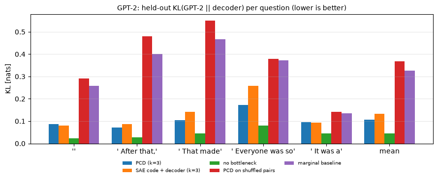


<details>
<summary>Expected output (table)</summary>

<pre style="white-space:pre;overflow-x:auto;line-height:normal;font-family:Menlo,'DejaVu Sans Mono',consolas,'Courier New',monospace">  0%|          | 0/2000 [00:00&lt;?, ?it/s]

  0%|          | 0/2000 [00:00&lt;?, ?it/s]

  0%|          | 0/2000 [00:00&lt;?, ?it/s]

  0%|          | 0/2000 [00:00&lt;?, ?it/s]

  0%|          | 0/2000 [00:00&lt;?, ?it/s]

                    PCD (k=3)  SAE code + decoder (k=3)  no bottleneck  \
''                      0.087                     0.079          0.022
' After that,'          0.072                     0.087          0.027
' That made'            0.103                     0.141          0.047
' Everyone was so'      0.174                     0.259          0.081
' It was a'             0.094                     0.094          0.046
mean                    0.106                     0.132          0.045

                    PCD on shuffled pairs  marginal baseline
''                                  0.296              0.257
' After that,'                      0.486              0.401
' That made'                        0.556              0.468
' Everyone was so'                  0.377              0.373
' It was a'                         0.139              0.134
mean                                0.371              0.327</pre>

</details>

<details>
<summary>Help - how should I interpret this plot?</summary>

Start with the controls. The shuffled-pairs PCD (mean 0.371) is slightly *worse* than the marginal baseline (0.327): with nothing real to learn, it fits noise in the training
pairs, which costs it a little on test stories. Every real decoder is far below both.

**The PCD beats the SAE bottleneck, but by much less than in the planted world**: 0.106 vs 0.132 nats on average. The PCD is better on the three questions about the subject and the
reaction, most clearly on the emotional reaction `" Everyone was so"` (0.174 vs 0.259); the two are tied on `" It was a"`, and the SAE bottleneck is slightly better on the bare
next token (0.079 vs 0.087). Measured as a fraction of the gap between the marginal baseline and the no-bottleneck decoder, the PCD closes 78% and the SAE bottleneck 69%. At layer
10, the loudest directions of the residual stream at a sentence-final `"."` are largely about what comes next, so reconstruction and prediction agree far more than in our planted
world, which was designed to make them disagree.

**The bottleneck has a cost.** The no-bottleneck decoder gets 0.045 nats, less than half the PCD's KL. Three active concepts out of twelve can't carry everything GPT-2's behaviour
depends on: for example, which *specific* event happened affects the emotional reaction in ways that a coarse sentiment concept can't. (The paper reports that with enough
pretraining data, PCDs match their no-bottleneck baseline, LatentQA, on its user-attribute questions; our miniature, with $k = 3$ and 10,000 stories, pays a visible price.)
</details>


Numbers are abstract, so let's look at what the PCD actually predicts for a few test stories, next to what GPT-2 does. For each story we also list the active concepts (by latent
index, for now) and their activations.


```python
def top_answers(logprobs: Float[Tensor, " n_answers"], n: int = 3) -> str:
    """Formats the n most likely answers of a restricted distribution, e.g. "' she' (0.41), ' the' (0.16)"."""
    probs = logprobs.exp()
    top = probs.topk(n)
    return ", ".join(f"{ANSWER_STRS[i]!r} ({p:.2f})" for p, i in zip(top.values.tolist(), top.indices.tolist()))


def describe(z_row: Tensor) -> str:
    """Formats the active concepts of one code, e.g. "#3=2.1, #7=0.4"."""
    active = z_row.nonzero().squeeze(-1).tolist()
    return ", ".join(f"#{j}={z_row[j]:.1f}" for j in sorted(active, key=lambda j: -z_row[j].item())) or "(none)"
```


```python
with t.no_grad():
    gpt2_z_test = gpt2_pcd.encode(gpt2_test_acts)
    pcd_pred = gpt2_pcd(gpt2_test_acts).log_softmax(-1)
for i in [0, 1, 2]:
    print(f"{test_prompts[i]}\n  active concepts: {describe(gpt2_z_test[i])}")
    for q, probe in enumerate(PROBES[1:4], start=1):
        print(f"  {probe!r:<19} GPT-2: {top_answers(gpt2_test_behaviour[i, q])}")
        print(f"  {'':<19} PCD:   {top_answers(pcd_pred[i, q])}")
    print()
```


<details>
<summary>Expected output</summary>

<pre style="white-space:pre;overflow-x:auto;line-height:normal;font-family:Menlo,'DejaVu Sans Mono',consolas,'Courier New',monospace">Last week the stewardess crashed the car in the woods.
  active concepts: #1=5.0, #3=3.8, #0=1.2
  ' After that,'      GPT-2: ' she' (0.33), '&lt;other&gt;' (0.19), ' the' (0.17)
                      PCD:   ' she' (0.34), '&lt;other&gt;' (0.21), ' the' (0.12)
  ' That made'        GPT-2: ' her' (0.25), '&lt;other&gt;' (0.15), ' it' (0.13)
                      PCD:   ' her' (0.35), '&lt;other&gt;' (0.14), ' me' (0.14)
  ' Everyone was so'  GPT-2: '&lt;other&gt;' (0.35), ' upset' (0.14), ' shocked' (0.12)
                      PCD:   '&lt;other&gt;' (0.40), ' upset' (0.12), ' shocked' (0.10)

One morning the wrestlers got an amazing surprise at the mall.
  active concepts: #8=5.4, #0=3.6, #2=1.5
  ' After that,'      GPT-2: ' they' (0.25), '&lt;other&gt;' (0.24), ' the' (0.16)
                      PCD:   ' they' (0.30), '&lt;other&gt;' (0.22), ' the' (0.14)
  ' That made'        GPT-2: ' them' (0.36), '&lt;other&gt;' (0.14), ' me' (0.12)
                      PCD:   ' them' (0.26), ' me' (0.17), '&lt;other&gt;' (0.13)
  ' Everyone was so'  GPT-2: ' excited' (0.69), '&lt;other&gt;' (0.13), ' happy' (0.07)
                      PCD:   ' excited' (0.39), '&lt;other&gt;' (0.23), ' happy' (0.17)

Last week Frank heard some wonderful music in the meadow.
  active concepts: #5=5.0, #2=3.2, #0=1.8
  ' After that,'      GPT-2: ' he' (0.28), '&lt;other&gt;' (0.20), ' I' (0.17)
                      PCD:   ' he' (0.29), '&lt;other&gt;' (0.20), ' we' (0.10)
  ' That made'        GPT-2: ' me' (0.36), ' him' (0.26), '&lt;other&gt;' (0.11)
                      PCD:   ' me' (0.32), ' him' (0.16), '&lt;other&gt;' (0.10)
  ' Everyone was so'  GPT-2: ' excited' (0.41), '&lt;other&gt;' (0.26), ' happy' (0.16)
                      PCD:   '&lt;other&gt;' (0.28), ' excited' (0.26), ' happy' (0.19)</pre>

</details>

From three numbers per story, the PCD gets the right pronoun for all three stories under both pronoun questions, and the reactions look sensible. Its probabilities are smoothed
versions of GPT-2's: for the wrestlers' amazing surprise, GPT-2 is very sure that everyone was `' excited'` (0.69), while the PCD hedges (0.39). Each story activates exactly three
concepts, as we saw in the planted world: the strongest one (activation around 5) differs between the three stories, while weaker ones (#0 and #2) recur. Let's find out what they
mean.


## Auditing the concepts

What do the 12 latents mean? In the paper, each concept is interpreted with **auto-interp**: collect the inputs that activate it most, ask an LLM to describe the pattern, and score
the description by how well it predicts the concept's activations on new inputs (see [7.2] Feature Verbalizers). We'll do the first step by hand with a small **latent dashboard**,
and replace the LLM's judgement with a quantitative check against our four labelled concepts.


### Exercise - build a latent dashboard

> ```yaml
> Difficulty: 🔴⚪⚪⚪⚪
> Importance: 🔵🔵🔵⚪⚪
>
> You should spend up to 10 minutes on this exercise.
> ```

Implement `latent_dashboard`. Given codes `z` of shape `(n, n_latents)` and the corresponding prompts, return a DataFrame with one row per latent (indexed by latent number), and
columns:

- `"freq"`: the fraction of examples on which the latent is active ($z > 0$);
- `"top 1"`, ..., `"top {n_top}"`: the prompts with the highest activation of that latent.

If a latent is active on fewer than `n_top` examples, it's fine for the remaining columns to show prompts where it's zero (dead latents will simply show arbitrary prompts with
`freq` 0).


```python
def latent_dashboard(z: Float[Tensor, "n n_latents"], prompts: list[str], n_top: int = 3) -> pd.DataFrame:
    """One row per latent: firing frequency and the n_top most strongly activating prompts."""
    raise NotImplementedError()


tests.test_latent_dashboard(latent_dashboard)
```


```python
with pd.option_context("display.max_colwidth", 70, "display.width", 250):
    display(latent_dashboard(gpt2_z_test, test_prompts, n_top=2).round(2))
```


<details><summary>Solution</summary>

```python
def latent_dashboard(z: Float[Tensor, "n n_latents"], prompts: list[str], n_top: int = 3) -> pd.DataFrame:
    """One row per latent: firing frequency and the n_top most strongly activating prompts."""
    z = z.detach().cpu()
    rows = []
    for j in range(z.shape[1]):
        row = {"freq": (z[:, j] > 0).float().mean().item()}
        for rank, i in enumerate(z[:, j].topk(n_top).indices.tolist()):
            row[f"top {rank + 1}"] = prompts[i]
        rows.append(row)
    return pd.DataFrame(rows).rename_axis("latent")
```
</details>


<details>
<summary>Expected output</summary>

<pre style="white-space:pre;overflow-x:auto;line-height:normal;font-family:Menlo,'DejaVu Sans Mono',consolas,'Courier New',monospace">        freq                                                                  top 1                                                                  top 2
latent
0       0.33           Last week Frank and Andrew had a great vacation at the mall.          Last week Nicole and Megan had a great vacation in the woods.
1       0.40                      Last week the priest crashed the car on the hill.                Last week the househusband crashed the car on the hill.
2       0.27             In the basement, the househusband got an amazing surprise.                           Charles got an amazing surprise at the mall.
3       0.34             One morning Nicole heard some wonderful music at the mall.                    Last week Nicole earned a gold medal in the meadow.
4       0.21           Last week the wizard heard a frightening scream on the hill.         Thomas and Charles heard a frightening scream in the basement.
5       0.24                        At the mall, Thomas heard some wonderful music.  According to the report, Thomas heard some wonderful music in the ...
6       0.34        One morning Natalie and Amy got stung by a bee in the basement.  According to the report, Victoria and Nicole got stung by a bee in...
7       0.12         One morning Charles heard a frightening scream in the bedroom.  According to the report, Elizabeth heard a frightening scream in t...
8       0.34  One morning Thomas and Andrew heard some wonderful music on the hill.         Yesterday, William and Thomas earned a gold medal on the hill.
9       0.06         Yesterday, Nicole and Megan got stung by a bee in the bedroom.      Yesterday, Megan and Victoria got stung by a bee in the basement.
10      0.23  According to the report, the wrestler earned a gold medal in the b...  According to the report, the househusbands earned a gold medal in ...
11      0.11             Yesterday, Andrew heard a frightening scream in the woods.             Yesterday, Joseph heard a frightening scream in the woods.</pre>

</details>

Before reading on, try to label a few latents yourself from their top examples. Then let's check your labels quantitatively.


### Exercise - score every latent against every labelled concept

> ```yaml
> Difficulty: 🔴⚪⚪⚪⚪
> Importance: 🔵🔵🔵⚪⚪
>
> You should spend up to 5 minutes on this exercise.
> ```

Our labels are female / plural / positive / outdoors, but GPT-2's *behaviour* (e.g. choosing `she`, `he` or `they`) might depend on combinations of them, so it's useful to score
latents against a few derived **groups** too. The cell after this exercise builds them: `she` (female and singular), `he` (male and singular), `they` (plural), `positive`,
`negative`, `outdoors` and `indoors`.

Implement `latent_group_aurocs`, which returns a `(n_latents, n_groups)` tensor of AUROCs, one for each latent's activation against each group's labels.


```python
def latent_group_aurocs(z: Float[Tensor, "n n_latents"], groups: dict[str, Float[Tensor, " n"]]) -> Float[Tensor, "n_latents n_groups"]:
    """AUROC of every latent's activation for every group label."""
    raise NotImplementedError()


tests.test_latent_group_aurocs(latent_group_aurocs, auroc)
```


```python
def make_groups(labels: Float[Tensor, "n 4"]) -> dict[str, Tensor]:
    """Derived concept groups from the (female, plural, positive, outdoors) labels."""
    female, plural, positive, outdoors = labels.unbind(-1)
    return {
        "she": female * (1 - plural),
        "he": (1 - female) * (1 - plural),
        "they": plural,
        "positive": positive,
        "negative": 1 - positive,
        "outdoors": outdoors,
        "indoors": 1 - outdoors,
    }
```


```python
train_groups, test_groups = make_groups(train_labels), make_groups(test_labels)
with t.no_grad():
    gpt2_z_train = gpt2_pcd.encode(gpt2_train_acts)
    sae_z_train, sae_z_test = gpt2_sae.encode(gpt2_train_acts), gpt2_sae.encode(gpt2_test_acts)
utils.plot_heatmaps(
    {
        "PCD latents": latent_group_aurocs(gpt2_z_test.cpu(), test_groups),
        "SAE latents": latent_group_aurocs(sae_z_test.cpu(), test_groups),
    },
    row_label="latent",
    col_labels=list(test_groups),
    title="GPT-2 layer 10: held-out AUROC of each latent for each concept group",
)
```


<details><summary>Solution</summary>

```python
def latent_group_aurocs(z: Float[Tensor, "n n_latents"], groups: dict[str, Float[Tensor, " n"]]) -> Float[Tensor, "n_latents n_groups"]:
    """AUROC of every latent's activation for every group label."""
    return t.tensor([[auroc(z[:, j], labels) for labels in groups.values()] for j in range(z.shape[1])])
```
</details>


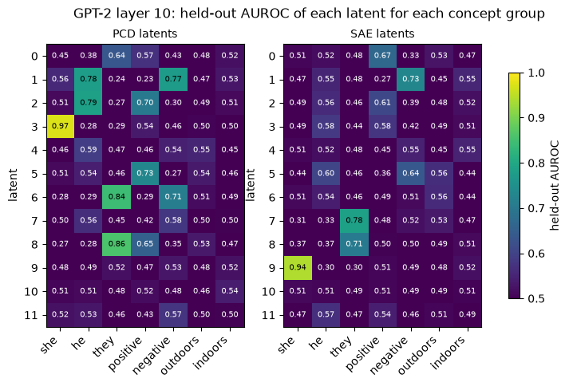


<details>
<summary>Help - how should I interpret this plot?</summary>

**The pronoun concepts.** Latent 3 is a `she` detector (held-out AUROC 0.97; on the dashboard its top stories are about Nicole), latents 6 and 8 are `they` detectors (0.84 and
0.86), and latents 1 and 2 are the best `he` detectors (both 0.78). Notice what *isn't* there: there is no `female` latent that fires both for a woman and for a group of women. The
PCD's categories are GPT-2's *behavioural* categories (which pronoun comes next), not the factors we used to generate the data.

**The sentiment concepts are weaker and mixed with other things.** Latent 1 scores 0.78 for both `he` *and* `negative`, latent 2 scores 0.78 for `he` and 0.70 for `positive`,
latent 5 scores 0.73 for `positive`. The dashboard shows why sentiment is messy: many latents are about **specific events**. Latents 4, 7 and 11 have *heard a frightening scream*
as their top stories, latents 6 and 9 *got stung by a bee*, latent 10 *earned a gold medal*, latent 1 *crashed the car*. That makes sense given the reaction question: GPT-2's
reaction to a frightening scream (`scared`, `shocked`) is different from its reaction to burning the dinner, and a binary positive/negative label can't capture that, so the PCD
spends some of its capacity on particular events that matter a lot for the reaction.

**No PCD latent tracks location**: every AUROC in the `outdoors` and `indoors` columns is between 0.44 and 0.56. None of our questions depend on location.

**The SAE (right) finds some of the same structure**: a strong `she` latent (latent 9, 0.94) and two `they` latents (0.78 and 0.71). But it has no good `he` latent (its best is
0.60), and its best sentiment latents are weaker (0.73 for `negative`, 0.67 for `positive`). This matches the KL comparison: at this layer, the SAE's variance-driven choice of what
to keep overlaps a lot with the PCD's behaviour-driven choice, but not completely.
</details>


## Concept accuracy on held-out stories

Now the headline metric: for each of the four labelled concepts, how well can a linear readout recover it from each bottleneck's code, on test stories made of unseen words? We
compare against the same controls as in section 2️⃣, now on real activations: a dense linear probe on the full 768-dimensional activation (the ceiling), an untrained (random)
encoder, the shuffled-pairs PCD, and shuffled labels.

There's one more comparison we'll make, motivated by the heatmap. GPT-2's behaviour only depends on the subject's gender when the subject is **singular** (`she` vs `he`); for
plurals, it's `they` either way. So we'll also measure the female readout separately on singular and on plural test stories.


```python
t.manual_seed(0)
gpt2_untrained = PCD(d_gpt2, GPT2_LATENTS, GPT2_K, N_PROBES, N_GPT2_ANSWERS).to(device)
with t.no_grad():
    gpt2_codes = {
        "dense probe (768-d activation)": (gpt2_train_acts, gpt2_test_acts),
        "PCD (k=3)": (gpt2_z_train, gpt2_z_test),
        "SAE (k=3)": (sae_z_train, sae_z_test),
        "untrained PCD": (gpt2_untrained.encode(gpt2_train_acts), gpt2_untrained.encode(gpt2_test_acts)),
        "PCD on shuffled pairs": (gpt2_shuffled.encode(gpt2_train_acts), gpt2_shuffled.encode(gpt2_test_acts)),
    }

gpt2_readout = pd.DataFrame(index=utils.CONCEPT_NAMES, dtype=float)
for c, concept in enumerate(utils.CONCEPT_NAMES):
    for name, (X_tr, X_te) in gpt2_codes.items():
        gpt2_readout.loc[concept, name] = readout_accuracy(X_tr, train_labels[:, c], X_te, test_labels[:, c])
    gpt2_readout.loc[concept, "PCD, shuffled labels"] = shuffled_label_readout(gpt2_z_train, train_labels[:, c], gpt2_z_test, test_labels[:, c])

singular = test_labels[:, 1] == 0
gender_split = pd.DataFrame(index=["singular subjects", "plural subjects"], dtype=float)
for name in ["dense probe (768-d activation)", "PCD (k=3)", "SAE (k=3)"]:
    X_tr, X_te = gpt2_codes[name]
    for row, mask in [("singular subjects", singular), ("plural subjects", ~singular)]:
        gender_split.loc[row, name] = readout_accuracy(X_tr, train_labels[:, 0], X_te[mask.to(X_te.device)], test_labels[mask, 0])

fig, axes = plt.subplots(1, 2, figsize=(15, 4), gridspec_kw={"width_ratios": [2.2, 1]})
utils.plot_grouped_bars(gpt2_readout, "Held-out readout of labelled concepts (unseen words)", "balanced accuracy", ylim=(0.3, 1.05), chance=0.5, ax=axes[0])
utils.plot_grouped_bars(gender_split, "'female' readout, split by subject number", "balanced accuracy", ylim=(0.3, 1.05), chance=0.5, ax=axes[1])
plt.tight_layout()
plt.show()
display(gpt2_readout.round(2))
display(gender_split.round(2))
```


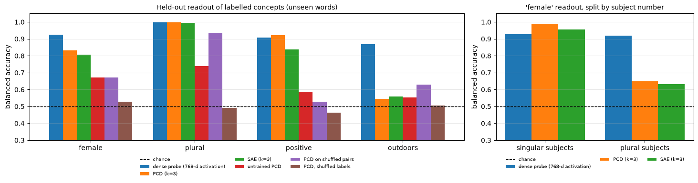


<details>
<summary>Expected output (table)</summary>

<pre style="white-space:pre;overflow-x:auto;line-height:normal;font-family:Menlo,'DejaVu Sans Mono',consolas,'Courier New',monospace">          dense probe (768-d activation)  PCD (k=3)  SAE (k=3)  untrained PCD  \
female                              0.92       0.83       0.81           0.67
plural                              1.00       1.00       1.00           0.74
positive                            0.91       0.92       0.84           0.59
outdoors                            0.87       0.55       0.56           0.55

          PCD on shuffled pairs  PCD, shuffled labels
female                     0.67                  0.53
plural                     0.94                  0.49
positive                   0.56                  0.47
outdoors                   0.62                  0.51

                   dense probe (768-d activation)  PCD (k=3)  SAE (k=3)
singular subjects                            0.93       0.99       0.95
plural subjects                              0.92       0.64       0.63</pre>

</details>

<details>
<summary>Help - how should I interpret this plot?</summary>

**Plural** is decodable from everything, including the controls: 1.00 for the PCD, SAE and dense probe, but also 0.94 for the shuffled-pairs PCD and 0.74 for the untrained encoder.
At layer 10, plurality is such a large, salient direction at the `"."` that even a 12-latent code that learned nothing about behaviour keeps much of it. So plural accuracy, on its
own, would tell us nothing about the PCD. This is exactly why the controls are needed.

**Positive** separates the methods: the PCD (0.92) matches the dense probe (0.91), the SAE is lower (0.84), and both controls are near chance (0.59 and 0.56). The reaction question
makes sentiment matter, and the PCD keeps it.

**Outdoors** is linearly present in the activation (dense probe 0.87), but **every bottleneck drops it**: the PCD gets 0.55 and the SAE 0.56, no better than the controls (0.55 for
the untrained encoder, and 0.62 for the shuffled-pairs PCD, a reminder that a code which learned nothing about behaviour can still keep a little of whatever is in the activation).
For the PCD, this is the predictive objective working as designed: none of our questions depends on location, so it isn't worth a slot.

**Female** is the subtle one: 0.83 for the PCD vs 0.92 for the dense probe. The right panel explains it. On singular subjects, the PCD's female readout is 0.99, even higher than
the dense probe's 0.93. On plural subjects it falls to 0.64, while the dense probe stays at 0.92. The PCD keeps gender exactly where GPT-2's behaviour depends on it (`she` vs `he`)
and mostly drops it where it doesn't (`they` is `they`, for women or for men). The information is in the activation (the dense probe proves it); the PCD just has no reason to spend
capacity on it. The SAE shows the same pattern (0.95 vs 0.63), another sign that at this layer the high-variance directions are the behaviourally relevant ones.

The shuffled-label control is at chance everywhere (0.47-0.53).
</details>


## Try it yourself - audit your own stories

Write your own stories below and see which concepts the PCD activates, and what it predicts GPT-2 will say, next to what GPT-2 actually says. We've given each latent a short name
from the heatmap (the group it has the highest held-out AUROC for, if that AUROC is above 0.75, and `?` otherwise) so that the concept lists are readable.

Some things to try:

- Words outside our templates entirely: *"The nurse lost her keys at the station."* (is the nurse female? GPT-2 thinks so, from "her"), *"The team celebrated the victory downtown."* (collective nouns), *"My grandmother's cat died last night."*
- Stories where the sentiment and the event disagree: *"Sadly, the king won the lottery."*
- Very short or ungrammatical inputs. When does the PCD's summary stop making sense?


```python
group_aurocs = latent_group_aurocs(gpt2_z_test.cpu(), test_groups)
LATENT_NAMES = [
    f"#{j} {list(test_groups)[group_aurocs[j].argmax()]}" if group_aurocs[j].max() > 0.75 else f"#{j} ?"
    for j in range(GPT2_LATENTS)
]
print("Latent names:", LATENT_NAMES, "\n")

my_stories = [
    "The nurse lost her keys at the station.",
    "The team celebrated the victory downtown.",
    "Sadly, the king won the lottery.",
]
my_acts, my_behaviour = get_acts_and_behaviour(my_stories)
with t.no_grad():
    my_z = gpt2_pcd.encode((my_acts - act_mean) / act_scale)
    my_pred = gpt2_pcd.decode(my_z).log_softmax(-1)
for i, story in enumerate(my_stories):
    active = sorted(my_z[i].nonzero().squeeze(-1).tolist(), key=lambda j: -my_z[i, j].item())
    print(f"{story}\n  concepts: " + ", ".join(f"{LATENT_NAMES[j]} ({my_z[i, j]:.1f})" for j in active))
    for q in [1, 2, 3]:
        print(f"  {PROBES[q]!r:<19} GPT-2: {top_answers(my_behaviour[i, q])}")
        print(f"  {'':<19} PCD:   {top_answers(my_pred[i, q])}")
    print()
```


<details>
<summary>Expected output</summary>

<pre style="white-space:pre;overflow-x:auto;line-height:normal;font-family:Menlo,'DejaVu Sans Mono',consolas,'Courier New',monospace">Latent names: ['#0 ?', '#1 negative', '#2 he', '#3 she', '#4 ?', '#5 ?', '#6 they', '#7 ?', '#8 they', '#9 ?', '#10 ?', '#11 ?']

  0%|          | 0/1 [00:00&lt;?, ?it/s]

The nurse lost her keys at the station.
  concepts: #3 she (5.5), #1 negative (3.9), #10 ? (2.1)
  ' After that,'      GPT-2: ' she' (0.49), '&lt;other&gt;' (0.18), ' the' (0.11)
                      PCD:   ' she' (0.49), '&lt;other&gt;' (0.21), ' the' (0.09)
  ' That made'        GPT-2: ' her' (0.46), ' it' (0.15), '&lt;other&gt;' (0.13)
                      PCD:   ' her' (0.55), '&lt;other&gt;' (0.15), ' it' (0.11)
  ' Everyone was so'  GPT-2: '&lt;other&gt;' (0.35), ' shocked' (0.14), ' upset' (0.11)
                      PCD:   '&lt;other&gt;' (0.43), ' upset' (0.11), ' shocked' (0.07)

The team celebrated the victory downtown.
  concepts: #8 they (5.8), #5 ? (2.7), #10 ? (2.1)
  ' After that,'      GPT-2: '&lt;other&gt;' (0.30), ' they' (0.28), ' the' (0.18)
                      PCD:   ' they' (0.37), '&lt;other&gt;' (0.28), ' the' (0.16)
  ' That made'        GPT-2: '&lt;other&gt;' (0.23), ' it' (0.22), ' sense' (0.08)
                      PCD:   ' them' (0.36), '&lt;other&gt;' (0.20), ' the' (0.09)
  ' Everyone was so'  GPT-2: ' excited' (0.36), ' happy' (0.27), '&lt;other&gt;' (0.17)
                      PCD:   ' happy' (0.43), '&lt;other&gt;' (0.24), ' excited' (0.15)

Sadly, the king won the lottery.
  concepts: #1 negative (4.6), #2 he (2.8), #10 ? (2.2)
  ' After that,'      GPT-2: '&lt;other&gt;' (0.26), ' he' (0.25), ' the' (0.17)
                      PCD:   ' he' (0.44), '&lt;other&gt;' (0.22), ' the' (0.12)
  ' That made'        GPT-2: '&lt;other&gt;' (0.21), ' him' (0.20), ' it' (0.13)
                      PCD:   ' him' (0.40), '&lt;other&gt;' (0.15), ' it' (0.12)
  ' Everyone was so'  GPT-2: '&lt;other&gt;' (0.52), ' happy' (0.09), ' excited' (0.08)
                      PCD:   '&lt;other&gt;' (0.42), ' excited' (0.09), ' happy' (0.08)</pre>

- *The nurse lost her keys at the station.* No nurse (or station) appears in our templates, but the PCD activates its `she` concept strongly (5.5) and predicts `she` and `her` almost exactly as GPT-2 does. The concept is about the story (here, via "her"), not a memorised list of nouns.
- *The team celebrated the victory downtown.* The PCD activates a `they` concept for "the team" and predicts `them` (0.36) after `" That made"`. GPT-2 doesn't agree: its top answers there are `it` (0.22) and `sense` (0.08), as in "that made sense". Collective nouns are genuinely ambiguous, and a concept vocabulary learned from our templates forces a choice between `she`, `he` and `they`.
- *Sadly, the king won the lottery.* The strongest concept is `negative` (4.6), triggered by "Sadly" even though the event is good. GPT-2 is unsure too: its reaction is spread out (`happy` 0.09, `excited` 0.08, 52% of the mass on other tokens), and the PCD's predicted reaction matches that closely. But the PCD is much more confident than GPT-2 about `he` (0.44 vs 0.25) and `him` (0.40 vs 0.20): the unusual opening word changes what GPT-2 expects next in a way that the three active concepts don't capture.
</details>


## Summary of 3️⃣

- A PCD trained only to predict GPT-2's next-token distributions under five continuations learns concepts that are recognisably about the stories: a `she` concept (held-out AUROC 0.97), two `they` concepts, two `he` concepts, and several sentiment- and event-specific concepts.
- Its concepts are GPT-2's *behavioural* categories rather than the factors we generated the data from: she / he / they, rather than female / plural.
- What the PCD keeps depends on behavioural relevance. Sentiment (which the reaction question needs) is kept as well as a dense probe keeps it; location (which no question needs) is dropped even though a probe can read it; gender is kept for singular subjects (0.99) and mostly dropped for plural ones (0.64).
- Controls matter: plurality is so salient at this layer that even a PCD trained on shuffled pairs supports a 0.94 readout of it.
- Unlike in the planted world, a reconstruction-only SAE of the same size is only somewhat worse (held-out KL 0.132 vs 0.106), and finds some of the same concepts.

So the PCD's concepts are predictive, and many of them are meaningful. What we don't know yet is whether they're *causal*: does GPT-2 actually use these concepts, at this position,
the way the decoder assumes?


=== NEW CHAPTER ===


# 4️⃣ Causal Faithfulness


> ##### Learning Objectives
>
> - Define and measure causal faithfulness as agreement between predicted and actual behaviour changes under interventions
> - Distinguish a concept's *detection* direction (the encoder row) from its *effect* direction (a mean-difference vector)
> - Understand why a decoder that reads one position can be unfaithful when the model stores information redundantly

## Predictive is not the same as causal

A PCD is trained on observational data: it sees activations and the behaviour that followed, and learns to predict one from the other. That makes it a good *predictor*, but it
doesn't make it a good *explanation*. A decoder can predict behaviour perfectly well from a **correlate** of the real cause. For example, if GPT-2 decides between `she` and `he` by
looking back at the subject's token, but the `"."` position also happens to carry a copy of the gender information, a PCD reading the `"."` will predict the pronoun perfectly, and
yet the `"."` position is not where the decision comes from.

The PCD paper evaluates concepts by how interpretable they are and how well the decoder answers questions; it doesn't test whether the concepts are causal. We'll test it directly,
with the definition from the introduction:

> A PCD is **causally faithful** for an intervention if, when we apply the intervention to the model's activations, the model's behaviour changes the way the PCD predicts it will.

Concretely, for an edit $a \mapsto a'$ of the activation (we'll have to be careful about *where* in the model the edit is applied; more on that below), we compare

- the **predicted change**: $p_{\text{PCD}}(\cdot \mid a', q)$ vs $p_{\text{PCD}}(\cdot \mid a, q)$, i.e. run the PCD on the edited activation;
- the **actual change**: $p_{\text{model}}(\cdot \mid a', q)$ vs $p_{\text{model}}(\cdot \mid a, q)$, i.e. run the model with the edit patched in, and look at what it does.

We'll summarise each with a KL divergence (how *much* does the behaviour change?) and also compare the changes token by token, with the correlation between predicted and actual
changes in log-probability (does it change *in the predicted direction*?).

### What does "removing a concept" mean?

To remove concept $j$ from an activation, we need a direction (or vector) in activation space that represents it. A PCD gives us two natural candidates, and they are not the same:

- **The detection direction**: the encoder column $W_{enc}[:, j]$, the direction the latent *reads*. Moving the activation along it, so that the projection drops to its typical value on examples where the latent is off, is the smallest edit that brings the latent's pre-activation down to its typical "off" value.
- **The effect vector**: the **mean difference** between activations where the latent is on and where it's off,
$$
v_j = \mathbb{E}[a \mid z_j > 0] - \mathbb{E}[a \mid z_j = 0].
$$
Subtracting $v_j$ moves the activation from "typical with the concept" to "typical without it", along *every* direction that differs between the two populations, not just the one
the encoder happens to read.

These coincide for an idealised feature, but encoder directions are optimised to *detect* a concept despite interference from everything else, so they are often tilted away from the direction along which the concept actually varies. (The same is true of SAE encoder vs decoder directions, and of logistic-regression probes vs mean-difference probes; see Marks & Tegmark, [*The Geometry of Truth*](https://arxiv.org/abs/2310.06824), 2023, for evidence that mean-difference directions are more causally implicated.) We'll try both.


### Exercise - compute a concept's effect vector

> ```yaml
> Difficulty: 🔴⚪⚪⚪⚪
> Importance: 🔵🔵🔵⚪⚪
>
> You should spend up to 5 minutes on this exercise.
> ```

Implement `concept_vector`, the mean activation where latent `j` is active minus the mean activation where it isn't.


```python
def concept_vector(
    acts: Float[Tensor, "n d_model"], z: Float[Tensor, "n n_latents"], j: int
) -> Float[Tensor, " d_model"]:
    """Mean activation where latent j is active, minus mean activation where it isn't."""
    raise NotImplementedError()


tests.test_concept_vector(concept_vector)
```


<details><summary>Solution</summary>

```python
def concept_vector(
    acts: Float[Tensor, "n d_model"], z: Float[Tensor, "n n_latents"], j: int
) -> Float[Tensor, " d_model"]:
    """Mean activation where latent j is active, minus mean activation where it isn't."""
    on = z[:, j] > 0
    return acts[on].mean(0) - acts[~on].mean(0)
```
</details>


## Faithfulness in the planted world

In the planted world, the model's behaviour is a known function of the activation, so the "actual change" under an edit is just `planted_behaviour(world, edited_acts)`. Since the
behaviour reads the activation through the concept directions only, a PCD whose latents have found the concept subspace *should* be faithful here. This is our positive control for
the method: if the test can't confirm faithfulness when we know it's there, it's useless on GPT-2.


### Exercise - predicted vs actual changes

> ```yaml
> Difficulty: 🔴🔴⚪⚪⚪
> Importance: 🔵🔵🔵🔵⚪
>
> You should spend up to 10 minutes on this exercise.
> ```

Implement `planted_effects`. Given a decoder (anything that maps activations to answer logits: a PCD, or a `FrozenEncoderPCD`), the true behaviour function (which maps activations
to answer **log-probs**), a batch of activations and an edit vector `vec`, subtract `vec` from every activation and return the flattened changes in log-probability, `(predicted,
actual)`, each of shape `(batch * n_questions * n_answers,)`.


```python
@t.no_grad()
def planted_effects(
    decoder: nn.Module,
    behaviour_fn: Callable[[Tensor], Tensor],
    acts: Float[Tensor, "batch d_model"],
    vec: Float[Tensor, " d_model"],
) -> tuple[Float[Tensor, " n"], Float[Tensor, " n"]]:
    """Flattened (predicted, actual) changes in answer log-probs when `vec` is subtracted from `acts`."""
    raise NotImplementedError()


tests.test_planted_effects(planted_effects)
```


<details><summary>Solution</summary>

```python
@t.no_grad()
def planted_effects(
    decoder: nn.Module,
    behaviour_fn: Callable[[Tensor], Tensor],
    acts: Float[Tensor, "batch d_model"],
    vec: Float[Tensor, " d_model"],
) -> tuple[Float[Tensor, " n"], Float[Tensor, " n"]]:
    """Flattened (predicted, actual) changes in answer log-probs when `vec` is subtracted from `acts`."""
    edited = acts - vec
    predicted = decoder(edited).log_softmax(-1) - decoder(acts).log_softmax(-1)
    actual = behaviour_fn(edited) - behaviour_fn(acts)
    return predicted.flatten(), actual.flatten()
```
</details>


Now we remove each PCD latent's effect vector from the test examples on which that latent is active, and compare predicted and actual changes for:

- **the PCD** (does it predict the effect of removing its own concepts?);
- **the decoder trained on the SAE's code**, and **the shuffled-pairs PCD**: two decoders that predict behaviour badly, so they should also fail to predict *changes* in behaviour (negative controls);
- **the PCD under a random edit**: subtract a random vector with the same norm as the effect vector. This checks how much behaviour changes when we move the activation by the same distance in an arbitrary direction.

All four use the same activations, so the actual changes for the first three are identical; only the predictions differ.


```python
behaviour_fn = lambda acts: planted_behaviour(world, acts)
with t.no_grad():
    z_train_planted, z_test_planted = pcd.encode(train_acts), pcd.encode(test_acts)

results = {name: ([], []) for name in ["PCD", "SAE code + decoder", "PCD on shuffled pairs", "PCD, random edit"]}
for j in range(N_LATENTS):
    on = z_test_planted[:, j] > 0
    if on.sum() < 20 or (z_train_planted[:, j] > 0).all():
        continue  # skip latents that (almost) never fire or always fire: their mean difference is undefined/noisy
    v = concept_vector(train_acts, z_train_planted, j)
    r = F.normalize(t.randn(D_MODEL, generator=t.Generator().manual_seed(j)), dim=0).to(device) * v.norm()
    for name, decoder, vec in [
        ("PCD", pcd, v),
        ("SAE code + decoder", sae_decoder, v),
        ("PCD on shuffled pairs", shuffled_pcd, v),
        ("PCD, random edit", pcd, r),
    ]:
        predicted, actual = planted_effects(decoder, behaviour_fn, test_acts[on], vec)
        results[name][0].append(predicted)
        results[name][1].append(actual)

points = {name: (t.cat(p), t.cat(a)) for name, (p, a) in results.items()}
for name, (p, a) in points.items():
    print(f"{name:<22} mean |actual change| {a.abs().mean():.3f}   mean |predicted change| {p.abs().mean():.3f}")
utils.plot_faithfulness_scatter(points, "Planted world: removing each PCD concept's effect vector")
```


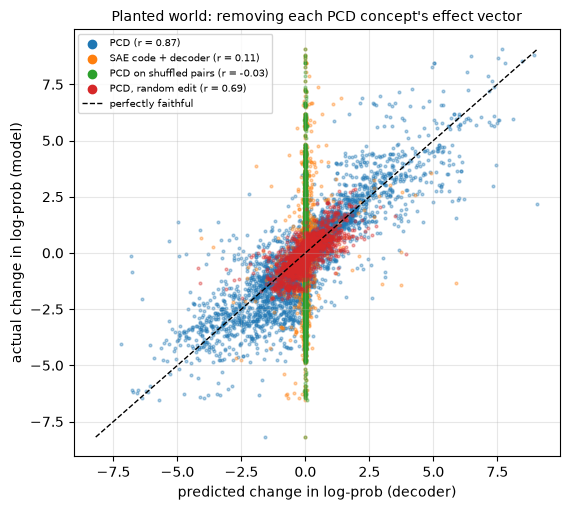


<details>
<summary>Expected output</summary>

<pre style="white-space:pre;overflow-x:auto;line-height:normal;font-family:Menlo,'DejaVu Sans Mono',consolas,'Courier New',monospace">PCD                    mean |actual change| 1.614   mean |predicted change| 1.380
SAE code + decoder     mean |actual change| 1.614   mean |predicted change| 0.057
PCD on shuffled pairs  mean |actual change| 1.614   mean |predicted change| 0.007
PCD, random edit       mean |actual change| 0.402   mean |predicted change| 0.316</pre>

</details>

<details>
<summary>Help - how should I interpret this plot?</summary>

The PCD's predictions (blue) lie along the diagonal, with correlation 0.87. When we remove a concept's effect vector, the planted model's answer log-probs change by up to about 8
nats, and the PCD predicts both the direction and roughly the size of each change (mean absolute change 1.38 predicted vs 1.61 actual). The two decoders that predict behaviour
badly fail exactly as they should: the SAE-code decoder (orange, r = 0.11) and the shuffled-pairs PCD (green, r = -0.03) predict almost no change at all (mean predicted change
0.057 and 0.007), so their points form a vertical line at zero.

The random edit (red) moves the activation by the same distance in a random direction. It changes the behaviour about 4 times less (mean 0.40 vs 1.61), because a random direction
in 48 dimensions only has about 6/48 = 1/8 of its squared norm in the 6-dimensional concept subspace. The PCD predicts those smaller changes reasonably well too (r = 0.69). That's
what we'd hope for: a faithful model of the behaviour should predict the effect of *any* edit, not just the ones we designed.

The PCD isn't perfectly faithful even here; some points sit well off the diagonal. Subtracting a mixed latent's effect vector can push activations to combinations of concept
projections (some of them negative) that never occur in training, and the decoder has to extrapolate.
</details>


## Faithfulness in GPT-2

Now the real test. For GPT-2 we have to actually run the model with an edited residual stream, using a hook on `blocks.10.hook_resid_pre`. That raises a question the planted world
didn't have: **where** do we apply the edit?

- **At the read position only** (the `"."`). This is exactly what the PCD sees, so it's the natural test of the PCD's claim. But GPT-2 can also look back at earlier positions (like the subject's own token), which we haven't touched.
- **At all positions.** We subtract the same vector from the residual stream at every position of the story and the continuation. This is a stronger intervention that also removes copies of the concept stored elsewhere (to the extent they're stored along the same vector), in the same spirit as the all-position direction ablations in refusal-direction work ([9.1]). The PCD only sees the read position, so its prediction is the same either way.

We'll test four interventions, for the latents that the heatmap identified as the `she`, `he` and `they` concepts:

| intervention | edit | where |
|---|---|---|
| encoder direction @ read | move the projection onto $W_{enc}[:, j]$ to its mean on inactive examples | read position |
| effect vector @ read | subtract $v_j$ | read position |
| effect vector @ all | subtract $v_j$ | every position |
| random vector @ all *(control)* | subtract a random vector with $\|r\| = \|v_j\|$ | every position |


### Exercise - build the edits

> ```yaml
> Difficulty: 🔴🔴⚪⚪⚪
> Importance: 🔵🔵🔵🔵⚪
>
> You should spend up to 10-15 minutes on this exercise.
> ```

Implement `make_edits`, which returns a dict of three functions, each mapping (normalised) activations of shape `(..., d_model)` to edited activations of the same shape:

- `"encoder direction"`: with $\hat w = W_{enc}[:, j] / \|W_{enc}[:, j]\|$, replace the activation's projection $(a - b_{pre}) \cdot \hat w$ by its **mean over training examples where the latent is off**, leaving the orthogonal complement unchanged: $a' = a + (\mu_{\text{off}} - (a - b_{pre})\cdot \hat w)\, \hat w$.
- `"effect vector"`: $a' = a - v_j$, using `concept_vector`.
- `"random vector"`: $a' = a - r$, with $r$ a standard Gaussian vector (from a `t.Generator` seeded with `seed`, created on the CPU) rescaled to have the same norm as $v_j$.

Detach any parameters you use, so the edits don't build autograd graphs.


```python
def make_edits(
    pcd: PCD, acts_train: Float[Tensor, "n d_model"], z_train: Float[Tensor, "n n_latents"], j: int, seed: int = 0
) -> dict[str, Callable[[Tensor], Tensor]]:
    """Three ways of removing latent j from (normalised) activations of shape (..., d_model)."""
    raise NotImplementedError()


tests.test_make_edits(make_edits, PCD, concept_vector)
```


<details>
<summary>Hint</summary>

`(a - b_pre) @ w_hat` has shape `(...)`; to multiply it back onto `w_hat` you need a trailing dimension, `[..., None] * w_hat`. Compute $\mu_{\text{off}}$ once, outside the
returned function, from `acts_train[z_train[:, j] == 0]`.
</details>


<details><summary>Solution</summary>

```python
def make_edits(
    pcd: PCD, acts_train: Float[Tensor, "n d_model"], z_train: Float[Tensor, "n n_latents"], j: int, seed: int = 0
) -> dict[str, Callable[[Tensor], Tensor]]:
    """Three ways of removing latent j from (normalised) activations of shape (..., d_model)."""
    off = z_train[:, j] == 0
    b_pre = pcd.b_pre.detach()
    w_hat = F.normalize(pcd.W_enc[:, j].detach(), dim=0)
    off_value = ((acts_train[off] - b_pre) @ w_hat).mean()
    v = concept_vector(acts_train, z_train, j)
    generator = t.Generator().manual_seed(seed)
    r = F.normalize(t.randn(v.shape, generator=generator), dim=0).to(v.device) * v.norm()

    def encoder_direction(a: Tensor) -> Tensor:
        return a + (off_value - (a - b_pre) @ w_hat)[..., None] * w_hat

    return {
        "encoder direction": encoder_direction,
        "effect vector": lambda a: a - v,
        "random vector": lambda a: a - r,
    }
```
</details>


Our edits work on *normalised* activations (the space the PCD was trained in), but the hook will see GPT-2's *raw* residual stream. This helper converts an edit from one space to
the other:


```python
def in_raw_space(edit: Callable[[Tensor], Tensor], mean: Tensor, scale: Tensor) -> Callable[[Tensor], Tensor]:
    """Turns an edit of normalised activations ((raw - mean) / scale) into an edit of raw activations."""
    return lambda raw: edit((raw - mean) / scale) * scale + mean
```


### Exercise - run GPT-2 with an edited residual stream

> ```yaml
> Difficulty: 🔴🔴🔴⚪⚪
> Importance: 🔵🔵🔵🔵🔵
>
> You should spend up to 15-20 minutes on this exercise.
> ```

Implement `behaviour_under_edit`. For each probe, it should run GPT-2 on the prompts + probe with a hook on `blocks.{layer}.hook_resid_pre` that applies `edit_raw` (a function of
raw activations of shape `(..., d_model)`):

- if `positions == "read"`, only to the read position of each row (the last real token of the *prompt*);
- if `positions == "all"`, to every position;
- if `edit_raw is None`, no hook at all (this gives the clean behaviour).

It returns the restricted log-probs (using `restrict_to_answer_vocab` with the global `answer_ids`) of shape `(n_prompts, n_probes, n_answers + 1)`, in the same format as
`gpt2_test_behaviour`. Process the prompts in batches of `batch_size`.

You can (and should) reuse `last_token_logprobs_and_acts` for the forward pass: if you register your editing hook with `with gpt2.hooks(...)` around the call, it runs *before* that
function's own storing hook (hooks on the same point run in the order they were added). You'll need to compute the read positions yourself, in the same way as before.


```python
@t.no_grad()
def behaviour_under_edit(
    model: HookedTransformer,
    prompts: list[str],
    edit_raw: Callable[[Tensor], Tensor] | None,
    positions: str = "read",
    layer: int = 10,
    batch_size: int = 150,
) -> Float[Tensor, "n_prompts n_probes n_answers_plus_1"]:
    """Restricted next-token log-probs for every probe, with `edit_raw` applied to resid_pre[layer] at `positions`."""
    assert positions in ("read", "all")
    raise NotImplementedError()


tests.test_behaviour_under_edit(behaviour_under_edit, gpt2, test_prompts[:4], gpt2_test_behaviour[:4])
```


<details>
<summary>Hint</summary>

Inside the batch loop, define a hook function that closes over `rows` and `read_pos`. For `"read"`, use advanced indexing to edit and write back: `resid[rows, read_pos] =
edit_raw(resid[rows, read_pos])`. For `"all"`, just return `edit_raw(resid)`: the edits act on the last dimension, so they work on a `(batch, seq, d_model)` tensor directly.
</details>


<details><summary>Solution</summary>

```python
@t.no_grad()
def behaviour_under_edit(
    model: HookedTransformer,
    prompts: list[str],
    edit_raw: Callable[[Tensor], Tensor] | None,
    positions: str = "read",
    layer: int = 10,
    batch_size: int = 150,
) -> Float[Tensor, "n_prompts n_probes n_answers_plus_1"]:
    """Restricted next-token log-probs for every probe, with `edit_raw` applied to resid_pre[layer] at `positions`."""
    assert positions in ("read", "all")
    pad_id = model.tokenizer.pad_token_id
    out = []
    for start in range(0, len(prompts), batch_size):
        batch = prompts[start : start + batch_size]
        read_pos = (model.to_tokens(batch)[:, 1:] != pad_id).sum(1)
        rows = t.arange(len(batch), device=read_pos.device)

        def edit_hook(resid: Float[Tensor, "batch seq d_model"], hook) -> Float[Tensor, "batch seq d_model"]:
            if positions == "all":
                return edit_raw(resid)
            resid[rows, read_pos] = edit_raw(resid[rows, read_pos])
            return resid

        hooks = [] if edit_raw is None else [(f"blocks.{layer}.hook_resid_pre", edit_hook)]
        per_probe = []
        for probe in PROBES:
            with model.hooks(fwd_hooks=hooks):
                logprobs, _ = last_token_logprobs_and_acts(model, batch, probe, layer)
            per_probe.append(restrict_to_answer_vocab(logprobs, answer_ids))
        out.append(t.stack(per_probe, dim=1))
    return t.cat(out)
```
</details>


### Exercise - summarise faithfulness

> ```yaml
> Difficulty: 🔴🔴⚪⚪⚪
> Importance: 🔵🔵🔵🔵⚪
>
> You should spend up to 10 minutes on this exercise.
> ```

Implement `faithfulness_summary`. All four inputs are restricted log-probs of shape `(n, n_probes, n_answers + 1)`. Return a dict with:

- `"actual KL"`: the mean over examples and probes of $D_{KL}(\text{clean actual} \,\|\, \text{edited actual})$;
- `"predicted KL"`: the same for the PCD's clean and edited predictions;
- `"r"`: the Pearson correlation between predicted and actual **changes in log-prob**, computed over the answer tokens (not the "other" bucket) to which the *clean model* assigns probability greater than `min_prob`. (Tokens the model never considers would add thousands of near-zero points and wash out the correlation.)


```python
def faithfulness_summary(
    clean_actual: Tensor, edited_actual: Tensor, clean_pred: Tensor, edited_pred: Tensor, min_prob: float = 0.02
) -> dict[str, float]:
    """KL of actual and predicted behaviour changes, and the correlation of per-token log-prob changes."""
    raise NotImplementedError()


tests.test_faithfulness_summary(faithfulness_summary)
```


<details><summary>Solution</summary>

```python
def faithfulness_summary(
    clean_actual: Tensor, edited_actual: Tensor, clean_pred: Tensor, edited_pred: Tensor, min_prob: float = 0.02
) -> dict[str, float]:
    """KL of actual and predicted behaviour changes, and the correlation of per-token log-prob changes."""
    def mean_kl(p: Tensor, q: Tensor) -> float:
        return (p.exp() * (p - q)).sum(-1).mean().item()

    mask = clean_actual[..., :-1].exp() > min_prob
    d_pred = (edited_pred - clean_pred)[..., :-1][mask]
    d_actual = (edited_actual - clean_actual)[..., :-1][mask]
    return {
        "actual KL": mean_kl(clean_actual, edited_actual),
        "predicted KL": mean_kl(clean_pred, edited_pred),
        "r": t.corrcoef(t.stack([d_pred, d_actual]))[0, 1].item(),
    }
```
</details>


Now let's run the experiment. For each of the `she`, `he` and `they` latents (chosen as the best latent for each group *on the training set*), we take up to 150 test stories on
which the latent is active, and run the four interventions. This needs about 11,000 sequences' worth of GPT-2 forward passes and takes 10-30 seconds.


```python
CONDITIONS = [
    ("encoder direction", "read"),
    ("effect vector", "read"),
    ("effect vector", "all"),
    ("random vector", "all"),
]
gpt2_mean, gpt2_scale = act_mean.to(device), act_scale.to(device)
faith_rows, scatter_points = {}, {}
for group in ["she", "he", "they"]:
    j, test_auc = best_latent_auroc(gpt2_z_train.cpu(), train_groups[group], gpt2_z_test.cpu(), test_groups[group])
    active = (gpt2_z_test[:, j] > 0).nonzero().squeeze(-1)[:150]
    prompts = [test_prompts[i] for i in active.tolist()]
    edits = make_edits(gpt2_pcd, gpt2_train_acts, gpt2_z_train, j)
    clean_actual = behaviour_under_edit(gpt2, prompts, None)
    with t.no_grad():
        clean_pred = gpt2_pcd(gpt2_test_acts[active]).log_softmax(-1)
    label = f"#{j} ({group})"
    print(f"latent {label}: held-out AUROC {test_auc:.2f}, active on {len(active)} of the stories used")
    for edit_name, positions in CONDITIONS:
        edited_actual = behaviour_under_edit(gpt2, prompts, in_raw_space(edits[edit_name], gpt2_mean, gpt2_scale), positions)
        with t.no_grad():
            edited_pred = gpt2_pcd(edits[edit_name](gpt2_test_acts[active])).log_softmax(-1)
        faith_rows[(label, f"{edit_name} @ {positions}")] = faithfulness_summary(clean_actual, edited_actual, clean_pred, edited_pred)
        if (edit_name, positions) == ("effect vector", "all"):
            mask = clean_actual[..., :-1].exp() > 0.02
            scatter_points[label] = ((edited_pred - clean_pred)[..., :-1][mask], (edited_actual - clean_actual)[..., :-1][mask])

faith_df = pd.DataFrame(faith_rows).T
utils.plot_faithfulness_bars(faith_df, "GPT-2: does removing a PCD concept change GPT-2 as much as the PCD predicts?")
display(faith_df.round(3))
```


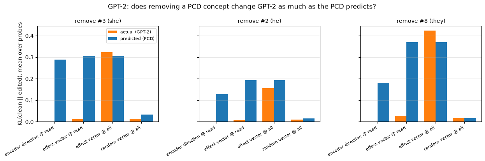


<details>
<summary>Expected output (table)</summary>

<pre style="white-space:pre;overflow-x:auto;line-height:normal;font-family:Menlo,'DejaVu Sans Mono',consolas,'Courier New',monospace">latent #3 (she): held-out AUROC 0.97, active on 150 of the stories used
latent #2 (he): held-out AUROC 0.78, active on 150 of the stories used
latent #8 (they): held-out AUROC 0.86, active on 150 of the stories used
                                    actual KL  predicted KL      r
#3 (she)  encoder direction @ read      0.000         0.282  0.508
          effect vector @ read          0.011         0.306  0.573
          effect vector @ all           0.325         0.306  0.810
          random vector @ all           0.013         0.034  0.260
#2 (he)   encoder direction @ read      0.000         0.127  0.399
          effect vector @ read          0.009         0.198  0.434
          effect vector @ all           0.158         0.198  0.642
          random vector @ all           0.010         0.016  0.044
#8 (they) encoder direction @ read      0.001         0.181  0.358
          effect vector @ read          0.028         0.369  0.652
          effect vector @ all           0.420         0.369  0.858
          random vector @ all           0.017         0.018  0.117</pre>

</details>

<details>
<summary>Help - how should I interpret this plot?</summary>

Read each panel from left to right.

**Encoder direction @ read: unfaithful.** Switching the latent off by moving the activation along its encoder direction makes the PCD predict a large change (KL 0.13-0.28), and
GPT-2 does essentially nothing (actual KL 0.000-0.001). The PCD has learned to *read* each concept along a direction that is excellent for detection (the `she` latent has a
held-out AUROC of 0.97) but causally inert on its own.

**Effect vector @ read: still unfaithful.** Subtracting the full mean-difference vector at the `"."` is a much bigger edit, and the PCD predicts even larger changes (0.20-0.37).
GPT-2 barely notices (0.009-0.028), 13-28 times less than predicted. The information the continuations use is not only at the `"."`: GPT-2 can look back at the subject's own
tokens, which we didn't touch, and evidently does. A PCD that reads only the `"."` has no way to know this.

**Effect vector @ all: roughly faithful.** When the same vector is subtracted at every position, GPT-2's behaviour changes a lot (0.16-0.42), within about 20% of what the PCD
predicts (0.20-0.37), and the token-level changes correlate well (r = 0.64-0.86). Note that the PCD's prediction is identical to the previous condition; what changed is that the
intervention now actually reaches the places GPT-2 reads from.

**Random vector @ all: the control.** A random vector of the same norm, subtracted everywhere, changes GPT-2's behaviour by only 0.010-0.017, an order of magnitude less than the
effect vector, and the PCD correctly predicts small changes (0.016-0.034). So what matters about the effect vector is its direction, not its size.

The honest summary is mixed. The PCD's concepts correspond to *real, causally relevant* directions (their effect vectors), and the PCD predicts their effect on GPT-2 well, **but
only for an intervention it cannot itself see**. For the interventions that act on exactly what the PCD reads, its predictions are wrong by more than an order of magnitude. Its
explanations are predictive, and directionally right, but they badly overstate how much the read position matters.
</details>


For the one condition where GPT-2's behaviour does change substantially (the effect vector at all positions), let's look at the changes token by token. Each point is one (story,
question, answer token) triple where GPT-2 gave the token at least 2% probability before the edit.


```python
utils.plot_faithfulness_scatter(scatter_points, "GPT-2: effect vector removed at all positions (layer 10)")
```


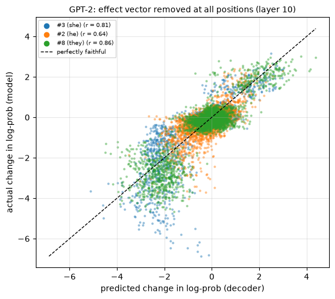


<details>
<summary>Help - how should I interpret this plot?</summary>

For all three concepts, predicted and actual changes lie along the diagonal (r = 0.81 for `she`, 0.64 for `he`, 0.86 for `they`). Points in the bottom-left are tokens whose
probability falls when the concept is removed; points in the top-right are the alternatives that rise. The PCD tends to *under*-predict the biggest drops: for the `she` concept,
some tokens lose 4-6 nats in GPT-2 but only 2-3 nats according to the PCD. The `he` concept is the least faithful, matching the fact that its latent is the least clean (held-out
AUROC 0.78, vs 0.97 for `she`).
</details>


## Try it yourself - edit your own story

Pick a story and a concept, remove the concept's effect vector at all positions, and compare what GPT-2 does with what the PCD predicts. The cell below does this for the `she`
concept on a story from outside our templates. Try:

- removing the `they` concept from a story with a plural subject: what does GPT-2 say instead? Does the PCD agree?
- *adding* a concept instead of removing it (`lambda a: a + v` with the `she` vector): can you make GPT-2 say `she` about the kings?
- removing a concept at the read position only, on your own stories: is the read position ever enough?


```python
story, group = "The nurse lost her keys at the station.", "she"
j = best_latent_auroc(gpt2_z_train.cpu(), train_groups[group], gpt2_z_test.cpu(), test_groups[group])[0]
v = concept_vector(gpt2_train_acts, gpt2_z_train, j)
remove = lambda a: a - v

story_acts = (get_acts_and_behaviour([story])[0] - act_mean) / act_scale
clean = behaviour_under_edit(gpt2, [story], None)
edited = behaviour_under_edit(gpt2, [story], in_raw_space(remove, gpt2_mean, gpt2_scale), "all")
with t.no_grad():
    pred_clean, pred_edited = gpt2_pcd(story_acts).log_softmax(-1), gpt2_pcd(remove(story_acts)).log_softmax(-1)
print(f"{story}   (removing latent #{j}, the '{group}' concept, at all positions)\n")
for q in [1, 2]:
    print(f"{PROBES[q]!r}")
    print(f"  GPT-2 before: {top_answers(clean[0, q])}\n  GPT-2 after:  {top_answers(edited[0, q])}")
    print(f"  PCD before:   {top_answers(pred_clean[0, q])}\n  PCD after:    {top_answers(pred_edited[0, q])}")
```


<details>
<summary>Expected output</summary>

<pre style="white-space:pre;overflow-x:auto;line-height:normal;font-family:Menlo,'DejaVu Sans Mono',consolas,'Courier New',monospace">  0%|          | 0/1 [00:00&lt;?, ?it/s]

The nurse lost her keys at the station.   (removing latent #3, the 'she' concept, at all positions)

' After that,'
  GPT-2 before: ' she' (0.49), '&lt;other&gt;' (0.18), ' the' (0.11)
  GPT-2 after:  '&lt;other&gt;' (0.23), ' he' (0.21), ' they' (0.14)
  PCD before:   ' she' (0.49), '&lt;other&gt;' (0.21), ' the' (0.09)
  PCD after:    '&lt;other&gt;' (0.24), ' the' (0.23), ' he' (0.19)
' That made'
  GPT-2 before: ' her' (0.46), ' it' (0.15), '&lt;other&gt;' (0.13)
  GPT-2 after:  ' him' (0.18), ' it' (0.17), '&lt;other&gt;' (0.17)
  PCD before:   ' her' (0.55), '&lt;other&gt;' (0.15), ' it' (0.11)
  PCD after:    ' him' (0.19), '&lt;other&gt;' (0.18), ' it' (0.13)</pre>

Removing the `she` concept everywhere turns GPT-2's `she` (0.49) into a mix of `he` (0.21) and `they` (0.14), and its `her` (0.46) into `him` (0.18) and `it` (0.17). The PCD
predicts the same switch (`he` 0.19, `him` 0.19), though it puts more weight on `the` than GPT-2 does. The story contains the word "her" itself; subtracting the effect vector from
the residual stream at that position too (along with every other position) was enough to override it.
</details>


## Summary of 4️⃣

- **Faithfulness has to be tested separately from accuracy.** A decoder trained on observational data can predict behaviour well from correlates of its causes.
- In the planted world, where behaviour reads the activation directly, the PCD is faithful: removing its concepts changes the behaviour as predicted (r = 0.87), while decoders built on the SAE code or on shuffled pairs predict no change at all.
- In GPT-2, the PCD's concepts have real causal counterparts: subtracting a concept's mean-difference vector at every position changes GPT-2's behaviour about as much as the PCD predicts (r = 0.64-0.86), and far more than a norm-matched random vector does.
- But the PCD is **unfaithful about the position it reads**. Editing that activation, along the PCD's own encoder direction or even along the full effect vector, changes GPT-2 more than ten times less than the PCD predicts (and along the encoder direction, not at all). GPT-2 can get the same information from other positions, and a decoder that sees one position can't know that.
- A concept's *detection* direction (the encoder row) and its *effect* direction (the mean difference) behave completely differently under intervention. Report which one you used.


=== NEW CHAPTER ===


# ☆ Bonus


## Make the PCD faithful at the read position

The PCD in section 4️⃣ was unfaithful in a specific way: it predicted large behaviour changes from edits that GPT-2 ignores. One fix is to change *what* we encode rather than
*how*. Some ideas:

- **Read more positions.** The paper's encoder reads 16 consecutive positions, each encoded separately, and the decoder sees all 16 soft tokens. Encode every position of the story (with a shared encoder) and let the decoder see the sum or the sequence of soft tokens. Does the PCD's prediction for "effect vector @ read" get smaller (closer to the truth), because it now knows the information is also elsewhere?
- **Train on interventions.** Add a term to the loss that uses *edited* activations: patch a random training story's activation at the read position with another story's, run GPT-2 to get the actual behaviour under that patch, and train the PCD to predict it. This turns the PCD into a model of the *causal* effect of the read activation, rather than of its correlation with behaviour. How much does it cost in ordinary predictive accuracy?
- **Use effect vectors as the concept directions.** Train the encoder, then replace each concept's reading direction with its effect vector and retrain the decoder. Is the PCD still as predictive?

## Dead concepts and the auxiliary loss

In the planted world, 2 of the PCD's 12 latents nearly died (latents 0 and 5 fire on 26 and 7 of 20,000 training examples); the GPT-2 PCD happened to keep all 12 in use. With
larger dictionaries, TopK bottlenecks routinely end up with many **dead latents** that never make it into the top $k$, and so never receive gradient. The PCD paper uses an
auxiliary loss that, for the latents that have been inactive for a while, pushes their encoder directions towards activations on which they *nearly* fired:

$$
\mathcal{L}_{aux} = -\frac{\epsilon_{aux}}{k_{aux}} \sum_{i \in I} W_{enc,i} \cdot a
$$

where $I$ is the set of top-$k_{aux}$ dead latents by pre-activation. Train a GPT-2 PCD with $m = 128$, $k = 8$, count the dead latents, then implement the auxiliary loss and see
how many you can revive. Do the revived latents look interpretable on the dashboard?

## Add a question, get a concept

Our PCD dropped the `outdoors` concept, because none of our five questions depends on the location. Add a question whose answer *does* depend on it: from a quick check, `" They
could hear the"` (wind? music?) and `" Outside, the"` are the most location-sensitive continuations we tried, though even their dependence on location is weak. Re-extract the
behaviour, retrain, and redo the concept-accuracy plot. Does an `outdoors` concept appear? How does the PCD trade it off against the others when $k$ stays at 3?

This is a general lesson about PCDs: **the questions decide the concepts.** In the paper, the "questions" during pretraining are "what comes next in this web text?", which depends
on almost everything, so the concepts are very general. A PCD trained on a narrow set of questions is a narrow lens.

## Scale up the dictionary

We used 12 concepts so that the dashboard fits on a screen. Try $m \in \{32, 128\}$ and $k \in \{3, 8\}$. As $m$ grows, do the `she`/`he`/`they` concepts split into finer ones
(e.g. "she, and the event was good")? Does the best single-latent AUROC for each group go up or down? The paper found that concept interpretability improves with training data up
to a point and then plateaus, while SAEs with larger $k$ eventually overtake PCDs on auto-interp scores.

## An LLM decoder

The paper's decoder is an LLM reading soft tokens. You can build a miniature of this with GPT-2 itself as the decoder: insert the soft token $s = W_{emb}^\top z$ (now with
$d_{hidden} = 768$) as the embedding of a placeholder token in a prompt like `"<soft> After that,"`, and train only the encoder and $W_{emb}$ (keeping GPT-2 frozen) to make the
decoder's next-token distribution match the subject's. This is a cross between a PCD and a Patchscope ([7.1]). Does the frozen GPT-2 decoder learn to read concept embeddings at
all? If you've done [7.3] Mini Activation Oracles, compare with an oracle that reads the full activation.

## Further reading

- Huang, Choi, Johnson, Schwettmann & Steinhardt (2025), [*Predictive Concept Decoders: Training Scalable End-to-End Interpretability Assistants*](https://arxiv.org/abs/2512.15712). The method this section is based on. Includes pretraining on FineWeb, finetuning on user-attribute questions, and applications to jailbreak detection, secret hints and implanted concepts.
- Koh et al. (2020), [*Concept Bottleneck Models*](https://arxiv.org/abs/2007.04612). The original concept bottleneck: predict human-labelled concepts first, then the label from the concepts. PCDs replace the human labels with a sparsity constraint and a behavioural target.
- Pan et al. (2024), [*LatentQA: Teaching LLMs to Decode Activations Into Natural Language*](https://arxiv.org/abs/2412.08686). The no-bottleneck version of the decoder, and the main baseline in the PCD paper. See also [1.3.4] and [7.3] on Activation Oracles.
- Braun, Taylor, Goldowsky-Dill & Sharkey (2024), [*Identifying Functionally Important Features with End-to-End Sparse Dictionary Learning*](https://arxiv.org/abs/2405.12241). SAEs trained to preserve the model's output distribution rather than the activation: the same "predictive vs reconstructive" argument as section 2️⃣, applied to SAEs.
- Gao et al. (2024), [*Scaling and evaluating sparse autoencoders*](https://arxiv.org/abs/2406.04093). TopK SAEs, and the dead-latent auxiliary loss that the PCD paper adapts.
- Hewitt & Liang (2019), [*Designing and Interpreting Probes with Control Tasks*](https://arxiv.org/abs/1909.03368). Why probe accuracy needs controls, and the idea of selectivity.
- Marks & Tegmark (2023), [*The Geometry of Truth*](https://arxiv.org/abs/2310.06824). Mean-difference probes are more causally implicated than logistic-regression probes, the distinction behind the encoder-direction vs effect-vector result in section 4️⃣.
- Makelov, Lange & Nanda (2023), [*Is This the Subspace You Are Looking For?*](https://arxiv.org/abs/2311.17030). An interpretability illusion for subspace interventions: an edit can change behaviour through a dormant pathway, so "the edit changed behaviour" does not by itself mean "the concept lives here".
- Tigges, Hollinsworth, Geiger & Nanda (2023), [*Linear Representations of Sentiment in Large Language Models*](https://arxiv.org/abs/2310.15154). Evidence that sentiment is summarised at punctuation tokens, relevant to why our `"."` read position works at all.

