# [8.1] Activation Patching Refresher


> **Colab: [exercises](https://colab.research.google.com/github/shinobiultra/ARENA_3.0_Extended/blob/main/chapter8_automated_circuits/exercises/part1_activation_patching_refresher/8.1_Activation_Patching_Refresher_exercises.ipynb) |
> [solutions](https://colab.research.google.com/github/shinobiultra/ARENA_3.0_Extended/blob/main/chapter8_automated_circuits/exercises/part1_activation_patching_refresher/8.1_Activation_Patching_Refresher_solutions.ipynb)**

If you want to change to dark mode, you can do this by clicking the three horizontal lines in the top-right, then navigating to Settings → Theme.


# Introduction


You've met this prompt before:

```
When Mary and John went to the store, John gave a drink to
```

GPT-2 Small answers `" Mary"`, and in [1.4.1] you found the circuit that does it: duplicate-token and induction heads notice that John appears twice, S-inhibition heads pass that
on to the final position, and the **name mover heads** 9.9, 9.6 and 10.0 copy the remaining name, Mary, into the logits.

Here's a fact you'll establish for yourself in this section. On the dataset we'll build, the three name movers between them write about **+4.3** onto the logit difference
`logit(Mary) - logit(John)`, which is *more than the model's entire logit difference* of 2.9. So if we patch their outputs with outputs from a corrupted prompt, so that they no
longer know which name to copy, the logit difference should collapse. It doesn't. It falls by 0.03 (from 2.92 to 2.90).

Removing more than 100% of the answer barely changes the answer. Is the name-mover story wrong? No. But the experiment asked a different question from the one you probably thought
you were asking, and the rest of the model answered it by **repairing itself**.

This section is about asking activation patching the right question. A patching experiment looks like one operation ("replace this activation, see what happens"), but its result
depends on at least four choices:

1. **The prompts and the metric.** What behaviour, measured how? A logit difference, a probability and a log-probability can disagree about which components matter, and even about the *sign* of an effect.
2. **The direction.** Patching clean activations into a corrupted run (*denoising*) tells you what is **sufficient** to restore a behaviour. Patching corrupted activations into a clean run (*noising*) tells you what is **necessary**. In a circuit with any redundancy or any serial dependencies, these give different answers.
3. **What you patch in.** A corrupted prompt, a zero vector, the dataset mean or another random prompt's activation are four different counterfactuals, and each one only removes the information it actually changes.
4. **What the rest of the model is allowed to do.** If downstream components recompute in response to your patch, you measure a **total effect**. If you freeze them, you measure a **direct effect**. The difference, the **indirect effect**, is where both circuits and self-repair live.

You'll study these on two real GPT-2 Small tasks: indirect object identification (IOI, Wang et al. 2022) and greater-than (Hanna et al. 2023). By the end you'll have written, from
scratch, a small patching toolkit (metrics, a generic patching hook, layer × position sweeps over the residual stream, attention and MLP outputs, head and head × position sweeps,
and a "frozen downstream" runner for direct and indirect effects), and used it to produce the pictures that go with each choice above. The headline picture is the **Hydra plot**:
total effect against direct effect for knocking out sets of heads, where the name movers sit far off the line that 30 random sets of heads follow.

Every result in this section has a control next to it: a **placebo corruption** that changes only task-irrelevant words, **shuffled clean/corrupted pairings**, **random sets of
heads**, **held-out templates** and **per-prompt distributions** instead of averages.

This section assumes you've done [1.4.1] Indirect Object Identification (or at least its activation patching and path patching parts), so you're comfortable with TransformerLens
hooks, `run_with_cache`, and the IOI circuit. It's the first section of Chapter 8. The `PatchingTask` interface you'll define in part 1️⃣ (clean tokens, corrupted tokens, a
per-prompt metric, position labels) is the minimal input that the methods in the rest of the chapter (attribution patching, AtP*, ACDC) need, and the exhaustive sweeps you compute
here are the ground truth those faster methods try to approximate.


## Content & Learning Objectives

### 1️⃣ Tasks, metrics and the patching loop

You'll build an IOI dataset with a fixed token template, write four corruptions of it, and package the result in a small `PatchingTask` interface. Then you'll write the metric, the
normalised patching score, a generic patching hook, and a layer × position sweep, and use them to watch information move from the second subject token to the final position, in
both patching directions. A shuffled-pairing control tells you which parts of that picture are about *this* prompt and which are about the template.

> ##### Learning Objectives
>
> - Design clean and corrupted prompts that differ in exactly the information you want to localise
> - Implement the logit difference metric and a normalised patching score that works in both directions
> - Implement a generic activation-patching hook and a layer × position sweep
> - Use a shuffled clean/corrupted pairing as a control for prompt-specific information

### 2️⃣ Sufficiency vs necessity: denoising and noising

Denoising asks "is this enough?", noising asks "is this needed?". You'll see why these differ for AND-like and OR-like circuits, sweep every attention head in both directions, and
plot one against the other. A placebo corruption gives you a noise floor for the whole plot.

> ##### Learning Objectives
>
> - Explain what denoising and noising measure, and why they disagree for serial, AND-like and OR-like structure
> - Implement head-level and head × position patching sweeps
> - Read a denoising-vs-noising scatter plot, and use a placebo corruption to calibrate what counts as "an effect"

### 3️⃣ What do you patch in? Corruptions and ablations

You'll run the same noising sweep with seven different sources: three corrupted-prompt datasets, zero ablation, mean ablation, resample ablation and a placebo. They pick out
overlapping but different sets of heads, and you'll explain the differences.

> ##### Learning Objectives
>
> - Implement zero, mean and resample ablation
> - Understand that an ablation only removes information that *varies* across the source distribution
> - Recognise off-distribution replacements, and why zero ablation flags heads that have little to do with the task

### 4️⃣ Direct, indirect and total effects

You'll write a forward pass in which any chosen set of components is frozen at its clean value, and use it to split every head's total effect into a direct and an indirect part.
Then you'll knock out the name movers and watch the rest of the model compensate.

> ##### Learning Objectives
>
> - Define total, direct and indirect effects as interventions, and implement them with frozen downstream components
> - Restrict an effect to specific paths (e.g. "only through the name movers"), and see why path effects don't add up
> - Reproduce the Hydra effect / backup behaviour, with a random-heads control, and identify the heads that compensate

### 5️⃣ A second task, and the pitfalls checklist

You'll plug the greater-than task into the same interface, find that MLPs matter far more there than in IOI, and then go through the pitfalls that make patching results misleading:
averages that hide per-prompt structure, results that don't transfer to held-out templates, metrics that disagree about sign, and subspace patching illusions.

> ##### Learning Objectives
>
> - Reuse the `PatchingTask` interface on a task with a probability-based metric
> - Use per-prompt distributions and bootstrap confidence intervals instead of bare means
> - Test patching results on held-out templates
> - Know when logit difference and probability metrics disagree, and why

### ☆ Bonus

Path patching with your frozen-run function, Gaussian-noise corruptions, a positive-total-effect anomaly, self-repair through LayerNorm, greater-than MLP neurons, and further
reading.


## Setup code


```python
import random
import sys
from dataclasses import dataclass, replace
from functools import partial
from pathlib import Path
from typing import Callable

import numpy as np
import pandas as pd
import torch as t
from IPython.display import display
from jaxtyping import Float, Int
from torch import Tensor
from tqdm.auto import tqdm
from transformer_lens import ActivationCache, HookedTransformer
from transformer_lens.utils import get_act_name

device = t.device("mps" if t.backends.mps.is_available() else "cuda" if t.cuda.is_available() else "cpu")

# Make sure exercises are in the path
chapter = "chapter8_automated_circuits"
section = "part1_activation_patching_refresher"
root_dir = next(p for p in [Path.cwd(), *Path.cwd().parents] if (p / chapter).exists())
exercises_dir = root_dir / chapter / "exercises"
section_dir = exercises_dir / section
if str(exercises_dir) not in sys.path:
    sys.path.append(str(exercises_dir))

import part1_activation_patching_refresher.tests as tests
import part1_activation_patching_refresher.utils as utils

MAIN = __name__ == "__main__"
```


=== NEW CHAPTER ===


# 1️⃣ Tasks, Metrics and the Patching Loop


> ##### Learning Objectives
>
> - Design clean and corrupted prompts that differ in exactly the information you want to localise
> - Implement the logit difference metric and a normalised patching score that works in both directions
> - Implement a generic activation-patching hook and a layer × position sweep
> - Use a shuffled clean/corrupted pairing as a control for prompt-specific information

## What a patching experiment is made of

Let's fix some notation. We have a model, a **clean** input $x_{\text{clean}}$ on which it shows some behaviour, and a **corrupted** input $x_{\text{corr}}$ on which it doesn't. A
**metric** $M$ maps the model's output to a number measuring the behaviour (higher = more of it). For a model component $c$ (a residual stream vector at some position, an attention
head's output, an MLP's output...), write $a_c(x)$ for its activation on input $x$, and $M(x \mid a_c \leftarrow v)$ for the metric when we run the model on $x$ but overwrite $c$'s
activation with $v$, letting everything downstream recompute.

There are two ways to patch:

$$
\underbrace{M\big(x_{\text{corr}} \mid a_c \leftarrow a_c(x_{\text{clean}})\big)}_{\text{denoising: restore one clean activation}}
\qquad\qquad
\underbrace{M\big(x_{\text{clean}} \mid a_c \leftarrow a_c(x_{\text{corr}})\big)}_{\text{noising: break one activation}}
$$

In [1.4.1], most of the choices that go into these formulas were made for you: the prompts, the corruption (swap the subject, or replace every name), the metric (logit difference),
and the direction. In this section we'll make each of them deliberately, and see how much the answer depends on them.

We'll write everything from scratch with hooks rather than using `transformer_lens.patching`. (The tests use `transformer_lens.patching` as an independent check on your code.)


Let's load GPT-2 Small. We never train it, so we turn off gradients globally (this also saves memory during the sweeps).


```python
t.set_grad_enabled(False)
model = HookedTransformer.from_pretrained("gpt2-small", device=device)
N_LAYERS, N_HEADS = model.cfg.n_layers, model.cfg.n_heads
print(f"{N_LAYERS} layers, {N_HEADS} heads per layer, d_head={model.cfg.d_head}")
```


## The IOI prompts

We'll generate IOI prompts from a family of 64 templates of the form

```
{opener} {A} and {B} {action} the {PLACE}, {C} {verb} a {OBJECT} to
```

with four openers (`When`, `After`, `While`, `Once`), four actions (`went to`, `were at`, `arrived at`, `got to`) and four verbs (`gave`, `handed`, `passed`, `sent`). In a clean
prompt, `{A}` is the indirect object (IO) and `{B}` and `{C}` are both the subject (S), so the clean prompts are all **ABBA**-ordered: `"When Mary and John went to the store, John
gave a drink to"`.

Two design decisions are worth making explicit, because they'll come back to bite us (in a useful way) later.

**Every prompt has exactly the same token template.** All names, places and objects are single tokens, so every prompt is 15 tokens long, with IO at position 2, the first subject
(S1) at position 4, the second subject (S2) at position 10 and the final token (END) at position 14. This makes "patch position 10" mean the same thing for every prompt, so we can
batch everything and label positions with roles. It's the reason we vary the *filler* words (opener, action, verb, place, object) rather than the sentence structure: we want
results that aren't about one particular sentence, without giving up aligned positions.

**We only use ABBA order.** The IOI paper mixes ABBA and BABA (`"When John and Mary went to the store, John gave a drink to"`). Mixing them would put IO at position 2 in half the
prompts and at position 4 in the other half. We've chosen alignment over balance, and in part 5️⃣ we'll test what that choice costs us by evaluating on held-out BABA prompts. Keep
in mind already that, in our dataset, *"the answer is the first name"* is always true. A model that had only learned that heuristic would score well.

The cell below defines the template family, an `IOIExample` dataclass, and a sampler. Each example stores the template with the filler words already filled in, and the names that
the different corruptions will use: `io`, `s`, a third name `c`, and three more fresh names `xyz`.


```python
OPENERS = ["When", "After", "While", "Once"]
ACTIONS = ["went to", "were at", "arrived at", "got to"]
VERBS = ["gave", "handed", "passed", "sent"]
TRAIN_TEMPLATES = [
    f"{opener} {{A}} and {{B}} {action} the {{PLACE}}, {{C}} {verb} a {{OBJECT}} to"
    for opener in OPENERS
    for action in ACTIONS
    for verb in VERBS
]


@dataclass
class IOIExample:
    template: str  # e.g. "When {A} and {B} went to the store, {C} gave a drink to" (only the name slots are left)
    io: str  # indirect object, e.g. "Mary"
    s: str  # subject, e.g. "John"
    c: str  # a third name, used by the ABC corruption
    xyz: tuple[str, str, str]  # three more names, used by the XYZ corruption


def sample_ioi_examples(templates: list[str], n: int, seed: int = 0) -> list[IOIExample]:
    """Samples n IOI examples: a random template, place, object and six distinct names for each."""
    rng = random.Random(seed)
    examples = []
    for _ in range(n):
        io, s, c, x, y, z = rng.sample(utils.NAMES, 6)
        template = rng.choice(templates).format(
            A="{A}", B="{B}", C="{C}", PLACE=rng.choice(utils.PLACES), OBJECT=rng.choice(utils.OBJECTS)
        )
        examples.append(IOIExample(template, io, s, c, (x, y, z)))
    return examples


def resample_fillers(examples: list[IOIExample], templates: list[str], seed: int = 1) -> list[IOIExample]:
    """Same names as `examples`, but a freshly sampled template, place and object for each one."""
    fresh = sample_ioi_examples(templates, len(examples), seed=seed)
    return [replace(ex, template=new.template) for ex, new in zip(examples, fresh)]
```


### Exercise - write the corruptions

> ```yaml
> Difficulty: 🔴⚪⚪⚪⚪
> Importance: 🔵🔵🔵🔵⚪
>
> You should spend up to 5-10 minutes on this exercise.
> ```

A corrupted prompt should differ from the clean prompt in exactly the information you want to localise, and in nothing else. Implement `ioi_prompt`, which fills an example's name
slots `{A}`, `{B}`, `{C}` according to a **scheme** written in the IOI paper's notation:

| scheme | `{A}`, `{B}`, `{C}` | example | what changes relative to clean |
|---|---|---|---|
| `"ABB"` (clean) | `io, s, s` | When Mary and John went to the store, **John** gave a drink to | |
| `"ABA"` | `io, s, io` | When Mary and John went to the store, **Mary** gave a drink to | S2 now repeats the *other* name, so the correct answer flips to John |
| `"ABC"` | `io, s, c` | When Mary and John went to the store, **Tom** gave a drink to | S2 is a new name: nothing is duplicated, so there's no reason to prefer Mary over John |
| `"XYZ"` | `*xyz` | When **Ann** and **Bob** went to the store, **Tom** gave a drink to | every name is new: neither Mary nor John appears at all |

`ABA` is (up to which half of the pair you call clean) the corruption used in the activation patching part of [1.4.1]; `XYZ` is the one used in its path patching part, where it was
called the "ABC dataset", confusingly. Our `ABC` is the minimal one: it changes a single token.


```python
def ioi_prompt(example: IOIExample, scheme: str = "ABB") -> str:
    """Fills the name slots of example.template according to the scheme ("ABB", "ABA", "ABC" or "XYZ")."""
    raise NotImplementedError()


tests.test_ioi_prompt(ioi_prompt, IOIExample)
```


<details><summary>Solution</summary>

```python
def ioi_prompt(example: IOIExample, scheme: str = "ABB") -> str:
    """Fills the name slots of example.template according to the scheme ("ABB", "ABA", "ABC" or "XYZ")."""
    names = {
        "ABB": (example.io, example.s, example.s),
        "ABA": (example.io, example.s, example.io),
        "ABC": (example.io, example.s, example.c),
        "XYZ": example.xyz,
    }[scheme]
    return example.template.format(A=names[0], B=names[1], C=names[2])
```
</details>


Now let's sample 100 examples, and also a **placebo** version of them: the same names, but freshly sampled filler words (opener, action, verb, place, object). The placebo will be
our control corruption throughout. It changes a lot of tokens, but none of the information that IOI depends on, so if patching from it ever looks like it matters, that tells us how
big a "meaningless" effect can be.


```python
N_PROMPTS = 100
examples = sample_ioi_examples(TRAIN_TEMPLATES, N_PROMPTS, seed=0)
placebo_examples = resample_fillers(examples, TRAIN_TEMPLATES, seed=1)

for i in range(2):
    for scheme in ["ABB", "ABA", "ABC", "XYZ"]:
        print(f"{scheme:<8}{ioi_prompt(examples[i], scheme)}")
    print(f"{'placebo':<8}{ioi_prompt(placebo_examples[i], 'ABB')}\n")
```


<details>
<summary>Expected output</summary>

<pre style="white-space:pre;overflow-x:auto;line-height:normal;font-family:Menlo,'DejaVu Sans Mono',consolas,'Courier New',monospace">ABB     Once William and Jane got to the house, Jane passed a gift to
ABA     Once William and Jane got to the house, William passed a gift to
ABC     Once William and Jane got to the house, Scott passed a gift to
XYZ     Once Jeremy and Amy got to the house, Emily passed a gift to
placebo While William and Jane went to the garden, Jane gave a key to

ABB     While Kate and Jacob were at the restaurant, Jacob gave a computer to
ABA     While Kate and Jacob were at the restaurant, Kate gave a computer to
ABC     While Kate and Jacob were at the restaurant, Maria gave a computer to
XYZ     While Crystal and Kyle were at the restaurant, Carter gave a computer to
placebo After Kate and Jacob arrived at the garden, Jacob passed a key to</pre>

</details>


### Exercise - implement the logit difference

> ```yaml
> Difficulty: 🔴⚪⚪⚪⚪
> Importance: 🔵🔵🔵⚪⚪
>
> You should spend up to 5 minutes on this exercise.
> ```

You wrote this in [1.4.1]; this time we want it **per prompt**, because we'll be looking at distributions over prompts as well as means. Implement `logit_diff`, which takes logits
of shape `(batch, seq, d_vocab)` and `answer_tokens` of shape `(batch, 2)` (the correct and incorrect answer token for each prompt), and returns `logit[correct] - logit[incorrect]`
at the **final** position, as a tensor of shape `(batch,)`.

For IOI the correct answer is IO and the incorrect one is S. Note that we always measure the metric with respect to the *clean* prompt's answers, even when we run the model on a
corrupted prompt. On an `ABC` prompt, "the correct answer" still means Mary, even though the model has no reason to say Mary.


```python
def logit_diff(
    logits: Float[Tensor, "batch seq d_vocab"], answer_tokens: Int[Tensor, "batch 2"]
) -> Float[Tensor, " batch"]:
    """Returns logit(correct) - logit(incorrect) at the final position, for each prompt."""
    raise NotImplementedError()


tests.test_logit_diff(logit_diff)
```


<details>
<summary>Hint</summary>

`logits[:, -1].gather(dim=-1, index=answer_tokens)` gives you a `(batch, 2)` tensor of the two answer logits for each prompt.
</details>


<details><summary>Solution</summary>

```python
def logit_diff(
    logits: Float[Tensor, "batch seq d_vocab"], answer_tokens: Int[Tensor, "batch 2"]
) -> Float[Tensor, " batch"]:
    """Returns logit(correct) - logit(incorrect) at the final position, for each prompt."""
    final_logits = logits[:, -1]
    answer_logits = final_logits.gather(dim=-1, index=answer_tokens.to(final_logits.device))
    return answer_logits[:, 0] - answer_logits[:, 1]
```
</details>


## The `PatchingTask` interface

Everything we do from now on needs the same four things: clean tokens, corrupted tokens, a metric, and some labels for the sequence positions. We'll bundle them into a small
dataclass:

- `clean_tokens` and `corrupted_tokens` have the same shape `(batch, seq)`, and row `i` of each is a matched pair.
- `metric` maps logits `(batch, seq, d_vocab)` to a **per-prompt** score `(batch,)`, where higher means "more of the clean behaviour". It closes over whatever it needs (here, the answer tokens), so code that uses a task never needs to know what the task is.
- `labels` names each position, for plotting.

The contract is that **all prompts in a task share one token template**: the same length, and the same role at each position. Tasks are cheap to make, so when you want to test a
different template (or a different word order), you make a different task rather than padding.

Every function you write from here on takes a `PatchingTask` (or its parts), so you can point the whole toolkit at a new task by writing one constructor. You can also import
`PatchingTask`, `make_ioi_task` and (later) `make_greater_than_task` from this section's `solutions.py` in later sections.


```python
@dataclass
class PatchingTask:
    """Matched clean/corrupted prompts sharing one token template, plus a per-prompt metric."""

    name: str
    clean_tokens: Int[Tensor, "batch seq"]
    corrupted_tokens: Int[Tensor, "batch seq"]
    metric: Callable[[Float[Tensor, "batch seq d_vocab"]], Float[Tensor, " batch"]]
    labels: list[str]

    def __post_init__(self):
        assert self.clean_tokens.shape == self.corrupted_tokens.shape, (
            f"Clean and corrupted tokens must have the same shape, got {tuple(self.clean_tokens.shape)} "
            f"and {tuple(self.corrupted_tokens.shape)}. Do all your prompts share one token template?"
        )
        assert len(self.labels) == self.clean_tokens.shape[1], "Need exactly one label per position"

    @property
    def n_prompts(self) -> int:
        return self.clean_tokens.shape[0]

    @property
    def seq_len(self) -> int:
        return self.clean_tokens.shape[1]


def make_ioi_task(
    model: HookedTransformer,
    examples: list[IOIExample],
    scheme: str = "ABC",
    corrupted_examples: list[IOIExample] | None = None,
    name: str | None = None,
) -> PatchingTask:
    """
    IOI task with clean prompts ioi_prompt(ex, "ABB"), and corrupted prompts ioi_prompt(ex', scheme) where ex'
    comes from `corrupted_examples` if given (e.g. for the placebo) and is the same example otherwise.
    """
    corrupted_examples = corrupted_examples or examples
    clean_tokens = model.to_tokens([ioi_prompt(ex, "ABB") for ex in examples])
    corrupted_tokens = model.to_tokens([ioi_prompt(ex, scheme) for ex in corrupted_examples])
    answer_tokens = t.tensor(
        [[model.to_single_token(" " + ex.io), model.to_single_token(" " + ex.s)] for ex in examples],
        device=clean_tokens.device,
    )
    # Label positions using the first prompt, with roles for the name positions
    roles = {" " + examples[0].io: "IO", " " + examples[0].s: "S"}
    labels = []
    for tok in clean_tokens[0]:
        tok_str = model.to_string(tok)
        label = roles.get(tok_str, tok_str.strip() or repr(tok_str))
        if label == "S":
            label = "S1" if "S1" not in labels else "S2"
        labels.append(label)
    labels[0], labels[-1] = "BOS", "END"
    return PatchingTask(
        name=name or f"IOI ({scheme})",
        clean_tokens=clean_tokens,
        corrupted_tokens=corrupted_tokens,
        metric=partial(logit_diff, answer_tokens=answer_tokens),
        labels=labels,
    )
```


Let's build one task per corruption, plus the placebo, and see what each corruption does to the model's behaviour. As in [7.1], it's worth knowing how the model behaves *before* we
look inside it.


```python
ioi_tasks = {scheme: make_ioi_task(model, examples, scheme) for scheme in ["ABA", "ABC", "XYZ"]}
ioi_tasks["placebo"] = make_ioi_task(model, examples, "ABB", corrupted_examples=placebo_examples, name="IOI (placebo)")
task = ioi_tasks["ABC"]  # our main task from now on
answer_tokens = task.metric.keywords["answer_tokens"]

print(task.labels)
clean_logits = model(task.clean_tokens)
clean_ld = task.metric(clean_logits)
io_top1 = (clean_logits[:, -1].argmax(-1) == answer_tokens[:, 0]).float().mean()
print(f"\nclean: logit diff {clean_ld.mean():.2f} ± {clean_ld.std():.2f}, IO is the top-1 prediction for {io_top1:.0%} of prompts")

per_prompt_ld = {"clean (ABB)": clean_ld}
for name, tsk in ioi_tasks.items():
    ld = tsk.metric(model(tsk.corrupted_tokens))
    per_prompt_ld[name if name == "placebo" else f"corrupted ({name})"] = ld
    print(f"{name:>8}: logit diff {ld.mean():5.2f} ± {ld.std():.2f}, fraction of prompts with logit diff > 0: {(ld > 0).float().mean():.0%}")

del clean_logits  # full logits for 100 prompts are ~300MB; we only needed the metric
```


<details>
<summary>Expected output</summary>

<pre style="white-space:pre;overflow-x:auto;line-height:normal;font-family:Menlo,'DejaVu Sans Mono',consolas,'Courier New',monospace">['BOS', 'Once', 'IO', 'and', 'S1', 'got', 'to', 'the', 'house', ',', 'S2', 'passed', 'a', 'gift', 'END']

clean: logit diff 2.92 ± 1.34, IO is the top-1 prediction for 90% of prompts
     ABA: logit diff -3.94 ± 1.86, fraction of prompts with logit diff &gt; 0: 3%
     ABC: logit diff  0.92 ± 1.40, fraction of prompts with logit diff &gt; 0: 76%
     XYZ: logit diff  0.12 ± 2.07, fraction of prompts with logit diff &gt; 0: 51%
 placebo: logit diff  2.92 ± 1.27, fraction of prompts with logit diff &gt; 0: 99%</pre>

</details>


```python
utils.plot_metric_strips(
    per_prompt_ld,
    title="IOI logit difference logit(IO) - logit(S), one point per prompt",
    xlabel="logit difference (measured w.r.t. the clean prompt's IO and S)",
)
```


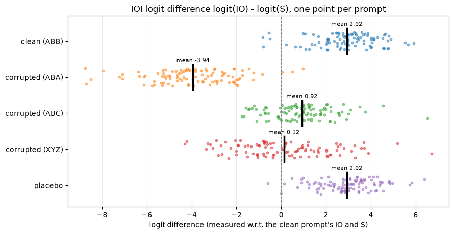


<details>
<summary>Help - how should I interpret this plot?</summary>

- **Clean prompts**: mean logit difference 2.92, and IO is the model's top prediction for 90% of prompts. A handful of prompts sit near or below zero: GPT-2 Small doesn't solve every IOI prompt.
- **`ABA`** reverses the answer: 97% of prompts now prefer S, with a mean of -3.94. It's a strong corruption, but it doesn't *remove* the IOI signal, it points it at the other name. Patching between clean and `ABA` moves the metric through a range of almost 7 logits, so effects look bigger than with other corruptions.
- **`ABC`** removes the duplication, so we might expect the model to be indifferent between Mary and John (logit difference 0). It isn't: the mean is 0.92, and 76% of prompts still prefer IO. Since IO is always the *first* name in our ABBA prompts, this is a prior for the first-mentioned name, which has nothing to do with IOI. It's why we normalise against the *measured* corrupted baseline rather than against zero: a component that restores the logit difference to 0.92 hasn't restored anything.
- **`XYZ`** removes both names from the prompt, so the logit difference now measures the model's preference between two names that aren't there. The mean is close to 0 (0.12), but the spread is the largest of all (std 2.07): with no Mary or John in context, the result depends on which names happen to be more likely in general.
- **The placebo** leaves the distribution essentially unchanged (mean 2.92, 99% positive). Changing the filler words changes nothing the model uses for IOI, which is exactly what we want from a control.
</details>


### Exercise - implement the normalised patching score

> ```yaml
> Difficulty: 🔴⚪⚪⚪⚪
> Importance: 🔵🔵🔵🔵⚪
>
> You should spend up to 5 minutes on this exercise.
> ```

Raw logit differences aren't comparable across tasks, corruptions or directions, so we'll usually report a normalised **patching score**. Every patching run starts in one run (the
**base**) and patches in activations from another (the **source**), so the natural scale is "how far did one patch move us from the base towards the source?":

$$
\text{score} = \frac{M_{\text{patched}} - M_{\text{base}}}{M_{\text{source}} - M_{\text{base}}}
$$

For **denoising**, base = corrupted and source = clean, so this is the familiar "fraction of performance recovered" from [1.4.1] (0 = still corrupted, 1 = fully clean). For
**noising**, base = clean and source = corrupted, so it's "fraction of performance destroyed" (0 = still clean, 1 = as bad as the corrupted run). With this convention a score of 1
always means "this one patch is as good as patching everything", in either direction, so we can put denoising and noising scores on the same axes.

Implement `patching_score`. It should work on Python floats and on tensors of any shape (so you can normalise a whole sweep at once).

Scores outside $[0, 1]$ are allowed and meaningful: below 0 means the patch moved the metric *away* from the source, above 1 means it overshot.


```python
def patching_score(patched, base, source):
    """(patched - base) / (source - base). Works elementwise on floats or tensors."""
    raise NotImplementedError()


tests.test_patching_score(patching_score)
```


<details>
<summary>Aside - normalise the mean, not each prompt</summary>

We'll always compute $M$ as a **mean over prompts** first, and normalise afterwards. The alternative, normalising each prompt separately and averaging the ratios, looks more
principled but is a trap: for some prompts the clean-corrupted gap is close to zero (look at the strip plot above: some clean prompts have a logit difference near 0, and some `ABC`
prompts are as high as typical clean ones). Those prompts get enormous ratios that dominate the average. If you want per-prompt information, look at per-prompt *raw* effects (we'll
do this in part 5️⃣), not per-prompt ratios.
</details>


<details><summary>Solution</summary>

```python
def patching_score(patched, base, source):
    """(patched - base) / (source - base). Works elementwise on floats or tensors."""
    return (patched - base) / (source - base)
```
</details>


## Patching with hooks


### Exercise - implement `patch_run`

> ```yaml
> Difficulty: 🔴🔴⚪⚪⚪
> Importance: 🔵🔵🔵🔵🔵
>
> You should spend up to 10-15 minutes on this exercise.
> ```

In [1.4.1] you wrote a separate hook function for each kind of patch (residual stream by position, head output, head output by position...). They're all the same operation: *at one
hook point, overwrite some slice of the activation with the same slice of a source activation*. So let's write it once.

Implement `patch_run`, which runs the model on `base_tokens` with a single forward hook at `hook_name`. The hook should overwrite `activation[index]` with
`source_activation[index]`, and `patch_run` should return the logits. `source_activation` has the same shape as the activation at that hook point (e.g. it's
`clean_cache[hook_name]`), and `index` is any valid tensor index. NumPy's `np.s_` is a convenient way to write one:

```python
np.s_[:, 10]          # residual stream: every prompt, position 10 -> shape (batch, d_model)
np.s_[:, :, 7]        # hook_z: every prompt, every position, head 7 -> shape (batch, seq, d_head)
np.s_[:, 14, 7]       # hook_z: every prompt, position 14, head 7
```

(`np.s_[:, 10]` is just the tuple `(slice(None), 10)`, which PyTorch understands.)

Use `model.run_with_hooks`, so the hook is removed after the forward pass even if something goes wrong.


```python
def patch_run(
    model: HookedTransformer,
    base_tokens: Int[Tensor, "batch seq"],
    hook_name: str,
    source_activation: Tensor,
    index: tuple,
) -> Float[Tensor, "batch seq d_vocab"]:
    """Runs the model on base_tokens, with activation[index] at hook_name replaced by source_activation[index]."""
    raise NotImplementedError()


tests.test_patch_run(patch_run, model)
```


<details>
<summary>Hint</summary>

Define a hook function `hook_fn(activation, hook)` inside `patch_run` (so it can see `index` and `source_activation`), assign `activation[index] = source_activation[index]`, and
return `activation`. Then call `model.run_with_hooks(base_tokens, fwd_hooks=[(hook_name, hook_fn)])`.
</details>

<details>
<summary>Help - the test says the cached source activation was modified.</summary>

Make sure you write *into* the activation flowing through the model, not into `source_activation`. `activation[index] = source_activation[index]` copies values from the source into
the model's activation; `source_activation[index] = ...` would corrupt your cache, and every later patch that uses it.
</details>


<details><summary>Solution</summary>

```python
def patch_run(
    model: HookedTransformer,
    base_tokens: Int[Tensor, "batch seq"],
    hook_name: str,
    source_activation: Tensor,
    index: tuple,
) -> Float[Tensor, "batch seq d_vocab"]:
    """Runs the model on base_tokens, with activation[index] at hook_name replaced by source_activation[index]."""

    def hook_fn(activation: Tensor, hook) -> Tensor:
        activation[index] = source_activation[index]
        return activation

    return model.run_with_hooks(base_tokens, fwd_hooks=[(hook_name, hook_fn)])
```
</details>


### Exercise - implement `layer_position_sweep`

> ```yaml
> Difficulty: 🔴🔴⚪⚪⚪
> Importance: 🔵🔵🔵🔵⚪
>
> You should spend up to 15 minutes on this exercise.
> ```

Now implement the classic sweep: for every layer and every position, patch one activation vector and record the normalised patching score. Your function should work for any
per-layer activation with shape `(batch, seq, d_model)`, which TransformerLens names `"resid_pre"`, `"attn_out"` and `"mlp_out"` (use `get_act_name(act_name, layer)` to get the
hook name, e.g. `get_act_name("attn_out", 3) == "blocks.3.hook_attn_out"`).

- For `direction="denoise"`, the base run is the corrupted prompt and the source is the clean prompt.
- For `direction="noise"`, it's the other way round.
- Compute $M_{\text{base}}$ and $M_{\text{source}}$ as mean metrics over the batch, and return a `(n_layers, seq)` tensor of `patching_score(mean patched metric, M_base, M_source)`.

There's one extra argument, `source_perm`. If it's given, it's a permutation of the batch indices, and you should patch row `i` of the base run with row `source_perm[i]` of the
source activations, i.e. with an activation from a *different* prompt. Keep normalising with the unpermuted $M_{\text{source}}$. We'll use this as a control in a moment.

To save memory, cache only the activations you need: `model.run_with_cache(tokens, names_filter=lambda name: name.endswith(f"hook_{act_name}"))`.


```python
def layer_position_sweep(
    model: HookedTransformer,
    task: PatchingTask,
    act_name: str = "resid_pre",
    direction: str = "denoise",
    source_perm: Int[Tensor, " batch"] | None = None,
) -> Float[Tensor, "layer pos"]:
    """
    Patching score for patching act_name at every (layer, position), in the given direction. If source_perm is
    given, base prompt i is patched with the activation from source prompt source_perm[i].
    """
    raise NotImplementedError()


tests.test_layer_position_sweep(layer_position_sweep, PatchingTask, model)
```


<details>
<summary>Hint</summary>

Set up `base, source` tokens according to `direction`. Run the base once to get `base_metric`, and the source once with `run_with_cache` (filtered) to get both `source_metric` and
the source activations. Then loop over layers (getting the hook name and the source activation for that layer, permuted if necessary) and positions (calling `patch_run` with
`np.s_[:, pos]`).
</details>


<details><summary>Solution</summary>

```python
def layer_position_sweep(
    model: HookedTransformer,
    task: PatchingTask,
    act_name: str = "resid_pre",
    direction: str = "denoise",
    source_perm: Int[Tensor, " batch"] | None = None,
) -> Float[Tensor, "layer pos"]:
    """
    Patching score for patching act_name at every (layer, position), in the given direction. If source_perm is
    given, base prompt i is patched with the activation from source prompt source_perm[i].
    """
    assert direction in ("denoise", "noise")
    if direction == "denoise":
        base, source = task.corrupted_tokens, task.clean_tokens
    else:
        base, source = task.clean_tokens, task.corrupted_tokens
    base_metric = task.metric(model(base)).mean()
    source_logits, source_cache = model.run_with_cache(source, names_filter=lambda name: name.endswith(f"hook_{act_name}"))
    source_metric = task.metric(source_logits).mean()

    scores = t.zeros(model.cfg.n_layers, task.seq_len)
    for layer in range(model.cfg.n_layers):
        hook_name = get_act_name(act_name, layer)
        source_activation = source_cache[hook_name]
        if source_perm is not None:
            source_activation = source_activation[source_perm.to(source_activation.device)]
        for pos in range(task.seq_len):
            logits = patch_run(model, base, hook_name, source_activation, np.s_[:, pos])
            scores[layer, pos] = patching_score(task.metric(logits).mean(), base_metric, source_metric)
    return scores
```
</details>


Let's run three sweeps over the residual stream (`resid_pre`): denoising, noising, and a **shuffled** denoising sweep in which every corrupted prompt receives the clean activation
of a *different* prompt (we use a cyclic shift, so no prompt is paired with itself).

The shuffled sweep is a control for a question that's easy to forget to ask: *is the patched activation carrying information about this particular prompt, or something generic
about the template?* If patching in another prompt's clean activation works just as well, then whatever is being restored isn't specific to the names in this prompt.

Before running the cell, predict what the denoising heatmap will look like for positions *before* S2 (position 10). (Hint: how do the clean and `ABC` prompts differ?)


```python
shift = t.roll(t.arange(task.n_prompts), shifts=1)  # prompt i receives prompt i-1's activation
resid_maps = {
    "denoising (clean -> ABC)": layer_position_sweep(model, task, "resid_pre", "denoise"),
    "noising (ABC -> clean)": layer_position_sweep(model, task, "resid_pre", "noise"),
    "CONTROL: denoising, shuffled pairs": layer_position_sweep(model, task, "resid_pre", "denoise", source_perm=shift),
}
utils.plot_layer_pos_maps(resid_maps, task.labels, "IOI: patching the residual stream (resid_pre), ABC corruption", vmax=1.2)
```


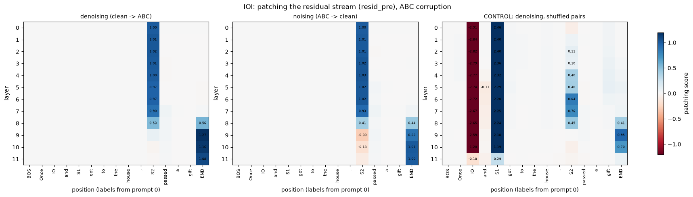


<details>
<summary>Help - how should I interpret these plots?</summary>

**Denoising (left).** Every position before S2 is exactly zero, as you should have predicted: the clean and `ABC` prompts are identical there, so patching changes nothing. The rest
of the picture has two parts. Up to layer 7, restoring the residual stream at S2 alone restores essentially all of the behaviour (1.00 at layers 0-4, still 0.90 at layer 7). From
layer 9 onwards, restoring END alone does the same. Layer 8 is the handoff, with about half at each position (0.53 at S2, 0.56 at END). So all the information that distinguishes
`"... Jane passed"` from `"... Scott passed"` sits at S2 until layer 7, and is moved to END by attention in layers 7 and 8. This is the same picture as in [1.4.1], which used the
`ABA` corruption.

Two details are worth noticing. At layers 9-11 END denoising *overshoots* (1.27, 1.16 and 1.08): restoring END alone gives a *higher* logit difference than the clean run, so
something downstream of END reads S2 and, in the clean run, works against the answer. In the noising plot, the S2 column goes slightly *negative* at layers 9-10 (-0.30, -0.18):
corrupting S2 late in the network helps a little. Both suggest that some late heads read S2 and push against IO. We'll meet good candidates (heads with negative effects in layers
10-11) in part 2️⃣, but we won't pin this particular effect down; it's a nice exercise.

**Noising (middle).** Almost a mirror image of denoising. For residual stream patching that's what we should expect: at any layer, the residual stream at the right position is a
*bottleneck*, since all the information that distinguishes clean from corrupted has to pass through it. Patching a bottleneck gives the full effect in either direction. (This is
the "serial" case of part 2️⃣.)

**Shuffled pairs (right).** Now each `ABC` prompt receives the clean residual stream of a *different* prompt, with different names. Two quite different things happen.

- At **S2 and END**, the shuffled source carries the right *kind* of information about the wrong *names*. How much it still helps tells us how much of what's stored there is the same for every prompt. We'll look at the numbers in the next cell.
- At **IO and S1**, the matched sweep was trivially zero (the names there are the same in clean and `ABC`), but the shuffled source puts *different names* there. Replacing IO's residual stream with another prompt's removes Mary from the context, and the logit difference collapses (scores between -2.9 and -2.5 for layers 0-9, i.e. about 5-6 logits lost); replacing S1's removes John, and it shoots up (+2.2 to +2.5). These columns say nothing about IOI. They show how sensitive the metric is to *which names appear in the context*, and they're a reminder that a control can introduce changes of its own. When you shuffle sources, check which positions actually differ between base and source.
</details>


```python
S2, END = task.labels.index("S2"), task.seq_len - 1
for layer, pos in [(0, S2), (4, S2), (7, S2), (8, END), (10, END), (11, END)]:
    matched = resid_maps["denoising (clean -> ABC)"][layer, pos]
    shuffled = resid_maps["CONTROL: denoising, shuffled pairs"][layer, pos]
    print(f"layer {layer:>2}, {task.labels[pos]:>3}: matched {matched:5.2f}   shuffled {shuffled:5.2f}")
```


<details>
<summary>Expected output</summary>

<pre style="white-space:pre;overflow-x:auto;line-height:normal;font-family:Menlo,'DejaVu Sans Mono',consolas,'Courier New',monospace">layer  0,  S2: matched  1.00   shuffled -0.08
layer  4,  S2: matched  1.00   shuffled  0.40
layer  7,  S2: matched  0.90   shuffled  0.76
layer  8, END: matched  0.56   shuffled  0.41
layer 10, END: matched  1.16   shuffled  0.70
layer 11, END: matched  1.08   shuffled  0.08</pre>

</details>

<details>
<summary>Question - why does a <i>different</i> prompt's S2 vector restore so much at early layers, but its END vector almost nothing at layer 11?</summary>

Start with layer 0 at S2, where the residual stream is just a token embedding. The shuffled source puts another prompt's S2 name there, which is a third name for this prompt, just
like `ABC`. So it restores nothing (-0.08).

By layer 4, though, a *different* prompt's S2 vector restores 0.40 of the behaviour, and by layer 7 it restores 0.76, not far from the matched vector's 0.90. Some of what S2
carries by then doesn't depend on which name is at S2. The obvious candidate is the output of the duplicate-token and induction heads: *"this token is a repeat of an earlier
token"*, and perhaps *"the earlier copy is at position 4"*. Every prompt in our dataset has the same template, so that information is identical across prompts, and another prompt's
S2 vector carries it just as well. (In [1.4.1]'s bonus section you found that the S-inhibition heads move a mixture of positional and token information. This is the same
phenomenon, seen from a different angle.)

END tells a different story. At layer 10 a shuffled END vector still restores 0.70, plausibly because the remaining heads only need to know *where* to attend ("the name at position
2"), which is the same instruction in every prompt. But by layer 11 the END residual stream has turned into "predict *this* name", which is prompt-specific, and another prompt's
END vector (which predicts some other name) restores almost nothing (0.08).

So the shuffled control splits the information flow into a template-level part and a prompt-specific part, which a matched sweep can't do. Remember this in part 3️⃣: mean and
resample ablation can't see template-level information either.
</details>


## Summary of 1️⃣

- A patching experiment is a choice of prompts, corruption, metric, component and direction. We've packaged the first three into a `PatchingTask`, with one token template per task.
- Corruptions differ in what they remove. `ABA` reverses the answer, `ABC` removes only the duplication, `XYZ` removes both names. None of them gives a logit difference of exactly zero, and `ABC` doesn't even get close (0.92), because GPT-2 prefers the first-mentioned name, which in our ABBA dataset is always the IO.
- The normalised patching score $(M_{\text{patched}} - M_{\text{base}}) / (M_{\text{source}} - M_{\text{base}})$ puts denoising and noising on the same scale.
- In the residual stream, the information that distinguishes clean from `ABC` sits at S2 up to layer 7 and at END from layer 9. Denoising and noising agree here, because the residual stream at the right position is a bottleneck.
- The shuffled-pairing control shows that part of what's stored at S2 (from layer 4) and at END (up to layer 10) is the same for every prompt with our template, while the END residual stream at layer 11 is entirely prompt-specific. It also shows that a control can introduce changes of its own (different names at IO and S1).

Residual stream patching is easy to interpret precisely because the residual stream is a bottleneck. Individual heads aren't bottlenecks, and that's where the two patching
directions start to disagree.


=== NEW CHAPTER ===


# 2️⃣ Sufficiency vs Necessity: Denoising and Noising


> ##### Learning Objectives
>
> - Explain what denoising and noising measure, and why they disagree for serial, AND-like and OR-like structure
> - Implement head-level and head × position patching sweeps
> - Read a denoising-vs-noising scatter plot, and use a placebo corruption to calibrate what counts as "an effect"

## Two questions, not one

[1.4.1] gave you the slogan: **noising tells you what is necessary, denoising tells you what is sufficient.** Let's make that precise, because the two directions really do answer
different questions as soon as a behaviour depends on more than one component.

- **Denoising** component $c$: the model runs on the corrupted prompt, except that $c$ gets its clean value. A high score means "$c$'s clean value, together with *corrupted* values everywhere else upstream, is enough to bring back the behaviour".
- **Noising** component $c$: the model runs on the clean prompt, except that $c$ gets its corrupted value. A high score means "the behaviour can't survive without $c$'s clean value, even with *clean* values everywhere else".

Heimersheim & Nanda ([*How to use and interpret activation patching*](https://arxiv.org/abs/2404.15255), 2024) make this concrete with logic gates. Suppose the behaviour $y$ depends on two components $a$ and $b$, both of which are "on" (1) for the clean prompt and "off" (0) for the corrupted one:

- **Serial** ($a \to b \to y$, i.e. $b$ just reads $a$): every component on the path is both necessary and sufficient. Both directions give 1.
- **AND** ($y = a \wedge b$): denoising $a$ alone gives nothing (we still need $b$), but noising $a$ alone destroys $y$. So $a$ looks necessary but not sufficient.
- **OR** ($y = a \vee b$, i.e. redundancy): denoising $a$ alone fully restores $y$, but noising $a$ alone does nothing ($b$ still works). So $a$ looks sufficient but not necessary.

The cell below computes these with your `patching_score`, so you can check the claims.


```python
toy_circuits = {
    # each function maps the values of (a, b) to y. In the serial circuit b just copies a, so y only depends on a
    "serial  a -> b -> y": lambda a, b: a,
    "AND     y = a and b": lambda a, b: a * b,
    "OR      y = a or b": lambda a, b: max(a, b),
}
for name, f in toy_circuits.items():
    y_clean, y_corr = f(1, 1), f(0, 0)
    denoise_a = patching_score(f(1, 0), y_corr, y_clean) + 0.0  # corrupted run, a restored to its clean value
    noise_a = patching_score(f(0, 1), y_clean, y_corr) + 0.0  # clean run, a set to its corrupted value (+ 0.0 avoids printing -0)
    print(f"{name:<22} denoising a: {denoise_a:.0f}   noising a: {noise_a:.0f}")
```


<details>
<summary>Expected output</summary>

<pre style="white-space:pre;overflow-x:auto;line-height:normal;font-family:Menlo,'DejaVu Sans Mono',consolas,'Courier New',monospace">serial  a -&gt; b -&gt; y    denoising a: 1   noising a: 1
AND     y = a and b    denoising a: 0   noising a: 1
OR      y = a or b     denoising a: 1   noising a: 0</pre>

</details>

Each row is a different signature. If you only ran one direction, you couldn't tell an AND input from a serial one (noising gives 1 for both), or an OR input from a serial one
(denoising gives 1 for both).

Real circuits are mixtures of all three. The IOI circuit has serial structure (duplicate-token heads → S-inhibition heads → name movers), AND-like structure (the name movers need
both "which names are in context" and "which one is duplicated"), and OR-like structure (several heads, including backup name movers, can each do part of the same job). So we
should expect heads to sit at very different places on a denoising-vs-noising plot. Let's make that plot.


### Exercise - implement `head_sweep`

> ```yaml
> Difficulty: 🔴🔴⚪⚪⚪
> Importance: 🔵🔵🔵🔵⚪
>
> You should spend up to 10 minutes on this exercise.
> ```

Implement `head_sweep`. For every (layer, head), it should run the model on `base_tokens` with that head's output at *all* positions replaced by the source, and record the **mean
metric** (not the patching score; we'll normalise afterwards, which lets us reuse this function with sources that aren't a corrupted prompt, like ablations).

We patch at `hook_z`, the per-head attention output *before* it's multiplied by $W_O$. Since a head's contribution to the residual stream is $z^{(h)} W_O^{(h)}$, replacing
$z^{(h)}$ is exactly the same as replacing the head's output, but it's cheaper (no need for `use_attn_result`). `source_z` is a list with one tensor per layer, each of shape
`(batch, seq, n_heads, d_head)`, i.e. what you get from `cache["z", layer]`.


```python
def head_sweep(
    model: HookedTransformer,
    base_tokens: Int[Tensor, "batch seq"],
    source_z: list[Float[Tensor, "batch seq n_heads d_head"]],
    metric: Callable[[Tensor], Float[Tensor, " batch"]],
) -> Float[Tensor, "layer head"]:
    """Mean metric when each head's output (hook_z, all positions) is replaced by the source, one head at a time."""
    raise NotImplementedError()


tests.test_head_sweep(head_sweep, model)
```


<details><summary>Solution</summary>

```python
def head_sweep(
    model: HookedTransformer,
    base_tokens: Int[Tensor, "batch seq"],
    source_z: list[Float[Tensor, "batch seq n_heads d_head"]],
    metric: Callable[[Tensor], Float[Tensor, " batch"]],
) -> Float[Tensor, "layer head"]:
    """Mean metric when each head's output (hook_z, all positions) is replaced by the source, one head at a time."""
    results = t.zeros(model.cfg.n_layers, model.cfg.n_heads)
    for layer in range(model.cfg.n_layers):
        for head in range(model.cfg.n_heads):
            logits = patch_run(model, base_tokens, get_act_name("z", layer), source_z[layer], np.s_[:, :, head])
            results[layer, head] = metric(logits).mean()
    return results
```
</details>


<details>
<summary>Hint</summary>

Loop over layers and heads, and call `patch_run` with hook name `get_act_name("z", layer)`, source `source_z[layer]`, and index `np.s_[:, :, head]`.
</details>

We'll need the `hook_z` activations for lots of different prompts, so here's a helper. We also record the head classes the IOI paper identified, which we'll use to colour our
plots. (These labels come from Wang et al.'s analysis on *their* dataset; part of our job is to check whether they hold up on ours.)


```python
def get_z(model: HookedTransformer, tokens: Int[Tensor, "batch seq"]) -> list[Float[Tensor, "batch seq n_heads d_head"]]:
    """Returns [cache["z", layer] for each layer] for a forward pass on tokens."""
    _, cache = model.run_with_cache(tokens, names_filter=lambda name: name.endswith("hook_z"))
    return [cache["z", layer] for layer in range(model.cfg.n_layers)]


def parse_head(node: str) -> tuple[int, int]:
    """'9.6' -> (9, 6)"""
    layer, head = node.split(".")
    return int(layer), int(head)


HEAD_LABELS = [f"{layer}.{head}" for layer in range(12) for head in range(12)]

IOI_HEAD_CLASSES = {  # from Wang et al. (2022), figure 2
    "name mover": ["9.9", "9.6", "10.0"],
    "backup name mover": ["10.10", "10.6", "10.2", "10.1", "11.2", "9.7", "9.0", "11.9"],
    "negative name mover": ["10.7", "11.10"],
    "S-inhibition": ["7.3", "7.9", "8.6", "8.10"],
    "induction": ["5.5", "5.8", "5.9", "6.9"],
    "duplicate token": ["0.1", "0.10", "3.0"],
    "previous token": ["2.2", "4.11"],
}
```


Now let's run three head sweeps on the `ABC` task: denoising, noising, and the **placebo control**: noising with activations from the placebo prompts (same names, different filler
words), normalised by the same clean-vs-`ABC` gap as the real noising sweep. The placebo changes no IOI-relevant information, so the largest placebo score tells us how big a score
can get "for free", from heads that react to changes in the filler words. We'll call that the **noise floor**.


```python
clean_z = get_z(model, task.clean_tokens)
corrupted_z = get_z(model, task.corrupted_tokens)
placebo_z = get_z(model, ioi_tasks["placebo"].corrupted_tokens)
M_clean = task.metric(model(task.clean_tokens)).mean().item()
M_corr = task.metric(model(task.corrupted_tokens)).mean().item()

head_denoise = patching_score(head_sweep(model, task.corrupted_tokens, clean_z, task.metric), M_corr, M_clean)
head_noise = patching_score(head_sweep(model, task.clean_tokens, corrupted_z, task.metric), M_clean, M_corr)
head_placebo = patching_score(head_sweep(model, task.clean_tokens, placebo_z, task.metric), M_clean, M_corr)
noise_floor = head_placebo.abs().max().item()

print(f"M_clean = {M_clean:.2f}, M_corr = {M_corr:.2f}, placebo noise floor = {noise_floor:.3f}")
print(f"Sum of denoising scores over all heads: {head_denoise.sum():.2f};  sum of noising scores: {head_noise.sum():.2f}")
for name, grid in [("denoising", head_denoise), ("noising", head_noise), ("placebo", head_placebo)]:
    order = grid.flatten().abs().argsort(descending=True)[:8]
    print(f"{name:>9}, largest |score|: " + ", ".join(f"{HEAD_LABELS[i]} ({grid.flatten()[i]:+.2f})" for i in order))
utils.plot_head_maps(
    {"denoising (clean -> ABC)": head_denoise, "noising (ABC -> clean)": head_noise, "CONTROL: noising from placebo": head_placebo},
    "IOI: patching each head's output (all positions), normalised patching score",
)
```


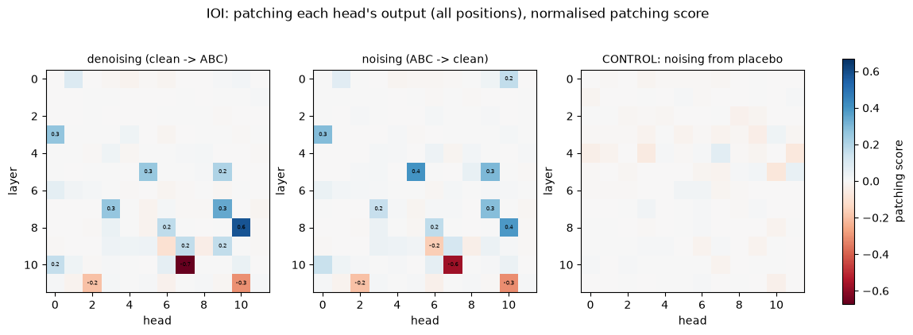


<details>
<summary>Expected output (text)</summary>

<pre style="white-space:pre;overflow-x:auto;line-height:normal;font-family:Menlo,'DejaVu Sans Mono',consolas,'Courier New',monospace">M_clean = 2.92, M_corr = 0.92, placebo noise floor = 0.076
Sum of denoising scores over all heads: 1.54;  sum of noising scores: 1.72
denoising, largest |score|: 10.7 (-0.67), 8.10 (+0.58), 7.9 (+0.34), 11.10 (-0.31), 3.0 (+0.26), 7.3 (+0.26), 5.5 (+0.26), 5.9 (+0.21)
  noising, largest |score|: 10.7 (-0.57), 5.5 (+0.40), 8.10 (+0.38), 11.10 (-0.31), 5.9 (+0.30), 3.0 (+0.29), 7.9 (+0.29), 11.2 (-0.20)
  placebo, largest |score|: 5.10 (-0.08), 4.11 (-0.07), 4.7 (+0.07), 4.3 (-0.06), 5.11 (+0.05), 3.9 (-0.04), 4.0 (-0.04), 11.10 (-0.03)</pre>

</details>

The heatmaps are hard to compare by eye, so let's put each head at the point (noising score, denoising score).


```python
for node in ["0.10", "3.0", "5.5", "5.9", "7.3", "7.9", "8.6", "8.10", "9.6", "9.9", "10.0", "10.7"]:
    layer, head = parse_head(node)
    noise, denoise = head_noise[layer, head].item(), head_denoise[layer, head].item()
    print(f"{node:>5}: noising {noise:+.2f}, denoising {denoise:+.2f}, denoising - noising {denoise - noise:+.2f}")
utils.plot_labelled_scatter(
    head_noise.flatten(),
    head_denoise.flatten(),
    HEAD_LABELS,
    xlabel="noising score  (necessity: how much breaking this head hurts)",
    ylabel="denoising score  (sufficiency: how much restoring this head helps)",
    title="IOI heads: sufficiency vs necessity (ABC corruption)",
    n_labels=14,
    noise_floor=noise_floor,
    groups=IOI_HEAD_CLASSES,
)
```


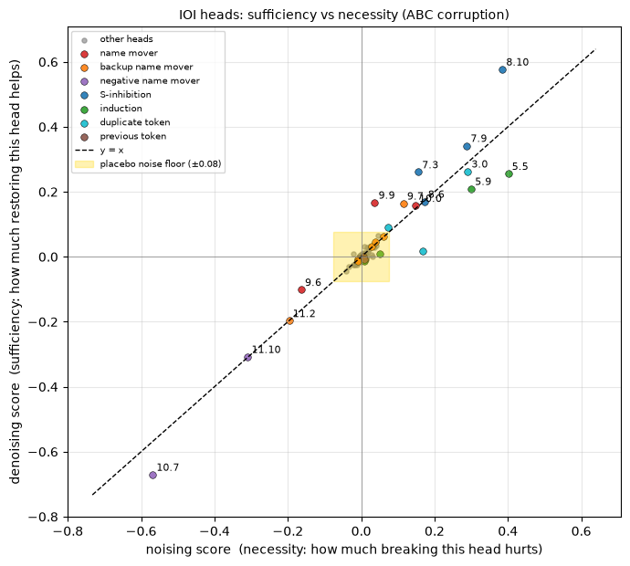


<details>
<summary>Help - how should I interpret this plot?</summary>

First, the control. The placebo sweep's largest score is 0.076 in absolute value (the yellow square). Every head outside the square responds to the IOI information more than any
head responds to arbitrary changes of filler words; inside it, don't interpret anything.

Here are the exact scores for the heads that matter (the cell prints them):

<pre style="white-space:pre;overflow-x:auto;line-height:normal;font-family:Menlo,'DejaVu Sans Mono',consolas,'Courier New',monospace"> 0.10: noising +0.17, denoising +0.02, denoising - noising -0.15
  3.0: noising +0.29, denoising +0.26, denoising - noising -0.03
  5.5: noising +0.40, denoising +0.26, denoising - noising -0.14
  5.9: noising +0.30, denoising +0.21, denoising - noising -0.09
  7.3: noising +0.16, denoising +0.26, denoising - noising +0.11
  7.9: noising +0.29, denoising +0.34, denoising - noising +0.05
  8.6: noising +0.17, denoising +0.17, denoising - noising -0.00
 8.10: noising +0.38, denoising +0.58, denoising - noising +0.19
  9.6: noising -0.16, denoising -0.10, denoising - noising +0.06
  9.9: noising +0.04, denoising +0.17, denoising - noising +0.13
 10.0: noising +0.15, denoising +0.16, denoising - noising +0.01
 10.7: noising -0.57, denoising -0.67, denoising - noising -0.10</pre>

Most heads sit close to the diagonal, but the departures from it are informative.

- **Above the diagonal (more sufficient than necessary): 8.10, 7.3, 9.9.** Restoring S-inhibition head 8.10 alone recovers 0.58 of the behaviour, but breaking it alone costs only 0.38; 7.3 is similar (0.26 vs 0.16). When one S-inhibition head is corrupted, the others still carry much of the same signal, so no single one is necessary, but each carries enough to help on its own: the OR signature, i.e. redundancy. The name mover 9.9 is the clearest case: breaking it costs almost nothing (0.04), but restoring it recovers 0.17.
- **Below the diagonal (more necessary than sufficient): 5.5, 5.9, 0.10.** Breaking induction head 5.5 costs 0.40, but restoring it alone recovers only 0.26; 5.9 is similar (0.30 vs 0.21); and breaking duplicate-token head 0.10 costs 0.17, while restoring it alone does almost nothing (0.02). These heads produce the "S is duplicated" signal: each of them is needed, but none is enough on its own, which is the AND signature. (3.0, the other duplicate-token head, sits close to the diagonal.)
- **Negative heads: 10.7, 11.10, 11.2 and 9.6.** Both scores are negative: restoring their clean output makes things *worse*, and corrupting them makes things *better*. In the clean run these heads push against the correct answer. 10.7 and 11.10 are the IOI paper's negative name movers, but 9.6 is supposed to be a name mover, so its negative scores are a puzzle. We'll come back to it in part 4️⃣.
- **Missing: the name movers.** 9.9 and 10.0, the heads that write the answer into the logits, have single-head scores of 0.04 and 0.15 when noised, and 0.17 and 0.16 when denoised: smaller than most of the S-inhibition heads, which merely tell them what to do. Keep this in mind.

Finally, neither set of scores adds up to 1 (the sums over all heads are 1.54 for denoising and 1.72 for noising). Single-head patching scores are not a decomposition of the
behaviour into parts; they're 144 separate experiments.
</details>


### Exercise - implement `head_position_sweep`

> ```yaml
> Difficulty: 🔴🔴⚪⚪⚪
> Importance: 🔵🔵🔵⚪⚪
>
> You should spend up to 10 minutes on this exercise.
> ```

A head's output at different positions can play completely different roles (an induction head's output at S2 means "S2 is a repeat", its output at END might mean nothing at all).
Implement `head_position_sweep`, which for each head in `heads` (given as strings like `"9.6"`; use `parse_head`) and each position, patches only that head's output at that one
position, and returns the mean metric as a `(len(heads), seq)` tensor.

This is the same as `head_sweep` with a different index. (If you're tempted to sweep every head at every position: that's $144 \times 15 = 2160$ forward passes. It's fine for GPT-2
Small and 100 prompts, but it's exactly the scaling problem that attribution patching in 8.2 exists to solve.)


```python
def head_position_sweep(
    model: HookedTransformer,
    base_tokens: Int[Tensor, "batch seq"],
    source_z: list[Float[Tensor, "batch seq n_heads d_head"]],
    metric: Callable[[Tensor], Float[Tensor, " batch"]],
    heads: list[str],
) -> Float[Tensor, "n_heads pos"]:
    """Mean metric when one head's output at one position is replaced by the source, for each head and position."""
    raise NotImplementedError()


tests.test_head_position_sweep(head_position_sweep, model)
```


<details><summary>Solution</summary>

```python
def head_position_sweep(
    model: HookedTransformer,
    base_tokens: Int[Tensor, "batch seq"],
    source_z: list[Float[Tensor, "batch seq n_heads d_head"]],
    metric: Callable[[Tensor], Float[Tensor, " batch"]],
    heads: list[str],
) -> Float[Tensor, "n_heads pos"]:
    """Mean metric when one head's output at one position is replaced by the source, for each head and position."""
    results = t.zeros(len(heads), base_tokens.shape[1])
    for i, node in enumerate(heads):
        layer, head = parse_head(node)
        for pos in range(base_tokens.shape[1]):
            logits = patch_run(model, base_tokens, get_act_name("z", layer), source_z[layer], np.s_[:, pos, head])
            results[i, pos] = metric(logits).mean()
    return results
```
</details>


Let's look at the noising scores, by position, for the heads that stood out above (plus the paper's name movers and negative name movers).


```python
key_heads = ["0.10", "3.0", "5.5", "5.9", "6.9", "7.3", "7.9", "8.6", "8.10", "9.6", "9.9", "10.0", "10.7", "11.10"]
head_pos_noise = patching_score(head_position_sweep(model, task.clean_tokens, corrupted_z, task.metric, key_heads), M_clean, M_corr)
utils.plot_layer_pos_maps(
    {"noising one head at one position": head_pos_noise},
    task.labels,
    "IOI: noising score for patching a head's output at a single position (ABC corruption)",
    ylabel="head",
    ylabels=key_heads,
    annotate_threshold=0.05,
)
print("Columns before S2 are all zero:", bool((head_pos_noise[:, : task.labels.index("S2")].abs() < 1e-4).all()))
```


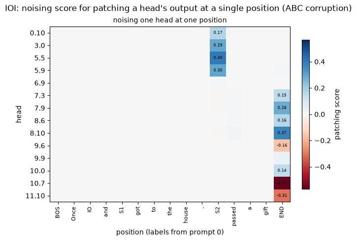


<details>
<summary>Help - how should I interpret this plot?</summary>

Every column before S2 is zero (the cell checks this), because the clean and `ABC` prompts are identical up to S2 and attention is causal. Beyond that, the heads split cleanly by
position.

- **Duplicate-token and induction heads (0.10, 3.0, 5.5, 5.9) matter only at S2** (0.17, 0.29, 0.40, 0.30). Their job is to write "this token is a repeat" into S2's residual stream; their output at END is irrelevant. This matches part 1️⃣, where everything before layer 7 happened at S2.
- **S-inhibition heads (7.3, 7.9, 8.6, 8.10) and the later heads matter only at END.** The S-inhibition heads move information from S2 to END in layers 7-8, exactly where the residual stream sweep showed the handoff, and the name movers and negative name movers write from END into the logits. 10.7 (-0.57) and 11.10 (-0.31) are the most negative cells.
- **6.9 and 9.9 are empty.** 6.9 is an induction head in the IOI paper but does nothing measurable here, and 9.9's single-position score is as small as its all-position one.

For heads that act at one position only, the all-position score and the single-position score are the same experiment (compare 5.5: 0.40 in both). Head × position sweeps earn their
cost for heads that do different things at different positions, which is more common in longer prompts.
</details>


## Summary of 2️⃣

- Denoising measures sufficiency, noising measures necessity. They agree for serial structure and disagree for AND-like and OR-like structure.
- On IOI, the induction and duplicate-token heads are more necessary than sufficient (AND-like: the duplication signal is needed, but isn't enough by itself), and the S-inhibition head 8.10 is more sufficient than necessary (OR-like: the other S-inhibition heads can partly stand in for it).
- The name movers, which write most of the answer, look unimportant in *both* directions when patched one at a time. A component that matters can have a small single-component patching score. We'll find out why in part 4️⃣.
- Neither sum of scores over heads is 1: single-component scores are not a decomposition of the behaviour.
- A placebo corruption gives a noise floor (0.076 here). Scores inside it shouldn't be interpreted.
- Head × position patching shows that the duplication heads act at S2, and the S-inhibition, name-mover and negative heads act at END.


=== NEW CHAPTER ===


# 3️⃣ What Do You Patch In? Corruptions and Ablations


> ##### Learning Objectives
>
> - Implement zero, mean and resample ablation
> - Understand that an ablation only removes information that *varies* across the source distribution
> - Recognise off-distribution replacements, and why zero ablation flags heads that have little to do with the task

## The corruption is the question

When you noise a component, you replace its activation with *something*. Whatever you choose, the experiment measures the effect of changing the information that differs between
the clean activation and that something, and nothing else. Here are the common choices, all of which you'll find in published work:

| source of the replacement | used in | what it removes |
|---|---|---|
| a matched **corrupted prompt** (`ABA`, `ABC`, `XYZ`) | IOI, greater-than, most circuit papers | exactly what you changed in the prompt |
| **zero ablation**: replace with 0 | early interpretability work, many quick experiments | everything, including things the model always has (e.g. a constant bias direction), so the model is pushed off-distribution |
| **mean ablation**: replace with the mean over a dataset | Wang et al. 2022 (mean over the `XYZ` dataset), Conmy et al. 2023 (ACDC, as one option) | whatever varies across that dataset |
| **resample ablation**: replace with the activation on another random prompt | causal scrubbing (Chan et al. 2022) | whatever varies across that dataset, while keeping each activation a "real" one |
| **Gaussian noise** added to input embeddings | ROME's causal tracing (Meng et al. 2022) | depends on the noise scale; usually off-distribution |

The key point is in the last column. **An ablation can only remove information that differs between the clean run and the replacement.** Mean ablation over a dataset preserves
everything that's constant across that dataset. Zero ablation removes everything, including information that the model relies on for *every* task, which tells you about the model's
general health rather than about the task.

Zhang & Nanda ([*Towards Best Practices of Activation Patching*](https://arxiv.org/abs/2309.16042), 2023) compared several of these systematically and found that they can give quite different circuits; they recommend matched corrupted prompts (which they call "symmetric token replacement") over Gaussian noise. Let's see the differences for ourselves.


### Exercise - implement `ablation_source`

> ```yaml
> Difficulty: 🔴🔴⚪⚪⚪
> Importance: 🔵🔵🔵⚪⚪
>
> You should spend up to 10 minutes on this exercise.
> ```

Implement `ablation_source`, which takes clean activations `z` of shape `(batch, seq, n_heads, d_head)` and returns a replacement of the same shape:

- `"zero"`: all zeros.
- `"mean"`: the mean over the batch dimension, broadcast back to every prompt (so every prompt gets the same replacement, but each position keeps its own mean).
- `"resample"`: the activation of a *different* prompt, i.e. `z[perm]` for a random permutation `perm` with **no fixed points** (no prompt should be "resampled" with itself, or that prompt isn't ablated at all). Use a `t.Generator` seeded with `seed`.


```python
def ablation_source(
    z: Float[Tensor, "batch seq n_heads d_head"], method: str, seed: int = 0
) -> Float[Tensor, "batch seq n_heads d_head"]:
    """Replacement activations for zero, mean or resample ablation."""
    raise NotImplementedError()


tests.test_ablation_source(ablation_source)
```


<details>
<summary>Hint - how do I make a permutation with no fixed points?</summary>

Take a random ordering `order` of the indices, and map each index to the next one in that order (wrapping around): `perm[order[k]] = order[k + 1]`. This is a single cycle through
all the prompts, so nobody maps to themselves. In code: `perm = t.empty_like(order); perm[order] = order.roll(-1)`.
</details>


<details><summary>Solution</summary>

```python
def ablation_source(
    z: Float[Tensor, "batch seq n_heads d_head"], method: str, seed: int = 0
) -> Float[Tensor, "batch seq n_heads d_head"]:
    """Replacement activations for zero, mean or resample ablation."""
    if method == "zero":
        return t.zeros_like(z)
    if method == "mean":
        return z.mean(dim=0, keepdim=True).expand_as(z)
    if method == "resample":
        # A random cyclic order is a permutation with no fixed points: each prompt takes the next one's activation
        generator = t.Generator().manual_seed(seed)
        order = t.randperm(z.shape[0], generator=generator)
        perm = t.empty_like(order)
        perm[order] = order.roll(-1)
        return z[perm.to(z.device)]
    raise ValueError(f"Unknown method {method!r}")
```
</details>


Now let's run the same noising head sweep with seven different replacements: the three corrupted-prompt datasets, the three ablations of the clean activations, and the placebo.
Since these replacements don't share a common "corrupted run", we report the **raw change in logit difference**, $\Delta M = M_{\text{patched}} - M_{\text{clean}}$, rather than a
normalised score. Negative means the head's clean output was helping.

Before you run it: which heads do you expect zero ablation to flag that the others don't? Which heads do you expect *mean* ablation to miss, given that every prompt in our dataset
is ABBA?


```python
sources = {
    "ABA (S2 -> IO)": get_z(model, ioi_tasks["ABA"].corrupted_tokens),
    "ABC (S2 -> new name)": corrupted_z,
    "XYZ (all names new)": get_z(model, ioi_tasks["XYZ"].corrupted_tokens),
    "zero ablation": [ablation_source(z, "zero") for z in clean_z],
    "mean ablation": [ablation_source(z, "mean") for z in clean_z],
    "resample ablation": [ablation_source(z, "resample", seed=layer) for layer, z in enumerate(clean_z)],
    "CONTROL: placebo": placebo_z,
}
noising_deltas = {name: head_sweep(model, task.clean_tokens, src, task.metric) - M_clean for name, src in tqdm(sources.items())}
utils.plot_head_maps(
    noising_deltas, "Noising each head with different replacements: change in IOI logit difference", ncols=4, cbar_label="Δ logit diff"
)
```


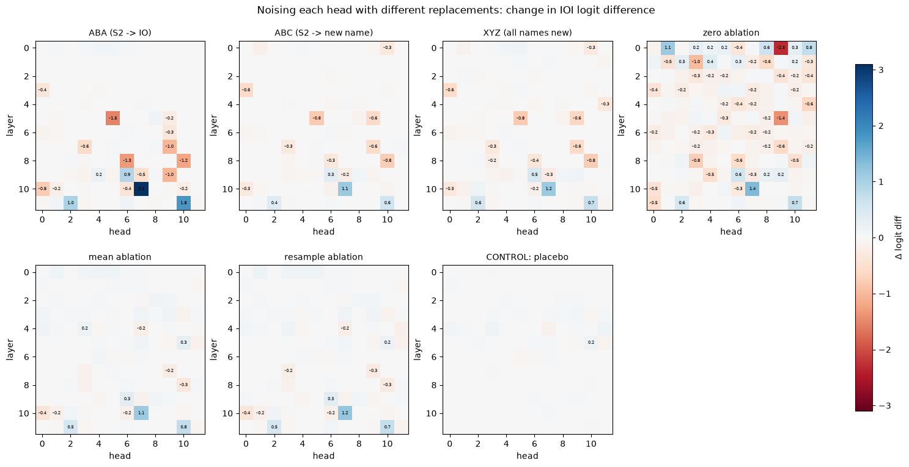


```python
for name, delta in noising_deltas.items():
    order = delta.flatten().argsort()[:6]
    print(f"{name:<22} most negative: " + ", ".join(f"{HEAD_LABELS[i]} ({delta.flatten()[i]:+.2f})" for i in order))

names = list(noising_deltas)
corr = np.corrcoef(np.stack([noising_deltas[n].flatten().numpy() for n in names]))
utils.plot_correlation_matrix(corr, names, "How similar are the head rankings? (correlation of Δ logit diff across heads)")
```


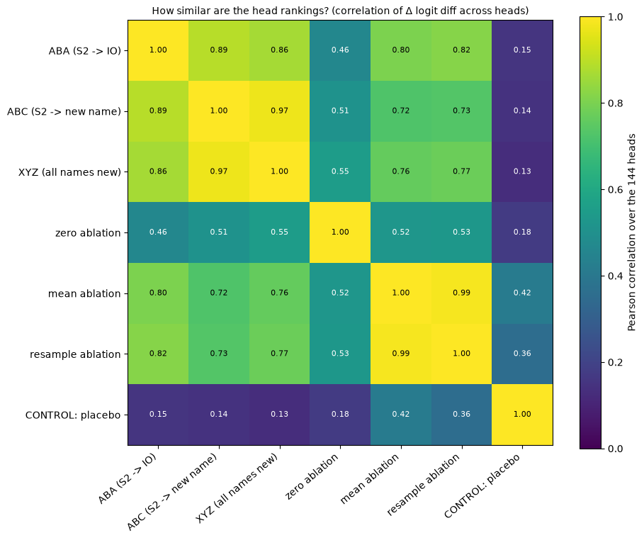


<details>
<summary>Expected output (text)</summary>

<pre style="white-space:pre;overflow-x:auto;line-height:normal;font-family:Menlo,'DejaVu Sans Mono',consolas,'Courier New',monospace">ABA (S2 -&gt; IO)         most negative: 5.5 (-1.54), 8.6 (-1.31), 8.10 (-1.21), 9.9 (-1.03), 7.9 (-1.03), 10.0 (-0.79)
ABC (S2 -&gt; new name)   most negative: 5.5 (-0.80), 8.10 (-0.77), 5.9 (-0.60), 3.0 (-0.58), 7.9 (-0.58), 8.6 (-0.34)
XYZ (all names new)    most negative: 5.5 (-0.81), 8.10 (-0.79), 5.9 (-0.65), 7.9 (-0.60), 3.0 (-0.58), 8.6 (-0.39)
zero ablation          most negative: 0.9 (-2.30), 5.9 (-1.41), 1.3 (-0.99), 8.3 (-0.77), 4.11 (-0.64), 7.9 (-0.60)
mean ablation          most negative: 10.0 (-0.39), 8.10 (-0.34), 7.9 (-0.23), 4.7 (-0.17), 10.6 (-0.16), 10.1 (-0.15)
resample ablation      most negative: 10.0 (-0.37), 8.10 (-0.29), 7.9 (-0.26), 4.7 (-0.22), 7.3 (-0.18), 10.1 (-0.17)
CONTROL: placebo       most negative: 4.7 (-0.14), 5.11 (-0.10), 3.10 (-0.05), 6.5 (-0.05), 7.3 (-0.04), 6.6 (-0.04)</pre>

</details>

<details>
<summary>Help - how should I interpret these results?</summary>

**The three corrupted-prompt datasets agree.** `ABC` and `XYZ` give almost identical maps (correlation 0.97) and the same top heads: 5.5, 8.10, 5.9, 3.0, 7.9, 8.6. `ABA` correlates
0.89 with `ABC` and finds the same heads, with effects about twice as large (5.5: -1.54 vs -0.80), because the `ABA` corrupted run doesn't just lack the signal, it carries the
opposite one. `ABA` also gives the name movers 9.9 (-1.03) and 10.0 (-0.79) large effects, which `ABC` doesn't: in an `ABA` prompt, the name movers' corrupted output actively
copies the wrong name, which is a much bigger change than copying "nothing in particular".

**Zero ablation finds different heads.** Its top heads are 0.9 (-2.30), 5.9, 1.3, 8.3 and 4.11, and its map is covered in moderate effects of both signs, particularly in layers
0-1. Head 0.9 doesn't show up under any other replacement. Zeroing a head's output doesn't remove "IOI information"; it removes everything the head ever writes, including whatever
it writes on every prompt, and the downstream layers have never seen a residual stream without that. The result is an off-distribution input, and the effects mostly measure how
much the model depends on the head in general. Zero ablation correlates only 0.46-0.55 with every other replacement.

**Mean and resample ablation miss the start of the circuit.** They agree with each other almost perfectly (0.99) and correlate 0.72-0.82 with the corrupted prompts, but look at
what's missing from their top heads: 5.5, 5.9, 3.0 and 8.6 are gone, and the effects of 8.10 (-0.34 and -0.29) and 7.9 (-0.23 and -0.26) are less than half of what `ABC` gives.
What they find instead are the late heads: name mover 10.0 (-0.39), backup name movers 10.1 and 10.6, and the negative heads 10.7 and 11.10 with positive effects.

Why? Every prompt in our dataset is ABBA, so the duplicated name is always at positions 4 and 10. The duplicate-token and induction heads write something like "S2 repeats the token
at position 4" into S2, and that's *the same in every prompt*. Replacing a head's output with its mean over the dataset, or with its output on another prompt from the dataset,
leaves that information intact. Only what varies across prompts (here, mostly the identity of the names) gets ablated. It's the same template-level information that the shuffled
control detected at S2 in part 1️⃣.

**The placebo stays near zero.** Its largest effects are 4.7 (-0.14) and 5.10 (+0.16). Interestingly, the placebo map correlates more with mean ablation (0.42) than with the
corrupted prompts (0.13-0.15). Mean and resample ablation also replace whatever a head encodes about the filler words, so they pick up the same small filler-sensitive effects (4.7
is in the top six of both).
</details>

<details>
<summary>Question - so which replacement should you use?</summary>

It depends on the question, which is the whole point. Some rules of thumb:

- If you want to know **which components implement a specific step** of an algorithm, use a matched corrupted prompt that changes exactly the input that step depends on. `ABC` asks "what carries the duplication signal?"; `XYZ` additionally asks "what carries the identity of the names?". `ABA` amplifies the signal (the answer flips) but conflates "remove the duplication of S" with "add a duplication of IO".
- If you want a **task-agnostic ablation** (e.g. for automated circuit discovery, as in 8.4), use mean or resample ablation over a dataset that varies *everything you care about*. With our ABBA-only dataset, mean and resample ablation can't see anything that is the same in every prompt, such as which *position* holds the repeated name. With a mixed ABBA/BABA dataset they could.
- Avoid **zero ablation** unless you have a reason to believe zero is a natural value for that activation. It's the easiest to implement and the hardest to interpret.
- Whatever you use, run the **placebo** too. It costs one sweep, and it tells you what size of effect you'd see by accident.
</details>


## Summary of 3️⃣

- The replacement you patch in defines the question, and different reasonable choices highlight different heads.
- Matched corrupted prompts (`ABA`, `ABC`, `XYZ`) agree closely on this task (correlations 0.86-0.97). `ABA` gives the largest effects, because it reverses the answer rather than erasing it, and it makes the name movers look important.
- Zero ablation flags heads such as 0.9 and 1.3 that no other replacement flags, and correlates only about 0.5 with everything else. It's off-distribution.
- Mean and resample ablation over a dataset can only detect information that varies across the dataset. On our ABBA-only data they miss the duplicate-token and induction heads almost entirely (none of them reaches 0.15 in absolute value), and halve the S-inhibition effects.
- The placebo stays close to zero, as it should.


=== NEW CHAPTER ===


# 4️⃣ Direct, Indirect and Total Effects


> ##### Learning Objectives
>
> - Define total, direct and indirect effects as interventions, and implement them with frozen downstream components
> - Restrict an effect to specific paths (e.g. "only through the name movers"), and see why path effects don't add up
> - Reproduce the Hydra effect / backup behaviour, with a random-heads control, and identify the heads that compensate

## Letting the rest of the model react (or not)

Every patch so far let everything downstream of the patched component **recompute**. That's the natural thing to do, but it means a patching score mixes together everything the
change causes: the component's own contribution to the logits, its influence on later components, and those components' reactions.

Causal mediation analysis (Pearl 2001; applied to transformers by Vig et al. 2020 and McGrath et al. 2023) separates these. For a component $c$ and the noising direction:

- The **total effect** is what we've been measuring: change $c$, let everything downstream recompute.
$$
\text{TE}(c) = M\big(x_{\text{clean}} \mid a_c \leftarrow a_c(x_{\text{corr}})\big) - M(x_{\text{clean}})
$$
- The **direct effect** changes $c$ but **freezes** every other component at its clean value, so the only thing that changes is $c$'s own write to the residual stream, and the only way it can affect the output is by going straight to the unembedding:
$$
\text{DE}(c) = M\big(x_{\text{clean}} \mid a_c \leftarrow a_c(x_{\text{corr}}),\; a_{c'} \leftarrow a_{c'}(x_{\text{clean}}) \text{ for all } c' \neq c\big) - M(x_{\text{clean}})
$$
- The **indirect effect** is the rest: $\text{IE}(c) = \text{TE}(c) - \text{DE}(c)$. It's the part of $c$'s effect that goes *through* other components. For an S-inhibition head this is the whole point (it affects the output only by changing what the name movers attend to). For a name mover it should be small... unless the rest of the model reacts to its absence.

"Freeze every other component" has to include the final LayerNorm. The final LayerNorm divides the residual stream by its norm, and the norm depends on everything, so we also
freeze its scale at the clean value. Then the direct effect of a head is exactly linear: if $\Delta o_h$ is the change in head $h$'s output at the final position and $\sigma$ is
the frozen LayerNorm scale,

$$
\text{DE}(h) = \frac{\Delta o_h \cdot (W_U[:, \text{IO}] - W_U[:, \text{S}])}{\sigma}
$$

which is the **direct logit attribution** of the change. This identity is how the tests check your implementation.

We can also do anything in between: let some downstream components recompute and freeze the rest. That gives "path-restricted" effects, a generalisation of the path patching you
did in [1.4.1] (where heads were frozen and MLPs recomputed).


### Exercise - implement `run_with_frozen`

> ```yaml
> Difficulty: 🔴🔴🔴⚪⚪
> Importance: 🔵🔵🔵🔵🔵
>
> You should spend up to 20-25 minutes on this exercise.
> ```

We'll treat the model as a graph of **nodes**: every attention head (named `"layer.head"`, e.g. `"9.6"`), every MLP (named `"mlp{layer}"`, e.g. `"mlp9"`), and the final LayerNorm
scale (`"ln_final"`). `all_nodes(model)` returns the full set.

Implement `run_with_frozen`, which runs the model on `base_tokens` and:

- for every head in `patches`, sets that head's `hook_z` (all positions) to the given tensor of shape `(batch, seq, d_head)`;
- for every other node **not** in `recompute`, freezes it at its value in `base_cache`: heads at `hook_z`, MLPs at `hook_mlp_out`, the final LayerNorm at `ln_final.hook_scale`;
- lets nodes in `recompute` compute normally.

Then:

- `recompute = all_nodes(model)` gives an ordinary patched run (the **total** effect);
- `recompute = set()` gives the **direct** effect;
- anything in between restricts the paths through which the patch can act.

Freezing nodes *upstream* of the patched head is harmless: they'd compute their clean values anyway. So you don't need to work out what's downstream of what, which keeps the code
simple.

A few tips: one hook per layer at `hook_z` can handle all of that layer's heads (`hook.layer()` gives you the layer index). Hook functions can return a new tensor instead of
modifying the activation in place, which is the simplest way to freeze an MLP or the LayerNorm scale.


```python
def all_nodes(model: HookedTransformer) -> set[str]:
    """Every head ("layer.head"), every MLP ("mlp{layer}"), and the final LayerNorm scale ("ln_final")."""
    heads = {f"{layer}.{head}" for layer in range(model.cfg.n_layers) for head in range(model.cfg.n_heads)}
    return heads | {f"mlp{layer}" for layer in range(model.cfg.n_layers)} | {"ln_final"}


def frozen_run_cache(model: HookedTransformer, tokens: Int[Tensor, "batch seq"]) -> ActivationCache:
    """Caches exactly the activations that run_with_frozen needs: hook_z, hook_mlp_out and ln_final.hook_scale."""
    names = ("hook_z", "hook_mlp_out", "ln_final.hook_scale")
    _, cache = model.run_with_cache(tokens, names_filter=lambda name: name.endswith(names))
    return cache


def run_with_frozen(
    model: HookedTransformer,
    base_tokens: Int[Tensor, "batch seq"],
    base_cache: ActivationCache,
    patches: dict[str, Float[Tensor, "batch seq d_head"]],
    recompute: set[str],
) -> Float[Tensor, "batch seq d_vocab"]:
    """
    Runs on base_tokens with the heads in `patches` set to the given z values, every node not in `recompute`
    frozen at its value in base_cache, and the nodes in `recompute` computed normally. Returns the logits.
    """
    raise NotImplementedError()


tests.test_run_with_frozen(run_with_frozen, all_nodes, frozen_run_cache, model)
```


<details>
<summary>Hint - structure of the hooks</summary>

You need three kinds of hooks:

1. At `blocks.{layer}.attn.hook_z` for every layer: loop over heads; if the head is in `patches`, write the patch into `z[:, :, head]`; elif it's not in `recompute`, write `base_cache[hook.name][:, :, head]`.
2. At `blocks.{layer}.hook_mlp_out` for every MLP not in `recompute`: return `base_cache[hook.name]`.
3. At `ln_final.hook_scale`, if `"ln_final"` is not in `recompute`: return `base_cache["ln_final.hook_scale"]`.
</details>

<details>
<summary>Help - my "direct effect" test fails, but the other two pass.</summary>

Check that you freeze the final LayerNorm scale and every MLP. Without the LayerNorm, changing one head's output changes the norm of the final residual stream, which rescales
*every* component's contribution to the logits. Without the MLPs, late MLPs react to the change. Either way the result is no longer the direct logit attribution of the change.
</details>


<details><summary>Solution</summary>

```python
def all_nodes(model: HookedTransformer) -> set[str]:
    """Every head ("layer.head"), every MLP ("mlp{layer}"), and the final LayerNorm scale ("ln_final")."""
    heads = {f"{layer}.{head}" for layer in range(model.cfg.n_layers) for head in range(model.cfg.n_heads)}
    return heads | {f"mlp{layer}" for layer in range(model.cfg.n_layers)} | {"ln_final"}


def frozen_run_cache(model: HookedTransformer, tokens: Int[Tensor, "batch seq"]) -> ActivationCache:
    """Caches exactly the activations that run_with_frozen needs: hook_z, hook_mlp_out and ln_final.hook_scale."""
    names = ("hook_z", "hook_mlp_out", "ln_final.hook_scale")
    _, cache = model.run_with_cache(tokens, names_filter=lambda name: name.endswith(names))
    return cache


def run_with_frozen(
    model: HookedTransformer,
    base_tokens: Int[Tensor, "batch seq"],
    base_cache: ActivationCache,
    patches: dict[str, Float[Tensor, "batch seq d_head"]],
    recompute: set[str],
) -> Float[Tensor, "batch seq d_vocab"]:
    """
    Runs on base_tokens with the heads in `patches` set to the given z values, every node not in `recompute`
    frozen at its value in base_cache, and the nodes in `recompute` computed normally. Returns the logits.
    """

    def z_hook(z: Tensor, hook) -> Tensor:
        layer = hook.layer()
        for head in range(model.cfg.n_heads):
            node = f"{layer}.{head}"
            if node in patches:
                z[:, :, head] = patches[node]
            elif node not in recompute:
                z[:, :, head] = base_cache[hook.name][:, :, head]
        return z

    def freeze_hook(activation: Tensor, hook) -> Tensor:
        return base_cache[hook.name]

    fwd_hooks = [(get_act_name("z", layer), z_hook) for layer in range(model.cfg.n_layers)]
    fwd_hooks += [
        (get_act_name("mlp_out", layer), freeze_hook)
        for layer in range(model.cfg.n_layers)
        if f"mlp{layer}" not in recompute
    ]
    if "ln_final" not in recompute:
        fwd_hooks.append(("ln_final.hook_scale", freeze_hook))
    return model.run_with_hooks(base_tokens, fwd_hooks=fwd_hooks)
```
</details>


### Exercise - implement `total_and_direct_effect`

> ```yaml
> Difficulty: 🔴🔴⚪⚪⚪
> Importance: 🔵🔵🔵🔵⚪
>
> You should spend up to 10 minutes on this exercise.
> ```

Implement `total_and_direct_effect`, which noises a **set** of heads at once (patching each one's `hook_z` with its value in `corrupted_cache`) and returns `(total effect, direct
effect)` as two floats, each measured as the change in the mean metric relative to the clean run.


```python
def total_and_direct_effect(
    model: HookedTransformer,
    task: PatchingTask,
    clean_cache: ActivationCache,
    corrupted_cache: ActivationCache,
    heads: list[str],
) -> tuple[float, float]:
    """(TE, DE) of noising all of `heads` together: change in the mean metric relative to the clean run."""
    raise NotImplementedError()


tests.test_total_and_direct_effect(total_and_direct_effect, PatchingTask, model)
```


<details><summary>Solution</summary>

```python
def total_and_direct_effect(
    model: HookedTransformer,
    task: PatchingTask,
    clean_cache: ActivationCache,
    corrupted_cache: ActivationCache,
    heads: list[str],
) -> tuple[float, float]:
    """(TE, DE) of noising all of `heads` together: change in the mean metric relative to the clean run."""
    patches = {}
    for node in heads:
        layer, head = parse_head(node)
        patches[node] = corrupted_cache["z", layer][:, :, head]
    clean_metric = task.metric(model(task.clean_tokens)).mean()
    total = task.metric(run_with_frozen(model, task.clean_tokens, clean_cache, patches, all_nodes(model))).mean()
    direct = task.metric(run_with_frozen(model, task.clean_tokens, clean_cache, patches, set())).mean()
    return (total - clean_metric).item(), (direct - clean_metric).item()
```
</details>


Now let's compute the total and direct effect of noising each of the 144 heads on its own (about 430 forward passes, well under a minute on a GPU), and plot one against the other.


```python
del sources  # free the ablation activations from part 3
if t.cuda.is_available():
    t.cuda.empty_cache()
clean_cache = frozen_run_cache(model, task.clean_tokens)
corrupted_cache = frozen_run_cache(model, task.corrupted_tokens)

head_te, head_de = t.zeros(N_LAYERS, N_HEADS), t.zeros(N_LAYERS, N_HEADS)
for node in tqdm(HEAD_LABELS):
    layer, head = parse_head(node)
    head_te[layer, head], head_de[layer, head] = total_and_direct_effect(model, task, clean_cache, corrupted_cache, [node])
head_ie = head_te - head_de

utils.plot_labelled_scatter(
    head_de.flatten(),
    head_te.flatten(),
    HEAD_LABELS,
    xlabel="direct effect  (Δ logit diff, everything else frozen)",
    ylabel="total effect  (Δ logit diff, everything recomputes)",
    title="IOI: noising one head at a time (ABC corruption)",
    n_labels=14,
    groups=IOI_HEAD_CLASSES,
)
for name, grid in [("total", head_te), ("direct", head_de), ("indirect", head_ie)]:
    flat = grid.flatten()
    neg, pos = flat.argsort()[:5], flat.argsort(descending=True)[:4]
    print(f"{name:>8} effect, most negative: " + ", ".join(f"{HEAD_LABELS[i]} ({flat[i]:+.2f})" for i in neg))
    print(f"{'':>8}         most positive: " + ", ".join(f"{HEAD_LABELS[i]} ({flat[i]:+.2f})" for i in pos))
```


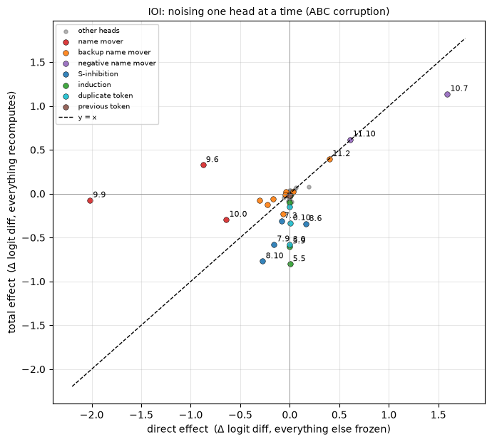


<details>
<summary>Expected output (text)</summary>

<pre style="white-space:pre;overflow-x:auto;line-height:normal;font-family:Menlo,'DejaVu Sans Mono',consolas,'Courier New',monospace">   total effect, most negative: 5.5 (-0.80), 8.10 (-0.77), 5.9 (-0.60), 3.0 (-0.58), 7.9 (-0.58)
                 most positive: 10.7 (+1.14), 11.10 (+0.62), 11.2 (+0.39), 9.6 (+0.33)
  direct effect, most negative: 9.9 (-2.02), 9.6 (-0.88), 10.0 (-0.64), 10.10 (-0.30), 8.10 (-0.27)
                 most positive: 10.7 (+1.59), 11.10 (+0.61), 11.2 (+0.40), 9.8 (+0.19)
indirect effect, most negative: 5.5 (-0.80), 5.9 (-0.60), 3.0 (-0.58), 8.6 (-0.51), 8.10 (-0.50)
                 most positive: 9.9 (+1.94), 9.6 (+1.20), 10.0 (+0.35), 10.10 (+0.23)</pre>

</details>

<details>
<summary>Help - how should I interpret this plot?</summary>

The diagonal is where a head's whole effect is direct. The heads fall into three groups.

- **On the vertical axis: the start of the circuit.** Induction head 5.5 has total effect -0.80 and direct effect 0.00, and duplicate-token head 3.0 and induction head 5.9 are the same. They don't write to the logits at all: their effect is entirely indirect, through the S-inhibition heads and name movers. The S-inhibition heads are mostly indirect too, with a small direct part (8.10: total -0.77, direct -0.27). 8.6 even has a *positive* direct effect (+0.17) but a negative total effect (-0.34).
- **Far above the diagonal: the name movers.** Noising 9.9 has a direct effect of -2.02, two-thirds of the whole clean logit difference (2.92), but a total effect of only about -0.07. Its indirect effect is +1.94: the rest of the model makes up for almost everything 9.9 stops writing. 9.6 is stranger still: direct effect -0.88, total effect **+0.33**, so noising it makes the model *better*. 10.0 is in between (direct -0.64, total -0.29).
- **On or below the diagonal, at the top right: the negative heads.** 10.7 writes against the answer (noising it has a direct effect of +1.59), but its total effect is only +1.14, so even its effect is partly compensated. 11.10 and 11.2 sit on the diagonal: their effects are purely direct.

The name movers are exactly the heads that part 2️⃣ found "unimportant in both directions". Their single-head patching scores were small because the model compensates for each of
them, not because they don't do anything.
</details>


## Restricting paths

The indirect effect lumps together every route from a head to the logits. With `run_with_frozen` we can open the routes one at a time: noise a "sender" head, and let only a chosen
set of downstream nodes recompute. For example, "noise 8.10, recompute only the name movers" asks *how much of 8.10's effect could flow through the name movers, if nothing else
reacted?*


### Exercise - implement `path_restricted_effects`

> ```yaml
> Difficulty: 🔴⚪⚪⚪⚪
> Importance: 🔵🔵🔵⚪⚪
>
> You should spend up to 5-10 minutes on this exercise.
> ```

Implement `path_restricted_effects`, which noises a single `sender` head and, for each named route in `routes` (a dict from route name to a set of nodes to recompute), returns the
change in mean metric relative to the clean run.


```python
def path_restricted_effects(
    model: HookedTransformer,
    task: PatchingTask,
    clean_cache: ActivationCache,
    corrupted_cache: ActivationCache,
    sender: str,
    routes: dict[str, set[str]],
) -> dict[str, float]:
    """For each route, the effect of noising `sender` when only the nodes in that route recompute."""
    raise NotImplementedError()


tests.test_path_restricted_effects(path_restricted_effects, all_nodes, frozen_run_cache, PatchingTask, model)
```


```python
NAME_MOVERS = IOI_HEAD_CLASSES["name mover"]
late_heads = {f"{layer}.{head}" for layer in (9, 10, 11) for head in range(N_HEADS)}
routes = {
    "total (all recompute)": all_nodes(model),
    "direct (none recompute)": set(),
    "via name movers only": set(NAME_MOVERS),
    "via NMs + negative NMs": set(NAME_MOVERS + IOI_HEAD_CLASSES["negative name mover"]),
    "via all heads in layers 9-11": late_heads,
    "via all heads": {node for node in all_nodes(model) if "." in node},
}
path_table = pd.DataFrame(
    {sender: path_restricted_effects(model, task, clean_cache, corrupted_cache, sender, routes) for sender in ["8.10", "7.9", "5.5", "3.0"]}
).T
with pd.option_context("display.width", 200, "display.max_columns", 10):
    print(path_table.round(2))
```


<details>
<summary>Expected output</summary>

<pre style="white-space:pre;overflow-x:auto;line-height:normal;font-family:Menlo,'DejaVu Sans Mono',consolas,'Courier New',monospace">      total (all recompute)  direct (none recompute)  via name movers only  via NMs + negative NMs  via all heads in layers 9-11  via all heads
8.10                  -0.77                    -0.27                 -2.00                   -0.72                         -0.92          -0.92
7.9                   -0.58                    -0.16                 -0.88                   -0.43                         -0.49          -0.58
5.5                   -0.80                     0.00                  0.09                   -0.11                         -0.12          -0.72
3.0                   -0.58                     0.00                  0.11                   -0.03                         -0.04          -0.86</pre>

</details>

<details>
<summary>Help - how should I interpret this table?</summary>

Read across the row for 8.10.

- Its direct effect is -0.27. If the three name movers (and only they) can react to 8.10 being noised, the effect is **-2.00**, more than *twice* its total effect of -0.77. The name movers really are where 8.10's signal goes: without it, they copy the wrong name.
- But if the negative name movers can react as well, the effect drops back to -0.72, and letting every late head react gives -0.92, close to the total. So the paths through the name movers and through the negative name movers have large effects of *opposite sign* that mostly cancel, a cancellation that's invisible in the total effect.
- Path effects don't add up. "Via name movers only" (-2.00) plus "direct" (-0.27) is nothing like "total" (-0.77), because each restricted run freezes the components that would otherwise respond.

7.9 shows the same pattern more weakly (-0.88 via the name movers, -0.58 total). For the early heads 5.5 and 3.0, the late heads are the wrong place to look: letting only heads in
layers 9-11 recompute gives almost nothing (-0.12 and -0.04), and their effect only appears once the middle layers, where the S-inhibition heads are, can recompute as well (-0.72
and -0.86). That's the serial structure (duplicate/induction heads → S-inhibition heads → name movers), read directly off the table.

One more detail: for 3.0, "via all heads" (MLPs and the final LayerNorm frozen) gives -0.86, more than its total effect of -0.58. When the MLPs and the LayerNorm are allowed to
react, they absorb part of the effect: another, smaller instance of compensation.
</details>


<details><summary>Solution</summary>

```python
def path_restricted_effects(
    model: HookedTransformer,
    task: PatchingTask,
    clean_cache: ActivationCache,
    corrupted_cache: ActivationCache,
    sender: str,
    routes: dict[str, set[str]],
) -> dict[str, float]:
    """For each route, the effect of noising `sender` when only the nodes in that route recompute."""
    layer, head = parse_head(sender)
    patches = {sender: corrupted_cache["z", layer][:, :, head]}
    clean_metric = task.metric(model(task.clean_tokens)).mean()
    return {
        name: (task.metric(run_with_frozen(model, task.clean_tokens, clean_cache, patches, nodes)).mean() - clean_metric).item()
        for name, nodes in routes.items()
    }
```
</details>


## The Hydra effect: knocking out the name movers

We can now resolve the puzzle from the introduction. Let's noise all three name movers at once and measure the total and direct effects. To know whether the gap between them is
unusual, we need a **control**: the same measurement for 30 random sets of three heads, drawn from the same layers (9-11, excluding the name movers). If nothing special is going
on, the total effect of a set of heads should be roughly equal to its direct effect, i.e. the points should lie near the line TE = DE.

We'll add one more group for contrast: the four S-inhibition heads, whose effect we expect to be almost entirely *indirect*.

McGrath et al. ([*The Hydra Effect: Emergent Self-repair in Language Model Computations*](https://arxiv.org/abs/2307.15771), 2023) named the phenomenon we're about to see after the mythical beast that grows two heads for each one you cut off. They found that ablating an attention layer in a 7B model often changes the output far less than the layer's direct effect predicts, because later layers compensate. In IOI, the same thing had already been spotted by Wang et al. as **backup name mover heads**.


```python
nm_effect = total_and_direct_effect(model, task, clean_cache, corrupted_cache, NAME_MOVERS)
s_inhibition_effect = total_and_direct_effect(model, task, clean_cache, corrupted_cache, IOI_HEAD_CLASSES["S-inhibition"])

rng = random.Random(0)
candidates = sorted(late_heads - set(NAME_MOVERS))
random_sets = [rng.sample(candidates, 3) for _ in range(30)]
random_effects = [total_and_direct_effect(model, task, clean_cache, corrupted_cache, heads) for heads in tqdm(random_sets)]

print(f"Clean logit diff: {M_clean:.2f}")
print(f"Name movers {NAME_MOVERS}: total effect {nm_effect[0]:+.2f}, direct effect {nm_effect[1]:+.2f}")
print(f"S-inhibition heads: total effect {s_inhibition_effect[0]:+.2f}, direct effect {s_inhibition_effect[1]:+.2f}")
gaps = t.tensor([te - de for te, de in random_effects])
print(f"Random sets of 3 heads: |total - direct| has median {gaps.abs().median():.2f}, max {gaps.abs().max():.2f}")
print(f"Name movers: total - direct = {nm_effect[0] - nm_effect[1]:+.2f}")

utils.plot_total_vs_direct(
    {
        "CONTROL: 30 random sets of 3 heads from layers 9-11": random_effects,
        "name movers 9.9 + 9.6 + 10.0": [nm_effect],
        "S-inhibition heads 7.3 + 7.9 + 8.6 + 8.10": [s_inhibition_effect],
    },
    title="The Hydra effect: knocking out the name movers barely matters\n(noising sets of heads with ABC activations)",
)
```


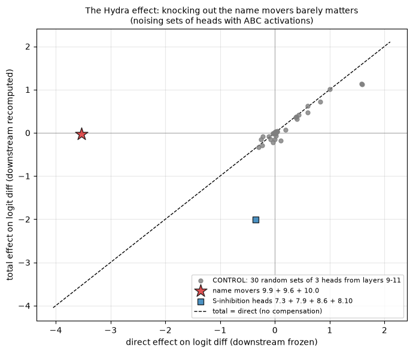


<details>
<summary>Expected output (text)</summary>

<pre style="white-space:pre;overflow-x:auto;line-height:normal;font-family:Menlo,'DejaVu Sans Mono',consolas,'Courier New',monospace">Clean logit diff: 2.92
Name movers ['9.9', '9.6', '10.0']: total effect -0.03, direct effect -3.53
S-inhibition heads: total effect -2.00, direct effect -0.35
Random sets of 3 heads: |total - direct| has median 0.03, max 0.47
Name movers: total - direct = +3.51</pre>

</details>

<details>
<summary>Help - how should I interpret this plot?</summary>

**The control behaves as expected.** For random sets of three heads from layers 9-11, the total effect is close to the direct effect: the median gap $|\text{TE} - \text{DE}|$ is
0.03, and the largest is 0.47. (The two points furthest to the right, slightly below the line, are the two random sets that happen to include the negative name mover 10.7, whose
own effect we just saw is partly compensated; they account for the largest gaps.)

**The name movers are far off the line.** Their direct effect is -3.53: with everything else frozen, replacing their outputs removes more than the entire clean logit difference of
2.92 (the logit difference would go from +2.92 to about -0.6, so the model would slightly prefer S). Their total effect is -0.03. The model makes up for 3.51 of the 3.53 logits we
removed. That gap is more than seven times the largest gap in the control.

**The S-inhibition heads are off the line in the other direction.** Direct effect -0.35, total effect -2.00. That's not compensation, it's the circuit: their effect works through
the name movers, so most of it is indirect.

So this plot has a simple reading. Below the diagonal, effects are *mediated* by downstream components; above it, they're *compensated* by downstream components. Both are invisible
if you only measure total effects, which is what ordinary activation patching does.
</details>


### Exercise - find the heads that compensate

> ```yaml
> Difficulty: 🔴🔴🔴⚪⚪
> Importance: 🔵🔵🔵🔵⚪
>
> You should spend up to 15-20 minutes on this exercise.
> ```

Who picks up the slack? To find out, we'll compute each head's **direct contribution** to the logit difference, once in the clean run and once in the run where the name movers are
knocked out, and look at which heads change.

Implement `head_direct_contributions`, which takes a cache (containing `hook_z` and `ln_final.hook_scale`) and the answer tokens, and returns a `(n_layers, n_heads)` tensor: the
mean over prompts of each head's direct logit attribution at the final position,

$$
\text{DLA}(h) = \frac{z^{(h)}_{\text{END}} W_O^{(h)} \cdot \big(W_U[:, \text{correct}] - W_U[:, \text{incorrect}]\big)}{\sigma_{\text{END}}}
$$

where $\sigma_{\text{END}}$ is the final LayerNorm scale at the final position *in the same run* (so that in each run, the contributions of all heads, MLPs, embeddings and biases
add up to that run's logit difference).

This is the same quantity as the direct logit attribution in [1.2] and [1.4.1], but computed from `hook_z` and `W_O` rather than from `cache.stack_head_results`. (The test checks
it against `stack_head_results`.)


```python
def head_direct_contributions(
    model: HookedTransformer, cache: ActivationCache, answer_tokens: Int[Tensor, "batch 2"]
) -> Float[Tensor, "layer head"]:
    """Mean (over prompts) direct logit attribution of each head at the final position, using cache's own LN scale."""
    raise NotImplementedError()


tests.test_head_direct_contributions(head_direct_contributions, model)
```


<details>
<summary>Hint</summary>

Stack `cache["z", layer][:, -1]` over layers to get shape `(layer, batch, head, d_head)`. Multiply by `model.W_O` (shape `(layer, head, d_head, d_model)`) with an einsum to get
each head's output `(layer, batch, head, d_model)`. Divide by `cache["ln_final.hook_scale"][:, -1]` (shape `(batch, 1)`; broadcast it carefully). Finally take the dot product with
the per-prompt logit difference direction `W_U[:, correct] - W_U[:, incorrect]`, of shape `(d_model, batch)`, and average over the batch.
</details>

<details>
<summary>Aside - why doesn't the head's mean get subtracted, like layernorm would?</summary>

The final LayerNorm also subtracts the mean of the residual stream over `d_model`. TransformerLens loads GPT-2 with `center_writing_weights=True`, which makes every component's
output (including every head's $W_O$ output) mean-zero over `d_model`, so the subtraction does nothing to it. If you load a model without that option, you'd need to centre each
head's output yourself.
</details>


<details><summary>Solution</summary>

```python
def head_direct_contributions(
    model: HookedTransformer, cache: ActivationCache, answer_tokens: Int[Tensor, "batch 2"]
) -> Float[Tensor, "layer head"]:
    """Mean (over prompts) direct logit attribution of each head at the final position, using cache's own LN scale."""
    z_end = t.stack([cache["z", layer][:, -1] for layer in range(model.cfg.n_layers)])  # [layer batch head d_head]
    head_out = t.einsum("lbhd,lhdm->lbhm", z_end, model.W_O)
    head_out = head_out / cache["ln_final.hook_scale"][:, -1][None, :, None, :]  # scale has shape [batch seq 1]
    answer_tokens = answer_tokens.to(model.W_U.device)
    direction = model.W_U[:, answer_tokens[:, 0]] - model.W_U[:, answer_tokens[:, 1]]  # [d_model batch]
    return t.einsum("lbhm,mb->lbh", head_out, direction).mean(dim=1).cpu()
```
</details>


Now let's run the knocked-out model with a cache, and compare. We use TransformerLens's `model.hooks` context manager so that `run_with_cache` runs with our patching hooks
attached.


```python
def knockout_hook(z: Tensor, hook, heads: list[int]) -> Tensor:
    z[:, :, heads] = corrupted_cache[hook.name][:, :, heads]
    return z


nm_by_layer = {9: [9, 6], 10: [0]}
with model.hooks(fwd_hooks=[(get_act_name("z", layer), partial(knockout_hook, heads=heads)) for layer, heads in nm_by_layer.items()]):
    ko_logits, ko_cache = model.run_with_cache(task.clean_tokens, names_filter=lambda name: name.endswith(("hook_z", "ln_final.hook_scale")))

dla_clean = head_direct_contributions(model, clean_cache, answer_tokens)
dla_ko = head_direct_contributions(model, ko_cache, answer_tokens)
change = dla_ko - dla_clean
nm_change = sum(change[parse_head(n)] for n in NAME_MOVERS)

ko_ld = task.metric(ko_logits).mean().item()
del ko_logits
print(f"Logit diff: clean {M_clean:.2f}, name movers knocked out {ko_ld:.2f}")
print(f"Sum of the name movers' direct contributions in the clean run: {sum(dla_clean[parse_head(n)] for n in NAME_MOVERS):+.2f}")
print(f"Change in the summed direct contributions of all 144 heads: {change.sum():+.2f}")
print(f"  of which the name movers themselves: {nm_change:+.2f}")
print(f"  of which all other heads:            {change.sum() - nm_change:+.2f}")

order = change.flatten().argsort(descending=True)
top_compensators = [HEAD_LABELS[i] for i in order[:10]]
utils.plot_bars(
    {node: change[parse_head(node)].item() for node in top_compensators + NAME_MOVERS},
    title="Change in each head's direct contribution to the logit diff when the name movers are knocked out\n"
    "(10 largest increases, then the name movers themselves)",
    ylabel="Δ direct contribution",
    colors=["tab:green"] * 10 + ["tab:red"] * 3,
)
print("Direct contributions, clean -> knocked out:")
print(", ".join(f"{n}: {dla_clean[parse_head(n)]:+.2f} -> {dla_ko[parse_head(n)]:+.2f}" for n in top_compensators[:6]))
```


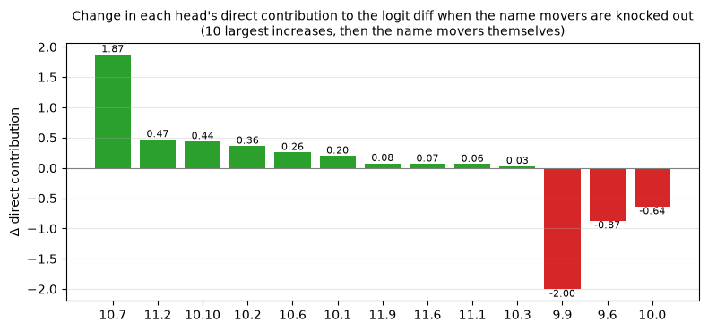


<details>
<summary>Expected output (text)</summary>

<pre style="white-space:pre;overflow-x:auto;line-height:normal;font-family:Menlo,'DejaVu Sans Mono',consolas,'Courier New',monospace">Logit diff: clean 2.92, name movers knocked out 2.90
Sum of the name movers' direct contributions in the clean run: +4.34
Change in the summed direct contributions of all 144 heads: -0.05
  of which the name movers themselves: -3.52
  of which all other heads:            +3.47
Direct contributions, clean -&gt; knocked out:
10.7: -1.71 -&gt; +0.16, 11.2: -0.50 -&gt; -0.03, 10.10: +0.37 -&gt; +0.81, 10.2: -0.09 -&gt; +0.27, 10.6: +0.30 -&gt; +0.56, 10.1: +0.35 -&gt; +0.55</pre>

</details>

<details>
<summary>Help - how should I interpret this?</summary>

In the clean run, the name movers contribute +4.34 to the logit difference, and the negative heads take some of it back (10.7 contributes -1.71, 11.2 -0.50). When we knock the name
movers out, their contributions drop by 3.52 in total (9.9: -2.00, 9.6: -0.87, 10.0: -0.64), and the other heads' contributions rise by 3.47, almost exactly the same amount. The
compensation comes from two different mechanisms.

- **Suppression is withdrawn.** By far the biggest change is the negative name mover 10.7, whose contribution goes from -1.71 to +0.16 (a change of +1.87). 11.2 does the same thing on a smaller scale (-0.50 → -0.03). 10.7 is a *copy suppression* head (McDougall et al. 2023): it pushes down tokens that earlier layers are predicting. When the name movers stop predicting IO, 10.7 stops suppressing it. McGrath et al. call this **erasure**: part of the downstream computation was cancelling the upstream signal, and the cancellation disappears along with the signal. (Wang et al. list 11.2 as a *backup* name mover, but on our data its clean contribution is negative, so here it behaves more like a negative one.)
- **Backups step up.** 10.10 (+0.37 → +0.81), 10.2 (-0.09 → +0.27), 10.6 (+0.30 → +0.56) and 10.1 (+0.35 → +0.55) all write *more* IO once the name movers are gone. These are among the IOI paper's backup name movers: they were doing a little of the job all along, and they do more of it when the main heads fail.

Together, these changes almost exactly cancel the knockout. This experiment doesn't tell us *how* the backups know to step up. One hypothesis is that they read the name movers'
output at END, and do less when it says the job is already done. You could test it with `run_with_frozen`, by noising the name movers and letting only one backup head recompute.
</details>

<details>
<summary>Question - does this mean the name movers "don't matter"?</summary>

No, and this is exactly why you should never read "small total effect" as "unimportant". In the clean model, the name movers do most of the work: their direct contribution is
larger than the whole logit difference. The model *also* contains machinery that can do the job when they fail, and machinery (the negative name movers) whose suppression depends
on what the name movers do. A complete description of the circuit has to include both.

It does mean that **single-component total effects are a poor guide to what a component does**, and that circuit-discovery methods built on them (including ACDC in 8.4) can miss
components whose effect is masked by backups. Direct effects, path-restricted effects and joint ablations are the tools that reveal them.
</details>


## Summary of 4️⃣

- Total effect = let everything recompute; direct effect = freeze everything else (including the final LayerNorm scale); indirect effect = the difference. One "frozen run" function implements all of them, and anything in between.
- Heads fall into recognisable regions of the direct-vs-total plot: induction and duplicate-token heads act purely indirectly, S-inhibition heads mostly indirectly, name movers have large direct effects but much smaller (or even positive) total effects, and negative name movers have large positive direct effects.
- Path-restricted effects don't add up. Opening only some paths can give an effect much *larger* than the total effect (-2.00 vs -0.77 for 8.10 via the name movers), because the paths you left frozen were cancelling it.
- Knocking out all three name movers removes a direct contribution of 3.53, more than the whole logit difference, but changes the logit difference by only 0.03. Random sets of heads in the same layers show gaps of at most 0.47. The compensation comes from negative heads backing off (mainly 10.7) and backup name movers stepping up.


=== NEW CHAPTER ===


# 5️⃣ A Second Task, and the Pitfalls Checklist


> ##### Learning Objectives
>
> - Reuse the `PatchingTask` interface on a task with a probability-based metric
> - Use per-prompt distributions and bootstrap confidence intervals instead of bare means
> - Test patching results on held-out templates
> - Know when logit difference and probability metrics disagree, and why

## Greater-than

Hanna et al. ([*How does GPT-2 compute greater-than?*](https://arxiv.org/abs/2305.00586), 2023) studied prompts like

```
The war lasted from the year 1732 to the year 17
```

A model that understands the sentence should continue with a two-digit year *greater than* 32. GPT-2 tokenizes `" 1732"` as `" 17"` + `"32"`, so the next token is one of the 100
two-digit tokens `"00"`, ..., `"99"`, and we can read off the model's whole distribution over end years.

The natural metric is the **probability difference**: the total probability on years greater than the start year YY, minus the total probability on years less than or equal to it,

$$
\text{PD} = \sum_{y > YY} p(y) - \sum_{y \le YY} p(y)
$$

which is +1 if the model is perfectly right and -1 if it's perfectly wrong. The standard corruption replaces the start year with `01` ("from the year 1701"). This keeps everything
else identical but makes almost every year "greater". Note that it doesn't erase the task: on `01` prompts, the model should *also* predict a year greater than 01. The corrupted
run is only wrong relative to the *clean* start year, which is what the metric measures.

This is a useful second task because it's quite different from IOI: the answer depends on comparing two numbers rather than moving a name, and the metric is a sum of probabilities
rather than a logit difference.

We keep only centuries 12-17 and start years 02-98 for which both `" XXYY"` and `" XX01"` split into exactly the tokens `" XX"` + `"YY"`, so that every prompt has the same 13-token
template.


```python
def sample_greater_than_rows(model: HookedTransformer, n: int, seed: int = 0) -> list[tuple[str, int, int]]:
    """(noun, century, start year YY) triples whose years tokenize as [' XX', 'YY'] (and so does XX01)."""

    def splits_cleanly(century: int, yy: int) -> bool:
        tokens = model.to_tokens(f" {century}{yy:02d}", prepend_bos=False)[0]
        return [model.to_string(tok) for tok in tokens] == [f" {century}", f"{yy:02d}"]

    rng = random.Random(seed)
    rows = []
    while len(rows) < n:
        noun, century, yy = rng.choice(utils.GT_NOUNS), rng.randint(12, 17), rng.randint(2, 98)
        if splits_cleanly(century, yy) and splits_cleanly(century, 1):
            rows.append((noun, century, yy))
    return rows
```


### Exercise - implement `year_prob_diff`

> ```yaml
> Difficulty: 🔴🔴⚪⚪⚪
> Importance: 🔵🔵🔵⚪⚪
>
> You should spend up to 10 minutes on this exercise.
> ```

Implement the probability difference metric. `year_tokens` is a tensor of the 100 token ids for `"00"`, ..., `"99"` (in order), and `start_years` contains each clean prompt's YY as
an integer. Use the softmax over the **full vocabulary** at the final position (so the 100 probabilities don't necessarily sum to 1), and return one PD per prompt.


```python
def year_prob_diff(
    logits: Float[Tensor, "batch seq d_vocab"], start_years: Int[Tensor, " batch"], year_tokens: Int[Tensor, " 100"]
) -> Float[Tensor, " batch"]:
    """Sum of P(year > YY) minus sum of P(year <= YY), over the 100 two-digit year tokens, for each prompt."""
    raise NotImplementedError()


tests.test_year_prob_diff(year_prob_diff)
```


<details><summary>Solution</summary>

```python
def year_prob_diff(
    logits: Float[Tensor, "batch seq d_vocab"], start_years: Int[Tensor, " batch"], year_tokens: Int[Tensor, " 100"]
) -> Float[Tensor, " batch"]:
    """Sum of P(year > YY) minus sum of P(year <= YY), over the 100 two-digit year tokens, for each prompt."""
    probs = logits[:, -1].softmax(dim=-1)[:, year_tokens.to(logits.device)]  # [batch 100]
    greater = t.arange(100, device=logits.device)[None, :] > start_years.to(logits.device)[:, None]
    return (probs * greater).sum(-1) - (probs * ~greater).sum(-1)
```
</details>


<details>
<summary>Hint</summary>

Index the softmaxed final logits with `year_tokens` to get a `(batch, 100)` tensor. Build a boolean mask `greater[b, y] = y > start_years[b]` by broadcasting `t.arange(100)`
against `start_years[:, None]`, and use it (and its negation `~greater`) to sum the two groups.
</details>

Here's the task constructor. Note how little of it is specific to greater-than: everything task-specific lives in the metric.


```python
def make_greater_than_task(model: HookedTransformer, n: int = 100, seed: int = 0, corrupt_year: int = 1) -> PatchingTask:
    """Greater-than task: clean 'from the year XXYY to the year XX', corrupted with YY -> corrupt_year, metric = PD."""
    rows = sample_greater_than_rows(model, n, seed)
    template = "The {noun} lasted from the year {century}{yy} to the year {century}"
    clean_tokens = model.to_tokens([template.format(noun=noun, century=c, yy=f"{yy:02d}") for noun, c, yy in rows])
    corrupted_tokens = model.to_tokens([template.format(noun=noun, century=c, yy=f"{corrupt_year:02d}") for noun, c, yy in rows])
    year_tokens = t.tensor([model.to_single_token(f"{y:02d}") for y in range(100)])
    start_years = t.tensor([yy for _, _, yy in rows])
    labels = ["BOS", "The", "noun", "lasted", "from", "the", "year", "XX", "YY", "to", "the", "year", "END (XX)"]
    return PatchingTask(
        name=f"greater-than (YY -> {corrupt_year:02d})",
        clean_tokens=clean_tokens,
        corrupted_tokens=corrupted_tokens,
        metric=partial(year_prob_diff, start_years=start_years, year_tokens=year_tokens),
        labels=labels,
    )
```


```python
gt_task = make_greater_than_task(model, n=100, seed=0)
print(repr(model.to_string(gt_task.clean_tokens[0, 1:])), "|", repr(model.to_string(gt_task.corrupted_tokens[0, 1:])))
gt_clean_logits, gt_corr_logits = model(gt_task.clean_tokens), model(gt_task.corrupted_tokens)
gt_M_clean, gt_M_corr = gt_task.metric(gt_clean_logits).mean().item(), gt_task.metric(gt_corr_logits).mean().item()
print(f"PD clean: {gt_M_clean:.3f},  PD corrupted (YY -> 01): {gt_M_corr:.3f}")

year_tokens = gt_task.metric.keywords["year_tokens"].to(device)
start_years = gt_task.metric.keywords["start_years"]
gt_clean_year_probs = gt_clean_logits[:, -1].softmax(-1)[:, year_tokens]
gt_corr_year_probs = gt_corr_logits[:, -1].softmax(-1)[:, year_tokens]
del gt_clean_logits, gt_corr_logits  # ~260MB each; from now on we only need the metric values
print(f"Mean probability mass on the 100 two-digit tokens (clean): {gt_clean_year_probs.sum(-1).mean():.3f}")
utils.plot_year_probs(
    {
        "clean prompts (from the year XXYY ...)": gt_clean_year_probs,
        "corrupted prompts (from the year XX01 ...)": gt_corr_year_probs,
    },
    start_years,
    "Greater-than: GPT-2's distribution over the end year (rows sorted by the clean start year)",
)
```


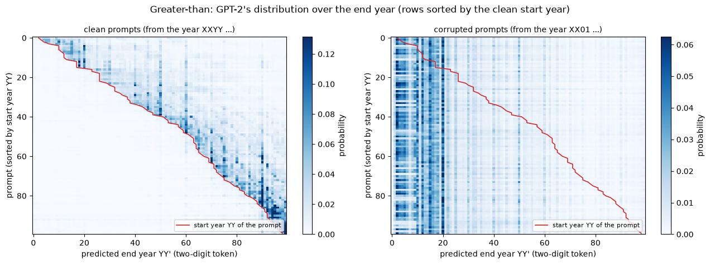


<details>
<summary>Expected output (text)</summary>

<pre style="white-space:pre;overflow-x:auto;line-height:normal;font-family:Menlo,'DejaVu Sans Mono',consolas,'Courier New',monospace">'The conflict lasted from the year 1664 to the year 16' | 'The conflict lasted from the year 1601 to the year 16'
PD clean: 0.803,  PD corrupted (YY -&gt; 01): -0.583
Mean probability mass on the 100 two-digit tokens (clean): 0.999</pre>

</details>

<details>
<summary>Help - how should I interpret this plot?</summary>

**Clean prompts (left).** Practically all the probability (99.9%) goes to the two-digit year tokens, and almost all of it sits just to the right of the red line: the model predicts
end years *after* the start year, concentrated in the decades immediately following it, with almost nothing before YY. That's a sharp, prompt-dependent threshold, and it gives a PD
of 0.80. There are also faint vertical stripes at a few round years (e.g. 50), which the model likes regardless of YY.

**Corrupted prompts (right).** With a start year of 01, the model puts most of its mass on years from 02 to about 20, for every prompt, regardless of the clean YY. (The red line is
irrelevant to these prompts, but it's what the metric is measured against.) Measured against the clean start year, those predictions are mostly "too early", so PD is -0.58.

So the clean-corrupted gap is about 1.39 PD, and the question for patching is: which components carry "the start year is YY" to the final position, and which use it to put the
probability mass after YY?
</details>


Since the greater-than task satisfies the same interface, all our sweeps work on it without modification. Let's sweep the residual stream, the attention outputs and the MLP outputs
(denoising), and then compare with the attention and MLP sweeps for IOI.


```python
gt_maps = {f"{act} (denoising)": layer_position_sweep(model, gt_task, act, "denoise") for act in ["resid_pre", "attn_out", "mlp_out"]}
utils.plot_layer_pos_maps(gt_maps, gt_task.labels, "Greater-than: denoising sweeps (clean -> YY=01)", vmax=1.0)
yy, end = gt_task.labels.index("YY"), gt_task.seq_len - 1
print("resid_pre at YY, by layer: ", [round(x, 2) for x in gt_maps["resid_pre (denoising)"][:, yy].tolist()])
print("resid_pre at END, by layer:", [round(x, 2) for x in gt_maps["resid_pre (denoising)"][:, end].tolist()])
```


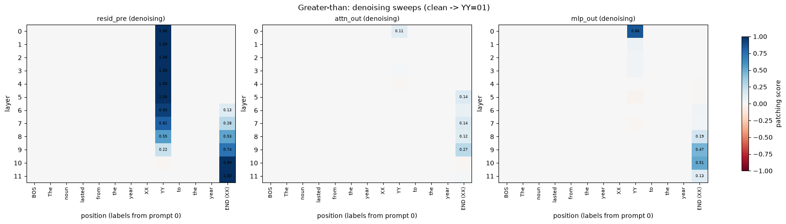


```python
ioi_block_maps = {f"{act} (denoising)": layer_position_sweep(model, task, act, "denoise") for act in ["attn_out", "mlp_out"]}
utils.plot_layer_pos_maps(ioi_block_maps, task.labels, "IOI for comparison: denoising attention and MLP outputs (clean -> ABC)", vmax=1.0)

for name, maps, seq_len in [("greater-than", gt_maps, gt_task.seq_len), ("IOI", ioi_block_maps, task.seq_len)]:
    mlp_end, attn_end = maps["mlp_out (denoising)"][:, seq_len - 1], maps["attn_out (denoising)"][:, seq_len - 1]
    print(f"{name}, END position: sum over layers of MLP scores {mlp_end.sum():.2f}, of attention scores {attn_end.sum():.2f}")
    print(f"  MLP scores by layer:       {[round(x, 2) for x in mlp_end.tolist()]}")
    print(f"  attention scores by layer: {[round(x, 2) for x in attn_end.tolist()]}")
```


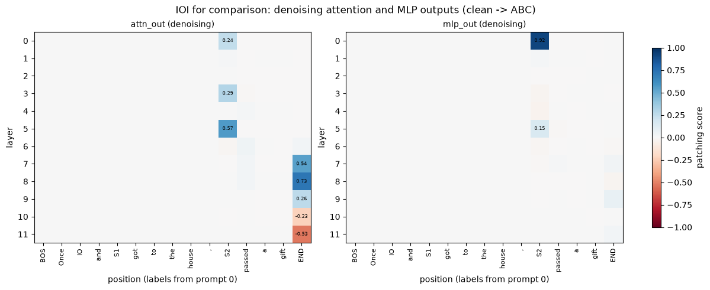


<details>
<summary>Expected output (text)</summary>

<pre style="white-space:pre;overflow-x:auto;line-height:normal;font-family:Menlo,'DejaVu Sans Mono',consolas,'Courier New',monospace">greater-than, END position: sum over layers of MLP scores 1.35, of attention scores 0.73
  MLP scores by layer:       [0.0, -0.0, -0.0, 0.01, -0.01, -0.01, 0.03, 0.03, 0.19, 0.47, 0.51, 0.13]
  attention scores by layer: [-0.0, -0.0, -0.0, 0.0, -0.0, 0.14, 0.07, 0.14, 0.12, 0.27, -0.02, 0.01]
IOI, END position: sum over layers of MLP scores 0.09, of attention scores 0.78
  MLP scores by layer:       [0.0, 0.0, 0.0, -0.0, 0.0, 0.0, -0.01, 0.04, -0.03, 0.07, 0.0, 0.03]
  attention scores by layer: [-0.0, -0.0, -0.0, -0.0, -0.0, -0.0, 0.03, 0.54, 0.73, 0.26, -0.23, -0.53]</pre>

</details>

<details>
<summary>Help - how should I interpret these plots?</summary>

The greater-than sweep cell also prints the residual stream columns:

<pre style="white-space:pre;overflow-x:auto;line-height:normal;font-family:Menlo,'DejaVu Sans Mono',consolas,'Courier New',monospace">resid_pre at YY, by layer:  [1.0, 1.0, 1.0, 1.0, 1.0, 1.0, 0.93, 0.82, 0.55, 0.22, -0.02, 0.0]
resid_pre at END, by layer: [0.0, -0.0, -0.0, -0.0, -0.0, -0.0, 0.13, 0.28, 0.53, 0.74, 0.99, 1.0]</pre>

**Greater-than.** The residual stream sweep has the same two-phase shape as IOI: the information sits at YY up to layer 5, then moves to the final position over layers 6-10 (the YY
column falls from 1.00 at layer 5 to 0.22 at layer 9, while END rises from 0.13 at layer 6 to 0.99 at layer 10). The attention sweep shows *how* it moves: attention outputs at END
in layers 5-9 each restore a little (0.07 to 0.27). The MLP sweep shows where it's *used*: MLPs 8-11 at END restore 0.19, 0.47, 0.51 and 0.13. Their scores add up to 1.35, more
than 1, so they overlap rather than add. This matches Hanna et al.: attention heads in layers 5-9 move the start year to the final position, and MLPs 8-11 compute "greater than YY"
from it. At the YY position, MLP0 alone restores 0.86. As in many GPT-2 circuits, MLP0 acts like an extended token embedding.

**IOI.** At END, attention restores most of the behaviour (layers 7 and 8: 0.54 and 0.73), and the late attention layers 10 and 11 have *negative* scores (-0.23 and -0.53), which
is where the negative name movers live. The MLPs at END do essentially nothing (summed score 0.09). At S2, attention layers 0, 3 and 5 (the duplicate-token and induction heads) and
MLP0 (0.92) matter.

So the two tasks route information the same way (attention moves a token's information to the final position) but compute the answer in different places: IOI in attention heads
(the name movers copy the name), greater-than mostly in MLPs. A method that only looks at attention heads, like the head sweeps of parts 2️⃣-4️⃣, would miss most of the
greater-than circuit.
</details>


Which attention heads move the year? Run the denoising head sweep on greater-than, and compare with Hanna et al., who found heads 5.1, 5.5, 6.1, 6.9, 7.10, 8.8, 8.11 and 9.1
attending from the final position to YY.


```python
gt_head_denoise = patching_score(
    head_sweep(model, gt_task.corrupted_tokens, get_z(model, gt_task.clean_tokens), gt_task.metric), gt_M_corr, gt_M_clean
)
order = gt_head_denoise.flatten().argsort(descending=True)
print("Top 10 heads (denoising score):", ", ".join(f"{HEAD_LABELS[i]} ({gt_head_denoise.flatten()[i]:.2f})" for i in order[:10]))
print(f"Sum over all 144 heads: {gt_head_denoise.sum():.2f}")
```


<details>
<summary>Expected output</summary>

<pre style="white-space:pre;overflow-x:auto;line-height:normal;font-family:Menlo,'DejaVu Sans Mono',consolas,'Courier New',monospace">Top 10 heads (denoising score): 9.1 (0.28), 7.10 (0.14), 8.11 (0.08), 6.9 (0.07), 5.1 (0.06), 5.5 (0.05), 0.1 (0.03), 8.8 (0.03), 0.5 (0.02), 0.3 (0.01)
Sum over all 144 heads: 0.78</pre>

</details>

The top six heads (9.1, 7.10, 8.11, 6.9, 5.1 and 5.5) and 8.8 in eighth place are all on Hanna et al.'s list, which is reassuring, since we used a different, smaller dataset and
plain activation patching rather than path patching. (6.1, the one head from their list that's missing, isn't in the top 10, so it scores 0.01 or less here.) Two things are
different from IOI. No single head matters much: the largest denoising score is 0.28, and the scores of all 144 heads add up to 0.78, compared with 1.35 for the MLPs at END. And
the important heads are spread over layers 5-9 rather than concentrated in a couple of layers, consistent with the attention sweep above.


## Pitfall: averages hide prompts

Every number so far has been a mean over 100 prompts. A mean of -0.1 could be every prompt moving a little, or half the prompts moving a lot in each direction, and those are very
different mechanisms. Before you call a component "unimportant" (or "important"), look at the distribution.


### Exercise - per-prompt effects with bootstrap confidence intervals

> ```yaml
> Difficulty: 🔴🔴⚪⚪⚪
> Importance: 🔵🔵🔵🔵⚪
>
> You should spend up to 15 minutes on this exercise.
> ```

Implement two functions:

- `per_prompt_head_effects` noises each head in `heads` (all positions, from `source_z`) on the clean prompts, and returns the **per-prompt** change in the metric, shape `(len(heads), batch)`.
- `bootstrap_mean_ci` returns a percentile bootstrap confidence interval for the mean of a 1D tensor: resample the values with replacement `n_boot` times (use a `t.Generator` seeded with `seed`), compute the mean of each resample, and return the `alpha / 2` and `1 - alpha / 2` quantiles of those means.


```python
def per_prompt_head_effects(
    model: HookedTransformer,
    task: PatchingTask,
    source_z: list[Float[Tensor, "batch seq n_heads d_head"]],
    heads: list[str],
) -> Float[Tensor, "n_heads batch"]:
    """Per-prompt change in the metric when each head is noised (on the clean prompts) with source_z."""
    raise NotImplementedError()


def bootstrap_mean_ci(values: Float[Tensor, " n"], n_boot: int = 2000, alpha: float = 0.05, seed: int = 0) -> tuple[float, float]:
    """Percentile bootstrap (1 - alpha) confidence interval for the mean of values."""
    raise NotImplementedError()


tests.test_per_prompt_head_effects(per_prompt_head_effects, PatchingTask, model)
tests.test_bootstrap_mean_ci(bootstrap_mean_ci)
```


```python
variance_heads = ["3.0", "5.5", "7.9", "8.6", "8.10", "9.6", "9.9", "10.0", "10.7", "11.10"]
per_prompt = per_prompt_head_effects(model, task, corrupted_z, variance_heads)
cis = [bootstrap_mean_ci(row) for row in per_prompt]

rows = []
for node, row, (lo, hi) in zip(variance_heads, per_prompt, cis):
    rows.append({"head": node, "mean": row.mean().item(), "95% CI": f"[{lo:+.2f}, {hi:+.2f}]", "std": row.std().item(),
                 "frac < 0": (row < 0).float().mean().item(), "min": row.min().item(), "max": row.max().item()})
with pd.option_context("display.width", 200):
    print(pd.DataFrame(rows).set_index("head").round(2))
utils.plot_per_prompt_effects(
    per_prompt, variance_heads, cis, "IOI: per-prompt effect of noising one head (ABC corruption)", "Δ logit diff (per prompt)"
)
```


<details><summary>Solution</summary>

```python
def per_prompt_head_effects(
    model: HookedTransformer,
    task: PatchingTask,
    source_z: list[Float[Tensor, "batch seq n_heads d_head"]],
    heads: list[str],
) -> Float[Tensor, "n_heads batch"]:
    """Per-prompt change in the metric when each head is noised (on the clean prompts) with source_z."""
    clean_metric = task.metric(model(task.clean_tokens))
    effects = []
    for node in heads:
        layer, head = parse_head(node)
        logits = patch_run(model, task.clean_tokens, get_act_name("z", layer), source_z[layer], np.s_[:, :, head])
        effects.append(task.metric(logits) - clean_metric)
    return t.stack(effects).cpu()


def bootstrap_mean_ci(values: Float[Tensor, " n"], n_boot: int = 2000, alpha: float = 0.05, seed: int = 0) -> tuple[float, float]:
    """Percentile bootstrap (1 - alpha) confidence interval for the mean of values."""
    generator = t.Generator().manual_seed(seed)
    values = values.float().cpu()
    idx = t.randint(0, len(values), (n_boot, len(values)), generator=generator)
    means = values[idx].mean(dim=-1)
    return means.quantile(alpha / 2).item(), means.quantile(1 - alpha / 2).item()
```
</details>


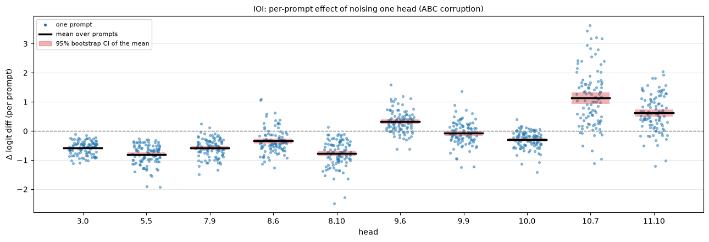


<details>
<summary>Expected output (table)</summary>

<pre style="white-space:pre;overflow-x:auto;line-height:normal;font-family:Menlo,'DejaVu Sans Mono',consolas,'Courier New',monospace">       mean          95% CI   std  frac &lt; 0   min   max
head
3.0   -0.58  [-0.63, -0.54]  0.23      1.00 -1.10 -0.11
5.5   -0.80  [-0.87, -0.74]  0.34      1.00 -1.92 -0.27
7.9   -0.58  [-0.64, -0.52]  0.32      0.98 -1.49  0.26
8.6   -0.34  [-0.43, -0.26]  0.42      0.84 -1.26  1.10
8.10  -0.77  [-0.86, -0.68]  0.45      0.99 -2.50  0.14
9.6    0.33  [+0.25, +0.40]  0.38      0.19 -0.63  1.58
9.9   -0.07  [-0.16, +0.00]  0.40      0.60 -1.24  1.37
10.0  -0.29  [-0.35, -0.24]  0.29      0.85 -1.41  0.39
10.7   1.14  [+0.94, +1.33]  0.98      0.09 -1.11  3.64
11.10  0.62  [+0.50, +0.74]  0.62      0.15 -1.21  2.05</pre>

</details>

<details>
<summary>Help - how should I interpret this?</summary>

There are three kinds of head here.

- **Consistent effects.** Noising 3.0, 5.5, 7.9 or 8.10 hurts on 98-100% of prompts, and the confidence intervals are narrow (5.5: -0.80, CI [-0.87, -0.74]). Their means describe essentially every prompt, although the *size* of the effect still varies a lot (5.5: from -1.92 to -0.27).
- **A mean near zero that hides both signs.** Name mover 9.9 has a mean of -0.07, and its CI touches zero ([-0.16, +0.00]), so by the usual standard it "has no effect". But its per-prompt effects range from -1.24 to +1.37, and 60% of them are negative. Noising it hurts on some prompts and helps on others, and the mean averages two real effects into nothing. (After part 4️⃣, a natural guess is that the balance between 9.9 and its backups differs from prompt to prompt.)
- **Heavy tails.** The negative name mover 10.7 has the largest mean (+1.14) but also by far the largest spread (std 0.98): on some prompts, noising it adds more than 3 logits (max +3.64); on 9% of prompts it goes the other way (min -1.11).

The general lesson: a mean with a confidence interval tells you whether an *average* effect is distinguishable from zero. It doesn't tell you whether the effect is the same on
every prompt, and mechanisms often aren't.
</details>


## Pitfall: one template family is not the task

All our IOI results come from one family of templates with ABBA order. Do they describe "how GPT-2 does IOI", or "how GPT-2 does *this sentence*"? The only way to find out is to
rerun the analysis on templates we didn't look at while forming our conclusions.

We'll use four held-out template families: the same family in **BABA** order (`"When John and Mary went to the store, John gave a drink to"`), and three structurally different
sentences from the IOI paper's template list.


### Exercise - noising scores on held-out templates

> ```yaml
> Difficulty: 🔴🔴⚪⚪⚪
> Importance: 🔵🔵🔵🔵⚪
>
> You should spend up to 10 minutes on this exercise.
> ```

Implement `heldout_noising_scores`. For each template family, sample `n` examples, build an `ABC` task with `make_ioi_task`, and compute the normalised head noising scores, exactly
as we did for the main task in part 2️⃣. Also print each task's sequence length and clean and corrupted mean logit differences (you'll want them for the interpretation). Return a
dict from family name to the `(n_layers, n_heads)` scores.


```python
HELDOUT_TEMPLATES = {
    "BABA order": [tmpl.replace("{A}", "{X}").replace("{B}", "{A}").replace("{X}", "{B}") for tmpl in TRAIN_TEMPLATES],
    "argument": ["Then, {A} and {B} had a long argument. Afterwards {C} said to"],
    "found": ["Friends {A} and {B} found a {OBJECT} at the {PLACE}. {C} gave it to"],
    "working": ["While {A} and {B} were working at the {PLACE}, {C} decided to give a {OBJECT} to"],
}


def heldout_noising_scores(
    model: HookedTransformer, templates: dict[str, list[str]], n: int = 60, seed: int = 0
) -> dict[str, Float[Tensor, "layer head"]]:
    """Normalised head noising scores (ABC corruption) for each held-out template family."""
    raise NotImplementedError()
```


```python
heldout_scores = heldout_noising_scores(model, HELDOUT_TEMPLATES)
utils.plot_scatter_grid(
    head_noise.flatten(),
    {name: s.flatten() for name, s in heldout_scores.items()},
    HEAD_LABELS,
    xlabel="noising score, main (ABBA) templates",
    title="Do head noising scores transfer to held-out templates? (one point per head)",
)
for name, s in heldout_scores.items():
    order = s.flatten().argsort(descending=True)
    print(f"{name:>10} top 6: " + ", ".join(f"{HEAD_LABELS[i]} ({s.flatten()[i]:.2f})" for i in order[:6]))
```


<details><summary>Solution</summary>

```python
HELDOUT_TEMPLATES = {
    "BABA order": [tmpl.replace("{A}", "{X}").replace("{B}", "{A}").replace("{X}", "{B}") for tmpl in TRAIN_TEMPLATES],
    "argument": ["Then, {A} and {B} had a long argument. Afterwards {C} said to"],
    "found": ["Friends {A} and {B} found a {OBJECT} at the {PLACE}. {C} gave it to"],
    "working": ["While {A} and {B} were working at the {PLACE}, {C} decided to give a {OBJECT} to"],
}


def heldout_noising_scores(
    model: HookedTransformer, templates: dict[str, list[str]], n: int = 60, seed: int = 0
) -> dict[str, Float[Tensor, "layer head"]]:
    """Normalised head noising scores (ABC corruption) for each held-out template family."""
    scores = {}
    for name, family in templates.items():
        heldout_task = make_ioi_task(model, sample_ioi_examples(family, n, seed), "ABC", name=name)
        m_clean = heldout_task.metric(model(heldout_task.clean_tokens)).mean().item()
        m_corr = heldout_task.metric(model(heldout_task.corrupted_tokens)).mean().item()
        print(f"{name:>10}: {heldout_task.seq_len} tokens, clean logit diff {m_clean:.2f}, ABC logit diff {m_corr:.2f}")
        deltas = head_sweep(model, heldout_task.clean_tokens, get_z(model, heldout_task.corrupted_tokens), heldout_task.metric)
        scores[name] = patching_score(deltas, m_clean, m_corr)
    return scores
```
</details>


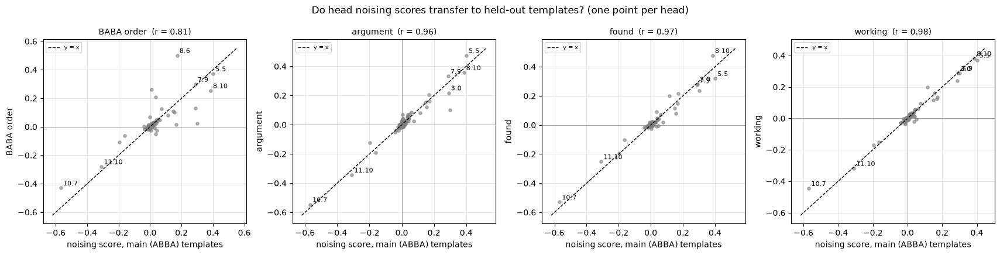


<details>
<summary>Expected output (text)</summary>

<pre style="white-space:pre;overflow-x:auto;line-height:normal;font-family:Menlo,'DejaVu Sans Mono',consolas,'Courier New',monospace">BABA order: 15 tokens, clean logit diff 3.53, ABC logit diff -0.73
  argument: 15 tokens, clean logit diff 4.32, ABC logit diff 1.96
     found: 16 tokens, clean logit diff 4.26, ABC logit diff 1.35
   working: 18 tokens, clean logit diff 2.28, ABC logit diff 0.55
BABA order top 6: 8.6 (0.50), 5.5 (0.37), 7.9 (0.30), 6.9 (0.26), 8.10 (0.25), 9.9 (0.21)
  argument top 6: 5.5 (0.47), 8.10 (0.36), 7.9 (0.33), 3.0 (0.22), 0.10 (0.21), 8.6 (0.16)
     found top 6: 8.10 (0.48), 5.5 (0.32), 3.0 (0.28), 7.9 (0.28), 5.9 (0.23), 8.6 (0.22)
   working top 6: 8.10 (0.38), 5.5 (0.37), 5.9 (0.29), 3.0 (0.29), 7.9 (0.24), 9.7 (0.20)</pre>

</details>

<details>
<summary>Help - how should I interpret this?</summary>

**The three structurally different ABBA templates transfer well** (r = 0.96-0.98 with the main template). Their top heads come from the same set: 5.5, 8.10, 7.9, 3.0, 5.9 and 8.6,
in slightly different orders. Our conclusions about the duplication → S-inhibition part of the circuit aren't specific to one sentence frame.

**BABA order transfers less well** (r = 0.81), and the differences look systematic rather than noisy. The top head is now the S-inhibition head 8.6 (0.50, compared with 0.17 on the
main task), 6.9 and 9.9 enter the top six, 3.0 and 5.9 drop out, and 8.10 falls from 0.38 to 0.25. Look at the corrupted baseline, too: on BABA prompts the `ABC` logit difference
is **-0.73**, the mirror image of the +0.92 we saw on ABBA. Without a duplicated name, the model prefers the *first* name, which in BABA order is the subject. So for GPT-2 Small,
ABBA and BABA IOI are not quite the same computation: in one the positional prior helps the circuit, in the other the circuit has to overcome it, and the work is spread differently
across heads.

This is the price of our ABBA-only design choice from part 1️⃣, made visible. Any description of "the IOI circuit" based only on ABBA prompts (like everything in parts 1️⃣-4️⃣)
should be read as a description of ABBA IOI.
</details>


## Pitfall: the metric decides the answer

The logit difference has become the default IOI metric for good reasons (Zhang & Nanda 2023 recommend it): it's linear in the final residual stream (which is what made our direct
effects exact), it isn't saturated by the softmax, and it measures the *choice between the two names*, which is the thing IOI is about. But other metrics are often used, and they
measure different things. The probability of the correct answer, for example, also goes up if the model becomes more confident that the next token is *some* name, and down if
probability leaks to tokens like `" the"` or `" them"`.


### Exercise - implement `answer_probability`, and compare

> ```yaml
> Difficulty: 🔴⚪⚪⚪⚪
> Importance: 🔵🔵🔵⚪⚪
>
> You should spend up to 10 minutes on this exercise.
> ```

Implement `answer_probability`, the per-prompt probability of the correct answer (`answer_tokens[:, 0]`) at the final position. Then run the cell after it, which repeats the `ABC`
noising head sweep with this metric and plots each head's change in probability against its change in logit difference.


```python
def answer_probability(
    logits: Float[Tensor, "batch seq d_vocab"], answer_tokens: Int[Tensor, "batch 2"]
) -> Float[Tensor, " batch"]:
    """Probability of the correct answer token at the final position, for each prompt."""
    raise NotImplementedError()


tests.test_answer_probability(answer_probability)
```


```python
prob_metric = partial(answer_probability, answer_tokens=answer_tokens)
P_clean = prob_metric(model(task.clean_tokens)).mean().item()
delta_prob = head_sweep(model, task.clean_tokens, corrupted_z, prob_metric) - P_clean
delta_ld = noising_deltas["ABC (S2 -> new name)"]
r = np.corrcoef(delta_ld.flatten().numpy(), delta_prob.flatten().numpy())[0, 1]
print(f"Clean P(IO) = {P_clean:.3f}. Correlation between the two metrics' head effects: r = {r:.2f}")
disagree = [
    HEAD_LABELS[i] for i in range(144) if delta_ld.flatten()[i] * delta_prob.flatten()[i] < 0 and abs(delta_ld.flatten()[i]) > 0.2
]
print(f"Heads with |Δ logit diff| > 0.2 whose two effects have opposite signs: {disagree}")
utils.plot_labelled_scatter(
    delta_ld.flatten(),
    delta_prob.flatten(),
    HEAD_LABELS,
    xlabel="Δ logit diff  (logit IO - logit S)",
    ylabel="Δ P(IO)",
    title=f"Noising each head (ABC): two metrics, two rankings (r = {r:.2f})",
    diagonal=False,
    groups=IOI_HEAD_CLASSES,
)
```


<details><summary>Solution</summary>

```python
def answer_probability(
    logits: Float[Tensor, "batch seq d_vocab"], answer_tokens: Int[Tensor, "batch 2"]
) -> Float[Tensor, " batch"]:
    """Probability of the correct answer token at the final position, for each prompt."""
    probs = logits[:, -1].softmax(dim=-1)
    return probs.gather(dim=-1, index=answer_tokens[:, :1].to(probs.device))[:, 0]
```
</details>


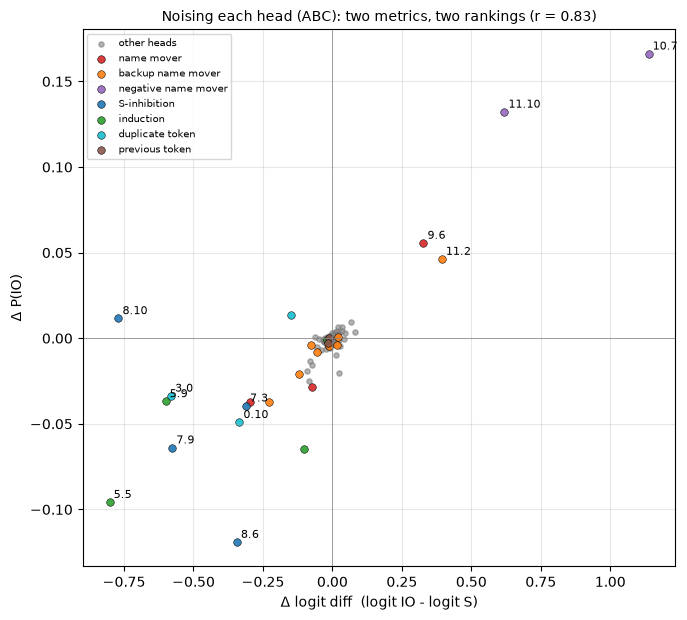


Let's take apart the disagreements, by measuring the logits and probabilities of both names separately (we add 9.9 for comparison).


```python
def name_stats(logits: Tensor) -> dict[str, float]:
    final = logits[:, -1]
    probs = final.softmax(-1)
    idx, io, s = t.arange(len(answer_tokens)), answer_tokens[:, 0], answer_tokens[:, 1]
    return {
        "logit IO": final[idx, io].mean().item(),
        "logit S": final[idx, s].mean().item(),
        "logit diff": (final[idx, io] - final[idx, s]).mean().item(),
        "P(IO)": probs[idx, io].mean().item(),
        "P(S)": probs[idx, s].mean().item(),
        "P(IO) + P(S)": (probs[idx, io] + probs[idx, s]).mean().item(),
    }


clean_stats = name_stats(model(task.clean_tokens))
breakdown = {"clean run": clean_stats}
for node in disagree + ["9.9"]:
    layer, head = parse_head(node)
    patched = patch_run(model, task.clean_tokens, get_act_name("z", layer), corrupted_z[layer], np.s_[:, :, head])
    breakdown[f"noise {node} (change)"] = {k: v - clean_stats[k] for k, v in name_stats(patched).items()}
with pd.option_context("display.width", 200):
    print(pd.DataFrame(breakdown).T.round(3))
```


<details>
<summary>Expected output</summary>

<pre style="white-space:pre;overflow-x:auto;line-height:normal;font-family:Menlo,'DejaVu Sans Mono',consolas,'Courier New',monospace">Clean P(IO) = 0.431. Correlation between the two metrics' head effects: r = 0.83
Heads with |Δ logit diff| &gt; 0.2 whose two effects have opposite signs: ['8.10']

                     logit IO  logit S  logit diff  P(IO)   P(S)  P(IO) + P(S)
clean run              16.023   13.099       2.924  0.431  0.031         0.462
noise 8.10 (change)     0.205    0.975      -0.770  0.012  0.032         0.044
noise 9.9 (change)     -0.031    0.043      -0.074 -0.029 -0.001        -0.030</pre>

</details>

<details>
<summary>Help - how should I interpret this?</summary>

The two metrics broadly agree (r = 0.83 over heads), but they rank heads differently, and they disagree about the sign of one of the most important heads.

**8.10 has opposite signs.** Noising it lowers the logit difference by 0.77 (one of the three biggest effects by that metric), but *raises* P(IO) by 0.012. The breakdown shows why: noising 8.10 raises the logits of *both* names, the subject's much more (+0.98) than the IO's (+0.21). The model gets worse at choosing between the names, but more confident that the answer is *one of* them (P(IO) + P(S) rises by 0.044), and for P(IO) the second effect wins. If you used P(IO) as your metric, you'd conclude that 8.10 works *against* the task.

**8.6 is the opposite case.** On the scatter plot it has the largest drop in P(IO) of any head (about -0.12), but only a moderate effect on the logit difference (-0.34, sixth in the `ABC` list in part 3️⃣).

**9.9 is a case where they agree.** Its effects on both metrics are small (-0.07 and -0.03), for the reasons we saw in part 4️⃣.

Which metric is right? Neither, in general: they measure different behaviours. Logit difference measures "IO rather than S", which is what IOI is about, and (as part 4️⃣ needed) it's linear in the final residual stream. P(IO) mixes that with "a name rather than anything else", and passes everything through a softmax, which saturates when P(IO) is near 0 or 1. Zhang & Nanda (2023) recommend logit difference for localisation for these reasons. Whichever you choose, say which, and check whether your conclusions survive the other.
</details>


## Pitfall: patching subspaces can create the effect it finds

Everything in this section patched whole activations: a whole residual stream vector, a whole head output. A natural next step is to patch only a **subspace**, e.g. a single direction you believe encodes "which name is the IO". Makelov, Lange & Nanda ([*Is This the Subspace You Are Looking For? An Interpretability Illusion for Subspace Activation Patching*](https://arxiv.org/abs/2311.17030), 2023) showed that this can produce convincing effects that aren't there. If a direction combines a component that *distinguishes* the two prompts (but is never read by the model) with a *dormant* component (that the model would read, but which is normally inactive), patching along that direction activates the dormant pathway. You get a large patching effect from a direction that played no role in the model's actual computation.

You built exactly this illusion on a toy model in [0.6] How to Know When an Interpretability Result Is Fake. The lesson for this chapter: whole-component patching is relatively
safe (you replace an activation with another activation the model actually produces), but as soon as you patch subspaces, features or edges, ask whether your intervention could be
*creating* the path it reports.


## The checklist

Here is everything from this section, in the form of questions to ask of any activation patching result (yours or a paper's):

| question | what goes wrong if you skip it | what we saw |
|---|---|---|
| What exactly does the corruption change? | You localise something other than what you think | `ABA`, `ABC`, `XYZ`, zero, mean and resample ablation flag different heads |
| Is the corrupted baseline what you think it is? | Normalised scores are relative to the wrong zero | `ABC` prompts keep a logit diff of 0.92 (not 0) from a first-name prior; on BABA prompts it's -0.73 |
| Did you patch in both directions? | You confuse "necessary" with "sufficient" | Induction head 5.5: noising 0.40, denoising 0.26; S-inhibition head 8.10: noising 0.38, denoising 0.58 |
| Is there a noise floor? | You interpret effects that a meaningless change would also produce | Placebo patching gives head scores up to 0.076 in absolute value |
| Is the patched information prompt-specific? | You credit a component with information that's the same for every prompt | Shuffled pairs still restore 0.76 at S2 (layer 7) but only 0.08 at END (layer 11) |
| Did the rest of the model compensate? | You call a component unimportant because its total effect is small | Name movers: direct effect -3.53, total effect -0.03 |
| Does a mean hide the distribution? | You average away bimodal or heavy-tailed behaviour | 9.9: mean -0.07, but per-prompt effects from -1.24 to +1.37 |
| Does it hold on held-out templates? | You've explained one sentence, not the task | Other ABBA templates: r = 0.96-0.98; BABA order: r = 0.81, with different top heads |
| Would a different metric agree? | The "effect" is about the metric, not the mechanism | Noising 8.10 lowers the logit diff by 0.77 but raises P(IO) by 0.012 |
| Are you patching a subspace? | The intervention can create the pathway it finds | See [0.6] |


## Try it yourself

Now design your own patching experiment. The cell below builds a task from any IOI-style template and corruption scheme you like, and runs the residual stream sweep and the head
noising sweep on it. Some things to try:

- **Your own template.** Write a template with `{A}`, `{B}`, `{C}` (and optionally `{PLACE}`, `{OBJECT}`). Does the S2 → END handoff happen at the same layers? Are the same heads important? (Keep every slot single-token, so all prompts have the same length.)
- **A different corruption.** Try `"XYZ"`: now the IO and S1 positions differ between clean and corrupted prompts too. Which positions light up in the residual stream sweep, and what do you think they're carrying?
- **A longer distance.** Put more words between the first clause and S2. Does the handoff move to later layers?
- **Greater-than variations.** Make a task with `make_greater_than_task(model, corrupt_year=99)` (so that the corrupted prompts make every year "less than or equal"), and run the sweeps from earlier on it. Do the same components show up?

The example output below uses a template with a longer gap between the names and S2.


```python
MY_TEMPLATES = ["At the {PLACE}, {A} and {B} talked for hours about the weather. Then {C} gave a {OBJECT} to"]
MY_SCHEME = "ABC"

my_task = make_ioi_task(model, sample_ioi_examples(MY_TEMPLATES, 60, seed=0), MY_SCHEME, name="my task")
my_clean = my_task.metric(model(my_task.clean_tokens)).mean().item()
my_corr = my_task.metric(model(my_task.corrupted_tokens)).mean().item()
print(f"{my_task.seq_len} tokens. Clean logit diff {my_clean:.2f}, corrupted ({MY_SCHEME}) logit diff {my_corr:.2f}")

my_resid = layer_position_sweep(model, my_task, "resid_pre", "denoise")
utils.plot_layer_pos_maps({"denoising resid_pre": my_resid}, my_task.labels, f"My task: {MY_TEMPLATES[0]}", vmax=1.2)

my_heads = patching_score(head_sweep(model, my_task.clean_tokens, get_z(model, my_task.corrupted_tokens), my_task.metric), my_clean, my_corr)
order = my_heads.flatten().argsort(descending=True)
print("Top heads by noising score:", ", ".join(f"{HEAD_LABELS[i]} ({my_heads.flatten()[i]:.2f})" for i in order[:8]))
print(f"Correlation with the main task's noising scores: {np.corrcoef(my_heads.flatten(), head_noise.flatten())[0, 1]:.2f}")
```


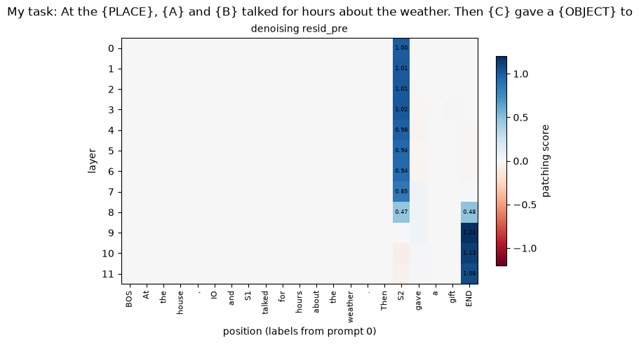


<details>
<summary>Example output (text)</summary>

<pre style="white-space:pre;overflow-x:auto;line-height:normal;font-family:Menlo,'DejaVu Sans Mono',consolas,'Courier New',monospace">21 tokens. Clean logit diff 3.24, corrupted (ABC) logit diff 1.48
Top heads by noising score: 8.10 (0.50), 5.9 (0.47), 5.5 (0.35), 7.9 (0.31), 3.0 (0.23), 8.6 (0.17), 7.3 (0.17), 9.9 (0.14)
Correlation with the main task's noising scores: 0.96</pre>

With six extra tokens between the names and S2, the picture barely changes. The S2 → END handoff still happens at layer 8 (0.47 at S2, 0.48 at END), the same heads come out on top,
and the head noising scores correlate 0.96 with the main task's. The first-name prior is stronger here (`ABC` logit difference 1.48). Now try something that *should* change the
picture, such as the `XYZ` corruption, or a template with three names in the first clause.
</details>


## Summary of 5️⃣

- The `PatchingTask` interface carried over to greater-than with no change to any sweep: everything task-specific lives in the metric.
- Greater-than and IOI route information the same way (attention moves a token's information to the final position), but compute the answer in different places: greater-than mostly in MLPs 8-11, IOI in attention heads. Head-only analyses would miss most of greater-than.
- Means hide per-prompt structure. 9.9's near-zero mean noising effect is a mixture of real positive and negative effects.
- Results on one template family transfer to other ABBA frames (r = 0.96-0.98) but only partly to BABA order (r = 0.81), where GPT-2's first-name prior works against the answer.
- Logit difference and P(IO) correlate at 0.83 over heads, but disagree on the sign of 8.10's effect.
- Whole-component patching is relatively safe; subspace patching can create the effects it finds ([0.6]).


=== NEW CHAPTER ===


# ☆ Bonus


## Path patching, rebuilt

In [1.4.1] you implemented path patching with a three-step algorithm. Your `run_with_frozen` does most of it in one call: noising a sender head with `recompute = {receiver heads} ∪
{all MLPs} ∪ {"ln_final"}` lets the change reach the logits only through the receivers (and the MLPs, which [1.4.1]'s version also treated as part of the direct path). Use this to
reproduce [1.4.1]'s "path patching to the name movers" result, and check where the two methods differ. (Hint: [1.4.1] patched only the receivers' *queries*; here the receivers'
keys and values also see the change. How would you restrict `run_with_frozen` to queries only?)

## Gaussian-noise corruptions

ROME's "causal tracing" corrupts the subject by adding Gaussian noise (3× the embedding standard deviation) to its token embeddings, rather than swapping in a different token.
Implement this as a corruption for IOI (add noise to the `hook_embed` output at the S2 position, or at all name positions), cache the resulting activations, and add it to the
corruption grid of part 3️⃣. How well does it agree with `ABC`? Which heads does it flag that `ABC` doesn't?

## An anomaly: noising 9.6 helps

In part 4️⃣, noising name mover 9.6 on its own *increased* the logit difference (look at its total effect), even though its direct effect is negative. Which heads respond to 9.6
being noised? Use `head_direct_contributions` on a run with only 9.6 noised, and compare with the clean run. Is the negative name mover 10.7 involved, as it was for the full
knockout?

## Self-repair through LayerNorm

Our direct effects froze the final LayerNorm scale. When you remove a component, the norm of the final residual stream changes, which rescales every other component's contribution: a mechanism for self-repair that involves no "backup" component at all. Rushing & Nanda ([*Explorations of Self-Repair in Language Models*](https://arxiv.org/abs/2402.15390), 2024) found that LayerNorm accounts for a meaningful fraction of self-repair. Measure it here: for the name mover knockout, compare the total effect with `"ln_final"` removed from `recompute` (everything else recomputing) against the ordinary total effect.

## Greater-than MLP neurons

Hanna et al. show that MLPs 8-11 contain neurons that upweight years greater than YY. Take the MLP with the biggest denoising score at the final position, find the neurons whose
activation difference (clean vs `01`) contributes most to PD, and plot each one's output direction projected onto the 100 year tokens, $W_{out}[n] \, W_U[:, \text{years}]$. Do you
see neurons that boost a *range* of years?

## Further reading

- Heimersheim & Nanda (2024), [*How to use and interpret activation patching*](https://arxiv.org/abs/2404.15255). The best practical guide: denoising vs noising, AND/OR circuits, metrics, and common mistakes. Much of part 2️⃣ follows it.
- Zhang & Nanda (2023), [*Towards Best Practices of Activation Patching in Language Models: Metrics and Methods*](https://arxiv.org/abs/2309.16042). Systematic comparison of corruptions (Gaussian noise vs token replacement) and metrics (probability vs logit difference), on IOI and factual recall.
- McGrath, Rahtz, Kramár, Mikulik & Legg (2023), [*The Hydra Effect: Emergent Self-repair in Language Model Computations*](https://arxiv.org/abs/2307.15771). Direct vs total effects of whole layers in a 7B model, and the erasure/compensation picture behind part 4️⃣.
- Rushing & Nanda (2024), [*Explorations of Self-Repair in Language Models*](https://arxiv.org/abs/2402.15390). Self-repair across heads in several models, including through LayerNorm.
- Wang, Variengien, Conmy, Shlegeris & Steinhardt (2022), [*Interpretability in the Wild: a Circuit for Indirect Object Identification in GPT-2 small*](https://arxiv.org/abs/2211.00593). The IOI paper, including backup and negative name movers.
- Hanna, Liu & Variengien (2023), [*How does GPT-2 compute greater-than?*](https://arxiv.org/abs/2305.00586). The greater-than circuit, found with path patching.
- Vig et al. (2020), [*Investigating Gender Bias in Language Models Using Causal Mediation Analysis*](https://arxiv.org/abs/2004.12265). The causal mediation framing (direct and indirect effects) applied to neurons and heads.
- Makelov, Lange & Nanda (2023), [*Is This the Subspace You Are Looking For?*](https://arxiv.org/abs/2311.17030). The subspace patching illusion.
- Chan et al. (2022), [*Causal Scrubbing*](https://www.lesswrong.com/posts/JvZhhzycHu2Yd57RN/causal-scrubbing-a-method-for-rigorously-testing). Resample ablation taken to its logical conclusion; it's the subject of section 8.5.

The next section, 8.2, asks how to get sweeps like these without thousands of forward passes: attribution patching approximates them with a single backward pass, and exact patching
results like the ones you computed here are the ground truth to check it against.

