# [8.3] ACDC and Circuit Metrics - Exercises

**By the end of this notebook, you will have shown that iterative edge deletion with metric recomputation recovers a nonlinear ground-truth circuit which one-shot edge scores completely miss, then built the full residual-edge graph of GPT-2 and compared ACDC, EAP and EAP-IG on fixed IOI and greater-than tasks.**

```python
EXERCISE_ID = "8_3_acdc_and_circuit_metrics"
GT_TIER = "GT-1"
DIFFICULTY = 4
IMPORTANCE = 5
EXPECTED_RUNTIME = "two to three study days; about three hours for all fresh GPU searches and diagnostics"
REQUIRES_GPU = True
```

The nonlinear warm-up has exact GT-0 ground truth. The full graph and EAP-IG
exercises use GT-1 implementation parity, followed by controlled real-model
experiments. The small datasets do not reproduce the papers' complete benchmarks.

## Core Question

**Can an automated deletion search recover the edges that actually implement a behavior, including edges whose importance only appears when the rest of their path is present?**

Original ARENA's IOI sequence does not begin with a finished circuit. It moves from a crisp task metric, through exploratory evidence, to exact interventions, minimal circuits, and anomaly hunting. We will follow the same rhythm on a model organism where the answer is known before moving to a real model where it is not.

## Learning Objectives

1. Run a named directed acyclic graph and cache every node activation.
2. Implement edge interventions which replace removed messages with a corrupt-run reference.
3. Explain why isolated insertion scores fail on interacting paths.
4. Implement greedy ACDC deletion with metric recomputation after every decision.
5. Sweep the threshold and separate faithfulness, minimality, and completeness.
6. Compare against every same-size circuit, not one convenient random draw.
7. Use component patching as a warm-up for Q/K/V, MLP and output edge interventions.
8. Test input-interpolated EAP-IG against exact edge interventions.
9. Compare real circuits with matched random circuits and shifted prompts.

## Cold Open - the edge that looks useless

The primary path below contains a product gate. Both of its inputs are required. If you insert only one clean edge into an otherwise corrupt graph, the other input remains zero and the output does not move. Every single-edge insertion therefore scores **zero**, even though six primary edges are individually necessary in the complete graph.

That is the point of this lesson: **ACDC is a sequential intervention algorithm, not `scores > threshold`.**


```python
import json
import sys
from collections.abc import Callable, Mapping, Sequence
from dataclasses import asdict
from itertools import combinations
from pathlib import Path

import matplotlib.pyplot as plt
import networkx as nx
import numpy as np
import torch as t

chapter = "chapter8_automated_circuits"
section = "part3_acdc_circuit_metrics"
root_dir = next(p for p in [Path.cwd(), *Path.cwd().parents] if (p / chapter).exists())
exercises_dir = root_dir / chapter / "exercises"
section_dir = exercises_dir / section
assets_dir = root_dir / chapter / "instructions" / "assets"
if str(root_dir) not in sys.path:
    sys.path.append(str(root_dir))
if str(exercises_dir) not in sys.path:
    sys.path.append(str(exercises_dir))

import part3_acdc_circuit_metrics.solutions as reference
import part3_acdc_circuit_metrics.tests as tests
from part3_acdc_circuit_metrics.solutions import (
    ACDCResult,
    ACDCStep,
    CircuitMetricsReport,
    Edge,
    GraphRun,
    OODCircuitReport,
    SameSizeCircuitReport,
    ThresholdSweepPoint,
    ToyCircuitGraph,
    TOY_CLEAN_INPUTS,
    TOY_CORRUPT_INPUTS,
    TOY_OOD_INPUTS,
    _apply_operation,
    _validate_edge_names,
    _validate_graph,
    _validate_inputs,
    build_toy_acdc_graph,
)

t.set_grad_enabled(False)
MetricEvaluator = Callable[[frozenset[str]], float]

graph = build_toy_acdc_graph()
edge_names = tuple(edge.name for edge in graph.edges)
print(f"{len(graph.node_order)} named nodes, {len(edge_names)} candidate edges")
print(f"ground truth: {len(graph.ground_truth_edges)} edges; controls: {len(graph.decoy_edges)} edges")
```


### Exercise - execute the named graph

> ```yaml
> Difficulty: 🔴🔴⚪⚪⚪
> Importance: 🔵🔵🔵⚪⚪
> Suggested time: 10 minutes
> ```

Implement `run_toy_graph`. Traverse `graph.node_order`, gather weighted messages from incoming edges, and apply each node's `sum` or `product` operation. Return the complete activation cache, not just the final scalar: the cache is what makes later interventions debuggable.

<details><summary>Expected output</summary>

```text
All tests in `test_toy_graph_forward_values` passed!
All tests in `test_toy_graph_rejects_bad_inputs` passed!
clean metric = 2.5; corrupt metric = 0.1; clean binding activation = 1.0
```

</details>

<details><summary>Help - Start from the input cache</summary>

Initialize the activation dictionary with the four input values. For each later node, select edges whose `receiver` is that node, multiply sender activation by edge weight, then apply `_apply_operation`.

</details>

<details><summary>Common bug</summary>

Computing only the output loses the intermediate node values needed for corrupt substitutions. Another common bug is evaluating nodes alphabetically rather than in topological order.

</details>

<details><summary>Solution</summary>

```python
def run_toy_graph(graph: ToyCircuitGraph, inputs: Mapping[str, float]) -> GraphRun:
    """Run every edge of the toy graph on one set of inputs."""

    _validate_graph(graph)
    _validate_inputs(graph, inputs)
    incoming = {
        node: tuple(edge for edge in graph.edges if edge.receiver == node)
        for node in graph.node_order
    }
    activations: dict[str, float] = {name: float(inputs[name]) for name in graph.input_nodes}
    for node in graph.node_order:
        if node in graph.input_nodes:
            continue
        messages = [activations[edge.sender] * edge.weight for edge in incoming[node]]
        activations[node] = _apply_operation(graph.operations[node], messages)
    return GraphRun(
        activations=activations,
        metric=activations[graph.output_node],
        active_edges=tuple(edge.name for edge in graph.edges),
    )
```

</details>


```python
def run_toy_graph(graph: ToyCircuitGraph, inputs: Mapping[str, float]) -> GraphRun:
    """Run every edge of the toy graph and return all node activations."""
    raise NotImplementedError()


tests.test_toy_graph_forward_values(run_toy_graph)
tests.test_toy_graph_rejects_bad_inputs(run_toy_graph)
```


### Exercise - intervene on edges, then recompute downstream nodes

> ```yaml
> Difficulty: 🔴🔴🔴⚪⚪
> Importance: 🔵🔵🔵🔵🔵
> Suggested time: 20 minutes
> ```

Implement `run_edge_intervention` and `normalized_recovery`. A kept edge transmits its sender's current hybrid activation. A removed edge transmits the sender activation cached in the fully corrupt run. Recompute every downstream node in topological order.

This is closer to path patching than zero ablation: an absent circuit edge gets a task-matched corrupt value, which keeps the intervention on-distribution in the toy model.

<details><summary>Expected output</summary>

```text
All tests in `test_edge_intervention_endpoints` passed!
All tests in `test_edge_intervention_recomputes_downstream` passed!
All tests in `test_normalized_recovery` passed!
Removing one product-gate input leaves metric 0.5 and recovery 1/6.
```

</details>

<details><summary>Help - Cache corrupt first</summary>

Run the complete corrupt graph once. At each hybrid edge choose `activations[sender]` when kept and `corrupt.activations[sender]` when removed. Normalize with `(metric - corrupt) / (clean - corrupt)`.

</details>

<details><summary>Common bug</summary>

Replacing a missing edge with zero changes the reference distribution. Replacing a kept edge with the clean cache also freezes its upstream computation; kept edges should transmit the current hybrid sender value.

</details>

<details><summary>Solution</summary>

```python
def run_edge_intervention(
    graph: ToyCircuitGraph,
    clean_inputs: Mapping[str, float],
    corrupt_inputs: Mapping[str, float],
    active_edges: Sequence[str] | set[str] | frozenset[str],
) -> GraphRun:
    """Run clean inputs while replacing missing edge messages with corrupt ones."""

    _validate_graph(graph)
    _validate_inputs(graph, clean_inputs)
    _validate_inputs(graph, corrupt_inputs)
    known_edges = {edge.name for edge in graph.edges}
    active = frozenset(active_edges)
    unknown = active - known_edges
    if unknown:
        raise ValueError(f"unknown active edges: {sorted(unknown)}")
    corrupt = run_toy_graph(graph, corrupt_inputs)
    incoming = {
        node: tuple(edge for edge in graph.edges if edge.receiver == node)
        for node in graph.node_order
    }
    activations: dict[str, float] = {
        name: float(clean_inputs[name]) for name in graph.input_nodes
    }
    for node in graph.node_order:
        if node in graph.input_nodes:
            continue
        messages = []
        for edge in incoming[node]:
            sender_value = (
                activations[edge.sender]
                if edge.name in active
                else corrupt.activations[edge.sender]
            )
            messages.append(sender_value * edge.weight)
        activations[node] = _apply_operation(graph.operations[node], messages)
    ordered_active = tuple(edge.name for edge in graph.edges if edge.name in active)
    return GraphRun(activations, activations[graph.output_node], ordered_active)

def normalized_recovery(*, clean_metric: float, corrupt_metric: float, metric: float) -> float:
    """Normalize a circuit metric so corrupt is zero and clean is one."""

    values = t.tensor([clean_metric, corrupt_metric, metric], dtype=t.float64)
    if not t.isfinite(values).all():
        raise ValueError("clean, corrupt, and circuit metrics must be finite.")
    denominator = clean_metric - corrupt_metric
    if abs(denominator) < 1e-12:
        raise ValueError("clean_metric and corrupt_metric must differ.")
    return float((metric - corrupt_metric) / denominator)

def make_toy_evaluator(
    graph: ToyCircuitGraph,
    clean_inputs: Mapping[str, float] = TOY_CLEAN_INPUTS,
    corrupt_inputs: Mapping[str, float] = TOY_CORRUPT_INPUTS,
) -> tuple[MetricEvaluator, float, float]:
    clean_metric = run_toy_graph(graph, clean_inputs).metric
    corrupt_metric = run_toy_graph(graph, corrupt_inputs).metric

    def evaluate(active_edges: frozenset[str]) -> float:
        return run_edge_intervention(
            graph,
            clean_inputs,
            corrupt_inputs,
            active_edges,
        ).metric

    return evaluate, clean_metric, corrupt_metric
```

</details>


```python
def run_edge_intervention(
    graph: ToyCircuitGraph,
    clean_inputs: Mapping[str, float],
    corrupt_inputs: Mapping[str, float],
    active_edges: Sequence[str] | set[str] | frozenset[str],
) -> GraphRun:
    """Run clean inputs while removed edges transmit corrupt sender values."""
    raise NotImplementedError()


def normalized_recovery(*, clean_metric: float, corrupt_metric: float, metric: float) -> float:
    """Normalize corrupt to zero and clean to one."""
    raise NotImplementedError()


def make_toy_evaluator(graph, clean_inputs=TOY_CLEAN_INPUTS, corrupt_inputs=TOY_CORRUPT_INPUTS):
    clean_metric = run_toy_graph(graph, clean_inputs).metric
    corrupt_metric = run_toy_graph(graph, corrupt_inputs).metric
    def evaluate(active_edges):
        return run_edge_intervention(graph, clean_inputs, corrupt_inputs, active_edges).metric
    return evaluate, clean_metric, corrupt_metric


tests.test_edge_intervention_endpoints(run_edge_intervention)
tests.test_edge_intervention_recomputes_downstream(run_edge_intervention)
tests.test_normalized_recovery(normalized_recovery)
```


### Exercise - falsify one-shot edge scoring

> ```yaml
> Difficulty: 🔴🔴⚪⚪⚪
> Importance: 🔵🔵🔵🔵⚪
> Suggested time: 10 minutes
> ```

Implement `one_shot_insertion_scores`: start from the corrupt graph and activate one edge at a time. This is intentionally a method we expect to fail. The failure is the signature anomaly, not an inconvenience to hide.

<details><summary>Expected output</summary>

```text
All tests in `test_one_shot_scores_expose_interaction_failure` passed!
All ten isolated insertion scores are exactly 0.0.
A thresholded one-shot circuit therefore contains zero edges and has zero recovery.
```

</details>

<details><summary>Help - One singleton per edge</summary>

For each edge call `evaluate(frozenset({edge}))`, then normalize against the clean and corrupt endpoints.

</details>

<details><summary>Common bug</summary>

Scoring `all_edges - {edge}` computes deletion damage, not one-shot insertion. Both are useful, but they answer different questions.

</details>

<details><summary>Solution</summary>

```python
def one_shot_insertion_scores(
    edge_names: Sequence[str],
    evaluate: MetricEvaluator,
    *,
    clean_metric: float,
    corrupt_metric: float,
) -> Mapping[str, float]:
    """Score each edge alone in the otherwise corrupt graph."""

    names = _validate_edge_names(edge_names)
    return {
        edge: normalized_recovery(
            clean_metric=clean_metric,
            corrupt_metric=corrupt_metric,
            metric=evaluate(frozenset({edge})),
        )
        for edge in names
    }
```

</details>


```python
def one_shot_insertion_scores(
    edge_names: Sequence[str],
    evaluate: MetricEvaluator,
    *,
    clean_metric: float,
    corrupt_metric: float,
) -> Mapping[str, float]:
    raise NotImplementedError()


tests.test_one_shot_scores_expose_interaction_failure(one_shot_insertion_scores)

evaluator, clean_metric, corrupt_metric = make_toy_evaluator(graph)
one_shot = one_shot_insertion_scores(
    edge_names, evaluator, clean_metric=clean_metric, corrupt_metric=corrupt_metric
)
print({name: round(score, 3) for name, score in one_shot.items()})
```


### Exercise - implement greedy ACDC with recomputation

> ```yaml
> Difficulty: 🔴🔴🔴🔴⚪
> Importance: 🔵🔵🔵🔵🔵
> Suggested time: 30 minutes
> ```

Implement `initial_deletion_order` and `greedy_acdc`.

Start with every edge. For each candidate, evaluate the **current circuit minus that edge**. Remove it only when the normalized damage is at most the threshold. If you remove it, the next candidate must be tested in the already-pruned graph. Record every decision in `ACDCStep` so a learner can inspect the search rather than receiving a final edge list from a black box.

<details><summary>Expected output</summary>

```text
All tests in `test_initial_order_puts_decoys_first` passed!
All tests in `test_greedy_acdc_recovers_ground_truth` passed!
All tests in `test_greedy_acdc_recomputes_after_each_removal` passed!
Kept: 8/10 exact ground-truth edges; recovery: 1.000.
```

</details>

<details><summary>Help - Cache the accepted state, not every trial</summary>

Maintain `active`, `current_metric`, and `current_recovery`. A failed deletion leaves them unchanged; an accepted deletion replaces all three with the trial values.

</details>

<details><summary>Common bug</summary>

Re-evaluating every candidate against the original full graph silently turns the algorithm back into static score thresholding. The recording test checks that later calls see the cumulatively pruned edge set.

</details>

<details><summary>Solution</summary>

```python
def initial_deletion_order(
    edge_names: Sequence[str],
    evaluate: MetricEvaluator,
    *,
    clean_metric: float,
    corrupt_metric: float,
) -> tuple[str, ...]:
    """Rank least damaging full-circuit deletions first."""

    names = _validate_edge_names(edge_names)
    full = frozenset(names)
    full_recovery = normalized_recovery(
        clean_metric=clean_metric,
        corrupt_metric=corrupt_metric,
        metric=evaluate(full),
    )
    damages = {}
    for edge in names:
        trial_recovery = normalized_recovery(
            clean_metric=clean_metric,
            corrupt_metric=corrupt_metric,
            metric=evaluate(full - {edge}),
        )
        damages[edge] = full_recovery - trial_recovery
    return tuple(sorted(names, key=lambda edge: (damages[edge], names.index(edge))))

def greedy_acdc(
    edge_names: Sequence[str],
    evaluate: MetricEvaluator,
    *,
    clean_metric: float,
    corrupt_metric: float,
    threshold: float,
    order: Sequence[str] | None = None,
) -> ACDCResult:
    """Delete edges greedily, recomputing the metric after every decision."""

    names = _validate_edge_names(edge_names)
    if not t.isfinite(t.tensor(threshold)).item() or threshold < 0:
        raise ValueError("threshold must be finite and nonnegative.")
    deletion_order = tuple(order) if order is not None else names
    if len(deletion_order) != len(names) or set(deletion_order) != set(names):
        raise ValueError("order must be a permutation of edge_names.")
    active = frozenset(names)
    current_metric = evaluate(active)
    current_recovery = normalized_recovery(
        clean_metric=clean_metric,
        corrupt_metric=corrupt_metric,
        metric=current_metric,
    )
    steps: list[ACDCStep] = []
    removed: list[str] = []
    for edge in deletion_order:
        before_recovery = current_recovery
        trial_active = active - {edge}
        trial_metric = evaluate(trial_active)
        trial_recovery = normalized_recovery(
            clean_metric=clean_metric,
            corrupt_metric=corrupt_metric,
            metric=trial_metric,
        )
        damage = before_recovery - trial_recovery
        if damage <= threshold:
            decision = "remove"
            active = trial_active
            current_metric = trial_metric
            current_recovery = trial_recovery
            removed.append(edge)
        else:
            decision = "keep"
        steps.append(ACDCStep(edge, before_recovery, trial_recovery, damage, decision))
    kept = tuple(edge for edge in names if edge in active)
    return ACDCResult(kept, tuple(removed), threshold, current_recovery, tuple(steps))
```

</details>


```python
def initial_deletion_order(
    edge_names: Sequence[str],
    evaluate: MetricEvaluator,
    *, clean_metric: float, corrupt_metric: float,
) -> tuple[str, ...]:
    raise NotImplementedError()


def greedy_acdc(
    edge_names: Sequence[str],
    evaluate: MetricEvaluator,
    *, clean_metric: float, corrupt_metric: float,
    threshold: float,
    order: Sequence[str] | None = None,
) -> ACDCResult:
    raise NotImplementedError()


tests.test_initial_order_puts_decoys_first(initial_deletion_order)
tests.test_greedy_acdc_recovers_ground_truth(greedy_acdc)
tests.test_greedy_acdc_recomputes_after_each_removal(greedy_acdc)
tests.test_greedy_acdc_rejects_invalid_search(greedy_acdc)

deletion_order = initial_deletion_order(
    edge_names, evaluator, clean_metric=clean_metric, corrupt_metric=corrupt_metric
)
acdc = greedy_acdc(
    edge_names, evaluator,
    clean_metric=clean_metric, corrupt_metric=corrupt_metric,
    threshold=0.1, order=deletion_order,
)
for step in acdc.steps:
    print(f"{step.decision:>6}  damage={step.normalized_damage:6.3f}  {step.edge}")
print(f"kept={len(acdc.kept_edges)}/{len(edge_names)}, recovery={acdc.recovery:.3f}")
```


### Exercise - sweep thresholds and audit three circuit metrics

> ```yaml
> Difficulty: 🔴🔴🔴⚪⚪
> Importance: 🔵🔵🔵🔵🔵
> Suggested time: 25 minutes
> ```

Implement a full threshold sweep, rerunning the search at every threshold. Then implement:

- **faithfulness:** circuit recovery relative to clean and corrupt;
- **minimality:** damage from deleting each retained edge;
- **completeness:** gain from adding omitted subsets of up to two edges.

Why pairs? A missing two-edge path is invisible if completeness adds only one omitted edge at a time. The toy backup path makes this failure exact.

<details><summary>Expected output</summary>

```text
All tests in `test_threshold_sweep_shows_two_failure_cliffs` passed!
All tests in `test_circuit_metrics_are_distinct` passed!
All tests in `test_circuit_metrics_reject_incomplete_circuit` passed!
threshold 0.10 -> 8 edges / 1.000 recovery
threshold 0.17 -> 6 edges / 0.833 recovery
threshold 0.84 -> 0 edges / 0.000 recovery
```

</details>

<details><summary>Help - Rerun; do not filter one trace</summary>

Each threshold changes earlier decisions, so call `greedy_acdc` from a fresh full edge set. For completeness, enumerate omitted subsets of sizes one and two and keep the largest recovery gain.

</details>

<details><summary>Common bug</summary>

Adding only one omitted edge declares the primary-only circuit complete, because neither half of the two-edge backup path works alone. This is the same interaction trap as the cold open.

</details>

<details><summary>Solution</summary>

```python
def threshold_sweep(
    edge_names: Sequence[str],
    evaluate: MetricEvaluator,
    *,
    clean_metric: float,
    corrupt_metric: float,
    thresholds: Sequence[float],
    ground_truth_edges: Sequence[str],
    order: Sequence[str] | None = None,
) -> tuple[ThresholdSweepPoint, ...]:
    """Run the full deletion search independently at every threshold."""

    if not thresholds:
        raise ValueError("thresholds must be nonempty.")
    truth = set(ground_truth_edges)
    points = []
    for threshold in thresholds:
        result = greedy_acdc(
            edge_names,
            evaluate,
            clean_metric=clean_metric,
            corrupt_metric=corrupt_metric,
            threshold=float(threshold),
            order=order,
        )
        points.append(
            ThresholdSweepPoint(
                float(threshold),
                len(result.kept_edges),
                result.recovery,
                set(result.kept_edges) == truth,
            )
        )
    return tuple(points)

def evaluate_circuit_metrics(
    edge_names: Sequence[str],
    circuit_edges: Sequence[str],
    evaluate: MetricEvaluator,
    *,
    clean_metric: float,
    corrupt_metric: float,
    min_faithfulness: float = 0.95,
    min_edge_damage: float = 0.05,
    max_omitted_gain: float = 0.05,
    max_completeness_subset_size: int = 2,
) -> CircuitMetricsReport:
    """Measure faithfulness, edgewise minimality, and subset completeness."""

    names = _validate_edge_names(edge_names)
    circuit = frozenset(circuit_edges)
    if not circuit or not circuit.issubset(names):
        raise ValueError("circuit_edges must be a nonempty subset of edge_names.")
    for label, value in {
        "min_faithfulness": min_faithfulness,
        "min_edge_damage": min_edge_damage,
        "max_omitted_gain": max_omitted_gain,
    }.items():
        if not t.isfinite(t.tensor(value)).item() or value < 0:
            raise ValueError(f"{label} must be finite and nonnegative.")
    if max_completeness_subset_size <= 0:
        raise ValueError("max_completeness_subset_size must be positive.")

    def recovery(active: frozenset[str]) -> float:
        return normalized_recovery(
            clean_metric=clean_metric,
            corrupt_metric=corrupt_metric,
            metric=evaluate(active),
        )

    circuit_recovery = recovery(circuit)
    minimality = {
        edge: circuit_recovery - recovery(circuit - {edge})
        for edge in names
        if edge in circuit
    }
    omitted = tuple(edge for edge in names if edge not in circuit)
    completeness = {edge: recovery(circuit | {edge}) - circuit_recovery for edge in omitted}
    subset_rows: dict[tuple[str, ...], float] = {}
    for subset_size in range(1, min(max_completeness_subset_size, len(omitted)) + 1):
        for subset in combinations(omitted, subset_size):
            subset_rows[subset] = recovery(circuit | set(subset)) - circuit_recovery
    min_damage = min(minimality.values())
    strongest_subset = max(subset_rows, key=subset_rows.get) if subset_rows else ()
    max_gain = subset_rows.get(strongest_subset, 0.0)
    return CircuitMetricsReport(
        circuit_recovery,
        minimality,
        min_damage,
        completeness,
        {" + ".join(subset): gain for subset, gain in subset_rows.items()},
        strongest_subset,
        max_gain,
        circuit_recovery >= min_faithfulness,
        min_damage >= min_edge_damage,
        max_gain <= max_omitted_gain,
    )
```

</details>


```python
def threshold_sweep(
    edge_names, evaluate, *, clean_metric, corrupt_metric,
    thresholds, ground_truth_edges, order=None,
) -> tuple[ThresholdSweepPoint, ...]:
    raise NotImplementedError()


def evaluate_circuit_metrics(
    edge_names, circuit_edges, evaluate, *, clean_metric, corrupt_metric,
    min_faithfulness=0.95, min_edge_damage=0.05,
    max_omitted_gain=0.05, max_completeness_subset_size=2,
) -> CircuitMetricsReport:
    raise NotImplementedError()


tests.test_threshold_sweep_shows_two_failure_cliffs(threshold_sweep)
tests.test_circuit_metrics_are_distinct(evaluate_circuit_metrics)
tests.test_circuit_metrics_reject_incomplete_circuit(evaluate_circuit_metrics)

thresholds = (0.0, 0.05, 0.10, 0.16, 0.17, 0.40, 0.83, 0.84)
sweep = threshold_sweep(
    edge_names, evaluator, clean_metric=clean_metric, corrupt_metric=corrupt_metric,
    thresholds=thresholds, ground_truth_edges=graph.ground_truth_edges,
    order=deletion_order,
)
metrics = evaluate_circuit_metrics(
    edge_names, acdc.kept_edges, evaluator,
    clean_metric=clean_metric, corrupt_metric=corrupt_metric,
)
print([(p.threshold, p.circuit_size, round(p.recovery, 3)) for p in sweep])
print(f"faithfulness={metrics.circuit_recovery:.3f}, min damage={metrics.min_edge_damage:.3f}, max omitted gain={metrics.max_omitted_gain:.3f}")
```


### Exercise - beat every same-size circuit and held-out toy regime

> ```yaml
> Difficulty: 🔴🔴🔴⚪⚪
> Importance: 🔵🔵🔵🔵🔵
> Suggested time: 20 minutes
> ```

Implement `same_size_circuit_report` by enumerating all `10 choose 8 = 45` circuits, and implement `evaluate_toy_ood` on three unseen signal scales. Enumeration turns a noisy random baseline into an exact null distribution.

Rank is more informative than a cherry-picked comparison: the discovered circuit should be the unique best same-size graph.

<details><summary>Expected output</summary>

```text
All tests in `test_same_size_controls_are_exact` passed!
All tests in `test_toy_ood_preserves_exact_circuit` passed!
discovered rank = 1 / 45; exact p = 0.0222
best wrong recovery = 0.8333; mean wrong recovery = 0.1970
worst held-out recovery = 1.000
```

</details>

<details><summary>Help - Enumerate combinations of names</summary>

Use `itertools.combinations(edge_names, len(circuit_edges))`. Normalize every candidate's metric, keep the discovered candidate in the rank calculation, and exclude it from control mean and best values.

</details>

<details><summary>Common bug</summary>

Sampling one random circuit can make the result depend on a lucky seed. Comparing circuits of different sizes also confounds discovery quality with intervention strength.

</details>

<details><summary>Solution</summary>

```python
def same_size_circuit_report(
    edge_names: Sequence[str],
    circuit_edges: Sequence[str],
    evaluate: MetricEvaluator,
    *,
    clean_metric: float,
    corrupt_metric: float,
) -> SameSizeCircuitReport:
    """Enumerate every same-size circuit, an exact random-circuit null."""

    names = _validate_edge_names(edge_names)
    circuit = frozenset(circuit_edges)
    if not circuit or not circuit.issubset(names):
        raise ValueError("circuit_edges must be a nonempty subset of edge_names.")
    all_rows: list[tuple[frozenset[str], float]] = []
    for candidate in combinations(names, len(circuit)):
        candidate_set = frozenset(candidate)
        recovery = normalized_recovery(
            clean_metric=clean_metric,
            corrupt_metric=corrupt_metric,
            metric=evaluate(candidate_set),
        )
        all_rows.append((candidate_set, recovery))
    discovered = next(value for candidate, value in all_rows if candidate == circuit)
    controls = [value for candidate, value in all_rows if candidate != circuit]
    rank = 1 + sum(value > discovered + 1e-12 for _, value in all_rows)
    pvalue = sum(value >= discovered - 1e-12 for _, value in all_rows) / len(all_rows)
    return SameSizeCircuitReport(
        len(circuit),
        len(all_rows),
        discovered,
        rank,
        pvalue,
        float(sum(controls) / len(controls)) if controls else 0.0,
        float(max(controls)) if controls else discovered,
        tuple(float(value) for value in controls),
    )

def evaluate_toy_ood(
    graph: ToyCircuitGraph,
    circuit_edges: Sequence[str],
    templates: Sequence[tuple[str, Mapping[str, float], Mapping[str, float]]] = TOY_OOD_INPUTS,
    *,
    min_recovery: float = 0.95,
) -> OODCircuitReport:
    """Evaluate the exact circuit on held-out signal scales and nuisance values."""

    if not templates:
        raise ValueError("templates must be nonempty.")
    recoveries = {}
    for name, clean_inputs, corrupt_inputs in templates:
        evaluator, clean_metric, corrupt_metric = make_toy_evaluator(
            graph, clean_inputs, corrupt_inputs
        )
        recoveries[name] = normalized_recovery(
            clean_metric=clean_metric,
            corrupt_metric=corrupt_metric,
            metric=evaluator(frozenset(circuit_edges)),
        )
    worst = min(recoveries.values())
    return OODCircuitReport(recoveries, worst, worst >= min_recovery)
```

</details>


```python
def same_size_circuit_report(
    edge_names, circuit_edges, evaluate, *, clean_metric, corrupt_metric,
) -> SameSizeCircuitReport:
    raise NotImplementedError()


def evaluate_toy_ood(
    graph, circuit_edges, templates=TOY_OOD_INPUTS, *, min_recovery=0.95,
) -> OODCircuitReport:
    raise NotImplementedError()


tests.test_same_size_controls_are_exact(same_size_circuit_report)
tests.test_toy_ood_preserves_exact_circuit(evaluate_toy_ood)

random_report = same_size_circuit_report(
    edge_names, acdc.kept_edges, evaluator,
    clean_metric=clean_metric, corrupt_metric=corrupt_metric,
)
ood_report = evaluate_toy_ood(graph, acdc.kept_edges)
print(f"rank={random_report.discovered_rank}/{random_report.num_circuits}, p={random_report.exact_empirical_pvalue:.4f}")
print(f"wrong mean={random_report.control_mean_recovery:.3f}, wrong best={random_report.control_best_recovery:.3f}")
print({name: round(value, 3) for name, value in ood_report.recoveries.items()})
```


## Signature Result - a circuit, a threshold curve, and an exact null

The figure must answer three questions at a glance:

1. **What did ACDC keep?** Eight named causal edges, with the two matched background edges removed.
2. **How brittle is the threshold?** The weak backup disappears near `1/6`; the primary nonlinear path disappears near `5/6`.
3. **Could a same-size circuit do this by accident?** Only one of all 45 candidates reaches full recovery.


```python
fig, axes = plt.subplots(1, 3, figsize=(17, 5), constrained_layout=True)
fig.patch.set_facecolor("#f7f7f4")

G = nx.DiGraph()
for edge in graph.edges:
    G.add_edge(edge.sender, edge.receiver, name=edge.name)
pos = {
    "tokens.io_name": (0, 3.0), "tokens.position": (0, 2.0),
    "tokens.backup": (0, 1.0), "tokens.background": (0, 0.0),
    "L0H0.name_copy": (1, 3.0), "L0H1.position": (1, 2.0),
    "L0H2.background": (1, 0.0), "L0M0.binding": (2, 2.5),
    "L1M0.backup": (2, 1.0), "L1H0.answer": (3, 2.5),
    "logits.io": (4, 1.8),
}
labels = {
    "tokens.io_name": "IO name", "tokens.position": "position",
    "tokens.backup": "backup cue", "tokens.background": "background",
    "L0H0.name_copy": "L0H0\nname copy", "L0H1.position": "L0H1\nposition",
    "L0H2.background": "L0H2\nbackground", "L0M0.binding": "L0M0\nproduct gate",
    "L1M0.backup": "L1M0\nbackup", "L1H0.answer": "L1H0\nanswer",
    "logits.io": "IO logit",
}
node_colors = ["#d9edf2" if node.startswith("tokens") else "#f4d7a1" if "M0" in node else "#d8e7c5" for node in G.nodes]
edge_colors = ["#187a79" if data["name"] in acdc.kept_edges else "#b4b4b4" for _, _, data in G.edges(data=True)]
edge_styles = ["solid" if data["name"] in acdc.kept_edges else "dashed" for _, _, data in G.edges(data=True)]
nx.draw_networkx_nodes(G, pos, node_color=node_colors, node_size=1500, edgecolors="#333333", linewidths=0.8, ax=axes[0])
nx.draw_networkx_labels(G, pos, labels=labels, font_size=8, ax=axes[0])
for style in ("solid", "dashed"):
    chosen = [(u, v) for (u, v, data), s in zip(G.edges(data=True), edge_styles, strict=True) if s == style]
    colors = [edge_colors[list(G.edges).index((u, v))] for u, v in chosen]
    nx.draw_networkx_edges(G, pos, edgelist=chosen, edge_color=colors, style=style, width=2.2, arrowsize=15, ax=axes[0])
axes[0].set_title("Exact circuit recovered", fontweight="bold")
axes[0].set_xlim(-0.35, 4.45)
axes[0].set_ylim(-0.75, 3.45)
axes[0].text(0.0, -0.55, "teal = kept  |  dashed = corrupt-matched decoy", fontsize=8)
axes[0].axis("off")

x = [point.threshold for point in sweep]
recovery_y = [point.recovery for point in sweep]
size_y = [point.circuit_size for point in sweep]
axes[1].plot(x, recovery_y, marker="o", color="#187a79", linewidth=2.5, label="faithfulness")
axes[1].axhline(0.95, color="#b23a48", linestyle="--", linewidth=1.2, label="95% target")
axes[1].set_xlabel("deletion threshold")
axes[1].set_ylabel("normalized recovery")
axes[1].set_ylim(-0.04, 1.08)
ax_size = axes[1].twinx()
ax_size.step(x, size_y, where="mid", color="#d28e2c", linewidth=2, label="circuit size")
ax_size.set_ylabel("kept edges")
ax_size.set_ylim(-0.4, 10.4)
axes[1].set_title("Threshold reveals two mechanisms", fontweight="bold")
axes[1].legend(loc="lower left", frameon=False)
ax_size.legend(loc="center left", frameon=False)

axes[2].hist(random_report.control_recoveries, bins=np.linspace(-0.02, 1.02, 13), color="#9ea7ad", edgecolor="white")
axes[2].axvline(random_report.discovered_recovery, color="#187a79", linewidth=3, label="ACDC circuit")
axes[2].axvline(random_report.control_best_recovery, color="#d28e2c", linestyle="--", linewidth=2, label="best wrong")
axes[2].set_xlabel("normalized recovery")
axes[2].set_ylabel("same-size circuits")
axes[2].set_title("Exact same-size null", fontweight="bold")
axes[2].legend(frameon=False)
axes[2].text(0.03, 0.92, f"rank 1/{random_report.num_circuits}\nexact p={random_report.exact_empirical_pvalue:.3f}", transform=axes[2].transAxes, va="top", fontweight="bold")

toy_asset = assets_dir / "acdc_toy_ground_truth_signature.png"
fig.savefig(toy_asset, dpi=180, bbox_inches="tight", facecolor=fig.get_facecolor())
plt.show()
```


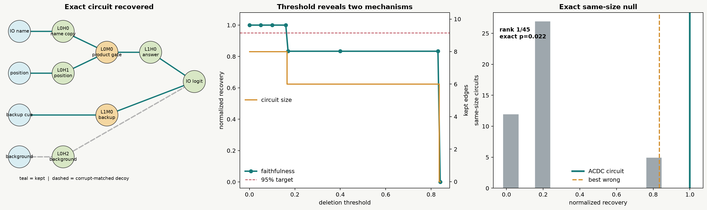

<details><summary>Interpretation - why the result is convincing</summary>

The exact oracle says which edges are causal before search begins. ACDC returns exactly those eight edges, preserves all of the clean-corrupt gap, finds every kept edge necessary, finds no gain from the omitted decoy pair, and ranks first among all same-size graphs. The one-shot baseline returns an empty circuit. Known ground truth makes the algorithmic claim falsifiable.

</details>

<details><summary>Interpretation - why completeness tests pairs</summary>

If we deliberately omit the two-edge backup path, adding either edge alone does nothing. A single-edge completeness check therefore says "complete" when the circuit is missing one sixth of the behavior. Testing omitted pairs catches the missing path. In real models the combinatorics become expensive, which is exactly why completeness claims need an explicit search scope.

</details>


## Real-Model Path - named heads feeding a real MLP

Our clean prompt is `"The cat sat on the"`; the model prefers `" floor"`. The corrupt prompt is `"The bird flew over the"`; it prefers `" top"`. The signed metric is `logit(" floor") - logit(" top")`.

We run the same greedy deletion routine over `L0H0` through `L0H7`. Kept heads are patched clean into the corrupt run; all others stay corrupt; the real `L0MLP` recomputes on every trial. We also enumerate all 56 three-head sets and test the discovered set on three held-out prompt pairs.

This is an **honest component-level result**, not full edge-level ACDC. Head outputs are candidate components, and the MLP is measured as a downstream bottleneck. We do not claim an IOI or greater-than circuit.


### Exercise - patch named attention-head results

> ```yaml
> Difficulty: 🔴🔴🔴⚪⚪
> Importance: 🔵🔵🔵🔵⚪
> Suggested time: 15 minutes
> ```

Now move to `NeelNanda/GELU_1L512W_C4_Code`, a pinned one-layer TransformerLens model with eight heads and one MLP. Implement the hook helper which replaces selected slices of `blocks.0.attn.hook_result` with their clean cached values.

We patch all positions for selected heads. The unpatched heads remain corrupt, and the real MLP recomputes from the hybrid residual stream.

<details><summary>Expected output</summary>

```text
All tests in `test_patch_selected_head_results` passed!
All tests in `test_patch_selected_head_results_rejects_bad_heads` passed!
Only the selected head axis slices change; the input tensor is not mutated.
```

</details>

<details><summary>Help - The head axis is dimension two</summary>

`hook_result` has shape `[batch, position, head, d_model]`. Clone the corrupt activation, then assign clean values at `[:, :, selected_heads, :]`.

</details>

<details><summary>Common bug</summary>

Patching the last axis treats residual dimensions as heads. Mutating the hook input in place can also leak state into later interventions.

</details>

<details><summary>Solution</summary>

```python
def patch_selected_head_results(
    activation: t.Tensor,
    clean_head_results: t.Tensor,
    selected_heads: Sequence[int],
) -> t.Tensor:
    """Patch selected clean head results into a corrupt hook activation."""

    if activation.ndim != 4:
        raise ValueError("head result must have shape [batch, position, head, d_model].")
    if activation.shape != clean_head_results.shape:
        raise ValueError("clean and corrupt head-result tensors must have matching shapes.")
    if not t.isfinite(activation).all() or not t.isfinite(clean_head_results).all():
        raise ValueError("head-result tensors must be finite.")
    heads = tuple(int(head) for head in selected_heads)
    if len(set(heads)) != len(heads):
        raise ValueError("selected_heads must not contain duplicates.")
    if any(head < 0 or head >= activation.shape[2] for head in heads):
        raise ValueError("selected head index is out of range.")
    patched = activation.clone()
    if heads:
        patched[:, :, list(heads), :] = clean_head_results[:, :, list(heads), :]
    return patched
```

</details>


```python
def patch_selected_head_results(
    activation: t.Tensor,
    clean_head_results: t.Tensor,
    selected_heads: Sequence[int],
) -> t.Tensor:
    raise NotImplementedError()


tests.test_patch_selected_head_results(patch_selected_head_results)
tests.test_patch_selected_head_results_rejects_bad_heads(patch_selected_head_results)
```


```python
model = reference.load_pinned_gelu1l(device="cpu")
task = reference._prepare_transformerlens_task(model, *reference.TL_PRIMARY_PAIR)
head_names = tuple(f"L0H{head}" for head in range(model.cfg.n_heads))

def make_head_evaluator(model, task):
    def evaluate(active_heads: frozenset[str]) -> float:
        selected = tuple(int(name.removeprefix("L0H")) for name in active_heads)
        def patch_hook(activation, hook):
            del hook
            return patch_selected_head_results(activation, task["clean_head_results"], selected)
        logits = model.run_with_hooks(
            task["corrupt_tokens"],
            fwd_hooks=[(reference.TL_HEAD_HOOK, patch_hook)],
        )
        return reference.answer_logit_diff(
            logits,
            positive_token_id=task["positive_token_id"],
            negative_token_id=task["negative_token_id"],
        )
    return evaluate

head_evaluator = make_head_evaluator(model, task)
head_order = initial_deletion_order(
    head_names, head_evaluator,
    clean_metric=task["clean_metric"], corrupt_metric=task["corrupt_metric"],
)
head_acdc = greedy_acdc(
    head_names, head_evaluator,
    clean_metric=task["clean_metric"], corrupt_metric=task["corrupt_metric"],
    threshold=0.05, order=head_order,
)
head_random = same_size_circuit_report(
    head_names, head_acdc.kept_edges, head_evaluator,
    clean_metric=task["clean_metric"], corrupt_metric=task["corrupt_metric"],
)
all_heads = frozenset(head_names)
all_head_recovery = normalized_recovery(
    clean_metric=task["clean_metric"], corrupt_metric=task["corrupt_metric"],
    metric=head_evaluator(all_heads),
)
head_deletion_damage = {
    name: all_head_recovery - normalized_recovery(
        clean_metric=task["clean_metric"], corrupt_metric=task["corrupt_metric"],
        metric=head_evaluator(all_heads - {name}),
    )
    for name in head_names
}

heldout_recoveries = {}
for label, clean_prompt, corrupt_prompt in reference.TL_HELDOUT_PAIRS:
    heldout_task = reference._prepare_transformerlens_task(model, clean_prompt, corrupt_prompt)
    heldout_eval = make_head_evaluator(model, heldout_task)
    heldout_recoveries[label] = normalized_recovery(
        clean_metric=heldout_task["clean_metric"],
        corrupt_metric=heldout_task["corrupt_metric"],
        metric=heldout_eval(frozenset(head_acdc.kept_edges)),
    )

mlp_bottleneck_recovery = reference._mlp_bottleneck_recovery(model, task)
real_result = {
    "positive_token": task["positive_token"],
    "negative_token": task["negative_token"],
    "clean_corrupt_gap": task["clean_metric"] - task["corrupt_metric"],
    "kept_heads": head_acdc.kept_edges,
    "primary_recovery": head_acdc.recovery,
    "same_size_rank": head_random.discovered_rank,
    "same_size_total": head_random.num_circuits,
    "random_mean": head_random.control_mean_recovery,
    "random_best": head_random.control_best_recovery,
    "heldout_recoveries": heldout_recoveries,
    "mlp_bottleneck_recovery": mlp_bottleneck_recovery,
}
print(json.dumps(real_result, indent=2))
```


<details><summary>Expected output - pinned CPU result</summary>

```text
target tokens: " floor" vs " top"
clean-corrupt gap: 6.2771
kept heads: [L0H0, L0H4, L0H6]
primary recovery: 0.9455
same-size rank: 1 / 56
wrong-set mean: 0.4095
best wrong set: 0.8855
held-out recovery range: 0.7855 to 0.9449
MLP clean-output recovery: 0.9912
```

</details>


```python
fig, axes = plt.subplots(1, 3, figsize=(16.5, 4.4), constrained_layout=True)
fig.patch.set_facecolor("#f7f7f4")

colors = ["#187a79" if name in head_acdc.kept_edges else "#a9afb3" for name in head_names]
axes[0].bar(head_names, [head_deletion_damage[name] for name in head_names], color=colors)
axes[0].axhline(0, color="#333333", linewidth=0.8)
axes[0].axhline(0.05, color="#b23a48", linestyle="--", linewidth=1.2, label="threshold")
axes[0].set_ylabel("full-set deletion damage")
axes[0].set_title("Named head candidates", fontweight="bold")
axes[0].legend(frameon=False)

axes[1].hist(head_random.control_recoveries, bins=np.linspace(0, 1, 13), color="#9ea7ad", edgecolor="white")
axes[1].axvline(head_acdc.recovery, color="#187a79", linewidth=3, label="L0H0 + L0H4 + L0H6")
axes[1].axvline(head_random.control_best_recovery, color="#d28e2c", linestyle="--", linewidth=2, label="best other set")
axes[1].set_xlabel("normalized recovery")
axes[1].set_ylabel("three-head sets")
axes[1].set_title("All 56 same-size sets", fontweight="bold")
axes[1].legend(frameon=False, fontsize=8)

labels = ["primary", *heldout_recoveries.keys(), "MLP only"]
values = [head_acdc.recovery, *heldout_recoveries.values(), mlp_bottleneck_recovery]
bar_colors = ["#187a79", "#5d95a3", "#5d95a3", "#5d95a3", "#d28e2c"]
axes[2].barh(labels, values, color=bar_colors)
axes[2].axvline(0.75, color="#b23a48", linestyle="--", linewidth=1.2)
axes[2].set_xlim(0, 1.08)
axes[2].set_xlabel("normalized recovery")
axes[2].set_title("Transfer and bottleneck control", fontweight="bold")
axes[2].text(0.755, 0.96, "held-out floor", transform=axes[2].get_xaxis_transform(),
             rotation=90, va="top", ha="left", color="#8d2936", fontsize=8)
for i, value in enumerate(values):
    axes[2].text(value + 0.015, i, f"{value:.3f}", va="center", fontsize=8)

real_asset = assets_dir / "acdc_transformerlens_component_signature.png"
fig.savefig(real_asset, dpi=180, bbox_inches="tight", facecolor=fig.get_facecolor())
plt.show()
```


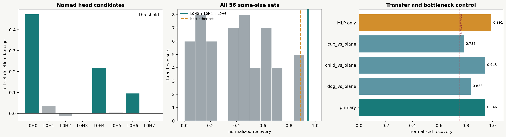

<details><summary>Interpretation - what the real result supports</summary>

At threshold `0.05`, sequential deletion retains `L0H0`, `L0H4`, and `L0H6`. Together they recover `94.6%` of the primary clean-corrupt gap, rank first among all 56 three-head sets, and recover `78.5%-94.5%` on three held-out prompt pairs. This is evidence that these named head outputs carry reusable context information for this small continuation contrast.

</details>

<details><summary>Interpretation - the MLP anomaly</summary>

Patching the clean `L0MLP` output alone recovers `99.1%`, more than the selected heads. This does **not** make the heads irrelevant. A downstream patch can overwrite the consequence of upstream computation. The head search recomputes the MLP from hybrid head outputs; the MLP-only patch replaces that computation wholesale. The mismatch is a useful warning that component patching and edge-level causal stories are not interchangeable.

</details>

<details><summary>Help - why negative deletion damage is allowed</summary>

Removing `L0H2` slightly improves recovery. Real models contain inhibitory, compensatory, and task-irrelevant components, so an intervention score need not be positive. Greedy ACDC removes negative-damage components first; the sign itself is evidence worth inspecting.

</details>


## Try It Yourself - move the threshold, order, or prompt

The following cell is deliberately small. Change `PLAY_THRESHOLD` across `0.16`, `0.17`, `0.83`, and `0.84`. Then reverse the deletion order and see whether this graph is order-sensitive. Finally, replace the real clean/corrupt prompt pair with another equal-token-length contrast and rerun the real section.

Before executing, write down a prediction for circuit size and recovery. ARENA-style play should test a hypothesis, not just change a number.


```python
PLAY_THRESHOLD = 0.17
PLAY_ORDER = deletion_order  # Try tuple(reversed(deletion_order)).

play_result = greedy_acdc(
    edge_names, evaluator,
    clean_metric=clean_metric, corrupt_metric=corrupt_metric,
    threshold=PLAY_THRESHOLD, order=PLAY_ORDER,
)
print({
    "threshold": PLAY_THRESHOLD,
    "kept_edges": len(play_result.kept_edges),
    "recovery": round(play_result.recovery, 3),
    "lost_edges": sorted(set(graph.ground_truth_edges) - set(play_result.kept_edges)),
})
```


## Bonus - anomaly hunting

Choose one question and turn it into a small result:

1. **Interaction order:** construct a graph with two redundant paths. Does greedy ACDC choose a different minimal circuit when you reverse the candidate order?
2. **Completeness depth:** omit a three-edge path. Show that pairwise completeness still fails, then generalize the subset search.
3. **Negative heads:** `L0H2` has negative deletion damage on the real contrast. Inspect its direct logit attribution and attention pattern. Is it inhibitory, compensatory, or merely prompt-specific?
4. **Prompt transfer:** find a held-out pair where `L0H0/L0H4/L0H6` recovers below `0.75`. Does rediscovery on that pair choose a different set?
5. **MLP mediation:** compare patching the MLP input, MLP output, and selected heads. Which intervention supports an edge claim, and which only identifies a bottleneck?

<details><summary>Help - turn an anomaly into evidence</summary>

State a prediction before running, include a matched control, and report the counterexample even when it weakens the original circuit story.

</details>


## From a head-output patch to a full transformer circuit

The warm-up found useful head outputs. It did not ask which upstream messages
make those heads useful. Now consider the actual IOI prefix:

> Then, Marco and William had a lot of fun at the garden. William gave a computer to

The correct next token is ` Marco`, and the competing subject is ` William`.
These labels come from the sentence, before we inspect model predictions.
We will replace the names with three unrelated names for the corrupt reference,
while continuing to score the original pair of answer labels.

The full candidate graph contains the input residual, every attention-head
result and every MLP output. Each head has three distinct receiver ports:
its Q, K and V residual inputs before layer normalization. MLP inputs and the
final residual before unembedding are receivers too. A sender can connect to
every later eligible receiver; we do not begin with the published IOI heads.

For a receiver with corrupt baseline $r_v'$, the hybrid input is

$$r_v = r_v' + \sum_{u \to v\;\mathrm{retained}} (z_u^{\mathrm{hybrid}}-z_u').$$

The sender on the retained path is recomputed during this forward pass.
Using its frozen clean value would erase all interventions further upstream.
Attention and MLP biases remain inside the corrupt baseline; their constant
contributions cancel when we add component differences.

The next exercises first use a small, genuine transformer with independent
numerical oracles. Only after those tests pass do we load GPT-2. This isolates
hook bugs from failures of circuit discovery.


```python
import math
import os
import time
from dataclasses import dataclass

from part3_acdc_circuit_metrics import edge_tests, edge_metric_tests, edge_attribution_tests, greater_than_tests
from part3_acdc_circuit_metrics.real_edges import load_pinned_gpt2, prepare_ioi_data, mask_from_result
from part3_acdc_circuit_metrics.greater_than import prepare_greater_than_data
from part3_acdc_circuit_metrics.edge_attribution import cache_sender_outputs
from part3_acdc_circuit_metrics.edge_metrics import plot_discovered_edges

# Provided: weight/data/cache/drawing plumbing and a visible test runner.
def check_edge(test, *functions, **kwargs):
    with t.enable_grad():
        test(*functions, **kwargs)
    print(f"All tests in `{test.__name__}` passed!")

RUN_REAL_EDGES = os.environ.get("ARENA_ACDC_NUMERICAL_ONLY", "0") != "1"
if not RUN_REAL_EDGES:
    print("Numerical-only run: real discovery, controls and template-transfer experiments are skipped.")
@dataclass(frozen=True)
class Receiver:
    name: str
    hook_name: str
    baseline_hook: str
    head: int | None
    source_count: int
    output_source: int | None


@dataclass(frozen=True)
class ResidualGraph:
    sources: tuple[str, ...]
    receivers: tuple[Receiver, ...]
    legal_mask: t.Tensor
    n_layers: int
    n_heads: int

    def edge_name(self, source: int, receiver: int) -> str:
        return f"{self.sources[source]} -> {self.receivers[receiver].name}"
```


### Exercise — construct every legal residual edge

> ```yaml
> Difficulty: 🔴🔴🔴🔴⚪
> Importance: 🔵🔵🔵🔵🔵
> Suggested time: 20 minutes
> ```

Implement `build_residual_graph`. Start with the input sender. At each layer,
add all attention results, then the MLP output. Q/K/V receivers can read the
input and earlier layers; the MLP can also read current-layer heads. The final
receiver reads every sender. Record the fixed dependency from each receiver
port to the component it computes: search will need that relation later.

Draw the one-layer, one-head case on paper before writing code. In particular,
a head cannot send its output back into its own Q input.

<details><summary>Expected output</summary>

GPT-2 has **157 senders, 445 receiver ports and 32,491 legal edges**. The small two-layer graph has 46 legal edges.

</details>

<details><summary>Help — Work through one receiver first</summary>

Keep `source_count` as a prefix boundary. All legal sources for a receiver
are contiguous in this ordering. Add the MLP receiver before appending that
MLP as a sender, so it cannot read its own output.

</details>

<details><summary>Solution</summary>

```python
def build_residual_graph(n_layers: int, n_heads: int) -> ResidualGraph:
    """Construct the complete legal residual graph for sequential attention/MLP blocks."""
    if n_layers < 1 or n_heads < 1:
        raise ValueError("positive layer and head counts are required")
    sources = ["input"]
    receivers = []
    for layer in range(n_layers):
        prefix = len(sources)
        sources.extend(f"L{layer}H{head}" for head in range(n_heads))
        for port in ("q", "k", "v"):
            for head in range(n_heads):
                receivers.append(Receiver(
                    f"L{layer}H{head}.{port}", f"blocks.{layer}.hook_{port}_input",
                    f"blocks.{layer}.hook_resid_pre", head, prefix, prefix + head,
                ))
        receivers.append(Receiver(
            f"L{layer}MLP.in", f"blocks.{layer}.hook_mlp_in",
            f"blocks.{layer}.hook_resid_mid", None, len(sources), len(sources),
        ))
        sources.append(f"L{layer}MLP")
    receivers.append(Receiver(
        "output", f"blocks.{n_layers - 1}.hook_resid_post",
        f"blocks.{n_layers - 1}.hook_resid_post", None, len(sources), None,
    ))
    legal = t.zeros(len(sources), len(receivers), dtype=t.bool)
    for column, receiver in enumerate(receivers):
        legal[:receiver.source_count, column] = True
    return ResidualGraph(tuple(sources), tuple(receivers), legal, n_layers, n_heads)

```

</details>


```python
def build_residual_graph(n_layers: int, n_heads: int) -> ResidualGraph:
    """Construct the complete legal residual graph for sequential attention/MLP blocks."""
    raise NotImplementedError()

check_edge(edge_tests.test_complete_residual_graph, build_residual_graph)
residual_graph = build_residual_graph(12, 12)
print(f"{len(residual_graph.sources)} senders, {len(residual_graph.receivers)} receiver ports, {int(residual_graph.legal_mask.sum()):,} legal edges")
```


### Exercise — rebuild a receiver from hybrid messages

> ```yaml
> Difficulty: 🔴🔴🔴🔴⚪
> Importance: 🔵🔵🔵🔵🔵
> Suggested time: 20 minutes
> ```

Implement `reconstruct_receiver`. Support a scalar MLP/output receiver and a
group of attention heads sharing a Q, K or V hook. The grouped mask has shape
`[sender, head]`. Preserve continuous weights between zero and one so we can
also check small edge perturbations against derivatives.

Do not modify the corrupt cache or sender differences in place.

<details><summary>Expected output</summary>

The explicit-sum, all-zero, single-receiver, grouped-head and half-weight checks pass.

</details>

<details><summary>Help — Work through one receiver first</summary>

Write the sum for one batch element, one position and one hidden coordinate.
Then keep the sender axis only inside the contraction. For grouped heads,
broadcast the same corrupt residual baseline across the head axis.

</details>

<details><summary>Solution</summary>

```python
def reconstruct_receiver(corrupt_receiver: t.Tensor, sender_deltas: t.Tensor,
                         active_edges: t.Tensor) -> t.Tensor:
    """Corrupt receiver plus retained current-hybrid minus corrupt sender messages.

    sender_deltas is [batch, position, sender, d_model]. active_edges is
    [sender] for a scalar receiver or [sender, head] for a grouped Q/K/V hook.
    """
    if sender_deltas.ndim != 4 or active_edges.ndim not in (1, 2):
        raise ValueError("sender deltas need four axes and mask needs one or two")
    if active_edges.shape[0] != sender_deltas.shape[2]:
        raise ValueError("one mask row is required for each sender")
    if corrupt_receiver.shape != sender_deltas.shape[:2] + sender_deltas.shape[-1:]:
        raise ValueError("corrupt receiver must have [batch, position, d_model] shape")
    weights = active_edges.to(sender_deltas)
    if active_edges.ndim == 1:
        return corrupt_receiver + t.einsum("bpsd,s->bpd", sender_deltas, weights)
    return corrupt_receiver[:, :, None, :] + t.einsum("bpsd,sh->bphd", sender_deltas, weights)

```

</details>


```python
def reconstruct_receiver(corrupt_receiver: t.Tensor, sender_deltas: t.Tensor, active_edges: t.Tensor) -> t.Tensor:
    """Corrupt receiver plus retained current-hybrid minus corrupt sender messages.

    sender_deltas is [batch, position, sender, d_model]. active_edges is
    [sender] for a scalar receiver or [sender, head] for a grouped Q/K/V hook.
    """
    raise NotImplementedError()

check_edge(edge_tests.test_receiver_reconstruction, reconstruct_receiver)
```


### Exercise — score the actual prediction position

> ```yaml
> Difficulty: 🔴🔴🔴🔴⚪
> Importance: 🔵🔵🔵🔵🔵
> Suggested time: 20 minutes
> ```

Implement `final_position_logits`, `answer_logit_differences` and
`clean_kl_divergence`. Right padding means each example can have a different
prediction position. Gather the final prefix residual, apply the model's final
layer norm and unembedding, then score the fixed `[IO, subject]` labels.

For ACDC, minimize mean $D_{KL}(p_{clean} || p_{circuit})$ over the full
vocabulary. For interpretation, also keep the answer logit difference.
Neither metric can silently choose new labels after an intervention.

<details><summary>Expected output</summary>

Final-position logits match an untouched transformer. Fixed labels yield `[2, -2]` in the numerical fixture, and KL matches an explicit probability sum.

</details>

<details><summary>Help — Work through one receiver first</summary>

Unembed `[batch, 1, d_model]` after gathering the end positions; this avoids
allocating logits for every token in the prompt. In the KL expression, the
weighting probabilities come from the clean model.

</details>

<details><summary>Solution</summary>

```python
def final_position_logits(model, residual: t.Tensor, end_positions: t.Tensor) -> t.Tensor:
    """Unembed only each example's actual end position, preserving right padding."""
    if end_positions.shape != (len(residual),):
        raise ValueError("provide one end position per example")
    end_positions = end_positions.to(residual.device)
    if bool(((end_positions < 0) | (end_positions >= residual.shape[1])).any()):
        raise ValueError("end positions must lie inside the token sequence")
    last = residual[t.arange(len(residual), device=residual.device), end_positions]
    return model.unembed(model.ln_final(last[:, None, :]))[:, 0]


def answer_logit_differences(logits: t.Tensor, answer_ids: t.Tensor) -> t.Tensor:
    if logits.ndim != 2 or answer_ids.shape != (len(logits), 2):
        raise ValueError("use final-position logits and [correct, distractor] token IDs")
    scores = logits.gather(1, answer_ids.to(logits.device))
    return scores[:, 0] - scores[:, 1]


def clean_kl_divergence(logits: t.Tensor, clean_logits: t.Tensor) -> t.Tensor:
    """Mean KL(clean || circuit) over examples and the entire output vocabulary."""
    if logits.shape != clean_logits.shape or logits.ndim != 2:
        raise ValueError("clean and circuit logits need matching final-position matrices")
    clean_logp = clean_logits.log_softmax(-1)
    return (clean_logp.exp() * (clean_logp - logits.log_softmax(-1))).sum(-1).mean()

```

</details>


```python
def final_position_logits(model, residual: t.Tensor, end_positions: t.Tensor) -> t.Tensor:
    """Unembed only each example's actual end position, preserving right padding."""
    raise NotImplementedError()

def answer_logit_differences(logits: t.Tensor, answer_ids: t.Tensor) -> t.Tensor:
    raise NotImplementedError()

def clean_kl_divergence(logits: t.Tensor, clean_logits: t.Tensor) -> t.Tensor:
    """Mean KL(clean || circuit) over examples and the entire output vocabulary."""
    raise NotImplementedError()

check_edge(edge_tests.test_end_positions_and_metrics, final_position_logits, answer_logit_differences, clean_kl_divergence)
```


### Exercise — execute the hybrid graph with scoped hooks

> ```yaml
> Difficulty: 🔴🔴🔴🔴⚪
> Importance: 🔵🔵🔵🔵🔵
> Suggested time: 45 minutes
> ```

Complete `EdgeIntervention.make_hooks` and `EdgeIntervention.__call__`.
The constructor is supplied: it prepares aligned corrupt caches and temporary
sender storage. Your source hooks must write **current hybrid minus corrupt**
messages into that storage. Your receiver hooks rebuild each Q/K/V group, MLP
input and final residual using the current mask.

Run the model inside a temporary hook context so exceptions also remove these
hooks. Leave any surrounding user hook context in place. Validate illegal
edges and mask ranges before transferring the mask to the model device.

The tests do more than check clean/corrupt endpoints. They compare selected
single-port interventions with independent native hooks, and several hybrid
circuits with an explicit edge-by-edge oracle. A frozen-clean sender shortcut
must disagree with that oracle.

<details><summary>Expected output</summary>

All four transformer tests pass. The full graph matches clean logits; the empty graph matches corrupt logits; the broken frozen-sender oracle fails.

</details>

<details><summary>Help — Work through one receiver first</summary>

Install source caches at `hook_resid_pre`, `attn.hook_result` and
`hook_mlp_out`. Receiver hooks occur before LN1, LN2 or the final layer norm.
Group columns with the same hook name, and bind each loop's receiver in the
closure's default arguments. The model must finish an entire hybrid forward
pass for each mask; copying a saved clean head output is insufficient.

</details>

<details><summary>Solution</summary>

```python
class EdgeIntervention:
    """Execute a real hybrid graph; retained senders are recomputed in this run."""
    def __init__(self, model, clean_tokens: t.Tensor, corrupt_tokens: t.Tensor,
                 end_positions: t.Tensor):
        if model.cfg.attn_only or model.cfg.parallel_attn_mlp:
            raise ValueError("this graph requires sequential attention then MLP blocks")
        if getattr(model.cfg, "n_key_value_heads", None) is not None:
            raise ValueError("this lesson's graph uses equal query/key/value head counts")
        if clean_tokens.shape != corrupt_tokens.shape or clean_tokens.ndim != 2:
            raise ValueError("matched clean/corrupt token matrices must have the same shape")
        model.set_use_attn_result(True)
        model.set_use_split_qkv_input(True)
        model.set_use_hook_mlp_in(True)
        self.model = model.eval()
        self.graph = build_residual_graph(model.cfg.n_layers, model.cfg.n_heads)
        device = next(model.parameters()).device
        self.clean_tokens = clean_tokens.to(device)
        self.corrupt_tokens = corrupt_tokens.to(device)
        self.end_positions = end_positions.to(device)
        self.active_mask = self.graph.legal_mask.to(device=device, dtype=t.float32)
        names = {receiver.baseline_hook for receiver in self.graph.receivers}
        names.add("blocks.0.hook_resid_pre")
        for layer in range(self.graph.n_layers):
            names.update((f"blocks.{layer}.attn.hook_result", f"blocks.{layer}.hook_mlp_out"))
        with t.inference_mode():
            residual, cache = model.run_with_cache(
                self.corrupt_tokens, names_filter=lambda name: name in names,
                stop_at_layer=self.graph.n_layers, return_type=None,
            )
            self.corrupt_logits = final_position_logits(model, residual, self.end_positions)
            self.corrupt_cache = {name: value.detach().clone() for name, value in cache.items()}
            pieces = [self.corrupt_cache["blocks.0.hook_resid_pre"][:, :, None]]
            for layer in range(self.graph.n_layers):
                pieces.extend((self.corrupt_cache[f"blocks.{layer}.attn.hook_result"],
                               self.corrupt_cache[f"blocks.{layer}.hook_mlp_out"][:, :, None]))
            self.corrupt_sources = t.cat(pieces, dim=2)
            self.sender_deltas = t.empty_like(self.corrupt_sources)
            residual = model(self.clean_tokens, stop_at_layer=self.graph.n_layers, return_type=None)
            self.clean_logits = final_position_logits(model, residual, self.end_positions)
        self.hooks = self.make_hooks()

    def make_hooks(self) -> list:
        """Install source caches before receiver reconstruction at each causal stage."""
        hooks = []

        def source_hook(start, count, has_head_axis):
            def save(activation, hook):
                del hook
                values = activation if has_head_axis else activation[:, :, None, :]
                self.sender_deltas[:, :, start:start + count] = (
                    values - self.corrupt_sources[:, :, start:start + count]
                )
                return activation
            return save

        hooks.append(("blocks.0.hook_resid_pre", source_hook(0, 1, False)))
        for layer in range(self.graph.n_layers):
            start = 1 + layer * (self.graph.n_heads + 1)
            hooks.append((f"blocks.{layer}.attn.hook_result", source_hook(start, self.graph.n_heads, True)))
            hooks.append((f"blocks.{layer}.hook_mlp_out", source_hook(start + self.graph.n_heads, 1, False)))

        groups = {}
        for column, receiver in enumerate(self.graph.receivers):
            groups.setdefault(receiver.hook_name, []).append(column)
        for hook_name, columns in groups.items():
            receiver = self.graph.receivers[columns[0]]

            def receive(activation, hook, columns=tuple(columns), receiver=receiver):
                del activation, hook
                mask = self.active_mask[:receiver.source_count, list(columns)]
                if receiver.head is None:
                    mask = mask[:, 0]
                return reconstruct_receiver(
                    self.corrupt_cache[receiver.baseline_hook],
                    self.sender_deltas[:, :, :receiver.source_count], mask,
                )
            hooks.append((hook_name, receive))
        return hooks

    @t.inference_mode()
    def __call__(self, active_mask: t.Tensor) -> t.Tensor:
        if active_mask.shape != self.graph.legal_mask.shape:
            raise ValueError("mask shape must describe the full candidate graph")
        # Validate on CPU before a single device transfer, rather than syncing every hook.
        mask = active_mask.detach().cpu()
        if bool((mask[~self.graph.legal_mask] != 0).any()):
            raise ValueError("mask contains a backward or otherwise illegal edge")
        if not bool(t.isfinite(mask.float()).all()) or bool(((mask < 0) | (mask > 1)).any()):
            raise ValueError("edge weights must lie between zero and one")
        self.active_mask = mask.to(device=self.clean_tokens.device, dtype=self.corrupt_sources.dtype)
        residual = self.model.run_with_hooks(
            self.clean_tokens, fwd_hooks=self.hooks,
            stop_at_layer=self.graph.n_layers, return_type=None,
        )
        return final_position_logits(self.model, residual, self.end_positions)

```

</details>


```python
class EdgeIntervention:
    """Execute a real hybrid graph; retained senders are recomputed in this run."""

    def __init__(self, model, clean_tokens: t.Tensor, corrupt_tokens: t.Tensor, end_positions: t.Tensor):
        if model.cfg.attn_only or model.cfg.parallel_attn_mlp:
            raise ValueError('this graph requires sequential attention then MLP blocks')
        if getattr(model.cfg, 'n_key_value_heads', None) is not None:
            raise ValueError("this lesson's graph uses equal query/key/value head counts")
        if clean_tokens.shape != corrupt_tokens.shape or clean_tokens.ndim != 2:
            raise ValueError('matched clean/corrupt token matrices must have the same shape')
        model.set_use_attn_result(True)
        model.set_use_split_qkv_input(True)
        model.set_use_hook_mlp_in(True)
        self.model = model.eval()
        self.graph = build_residual_graph(model.cfg.n_layers, model.cfg.n_heads)
        device = next(model.parameters()).device
        self.clean_tokens = clean_tokens.to(device)
        self.corrupt_tokens = corrupt_tokens.to(device)
        self.end_positions = end_positions.to(device)
        self.active_mask = self.graph.legal_mask.to(device=device, dtype=t.float32)
        names = {receiver.baseline_hook for receiver in self.graph.receivers}
        names.add('blocks.0.hook_resid_pre')
        for layer in range(self.graph.n_layers):
            names.update((f'blocks.{layer}.attn.hook_result', f'blocks.{layer}.hook_mlp_out'))
        with t.inference_mode():
            residual, cache = model.run_with_cache(self.corrupt_tokens, names_filter=lambda name: name in names, stop_at_layer=self.graph.n_layers, return_type=None)
            self.corrupt_logits = final_position_logits(model, residual, self.end_positions)
            self.corrupt_cache = {name: value.detach().clone() for name, value in cache.items()}
            pieces = [self.corrupt_cache['blocks.0.hook_resid_pre'][:, :, None]]
            for layer in range(self.graph.n_layers):
                pieces.extend((self.corrupt_cache[f'blocks.{layer}.attn.hook_result'], self.corrupt_cache[f'blocks.{layer}.hook_mlp_out'][:, :, None]))
            self.corrupt_sources = t.cat(pieces, dim=2)
            self.sender_deltas = t.empty_like(self.corrupt_sources)
            residual = model(self.clean_tokens, stop_at_layer=self.graph.n_layers, return_type=None)
            self.clean_logits = final_position_logits(model, residual, self.end_positions)
        self.hooks = self.make_hooks()

    def make_hooks(self) -> list:
        """Install source caches before receiver reconstruction at each causal stage."""
        raise NotImplementedError()

    @t.inference_mode()
    def __call__(self, active_mask: t.Tensor) -> t.Tensor:
        raise NotImplementedError()

check_edge(edge_tests.test_real_edge_endpoints, EdgeIntervention)
check_edge(edge_tests.test_single_edge_receiver_isolation, EdgeIntervention)
check_edge(edge_tests.test_hybrid_senders_and_slow_oracle, EdgeIntervention)
check_edge(edge_tests.test_edge_hook_cleanup_on_failure, EdgeIntervention)
```


### Exercise — remove only branches proven irrelevant to output

> ```yaml
> Difficulty: 🔴🔴🔴🔴⚪
> Importance: 🔵🔵🔵🔵🔵
> Suggested time: 20 minutes
> ```

Implement `output_reachable_sources`. Start at the final receiver and walk
backward through retained additive edges. From each sender component, also
walk to its fixed input ports. This allows search to skip a disconnected
branch without paying for another model run.

A component whose Q path is absent can still be reachable through its K or V
port. Do not replace graph reachability with a list of known important heads.

<details><summary>Expected output</summary>

The full graph reaches every sender, the empty graph reaches none, and the constructed two-head path reaches exactly `{0, 1, 5}`.

</details>

<details><summary>Help — Work through one receiver first</summary>

Maintain a queue of receiver indices and a set of visited receivers. Build a
mapping from an output sender to all receiver ports that compute it. An input
sender has no earlier receiver to visit.

</details>

<details><summary>Solution</summary>

```python
def output_reachable_sources(graph: ResidualGraph, active_mask: t.Tensor) -> set[int]:
    """Backward reachability through additive edges and fixed component computations."""
    active = active_mask.bool().cpu()
    pending = [len(graph.receivers) - 1]
    visited_receivers, sources = set(), set()
    inputs_by_source = {}
    for index, receiver in enumerate(graph.receivers):
        if receiver.output_source is not None:
            inputs_by_source.setdefault(receiver.output_source, []).append(index)
    while pending:
        receiver = pending.pop()
        if receiver in visited_receivers:
            continue
        visited_receivers.add(receiver)
        for source in active[:, receiver].nonzero().flatten().tolist():
            if source not in sources:
                sources.add(source)
                pending.extend(inputs_by_source.get(source, ()))
    return sources

```

</details>


```python
def output_reachable_sources(graph: ResidualGraph, active_mask: t.Tensor) -> set[int]:
    """Backward reachability through additive edges and fixed component computations."""
    raise NotImplementedError()

check_edge(edge_tests.test_reachability, output_reachable_sources)
```


### Exercise — run reverse-topological ACDC with a decision trace

> ```yaml
> Difficulty: 🔴🔴🔴🔴⚪
> Importance: 🔵🔵🔵🔵🔵
> Suggested time: 35 minutes
> ```

Implement `greedy_edge_acdc`. Begin with every legal edge. Visit receivers
from output toward input and senders in reverse order. Temporarily delete one
edge, run the current graph again, and accept the deletion if the increase in
loss is strictly below the threshold. Negative damage is allowed.

Keep a trace with the edge, before/trial losses and decision. Skip disconnected
receiver branches only using your reachability function. The checkpoint
arguments are supplied for long GPU runs: save masks and completed decisions
atomically, and resume without repeating those decisions. A fresh threshold
requires a fresh search; filtering a previous score list is not equivalent.

<details><summary>Expected output</summary>

The nonlinear two-path oracle retains four edges with zero final loss. Its recorded decisions can be replayed exactly; nonfinite loss is rejected.

</details>

<details><summary>Help — Work through one receiver first</summary>

After a rejected deletion, restore that edge. After an accepted deletion,
retain the new loss as the baseline for the next trial. Use the original full
legal graph only to define candidates, not to measure all deletion effects.

</details>

<details><summary>Solution</summary>

```python
def greedy_edge_acdc(graph: ResidualGraph, evaluate_loss: Callable[[t.Tensor], float], *,
                     threshold: float, progress_every: int = 100,
                     checkpoint_path: str | Path | None = None,
                     resume: dict | None = None) -> dict:
    """Reverse-topological edge deletion, evaluating every trial in the current graph."""
    if not math.isfinite(threshold) or threshold < 0:
        raise ValueError("threshold must be finite and nonnegative")
    if progress_every < 1:
        raise ValueError("progress_every must be positive")
    if resume is not None and (resume["threshold"] != threshold or resume["initial_edges"] != int(graph.legal_mask.sum())):
        raise ValueError("resume must use the same threshold and candidate graph")
    active = graph.legal_mask.clone() if resume is None else mask_from_result(graph, resume)
    current = float(evaluate_loss(active))
    if not math.isfinite(current):
        raise ValueError("initial graph loss must be finite")
    initial = current if resume is None else resume["initial_loss"]
    trace = [] if resume is None else list(resume["trace"])
    skipped = [] if resume is None else list(resume["skipped"])
    processed = {(row["source"], row["receiver"]) for row in trace}
    skipped_receivers = {row["receiver"] for row in skipped}
    prior_elapsed = 0. if resume is None else resume.get("elapsed_seconds", 0.)
    started = time.monotonic()
    for receiver_index in reversed(range(len(graph.receivers))):
        receiver = graph.receivers[receiver_index]
        if receiver.name in skipped_receivers:
            continue
        if receiver.output_source is not None and receiver.output_source not in output_reachable_sources(graph, active):
            count = int(active[:, receiver_index].sum())
            active[:, receiver_index] = False
            skipped.append({"receiver": receiver.name, "edges_removed": count})
            continue
        for source in reversed(range(receiver.source_count)):
            if not active[source, receiver_index] or (source, receiver_index) in processed:
                continue
            before = current
            active[source, receiver_index] = False
            trial = float(evaluate_loss(active))
            if not math.isfinite(trial):
                raise ValueError(f"nonfinite loss for {graph.edge_name(source, receiver_index)}")
            damage = trial - before
            remove = damage < threshold
            if remove:
                current = trial
            else:
                active[source, receiver_index] = True
            trace.append({"source": source, "receiver": receiver_index,
                          "edge": graph.edge_name(source, receiver_index),
                          "before_loss": before, "trial_loss": trial,
                          "damage": damage, "removed": remove})
            if len(trace) % progress_every == 0:
                print(f"{len(trace)} edge trials; {int(active.sum())} retained; "
                      f"loss {current:.6f}; {time.monotonic() - started:.1f}s", flush=True)
                if checkpoint_path is not None:
                    checkpoint = {
                        "threshold": threshold, "trace": trace, "skipped": skipped,
                        "active_edges": active.nonzero().tolist(), "complete": False,
                        "initial_edges": int(graph.legal_mask.sum()), "initial_loss": initial,
                        "elapsed_seconds": prior_elapsed + time.monotonic() - started,
                    }
                    temporary = Path(str(checkpoint_path) + ".tmp")
                    temporary.write_text(json.dumps(checkpoint))
                    temporary.replace(checkpoint_path)
    result = {"threshold": threshold, "initial_loss": initial, "final_loss": current,
              "trace": trace, "skipped": skipped, "active_edges": active.nonzero().tolist(),
              "initial_edges": int(graph.legal_mask.sum()), "retained_edges": int(active.sum()),
              "elapsed_seconds": prior_elapsed + time.monotonic() - started, "complete": True}
    if checkpoint_path is not None:
        Path(checkpoint_path).write_text(json.dumps(result))
    return result

```

</details>


```python
def greedy_edge_acdc(graph: ResidualGraph, evaluate_loss: Callable[[t.Tensor], float], *, threshold: float, progress_every: int=100, checkpoint_path: str | Path | None=None, resume: dict | None=None) -> dict:
    """Reverse-topological edge deletion, evaluating every trial in the current graph."""
    raise NotImplementedError()

check_edge(edge_tests.test_greedy_edge_recomputation, greedy_edge_acdc)
```


### Exercise — separate recovery from raw task performance

> ```yaml
> Difficulty: 🔴🔴🔴🔴⚪
> Importance: 🔵🔵🔵🔵🔵
> Suggested time: 15 minutes
> ```

Implement `circuit_behavior`. Report the raw mean logit difference, pairwise
accuracy, full-vocabulary KL and normalized recovery. Recovery is the ratio
of aggregate gaps, not the mean of per-example ratios; an example with a
near-zero clean/corrupt gap should not dominate the result.

A recovered gap above one can occur, and negative recovery is a meaningful
failure. Keep these values instead of clipping the plot to `[0, 1]`.

<details><summary>Expected output</summary>

The fixture has recovery **0.2**, not −0.25. Clean and corrupt endpoints recover 1 and 0.

</details>

<details><summary>Help — Work through one receiver first</summary>

Compute each example's fixed-label difference first. Normalize only after
averaging over examples. Count ties as unsuccessful in pairwise accuracy.

</details>

<details><summary>Solution</summary>

```python
def circuit_behavior(logits: t.Tensor, clean_logits: t.Tensor, corrupt_logits: t.Tensor,
                     answer_ids: t.Tensor) -> dict:
    """Report fixed-label behavior, KL and recovery of the aggregate clean/corrupt gap."""
    current = answer_logit_differences(logits, answer_ids)
    clean = answer_logit_differences(clean_logits, answer_ids)
    corrupt = answer_logit_differences(corrupt_logits, answer_ids)
    denominator = float(clean.mean() - corrupt.mean())
    if abs(denominator) < 1e-8:
        raise ValueError("task recovery is undefined when the clean/corrupt means coincide")
    return {
        "count": len(current), "mean_logit_difference": float(current.mean()),
        "clean_mean_logit_difference": float(clean.mean()),
        "corrupt_mean_logit_difference": float(corrupt.mean()),
        "pairwise_accuracy": float((current > 0).float().mean()),
        "clean_pairwise_accuracy": float((clean > 0).float().mean()),
        "recovery": float((current.mean() - corrupt.mean()) / denominator),
        "kl_clean_to_circuit": float(clean_kl_divergence(logits, clean_logits)),
        "per_example_logit_difference": current.tolist(),
    }

```

</details>


```python
def circuit_behavior(logits: t.Tensor, clean_logits: t.Tensor, corrupt_logits: t.Tensor, answer_ids: t.Tensor) -> dict:
    """Report fixed-label behavior, KL and recovery of the aggregate clean/corrupt gap."""
    raise NotImplementedError()

check_edge(edge_metric_tests.test_task_recovery, circuit_behavior)
```


### Exercise — construct honest same-size null circuits

> ```yaml
> Difficulty: 🔴🔴🔴🔴⚪
> Importance: 🔵🔵🔵🔵🔵
> Suggested time: 15 minutes
> ```

Implement `same_size_random_masks`. Sample an exact-size subset of all legal
edges, using a local generator. Also support matching the chosen circuit's
number of incoming edges at each receiver. These are two different nulls:
the second preserves which receivers are active.

Keep disconnected circuits and every measured result. Do not retry a sample
because it performs well, or keep drawing until a favorable p-value appears.

<details><summary>Expected output</summary>

All samples are reproducible, legal and exactly the chosen size; matched samples preserve every receiver indegree.

</details>

<details><summary>Help — Work through one receiver first</summary>

For the uniform null, sample indices from `legal_mask.nonzero()`. For the
matched null, sample independently within each receiver's legal sender list.
Both cases must keep the exact requested edge count.

</details>

<details><summary>Solution</summary>

```python
def same_size_random_masks(graph, circuit_mask: t.Tensor, *, count: int = 32,
                           seed: int = 701, match_receivers: bool = False) -> list[t.Tensor]:
    """Sample uniform legal edge subsets, optionally matching receiver indegrees.

    Do not condition on being connected or performing badly. Disconnected
    random circuits are part of the declared null and remain in its scores.
    """
    if count < 1 or circuit_mask.shape != graph.legal_mask.shape:
        raise ValueError("positive sample count and a full graph mask are required")
    if bool((circuit_mask.bool() & ~graph.legal_mask).any()):
        raise ValueError("circuit contains illegal edges")
    if not bool(((circuit_mask == 0) | (circuit_mask == 1)).all()):
        raise ValueError("sample controls for a binary selected circuit")
    generator = t.Generator().manual_seed(seed)
    legal = graph.legal_mask.nonzero()
    size = int(circuit_mask.sum())
    masks = []
    for _ in range(count):
        candidate = t.zeros_like(graph.legal_mask)
        if match_receivers:
            for receiver in range(candidate.shape[1]):
                available = graph.legal_mask[:, receiver].nonzero().flatten()
                chosen = available[t.randperm(len(available), generator=generator)[:int(circuit_mask[:, receiver].sum())]]
                candidate[chosen, receiver] = True
        else:
            chosen = legal[t.randperm(len(legal), generator=generator)[:size]]
            candidate[chosen[:, 0], chosen[:, 1]] = True
        masks.append(candidate)
    return masks

```

</details>


```python
def same_size_random_masks(graph, circuit_mask: t.Tensor, *, count: int=32, seed: int=701, match_receivers: bool=False) -> list[t.Tensor]:
    """Sample uniform legal edge subsets, optionally matching receiver indegrees.

    Do not condition on being connected or performing badly. Disconnected
    random circuits are part of the declared null and remain in its scores.
    """
    raise NotImplementedError()

check_edge(edge_metric_tests.test_same_size_controls, same_size_random_masks)
```


### Exercise — test local minimality and omitted backup mechanisms

> ```yaml
> Difficulty: 🔴🔴🔴🔴⚪
> Importance: 🔵🔵🔵🔵🔵
> Suggested time: 25 minutes
> ```

Implement `minimality_diagnostics` and `sampled_completeness_diagnostics`.
You can pass IO answer IDs or a per-example task-metric callback.
For minimality, delete each retained edge in the final circuit and recompute
both KL damage and task damage. An edge accepted early in a greedy search
need not remain necessary after later deletions.

For completeness, sample retained subsets $K$ and compare the circuit without
$K$ against the **full graph without the same $K$**. This asks whether omitted
mechanisms compensate when the identified mechanism is damaged. A high
intact-circuit recovery alone cannot answer that question.

The finite subset probe is diagnostic evidence. It does not prove completeness
for every subset or intervention distribution.

<details><summary>Expected output</summary>

The primary-only oracle is fully sufficient and locally necessary, yet every tested ablation reveals a backup gap of **1.0**.

</details>

<details><summary>Help — Work through one receiver first</summary>

Keep the selected circuit unchanged and clone masks for each trial. Draw K
only from its retained edges. Remove exactly those edges from both comparison
graphs; leave all other full-graph edges available to reveal compensation.

</details>

<details><summary>Solution</summary>

```python
def minimality_diagnostics(engine, circuit_mask: t.Tensor,
                          answer_ids: t.Tensor | Callable[[t.Tensor], t.Tensor]) -> list[dict]:
    """Delete retained edges; accept IO labels or an explicit per-example task metric."""
    task_values = answer_ids if callable(answer_ids) else lambda logits: answer_logit_differences(logits, answer_ids)
    baseline = engine(circuit_mask)
    baseline_kl = float(clean_kl_divergence(baseline, engine.clean_logits))
    baseline_diff = float(task_values(baseline).mean())
    rows = []
    for source, receiver in circuit_mask.nonzero().tolist():
        trial = circuit_mask.clone()
        trial[source, receiver] = False
        logits = engine(trial)
        row = {
            "edge": engine.graph.edge_name(source, receiver), "source": source, "receiver": receiver,
            "kl_damage": float(clean_kl_divergence(logits, engine.clean_logits)) - baseline_kl,
            "task_damage": baseline_diff - float(task_values(logits).mean()),
        }
        if not callable(answer_ids):
            row["logit_difference_damage"] = row["task_damage"]
        rows.append(row)
    return rows


def sampled_completeness_diagnostics(engine, circuit_mask: t.Tensor,
                                     answer_ids: t.Tensor | Callable[[t.Tensor], t.Tensor], *,
                                     subset_sizes: Sequence[int] = (1, 2, 4),
                                     samples_per_size: int = 24, seed: int = 702) -> list[dict]:
    """Compare C minus K and full minus K for sampled retained-edge subsets K.

    This follows the IOI completeness question about omitted backup mechanisms.
    It is a finite diagnostic, not proof over every possible subset.
    """
    if any(size < 1 for size in subset_sizes) or samples_per_size < 1:
        raise ValueError("subset sizes and sample count must be positive")
    task_values = answer_ids if callable(answer_ids) else lambda logits: answer_logit_differences(logits, answer_ids)
    edges = circuit_mask.nonzero()
    generator = t.Generator().manual_seed(seed)
    rows = []
    for size in subset_sizes:
        if size > len(edges):
            continue
        for sample in range(samples_per_size):
            selected = edges[t.randperm(len(edges), generator=generator)[:size]]
            sparse, full = circuit_mask.clone(), engine.graph.legal_mask.clone()
            sparse[selected[:, 0], selected[:, 1]] = False
            full[selected[:, 0], selected[:, 1]] = False
            sparse_diff = float(task_values(engine(sparse)).mean())
            full_diff = float(task_values(engine(full)).mean())
            rows.append({"subset_size": size, "sample": sample,
                         "removed_edges": selected.tolist(), "circuit_minus_subset": sparse_diff,
                         "full_minus_subset": full_diff, "omitted_backup_gap": full_diff - sparse_diff})
    return rows

```

</details>


```python
def minimality_diagnostics(engine, circuit_mask: t.Tensor, answer_ids: t.Tensor | Callable[[t.Tensor], t.Tensor]) -> list[dict]:
    """Delete each retained edge in the selected circuit, recomputing the model."""
    raise NotImplementedError()

def sampled_completeness_diagnostics(engine, circuit_mask: t.Tensor, answer_ids: t.Tensor | Callable[[t.Tensor], t.Tensor], *, subset_sizes: Sequence[int]=(1, 2, 4), samples_per_size: int=24, seed: int=702) -> list[dict]:
    """Compare C minus K and full minus K for sampled retained-edge subsets K.

    This follows the IOI completeness question about omitted backup mechanisms.
    It is a finite diagnostic, not proof over every possible subset.
    """
    raise NotImplementedError()

check_edge(edge_metric_tests.test_edge_minimality_recomputes, minimality_diagnostics)
check_edge(edge_metric_tests.test_completeness_exposes_backup, sampled_completeness_diagnostics)
check_edge(edge_metric_tests.test_diagnostics_accept_explicit_task_units, minimality_diagnostics, sampled_completeness_diagnostics)
```


## Faster edge scores: EAP and input-interpolated EAP-IG

An exact ACDC trial reruns the model. EAP estimates the effect of replacing a
clean sender by its corrupt value using the loss gradient at a receiver:

$$s_{u\to v}=(z'_u-z_u)^\top\nabla_{r_v}L.$$

The dot product also sums over positions and examples. We use a loss that
already averages examples, so do not divide by the batch size twice. For IOI,
use negative mean answer logit difference: larger positive scores estimate
harmful corruptions. Rank magnitudes when constructing circuits so inhibitory
edges are eligible too.

Input-interpolated EAP-IG keeps the clean/corrupt **sender differences fixed**,
but averages receiver gradients along interpolated input residuals. All later
activations are recomputed normally. This differs from interpolating every
edge mask or clamping every intermediate activation. We match the authors'
left-endpoint rule, $\alpha=0,1/m,\ldots,(m-1)/m$.

The [authors' implementation](https://github.com/hannamw/EAP-IG/tree/e24bafd3d22af2c59ac5a83e0a6581b89b5c05dd)
and the independent functions below agree on all 32,491 GPT-2 legal scores:
maximum absolute error is 1.28e-6 for EAP and 2.15e-6 for eight-step EAP-IG on
eight discovery prompts. The parity harness adapts tokenization boundaries,
not the published attribution or hook code. You will still evaluate circuits
with exact hybrid interventions; large attribution scores are not a
faithfulness guarantee.


### Exercise — contract sender changes with receiver gradients

> ```yaml
> Difficulty: 🔴🔴🔴🔴⚪
> Importance: 🔵🔵🔵🔵🔵
> Suggested time: 10 minutes
> ```

Implement `contract_edge_gradients`. Leave only sender and receiver-head
axes after summing the activation-gradient products. Support scalar receivers
by adding a singleton head axis.

<details><summary>Expected output</summary>

The contraction matches an independent scalar-loop sum for each sender/receiver pair.

</details>

<details><summary>Help — Work through one receiver first</summary>

A four-loop scalar calculation is a useful oracle. The vectorized result
has shape `[sender, receiver_head]`; for an MLP or final residual, the second
dimension is one.

</details>

<details><summary>Solution</summary>

```python
def contract_edge_gradients(corrupt_minus_clean: t.Tensor, receiver_gradient: t.Tensor) -> t.Tensor:
    """Sum over examples, positions and hidden dimensions; retain sender/receiver axes."""
    if corrupt_minus_clean.ndim != 4 or receiver_gradient.ndim not in (3, 4):
        raise ValueError("use [batch, position, sender, hidden] deltas and scalar/grouped receiver gradients")
    if receiver_gradient.ndim == 3:
        receiver_gradient = receiver_gradient[:, :, None, :]
    if (corrupt_minus_clean.shape[:2] != receiver_gradient.shape[:2]
            or corrupt_minus_clean.shape[-1] != receiver_gradient.shape[-1]):
        raise ValueError("sender and receiver batch, position and hidden dimensions must match")
    return t.einsum("bpsd,bphd->sh", corrupt_minus_clean, receiver_gradient)

```

</details>


```python
def contract_edge_gradients(corrupt_minus_clean: t.Tensor, receiver_gradient: t.Tensor) -> t.Tensor:
    """Sum over examples, positions and hidden dimensions; retain sender/receiver axes."""
    raise NotImplementedError()

check_edge(edge_attribution_tests.test_gradient_contraction, contract_edge_gradients)
```


### Exercise — integrate gradients along the input path

> ```yaml
> Difficulty: 🔴🔴🔴🔴⚪
> Importance: 🔵🔵🔵🔵🔵
> Suggested time: 40 minutes
> ```

Implement `edge_attribution_scores`. Cache clean and corrupt sender outputs
once. At each alpha, replace the input residual with a differentiable
interpolation and capture gradients at each receiver. Accumulate the fixed
endpoint sender differences contracted with those gradients.

Do not train the model or leave parameter gradients behind. Restore its
training mode and each parameter's `requires_grad` flag even if the loss fails.
Temporary tensor and model hooks must also be removed on failure.

First test the clean-endpoint EAP score against an infinitesimal exact edge
deletion. Then check batch averaging by comparing a batch to separate examples.

<details><summary>Expected output</summary>

EAP agrees with small exact deletions at Q/K/V, MLP and output receivers. Batched scores match the mean of individual scores; model state survives an intentional loss failure.

</details>

<details><summary>Help — Work through one receiver first</summary>

Freeze parameters temporarily, but enable gradients for the input residual.
A receiver tensor's `register_hook` can accumulate scores during backward.
Calling `autograd.grad(loss, interpolated_input)` computes receiver gradients
without filling parameter `.grad` buffers. Keep the hook scope alive until
after that backward pass.

</details>

<details><summary>Solution</summary>

```python
def edge_attribution_scores(model, clean_tokens: t.Tensor, corrupt_tokens: t.Tensor,
                            end_positions: t.Tensor, mean_loss: Callable[[t.Tensor], t.Tensor], *,
                            method: str = "eap-ig-inputs", steps: int = 8) -> t.Tensor:
    """Score all legal edges with fixed endpoint deltas and input-path gradients.

    EAP uses the clean endpoint. EAP-IG uses alpha=0,1/m,...,(m-1)/m,
    matching the authors' left-endpoint quadrature. The loss already averages
    examples, so only average again over integration steps, not batch size.
    This is not integrated gradients over circuit masks or a completeness proof.
    """
    if method not in ("eap", "eap-ig-inputs") or steps < 1:
        raise ValueError("choose eap or eap-ig-inputs and a positive integration count")
    if clean_tokens.shape != corrupt_tokens.shape or clean_tokens.ndim != 2:
        raise ValueError("use aligned clean/corrupt token matrices")
    if model.cfg.attn_only or model.cfg.parallel_attn_mlp or getattr(model.cfg, "n_key_value_heads", None) is not None:
        raise ValueError("use the sequential equal-head attention/MLP graph taught here")
    model.set_use_attn_result(True)
    model.set_use_split_qkv_input(True)
    model.set_use_hook_mlp_in(True)
    graph = build_residual_graph(model.cfg.n_layers, model.cfg.n_heads)
    parameters = list(model.parameters())
    original_requires_grad = [parameter.requires_grad for parameter in parameters]
    was_training = model.training
    device = parameters[0].device
    clean_tokens, corrupt_tokens = clean_tokens.to(device), corrupt_tokens.to(device)
    groups = {}
    for column, receiver in enumerate(graph.receivers):
        groups.setdefault(receiver.hook_name, []).append(column)
    try:
        model.eval()
        for parameter in parameters:
            parameter.requires_grad_(False)
        with t.inference_mode(False), t.enable_grad():
            clean = cache_sender_outputs(model, clean_tokens, graph)
            corrupt = cache_sender_outputs(model, corrupt_tokens, graph)
            differences = corrupt - clean
            scores = t.zeros(graph.legal_mask.shape, device=device, dtype=clean.dtype)
            alphas = [1.] if method == "eap" else [step / steps for step in range(steps)]
            for alpha in alphas:
                interpolated = (corrupt[:, :, 0] + alpha * (clean[:, :, 0] - corrupt[:, :, 0])).detach().requires_grad_(True)
                handles = []

                def replace_input(activation, hook):
                    return interpolated

                hooks = [("blocks.0.hook_resid_pre", replace_input)]
                for hook_name, columns in groups.items():
                    receiver = graph.receivers[columns[0]]

                    def capture(activation, hook, columns=tuple(columns), receiver=receiver):
                        def accumulate(gradient):
                            with t.no_grad():
                                update = contract_edge_gradients(
                                    differences[:, :, :receiver.source_count], gradient,
                                )
                                scores[:receiver.source_count, list(columns)] += update
                        handles.append(activation.register_hook(accumulate))
                        return activation
                    hooks.append((hook_name, capture))
                try:
                    with model.hooks(fwd_hooks=hooks):
                        residual = model(clean_tokens, stop_at_layer=graph.n_layers, return_type=None)
                        loss = mean_loss(final_position_logits(model, residual, end_positions))
                        if loss.ndim != 0 or not bool(t.isfinite(loss)):
                            raise ValueError("the attribution loss must be a finite scalar mean over examples")
                        t.autograd.grad(loss, interpolated)
                finally:
                    for handle in handles:
                        handle.remove()
            scores /= len(alphas)
            if not bool(t.isfinite(scores).all()):
                raise ValueError("attribution scores must be finite")
            return scores.detach().cpu()
    finally:
        for parameter, required in zip(parameters, original_requires_grad, strict=True):
            parameter.requires_grad_(required)
        model.train(was_training)

```

</details>


```python
def edge_attribution_scores(model, clean_tokens: t.Tensor, corrupt_tokens: t.Tensor, end_positions: t.Tensor, mean_loss: Callable[[t.Tensor], t.Tensor], *, method: str='eap-ig-inputs', steps: int=8) -> t.Tensor:
    """Score all legal edges with fixed endpoint deltas and input-path gradients.

    EAP uses the clean endpoint. EAP-IG uses alpha=0,1/m,...,(m-1)/m,
    matching the authors' left-endpoint quadrature. The loss already averages
    examples, so only average again over integration steps, not batch size.
    This is not integrated gradients over circuit masks or a completeness proof.
    """
    raise NotImplementedError()

check_edge(edge_attribution_tests.test_eap_matches_infinitesimal_edge_deletion, edge_attribution_scores)
check_edge(edge_attribution_tests.test_attribution_batch_mean_and_cleanup, edge_attribution_scores)
```


### Exercise — choose a size without looking at evaluation labels

> ```yaml
> Difficulty: 🔴🔴🔴🔴⚪
> Importance: 🔵🔵🔵🔵🔵
> Suggested time: 10 minutes
> ```

Implement `top_edge_mask`. Select exactly k legal edges by absolute score.
Break exact ties in graph order so repeated runs choose the same mask. Keep
selected disconnected edges in the declared size; their presence will be
exposed by exact circuit evaluation.

The score matrix comes from discovery data. A circuit size can be chosen on
development data, but do not recalculate scores on the final held-out prompts.

<details><summary>Expected output</summary>

A negative score of −10 outranks a positive score of 3; tied legal edges follow graph order.

</details>

<details><summary>Help — Work through one receiver first</summary>

Gather only legal entries before sorting. An illegal location can have an
arbitrarily large sentinel value and must still be excluded.

</details>

<details><summary>Solution</summary>

```python
def top_edge_mask(graph, scores: t.Tensor, edge_count: int) -> t.Tensor:
    """Absolute-score top-k over legal edges, with deterministic graph-order tie breaks.

    Keep the exact requested size, even if some selected edges are disconnected.
    Faithfulness evaluation, rather than score size, determines circuit quality.
    """
    if scores.shape != graph.legal_mask.shape or not bool(t.isfinite(scores).all()):
        raise ValueError("scores must be a finite full-graph matrix")
    legal = graph.legal_mask.nonzero()
    if edge_count < 0 or edge_count > len(legal):
        raise ValueError("edge count must lie between zero and the full legal graph size")
    values = scores.detach().cpu()[legal[:, 0], legal[:, 1]].abs()
    chosen = legal[t.argsort(values, descending=True, stable=True)[:edge_count]]
    mask = t.zeros_like(graph.legal_mask)
    mask[chosen[:, 0], chosen[:, 1]] = True
    return mask

```

</details>


```python
def top_edge_mask(graph, scores: t.Tensor, edge_count: int) -> t.Tensor:
    """Absolute-score top-k over legal edges, with deterministic graph-order tie breaks.

    Keep the exact requested size, even if some selected edges are disconnected.
    Faithfulness evaluation, rather than score size, determines circuit quality.
    """
    raise NotImplementedError()

check_edge(edge_attribution_tests.test_top_edges_use_absolute_legal_scores, top_edge_mask)
```


### Exercise — grow a score-based circuit backward from the output

> ```yaml
> Difficulty: 🔴🔴🔴🔴⚪
> Importance: 🔵🔵🔵🔵🔵
> Suggested time: 20 minutes
> ```

Implement `greedy_score_mask`. Begin with edges entering the final output.
Select the largest available magnitude, then expose the input ports of its
sender component. Repeat until the declared edge budget is used. This makes
every selected edge output-reachable without consulting a published head list.

An output-reachable circuit can still contain upstream branches with no path
from the clean input. Keep those edges in its declared size and compare masks
using exact hybrid intervention. The implementation matches the authors'
greedy selection with `prune=False`; deterministic graph-order tie breaks are
specified separately.

<details><summary>Expected output</summary>

The fixture first chooses a head-to-output edge and its input path. Its larger but currently disconnected MLP edge is deferred.

</details>

<details><summary>Help — Work through one receiver first</summary>

Use a priority queue for eligible incoming edges. Open each sender's input
ports only once, the first time an outgoing edge from that sender is selected.
A globally large edge cannot be selected until its receiver joins the frontier.

</details>

<details><summary>Solution</summary>

```python
def greedy_score_mask(graph, scores: t.Tensor, edge_count: int) -> t.Tensor:
    """Grow an exact-budget circuit backward from the output using edge-score magnitude.

    A receiver enters the frontier when its component has a selected path to
    the output. This matches the author's greedy selector with prune=False;
    ties use our declared sender/receiver index order. All selected edges can
    reach the output, but some can lack a retained path from the input. Count
    those edges too and determine usefulness with real hybrid evaluation.
    """
    from heapq import heappop, heappush

    if scores.shape != graph.legal_mask.shape or not bool(t.isfinite(scores).all()):
        raise ValueError("scores must be a finite full-graph matrix")
    if edge_count < 0 or edge_count > int(graph.legal_mask.sum()):
        raise ValueError("edge count must be within the full legal candidate graph")
    magnitudes = scores.detach().cpu().abs()
    inputs_by_source = {}
    for column, receiver in enumerate(graph.receivers):
        if receiver.output_source is not None:
            inputs_by_source.setdefault(receiver.output_source, []).append(column)
    mask = t.zeros_like(graph.legal_mask)
    frontier, opened_sources = [], set()

    def add_receiver(column):
        for source in range(graph.receivers[column].source_count):
            heappush(frontier, (-float(magnitudes[source, column]), source, column))

    add_receiver(len(graph.receivers) - 1)
    for _ in range(edge_count):
        _, source, receiver = heappop(frontier)
        mask[source, receiver] = True
        if source not in opened_sources:
            opened_sources.add(source)
            for column in inputs_by_source.get(source, ()):
                add_receiver(column)
    return mask

```

</details>


```python
def greedy_score_mask(graph, scores: t.Tensor, edge_count: int) -> t.Tensor:
    """Grow an exact-budget circuit backward from the output using edge-score magnitude.

    A receiver enters the frontier when its component has a selected path to
    the output. This matches the author's greedy selector with prune=False;
    ties use our declared sender/receiver index order. All selected edges can
    reach the output, but some can lack a retained path from the input. Count
    those edges too and determine usefulness with real hybrid evaluation.
    """
    raise NotImplementedError()

check_edge(edge_attribution_tests.test_greedy_scores_follow_the_output_frontier, greedy_score_mask)
```


### Why integrate KL gradients?

Ordinary EAP with KL at the clean endpoint has a zero first derivative even
when replacing an edge causes substantial finite divergence. EAP-IG can use
KL because intermediate inputs differ from clean inputs. Compare task-loss
and KL-loss EAP-IG using the same input path, size selector and exact circuit
evaluation. Neither choice is guaranteed to discover a faithful circuit.

For IOI, our initial task-loss curves remain weak even after output-frontier
selection. This is an observed limitation, consistent with the paper's IOI
comparison. Keep that failed curve alongside the KL experiment.


```python
check_edge(edge_attribution_tests.test_clean_kl_has_zero_first_derivative, clean_kl_divergence)
```


## A second task: complete a year span

For `The war lasted from the year 1732 to 17`, the model should put more mass
on two-digit endings greater than 32 than on earlier or equal endings.
Replacing only the start suffix with `01` provides a matched corrupt prompt.
The provided generator verifies that this changes exactly one token, and
keeps discovery and development prompt instances disjoint.

This task makes a different metric natural: probability mass on valid endings
minus probability mass on invalid endings. A prediction of an unrelated word
must still reduce the available numeric mass. Do not renormalize the model's
distribution onto the 100 numeric tokens.


### Exercise — measure greater-than probability mass

> ```yaml
> Difficulty: 🔴🔴🔴🔴⚪
> Importance: 🔵🔵🔵🔵🔵
> Suggested time: 15 minutes
> ```

Implement `greater_than_probability_difference`. Normalize logits over the
whole vocabulary, gather token IDs for `00` through `99`, and assign +1 to
suffixes strictly later than the start year and −1 to earlier/equal suffixes.
Return one value per example so plots can show failures as well as averages.

<details><summary>Expected output</summary>

Forward values and analytic softmax gradients agree with an explicit loop. Giving an unrelated token half the mass changes a perfect score from 1 to **0.5**.

</details>

<details><summary>Help — Work through one receiver first</summary>

The suffix IDs need not be contiguous or numerically ordered in vocabulary
space. Compare the *suffix numbers* 0..99 with the given start suffix, then use
that sign mask with the gathered probabilities.

</details>

<details><summary>Solution</summary>

```python
def greater_than_probability_difference(logits: t.Tensor, suffix_ids: t.Tensor,
                                        start_suffixes: t.Tensor) -> t.Tensor:
    """P(later two-digit suffix) minus P(earlier/equal suffix), per example.

    Probabilities are normalized over the complete vocabulary. Other words
    contribute neither sign, so do not renormalize onto numeric tokens.
    """
    if logits.ndim != 2 or suffix_ids.shape != (100,) or start_suffixes.shape != (len(logits),):
        raise ValueError("provide final logits, 100 ordered suffix IDs and one start suffix per example")
    if bool(((start_suffixes < 0) | (start_suffixes > 99)).any()):
        raise ValueError("start suffixes must be between 00 and 99")
    probabilities = logits.softmax(-1)[:, suffix_ids.to(logits.device)]
    later = t.arange(100, device=logits.device)[None, :] > start_suffixes.to(logits.device)[:, None]
    signs = t.where(later, 1., -1.).to(probabilities)
    return (probabilities * signs).sum(-1)

```

</details>


```python
def greater_than_probability_difference(logits: t.Tensor, suffix_ids: t.Tensor, start_suffixes: t.Tensor) -> t.Tensor:
    """P(later two-digit suffix) minus P(earlier/equal suffix), per example.

    Probabilities are normalized over the complete vocabulary. Other words
    contribute neither sign, so do not renormalize onto numeric tokens.
    """
    raise NotImplementedError()

check_edge(greater_than_tests.test_greater_than_probabilities_and_gradient, greater_than_probability_difference)
check_edge(greater_than_tests.test_non_numeric_mass_is_not_renormalized, greater_than_probability_difference)
```


## Discover an IOI circuit in GPT-2

You now have the complete intervention and discovery algorithms. Before a
long search, inspect actual clean and corrupt predictions. The original
sentence generator includes the answer token; our provided adapter removes
it and returns the preceding prediction position. It verifies the token
boundary and keeps right padding separate from the scored prefix.

The discovery split has 32 examples at seed 1. Development has 32 fresh
examples at seed 2 from the same six templates. The final transfer test uses
64 examples at seed 3 from six different templates. Neither its prompts nor
its scores enter the following search or threshold selection.

<details><summary>Expected output — fixed discovery task</summary>

The clean mean IO-minus-subject logit difference is about **2.738** and the
all-name corrupt mean is about **−0.307**. The full edge graph matches clean
logits within 1e-4, and the empty graph matches corrupt logits. These are
endpoint tests; they do not yet establish that a sparse circuit works.

</details>


```python
from IPython.display import display
import pandas as pd

from part3_acdc_circuit_metrics.real_edges import GPT2_REVISION
from part3_acdc_circuit_metrics.edge_experiments import checkpointed_learner_search
from part3_acdc_circuit_metrics.ioi_controls import prepare_ioi_second_subject_data
from part3_acdc_circuit_metrics.edge_metrics import plot_method_curves

FRESH_REAL_SEARCH = os.environ.get("ARENA_ACDC_FRESH_SEARCH", "0") == "1"
edge_run_directory = section_dir / "expected_outputs" / "learner_edge_runs"

if RUN_REAL_EDGES:
    if not t.cuda.is_available():
        raise RuntimeError("The full search uses CUDA. Use ARENA_ACDC_NUMERICAL_ONLY=1 for the CPU method exercises.")
    gpt2 = load_pinned_gpt2()
    ioi_discovery = prepare_ioi_data(gpt2, count=32, seed=1)
    ioi_development = prepare_ioi_data(gpt2, count=32, seed=2)
    assert not set(ioi_discovery["prompts"]) & set(ioi_development["prompts"])
    ioi_engine = EdgeIntervention(
        gpt2, ioi_discovery["clean_tokens"], ioi_discovery["corrupt_tokens"], ioi_discovery["end_positions"]
    )
    t.testing.assert_close(ioi_engine(ioi_engine.graph.legal_mask), ioi_engine.clean_logits, atol=1e-4, rtol=1e-5)
    t.testing.assert_close(ioi_engine(t.zeros_like(ioi_engine.graph.legal_mask)), ioi_engine.corrupt_logits, atol=1e-4, rtol=1e-5)
    discovery_full = circuit_behavior(
        ioi_engine.clean_logits, ioi_engine.clean_logits, ioi_engine.corrupt_logits, ioi_discovery["answer_ids"]
    )
    example_rows = []
    for row in range(6):
        correct, distractor = ioi_discovery["answer_ids"][row].tolist()
        example_rows.append({
            "Prefix": ioi_discovery["prompts"][row],
            "Correct IO": gpt2.tokenizer.decode([correct]),
            "Competing subject": gpt2.tokenizer.decode([distractor]),
            "Clean top prediction": gpt2.tokenizer.decode([int(ioi_engine.clean_logits[row].argmax())]),
            "Corrupt top prediction": gpt2.tokenizer.decode([int(ioi_engine.corrupt_logits[row].argmax())]),
        })
    display(pd.DataFrame(example_rows))
    print(f"Mean clean/corrupt IO logit differences: {discovery_full['clean_mean_logit_difference']:.3f} / {discovery_full['corrupt_mean_logit_difference']:.3f}")
```


## See a real circuit before the long deletion search

Use your EAP and EAP-IG functions to score the greater-than task. The 32
discovery and 32 development instances have different year/event combinations.
All methods use the same full graph and the same matched `01` corruption.
The task-loss versions minimize negative probability difference; the third
version integrates KL gradients relative to clean predictions.

After scoring discovery examples, select exact edge budgets and run each
circuit on development examples with your hybrid engine. Score all sixteen
same-size random circuits at every budget. A score ranking is useful only if
the resulting circuit actually preserves predictions.

The summary function below is supplied arithmetic around the probability
metric you implemented. It retains raw task performance and numeric mass,
so normalized recovery cannot hide a model that predicts unrelated words.


```python
def gt_behavior(logits, clean_logits, corrupt_logits, suffix_ids, start_suffixes):
    current = greater_than_probability_difference(logits, suffix_ids, start_suffixes)
    clean = greater_than_probability_difference(clean_logits, suffix_ids, start_suffixes)
    corrupt = greater_than_probability_difference(corrupt_logits, suffix_ids, start_suffixes)
    gap = float(clean.mean() - corrupt.mean())
    if abs(gap) < 1e-8:
        raise ValueError("Greater-than recovery needs a nonzero clean/corrupt gap.")
    return {
        "mean_probability_difference": float(current.mean()),
        "recovery": float((current.mean() - corrupt.mean()) / gap),
        "fraction_positive_probability_difference": float((current > 0).float().mean()),
        "numeric_probability_mass": float(logits.softmax(-1)[:, suffix_ids.to(logits.device)].sum(-1).mean()),
        "kl_clean_to_circuit": float(clean_kl_divergence(logits, clean_logits)),
        "per_example_probability_difference": current.tolist(),
    }

if RUN_REAL_EDGES:
    gt_discovery = prepare_greater_than_data(gpt2, count=32, seed=11)
    gt_development = prepare_greater_than_data(gpt2, count=32, seed=12, split="development")
    assert not set(gt_discovery["prompts"]) & set(gt_development["prompts"])
    with t.inference_mode():
        residual = gpt2(gt_discovery["clean_tokens"].cuda(), stop_at_layer=12, return_type=None)
        gt_clean_reference = final_position_logits(gpt2, residual, gt_discovery["end_positions"])

    def gt_task_loss(logits):
        return -greater_than_probability_difference(logits, gt_discovery["suffix_ids"], gt_discovery["start_suffixes"]).mean()

    def gt_kl_loss(logits):
        return clean_kl_divergence(logits, gt_clean_reference)

    gt_scores = {}
    for label, method, loss in (
        ("eap", "eap", gt_task_loss),
        ("eap-ig-inputs", "eap-ig-inputs", gt_task_loss),
        ("eap-ig-kl", "eap-ig-inputs", gt_kl_loss),
    ):
        gt_scores[label] = edge_attribution_scores(
            gpt2, gt_discovery["clean_tokens"], gt_discovery["corrupt_tokens"],
            gt_discovery["end_positions"], loss, method=method, steps=8,
        )
        print(f"Scored all {int(residual_graph.legal_mask.sum()):,} legal edges with {label}.")
```


### Signature result — size, behavior and a named graph

The reference development curve gives EAP-IG recovery about **0.879 at 100
edges** and **0.967 at 300 edges**. EAP gives about 0.759 and 0.927. These
values describe the declared year-span task, graph, data and corruption; they
are not universal rankings of discovery methods.

Notice that increasing the budget is not guaranteed to improve task recovery.
Adding an inhibitory component, or only part of another mechanism, can change
the result in either direction. The graph below displays every selected edge
in the 100-edge EAP-IG circuit; color identifies its receiver port.


```python
GT_EDGE_BUDGETS = (32, 100, 300, 1000, 3000)

if RUN_REAL_EDGES:
    gt_dev_engine = EdgeIntervention(
        gpt2, gt_development["clean_tokens"], gt_development["corrupt_tokens"], gt_development["end_positions"]
    )
    t.testing.assert_close(gt_dev_engine(gt_dev_engine.graph.legal_mask), gt_dev_engine.clean_logits, atol=1e-4, rtol=1e-5)
    t.testing.assert_close(gt_dev_engine(t.zeros_like(gt_dev_engine.graph.legal_mask)), gt_dev_engine.corrupt_logits, atol=1e-4, rtol=1e-5)

    def gt_development_behavior(logits):
        return gt_behavior(logits, gt_dev_engine.clean_logits, gt_dev_engine.corrupt_logits,
                           gt_development["suffix_ids"], gt_development["start_suffixes"])

    gt_curve_rows = []
    for budget in GT_EDGE_BUDGETS:
        row = {"edge_count": budget, "methods": {}, "uniform_same_size": []}
        for label, scores in gt_scores.items():
            mask = top_edge_mask(gt_dev_engine.graph, scores, budget)
            row["methods"][label] = {**gt_development_behavior(gt_dev_engine(mask)),
                                      "active_edges": mask.nonzero().tolist()}
        for random_mask in same_size_random_masks(gt_dev_engine.graph, mask, count=16, seed=701):
            row["uniform_same_size"].append(gt_development_behavior(gt_dev_engine(random_mask)))
        gt_curve_rows.append(row)
    gt_comparison = {
        "task": "greater-than", "score_selection": "topk", "corruption": "start-year suffix 01",
        "development": gt_development, "rows": gt_curve_rows,
        "full": gt_development_behavior(gt_dev_engine.clean_logits),
        "empty": gt_development_behavior(gt_dev_engine.corrupt_logits),
    }
    fig = plot_method_curves(gt_comparison)
    plt.show()
    fig.savefig(assets_dir / "acdc_greater_than_method_curves.png", dpi=150)

    gt_illustrative_mask = top_edge_mask(gt_dev_engine.graph, gt_scores["eap-ig-inputs"], 100)
    fig = plot_discovered_edges(gt_dev_engine.graph, gt_illustrative_mask)
    plt.show()
    fig.savefig(assets_dir / "acdc_greater_than_100_edge_graph.png", dpi=150)
```


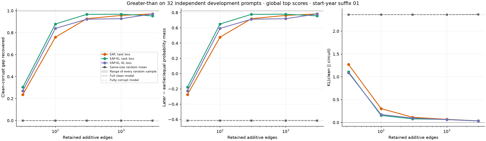

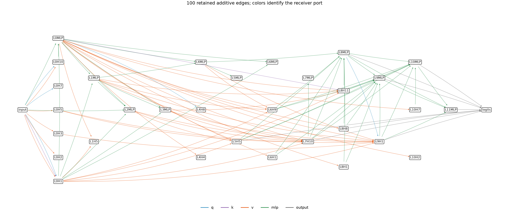

## Try It Yourself — inspect the year-ending distribution

Change the circuit budget and the development prompt index. Inspect the full
100-suffix distribution, not just its aggregate probability difference. Find
a prompt where a small circuit moves mass to later years but still disagrees
with the clean model's preferred ending. Compare it with the same-size random
circuit and the matched corrupt run.

<details><summary>Help — what counts as a valid ending?</summary>

For a start year ending in 32, `33` through `99` are valid; `32` is not.
The displayed probabilities still come from the whole-vocabulary softmax.
The green region marks valid suffixes; it does not renormalize them.

</details>


```python
PLAY_GT_BUDGET = 100
PLAY_GT_EXAMPLE = 0
PLAY_GT_METHOD = "eap-ig-inputs"

if RUN_REAL_EDGES:
    play_mask = top_edge_mask(gt_dev_engine.graph, gt_scores[PLAY_GT_METHOD], PLAY_GT_BUDGET)
    random_mask = same_size_random_masks(gt_dev_engine.graph, play_mask, count=1, seed=901)[0]
    play_logits = {
        "Clean model": gt_dev_engine.clean_logits,
        "Selected circuit": gt_dev_engine(play_mask),
        "Same-size random": gt_dev_engine(random_mask),
        "Corrupt model": gt_dev_engine.corrupt_logits,
    }
    fig, ax = plt.subplots(figsize=(11, 4), constrained_layout=True)
    suffix_ids = gt_development["suffix_ids"].cuda()
    start = int(gt_development["start_suffixes"][PLAY_GT_EXAMPLE])
    ax.axvspan(start + .5, 99.5, color="#66bd63", alpha=.12, label="Valid later endings")
    for label, logits in play_logits.items():
        probabilities = logits.softmax(-1)[PLAY_GT_EXAMPLE, suffix_ids].cpu()
        ax.plot(range(100), probabilities, label=label, alpha=.85)
    ax.set(xlabel="Two-digit ending", ylabel="Whole-vocabulary probability",
           title=gt_development["prompts"][PLAY_GT_EXAMPLE])
    ax.legend(fontsize=8)
    ax.grid(alpha=.2)
    plt.show()
```


## Does the deletion search find a different greater-than circuit?

Now run your ACDC implementation on the same discovery examples used by
attribution. Every trial removes an edge from the **current** hybrid circuit
and recomputes mean KL. Keep the reference threshold of 0.004 fixed for this
comparison. Selecting a new threshold after seeing transfer would answer a
different question.

The reference search retains **78 edges**, with discovery recovery about
0.871 and development recovery about 0.855. This is a local greedy result,
not a proof that 78 is the smallest possible circuit. The search takes several
minutes; its progress and checkpoints use the same wrapper as the IOI study.


```python
edge_core_functions = {
    "graph": build_residual_graph,
    "reconstruct": reconstruct_receiver,
    "engine_init": EdgeIntervention.__init__,
    "engine_hooks": EdgeIntervention.make_hooks,
    "engine_run": EdgeIntervention.__call__,
    "final_logits": final_position_logits,
    "kl": clean_kl_divergence,
    "reachability": output_reachable_sources,
}

if RUN_REAL_EDGES:
    gt_discovery_engine = EdgeIntervention(
        gpt2, gt_discovery["clean_tokens"], gt_discovery["corrupt_tokens"], gt_discovery["end_positions"]
    )

    def gt_discovery_loss(mask):
        return float(clean_kl_divergence(gt_discovery_engine(mask), gt_discovery_engine.clean_logits))

    gt_acdc_result = checkpointed_learner_search(
        gt_discovery_engine.graph, gt_discovery_loss, threshold=.004,
        search_fn=greedy_edge_acdc, core_functions=edge_core_functions,
        data=gt_discovery, model_revision=GPT2_REVISION,
        output_directory=edge_run_directory / "greater-than", fresh=FRESH_REAL_SEARCH,
    )
    gt_acdc_mask = mask_from_result(gt_dev_engine.graph, gt_acdc_result)
    gt_acdc_development = gt_development_behavior(gt_dev_engine(gt_acdc_mask))
    print(f"ACDC: {int(gt_acdc_mask.sum())} edges; development recovery {gt_acdc_development['recovery']:.3f}.")
    fig = plot_discovered_edges(gt_dev_engine.graph, gt_acdc_mask)
    plt.show()
    fig.savefig(assets_dir / "acdc_greater_than_acdc_graph.png", dpi=150)
```


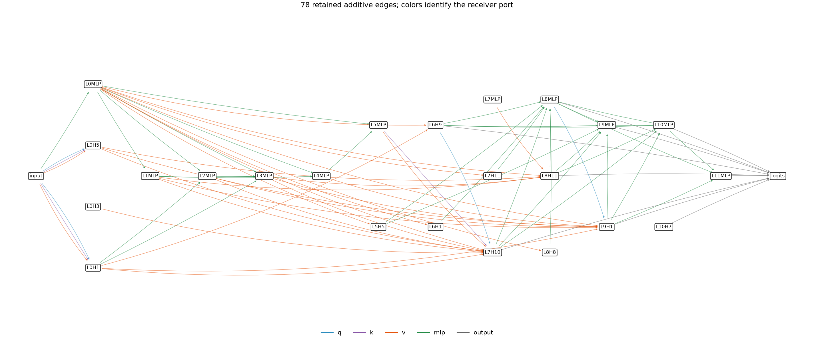

### Freeze the choices before changing the wording

Use the same development rule for each method: recovery at least 0.85,
fraction of positive probability margins within 0.10 of the clean model,
and KL at most 0.5. Choose the smallest qualifying **tested** size per method.
ACDC has one tested greater-than threshold; the attribution methods have five
budgets. This is a comparison of these declared choices, not equal search
cost or an exhaustive optimization over every size.

The reference choices are ACDC 78, EAP 300, task-loss EAP-IG 100 and KL-loss
EAP-IG 300 edges. Write their masks and development evidence before generating
the 64 changed-wording prompts. The next cell makes the decision inspectable;
no stored reference circuit is loaded into your experiment.

<details><summary>Help — recovery and positive margins</summary>

A positive greater-than margin means that the total probability of valid
later suffixes exceeds that of earlier/equal suffixes. It does **not** mean
the most likely token is a valid year. Keep whole-vocabulary normalization,
raw probability difference and numeric probability mass visible.

</details>


```python
import hashlib

GT_SELECTION_RULE = {"minimum_recovery": .85, "maximum_positive_margin_drop": .10, "maximum_kl": .5}

if RUN_REAL_EDGES:
    gt_full_development = gt_development_behavior(gt_dev_engine.clean_logits)

    def gt_qualifies(row):
        return (row["recovery"] >= GT_SELECTION_RULE["minimum_recovery"]
                and row["fraction_positive_probability_difference"] >= (
                    gt_full_development["fraction_positive_probability_difference"]
                    - GT_SELECTION_RULE["maximum_positive_margin_drop"])
                and row["kl_clean_to_circuit"] <= GT_SELECTION_RULE["maximum_kl"])

    if not gt_qualifies(gt_acdc_development):
        raise RuntimeError("The greater-than ACDC development candidate failed; keep the result and do not open transfer.")
    gt_selected_masks = {"acdc": gt_acdc_mask.clone()}
    gt_selected_development = {"acdc": gt_acdc_development}
    for method in gt_scores:
        eligible_rows = [row for row in gt_curve_rows if gt_qualifies(row["methods"][method])]
        if not eligible_rows:
            raise RuntimeError(f"No development budget qualifies for {method}; do not select from transfer.")
        chosen = min(eligible_rows, key=lambda row: row["edge_count"])
        gt_selected_masks[method] = top_edge_mask(gt_dev_engine.graph, gt_scores[method], chosen["edge_count"])
        gt_selected_development[method] = chosen["methods"][method]

    gt_frozen_choices = {
        "model_revision": GPT2_REVISION, "criteria": GT_SELECTION_RULE,
        "discovery_prompts": gt_discovery["prompts"], "development_prompts": gt_development["prompts"],
        "transfer_seed": 13, "transfer_count": 64, "transfer_split": "heldout",
        "choices": {method: {"active_edges": mask.nonzero().tolist(),
                             "development": gt_selected_development[method]}
                    for method, mask in gt_selected_masks.items()},
    }
    frozen_text = json.dumps(gt_frozen_choices, sort_keys=True, indent=2) + "\n"
    gt_freeze_hash = hashlib.sha256(frozen_text.encode()).hexdigest()
    gt_freeze_path = edge_run_directory / "frozen-greater-than" / f"{gt_freeze_hash}.json"
    gt_freeze_path.parent.mkdir(parents=True, exist_ok=True)
    if gt_freeze_path.exists() and gt_freeze_path.read_text() != frozen_text:
        raise RuntimeError("A frozen selection record must not be overwritten.")
    gt_freeze_path.write_text(frozen_text)
    display(pd.DataFrame([{"method": method, "edges": int(mask.sum()),
                           **{key: gt_selected_development[method][key] for key in
                              ("recovery", "fraction_positive_probability_difference", "kl_clean_to_circuit")}}
                          for method, mask in gt_selected_masks.items()]))
    print(f"Choices frozen before transfer: {gt_freeze_path}")
```


### Signature result — what survives a small wording change?

The held-out prompt changes `The war lasted from the year 1732 to 17` to
`The war lasted from 1732 to 17`. We generate 64 fixed examples at seed 13.
The corruption still changes only the starting suffix to `01`. Evaluate the
frozen masks and **all** 32 uniform and 32 receiver-indegree-matched random
circuits per method. No sample is removed for being disconnected or failing.

The reference transfer recoveries are **0.832, 0.895, 0.859 and 0.909** for
ACDC, EAP, task-loss EAP-IG and KL-loss EAP-IG. ACDC falls below its development
selection floor. Preserve that result: choosing it before transfer does not
guarantee that the same floor holds on new wording.

<details><summary>Interpretation — what did this test establish?</summary>

The selected circuits preserve much of this controlled behavior better than
the two declared random nulls. Most random circuits at these sizes have no
useful input-to-output path; the null is therefore an easy baseline, even with
matched receiver indegrees. Neither beating it nor transferring across one
wording change establishes unique mechanism recovery or broad generalization.
The larger circuits transfer somewhat better here, at a higher edge budget.

</details>


```python
from part3_acdc_circuit_metrics.edge_metrics import plot_frozen_transfer, plot_edge_diagnostics

if RUN_REAL_EDGES:
    assert hashlib.sha256(gt_freeze_path.read_bytes()).hexdigest() == gt_freeze_hash
    gt_heldout = prepare_greater_than_data(gpt2, count=64, seed=13, split="heldout")
    gt_heldout_engine = EdgeIntervention(
        gpt2, gt_heldout["clean_tokens"], gt_heldout["corrupt_tokens"], gt_heldout["end_positions"]
    )
    t.testing.assert_close(gt_heldout_engine(gt_heldout_engine.graph.legal_mask), gt_heldout_engine.clean_logits, atol=1e-4, rtol=1e-5)
    t.testing.assert_close(gt_heldout_engine(t.zeros_like(gt_heldout_engine.graph.legal_mask)), gt_heldout_engine.corrupt_logits, atol=1e-4, rtol=1e-5)

    def gt_heldout_behavior(logits):
        return gt_behavior(logits, gt_heldout_engine.clean_logits, gt_heldout_engine.corrupt_logits,
                           gt_heldout["suffix_ids"], gt_heldout["start_suffixes"])

    gt_transfer_rows = []
    for method, mask in gt_selected_masks.items():
        assert mask.nonzero().tolist() == gt_frozen_choices["choices"][method]["active_edges"]
        controls = {}
        for name, matched in (("uniform_same_size", False), ("receiver_indegree_matched", True)):
            samples = []
            for random_mask in same_size_random_masks(gt_heldout_engine.graph, mask, count=32, seed=701, match_receivers=matched):
                samples.append({**gt_heldout_behavior(gt_heldout_engine(random_mask)),
                                "active_edges": random_mask.nonzero().tolist()})
            controls[name] = {"seed": 701, "count": len(samples), "results": samples}
        gt_transfer_rows.append({
            "method": method, "retained_edges": int(mask.sum()), "count": 64,
            "development": gt_selected_development[method],
            "candidate": gt_heldout_behavior(gt_heldout_engine(mask)), "controls": controls,
            "full": gt_heldout_behavior(gt_heldout_engine.clean_logits),
            "empty": gt_heldout_behavior(gt_heldout_engine.corrupt_logits),
        })
    fig = plot_frozen_transfer(gt_transfer_rows, task="greater-than")
    plt.show()
    fig.savefig(assets_dir / "acdc_greater_than_frozen_transfer.png", dpi=150)
    display(pd.DataFrame([{"method": row["method"], "edges": row["retained_edges"],
                           **{key: row["candidate"][key] for key in
                              ("recovery", "mean_probability_difference", "fraction_positive_probability_difference",
                               "numeric_probability_mass", "kl_clean_to_circuit")}} for row in gt_transfer_rows]))
```


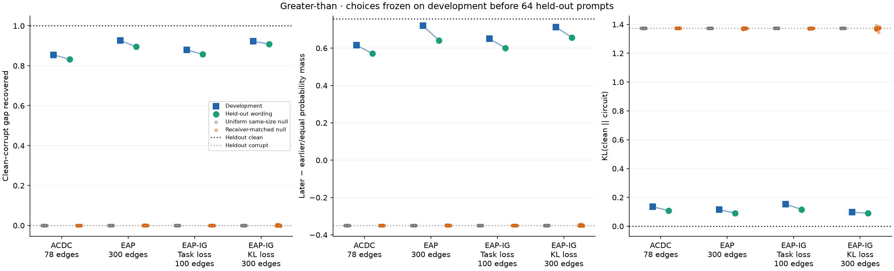

## Is every retained edge necessary? What did we leave out?

Apply your two diagnostic functions to the frozen ACDC circuit on transfer.
First, remove each of its retained edges in turn, always recomputing the
remaining circuit. Plot task damage and KL damage against their no-deletion
baseline. A zero or negative value contradicts strict necessity under that
particular metric; local greedy acceptance during discovery does not prevent
this on other examples or after later deletions.

Next, sample 24 retained-edge subsets at each size 1, 2 and 4. For each subset
$K$, run both $C\setminus K$ and the **full graph** $G\setminus K$. Points above
the identity line have better task performance in the full graph after the
same removal. That is evidence of behavior outside the proposed circuit,
though the gap also includes its original lack of perfect faithfulness.
These 72 probes do not quantify every subset or prove completeness.

<details><summary>Try to predict the disagreement</summary>

Should the edge with the largest increase in KL also have the largest drop
in greater-than probability difference? KL measures the whole distribution,
while the task score groups probabilities into two sets of year suffixes.
Inspect both columns before interpreting one edge as "most important."

</details>


```python
if RUN_REAL_EDGES:
    def gt_heldout_task_values(logits):
        return greater_than_probability_difference(logits, gt_heldout["suffix_ids"], gt_heldout["start_suffixes"])

    gt_minimality = minimality_diagnostics(gt_heldout_engine, gt_selected_masks["acdc"], gt_heldout_task_values)
    gt_completeness = sampled_completeness_diagnostics(
        gt_heldout_engine, gt_selected_masks["acdc"], gt_heldout_task_values,
        subset_sizes=(1, 2, 4), samples_per_size=24, seed=702,
    )
    fig = plot_edge_diagnostics(gt_minimality, gt_completeness, task_label="probability difference")
    plt.show()
    fig.savefig(assets_dir / "acdc_greater_than_edge_diagnostics.png", dpi=150)
    display(pd.DataFrame(gt_minimality).sort_values("task_damage", ascending=False).head(12))
```


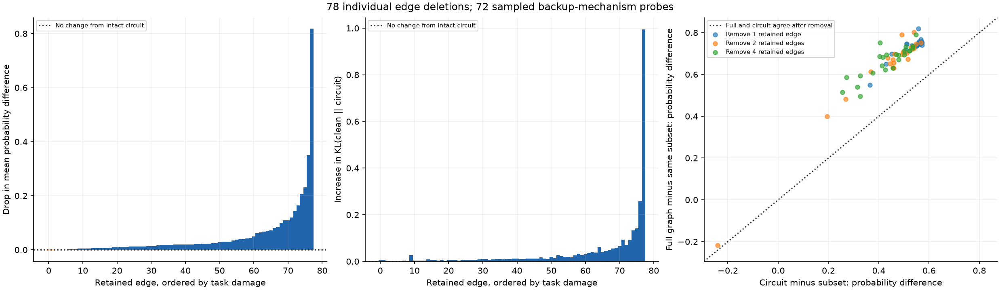

## Try It Yourself — delete a named real edge

Use the table above to choose one retained sender→receiver edge. Change
`PLAY_REMOVALS` from one to several named edges and inspect a concrete prompt.
Compare deleting them from the circuit with deleting the same edges from the
full graph. Find a case where those two interventions disagree. Then repeat
with the same number of randomly chosen retained edges; the random choice
below is fixed before seeing its effect.

This is exploratory work after transfer evaluation. Do not use it to replace
the frozen circuit and call the revised transfer score held-out evidence.


```python
PLAY_REMOVALS = None  # Replace with a list of exact edge names from the table.
PLAY_TRANSFER_EXAMPLE = 0

if RUN_REAL_EDGES:
    names = {row["edge"]: (row["source"], row["receiver"]) for row in gt_minimality}
    chosen_names = PLAY_REMOVALS or [max(gt_minimality, key=lambda row: row["task_damage"])["edge"]]
    if not set(chosen_names) <= names.keys() or len(set(chosen_names)) != len(chosen_names):
        raise ValueError("Choose distinct retained edges from the displayed table.")
    play_sparse, play_full = gt_selected_masks["acdc"].clone(), gt_heldout_engine.graph.legal_mask.clone()
    for name in chosen_names:
        source, receiver = names[name]
        play_sparse[source, receiver] = play_full[source, receiver] = False
    retained = gt_selected_masks["acdc"].nonzero()
    chosen_random = retained[t.randperm(len(retained), generator=t.Generator().manual_seed(903))[:len(chosen_names)]]
    play_random = gt_selected_masks["acdc"].clone()
    play_random[chosen_random[:, 0], chosen_random[:, 1]] = False
    conditions = {
        "Full clean": gt_heldout_engine.clean_logits,
        "Intact circuit": gt_heldout_engine(gt_selected_masks["acdc"]),
        "Circuit minus chosen edges": gt_heldout_engine(play_sparse),
        "Full minus chosen edges": gt_heldout_engine(play_full),
        "Circuit minus random retained edges": gt_heldout_engine(play_random),
        "Fully corrupt": gt_heldout_engine.corrupt_logits,
    }
    fig, ax = plt.subplots(figsize=(11, 4.5), constrained_layout=True)
    start = int(gt_heldout["start_suffixes"][PLAY_TRANSFER_EXAMPLE])
    ax.axvspan(start + .5, 99.5, color="#66bd63", alpha=.12, label="Valid later endings")
    for label, logits in conditions.items():
        probabilities = logits.softmax(-1)[PLAY_TRANSFER_EXAMPLE, gt_heldout["suffix_ids"].to(logits.device)].cpu()
        ax.plot(range(100), probabilities, label=label, alpha=.85)
    ax.set(xlabel="Two-digit ending", ylabel="Whole-vocabulary probability",
           title=gt_heldout["prompts"][PLAY_TRANSFER_EXAMPLE])
    ax.legend(fontsize=7)
    ax.grid(alpha=.2)
    plt.show()
    print("Removed:", *chosen_names, sep="\n")
```


### Four thresholds, four fresh searches

Each threshold below starts from all 32,491 legal edges. A larger tolerance
allows more individually small errors to accumulate. Predict which threshold
will produce the smallest circuit, and whether that circuit will still prefer
the correct name.

The supplied wrapper stores checkpoints using hashes of your actual function
bodies, task data and model revision. An unchanged interactive rerun can resume
or reuse its own result after recomputing the final loss. Changing the method
or data creates a different run. Full learner validation sets
`ARENA_ACDC_FRESH_SEARCH=1` and executes every search again.

Expect tens of minutes per threshold on the reference GPU. Progress lines
show tested edges and current loss. Receiver branches proven unable to reach
the output are skipped; no list of published circuit heads restricts search.

<details><summary>Expected output — a failure and a promising candidate</summary>

At threshold **0.05**, the reference discovery run kept 32 edges but had
**−0.277 recovery**. At **0.004**, it kept 383 edges with **0.949 recovery**;
at **0.001**, it kept 737 edges with **1.023 recovery**; at **0.0005**,
it kept 955 edges with **0.946 recovery**. Keep every run.
These are discovery values; development and transfer are separate experiments.

The fourth threshold, **0.0005**, was added after the original three failed
the development selection rule. The 0.001 candidate passed recovery and KL
but got only 27/32 correct name preferences; the fixed rule required 28/32.
This is adaptive development-only tuning. The accuracy rule was unchanged,
and no IOI holdout was opened to choose the additional threshold. The fourth
candidate also fails development: recovery 0.743, accuracy 26/32, KL 0.273.
All four searches end with **no qualifying IOI circuit**. A smaller per-edge
threshold does not guarantee better development recovery because the greedy
search can follow a different sequence of decisions.

</details>


```python
ACDC_THRESHOLDS = (0.05, 0.004, 0.001, 0.0005)

if RUN_REAL_EDGES:
    def ioi_discovery_loss(mask):
        return float(clean_kl_divergence(ioi_engine(mask), ioi_engine.clean_logits))

    ioi_acdc_results = []
    for threshold in ACDC_THRESHOLDS:
        result = checkpointed_learner_search(
            ioi_engine.graph, ioi_discovery_loss, threshold=threshold,
            search_fn=greedy_edge_acdc, core_functions=edge_core_functions,
            data=ioi_discovery, model_revision=GPT2_REVISION,
            output_directory=edge_run_directory / "ioi", fresh=FRESH_REAL_SEARCH,
        )
        ioi_acdc_results.append(result)
        mask = mask_from_result(ioi_engine.graph, result)
        behavior = circuit_behavior(
            ioi_engine(mask), ioi_engine.clean_logits, ioi_engine.corrupt_logits, ioi_discovery["answer_ids"]
        )
        print(f"Threshold {threshold:g}: {int(mask.sum())} edges; discovery recovery {behavior['recovery']:.3f}")
```


### Select using development examples

For this study, require development recovery at least 0.85, pairwise accuracy
within 0.10 of the clean model, and KL at most 0.5. Among qualifying candidates,
choose the smallest circuit. These criteria are fixed before opening the
held-out templates. If none qualifies, keep the holdout unopened. Inspect the
maximum-development-recovery candidate on development data as a diagnostic;
do not call it a qualified circuit. Revising the discovery protocol is a
further investigation beyond this bounded four-threshold study.

The plot shows why we check both distributional and task behavior. A small KL can coexist with
a wrong name preference; a large normalized recovery can coexist with errors
on individual prompts. Circuit size by itself says nothing about task success.


```python
if RUN_REAL_EDGES:
    ioi_dev_engine = EdgeIntervention(
        gpt2, ioi_development["clean_tokens"], ioi_development["corrupt_tokens"], ioi_development["end_positions"]
    )
    t.testing.assert_close(ioi_dev_engine(ioi_dev_engine.graph.legal_mask), ioi_dev_engine.clean_logits, atol=1e-4, rtol=1e-5)
    t.testing.assert_close(ioi_dev_engine(t.zeros_like(ioi_dev_engine.graph.legal_mask)), ioi_dev_engine.corrupt_logits, atol=1e-4, rtol=1e-5)
    ioi_development_rows = []
    for result in ioi_acdc_results:
        mask = mask_from_result(ioi_dev_engine.graph, result)
        behavior = circuit_behavior(
            ioi_dev_engine(mask), ioi_dev_engine.clean_logits, ioi_dev_engine.corrupt_logits,
            ioi_development["answer_ids"],
        )
        ioi_development_rows.append({"threshold": result["threshold"], "edges": int(mask.sum()), **behavior})

    fig, axes = plt.subplots(1, 4, figsize=(18, 4.2), constrained_layout=True)
    thresholds = [row["threshold"] for row in ioi_development_rows]
    axes[0].plot(thresholds, [row["edges"] for row in ioi_development_rows], "o-", color="#2166ac")
    axes[0].axhline(int(ioi_dev_engine.graph.legal_mask.sum()), color="#777777", linestyle=":", label="Full graph")
    axes[0].set(yscale="log", ylabel="Retained edges")
    axes[1].plot(thresholds, [row["recovery"] for row in ioi_development_rows], "o-", color="#1b9e77")
    axes[1].axhline(1, color="#333333", linestyle=":", label="Clean")
    axes[1].axhline(0, color="#aaaaaa", linestyle=":", label="Corrupt")
    axes[1].axhline(.85, color="#1b9e77", linestyle="--", alpha=.5, label="Selection floor")
    axes[1].set(ylabel="Development gap recovered")
    axes[3].plot(thresholds, [row["kl_clean_to_circuit"] for row in ioi_development_rows], "o-", color="#7570b3")
    axes[3].axhline(0, color="#333333", linestyle=":", label="Clean")
    corrupt_kl = float(clean_kl_divergence(ioi_dev_engine.corrupt_logits, ioi_dev_engine.clean_logits))
    axes[3].axhline(corrupt_kl, color="#aaaaaa", linestyle=":", label="Corrupt")
    axes[3].set(ylabel="Development KL(clean || circuit)")
    axes[2].plot(thresholds, [row["pairwise_accuracy"] for row in ioi_development_rows], "o-", color="#d95f02")
    clean_accuracy = ioi_development_rows[0]["clean_pairwise_accuracy"]
    corrupt_accuracy = float((answer_logit_differences(ioi_dev_engine.corrupt_logits, ioi_development["answer_ids"]) > 0).float().mean())
    axes[2].axhline(clean_accuracy, color="#333333", linestyle=":", label="Clean")
    axes[2].axhline(corrupt_accuracy, color="#aaaaaa", linestyle=":", label="Corrupt")
    axes[2].axhline(clean_accuracy - .10, color="#d95f02", linestyle="--", alpha=.5, label="Selection floor")
    axes[2].set(ylabel="Correct IO preferred over subject", ylim=(-.02, 1.02))
    for ax in axes:
        ax.set(xscale="log", xlabel="Allowed KL damage per deletion")
        ax.grid(alpha=.2)
        ax.legend(fontsize=8)
    fig.suptitle("An ACDC threshold controls local deletions, not the total accumulated error")
    plt.show()
    fig.savefig(assets_dir / "acdc_full_edge_thresholds.png", dpi=150)

    qualified = [index for index, row in enumerate(ioi_development_rows)
                 if row["recovery"] >= .85
                 and row["pairwise_accuracy"] >= row["clean_pairwise_accuracy"] - .10
                 and row["kl_clean_to_circuit"] <= .5]
    ioi_selection_passed = bool(qualified)
    if ioi_selection_passed:
        inspected_index = min(qualified, key=lambda index: ioi_development_rows[index]["edges"])
        print("A candidate qualifies; freeze it before opening new templates.")
    else:
        inspected_index = max(range(len(ioi_development_rows)), key=lambda index: ioi_development_rows[index]["recovery"])
        print("No candidate qualifies. The IOI holdout stays unopened; continue with development-only anomaly hunting.")
    inspected_ioi_result = ioi_acdc_results[inspected_index]
    inspected_ioi_mask = mask_from_result(ioi_dev_engine.graph, inspected_ioi_result)
    display(pd.DataFrame(ioi_development_rows)[["threshold", "edges", "recovery", "pairwise_accuracy", "kl_clean_to_circuit"]])
    print(f"Inspected candidate: threshold {inspected_ioi_result['threshold']:g}, {int(inspected_ioi_mask.sum())} edges.")
```


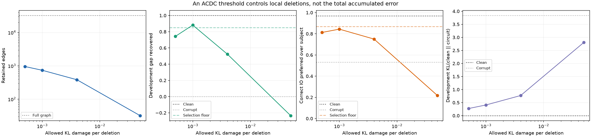

### Respect a failed selection, then inspect its mechanism

In the reference experiment, all four candidates fail at least one fixed
criterion. The next cell keeps the IOI holdout unopened and diagnoses the
highest-development-recovery candidate: threshold 0.001, 737 edges. Its 0.882
recovery does not erase its accuracy failure. All measurements and play
examples in this branch use the same development prompts.

If your independently revised discovery experiment produces a qualifying
candidate, the alternate branch freezes its exact mask before opening the
new IOI templates. The code makes this distinction explicit. Neither branch
chooses a candidate from random-null outcomes.

Both branches retain every one of the 32 uniform and 32 receiver-matched
random circuits. A diagnostic circuit can strongly beat these nulls and still
fail the declared faithfulness standard. That is a useful result to explain.


```python
if RUN_REAL_EDGES:
    ioi_frozen_choice = None
    ioi_diagnostic_choice = {
        "threshold": inspected_ioi_result["threshold"],
        "active_edges": inspected_ioi_mask.nonzero().tolist(),
        "development": ioi_development_rows[inspected_index],
        "reason": "Smallest qualifying candidate" if ioi_selection_passed else "Highest development recovery; diagnostic only, failed selection",
    }
    if ioi_selection_passed:
        ioi_frozen_choice = {
            **ioi_diagnostic_choice, "model_revision": GPT2_REVISION,
            "criteria": {"minimum_recovery": .85, "maximum_accuracy_drop": .10, "maximum_kl": .5},
            "discovery_prompts": ioi_discovery["prompts"], "development_prompts": ioi_development["prompts"],
            "heldout_seed": 3, "heldout_count": 64, "shifted_templates": True,
        }
        ioi_frozen_text = json.dumps(ioi_frozen_choice, sort_keys=True, indent=2) + "\n"
        ioi_freeze_hash = hashlib.sha256(ioi_frozen_text.encode()).hexdigest()
        ioi_freeze_path = edge_run_directory / "frozen-ioi" / f"{ioi_freeze_hash}.json"
        ioi_freeze_path.parent.mkdir(parents=True, exist_ok=True)
        if ioi_freeze_path.exists() and ioi_freeze_path.read_text() != ioi_frozen_text:
            raise RuntimeError("A frozen IOI selection record must not be overwritten.")
        ioi_freeze_path.write_text(ioi_frozen_text)
        ioi_evaluation_split = "heldout"
        ioi_evaluation = prepare_ioi_data(gpt2, count=64, seed=3, shifted_templates=True)
        ioi_evaluation_engine = EdgeIntervention(
            gpt2, ioi_evaluation["clean_tokens"], ioi_evaluation["corrupt_tokens"], ioi_evaluation["end_positions"]
        )
    else:
        ioi_evaluation_split = "development"
        ioi_evaluation, ioi_evaluation_engine = ioi_development, ioi_dev_engine
    t.testing.assert_close(ioi_evaluation_engine(ioi_evaluation_engine.graph.legal_mask), ioi_evaluation_engine.clean_logits, atol=1e-4, rtol=1e-5)
    t.testing.assert_close(ioi_evaluation_engine(t.zeros_like(ioi_evaluation_engine.graph.legal_mask)), ioi_evaluation_engine.corrupt_logits, atol=1e-4, rtol=1e-5)

    def ioi_evaluation_behavior(logits):
        return circuit_behavior(logits, ioi_evaluation_engine.clean_logits, ioi_evaluation_engine.corrupt_logits,
                                ioi_evaluation["answer_ids"])

    ioi_controls = {}
    for name, matched in (("uniform_same_size", False), ("receiver_indegree_matched", True)):
        samples = []
        for random_mask in same_size_random_masks(ioi_evaluation_engine.graph, inspected_ioi_mask, count=32, seed=701, match_receivers=matched):
            samples.append({**ioi_evaluation_behavior(ioi_evaluation_engine(random_mask)),
                            "active_edges": random_mask.nonzero().tolist()})
        ioi_controls[name] = {"seed": 701, "count": len(samples), "results": samples}
    ioi_evaluation_row = {
        "method": "acdc", "count": len(ioi_evaluation["prompts"]), "retained_edges": int(inspected_ioi_mask.sum()),
        "development": ioi_development_rows[inspected_index], "split": ioi_evaluation_split,
        "candidate": ioi_evaluation_behavior(ioi_evaluation_engine(inspected_ioi_mask)),
        "full": ioi_evaluation_behavior(ioi_evaluation_engine.clean_logits),
        "empty": ioi_evaluation_behavior(ioi_evaluation_engine.corrupt_logits), "controls": ioi_controls,
    }
    fig = plot_frozen_transfer([ioi_evaluation_row], task="ioi", split=ioi_evaluation_split)
    plt.show()
    fig.savefig(assets_dir / "acdc_ioi_candidate_controls.png", dpi=150)
    display(pd.DataFrame([{"condition": name, **{key: ioi_evaluation_row[name][key] for key in
                           ("recovery", "mean_logit_difference", "pairwise_accuracy", "kl_clean_to_circuit")}}
                          for name in ("full", "candidate", "empty")]))
```


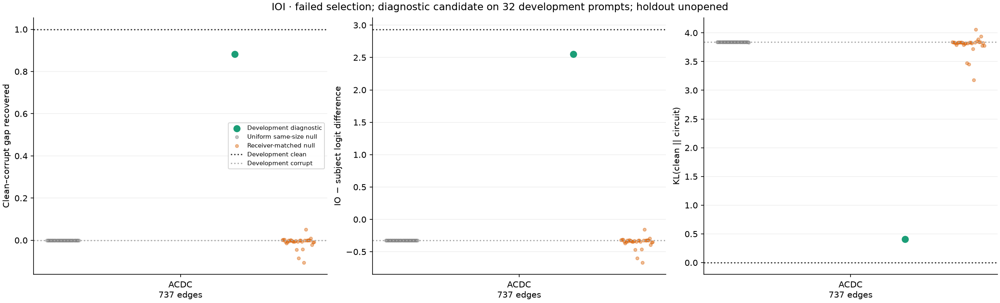

### See every retained IOI edge

Each pixel below is one sender→receiver connection. Sender rows group heads
and MLPs by layer; receiver columns group each layer's Q/K/V ports and MLP
input, followed by the output. Gray marks a legal but removed connection,
blue a retained connection, and white an illegal connection. The second panel
uses exactly the same number of edges sampled uniformly from the legal graph.

Use the named-edge table in the next cell to connect a pixel to a concrete
intervention. The image shows topology; the measured behavior plot determines
how well that topology carries the behavior. A strong null comparison does
not turn failed development selection into successful transfer.


```python
if RUN_REAL_EDGES:
    from matplotlib.colors import ListedColormap
    random_mask = same_size_random_masks(ioi_evaluation_engine.graph, inspected_ioi_mask, count=1, seed=904)[0]
    fig, axes = plt.subplots(2, 1, figsize=(15, 9), constrained_layout=True)
    edge_graph = ioi_evaluation_engine.graph
    for ax, mask, title in zip(axes, (inspected_ioi_mask, random_mask),
                               (f"ACDC diagnostic · {ioi_evaluation_split}", "Uniform same-size random circuit"), strict=True):
        pixels = edge_graph.legal_mask.to(t.int8) + mask.to(t.int8)
        ax.imshow(pixels, cmap=ListedColormap(["#ffffff", "#e3e3e3", "#2166ac"]), vmin=0, vmax=2, aspect="auto", interpolation="nearest")
        ax.set(yticks=[0] + [1 + layer * (edge_graph.n_heads + 1) for layer in range(edge_graph.n_layers)],
               yticklabels=["input"] + [f"layer {layer}" for layer in range(edge_graph.n_layers)],
               xticks=[layer * (3 * edge_graph.n_heads + 1) for layer in range(edge_graph.n_layers)] + [len(edge_graph.receivers) - 1],
               xticklabels=[f"L{layer}" for layer in range(edge_graph.n_layers)] + ["out"],
               xlabel="Receiver layer: Q heads, K heads, V heads, then MLP input", ylabel="Sender", title=f"{title} · {int(mask.sum())} edges")
    plt.show()
    fig.savefig(assets_dir / "acdc_ioi_edge_matrix.png", dpi=150)

    ioi_minimality = minimality_diagnostics(ioi_evaluation_engine, inspected_ioi_mask, ioi_evaluation["answer_ids"])
    ioi_completeness = sampled_completeness_diagnostics(
        ioi_evaluation_engine, inspected_ioi_mask, ioi_evaluation["answer_ids"],
        subset_sizes=(1, 2, 4), samples_per_size=24, seed=702,
    )
    fig = plot_edge_diagnostics(ioi_minimality, ioi_completeness, task_label="IO − subject logit difference")
    plt.show()
    fig.savefig(assets_dir / "acdc_ioi_edge_diagnostics.png", dpi=150)
    display(pd.DataFrame(ioi_minimality).sort_values("task_damage", ascending=False).head(12))
```


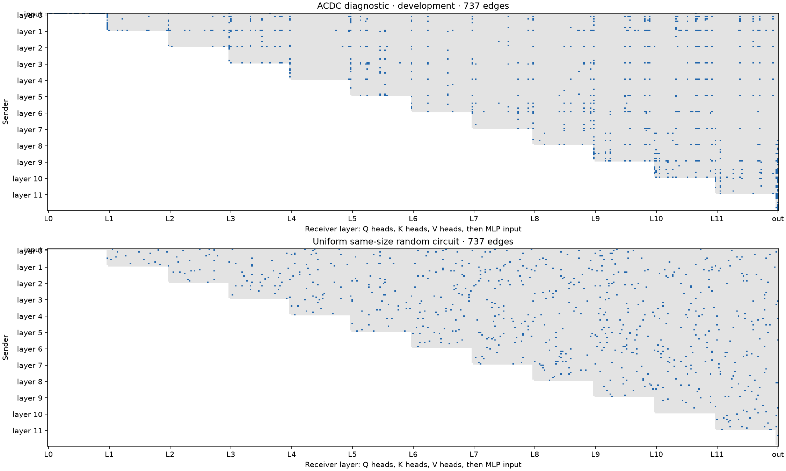

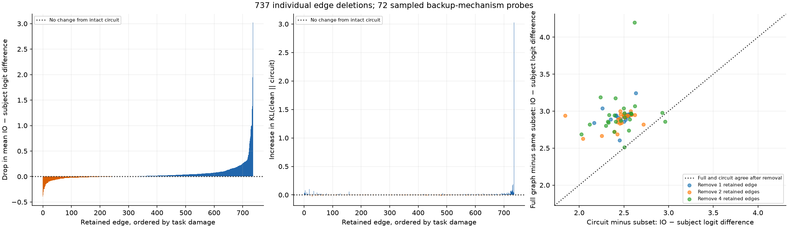

## Try It Yourself — explain a name prediction

Choose an IOI example and one retained edge from the table. Compare the same
removal in the sparse circuit and full graph. The random-removal baseline
removes one retained edge sampled before observing its effect.

Find a prompt on which the sparse circuit fails despite the full clean model
preferring the correct name. Inspect the top predictions as well as the IO−S
margin: winning this two-name comparison need not make the correct name the
most likely token in the vocabulary.


```python
PLAY_IOI_EXAMPLE = 0
PLAY_IOI_EDGE = None  # An exact edge name from the table, or the largest average task-damage edge.

if RUN_REAL_EDGES:
    lookup = {row["edge"]: row for row in ioi_minimality}
    chosen = lookup[PLAY_IOI_EDGE] if PLAY_IOI_EDGE is not None else max(ioi_minimality, key=lambda row: row["task_damage"])
    sparse_minus, full_minus = inspected_ioi_mask.clone(), ioi_evaluation_engine.graph.legal_mask.clone()
    sparse_minus[chosen["source"], chosen["receiver"]] = False
    full_minus[chosen["source"], chosen["receiver"]] = False
    retained = inspected_ioi_mask.nonzero()
    random_edge = retained[int(t.randint(len(retained), (1,), generator=t.Generator().manual_seed(905)))]
    random_minus = inspected_ioi_mask.clone()
    random_minus[random_edge[0], random_edge[1]] = False
    play_conditions = {
        "Full clean": ioi_evaluation_engine.clean_logits,
        "Intact circuit": ioi_evaluation_engine(inspected_ioi_mask),
        "Circuit minus chosen edge": ioi_evaluation_engine(sparse_minus),
        "Full minus chosen edge": ioi_evaluation_engine(full_minus),
        "Circuit minus random retained edge": ioi_evaluation_engine(random_minus),
        "Fully corrupt": ioi_evaluation_engine.corrupt_logits,
    }
    example_values = [float(answer_logit_differences(logits, ioi_evaluation["answer_ids"])[PLAY_IOI_EXAMPLE])
                      for logits in play_conditions.values()]
    fig, ax = plt.subplots(figsize=(11, 5), constrained_layout=True)
    ax.barh(list(play_conditions), example_values, color=["#2166ac" if value > 0 else "#d95f02" for value in example_values])
    ax.axvline(0, color="#333333", linestyle=":", label="Names equally likely")
    ax.set(xlabel="Correct IO − competing subject logit difference", title=ioi_evaluation["prompts"][PLAY_IOI_EXAMPLE])
    ax.invert_yaxis()
    ax.grid(axis="x", alpha=.2)
    plt.show()
    predictions = []
    for condition, logits in play_conditions.items():
        top_tokens = logits[PLAY_IOI_EXAMPLE].topk(5).indices.tolist()
        predictions.append({"condition": condition, "top five tokens": [gpt2.tokenizer.decode([token]) for token in top_tokens]})
    display(pd.DataFrame(predictions))
    correct, competing = ioi_evaluation["answer_ids"][PLAY_IOI_EXAMPLE].tolist()
    print(f"Correct IO: {gpt2.tokenizer.decode([correct])!r}; competing subject: {gpt2.tokenizer.decode([competing])!r}")
    print(f"Chosen removal: {chosen['edge']}; random removal: {edge_graph.edge_name(*random_edge.tolist())}")
```


## Does attribution work equally well on IOI?

Repeat the three attribution methods on IOI discovery data, without changing
the inspected ACDC candidate. First use all-name corruption, as in the deletion
study, and compare both global top-score selection and the output-frontier
greedy selector you implemented. Then change **only** the repeated subject in
the corrupt prompt and repeat greedy selection. Clean prompts, labels, score
budgets, seeds and development examples remain fixed.

The reference curves are a negative result. With all-name corruption, even
3,000-edge task-loss EAP-IG recovers only about 0.639 using the output frontier.
The KL-loss version has lower KL but much weaker task recovery. Replacing only
the repeated subject improves some curves, but does not make them uniformly
faithful. Keep all three panels and all random samples.

The [EAP-IG paper](https://arxiv.org/html/2403.17806v2) distinguishes the metric
used for attribution from the behavior recovered by the resulting graph.
Its IOI study uses more examples and a different corruption than our ACDC
study. Our repeated-subject experiment isolates that one difference; it is
not a full reproduction of the paper's dataset or pruning protocol.


```python
IOI_EDGE_BUDGETS = (32, 100, 300, 1000, 3000)

if RUN_REAL_EDGES:
    ioi_attribution_comparisons = []
    for corruption, prepare in (("all-names", prepare_ioi_data), ("second-subject", prepare_ioi_second_subject_data)):
        attribution_discovery = prepare(gpt2, count=32, seed=1)
        attribution_development = prepare(gpt2, count=32, seed=2)
        assert t.equal(attribution_discovery["clean_tokens"], ioi_discovery["clean_tokens"])
        assert t.equal(attribution_development["answer_ids"], ioi_development["answer_ids"])
        attribution_engine = EdgeIntervention(
            gpt2, attribution_development["clean_tokens"], attribution_development["corrupt_tokens"],
            attribution_development["end_positions"],
        )
        t.testing.assert_close(attribution_engine(attribution_engine.graph.legal_mask), attribution_engine.clean_logits, atol=1e-4, rtol=1e-5)
        t.testing.assert_close(attribution_engine(t.zeros_like(attribution_engine.graph.legal_mask)), attribution_engine.corrupt_logits, atol=1e-4, rtol=1e-5)

        def ioi_attribution_task_loss(logits):
            return -answer_logit_differences(logits, attribution_discovery["answer_ids"]).mean()

        def ioi_attribution_kl_loss(logits):
            return clean_kl_divergence(logits, ioi_engine.clean_logits)

        def ioi_attribution_behavior(logits):
            return circuit_behavior(logits, attribution_engine.clean_logits, attribution_engine.corrupt_logits,
                                    attribution_development["answer_ids"])

        scores_by_method = {}
        for label, method, loss in (
            ("eap", "eap", ioi_attribution_task_loss),
            ("eap-ig-inputs", "eap-ig-inputs", ioi_attribution_task_loss),
            ("eap-ig-kl", "eap-ig-inputs", ioi_attribution_kl_loss),
        ):
            scores_by_method[label] = edge_attribution_scores(
                gpt2, attribution_discovery["clean_tokens"], attribution_discovery["corrupt_tokens"],
                attribution_discovery["end_positions"], loss, method=method, steps=8,
            )
        selectors = (("topk", top_edge_mask), ("greedy", greedy_score_mask)) if corruption == "all-names" else (("greedy", greedy_score_mask),)
        for selection_name, selector in selectors:
            rows = []
            for budget in IOI_EDGE_BUDGETS:
                row = {"edge_count": budget, "methods": {}, "uniform_same_size": []}
                for label, scores in scores_by_method.items():
                    mask = selector(attribution_engine.graph, scores, budget)
                    row["methods"][label] = {**ioi_attribution_behavior(attribution_engine(mask)),
                                              "active_edges": mask.nonzero().tolist()}
                for random_mask in same_size_random_masks(attribution_engine.graph, mask, count=16, seed=701):
                    row["uniform_same_size"].append(ioi_attribution_behavior(attribution_engine(random_mask)))
                rows.append(row)
            comparison = {
                "task": "ioi", "score_selection": selection_name, "corruption": corruption,
                "development": attribution_development, "rows": rows,
                "full": ioi_attribution_behavior(attribution_engine.clean_logits),
                "empty": ioi_attribution_behavior(attribution_engine.corrupt_logits),
            }
            ioi_attribution_comparisons.append(comparison)
            fig = plot_method_curves(comparison)
            plt.show()
            fig.savefig(assets_dir / f"acdc_ioi_{corruption}_{selection_name}_attribution.png", dpi=150)
```


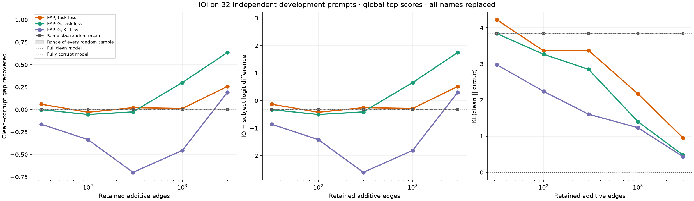

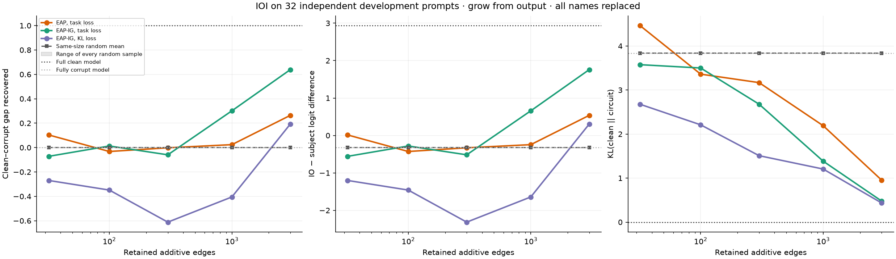

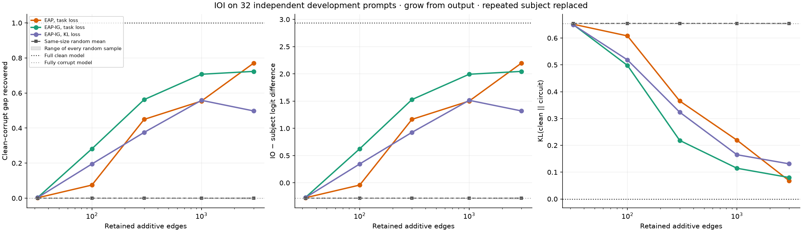

## What can you now defend?

You have implemented sequential edge deletion and gradient attribution, then
run their proposed circuits through an exact hybrid intervention engine. The
nonlinear toy supplies known truth and exhaustive equal-size controls. GPT-2
supplies a harder test: a complete candidate graph, concrete language tasks,
matched corrupt references, failed IOI development selection and successful
greater-than selection followed by changed-wording transfer.

Before moving on, write a short explanation of one discovered edge using its
sender, receiver port, effect on a concrete prompt, and the matching removal
in the full graph. Include one negative result that changed your interpretation.
The figure should carry your claim; the machine-readable report is supporting
evidence for someone who wants to rerun it.

<details><summary>Interpretation checklist</summary>

- Can you distinguish the current hybrid sender from a fixed clean cache?
- Can you explain why a per-deletion threshold does not bound final KL?
- Does your task recovery use an aggregate clean–corrupt gap with fixed labels?
- Which retained edges are unnecessary under one metric on these examples?
- What evidence suggests behavior outside the proposed circuit?
- How do corruption, score loss and graph selection change the IOI result?

</details>

### Limitations and connection to the papers

These are small, controlled GPT-2 studies with 32 discovery examples. The
greater-than holdout changes one wording pattern; it does not test broad
distribution shift. The reference IOI study has no held-out result because
none of its four candidates met the development criteria. Its diagnostic
plots reuse development examples and must not be described as transfer.
The graph contains additive residual connections and fixed component internals;
it does not discover neuron-level structure or attention links between token
positions. Corrupt substitutions can create activations unlike ordinary text,
and results depend on the corruption, metric, greedy order and finite IG grid.

ACDC gives local deletion decisions, not a globally minimal graph. EAP and
EAP-IG rank local or path-averaged first-order effects; nonlinear interactions
can make those rankings poor circuit selectors. Exact edge counts here include
all selected legal edges. The output-frontier selector does not subsequently
prune nodes without an input path, so its budgets must not be equated with a
paper's post-pruning budgets. The sampled completeness probes are bounded
counterfactual tests, not proof over every possible circuit subset.

The full graph uses 32,491 **additive** edges. Fixed connections inside a
component are rerun rather than counted as removable edges. Do not compare this
count directly with a graph convention that also counts fixed direct edges.
The [ACDC paper](https://papers.neurips.cc/paper_files/paper/2023/file/34e1dbe95d34d7ebaf99b9bcaeb5b2be-Paper-Conference.pdf)
and [authors' code](https://github.com/ArthurConmy/Automatic-Circuit-Discovery)
provide the wider experimental context. The numerical parity check uses the
[EAP-IG implementation at a fixed commit](https://github.com/hannamw/EAP-IG/tree/e24bafd3d22af2c59ac5a83e0a6581b89b5c05dd),
including its left-endpoint input-interpolation grid. Matching those scores
validates the implementation under matched inputs; it does not imply that a
small circuit faithfully recovers every task.

### Further investigations within this lesson

Increase discovery data or IG steps using development examples, then freeze a
new protocol before collecting fresh transfer evidence. Compare two greedy
orders on the nonlinear toy before paying for full-model runs. Finally, choose
a case where task damage and KL damage disagree, and plot the vocabulary
probability changes that explain the disagreement.


### Optional evidence for your future self

The figures and prompt experiments above are the lesson's results. The final
cell saves their raw measurements, every random sample and search trace so a
future rerun can be checked. This file does not substitute for executing the
methods or interpreting the plots. A numerical-only run explicitly has no
full-model evidence to save.


```python
if RUN_REAL_EDGES:
    import gzip

    edge_study_evidence = {
        "model_revision": GPT2_REVISION,
        "graph_sources": list(ioi_engine.graph.sources),
        "graph_receivers": [receiver.name for receiver in ioi_engine.graph.receivers],
        "legal_edges": ioi_engine.graph.legal_mask.nonzero().tolist(),
        "fresh_searches": FRESH_REAL_SEARCH,
        "ioi": {
            "discovery": ioi_discovery, "development": ioi_development,
            "heldout": ioi_evaluation if ioi_selection_passed else None,
            "evaluation": ioi_evaluation, "evaluation_split": ioi_evaluation_split,
            "selection_passed": ioi_selection_passed, "diagnostic_candidate": ioi_diagnostic_choice,
            "searches": ioi_acdc_results, "development_rows": ioi_development_rows,
            "frozen_selection": ioi_frozen_choice, "evaluation_row": ioi_evaluation_row,
            "minimality": ioi_minimality, "sampled_completeness": ioi_completeness,
            "attribution_comparisons": ioi_attribution_comparisons,
        },
        "greater_than": {
            "discovery": gt_discovery, "development": gt_development, "heldout": gt_heldout,
            "search": gt_acdc_result, "development_comparison": gt_comparison,
            "frozen_selection": gt_frozen_choices, "transfer": gt_transfer_rows,
            "acdc_minimality": gt_minimality, "acdc_sampled_completeness": gt_completeness,
        },
        "peak_vram_gb": t.cuda.max_memory_allocated() / 1024**3,
        "torch_version": t.__version__, "cuda_version": t.version.cuda,
        "device": t.cuda.get_device_name(0),
    }
    def serialize_evidence_tensor(value):
        if isinstance(value, t.Tensor):
            return value.detach().cpu().tolist()
        raise TypeError(f"Unsupported evidence value: {type(value).__name__}")

    encoded = (json.dumps(edge_study_evidence, default=serialize_evidence_tensor, sort_keys=True) + "\n").encode()
    evidence_path = edge_run_directory / "completed_edge_study.json.gz"
    evidence_path.write_bytes(gzip.compress(encoded, compresslevel=9, mtime=0))
    print(f"Saved search traces and raw measurements to {evidence_path}")
```
