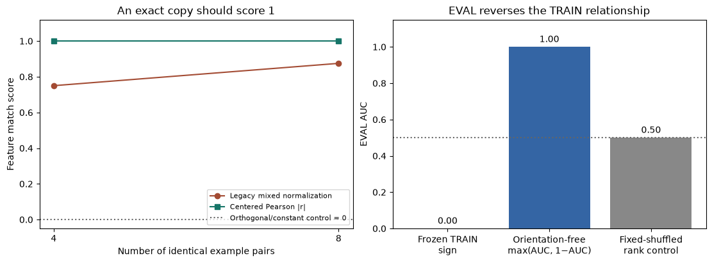

# 6.5 CPU metric repair companion

Open [exercises.ipynb](exercises.ipynb) to implement four metric contracts, or
[solutions.ipynb](solutions.ipynb) for the executed worked reference. This is
20–30 minutes of guided practice alongside existing 6.5, not a new chapter.

The visible methods are absolute centered Pearson correlation, tie-aware pairwise
AUC, TRAIN-only orientation fitting, and frozen-orientation EVAL. Immediate literal
oracles catch sample-scaling, absolute-AUC and EVAL-refitting errors. Hints, solutions,
expected output, a controlled two-panel plot and editable EVAL sign/sample-size play
stay in the notebooks. The plot's exact controls score 0 correlation and .5 AUC.

Requirements: Python with NumPy, Matplotlib and IPython; CPU only, no model, training,
download or GPU. From repository root, an existing compatible environment can run:

```bash
uv run --no-sync python -m pytest -q tests/test_crosscoder_metric_repair.py
uv run --no-sync python -m mastery_hub.practice_addons.crosscoder_metric_repair.generate
```

`lesson.py` is notebook source with inline algorithm cells and plotting plumbing.
`generate.py` creates missing files only: it **never overwrites existing notebooks**,
including filled answers, execution counts and recorded output. There is no force
option. Review generated changes in a fresh destination if revising the source.

The PNG and schema in `media/` are a fresh tiny CPU fixture, not historical model
evidence. Historical 6.5 notebooks, original ARENA, source pins, case manifests and
scientific measurements are preserved. No release or learner acceptance is claimed.


