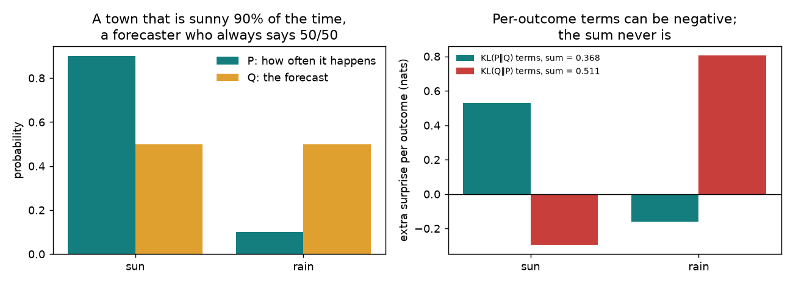
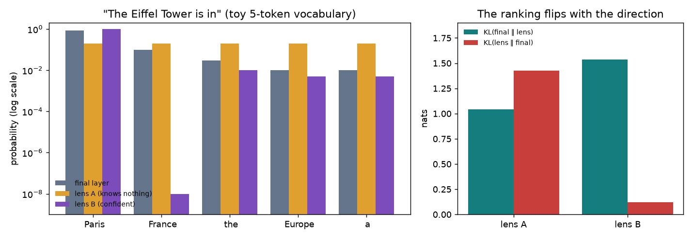
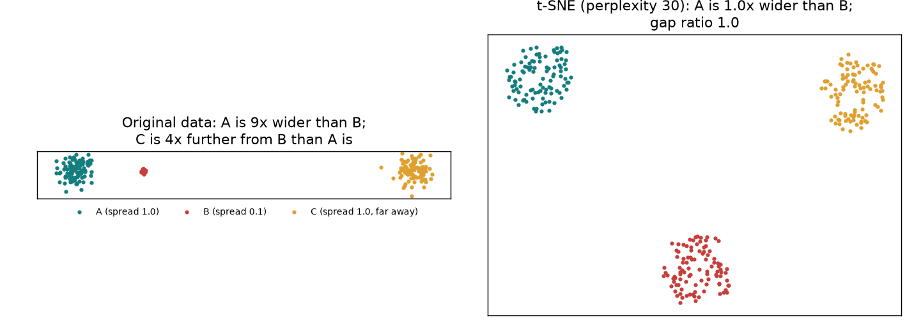
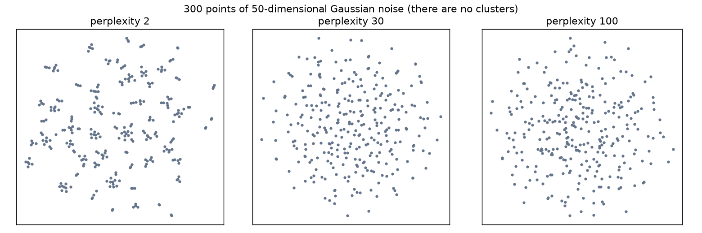

<!-- PROTOTYPE for issue #234, on the throwaway branch prototype/foundations-234. Not a learner page and never merged.
Parts 1 and 3 are written out in full; Parts 2, 4 and 5 are one-paragraph stubs. Every number is printed by foundations_toolkit.py (see run_output.txt). -->

# [0.7] - Foundations Toolkit


# Introduction


Here are two results you'll reproduce in this section:

- A logit lens that puts 98% on the model's top token scores **worse** than a lens that knows nothing and spreads its bets evenly: a KL divergence of 1.54 nats against 1.04. Swap the arguments of the KL and the ranking flips (0.12 against 1.43).
- t-SNE takes three clusters (one ten times tighter than the others, one four times further away than the others) and draws them **the same size and evenly spaced**: the size ratio comes out as 0.99 and the gap ratio as 0.96.

Neither is a bug. Both follow from what the tools are built to do, and both catch out people who know the formula but not the intuition behind it.

The rest of the course reaches for a small set of measuring tools again and again: KL divergence, PCA, t-SNE, linear probes and bootstrap intervals. This section builds the intuition for each, one part per family of tools. Every part starts with a small example you can work out by hand, before you see any formula.

You don't have to do this section in one sitting. Each part stands alone. Whenever a lesson first uses one of these tools, it gives you a few lines of intuition on the spot and links to the part here that builds the tool properly. Each part opens with two "Can you skip this part?" questions. If you get both right, move on.

In this section you will:

- work out a KL divergence by hand for a weather forecast, then see why the order of its arguments decides which of two lenses wins;
- build t-SNE's neighbour probabilities yourself, and see why a t-SNE picture keeps who is next to whom but loses cluster sizes, the gaps between clusters, and density;
- check every picture against a control that should fail, such as t-SNE run on pure noise.

Prerequisites: the maths reading in [0.0 Prerequisites](https://arena-chapter0-fundamentals.streamlit.app/[0.0]_Prerequisites) and PyTorch tensors at the level of [0.1 Ray Tracing](https://arena-chapter0-fundamentals.streamlit.app/[0.1]_Ray_Tracing). Nothing else.


## Content & Learning Objectives


### 1️⃣ Distributions: entropy, cross-entropy and KL divergence

How surprised are you, on average, if you believe the wrong distribution? That one question gives you entropy, cross-entropy and KL divergence. It also explains why the direction of a KL matters.

> ##### Learning Objectives
>
> - Understand KL divergence as average extra surprise, and work it out by hand for a two-outcome example
> - Implement a KL divergence that handles zero probabilities correctly
> - Predict which direction of KL punishes a lens that misses an outcome, and which punishes one that invents an outcome

*Used in:* 7.1 (first use), 7.4, 7.5, 8.4, 9.1, 11.2, 11.4, 14.7 and others.

### 2️⃣ Geometry of activations: covariance, whitening, PCA and effective rank

*(Stub in this prototype.)* How do features move together, which directions carry the spread, and how many directions does the spread really use?

*Used in:* 7.2, 7.4, 9.1 and 10.1 (PCA, before 11.1 teaches it), 9.2, 9.6, 11.4, 13.3 and 15.4 (both say "SVD from chapter 0"), 17.4.

### 3️⃣ Pictures of high-dimensional data: t-SNE and UMAP

A t-SNE or UMAP plot answers one question well: who is next to whom? It also tempts you to read three things it doesn't keep. You'll build the part of t-SNE that decides what it keeps.

> ##### Learning Objectives
>
> - Understand t-SNE as "match each point's neighbour distribution in 2D", built from a softmax and a KL divergence
> - Implement the neighbour probabilities, and see how perplexity sets each point's own scale
> - Predict what a t-SNE plot does to cluster sizes, gaps and pure noise, then check

*Used in:* 0.6 (mentions "a nice UMAP"), 11.1 (first use), 11.6.

### 4️⃣ Fitting a readout: least squares, ridge and logistic probes

*(Stub in this prototype.)* Many lessons read a model by fitting a small model to its activations. What does the fit measure, and when does it fool you?

*Used in:* 5.2 (first use) and about 30 other lessons, including 7.3, 11.x, 13.3, 14.x, 16.x and 17.x.

### 5️⃣ How sure are you? Bootstrap intervals, Monte Carlo standard errors and permutation nulls

*(Stub in this prototype.)* If you ran this again, how different could the number be, and could it have come from nothing at all?

*Used in:* 5.8, 7.2 (permutation null, first use), 8.1 (bootstrap), 10.1, 14.7, 16.3, 16.4, 16.9.

### 🎯 Held-out Quiz

Questions that change one thing about a run in this section. You predict, then see the real result.

### ☆ Bonus

Further reading, and the questions this section leaves open.


## Setup code


Everything in this section runs on a CPU in a few seconds.


```python
import math

import matplotlib.pyplot as plt
import numpy as np
import torch as t
from jaxtyping import Float
from sklearn.manifold import TSNE
from torch import Tensor

import part7_foundations_toolkit.tests as tests
from part7_foundations_toolkit.utils import perplexity, sigmas_for_perplexity, three_clusters

t.set_default_dtype(t.float64)
```


=== NEW CHAPTER ===


# 1️⃣ Distributions: entropy, cross-entropy and KL divergence


> ##### Learning Objectives
>
> - Understand KL divergence as average extra surprise, and work it out by hand for a two-outcome example
> - Implement a KL divergence that handles zero probabilities correctly
> - Predict which direction of KL punishes a lens that misses an outcome, and which punishes one that invents an outcome


## Can you skip this part?

Answer both questions before you open the dropdowns. If you get both right, skip to [Part 2️⃣](#2-geometry-of-activations-covariance-whitening-pca-and-effective-rank).

**1.** A model's cross-entropy loss on some text is 2.0 nats, and the entropy of the text itself is 1.5 nats. What is the KL divergence from the text's distribution to the model's?

<details><summary>Answer</summary>

0.5 nats. Cross-entropy is entropy plus KL, so 0.5 nats is what training could still remove.
</details>

**2.** Let $P = (0.5, 0.5)$ and $Q = (1, 0)$. Which of $D_{KL}(P \| Q)$ and $D_{KL}(Q \| P)$ is infinite?

<details><summary>Answer</summary>

$D_{KL}(P \| Q)$. $P$ produces the second outcome half the time, and $Q$ calls it impossible. $D_{KL}(Q \| P) = \log 2 \approx 0.69$, because $Q$ only ever produces the first outcome, and $P$ gives that outcome probability one half.
</details>


## Surprise and extra surprise

You live in a town where 90% of days are sunny and 10% are rainy. Call that distribution $P$.

When something you gave probability $q$ happens, a natural measure of your surprise is $-\log q$. An outcome you were sure of ($q = 1$) doesn't surprise you at all. A one-in-a-million outcome surprises you a lot. And surprises from independent events add up.

If you know the true odds, a sunny day surprises you by $-\log 0.9 = 0.105$ nats and a rainy day by $-\log 0.1 = 2.303$. Averaged over a year, that's

$$0.9 \times 0.105 + 0.1 \times 2.303 = 0.325 \text{ nats per day.}$$

This is the **entropy** of the weather, $H(P)$: the surprise you can't avoid.

Now suppose you trust a forecaster who always says 50/50; call that $Q$. Every day surprises you by $-\log 0.5 = 0.693$, so your average surprise is 0.693 nats per day. This is the **cross-entropy** $H(P, Q)$: the average surprise of someone who believes $Q$ while the world runs on $P$.

The difference, $0.693 - 0.325 = 0.368$ nats per day, is the **extra surprise that comes from believing $Q$ instead of $P$**. That's the KL divergence:

$$
D_{KL}(P \,\|\, Q) = \sum_x p(x) \log \frac{p(x)}{q(x)} = H(P, Q) - H(P).
$$



Three things in the right-hand panel come back again and again in the course:

- **One outcome's term can be negative.** On rainy days the 50/50 forecaster is *less* surprised than someone who knows the true odds, since $-\log 0.5 < -\log 0.1$. So rain contributes $0.1 \log(0.1/0.5) = -0.161$. Once you average under $P$, the total is never negative, and it's zero only when $Q = P$.
- **Calling a real outcome impossible costs infinity.** If $q(x) = 0$ for some $x$ with $p(x) > 0$, then $D_{KL}(P \| Q) = \infty$. Outcomes that $P$ never produces contribute nothing, whatever $Q$ says about them.
- **It isn't symmetric.** Swap the roles, so the world runs at 50/50 and you believe 90/10. Now it rains half the time, and each rainy day surprises you a lot: $D_{KL}(Q \| P) = 0.511$, not 0.368.

This is also why training with cross-entropy loss works. $H(P)$ is fixed by the data, so the only way to lower the cross-entropy is to lower the KL from the data to the model.


### Exercise - implement `kl_divergence`

> ```yaml
> Difficulty: 🔴⚪⚪⚪⚪
> Importance: 🔵🔵🔵🔵⚪
>
> You should spend up to 10 minutes on this exercise.
> ```

Implement `kl_divergence(p, q)`. It sums over the last dimension and works for any leading batch dimensions. A term where $p(x) = 0$ must count as 0, even if $q(x) = 0$ too. If $p(x) > 0$ and $q(x) = 0$, the result must be $\infty$.


```python
def kl_divergence(p: Float[Tensor, "... n"], q: Float[Tensor, "... n"]) -> Float[Tensor, "..."]:
    """KL(p || q) in nats, summed over the last dimension. p and q are probability vectors."""
    raise NotImplementedError()


tests.test_kl_divergence(kl_divergence)
```

<details><summary>Hint 1</summary>

`p * (p.log() - q.log())` is right whenever $p(x) > 0$. What does PyTorch give you for `0 * (-inf)`?
</details>

<details><summary>Hint 2</summary>

`t.special.xlogy(a, b)` computes `a * log(b)`, and returns 0 whenever `a == 0`.
</details>

<details><summary>Solution</summary>

```python
def kl_divergence(p: Float[Tensor, "... n"], q: Float[Tensor, "... n"]) -> Float[Tensor, "..."]:
    """KL(p || q) in nats, summed over the last dimension. p and q are probability vectors."""
    return (t.special.xlogy(p, p) - t.special.xlogy(p, q)).sum(-1)
```

The two `xlogy` terms are $-H(P)$ and $-H(P, Q)$. So this is literally "cross-entropy minus entropy", with `xlogy` handling both conventions: $0 \log 0 = 0$, and $p \log 0 = -\infty$ when $p > 0$.
</details>


## Which way round?

The [7.1 logit lens](https://arena-chapter7-activation-to-language.streamlit.app/[7.1]_Logit_Lens_Tuned_Lens_and_Patchscopes) decodes each layer's residual stream into a distribution over the vocabulary. It then asks how close that distribution is to the model's final output. Here is a toy version with a five-token vocabulary. After "The Eiffel Tower is in", the final layer puts 85% on " Paris", 10% on " France" and a little on the rest. Two lenses decode an earlier layer:

- **Lens A** knows nothing. It puts 20% on every token.
- **Lens B** is confident and almost right. It puts 98% on " Paris", but gives " France" a probability of $10^{-8}$.

**Make a prediction first:** which lens has the smaller $D_{KL}(p_{\text{final}} \,\|\, p_{\text{lens}})$? Which has the smaller $D_{KL}(p_{\text{lens}} \,\|\, p_{\text{final}})$?


```python
p_final = t.tensor([0.85, 0.10, 0.03, 0.01, 0.01])
lens_a = t.full((5,), 0.2)
lens_b = t.tensor([0.98, 1e-8, 0.01, 0.005, 0.005])
lens_b = lens_b / lens_b.sum()

for name, lens in [("A", lens_a), ("B", lens_b)]:
    print(
        f"lens {name}: KL(final || lens) = {kl_divergence(p_final, lens):.2f}, "
        f"KL(lens || final) = {kl_divergence(lens, p_final):.2f}"
    )
```

<details><summary>Help - how should I interpret this?</summary>



$D_{KL}(p_{\text{final}} \| p_{\text{lens}})$: lens A 1.04, lens B 1.54. $D_{KL}(p_{\text{lens}} \| p_{\text{final}})$: lens A 1.43, lens B 0.12.

$D_{KL}(p_{\text{final}} \| p_{\text{lens}})$ averages over what the *model* does. The model says " France" 10% of the time, and lens B calls that a one-in-a-hundred-million event. So B pays $0.1 \times \log(0.1 / 10^{-8}) = 1.61$ nats on that one token. Lens A is never confidently wrong, so it never pays much. This direction asks: **does the lens cover everything the model considers?**

$D_{KL}(p_{\text{lens}} \| p_{\text{final}})$ averages over what the *lens* does. Lens B almost always says " Paris", which the model likes too, so it pays little. Lens A spends 60% of its mass on tokens the model thinks are unlikely. This direction asks: **does the lens avoid what the model rules out?**

That's why 7.1 puts $p_L$ first: a lens that is confidently wrong about a token the model cares about should look bad. You'll meet the same choice in 14.7's balanced KL, and in the KL penalty of RLHF in 2.4.
</details>


## Summary

- KL divergence is the average extra surprise you get from believing $Q$ while the world runs on $P$. It equals cross-entropy minus entropy.
- It is zero only when $Q = P$. It is infinite when $Q$ rules out something $P$ does. It ignores outcomes $P$ never produces.
- The first argument decides whose behaviour you average over, so the two directions can rank the same candidates in opposite orders.


=== NEW CHAPTER ===


# 2️⃣ Geometry of activations: covariance, whitening, PCA and effective rank


*Stub in this prototype.*

**Hook.** You can keep almost all of the variance and still lose the one direction that separates two classes. The real hook would use this part's own run.

**Builds.**

- Centring, and covariance as "how features move together".
- Whitening as "make every direction equally loud".
- PCA as "rotate to the directions of greatest spread", done with the SVD of the centred data.
- Effective rank as "how many directions the spread really uses".

**Exercise.** PCA by SVD on a tiny 2D cloud, then a dataset where the label lives in the low-variance direction.

**Links in.** This part fixes an ordering problem. 7.2, 7.4, 9.1 and 10.1 link here for PCA instead of to 11.1, and 13.3 and 15.4 link here for SVD.


=== NEW CHAPTER ===


# 3️⃣ Pictures of high-dimensional data: t-SNE and UMAP


> ##### Learning Objectives
>
> - Understand t-SNE as "match each point's neighbour distribution in 2D", built from a softmax and a KL divergence
> - Implement the neighbour probabilities, and see how perplexity sets each point's own scale
> - Predict what a t-SNE plot does to cluster sizes, gaps and pure noise, then check


## Can you skip this part?

**1.** In a t-SNE plot of activations, cluster X is drawn three times wider than cluster Y. What does that tell you about how spread out they are in activation space?

<details><summary>Answer</summary>

Almost nothing. t-SNE gives every point its own neighbourhood scale, so tight and loose clusters come out about the same size. Measure the spread in the original space.
</details>

**2.** You run t-SNE on 300 activation vectors with perplexity 2, and you see dozens of small clumps. Is that evidence of dozens of groups?

<details><summary>Answer</summary>

No. At perplexity 2, each point only looks at about two neighbours, and t-SNE draws clumps like these even for pure Gaussian noise. Before you believe the clumps, compare against a noise or shuffled-label control at the same settings.
</details>


## Three clusters

Here are 300 points in three clusters of 100. A and C are spread out (standard deviation 1.0). B is ten times tighter (0.1). C sits four times further from B than A does. On the right is what t-SNE draws.



The three blobs come out the same size: the ratio of A's radius to B's is 0.99, against 9.3 in the data. They're also about evenly spaced: the gap ratio is 0.96, against 4.0 in the data. t-SNE hasn't failed here. It is built to keep one thing, who is next to whom, and it throws the rest away. Here's how.


## t-SNE in three steps

**Step 1: each point picks its neighbours, at its own scale.** For every point $i$, t-SNE turns distances into probabilities that answer one question: if $i$ picked a neighbour at random, how likely is it to pick $j$? Near points get high probability, and far points get almost none. It's a softmax over negative squared distances, with a temperature set separately for each point:

$$
p_{j|i} = \frac{\exp\left(-\|x_i - x_j\|^2 / 2\sigma_i^2\right)}{\sum_{k \neq i} \exp\left(-\|x_i - x_k\|^2 / 2\sigma_i^2\right)}.
$$

The width $\sigma_i$ is chosen so that point $i$ has about `perplexity` effective neighbours. A dense cluster needs a narrow Gaussian for that, and a sparse one needs a wide Gaussian. **This is where cluster size disappears.** In our data, points in B get $\sigma \approx 0.05$, and points in A and C get $\sigma \approx 0.5$, ten times wider. So every point sees "about 30 neighbours", however spread out its cluster is.

**Step 2: ask the same question in 2D, with heavier tails.** The 2D map defines neighbour probabilities $q_{ij}$ in much the same way, but with a Student-t kernel $(1 + \|y_i - y_j\|^2)^{-1}$ in place of the Gaussian. Because its tails are heavy, moderately distant points can be placed much further apart without much cost. That is what opens up clean gaps between clusters. The width of a gap carries no meaning.

**Step 3: move the 2D points until the two sets of answers match.** t-SNE minimises $D_{KL}(P \,\|\, Q)$, the direction from [Part 1️⃣](#1-distributions-entropy-cross-entropy-and-kl-divergence). Two points that are neighbours in the data but far apart in the map ($p$ large, $q$ small) cost a lot. Two points that aren't neighbours but sit fairly close in the map ($p$ small, $q$ larger) cost little. So the map is careful to keep neighbours together, and relaxed about everything else.

In fact t-SNE symmetrises the probabilities, $p_{ij} = (p_{j|i} + p_{i|j}) / 2n$, so each pair gets one number. That doesn't change anything above.


### Exercise - implement `conditional_neighbour_probs`

> ```yaml
> Difficulty: 🔴🔴⚪⚪⚪
> Importance: 🔵🔵🔵⚪⚪
>
> You should spend up to 15 minutes on this exercise.
> ```

Implement step 1 for given widths `sigmas`. Return the matrix whose row $i$ is $p_{\cdot | i}$. The diagonal must be zero, since a point never picks itself.


```python
def conditional_neighbour_probs(X: Float[Tensor, "n d"], sigmas: Float[Tensor, " n"]) -> Float[Tensor, "n n"]:
    """P[i, j] = p(j | i): the probability that point i picks j as its neighbour, using a Gaussian of
    width sigmas[i] centred on x_i. The diagonal is zero and every row sums to one."""
    raise NotImplementedError()


tests.test_conditional_neighbour_probs(conditional_neighbour_probs)
```

<details><summary>Hint 1</summary>

`t.cdist(X, X)` gives you all the pairwise distances. Each row is then a softmax over negative squared distances divided by $2\sigma_i^2$.
</details>

<details><summary>Hint 2</summary>

If you set a logit to `-inf` before the softmax, it gets probability exactly 0. `fill_diagonal_` does that for the whole diagonal.
</details>

<details><summary>Solution</summary>

```python
def conditional_neighbour_probs(X: Float[Tensor, "n d"], sigmas: Float[Tensor, " n"]) -> Float[Tensor, "n n"]:
    sq_dists = t.cdist(X, X).pow(2)
    logits = -sq_dists / (2 * sigmas[:, None] ** 2)
    logits.fill_diagonal_(-math.inf)
    return logits.softmax(dim=-1)
```
</details>

We've written `sigmas_for_perplexity` for you. It runs a binary search for each point's $\sigma_i$ until `perplexity(row)`, the exponential of the row's entropy, hits the target. Run it on the three clusters and look at the widths:


```python
X, y = three_clusters()
sigmas = sigmas_for_perplexity(t.tensor(X), target=30.0)
for k, name in enumerate("ABC"):
    print(f"cluster {name}: median sigma = {sigmas[t.tensor(y == k)].median():.3f}")
```

<details><summary>Click to see the expected output</summary>

```
cluster A: median sigma = 0.523
cluster B: median sigma = 0.051
cluster C: median sigma = 0.502
```
</details>


## What a t-SNE plot can and can't tell you

**Make a prediction first:** 300 points drawn from a 50-dimensional standard Gaussian contain no clusters at all. What will t-SNE draw at perplexity 2, 30 and 100?


```python
noise = np.random.default_rng(1).normal(size=(300, 50))
fig, axes = plt.subplots(1, 3, figsize=(12, 4))
for ax, perp in zip(axes, (2.0, 30.0, 100.0)):
    Z = TSNE(n_components=2, perplexity=perp, init="pca", random_state=0).fit_transform(noise)
    ax.scatter(*Z.T, s=6)
    ax.set_title(f"perplexity {perp:g}")
plt.show()
```

<details><summary>Help - how should I interpret this?</summary>



At perplexity 2, each point only cares about its two nearest neighbours, and those tiny neighbourhoods get pulled into tight clumps. The result is dozens of "clusters" made from pure noise. At 30 and 100, the same data comes out as one roughly even disc. Any cluster in a t-SNE plot needs a control at the same settings before you believe it: noise, shuffled labels or a different seed. 11.1 runs exactly these controls.
</details>

| You can read off | You can't read off |
|---|---|
| Which points are each other's neighbours | Cluster sizes, because each point has its own scale |
| Whether groups separate, once a noise control at the same settings doesn't | Distances between clusters, because of the heavy tails |
| | Density, or where a new point would go. scikit-learn's t-SNE has no `transform`, so placing new points means refitting everything. That's why 11.1 calls its t-SNE comparison transductive. |

UMAP optimises something different: fuzzy graph memberships and a cross-entropy over edges, rather than normalised probabilities and a KL. In practice, though, the same table applies. *(Stub: UMAP gets its own short subsection here.)*


### Try it yourself

Change the perplexity in the three-cluster fit to 5, then to 100, and rerun. Which setting starts to show that A is wider than B? Why might that be? Look at the widths `sigmas_for_perplexity` picks for each cluster.


## Summary

- t-SNE turns distances into neighbour probabilities, with one scale per point, then moves 2D points until a heavy-tailed version of the same probabilities matches under $D_{KL}(P \| Q)$.
- So it keeps who is next to whom. Cluster sizes, gaps and density are not preserved.
- Low perplexity makes clumps out of noise. Check every picture against a control at the same settings.


=== NEW CHAPTER ===


# 4️⃣ Fitting a readout: least squares, ridge and logistic probes


*Stub in this prototype.*

**Hook.** Give a linear probe more dimensions than examples and it fits shuffled labels too. The real hook would quote this part's own run.

**Builds.**

- Least squares as "the projection onto what the features can express".
- Ridge as "prefer small weights when the data can't decide".
- Logistic regression as the same idea for probabilities.
- Held-out accuracy and the shuffled-label control.

**Links in.** 5.2 is the first use, and about 30 later lessons link here. 13.3's "least squares from chapter 0" becomes a link to this part.


=== NEW CHAPTER ===


# 5️⃣ How sure are you? Bootstrap intervals, Monte Carlo standard errors and permutation nulls


*Stub in this prototype.*

**Hook.** Train the same probe with five seeds and you get five different accuracies. Which one do you report? The real hook would quote this part's own spread.

**Builds.**

- The bootstrap as "pretend the sample is the population and redo the study".
- Confidence intervals by coverage simulation (10.1 already does this; this part sets it up).
- The Monte Carlo standard error as "how much the estimate moves if you sample again".
- Permutation nulls as "what you'd see if the labels meant nothing".
- Multiple comparisons, as one picture.

**Links in.** 7.2's permutation null and 8.1's bootstrap link here on first use.


=== NEW CHAPTER ===


# 🎯 Held-out Quiz


Each question changes one thing about a run you did in this section. Answer, give a one-line reason, then open the reveal. (The format follows the held-out quiz design in #245. A real section would have four to six questions; these are two samples.)

### Q1 (Easy)

**From Part 1️⃣:** $P = (0.9, 0.1)$, $Q = (0.5, 0.5)$; you found $D_{KL}(P\|Q) = 0.368$ and $D_{KL}(Q\|P) = 0.511$.

**This question changes:** the forecaster now says $Q = (0.99, 0.01)$.

**Answer:** which is larger now, $D_{KL}(P\|Q)$ or $D_{KL}(Q\|P)$? Choose *forward*, *reverse* or *equal*, and give a one-line reason.

<details><summary>Reveal</summary>

**Forward.** $D_{KL}(P\|Q) = 0.144$ nats and $D_{KL}(Q\|P) = 0.071$, so the order flips from the 50/50 case.

**Mental model:** the direction whose first argument often produces an outcome the second calls rare is the one that pays. With 50/50, the forecaster's world rains half the time, which $P$ calls rare. With 99/1, the real town rains 10% of the time, which the forecaster calls a 1% event.
</details>

### Q2 (Medium)

**From Part 3️⃣:** three clusters at perplexity 30. The t-SNE radius ratio A/B came out as 0.99, against 9.3 in the data.

**This question changes:** perplexity 100.

**Answer:** an interval for the t-SNE radius ratio A/B: *below 1.3*, *1.3–3*, *3–6* or *above 6*. Give a one-line reason.

<details><summary>Reveal</summary>

**1.3–3.** The ratio is 1.68, and the gap ratio rises from 0.96 to 1.62.

**Mental model:** each cluster has 100 points, so B's points can't find 100 effective neighbours inside their own tight cluster without spreading their weight evenly across all of it. Their width jumps from 0.05 to 2.07, nearly the same as A's 2.41. The per-point rescaling that erased the size difference at perplexity 30 mostly stops, and some of the true difference leaks back into the map. It's still far from 9.3: a larger perplexity keeps more of the global structure, but it never turns t-SNE into a ruler.
</details>


=== NEW CHAPTER ===


# ☆ Bonus


- [Six (and a half) intuitions for KL divergence](https://www.lesswrong.com/posts/no5jDTut5Byjqb4j5/six-and-a-half-intuitions-for-kl-divergence) gives more ways to see Part 1️⃣. It's already on 0.0's reading list.
- [How to Use t-SNE Effectively](https://distill.pub/2016/misread-tsne/) (Wattenberg, Viégas and Johnson, Distill 2016) has interactive versions of everything in Part 3️⃣, and more traps besides.
- [Visualizing Data using t-SNE](https://www.jmlr.org/papers/v9/vandermaaten08a.html) (van der Maaten and Hinton, JMLR 2008) is the original paper. Its section on the "crowding problem" explains why the map uses a Student-t kernel.
- **An open question to try:** t-SNE uses $D_{KL}(P \| Q)$. What would a map optimised for $D_{KL}(Q \| P)$ be careful about, and what would it be relaxed about? Predict first, then change the loss in a small re-implementation of your own.
