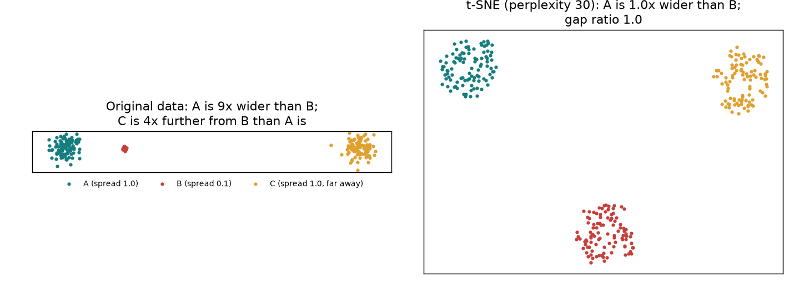

<!-- PROTOTYPE for issue #234, on the throwaway branch prototype/foundations-234. Never merged. -->

# How a lesson introduces a tool at first use

Taste bar item 7 (#243) says that the first time a lesson uses a tool, the tool gets a picture, a toy example or a plain-words explanation before its equation, **or** a one-line link to the place in the course that builds it. This page shows the three ways to do that on two real first uses:

- **7.1**, the first use of KL divergence (`kl_to_final`);
- **11.1**, Part 5️⃣, the first use of t-SNE.

The "Today" excerpts are copied from the current pages in the main checkout, and shortened only where marked with "…".

| Variant | What the learner sees at first use | Where the practice lives |
|---|---|---|
| **A. Link only** | One line: "New to KL? Do 0.7 Part 1️⃣ first (20 min)." Then the formula, as today. | 0.7 only |
| **B. Inline only** | A short intuition block before the formula. No link. | Nowhere: each lesson re-explains the tool |
| **C. Both** (recommended) | The same short intuition block, ending with a "Go deeper" link to the 0.7 part. | 0.7, which holds the exercises, controls and quiz |

---

## 7.1: KL divergence to the final distribution

### Today

> ### Exercise - KL divergence to the final distribution
>
> Difficulty: 🔴🔴⚪⚪⚪ · Importance: 🔵🔵🔵⚪⚪ · You should spend up to 10 minutes on this exercise.
>
> Ranks only look at one token. A more complete measure of "how close is layer $\ell$ to the final answer?" is the KL divergence between the final distribution $p_L$ and the decoded distribution $p_\ell$:
>
> $$D_{KL}(p_L \,\|\, p_\ell) = \sum_{v} p_L(v) \left(\log p_L(v) - \log p_\ell(v)\right)$$
>
> We put $p_L$ first because we care about how well the lens predicts *the tokens the model actually puts weight on*. This is also the quantity we'll train the tuned lens to minimise in the next section.
>
> Implement `kl_to_final`, …

The formula comes first, and the one sentence of intuition comes after it.

### Variant A: link only

> ### Exercise - KL divergence to the final distribution
>
> Difficulty: 🔴🔴⚪⚪⚪ · Importance: 🔵🔵🔵⚪⚪ · You should spend up to 10 minutes on this exercise.
>
> *This exercise uses KL divergence. If it's new to you, do [0.7 Part 1️⃣](0.7_foundations_toolkit_draft.md#1-distributions-entropy-cross-entropy-and-kl-divergence) first (about 20 minutes).*
>
> Ranks only look at one token. A more complete measure … *(the rest as today)*

### Variant B: inline only

> ### Exercise - KL divergence to the final distribution
>
> Difficulty: 🔴🔴⚪⚪⚪ · Importance: 🔵🔵🔵⚪⚪ · You should spend up to 10 minutes on this exercise.
>
> Ranks only look at one token. We want one number for how close the whole decoded distribution $p_\ell$ is to the final one, $p_L$.
>
> Think of $p_L$ as the truth and the lens as a forecast. Each time the model "says" a token $v$, the lens is surprised by $-\log p_\ell(v)$, where it could have been surprised by only $-\log p_L(v)$. KL divergence is that **extra surprise, averaged over what the model says**. It's zero only if the lens matches. It's huge if the lens calls a token nearly impossible that the model actually likes. And it hardly cares about tokens the model ignores. For example, a lens that puts 98% on " Paris" but $10^{-8}$ on the model's 10% runner-up " France" scores *worse* than a lens that guesses uniformly over five tokens: 1.54 nats against 1.04.
>
> $$D_{KL}(p_L \,\|\, p_\ell) = \sum_{v} p_L(v) \left(\log p_L(v) - \log p_\ell(v)\right)$$
>
> That's why $p_L$ comes first: we want a lens that is confidently wrong about a token the model cares about to look bad. This is also the quantity we'll train the tuned lens to minimise in the next section.
>
> Implement `kl_to_final`, …

### Variant C: both (recommended)

The same as Variant B, with one line added after the intuition paragraph:

> *Go deeper: [0.7 Part 1️⃣](0.7_foundations_toolkit_draft.md#1-distributions-entropy-cross-entropy-and-kl-divergence) builds KL from a two-outcome weather forecast, then shows why swapping its arguments flips which lens wins (20 minutes, with an exercise).*

Why C: a learner who half-remembers KL gets what they need without leaving 7.1. A learner for whom KL is new has one obvious place to practise it, so 7.4, 8.4, 9.1, 11.2 and 14.7 don't each have to re-teach it. Later lessons that use KL only need the one-line link. The full block appears at the **first** use only.

---

## 11.1, Part 5️⃣: does a nonlinear view preserve useful structure?

### Today

> PCA optimizes squared reconstruction error. UMAP and t-SNE instead emphasize neighborhood relationships, with different objectives and distance scales. Their plotted axes have no calendar units. Islands in either plot can be created from independent noise; color alone is a poor validation method.
>
> … *(two paragraphs on trustworthiness, continuity, and why the t-SNE comparison is transductive)* …
>
> ## Read the sweep, then run it

The learner is told what *not* to believe, but never sees why t-SNE behaves this way. Today the lesson never shows the objective (inventory #241: "Formula/code … Objective not built").

### Variant C: both (recommended)

> PCA optimizes squared reconstruction error. UMAP and t-SNE instead keep **who is next to whom**, and throw away almost everything else.
>
> t-SNE in three sentences. Each point turns its distances into "how likely am I to pick you as a neighbour?", using a Gaussian whose width is set so that it has about `perplexity` neighbours. So tight clusters get narrow Gaussians and loose ones get wide Gaussians. The 2D map asks the same question with a heavy-tailed kernel, and its points move until the two sets of answers match under $D_{KL}(P \| Q)$, which punishes splitting up neighbours much more than it punishes crowding non-neighbours together.
>
> 
>
> The result, above: a cluster ten times tighter than the others comes out the same size (radius ratio 0.99, against 9.3 in the data), and a cluster four times further away comes out evenly spaced (gap ratio 0.96). So in the plots below, read neighbours, not sizes or gaps. Islands can be created from independent noise too, which is why every fit below has a matched noise control.
>
> *Go deeper: [0.7 Part 3️⃣](0.7_foundations_toolkit_draft.md#3-pictures-of-high-dimensional-data-t-sne-and-umap) has you build the neighbour probabilities and watch t-SNE make clusters out of pure noise (25 minutes).*
>
> … *(the paragraphs on trustworthiness, continuity and transductive t-SNE, as today)*

The block is about 120 words and one figure. The figure is generated by the toy in 0.7, not by 11.1's model. Whether a host lesson may reuse a 0.7 figure, or must draw the intuition from its own data, is decision **FR3**.

---

## The first-use table for the shared tools

This sketch applies Variant C to every gap the tool inventory (#241) found. The "first use" column comes from that inventory.

| Tool | First use | Inline block there | Links to | Notes |
|---|---|---|---|---|
| KL divergence, entropy, cross-entropy | 7.1 (KL); 5.2 (entropy, CE) | yes | 0.7 Part 1️⃣ | 7.4, 7.5, 8.4, 9.1, 11.2, 11.4, 14.7: link only |
| PCA, SVD | 7.2 / 7.4 (PCA); 6.5 (SVD) | yes | 0.7 Part 2️⃣ | fixes PCA-before-11.1; 13.3 and 15.4 "SVD from chapter 0" become links |
| Covariance, whitening, effective rank | 9.2; 9.6 | yes | 0.7 Part 2️⃣ | |
| t-SNE, UMAP | 0.6 (UMAP mentioned); 11.1 Part 5️⃣ | yes in 11.1; 0.6 gets a link | 0.7 Part 3️⃣ | |
| Least squares, ridge, logistic | 5.2 | yes | 0.7 Part 4️⃣ | about 31 lessons: link only after 5.2 |
| Bootstrap, CIs, MC standard errors | 5.8 / 8.1 | yes | 0.7 Part 5️⃣ | 10.1 keeps its coverage simulation and links back |
| Permutation null | 7.2 | yes | 0.7 Part 5️⃣ | fixes permutation-null-before-11.1 |
| Diffusion forward noising | 13.1 / 13.2 | **13.1 builds it** | none | used in one chapter only, so no 0.7 part |
| Hessian-vector product | 16.9 | yes | forward link to 16.10 | used in one chapter only |
| LoRA | 7.3 (first of six uses before 15.1) | yes | forward link to 15.1 | 15.1 already builds it well |
