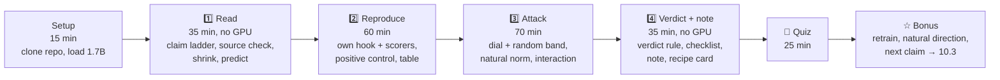

# Prototype for issue 246: chapter 10's first Research Practice afternoon

This is a throwaway branch and is never merged. It answers [What does chapter 10's first Research Practice afternoon look like?](https://github.com/shinobiultra/ARENA_3.0_Extended/issues/246)
with a storyboard of the 10.2 page in ARENA shape, plus a sketch of 10.3 (Micro-Lab ML01), for you to react to.

**Nothing was run, downloaded or trained.** The facts come from the research notes for [#240](https://github.com/shinobiultra/ARENA_3.0_Extended/blob/research/hewitt-linearity-repro/research/hewitt-linearity-repro.md)
(Hewitt) and [#247](https://github.com/shinobiultra/ARENA_3.0_Extended/blob/research/lyra-neuron-explorer/research/lyra-neuron-explorer.md) (Lyra).
A `‹…›` placeholder marks a number a learner's run would produce. Run-time and VRAM figures are estimates from #240 and #247.

| File | What it is |
|---|---|
| [`10.2_storyboard.md`](10.2_storyboard.md) | The 10.2 page. The first screen is real prose; the rest is an outline of headings, exercise blocks, prompts and result slots. |
| [`10.3_ML01_first_win_sketch.md`](10.3_ML01_first_win_sketch.md) | The second worked example: Lyra's L22 N2742 "alien" neuron, following the same recipe card. |
| [`critique_note_template.md`](critique_note_template.md) | The note `write_note()` would write: one Obsidian-compatible Markdown file per claim. |

## The afternoon at a glance

That's about four hours. The GPU time is generation only, estimated at 15–30 minutes in total.

## Decisions for you (RP1–RP9)

The recommendation comes first in each row. The storyboard is built on the recommendations.

| ID | Decision | Recommendation | Alternatives |
|---|---|---|---|
| **RP1** | The loop's steps | **Six steps, Read → Shrink → Predict → Reproduce → Attack → Write**, across four parts (1️⃣ holds Read, Shrink and Predict). Two changes from the ticket's shape: the source check ("who claimed what?") and the falsifiers move into Read, and the verdict rule is fixed at Predict, before any run. | (b) The ticket's six as written: claim ladder, organism, predict, reproduce, stress-test, note. |
| **RP2** | How deep the afternoon goes | **Reproduce in the core:** Qwen3-1.7B, the shipped vectors, your own hook and scorers, generation only. **Replicate in the Bonus:** retrain experiment 2, about 10–25 min (estimate). The 4B vectors are a "Try it yourself". Setup clones the repo at `04ad6c1`; we vendor nothing. The title stays "Replicate and Critique a Fresh Claim": the lesson teaches the four tiers, and its verdicts say whether a claim held up. | (b) Retraining in the core: +30–45 min, and VRAM at 24 GB is unmeasured. (c) 4B as the core organism: a stronger published average (+0.53), but no per-behaviour numbers either, and slower. |
| **RP3** | Scorers, with no API judge | **French** (fastText, provided), **code style** (regex, which you write) and **sycophancy trivia** (string match, which you write and check against 20 hand labels). Sentiment is left out of the core, so the dial shows three of the four behaviours. A local sentiment classifier is in the Bonus. | (b) Put a small local sentiment classifier in the core, so all four curves appear. That's one more download and one more proxy to check. (c) A local LLM judge after generation, which is heavier. |
| **RP4** | What counts as replicated, partly replicated or not replicated | **Four verdicts for each sub-claim, built on 10.1's `claim_verdict`.** *Inconclusive* if your positive control failed. *Not replicated* if the effect interval or the interval against random lies at or below 0. *Replicated* if the effect is above 0, it beats norm-matched random, and "at least half the published size" isn't ruled out. *Partly replicated* if it exists and beats random but is less than half the size, or if a multi-part claim (the dial) is mixed. Anything else is *inconclusive*. | (b) Drop the size test, so replicated means "exists and beats random". (c) Require overlap with the published number's ±0.05. |
| **RP5** | When a failed reproduction counts as done | **A "not replicated" or "inconclusive" is a finished lesson** when the note has a passed positive control, the list of everything done differently from the post, and the result that would change your mind. The same rule applies to every later fresh-claim exercise. | (b) Also require the Bonus retraining before "not replicated", since the reproduce tier can't tell a bad artifact from a bad claim. |
| **RP6** | Critique-note template and export | **One Obsidian-compatible Markdown file per claim**, written by a provided `write_note()`. It has front matter (claim, source, tier, verdict, `share:`), #239's four-line log at the top, the verdict table, the 12-item checklist, the dial figure and 10.1's `ResearchLog`. It stays local. Sending it to the author or making a blog fieldnote is a manual choice recorded in `share:`. There is no export tooling. | (b) The note is only a notebook cell. (c) A fieldnote exporter now, making one plot plus 200 words. |
| **RP7** | How to choose the next fresh claim quickly | **Six triage questions on the recipe card:** is it a primary source with a number? Are the artifacts shipped? Does the smallest size that shows it fit in 24 GB? Is there a judge-free metric? Does the licence let you run it? Is the cheapest falsifying run under an hour? Five yeses means this afternoon. The menu is 10.3 (Lyra), the Inbox replications [#248](https://github.com/shinobiultra/ARENA_3.0_Extended/issues/248) picks, or your own. It lives on the recipe card at the end of 4️⃣ and in the Bonus. | (b) A part 5️⃣, "Triage three claims", before the quiz (+20 min). |
| **RP8** | The second worked example | **Lyra's ML01 as 10.3** (see the sketch). It's documented down to the doses, MIT-licensed, a few minutes and about 9 GB (estimate), has random controls built in, and its misattributed headline is the best "who claimed what?" opener we have. | (b) The weight-space programming post ([#237](https://github.com/shinobiultra/ARENA_3.0_Extended/issues/237)). Its evidence tier is still undecided. |
| **RP9** | The link back to 0.6, and the route | **10.2 lists 0.6 and 10.1's parts 1️⃣–4️⃣ as prerequisites.** Each checklist item names the 0.6 section or 10.1 tool it comes from. 0.6's Bonus gets one forward line to 10.2. For [#30](https://github.com/shinobiultra/ARENA_3.0_Extended/issues/30): 10.1's part 5️⃣, "Your capstone", reads best after 10.2 and 10.3. | (b) Fold 0.6's detectors into 10.2, with no prerequisite. |

## Things the storyboard surfaced

- **A real gap gives the hook.** The post reports per-behaviour dial numbers only at 14B. At 1.7B it gives the average (+0.29), so the learner's per-behaviour
  table is new information, not a re-run.
- **The hook ages.** "Nobody has replicated it yet" will become false. Checklist item 1 now asks "has anyone replicated it since?", and the page says "when we
  wrote this lesson".
- **The repo is a live dependency.** The core needs the learner to clone an unlicensed repository at a pinned commit. If it disappears, the fallback is the
  Bonus retraining from the post's recipe. Asking the author for a licence is in the Bonus as a learner action. It's also an action for you, if you want it.
- **The held-out quiz** follows #245's shape. The five draft questions are variants of the dial, and the key runs are generation only.
